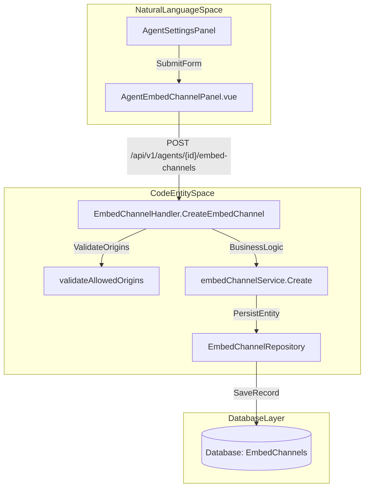
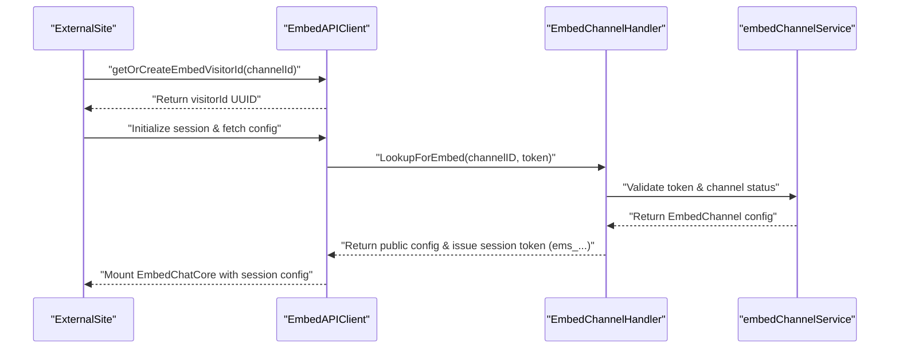
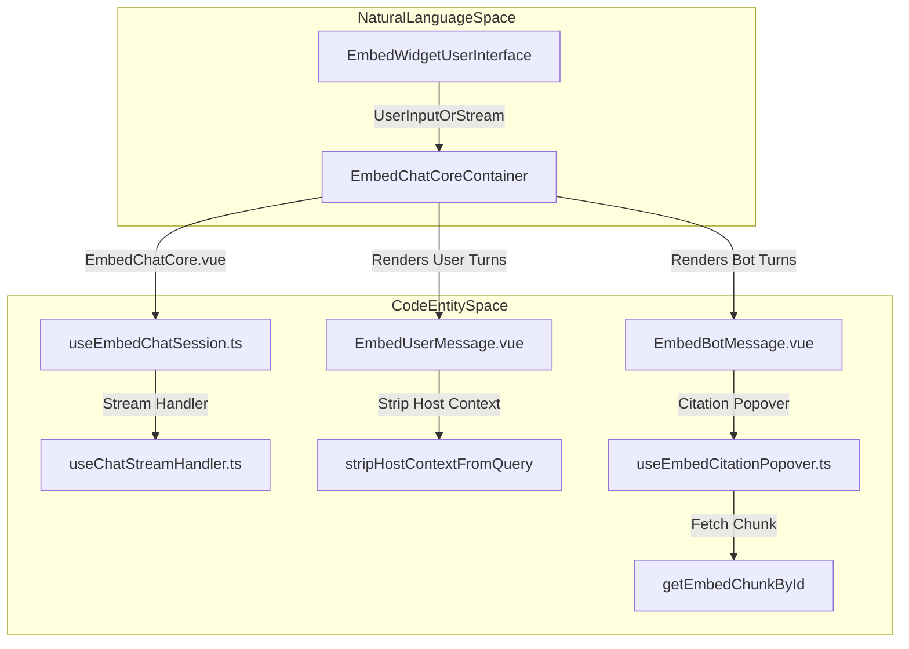
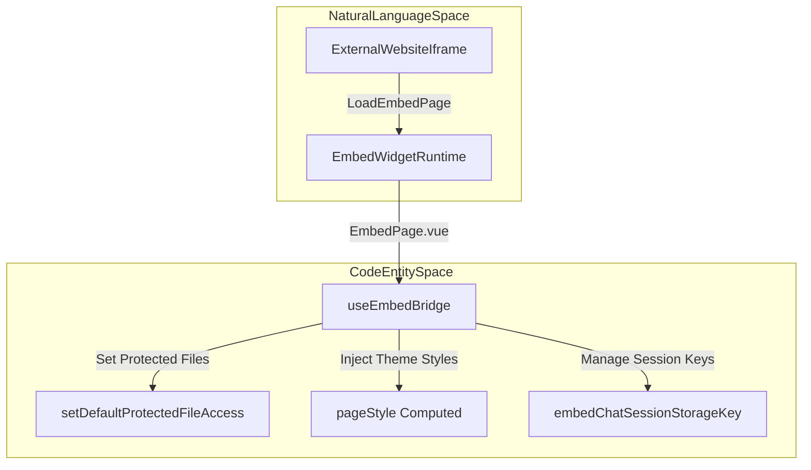

<!-- source: DeepWiki mcp.deepwiki.com · repo Tencent/WeKnora · page 5.7 Embedded Chat Channels · fetched 2026-10-29 -->

# Embedded Chat Channels

Relevant source files

The following files were used as context for generating this wiki page:

- [docreader/parser/source_locator.py](docreader/parser/source_locator.py)
- [docreader/tests/test_source_locator.py](docreader/tests/test_source_locator.py)
- [frontend/src/api/embed/index.ts](frontend/src/api/embed/index.ts)
- [frontend/src/assets/img/im/qqbot.png](frontend/src/assets/img/im/qqbot.png)
- [frontend/src/components/AgentEmbedChannelPanel.vue](frontend/src/components/AgentEmbedChannelPanel.vue)
- [frontend/src/components/css/channel-panel-list.less](frontend/src/components/css/channel-panel-list.less)
- [frontend/src/components/source-preview/pdfjsLoader.ts](frontend/src/components/source-preview/pdfjsLoader.ts)
- [frontend/src/composables/useChatCitationPopover.ts](frontend/src/composables/useChatCitationPopover.ts)
- [frontend/src/composables/useCitationPopover.test.ts](frontend/src/composables/useCitationPopover.test.ts)
- [frontend/src/composables/useCitationPopover.ts](frontend/src/composables/useCitationPopover.ts)
- [frontend/src/composables/useEmbedBridge.ts](frontend/src/composables/useEmbedBridge.ts)
- [frontend/src/composables/useEmbedCitationPopover.ts](frontend/src/composables/useEmbedCitationPopover.ts)
- [frontend/src/utils/embedContext.test.ts](frontend/src/utils/embedContext.test.ts)
- [frontend/src/utils/embedContext.ts](frontend/src/utils/embedContext.ts)
- [frontend/src/views/embed/EmbedBotMessage.vue](frontend/src/views/embed/EmbedBotMessage.vue)
- [frontend/src/views/embed/EmbedChatCore.vue](frontend/src/views/embed/EmbedChatCore.vue)
- [frontend/src/views/embed/EmbedPage.vue](frontend/src/views/embed/EmbedPage.vue)
- [frontend/src/views/embed/EmbedUserMessage.vue](frontend/src/views/embed/EmbedUserMessage.vue)
- [frontend/src/views/embed/embedHostContext.test.mjs](frontend/src/views/embed/embedHostContext.test.mjs)
- [internal/application/service/embed_channel.go](internal/application/service/embed_channel.go)
- [internal/handler/embed_channel.go](internal/handler/embed_channel.go)
- [internal/handler/embed_flow_test.go](internal/handler/embed_flow_test.go)
- [internal/middleware/embed_auth_test.go](internal/middleware/embed_auth_test.go)

The embedded chat channels subsystem enables administrators to publish custom AI agents as embeddable web chat widgets on external websites. This page documents backend configuration handlers, service layer logic, public session flow, anonymous visitor management, streaming chat sessions via `useEmbedChatSession`, host context injection, and the frontend component architecture (`EmbedChatCore`, `EmbedBotMessage`, `EmbedUserMessage`).

---

### 5.7.1 Embed Channel Configuration and Management

Embed channels are bound to specific custom agents within a tenant. Administrators configure these channels through the management UI (`AgentEmbedChannelPanel.vue`), where settings such as allowed origins, rate limits, UI themes, welcome messages, and toggleable features (web search, file uploads) are defined [frontend/src/components/AgentEmbedChannelPanel.vue:1-120]().

Backend CRUD operations are managed by `EmbedChannelHandler` in `internal/handler/embed_channel.go` [internal/handler/embed_channel.go:28-60]() and executed through the embed channel service interface [internal/handler/embed_channel.go:30](). When a channel is created via `CreateEmbedChannel` [internal/handler/embed_channel.go:119-172](), the service generates a secure cryptographic publish token.

Origin security is enforced during channel creation and updates via `validateAllowedOrigins()`, which rejects wildcard entries (`*`) in production mode and validates well-formed http/https origins or subdomain wildcards [internal/handler/embed_channel.go:94-128]().

Title: "EmbedChannelManagementDataFlow"

Sources: `internal/handler/embed_channel.go:28-183`, `frontend/src/components/AgentEmbedChannelPanel.vue:1-120`

---

### 5.7.2 Public Session Flow and Authentication

When an external website embeds the chat widget, the client-side widget initializes via `EmbedPage.vue` using the embed bridge composable. 

1. **Visitor Identification**: The client generates or retrieves a stable anonymous visitor UUID stored in `localStorage` scoped by the channel ID using `getOrCreateEmbedVisitorId()` [frontend/src/api/embed/index.ts:108-123]().
2. **Session Token Issuance**: Short-lived session tokens prefixed with `ems_` (`EMBED_SESSION_TOKEN_PREFIX`) are minted by the backend to authenticate runtime requests without exposing master credentials [frontend/src/api/embed/index.ts:59-60,155-158]().
3. **Protected File Access**: Because embed visitors do not possess standard Bearer user credentials, protected file rendering (such as inline images or attachments) is routed through an embed-scoped access context configured with the channel ID and token [frontend/src/views/embed/EmbedBotMessage.vue:165-171]().

Title: "PublicSessionBootstrapFlow"

Sources: `frontend/src/api/embed/index.ts:108-158`, `frontend/src/views/embed/EmbedBotMessage.vue:165-171`, `frontend/src/views/embed/EmbedPage.vue:1-94`

---

### 5.7.3 `EmbedChatCore` UI Architecture and Message Flow

The core chat interface for embedded channels is encapsulated in `EmbedChatCore.vue` [frontend/src/views/embed/EmbedChatCore.vue:1-114](). It coordinates conversation history, welcome messages, suggested questions, and scrolling behavior.

Additionally, `EmbedChatCore` supports host-context injection via `buildQueryWithHostContext` and strips the prefix for display using `stripHostContextFromQuery` [frontend/src/utils/embedContext.ts:1-22]().

#### Component Breakdown

| Component | File Path | Role & Responsibilities |
| :--- | :--- | :--- |
| `EmbedChatCore` | `frontend/src/views/embed/EmbedChatCore.vue` [frontend/src/views/embed/EmbedChatCore.vue:1-122]() | Main container managing chat message streams, auto-scrolling, suggestion grids, and input dispatch. |
| `EmbedUserMessage` | `frontend/src/views/embed/EmbedUserMessage.vue` | Renders user chat turns, attached files, image thumbnails, and handles protected file image hydration, stripping host context via `stripHostContextFromQuery` [frontend/src/utils/embedContext.ts:14-22](). |
| `EmbedBotMessage` | `frontend/src/views/embed/EmbedBotMessage.vue` [frontend/src/views/embed/EmbedBotMessage.vue:1-39]() | Renders assistant responses, markdown parsing, Mermaid diagrams, RAG progress pipelines, and citation popovers via `useEmbedCitationPopover` [frontend/src/views/embed/EmbedBotMessage.vue:127-139](). |

Title: "EmbeddedChatArchitecture"

Sources: `frontend/src/views/embed/EmbedChatCore.vue:1-122`, `frontend/src/views/embed/EmbedBotMessage.vue:1-139`, `frontend/src/utils/embedContext.ts:1-22`

---

### 5.7.4 External Site Integration and Styling Injection

To integrate an embed channel into an external website, administrators embed an iframe or JavaScript snippet pointing to the public embed route handled by `EmbedPage.vue` [frontend/src/views/embed/EmbedPage.vue:1-53](). 

The frontend runtime dynamically injects custom theme variables—such as primary brand colors (`primary_color`)—into the document style root to ensure seamless visual alignment with the host site's branding guidelines [frontend/src/views/embed/EmbedPage.vue:106-116](). Furthermore, protected file access is globally configured for the embed scope via `setDefaultProtectedFileAccess()` [frontend/src/views/embed/EmbedPage.vue:86-92]().

Session state persistence is managed via localStorage keys generated by `embedChatSessionStorageKey()` [frontend/src/api/embed/index.ts:125-127](), with automatic mismatch clearing if the bound agent changes [frontend/src/api/embed/index.ts:139-153]().

Title: "ExternalIntegrationFlow"

Sources: `frontend/src/views/embed/EmbedPage.vue:1-116`, `frontend/src/api/embed/index.ts:125-153`

---

