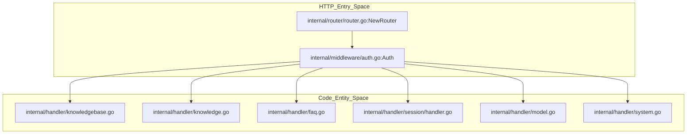
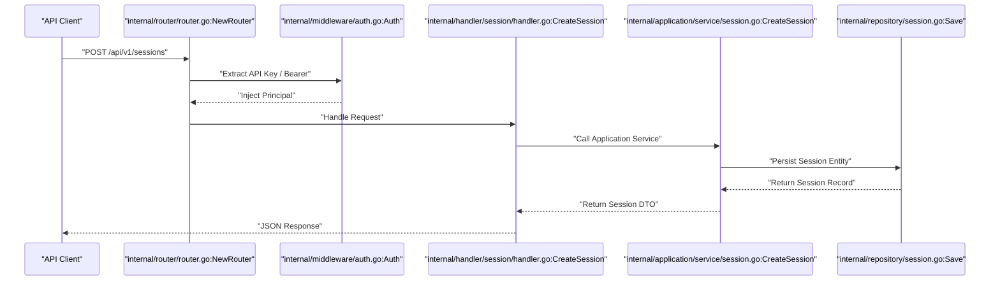

<!-- source: DeepWiki mcp.deepwiki.com · repo Tencent/WeKnora · page 6 API Reference · fetched 2026-10-29 -->

# API Reference

Relevant source files

The following files were used as context for generating this wiki page:

- [config/builtin_agents.yaml](config/builtin_agents.yaml)
- [config/prompt_templates/agent_system_prompt.yaml](config/prompt_templates/agent_system_prompt.yaml)
- [docs/docs.go](docs/docs.go)
- [docs/swagger.json](docs/swagger.json)
- [docs/swagger.yaml](docs/swagger.yaml)
- [internal/agent/complete_event_model_test.go](internal/agent/complete_event_model_test.go)
- [internal/agent/tools/definitions.go](internal/agent/tools/definitions.go)
- [internal/handler/session/complete_model_test.go](internal/handler/session/complete_model_test.go)
- [website-docs/03-features/02-knowledge-base.md](website-docs/03-features/02-knowledge-base.md)
- [website-docs/04-api/01-api-overview.md](website-docs/04-api/01-api-overview.md)
- [website-docs/04-api/02-api-chat.md](website-docs/04-api/02-api-chat.md)
- [website-docs/04-api/02-api-faq-wiki.md](website-docs/04-api/02-api-faq-wiki.md)
- [website-docs/04-api/02-api-knowledge.md](website-docs/04-api/02-api-knowledge.md)
- [website-docs/04-api/02-api-tenant.md](website-docs/04-api/02-api-tenant.md)
- [website-docs/05-clients/03-go-sdk.md](website-docs/05-clients/03-go-sdk.md)

## Purpose and Scope

This document provides a high-level overview of WeKnora's REST API. It outlines core architectural patterns, request/response formats, authentication mechanisms, and functional domains. The API enables programmatic access to knowledge base management, document processing, FAQ operations, conversational AI, and multi-tenant collaboration features.

WeKnora exposes a structured API organized into functional domains, primarily serving the frontend application and external integrations via platform-level or tenant-level credentials. Detailed endpoint specifications, parameter schemas, and code examples are maintained in the child pages.

For details on authentication and permissions, see [Authentication and Authorization](#6.1). For knowledge base operations, see [Knowledge Base Management APIs](#6.2). For file processing, see [Knowledge and Document APIs](#6.3). For conversational features, see [Chat and Query APIs](#6.4). For system settings, see [Model and Configuration APIs](#6.5). For FAQ and chunk details, see [FAQ and Chunk APIs](#6.6).

Sources: [website-docs/04-api/01-api-overview.md:1-15](), [internal/router/router.go:93-180]()

---

## API Architecture Overview

WeKnora exposes a RESTful API organized into functional groups, all prefixed with `/api/v1` [docs/swagger.yaml:1](). The system provides an interactive Swagger UI for exploring endpoints, available at `/swagger/index.html` when running in non-release modes [internal/router/router.go:137-144]().

### Route Registration and Handler Mapping

The following diagram bridges the natural language API functional domains to the code entities and router setup defined in `internal/router/router.go`.

Sources: [internal/router/router.go:93-180](), [docs/swagger.json:32-50]()

### Request Flow Architecture

The following sequence diagram bridges natural language API client actions to specific Go code entities (`SessionHandler`, `SessionService`, `SessionRepository`) during a session creation call.

Sources: [internal/router/router.go:113-120](), [docs/swagger.json:15-23](), [internal/handler/system.go:164-170]()

---

## 6.1 Authentication and Authorization

All API requests require identity verification via specific headers. The primary mechanisms include `X-API-Key` headers and `Authorization: Bearer` tokens [docs/swagger.json:17-23](). WeKnora implements a fine-grained principal model where API keys carry explicit role and capability grants [internal/handler/tenant.go:138-144]().

Requests are scoped to specific workspaces via the `X-Tenant-ID` header [internal/router/router.go:116](). Platform-level API keys allow control-plane automation across multiple tenants independently [website-docs/04-api/01-api-overview.md:37]().

For detailed documentation, parameter schemas, and permission models, see [Authentication and Authorization](#6.1).

Sources: [internal/router/router.go:113-120](), [internal/handler/tenant.go:138-144](), [website-docs/04-api/01-api-overview.md:30-40]()

---

## 6.2 Knowledge Base Management APIs

These endpoints manage the lifecycle of Knowledge Bases (KBs), including creation, deletion, configuration updates, cloning, and access control [website-docs/04-api/02-api-knowledge.md:13-138](). Administrators can configure indexing strategies and associate embedding or LLM models [website-docs/04-api/02-api-knowledge.md:20-30]().

For detailed endpoint listings and request payloads, see [Knowledge Base Management APIs](#6.2).

Sources: [website-docs/04-api/02-api-knowledge.md:13-138]()

---

## 6.3 Knowledge and Document APIs

This domain handles content ingestion from various sources, including file uploads, web URLs, and manual text entries [website-docs/04-api/02-api-knowledge.md:3](). It provides asynchronous status queries, parsing control, and document deletion.

For detailed endpoint documentation and status polling flows, see [Knowledge and Document APIs](#6.3).

Sources: [website-docs/04-api/02-api-knowledge.md:1-5]()

---

## 6.4 Chat and Query APIs

The chat and query subsystem exposes endpoints for session management, knowledge QA, agent reasoning loops, and real-time streaming via Server-Sent Events (SSE) [docs/swagger.json:15-35](). It also manages tool approvals and MCP (Model Context Protocol) interactions during conversational flows [docs/swagger.json:82-192]().

For complete reference on chat sessions, message handling, and SSE payloads, see [Chat and Query APIs](#6.4).

Sources: [docs/swagger.json:15-35](), [docs/swagger.json:82-192]()

---

## 6.5 Model and Configuration APIs

These administrative endpoints govern model provider credentials, tenant-level configurations, storage backend resolvers, parser engines, and system health status [website-docs/04-api/02-api-tenant.md:103-126]().

For full configuration reference and system administration endpoints, see [Model and Configuration APIs](#6.5).

Sources: [website-docs/04-api/02-api-tenant.md:103-126]()

---

## 6.6 FAQ and Chunk APIs

This domain provides specialized operations for FAQ entry management, batch import/export, granular document chunk queries, span inspection, and tag-based organization [website-docs/04-api/02-api-faq-wiki.md:7-170]().

For API specifications on batch operations and chunk filtering, see [FAQ and Chunk APIs](#6.6).

Sources: [website-docs/04-api/02-api-faq-wiki.md:7-170]()

---

## Error Handling

The API uses standard HTTP status codes and a uniform JSON error envelope defined by the `AppError` structure [docs/swagger.yaml:86-93]().

| HTTP Status | Error Code | Description |
|-------------|------------|-------------|
| 400 | 1000 | Bad Request (Validation failure) [docs/swagger.yaml:121]() |
| 401 | 1001 | Unauthorized (Invalid API Key/Token) [docs/swagger.yaml:122]() |
| 403 | 1002 | Forbidden (RBAC violation) [docs/swagger.yaml:123]() |
| 404 | 1003 | Not Found (Resource missing) [docs/swagger.yaml:124]() |
| 409 | 1005 | Conflict (Duplicate resource) [docs/swagger.yaml:126]() |
| 500 | 1007 | Internal Server Error [docs/swagger.yaml:128]() |

Sources: [docs/swagger.yaml:86-144]()

---

