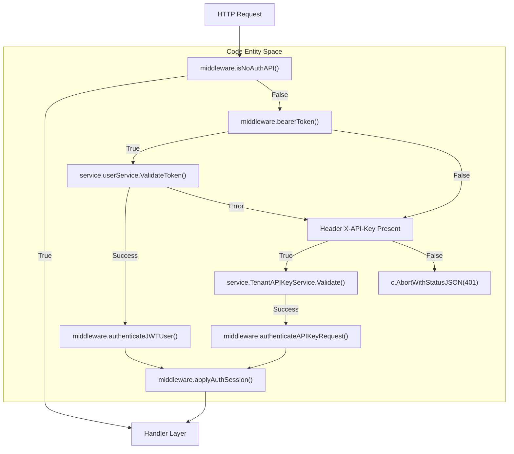
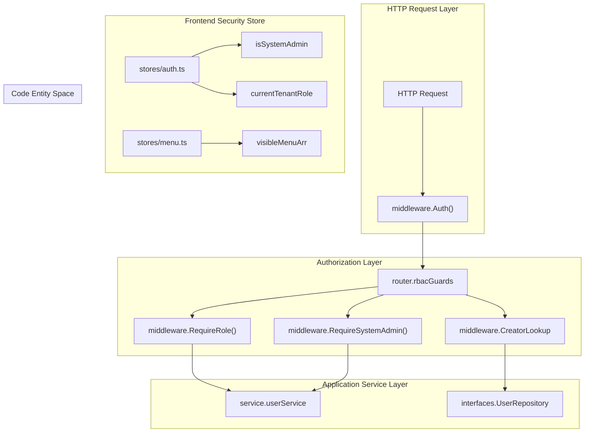

<!-- source: DeepWiki mcp.deepwiki.com · repo Tencent/WeKnora · page 6.1 Authentication and Authorization · fetched 2026-10-29 -->

# Authentication and Authorization

Relevant source files

The following files were used as context for generating this wiki page:

- [frontend/src/App.vue](frontend/src/App.vue)
- [frontend/src/api/auth/index.ts](frontend/src/api/auth/index.ts)
- [frontend/src/composables/useFont.ts](frontend/src/composables/useFont.ts)
- [frontend/src/composables/useTheme.ts](frontend/src/composables/useTheme.ts)
- [frontend/src/router/index.ts](frontend/src/router/index.ts)
- [frontend/src/stores/auth.ts](frontend/src/stores/auth.ts)
- [frontend/src/stores/menu.ts](frontend/src/stores/menu.ts)
- [frontend/src/utils/protectedFileAccess.test.ts](frontend/src/utils/protectedFileAccess.test.ts)
- [frontend/src/utils/protectedFileAccess.ts](frontend/src/utils/protectedFileAccess.ts)
- [frontend/src/views/auth/Login.vue](frontend/src/views/auth/Login.vue)
- [frontend/src/views/settings/GeneralSettings.vue](frontend/src/views/settings/GeneralSettings.vue)
- [frontend/src/views/settings/UserProfile.vue](frontend/src/views/settings/UserProfile.vue)
- [internal/application/repository/user.go](internal/application/repository/user.go)
- [internal/application/service/user.go](internal/application/service/user.go)
- [internal/application/service/user_auth_token_test.go](internal/application/service/user_auth_token_test.go)
- [internal/handler/auth.go](internal/handler/auth.go)
- [internal/middleware/auth.go](internal/middleware/auth.go)
- [internal/router/files.go](internal/router/files.go)
- [internal/router/router_api_key_capabilities_test.go](internal/router/router_api_key_capabilities_test.go)
- [internal/router/routes_agent.go](internal/router/routes_agent.go)
- [internal/router/static.go](internal/router/static.go)
- [internal/types/interfaces/user.go](internal/types/interfaces/user.go)
- [internal/types/user.go](internal/types/user.go)
- [website-docs/03-features/01-tenant-auth.md](website-docs/03-features/01-tenant-auth.md)
- [website-docs/04-api/02-api-auth.md](website-docs/04-api/02-api-auth.md)
- [website-docs/04-api/02-api-org.md](website-docs/04-api/02-api-org.md)

This page documents WeKnora's authentication and authorization mechanisms, including bearer tokens, API keys, single sign-on (OIDC), multi-tenant permission models, and role-based access control (RBAC).

## Purpose and Scope

The authentication and authorization subsystem secures all control plane and data plane entry points in WeKnora. It governs how HTTP and API clients authenticate, how tenant context and user identities are propagated via `context.Context`, how fine-grained role-based access control (RBAC) and resource ownership are enforced across workspaces, and how platform-level system administrators are isolated from standard tenant users.

Sources: [internal/middleware/auth.go:107-207](), [internal/router/rbac.go:19-38]()

---

## Authentication Model

### Context Keys and Session Structs
Incoming requests that pass authentication populate the request context with an `authSession` containing the authenticated `types.User`, a `types.Principal` identifier, and administrative flags via `applyAuthSession` [internal/middleware/auth.go:107-113]().

| Session Attribute | Type / Entity | Purpose |
|-------------------|---------------|---------|
| `User` | `types.User` | The underlying user entity retrieved from persistence [internal/middleware/auth.go:109]() |
| `Principal` | `types.Principal` | Distinguishes between web user sessions and API key principals [internal/middleware/auth.go:110]() |
| `SystemAdmin` | `bool` | Platform-wide administrative flag independent of tenant roles [internal/middleware/auth.go:111]() |

Sources: [internal/middleware/auth.go:107-113](), [internal/application/service/user.go:182-195]()

### Authentication Methods
1. **Bearer JWT Token:** Validated via `userService.ValidateToken` [internal/middleware/auth.go:148-158](). JWT secrets are loaded from `JWT_SECRET` or generated securely at runtime [internal/application/service/user.go:80-95]().
2. **Tenant API Keys:** Validated via `apiKeyService` for service-to-service communication [internal/middleware/auth.go:161-171]().
3. **OIDC Single Sign-On:** Handled by `AuthHandler` endpoints (`/api/v1/auth/oidc/config`, `/api/v1/auth/oidc/url`) [internal/handler/auth.go:225-251](), with frontend session synchronization managed in `syncOIDCUserContext` [frontend/src/App.vue:52-97]().

Sources: [internal/middleware/auth.go:146-171](), [internal/application/service/user.go:80-95](), [internal/handler/auth.go:225-251](), [frontend/src/App.vue:52-97]()

### Authentication Flow

Title: "Authentication Middleware Execution Flow"

Sources: [internal/middleware/auth.go:36-181](), [internal/application/service/user.go:141-216]()

---

## Authorization and RBAC

WeKnora implements a centralized role-based access control matrix managed through `rbacGuards` [internal/router/rbac.go:113-149]().

### Tenant Roles
- **Viewer:** Read-only access to tenant resources.
- **Contributor:** Can create new resources and modify items they personally authored (`creator_id`).
- **Admin:** Full management of tenant-level infrastructure, members, and configurations.
- **Owner:** Ultimate authority over workspace lifecycle and settings.

### Guard Mechanisms & Ownership Lookups
Guards enforce permissions by inspecting tenant memberships or resolving resource authors via `CreatorLookup` closures [internal/router/rbac.go:119-132]().

| Guard / Lookup Symbol | Code Entity & Role | Purpose |
|-----------------------|--------------------|---------|
| `RequireRole` | `middleware.RequireRole` [internal/middleware/rbac.go:67]() | Enforces minimum tenant role floor |
| `RequireSystemAdmin` | `middleware.RequireSystemAdmin` [internal/middleware/rbac.go:147]() | Restricts endpoints to platform administrators |
| `kbCreator` | `middleware.CreatorLookup` [internal/router/rbac.go:119]() | Resolves Knowledge Base `:id` to `creator_id` |
| `knowledgeKBCreator` | `middleware.CreatorLookup` [internal/router/rbac.go:129]() | Resolves document parent KB creator |

Sources: [internal/router/rbac.go:113-149](), [internal/middleware/rbac.go:67-170]()

---

## System Administration

Platform administration is strictly gated behind the `IsSystemAdmin` flag on the `types.User` model [internal/types/user.go:23](). 

- **Backend Enforcement:** The `RequireSystemAdmin` middleware aborts non-admin requests with `403 Forbidden` [internal/middleware/rbac.go:147-170]().
- **Frontend Gating:** The Pinia store `useAuthStore` exposes an `isSystemAdmin` computed property [frontend/src/stores/auth.ts:121-123]() which the menu store `useMenuStore` uses to conditionally render administrative navigation links [frontend/src/stores/menu.ts:69-84]().

Sources: [internal/middleware/rbac.go:147-170](), [frontend/src/stores/auth.ts:121-123](), [frontend/src/stores/menu.ts:69-84]()

---

## API Key Capabilities

API keys utilize a granular capability model tested in test suites [internal/router/router_api_key_capabilities_test.go:14-116]().

| Capability Identifier | Scope Description | Example Endpoint |
|-----------------------|-------------------|------------------|
| `chat` | Conversation sessions & message suggestion events | `POST /api/v1/sessions` [internal/router/router_api_key_capabilities_test.go:27]() |
| `read_agents` | Agent configuration discovery | `GET /api/v1/agents` [internal/router/router_api_key_capabilities_test.go:161]() |
| `manage_agents` | Agent authoring and mutation | `PUT /api/v1/agents/:id` [internal/router/router_api_key_capabilities_test.go:185]() |
| `system_settings_manage` | Global system setting modifications | `PUT /api/v1/system/admin/settings/:key` [internal/router/router_api_key_capabilities_test.go:62]() |

Sources: [internal/router/router_api_key_capabilities_test.go:14-116](), [internal/router/rbac.go:144-149]()

Title: "Security Architecture Entity Mapping"

Sources: [internal/middleware/auth.go:126-181](), [internal/router/rbac.go:113-149](), [internal/middleware/rbac.go:67-170](), [frontend/src/stores/auth.ts:65-124](), [frontend/src/stores/menu.ts:69-84]()

---

