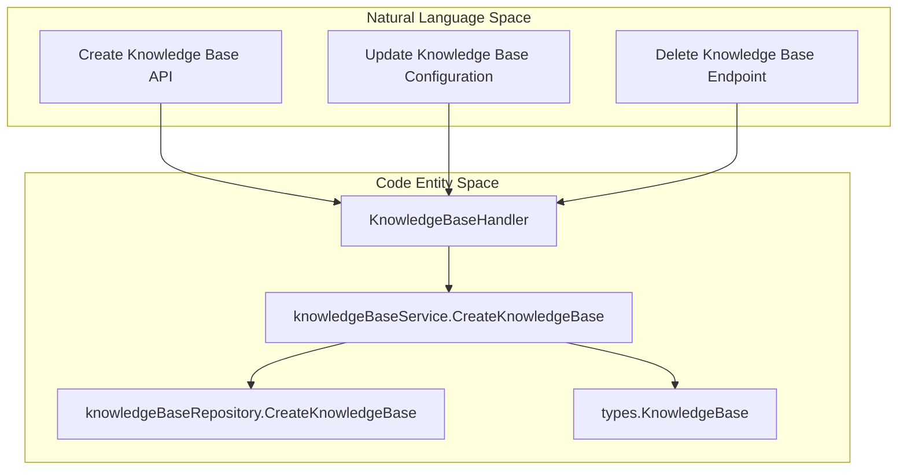
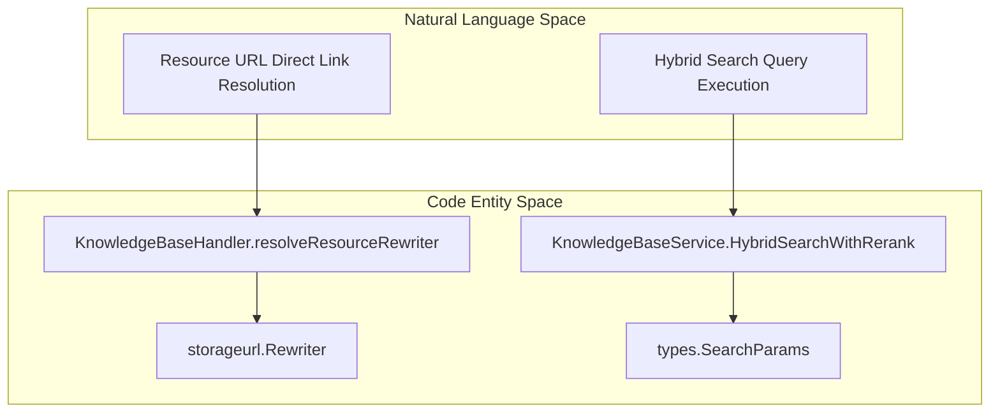

<!-- source: DeepWiki mcp.deepwiki.com · repo Tencent/WeKnora · page 6.2 Knowledge Base Management APIs · fetched 2026-10-29 -->

# Knowledge Base Management APIs

<details>
<summary>Relevant source files</summary>

The following files were used as context for generating this wiki page:

- [client/retrieval.go](client/retrieval.go)
- [internal/agent/tools/search_knowledge.go](internal/agent/tools/search_knowledge.go)
- [internal/agent/tools/search_knowledge_rerank_test.go](internal/agent/tools/search_knowledge_rerank_test.go)
- [internal/agent/tools/search_knowledge_test.go](internal/agent/tools/search_knowledge_test.go)
- [internal/application/repository/knowledgebase.go](internal/application/repository/knowledgebase.go)
- [internal/application/service/chat_pipeline/merge_history.go](internal/application/service/chat_pipeline/merge_history.go)
- [internal/application/service/chat_pipeline/search.go](internal/application/service/chat_pipeline/search.go)
- [internal/application/service/chat_pipeline/search_error_test.go](internal/application/service/chat_pipeline/search_error_test.go)
- [internal/application/service/knowledgebase.go](internal/application/service/knowledgebase.go)
- [internal/application/service/knowledgebase_search.go](internal/application/service/knowledgebase_search.go)
- [internal/application/service/knowledgebase_search_embedding_dimension_test.go](internal/application/service/knowledgebase_search_embedding_dimension_test.go)
- [internal/handler/knowledgebase.go](internal/handler/knowledgebase.go)
- [internal/types/interfaces/knowledgebase.go](internal/types/interfaces/knowledgebase.go)
- [internal/types/knowledgebase.go](internal/types/knowledgebase.go)

</details>


The purpose of this page is to provide a complete API reference and technical implementation guide for knowledge base CRUD operations, configuration updates, cloning, duplication, hybrid search, and access management within WeKnora `[internal/application/service/knowledgebase.go:121-131]`, `[internal/types/interfaces/knowledgebase.go:18-86]()`.

---

## 1. Service and Handler Architecture

The knowledge base subsystem is organized into a layered architecture comprising HTTP handlers, application services, and persistent repositories:
- **`KnowledgeBaseHandler`**: Parses HTTP parameters, handles resource-URL rewriting (`resolveResourceRewriter`), enriches responses with vector store display data (`buildKBResponse`, `buildKBListResponse`), and enforces route-level input validation `[internal/handler/knowledgebase.go:34-80]()`.
- **`KnowledgeBaseService` (`knowledgeBaseService`)**: Implements business rules, tenant ownership attribution (`CreatorID`), default configuration application, vector store binding validation, and audit log recording `[internal/application/service/knowledgebase.go:33-103]()`.
- **`KnowledgeBaseRepository` (`knowledgeBaseRepository`)**: Executes GORM-backed data access operations against the underlying database for knowledge bases and user-level UI pin states (`user_kb_pins`) `[internal/application/repository/knowledgebase.go:16-145]()`.

Title: "Natural Language Space to Code Entity Space Mapping for KB Management"

Sources: [internal/handler/knowledgebase.go:34-80](), [internal/application/service/knowledgebase.go:33-103](), [internal/application/repository/knowledgebase.go:16-28]()

---

## 2. Core CRUD and Configuration Endpoints

### Create Knowledge Base (`POST /api/v1/knowledge-bases`)
Creates a new knowledge base under the caller's tenant scope `[internal/application/service/knowledgebase.go:121-131]()`. Non-synthetic user IDs populate `CreatorID` to permit contributors to edit their created knowledge bases without tenant-wide edit rights `[internal/application/service/knowledgebase.go:139-141]()`. When `vector_store_id` is supplied, binding validation occurs against the tenant scope and engine registry `[internal/application/service/knowledgebase.go:158-162]()`.

```http
POST /api/v1/knowledge-bases
Content-Type: application/json
Authorization: Bearer <token>
```
Sources: [internal/application/service/knowledgebase.go:121-180](), [internal/types/interfaces/knowledgebase.go:18-26]()

### Get Knowledge Base Details (`GET /api/v1/knowledge-bases/:id`)
Retrieves a single knowledge base by ID, enriching the response payload with bound vector store display metadata (`vector_store_name`, `vector_store_source`, `vector_store_engine_type`, `vector_store_status`) and shared space permission hints (`my_permission`) via `buildKBResponse` `[internal/handler/knowledgebase.go:115-147]()`.

Sources: [internal/handler/knowledgebase.go:115-147](), [internal/types/interfaces/knowledgebase.go:28-36]()

### Update Knowledge Base (`PUT /api/v1/knowledge-bases/:id`)
Applies partial or wholesale updates to knowledge base configurations (chunking, image processing, VLM config, extraction rules, and metadata) `[internal/types/interfaces/knowledgebase.go:74-76]()`.

Sources: [internal/types/interfaces/knowledgebase.go:74-76](), [internal/application/repository/knowledgebase.go:170-173]()

### Delete Knowledge Base (`DELETE /api/v1/knowledge-bases/:id`)
Deletes a knowledge base and initiates background cleanup workflows via Asynq (`ProcessKBDelete`) to purge associated vector store indices and stored documents `[internal/types/interfaces/knowledgebase.go:78-84]()`.

Sources: [internal/types/interfaces/knowledgebase.go:78-84]()

### Pin Knowledge Base (`PUT /api/v1/knowledge-bases/:id/pin`)
Toggles user-level UI pinning state stored in the `user_kb_pins` table via `SetUserKBPin` `[internal/application/repository/knowledgebase.go:112-145]()`.

Sources: [internal/application/repository/knowledgebase.go:112-145](), [internal/types/interfaces/knowledgebase.go:86-88]()

Title: "Natural Language Space to Code Entity Space Mapping for Hybrid Search & Retrieval"

Sources: [internal/handler/knowledgebase.go:82-96](), [internal/types/interfaces/knowledgebase.go:89-104]()

---

## 3. Hybrid Search and Resource Rewriting

### Hybrid Search (`POST /api/v1/knowledge-bases/:id/hybrid-search`)
Executes vector similarity combined with keyword matching via `HybridSearchWithRerank` `[internal/types/interfaces/knowledgebase.go:99-104]()`. Callers can pass pre-computed `query_embedding` or `query_text` alongside filtering rules (`tag_ids`, `knowledge_ids`, `vector_threshold`) `[internal/application/service/knowledgebase_search.go:130-154]()`.

### Resource URL Rewriting
The query parameter `resource_urls=handle|public` governs output formats. When `public` is requested, `resolveResourceRewriter` constructs a `storageurl.Rewriter` to convert internal `resource://` references into pre-signed loadable direct HTTP URLs `[internal/handler/knowledgebase.go:82-96]()`.

Title: "Resource URL Rewriting Flow in KB Handler"
```mermaid
flowchart TD
    subgraph RequestIngestion["Request Ingestion"]
        Req[""IncomingHTTPRequest""]
        Query[""QueryParam: resource_urls""]
    end

    subgraph HandlerLayer["API Handler Layer"]
        Rewriter[""KnowledgeBaseHandler.resolveResourceRewriter""]
        Builder[""KnowledgeBaseHandler.buildKBResponse""]
    end

    subgraph StorageOutput["Storage & Output"]
        Handle[""resource:// Internal Handle""]
        Public[""Signed HTTP(S) Direct URL""]
    end

    Req --> Query
    Query --> Rewriter
    Rewriter --> Builder
    Builder -- ""Mode: handle"" --> Handle
    Builder -- ""Mode: public"" --> Public
```
Sources: [internal/handler/knowledgebase.go:82-96](), [internal/handler/knowledgebase.go:115-147]()

---

## 4. Cloning, Duplication, and Access Control

### Cloning and Duplication
- **`CopyKnowledgeBase`**: Copies a knowledge base and its structured content between identifiers `[internal/types/interfaces/knowledgebase.go:118-126]()`.
- **`DuplicateKnowledgeBase`**: Creates a settings-only knowledge base duplicate without copying chunks, FAQ rows, wiki pages, or underlying data sources, generating a new UUID `[internal/types/interfaces/knowledgebase.go:128-132]()`.

### Access Control and RBAC
Endpoint access relies on workspace RBAC middleware coupled with knowledge base ownership checks (`RequireOwnershipOrRole`). Contributors possess write permissions exclusively over knowledge bases where they are recorded as the creator or possess tenant administrative roles `[internal/types/knowledgebase.go:72-77]()`.

Sources: [internal/types/interfaces/knowledgebase.go:118-132](), [internal/types/knowledgebase.go:72-77]()

---

