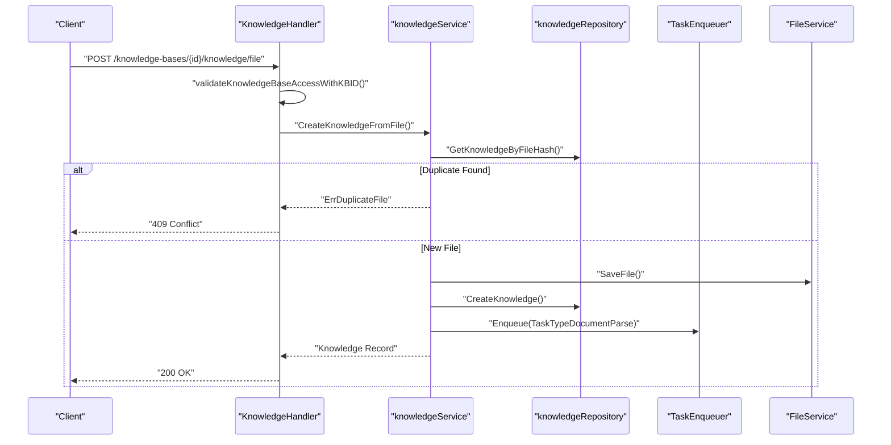

<!-- source: DeepWiki mcp.deepwiki.com · repo Tencent/WeKnora · page 6.3 Knowledge and Document APIs · fetched 2026-10-29 -->

# Knowledge and Document APIs

<details>
<summary>Relevant source files</summary>

The following files were used as context for generating this wiki page:

- [client/faq.go](client/faq.go)
- [frontend/src/api/knowledge-base/index.ts](frontend/src/api/knowledge-base/index.ts)
- [internal/application/repository/chunk.go](internal/application/repository/chunk.go)
- [internal/application/repository/knowledge.go](internal/application/repository/knowledge.go)
- [internal/application/repository/knowledge_duplicate_test.go](internal/application/repository/knowledge_duplicate_test.go)
- [internal/application/repository/knowledge_finalize_test.go](internal/application/repository/knowledge_finalize_test.go)
- [internal/application/service/chunk.go](internal/application/service/chunk.go)
- [internal/application/service/knowledge.go](internal/application/service/knowledge.go)
- [internal/application/service/knowledgebase_task_cancel_test.go](internal/application/service/knowledgebase_task_cancel_test.go)
- [internal/handler/faq.go](internal/handler/faq.go)
- [internal/handler/knowledge.go](internal/handler/knowledge.go)
- [internal/router/router.go](internal/router/router.go)
- [internal/router/task_inspector_errors.go](internal/router/task_inspector_errors.go)
- [internal/router/task_inspector_errors_test.go](internal/router/task_inspector_errors_test.go)
- [internal/router/task_inspector_runtime_test.go](internal/router/task_inspector_runtime_test.go)
- [internal/types/faq.go](internal/types/faq.go)
- [internal/types/interfaces/chunk.go](internal/types/interfaces/chunk.go)
- [internal/types/interfaces/knowledge.go](internal/types/interfaces/knowledge.go)
- [internal/types/knowledge.go](internal/types/knowledge.go)

</details>


This page documents the REST API endpoints for managing **knowledge entries** — individual documents, URLs, and manual content items residing within a knowledge base. It covers file upload, URL import, manual Markdown entry, retrieval, update, deletion, download, preview, and reparse operations.

For knowledge base management, see [Knowledge Base Management APIs](). For chunk-level and FAQ entry APIs, see [FAQ and Chunk APIs]().

Sources: `[internal/handler/knowledge.go:30-59]`, `[internal/application/service/knowledge.go:48-87]()`

---

## Handler Overview

All knowledge endpoint logic is implemented in `KnowledgeHandler` within `[internal/handler/knowledge.go:30-43]`. `KnowledgeHandler` coordinates between service interfaces to handle ingestion, storage, and permission resolution:

| Field | Interface | Role |
|---|---|---|
| `kgService` | `interfaces.KnowledgeService` | Core knowledge CRUD, file I/O, and search `[internal/handler/knowledge.go:33]()`. |
| `kbService` | `interfaces.KnowledgeBaseService` | Knowledge base metadata lookup for access checks `[internal/handler/knowledge.go:34]()`. |
| `kbShareService` | `interfaces.KBShareService` | Resolution of shared KB permissions `[internal/handler/knowledge.go:35]()`. |
| `agentShareService` | `interfaces.AgentShareService` | Cross-tenant access via shared agents `[internal/handler/knowledge.go:36]()`. |
| `asynqClient` | `interfaces.TaskEnqueuer` | Enqueueing asynchronous processing tasks `[internal/handler/knowledge.go:40]()`. |

Sources: `[internal/handler/knowledge.go:30-43]`, `[internal/application/service/knowledge.go:48-87]()`

---

## Access Control and Multi-Tenancy

Every endpoint executes an access-control helper to resolve the effective tenant ID and permission level:

1. **KB-Scoped Routes** (e.g., Create, List): Call `validateKnowledgeBaseAccessWithKBID` `[internal/handler/knowledge.go:145-155]()`. It verifies whether the caller owns the KB, has shared organization access, or reaches it via a shared agent.
2. **Item-Scoped Routes** (e.g., Get, Update, Delete): Call `resolveKnowledgeAndValidateKBAccess` `[internal/handler/knowledge.go:178-184]()` to retrieve document metadata and validate parent KB permissions.

**Required Roles:**
* **Viewer:** List, Get, Download, Preview, Batch Get, Search.
* **Editor/Admin:** Create, Update, Delete, Reparse, Tag Batch Update.

Sources: `[internal/handler/knowledge.go:113-184]()`

---

## Endpoint Map

**Route prefix:** `/api/v1`

| Method | Path | Handler Function | Min Role |
|---|---|---|---|
| `POST` | `/knowledge-bases/:id/knowledge/file` | `CreateKnowledgeFromFile` | Editor |
| `POST` | `/knowledge-bases/:id/knowledge/url` | `CreateKnowledgeFromURL` | Editor |
| `POST` | `/knowledge-bases/:id/knowledge/manual` | `CreateManualKnowledge` | Editor |
| `GET` | `/knowledge-bases/:id/knowledge` | `ListKnowledge` | Viewer |
| `GET` | `/knowledge/:id` | `GetKnowledge` | Viewer |
| `PUT` | `/knowledge/:id` | `UpdateKnowledge` | Editor |
| `PUT` | `/knowledge/manual/:id` | `UpdateManualKnowledge` | Editor |
| `DELETE` | `/knowledge/:id` | `DeleteKnowledge` | Editor |
| `GET` | `/knowledge/:id/download` | `DownloadKnowledgeFile` | Viewer |
| `GET` | `/knowledge/:id/preview` | `PreviewKnowledgeFile` | Viewer |
| `POST` | `/knowledge/:id/reparse` | `ReparseKnowledge` | Editor |
| `GET` | `/knowledge/batch` | `GetKnowledgeBatch` | Viewer |
| `PUT` | `/knowledge/tags` | `UpdateKnowledgeTagBatch` | Editor |
| `POST` | `/knowledge/:id/cancel-parse` | `CancelKnowledgeParse` | Editor |
| `POST` | `/knowledge/:id/summary/refresh` | `RefreshKnowledgeSummary` | Editor |
| `PUT` | `/knowledge/:knowledge_id/chunks/:chunk_id/image-info` | `UpdateChunkImageInfo` | Editor |
| `GET` | `/knowledge-bases/:id/knowledge/folders` | `ListKnowledgeFolderTree` | Viewer |
| `POST` | `/knowledge/folder` | `MoveKnowledgeToFolder` | Editor |
| `PUT` | `/knowledge-bases/:id/knowledge/folders` | `RenameKnowledgeFolder` | Editor |

Sources: `[internal/handler/knowledge.go:30-43]`, `[internal/types/interfaces/knowledge.go:13-133]()`

---

## Request and Data Flow

Title: "Document Ingestion Data Flow"


Sources: `[internal/handler/knowledge.go:145-155]`, `[internal/application/service/knowledge.go:48-87]`, `[internal/types/interfaces/knowledge.go:16-26]()`

---

## Key Operations

### Create Knowledge from File
**`POST /api/v1/knowledge-bases/:id/knowledge/file`**
Uploads a physical file via `multipart/form-data`. The service verifies file hashes to prevent duplicates (`ErrDuplicateFile`), saves the file via `FileService`, creates a `Knowledge` record (`[internal/application/repository/knowledge.go:57-61]()`), and enqueues an asynchronous parsing task (`[internal/router/task.go:95-103]()`).

Sources: `[internal/application/service/knowledge.go:16-26]`, `[internal/application/repository/knowledge.go:57-61]()`

### Create Knowledge from URL & Manual Entries
* **URL (`POST /api/v1/knowledge-bases/:id/knowledge/url`):** Ingests web content or direct file downloads depending on extension and configuration (`[internal/types/interfaces/knowledge.go:31-42]()`).
* **Manual (`POST /api/v1/knowledge-bases/:id/knowledge/manual`):** Stores raw Markdown content as a managed file for processing (`[internal/types/interfaces/knowledge.go:48-55]()`).

Sources: `[internal/types/interfaces/knowledge.go:27-55]()`

### Reparse and Cancellation
* **Reparse (`POST /api/v1/knowledge/:id/reparse`):** Deletes existing document content and triggers asynchronous re-parsing, accepting optional `KnowledgeProcessOverrides` (`[internal/types/interfaces/knowledge.go:126-130]()`).
* **Cancel Parse (`POST /api/v1/knowledge/:id/cancel-parse`):** Terminates or flags active parsing workflows as cancelled.

Sources: `[internal/types/interfaces/knowledge.go:126-133]()`

---

## API Entity Mapping

Title: "API Ingestion Route to Code Entity Mapping"
```mermaid
graph TD
    subgraph Natural_Language_Space
        API_FILE["POST /knowledge-bases/:id/knowledge/file"]
        API_URL["POST /knowledge-bases/:id/knowledge/url"]
        API_MANUAL["POST /knowledge-bases/:id/knowledge/manual"]
        API_LIST["GET /knowledge-bases/:id/knowledge"]
    end

    subgraph Code_Entity_Space
        KH["handler.KnowledgeHandler"]
        KS["service.knowledgeService"]
        KR["repository.knowledgeRepository"]
        TASK_Q["interfaces.TaskEnqueuer"]
        MODEL_K["types.Knowledge"]
    end

    API_FILE -->|invokes| KH
    API_URL -->|invokes| KH
    API_MANUAL -->|invokes| KH
    API_LIST -->|invokes| KH

    KH -->|calls| KS
    KS -->|persists| KR
    KS -->|enqueues| TASK_Q
    KR --|> MODEL_K
```

Sources: `[internal/handler/knowledge.go:30-43]`, `[internal/application/service/knowledge.go:48-87]`, `[internal/application/repository/knowledge.go:47-61]()`

Title: "Document Lifecycle Route to Code Entity Mapping"
```mermaid
graph TD
    subgraph Natural_Language_Space
        API_REPARSE["POST /knowledge/:id/reparse"]
        API_CANCEL["POST /knowledge/:id/cancel-parse"]
        API_DELETE["DELETE /knowledge/:id"]
        API_DOWNLOAD["GET /knowledge/:id/download"]
    end

    subgraph Code_Entity_Space
        KH["handler.KnowledgeHandler"]
        KS["service.knowledgeService"]
        CR["repository.chunkRepository"]
        FS["interfaces.FileService"]
        MODEL_PROC["types.KnowledgeProcessOverrides"]
    end

    API_REPARSE -->|invokes| KH
    API_CANCEL -->|invokes| KH
    API_DELETE -->|invokes| KH
    API_DOWNLOAD -->|invokes| KH

    KH -->|calls| KS
    KS -->|deletes/updates| CR
    KS -->|reads/writes| FS
    KH --|> MODEL_PROC
```

Sources: `[internal/handler/knowledge.go:30-43]`, `[internal/types/interfaces/knowledge.go:102-133]`, `[internal/application/repository/chunk.go:27-34]()`

---

## Error Handling

| Sentinel Error | Description | HTTP Status |
|---|---|---|
| `ErrDuplicateFile` | File content hash already exists in target KB `[internal/application/service/knowledge.go:41]()`. | 409 Conflict |
| `ErrDuplicateURL` | URL already ingested into target KB `[internal/application/service/knowledge.go:42]()`. | 409 Conflict |
| `ErrInvalidFileType` | Unsupported file extension provided `[internal/application/service/knowledge.go:32]()`. | 400 Bad Request |
| `ErrImageNotParse` | Image attribute/multimodal update requested without enabling multimodal `[internal/application/service/knowledge.go:44-45]()`. | 400 Bad Request |

Sources: `[internal/application/service/knowledge.go:30-46]`

---

