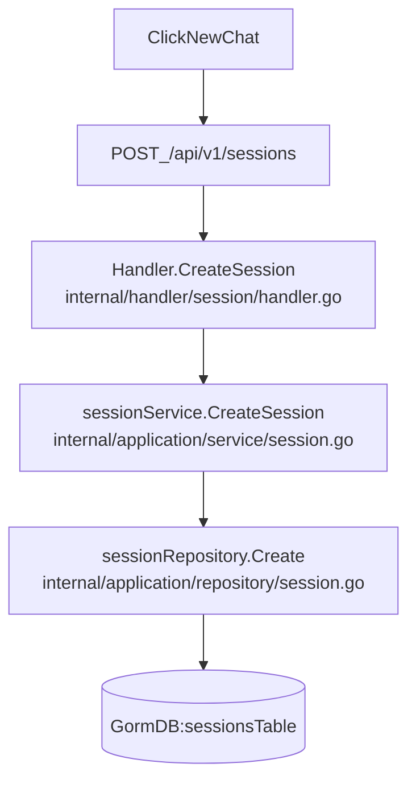
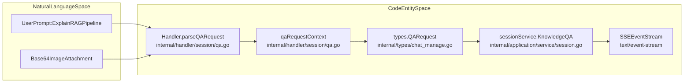

<!-- source: DeepWiki mcp.deepwiki.com · repo Tencent/WeKnora · page 6.4 Chat and Query APIs · fetched 2026-10-29 -->

# Chat and Query APIs

Relevant source files

The following files were used as context for generating this wiki page:

- [frontend/src/components/sessionGrouping.test.ts](frontend/src/components/sessionGrouping.test.ts)
- [frontend/src/components/sessionGrouping.ts](frontend/src/components/sessionGrouping.ts)
- [internal/application/repository/session.go](internal/application/repository/session.go)
- [internal/application/repository/session_test.go](internal/application/repository/session_test.go)
- [internal/application/service/session.go](internal/application/service/session.go)
- [internal/application/service/session_user_scope_test.go](internal/application/service/session_user_scope_test.go)
- [internal/handler/chunk.go](internal/handler/chunk.go)
- [internal/handler/evaluation.go](internal/handler/evaluation.go)
- [internal/handler/message.go](internal/handler/message.go)
- [internal/handler/message_limit_cap_test.go](internal/handler/message_limit_cap_test.go)
- [internal/handler/message_session_not_found_test.go](internal/handler/message_session_not_found_test.go)
- [internal/handler/message_suggestion.go](internal/handler/message_suggestion.go)
- [internal/handler/message_suggestion_test.go](internal/handler/message_suggestion_test.go)
- [internal/handler/session/handler.go](internal/handler/session/handler.go)
- [internal/handler/session/qa.go](internal/handler/session/qa.go)
- [internal/handler/session/resource_urls.go](internal/handler/session/resource_urls.go)
- [internal/handler/session/stream.go](internal/handler/session/stream.go)
- [internal/models/utils/ollama/ollama.go](internal/models/utils/ollama/ollama.go)
- [internal/storageurl/mode.go](internal/storageurl/mode.go)
- [internal/storageurl/storageurl.go](internal/storageurl/storageurl.go)
- [internal/storageurl/stream.go](internal/storageurl/stream.go)
- [internal/storageurl/stream_test.go](internal/storageurl/stream_test.go)
- [internal/types/interfaces/session.go](internal/types/interfaces/session.go)
- [internal/types/principal.go](internal/types/principal.go)
- [internal/types/session.go](internal/types/session.go)
- [internal/types/session_access_test.go](internal/types/session_access_test.go)

## Purpose and Scope
This page provides comprehensive technical documentation for the REST and Server-Sent Events (SSE) HTTP endpoints responsible for managing conversation sessions, executing KnowledgeQA and AgentQA inference, searching direct knowledge, handling media attachments, and continuing or replaying active stream sessions in WeKnora. It details the underlying handler structures, request/response data models, streaming execution flows, and integration patterns.

For pipeline architecture internals, see [5.2 Knowledge QA Mode]() and [5.3 Agent Mode and Tool Integration](). For conversation history and state management, see [5.4 Session Management and Context](). For authentication headers and token handling, see [6.1 Authentication and Authorization]().

Sources: `[internal/handler/session/handler.go:23-84]()`, `[internal/handler/message.go:51-64]()`

---

## Endpoint Summary

All routes are prefixed with `/api/v1` and managed by `Handler` [internal/handler/session/handler.go:23-84]() and `MessageHandler` [internal/handler/message.go:51-64]().

| Method | Path | Handler / Function | Description |
|---|---|---|---|
| `POST` | `/sessions` | `Handler.CreateSession` | Create a new conversation session |
| `GET` | `/sessions` | `Handler.GetSessionsByTenant` | List tenant sessions with pagination [internal/types/interfaces/session.go:29-30]() |
| `GET` | `/sessions/{id}` | `Handler.GetSession` | Fetch a single session by identifier honoring user/admin scope [internal/application/service/session.go:95-134]() |
| `PUT` | `/sessions/{id}` | `Handler.UpdateSession` | Update session title or description [internal/types/interfaces/session.go:31-32]() |
| `DELETE` | `/sessions/{id}` | `Handler.DeleteSession` | Delete a specific conversation session [internal/types/interfaces/session.go:37-38]() |
| `DELETE` | `/sessions/batch` | `Handler.BatchDeleteSessions` | Batch-delete multiple sessions [internal/types/interfaces/session.go:39-40]() |
| `POST` | `/knowledge-chat/{session_id}` | `Handler.KnowledgeQA` | Execute RAG-based QA with SSE streaming [internal/handler/session/qa.go:42-108]() |
| `POST` | `/agent-chat/{session_id}` | `Handler.AgentQA` | Execute ReAct agent QA with SSE streaming [internal/handler/session/qa.go:42-108]() |
| `GET` | `/sessions/continue-stream/{session_id}` | `Handler.ContinueStream` | Replay or continue an active stream via SSE [internal/handler/session/stream.go:21-37]() |
| `POST` | `/knowledge-search` | `Handler.SearchKnowledge` | Perform multi-KB search without summarization [internal/types/interfaces/session.go:68-75]() |
| `GET` | `/messages/{session_id}/load` | `MessageHandler.LoadMessages` | Load message history with optional time filtering [internal/handler/message.go:165-175]() |
| `POST` | `/sessions/{session_id}/generate_title` | `Handler.GenerateTitle` | Generate a title asynchronously from messages [internal/types/interfaces/session.go:52-58]() |

**Authentication**: All endpoints require a valid `Bearer` JWT token (`Authorization: Bearer <token>`) or API key.

Sources: `[internal/handler/session/handler.go:23-84]`, `[internal/handler/message.go:51-64]()`

---

## Handler Architecture and Route-to-Service Mapping

The HTTP request lifecycle for chat and session operations is orchestrated by `Handler` [internal/handler/session/handler.go:23-84]() and `MessageHandler` [internal/handler/message.go:51-64](). The `Handler` struct binds dependencies including `interfaces.SessionService`, `interfaces.MessageService`, `interfaces.StreamManager`, and related runtime components [internal/handler/session/handler.go:23-84]().

Title: "Session Creation Flow from Natural Language to Code Entity Space"

Sources: `[internal/handler/session/handler.go:23-84]`, `[internal/application/service/session.go:141-167]()`, `[internal/application/repository/session.go:37-49]()`

---

## Session Management Endpoints

Sessions operate as decoupled containers for multi-turn conversations. Configuration parameters such as knowledge bases, model instances, and agent selection are resolved dynamically per query rather than bound permanently at session creation [internal/types/session.go:89-155]().

### Visibility and Read Scoping
Session queries execute through `loadSessionForRead`, which enforces per-user ownership rules via `applySessionUserScope` while granting administrators access to tenant channel sessions (such as API keys, IM channels, and embedded chat widgets) [internal/application/service/session.go:29-134](). Mutation actions strictly invoke `GetOwnedSession` to protect system-managed sessions from administrative overwrite [internal/types/interfaces/session.go:19-22]().

Sources: `[internal/application/service/session.go:29-134]()`, `[internal/types/interfaces/session.go:11-42]()`, `[internal/application/repository/session.go:21-27]()`

---

## QA Endpoints and Streaming Execution

Both `KnowledgeQA` (`POST /api/v1/knowledge-chat/{session_id}`) and `AgentQA` (`POST /api/v1/agent-chat/{session_id}`) stream responses via Server-Sent Events (SSE). 

### Request Parsing and Context Building
When a QA request is received, the handler initializes a `qaRequestContext` structure holding immutable pipeline states, attachment metadata, and tracking IDs [internal/handler/session/qa.go:42-108]().
1. **Validation**: Validates path parameters and request bodies, rejecting empty queries [internal/handler/session/qa.go:42-108]().
2. **Resource Rewriting**: Resolves stream rewriters for outbound storage asset URLs (`resource_urls=public`) [internal/handler/message.go:149-163]().
3. **Payload Construction**: Converts `qaRequestContext` into a `types.QARequest` via `buildQARequest()` for service execution [internal/handler/session/qa.go:120-160]().

Title: "QA Execution Flow from Natural Language to Code Entity Space"

Sources: `[internal/handler/session/qa.go:42-160]`, `[internal/application/service/session.go:59-78]()`

---

## SSE Event Stream Format and Stream Continuation

Real-time streaming is managed by `StreamManager` and emitted using standard SSE headers. 

### `GET /sessions/continue-stream/{session_id}` — `ContinueStream`
Clients can reconnect or recover an ongoing or completed stream using `ContinueStream` [internal/handler/session/stream.go:21-37](). It loads the incomplete message via `MessageService.GetMessage`, queries `StreamManager.GetEvents` starting from offset `0` (or a given offset), replays existing frames, and polls for subsequent events until completion [internal/handler/session/stream.go:80-192]().

| Event Type | Description |
|---|---|
| `thinking` | Model reasoning thought chunks |
| `references` | Knowledge retrieval source results |
| `answer` | Final synthesized response chunks |
| `complete` | Stream termination event |

Sources: `[internal/handler/session/stream.go:21-192]()`

---

## Direct Knowledge Search

### `POST /knowledge-search` — `SearchKnowledge`
Executes vector and keyword retrieval across multiple knowledge bases without invoking an LLM summarization pass [internal/types/interfaces/session.go:68-75](). It accepts `knowledge_base_ids`, `knowledge_ids`, `tag_scopes`, and query parameters to filter retrieval targets [internal/types/interfaces/session.go:68-75]().

Sources: `[internal/types/interfaces/session.go:68-75]()`

---

## Generation Control, Multimodal, and Attachments

### Session Title Generation
Titles are generated via `GenerateTitleAsync`, which emits an event when text summary models finish evaluating the initial conversation turn [internal/types/interfaces/session.go:55-58]().

### Multimodal and File Attachments
Requests accept multimodal image attachments (`ImageAttachment`) and structured document uploads. Message history is retrieved via `MessageHandler.LoadMessages`, supporting pagination, limits, and time-based filtering [internal/handler/message.go:23-47,165-175](). Storage assets are dynamically signed and rewritten using `resolveResourceRewriter` [internal/handler/message.go:149-163]().

Sources: `[internal/handler/message.go:23-47,149-175]()`, `[internal/types/interfaces/session.go:55-58]()`

---

