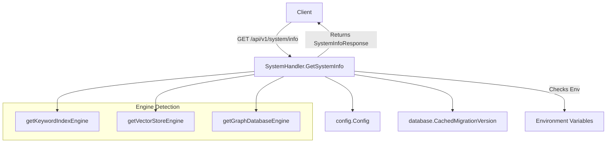
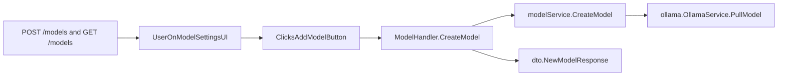
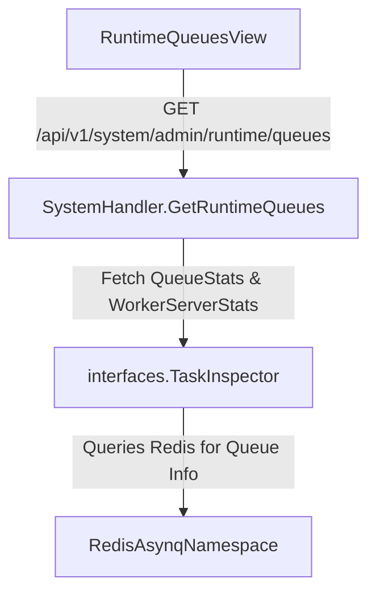
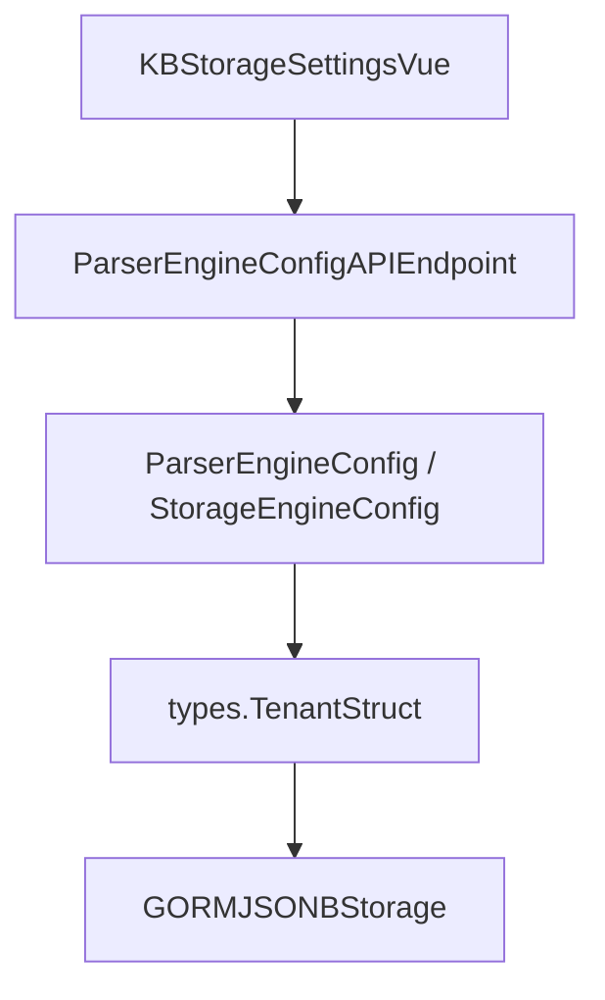

<!-- source: DeepWiki mcp.deepwiki.com · repo Tencent/WeKnora · page 6.5 Model and Configuration APIs · fetched 2026-10-29 -->

# Model and Configuration APIs

Relevant source files

The following files were used as context for generating this wiki page:

- [client/tenant.go](client/tenant.go)
- [frontend/src/api/initialization/index.ts](frontend/src/api/initialization/index.ts)
- [frontend/src/api/model/index.ts](frontend/src/api/model/index.ts)
- [frontend/src/api/system/index.ts](frontend/src/api/system/index.ts)
- [frontend/src/api/tenant/index.ts](frontend/src/api/tenant/index.ts)
- [frontend/src/components/ModelEditorDialog.vue](frontend/src/components/ModelEditorDialog.vue)
- [frontend/src/components/VectorStoreBadge.vue](frontend/src/components/VectorStoreBadge.vue)
- [frontend/src/components/modelSelectorClearability.test.ts](frontend/src/components/modelSelectorClearability.test.ts)
- [frontend/src/views/integrations/ApiIntegrationSettings.vue](frontend/src/views/integrations/ApiIntegrationSettings.vue)
- [frontend/src/views/knowledge/KnowledgeBaseEditorModal.vue](frontend/src/views/knowledge/KnowledgeBaseEditorModal.vue)
- [frontend/src/views/knowledge/settings/GraphSettings.vue](frontend/src/views/knowledge/settings/GraphSettings.vue)
- [frontend/src/views/knowledge/settings/KBAdvancedSettings.vue](frontend/src/views/knowledge/settings/KBAdvancedSettings.vue)
- [frontend/src/views/knowledge/settings/KBChunkingSettings.vue](frontend/src/views/knowledge/settings/KBChunkingSettings.vue)
- [frontend/src/views/knowledge/settings/KBModelConfig.vue](frontend/src/views/knowledge/settings/KBModelConfig.vue)
- [frontend/src/views/knowledge/settings/KBStorageSettings.vue](frontend/src/views/knowledge/settings/KBStorageSettings.vue)
- [frontend/src/views/knowledge/settings/KBVectorStoreSettings.vue](frontend/src/views/knowledge/settings/KBVectorStoreSettings.vue)
- [frontend/src/views/settings/McpSettings.vue](frontend/src/views/settings/McpSettings.vue)
- [frontend/src/views/settings/ModelSettings.vue](frontend/src/views/settings/ModelSettings.vue)
- [frontend/src/views/settings/VectorStoreSettings.vue](frontend/src/views/settings/VectorStoreSettings.vue)
- [frontend/src/views/settings/WebSearchSettings.vue](frontend/src/views/settings/WebSearchSettings.vue)
- [internal/application/service/model.go](internal/application/service/model.go)
- [internal/application/service/weknoracloud.go](internal/application/service/weknoracloud.go)
- [internal/handler/initialization.go](internal/handler/initialization.go)
- [internal/handler/model.go](internal/handler/model.go)
- [internal/handler/system.go](internal/handler/system.go)
- [internal/handler/tenant.go](internal/handler/tenant.go)
- [internal/types/model.go](internal/types/model.go)
- [internal/types/tenant.go](internal/types/tenant.go)
- [internal/types/weknoracloud.go](internal/types/weknoracloud.go)

This page provides a technical reference for the REST APIs that manage AI models, tenant-specific configurations (such as agents, conversations, parsers, and storage engines), and system-level metadata in WeKnora. These endpoints enable administrators and advanced users to configure and operate the underlying AI services supporting Retrieval-Augmented Generation (RAG) and Agentic pipelines.

---

## System Information and Engine Discovery

The system-level APIs expose deployment metadata, including version information, migration status, and runtime engine detection for vector stores, parsers, and graph databases.

### Implementation and Data Flow

The system handler aggregates deployment state from static configuration, migration version caches, and environment parameters:

Title: "System Information Aggregation Flow"

**Diagram Sources:**
- [frontend/src/api/system/index.ts:27-46]()
- [internal/handler/system.go:40-70]()

**Key Functions:**
- `GetSystemInfo` returns system version, build time, database version, migration status, and detected backend engines [frontend/src/api/system/index.ts:27-46]().
- Helper detection routines derive active engines by inspecting environment variables and configuration settings [internal/handler/system.go:40-70]().
- `GetRuntimeQueues` reports background task queues and worker metrics backed by `interfaces.TaskInspector` [internal/handler/system.go:35-61]().

Sources:
- [internal/handler/system.go:35-70]()
- [frontend/src/api/system/index.ts:27-46]()

---

## Model Management API

WeKnora supports multi-tenant model management via `ModelHandler` and `interfaces.ModelService`. Models are categorized by `types.ModelType`, `types.ModelSource`, and parameters `types.ModelParameters` [internal/types/model.go:14-115]().

### Natural Language Space to Code Entity Space: Model Creation

Title: "Model Creation Flow"

**Diagram Sources:**
- [internal/handler/model.go:71-132]()
- [internal/application/service/model.go:101-141]()
- [frontend/src/views/settings/ModelSettings.vue:53-57]()

### Implementation Details

- **SSRF Protection:** Model creation requests validate `BaseURL` against SSRF vulnerabilities [internal/handler/model.go:93-98]().
- **Asynchronous Ollama Downloads:** `modelService.CreateModel` initiates background model pulls when local sources are specified, tracking state transitions between active and failed [internal/application/service/model.go:101-141]().
- **Credential Injection:** `modelService.resolveWeKnoraCloudCredentials` automatically binds WeKnoraCloud credentials from workspace configurations if omitted [internal/application/service/model.go:69-96]().

Sources:
- [internal/handler/model.go:71-132]()
- [internal/application/service/model.go:69-141]()
- [internal/types/model.go:14-115]()

---

## Platform API Keys and Tenant API Principal Configurations

Platform-wide API keys and tenant-level API principal controls (such as header conventions, signed tokens, and HMAC secrets) are managed via designated admin routes [internal/handler/tenant.go:107-124]().

### Capability Model and Management Flow

- Capabilities for platform-scoped API keys are validated and enforced via `apiKeySvc.CreateAPIKey` [internal/handler/system.go:167-172]().
- System administrators manage platform keys using endpoints for listing (with masked secrets), creating, and revoking tokens [internal/handler/system.go:110-131]().
- API principal configurations enable tenants to customize authentication schemes and validation modes (`types.APIPrincipalMode`) [internal/handler/tenant.go:107-113]().

Sources:
- [internal/handler/system.go:110-172]()
- [internal/handler/tenant.go:107-113]()

---

## Runtime and Asynchronous Task Inspection

Background processing tasks (e.g., document parsing and chunk embedding) use Redis-backed `asynq` queues, inspected via system admin APIs.

Title: "Runtime Queue Inspection Flow"

**Diagram Sources:**
- [internal/handler/system.go:35-61]()

- Active task counts, retry counters, and recent errors are aggregated per queue.
- Programmatic cancellation, such as `CancelKnowledgeParse`, handles business state updates prior to purging queue entries [internal/handler/system.go:35-61]().

Sources:
- [internal/handler/system.go:35-61]()

---

## Engine Configuration APIs

WeKnora exposes APIs for configuring vector databases, storage backends, document parsers, and web search integrations.

### Vector and Storage Engines

- Storage providers include `local`, `minio`, `cos`, `tos`, `s3`, `oss`, `ks3`, and `obs` [frontend/src/api/system/index.ts:179-180]().
- Workspaces define default concrete instances via `DefaultStorageBackendID` [internal/types/tenant.go:113-114]().
- Retriever engines map to appropriate driver capabilities using `GetRetrieverEngineMapping()` [internal/types/tenant.go:16-57]().

### Natural Language Space to Code Entity Space: Storage and Engine Persistence

Title: "Storage Configuration Persistence Flow"

**Diagram Sources:**
- [frontend/src/views/knowledge/settings/KBStorageSettings.vue:33-60]()
- [internal/types/tenant.go:104-112]()

### Document Parsing Engines

- Parser engines are integrated via `ParserEngineConfig`, supporting DocReader and MinerU connection parameters [frontend/src/api/system/index.ts:115-146]().
- Endpoints like `getParserEngines`, `checkParserEngines`, and `updateParserEngineConfig` permit real-time validation and configuration updates [frontend/src/api/system/index.ts:156-171]().

Sources:
- [frontend/src/api/system/index.ts:115-180]()
- [internal/types/tenant.go:16-57]()

---

## Tenant Configuration APIs

Tenant-scoped settings leverage generic key-value stores and typed schema definitions.

### Prompt Templates and Workspace Settings

- Tenant settings expose prompt templates, retrieval properties, and web search configurations [frontend/src/api/system/index.ts:80-94]().
- The `Tenant` struct persists configurations within `gorm:"type:jsonb"` columns, isolating context rules, memory policies, and parser overrides per workspace [internal/types/tenant.go:104-122]().

Sources:
- [frontend/src/api/system/index.ts:80-94]()
- [internal/types/tenant.go:104-122]()

---

