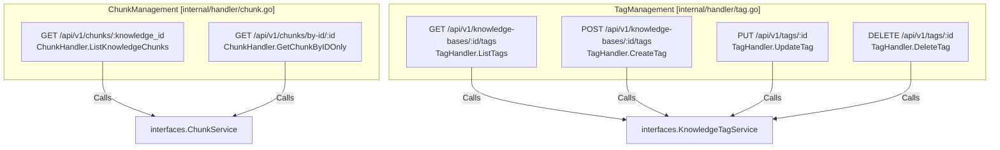
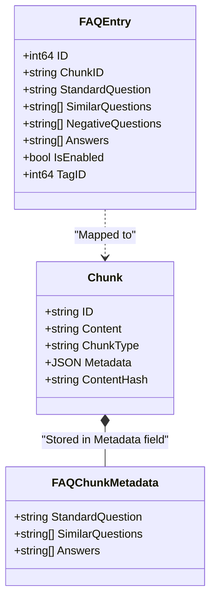
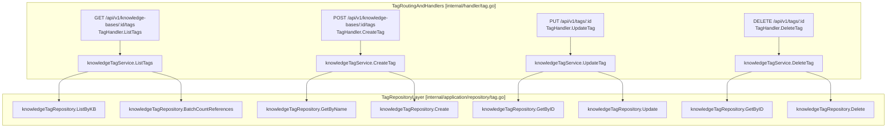

<!-- source: DeepWiki mcp.deepwiki.com · repo Tencent/WeKnora · page 6.6 FAQ and Chunk APIs · fetched 2026-10-29 -->

# FAQ and Chunk APIs

Relevant source files

The following files were used as context for generating this wiki page:

- [client/tag.go](client/tag.go)
- [internal/application/repository/tag.go](internal/application/repository/tag.go)
- [internal/application/service/tag.go](internal/application/service/tag.go)
- [internal/handler/chunk.go](internal/handler/chunk.go)
- [internal/handler/evaluation.go](internal/handler/evaluation.go)
- [internal/handler/message.go](internal/handler/message.go)
- [internal/handler/message_limit_cap_test.go](internal/handler/message_limit_cap_test.go)
- [internal/handler/message_session_not_found_test.go](internal/handler/message_session_not_found_test.go)
- [internal/handler/session/resource_urls.go](internal/handler/session/resource_urls.go)
- [internal/handler/session/stream.go](internal/handler/session/stream.go)
- [internal/handler/tag.go](internal/handler/tag.go)
- [internal/models/utils/ollama/ollama.go](internal/models/utils/ollama/ollama.go)
- [internal/storageurl/mode.go](internal/storageurl/mode.go)
- [internal/storageurl/storageurl.go](internal/storageurl/storageurl.go)
- [internal/storageurl/stream.go](internal/storageurl/stream.go)
- [internal/storageurl/stream_test.go](internal/storageurl/stream_test.go)
- [internal/types/interfaces/tag.go](internal/types/interfaces/tag.go)

This wiki page documents the REST API endpoints and backend implementations for managing **chunks** (document segments) and **FAQ entries** (question-answer pairs) within WeKnora knowledge bases. These APIs support full CRUD operations, batch processing, search, categorization, and metadata mapping.

For knowledge base management APIs, refer to [6.2 Knowledge Base Management APIs](). For document upload and processing, see [6.3 Knowledge and Document APIs](). For chat and retrieval operations, refer to [6.4 Chat and Query APIs]().

Sources: [internal/handler/chunk.go:31-43](), [internal/types/interfaces/tag.go:10-26]()

## API Overview

The following diagram illustrates the mapping from natural language REST request paths to backend handler structs and service interfaces, bridging natural language request routes to backend code entities.

**Diagram: API Endpoint Organization and Code Entities**

All endpoints require authentication via JWT Bearer token or API Key, validated by the authentication middleware layer. Access to specific knowledge bases is controlled via RBAC guards that resolve the effective tenant ID in the request context [internal/handler/chunk.go:18-23]().

Sources: [internal/handler/chunk.go:18-152](), [internal/types/interfaces/tag.go:10-26](), [internal/handler/tag.go:18-43]()

## Chunk Management APIs

Chunks represent the primary retrieval units stored in the database. Document ingestion splits raw files into chunks that are indexed into vector engines.

### List Chunks by Knowledge ID

**Endpoint:** `GET /api/v1/chunks/:knowledge_id`

Retrieves paginated chunks for a specific document via `ChunkHandler.ListKnowledgeChunks` [internal/handler/chunk.go:99-152](). Filters apply based on status and chunk type [internal/handler/chunk.go:128-134]().

- **Parameters:**
  - `knowledge_id` (path, required): Target document UUID [internal/handler/chunk.go:110-115]()
  - `page` (query, optional): Page index [internal/handler/chunk.go:118-123]()
  - `page_size` (query, optional): Page limit [internal/handler/chunk.go:127-132]()
  - `chunk_type` (query, optional): Filter by type (e.g., `text`, `image_caption`) [internal/handler/chunk.go:136-141]()

Sources: [internal/handler/chunk.go:99-152]()

### Get Chunk by ID

**Endpoint:** `GET /api/v1/chunks/by-id/:id`

Retrieves a single chunk by its identifier using `ChunkHandler.GetChunkByIDOnly` [internal/handler/chunk.go:55-85](). It performs lookups without tenant filtering when required for permission resolution in shared contexts [internal/handler/chunk.go:66-69]().

Sources: [internal/handler/chunk.go:55-85]()

## FAQ Entry Management APIs

FAQ entries are stored as specialized chunks within FAQ-type knowledge bases. Each entry bundles a standard question, similar variations, negative constraints, and answers.

### Data Structure Mapping

The following diagram details how high-level FAQ structures map to internal storage entities.

**Diagram: FAQ Entry to Code Entity Mapping**

The `FAQEntry` maps to an underlying `types.Chunk`. Specific FAQ attributes serialize into `Chunk.Metadata` as `types.FAQChunkMetadata`.

Sources: [internal/handler/chunk.go:87-91](), [client/tag.go:13-30]()

### List FAQ Entries

**Endpoint:** `GET /api/v1/knowledge-bases/:id/faq/entries`

Retrieves paginated FAQ entries with specific query filters through corresponding application handlers and repository methods.

- **Query Parameters:**
  - `keyword`: Search query matching questions or answers [client/tag.go:88-90]()
  - `tag_id`: Filter by tag classification [internal/application/repository/tag.go:145-166]()

Sources: [client/tag.go:76-105](), [internal/application/repository/tag.go:145-166]()

## FAQ Batch Operations

### Batch Import (Upsert)

**Endpoint:** `POST /api/v1/knowledge-bases/:id/faq/entries`

Asynchronously imports or updates FAQ entries via designated service endpoints, supporting dry-run configurations to validate entries without committing database writes.

Sources: [client/tag.go:107-122]()

### Export FAQ Entries

**Endpoint:** `GET /api/v1/knowledge-bases/:id/faq/entries/export`

Exports all FAQ entries associated with a knowledge base. The application service transforms chunk payloads into exportable formats.

Sources: [internal/application/repository/tag.go:94-136]()

## Tag Management

Tags organize both document knowledge and FAQ entries inside knowledge bases, coordinated by `TagHandler` and implemented via `knowledgeTagService` [internal/application/service/tag.go:21-34]().

### Tag Operations Data Flow

The following diagram bridges the tag endpoints to repository calls, associating natural language requests with specific code structures.

**Diagram: Tag Management Data Flow and Code Entities**

- **List Tags:** `GET /api/v1/knowledge-bases/:id/tags` — Retrieves tags and computes usage metrics via `knowledgeTagRepository.ListByKB` and `knowledgeTagRepository.BatchCountReferences` [internal/application/service/tag.go:66-108](), [internal/application/repository/tag.go:175-204]().
- **Create Tag:** `POST /api/v1/knowledge-bases/:id/tags` — Inserts a tag record with a distinct name and sort order using `knowledgeTagRepository.Create` [internal/application/service/tag.go:133-177](), [internal/application/repository/tag.go:23-25]().
- **Update Tag:** `PUT /api/v1/tags/:id` — Modifies metadata through `knowledgeTagRepository.Update` [internal/application/service/tag.go:186-223](), [internal/application/repository/tag.go:27-30]().
- **Delete Tag:** `DELETE /api/v1/tags/:id` — Removes tag records and unlinks references via `knowledgeTagRepository.Delete` [internal/application/repository/tag.go:138-143]().

Sources: [internal/application/service/tag.go:66-229](), [internal/application/repository/tag.go:23-143](), [internal/handler/tag.go:89-163]()

---

