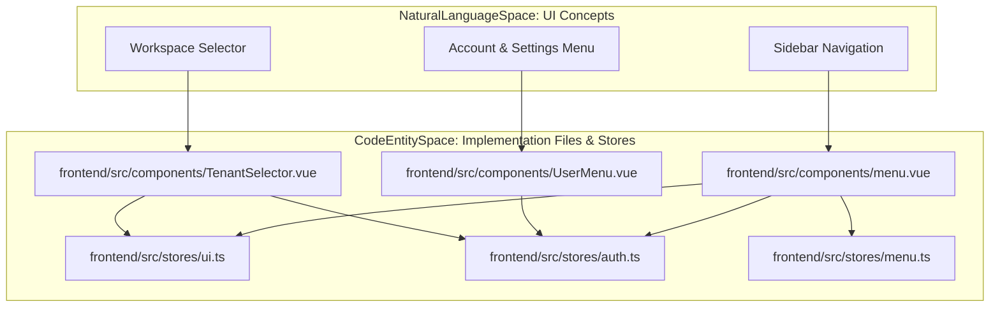

<!-- source: DeepWiki mcp.deepwiki.com · repo Tencent/WeKnora · page 7.1 Navigation and Menu System · fetched 2026-10-29 -->

# Navigation and Menu System

Relevant source files

The following files were used as context for generating this wiki page:

- [frontend/src/components/TenantSelector.vue](frontend/src/components/TenantSelector.vue)
- [frontend/src/components/UserMenu.vue](frontend/src/components/UserMenu.vue)
- [frontend/src/components/menu.vue](frontend/src/components/menu.vue)
- [frontend/src/i18n/locales/en-US.ts](frontend/src/i18n/locales/en-US.ts)
- [frontend/src/i18n/locales/ja-JP.ts](frontend/src/i18n/locales/ja-JP.ts)
- [frontend/src/i18n/locales/ko-KR.ts](frontend/src/i18n/locales/ko-KR.ts)
- [frontend/src/i18n/locales/ru-RU.ts](frontend/src/i18n/locales/ru-RU.ts)
- [frontend/src/i18n/locales/zh-CN.ts](frontend/src/i18n/locales/zh-CN.ts)
- [frontend/src/i18n/locales/zh-TW.ts](frontend/src/i18n/locales/zh-TW.ts)
- [frontend/src/utils/tenantSwitch.ts](frontend/src/utils/tenantSwitch.ts)
- [frontend/src/views/agent/AgentEditorModal.vue](frontend/src/views/agent/AgentEditorModal.vue)
- [frontend/src/views/agent/AgentList.vue](frontend/src/views/agent/AgentList.vue)
- [frontend/src/views/knowledge/KnowledgeBase.vue](frontend/src/views/knowledge/KnowledgeBase.vue)
- [frontend/src/views/knowledge/KnowledgeBaseList.vue](frontend/src/views/knowledge/KnowledgeBaseList.vue)
- [frontend/src/views/knowledge/components/FAQEntryManager.vue](frontend/src/views/knowledge/components/FAQEntryManager.vue)
- [frontend/src/views/knowledge/settings/DataSourceEditorDialog.test.ts](frontend/src/views/knowledge/settings/DataSourceEditorDialog.test.ts)
- [frontend/src/views/knowledge/settings/DataSourceEditorDialog.vue](frontend/src/views/knowledge/settings/DataSourceEditorDialog.vue)
- [frontend/src/views/organization/OrganizationList.vue](frontend/src/views/organization/OrganizationList.vue)
- [frontend/src/views/settings/Settings.vue](frontend/src/views/settings/Settings.vue)
- [frontend/src/views/settings/TenantInfo.vue](frontend/src/views/settings/TenantInfo.vue)
- [frontend/src/views/settings/settingsNavigation.test.ts](frontend/src/views/settings/settingsNavigation.test.ts)
- [internal/application/repository/tenant.go](internal/application/repository/tenant.go)
- [internal/application/repository/tenant_member.go](internal/application/repository/tenant_member.go)
- [internal/application/repository/tenant_test.go](internal/application/repository/tenant_test.go)
- [internal/application/service/tenant_member.go](internal/application/service/tenant_member.go)
- [internal/application/service/tenant_member_test.go](internal/application/service/tenant_member_test.go)
- [internal/application/service/user_provisioning_test.go](internal/application/service/user_provisioning_test.go)
- [internal/types/interfaces/tenant_member.go](internal/types/interfaces/tenant_member.go)
- [internal/utils/crypto_test.go](internal/utils/crypto_test.go)
- [website-docs/03-features/10-datasource.md](website-docs/03-features/10-datasource.md)

## Purpose and Scope

The Navigation and Menu System serves as the primary structural interface for WeKnora's frontend application (`frontend/`). It manages layout states, collapsible sidebar rendering (`[frontend/src/components/menu.vue:2-59]()`), workspace switching, user profile actions, session list organization, and client-side routing (`[frontend/src/router/index.ts:44-184]()`). This system enforces multi-tenant access control, role-based visibility, and adapts between Standard and Lite deployment modes.

Sources: `[frontend/src/components/menu.vue:2-59](), [frontend/src/router/index.ts:44-184]()`

---

## Component Architecture and UI Flow

The navigation system integrates Vue components with Pinia state management stores to control layout dimensions, authentication context, and menu items.

### Component to Code Entity Mapping

The following diagram bridges high-level UI concepts to their concrete implementation classes, components, and store files:

- `menu.vue`: Renders the main collapsible sidebar, logo row (`[frontend/src/components/menu.vue:4-31]()`), command search trigger (`[frontend/src/components/menu.vue:17-21]()`), and top menu items (`[frontend/src/components/menu.vue:97-110]()`).
- `UserMenu.vue`: Manages the user profile dropdown, displaying user information, tenant details, and quick navigation links to settings and administration pages (`[frontend/src/components/UserMenu.vue:1-133]()`).
- `TenantSelector.vue`: Provides a dropdown for switching between different tenants/workspaces, visible only when `canAccessAllTenants` is true (`[frontend/src/components/menu.vue:59]()`).
- `useUIStore`: Tracks `sidebarCollapsed` boolean state and toggles layout resizing (`[frontend/src/components/menu.vue:2-64]()`).
- `useAuthStore`: Exposes tenant memberships, active roles (`isSystemAdmin`, `canAccessAllTenants`), and deployment edition flags (`isLiteMode`) (`[frontend/src/components/UserMenu.vue:124]()`).

Sources: `[frontend/src/components/menu.vue:2-110](), [frontend/src/components/UserMenu.vue:1-133]()`

---

## Menu Structure, Visibility Rules, and Data Models

Menu items are centralized inside `useMenuStore` and rendered dynamically by `menu.vue` (`[frontend/src/components/menu.vue:97-110]()`).

### Primary Navigation Mapping

| Menu Identifier | Icon Resource | Visibility & Access Control Rule | Target View / Route |
|---|---|---|---|
| `creatChat` | `prefixIcon` | Always visible; initiates a new conversation session. | `/platform/creatChat` |
| `knowledge-bases` | `zhishiku` | Always visible; links to document and knowledge base management. | `/platform/knowledge-bases` |
| `agents` | `agent` | Visible if user has `agents` capability or required role. | `/platform/agents` |
| `organizations` | `organization` | Hidden in Lite mode or for users lacking admin permissions; displays pending join request counts (`[frontend/src/components/menu.vue:105-106]()`). | `/platform/organizations` |
| `settings` | `setting` | Always visible; links to configuration dashboards. | `/platform/settings` |
| `automation` | `automationIcon` | Visible if the automation feature is enabled. | `/platform/automations` |
| `toolbox` | `toolboxIcon` | Visible if the toolbox feature is enabled. | `/platform/toolbox` |
| `artifact` | `artifactIcon` | Visible if the artifact feature is enabled. | `/platform/artifacts` |

Sources: `[frontend/src/components/menu.vue:97-110](), [frontend/src/i18n/locales/zh-CN.ts:127-129](), [frontend/src/i18n/locales/en-US.ts:127-129](), [frontend/src/i18n/locales/ko-KR.ts:127-130](), [frontend/src/i18n/locales/ja-JP.ts:127-130](), [frontend/src/i18n/locales/ru-RU.ts:127-129]()`

---

## Session Management and Routing Structure

### Session Management UI

Chat sessions are grouped and rendered beneath the primary navigation items in `menu.vue`.
- `useMenuStore` provides methods to dynamically update session headings upon generation or renaming.
- Contextual actions include session renaming, message clearing, and bucket filtering.

Sources: `[frontend/src/components/menu.vue:97-110]()`

### Routing and Access Control Integration

Routing and server-side authorization mechanisms are mapped in the routing and middleware layers:

```mermaid
graph TB
    subgraph "NaturalLanguageSpace: Routing & Security"
        PlatformRoot["Platform Main Workspace"]
        SystemAdminRoute["System Administration View"]
        AuthGuards["Authentication & RBAC Guards"]
        KnowledgeBaseRoute["Knowledge Base Management"]
        AgentListRoute["Agent List"]
        FAQEntryManagerRoute["FAQ Entry Management"]
    end

    subgraph "CodeEntitySpace: Router & Middleware"
        RouterIndex["frontend/src/router/index.ts"]
        AuthMiddleware["internal/middleware/auth.go"]
        KnowledgeBaseVue["frontend/src/views/knowledge/KnowledgeBase.vue"]
        KnowledgeBaseListVue["frontend/src/views/knowledge/KnowledgeBaseList.vue"]
        AgentListVue["frontend/src/views/agent/AgentList.vue"]
        AgentEditorModalVue["frontend/src/views/agent/AgentEditorModal.vue"]
        FAQEntryManagerVue["frontend/src/views/knowledge/components/FAQEntryManager.vue"]
    end

    PlatformRoot --> RouterIndex
    SystemAdminRoute --> RouterIndex
    AuthGuards --> AuthMiddleware
    KnowledgeBaseRoute --> KnowledgeBaseVue
    KnowledgeBaseRoute --> KnowledgeBaseListVue
    AgentListRoute --> AgentListVue
    AgentListRoute --> AgentEditorModalVue
    FAQEntryManagerRoute --> FAQEntryManagerVue
```

- `router/index.ts`: Defines `/platform` layout routes, handling nested views for knowledge bases, agents, settings, and chat (`[frontend/src/router/index.ts:44-184]()`).
- `internal/middleware/auth.go`: Enforces JWT validation via `Auth()` middleware, tenant resolution via `X-Tenant-ID` headers or claims, and restricts system administration endpoints (`[internal/router/router.go:1-154]()`).
- `KnowledgeBaseList.vue`: Displays a list of knowledge bases, handling creation, sorting, and filtering (`[frontend/src/views/knowledge/KnowledgeBaseList.vue:1-121]()`).
- `KnowledgeBase.vue`: Manages the detailed view of a single knowledge base, including document management, wiki, and gallery tabs (`[frontend/src/views/knowledge/KnowledgeBase.vue:1-150]()`).
- `AgentList.vue`: Presents a list of agents, supporting creation, sorting, and filtering (`[frontend/src/views/agent/AgentList.vue:1-113]()`).
- `AgentEditorModal.vue`: Provides an interface for creating and editing agent configurations (`[frontend/src/views/agent/AgentEditorModal.vue:1-135]()`).
- `FAQEntryManager.vue`: Specifically handles the management of FAQ entries within a knowledge base (`[frontend/src/views/knowledge/components/FAQEntryManager.vue:1-127]()`).

Sources: `[frontend/src/router/index.ts:44-184](), [internal/router/router.go:1-154](), [frontend/src/views/knowledge/KnowledgeBaseList.vue:1-121](), [frontend/src/views/knowledge/KnowledgeBase.vue:1-150](), [frontend/src/views/agent/AgentList.vue:1-113](), [frontend/src/views/agent/AgentEditorModal.vue:1-135](), [frontend/src/views/knowledge/components/FAQEntryManager.vue:1-127]()`

---

## Global Command Palette and Quick Navigation

WeKnora features an integrated command search palette accessible across the application:
- Triggered via `Cmd/Ctrl + K` or by clicking the search icon button in the header (`[frontend/src/components/menu.vue:17-21](), [frontend/src/components/menu.vue:64-80]()`).
- Managed via `commandPaletteStore`, allowing users to jump directly to resources, knowledge bases, or agents without navigating deep hierarchical menus.

Sources: `[frontend/src/components/menu.vue:17-80]()`

---

