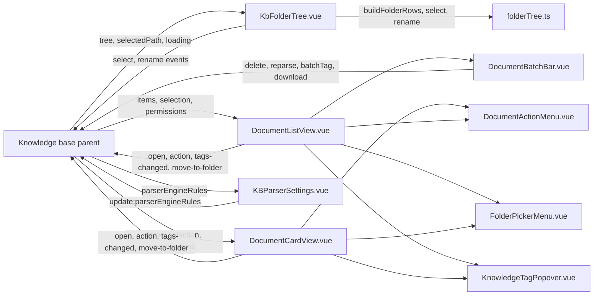
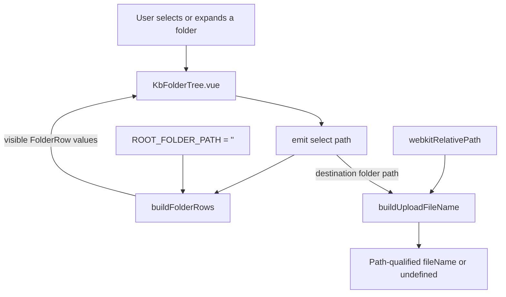
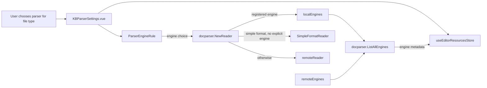

<!-- source: DeepWiki mcp.deepwiki.com · repo Tencent/WeKnora · page 7.2 Knowledge Base Interface · fetched 2026-10-29 -->

# Knowledge Base Interface

Relevant source files

The following files were used as context for generating this wiki page:

- [frontend/src/assets/img/toolbox-green.svg](frontend/src/assets/img/toolbox-green.svg)
- [frontend/src/assets/img/toolbox.svg](frontend/src/assets/img/toolbox.svg)
- [frontend/src/composables/useModalShell.test.ts](frontend/src/composables/useModalShell.test.ts)
- [frontend/src/composables/useModalShell.ts](frontend/src/composables/useModalShell.ts)
- [frontend/src/views/knowledge/components/BatchTagDialog.test.ts](frontend/src/views/knowledge/components/BatchTagDialog.test.ts)
- [frontend/src/views/knowledge/components/BatchTagDialog.vue](frontend/src/views/knowledge/components/BatchTagDialog.vue)
- [frontend/src/views/knowledge/components/DocumentBatchBar.vue](frontend/src/views/knowledge/components/DocumentBatchBar.vue)
- [frontend/src/views/knowledge/components/DocumentCardView.vue](frontend/src/views/knowledge/components/DocumentCardView.vue)
- [frontend/src/views/knowledge/components/DocumentListView.vue](frontend/src/views/knowledge/components/DocumentListView.vue)
- [frontend/src/views/knowledge/components/KbFolderTree.test.ts](frontend/src/views/knowledge/components/KbFolderTree.test.ts)
- [frontend/src/views/knowledge/components/KbFolderTree.vue](frontend/src/views/knowledge/components/KbFolderTree.vue)
- [frontend/src/views/knowledge/folderTree.test.ts](frontend/src/views/knowledge/folderTree.test.ts)
- [frontend/src/views/knowledge/folderTree.ts](frontend/src/views/knowledge/folderTree.ts)
- [frontend/src/views/knowledge/settings/KBParserSettings.vue](frontend/src/views/knowledge/settings/KBParserSettings.vue)
- [internal/infrastructure/docparser/engine_registry.go](internal/infrastructure/docparser/engine_registry.go)

## Purpose and Scope

Section 7.2 describes the knowledge-base document-management interface: folder navigation, document list and card presentations, batch actions, and parser-engine settings. The available source excerpts also show how folder paths are prepared for uploads. They do not include the knowledge-base editor’s full implementation or the image-gallery components, so those areas cannot be documented here at code-level detail.

Sources: `frontend/src/views/knowledge/components/DocumentListView.vue:1-85`, `frontend/src/views/knowledge/components/DocumentCardView.vue:1-84`, `frontend/src/views/knowledge/components/KbFolderTree.vue:1-174`, `frontend/src/views/knowledge/folderTree.ts:1-105`, `frontend/src/views/knowledge/settings/KBParserSettings.vue:1-161`

---

## Component Architecture

The available components divide document management into a folder sidebar, list or card views, and batch-action controls. The views communicate user actions through emitted events; their parent supplies the document items, selection state, permissions, and move-flow state. `KBParserSettings` separately presents parser rules and emits updated rules to its parent.

**Diagram: Knowledge-base UI components and event boundaries**

Sources: `frontend/src/views/knowledge/components/KbFolderTree.vue:136-166`, `frontend/src/views/knowledge/components/DocumentListView.vue:38-85`, `frontend/src/views/knowledge/components/DocumentCardView.vue:40-84`, `frontend/src/views/knowledge/components/DocumentBatchBar.vue:6-35`, `frontend/src/views/knowledge/settings/KBParserSettings.vue:102-118`

---

## Folder Sidebar and Document Organization

`KbFolderTree.vue` renders the folder tree as an `aside`. Its props include the knowledge-base folder tree, selected path, loading and collapsed state, and edit permission. It emits folder selection, collapse-state updates, and rename requests. Rows are keyboard-selectable; folders with children have a separate expand/collapse control. Rename controls are shown only for editable folder rows, not for the root row. [frontend/src/views/knowledge/components/KbFolderTree.vue:1-31]() [frontend/src/views/knowledge/components/KbFolderTree.vue:40-69]() [frontend/src/views/knowledge/components/KbFolderTree.vue:80-129]() [frontend/src/views/knowledge/components/KbFolderTree.vue:148-166]()

The underlying `folderTree.ts` helpers treat the empty string as the root path. `buildFolderRows` returns a root row and, when expanded, recursively flattened child rows. Each row keeps both a direct document count and a recursive total; this distinction lets a folder that contains only subfolders show its subtree count rather than appearing empty. `folderAncestorPaths` provides the root-to-selection path sequence used to expose a selected nested folder. [frontend/src/views/knowledge/folderTree.ts:3-18]() [frontend/src/views/knowledge/folderTree.ts:36-49]() [frontend/src/views/knowledge/folderTree.ts:95-105]() [frontend/src/views/knowledge/folderTree.ts:113-157]() [frontend/src/views/knowledge/folderTree.ts:185-198]()

`DocumentListView.vue` and `DocumentCardView.vue` accept direct subfolders as well as document items. Both describe a file-manager ordering in which subfolders precede documents; callers can pass an empty subfolder list while filtering across the subtree. Both views also accept folder options and expose folder navigation and move-to-folder events. [frontend/src/views/knowledge/components/DocumentListView.vue:38-60]() [frontend/src/views/knowledge/components/DocumentListView.vue:70-85]() [frontend/src/views/knowledge/components/DocumentCardView.vue:40-69]() [frontend/src/views/knowledge/components/DocumentCardView.vue:71-84]()

Sources: `frontend/src/views/knowledge/components/KbFolderTree.vue:1-31`, `frontend/src/views/knowledge/components/KbFolderTree.vue:40-69`, `frontend/src/views/knowledge/components/KbFolderTree.vue:80-129`, `frontend/src/views/knowledge/components/KbFolderTree.vue:136-166`, `frontend/src/views/knowledge/folderTree.ts:3-18`, `frontend/src/views/knowledge/folderTree.ts:36-49`, `frontend/src/views/knowledge/folderTree.ts:95-105`, `frontend/src/views/knowledge/folderTree.ts:113-157`, `frontend/src/views/knowledge/folderTree.ts:185-198`, `frontend/src/views/knowledge/components/DocumentListView.vue:38-85`, `frontend/src/views/knowledge/components/DocumentCardView.vue:40-84`

---

## Document List View, Card View, and Batch Operations

### Tabular List View (`DocumentListView.vue`)

`DocumentListView.vue` receives `items`, `kbId`, `selectedIds`, edit/download/mutation permissions, trace visibility, folder options, subfolders, and move-flow state. Its event contract lets the parent handle opening a document, toggling row or all-row selection, invoking document actions, probing traces, reacting to tag changes, navigating folders, and confirming folder moves. [frontend/src/views/knowledge/components/DocumentListView.vue:18-36]() [frontend/src/views/knowledge/components/DocumentListView.vue:38-85]()

The view maps source channels to localized labels and icons. The shown mappings include connectors such as Feishu, Notion, Yuque, Confluence, GitLab, Slack, and IM; URL and manual items receive their own labels, with upload as the fallback. `computeStatus` begins by checking `shownStall`, distinguishes queued and stalled items, and reports pending or processing parses as active processing. The available excerpt ends during this function, so it does not establish the complete status mapping. [frontend/src/views/knowledge/components/DocumentListView.vue:104-125]() [frontend/src/views/knowledge/components/DocumentListView.vue:127-160]()

### Card Grid View (`DocumentCardView.vue`)

`DocumentCardView.vue` accepts a similar item and permission model, with additional `batchMode` and trace-availability state. It computes formatted snippets from item descriptions and tracks the currently active action-menu index and folder-picker item locally. For parse status, it treats `pending`, `processing`, and `finalizing` as in-flight; trace access is available during those states or when the parent marks a trace available for the item. [frontend/src/views/knowledge/components/DocumentCardView.vue:14-38]() [frontend/src/views/knowledge/components/DocumentCardView.vue:40-69]() [frontend/src/views/knowledge/components/DocumentCardView.vue:86-123]()

### Batch Operation Toolbar (`DocumentBatchBar.vue`)

`DocumentBatchBar.vue` displays when it is explicitly visible or at least one item is selected. It emits events rather than performing document mutations itself. The toolbar exposes selection clearing and “select loaded” actions, and conditionally renders download, reparse, tag, move-to-folder, and delete controls according to the supplied permissions and folder availability. Download is disabled for zero selections, selections over 200 items, or while another batch operation is active. [frontend/src/views/knowledge/components/DocumentBatchBar.vue:6-35]() [frontend/src/views/knowledge/components/DocumentBatchBar.vue:37-63]() [frontend/src/views/knowledge/components/DocumentBatchBar.vue:65-109]()

Batch tagging is presented by `BatchTagDialog.vue`. When opened, the dialog initializes its selected tag IDs from `preSelectedTagIds`; it embeds `KnowledgeTagPicker`, emits tag-change notifications, and emits the selected IDs when confirmed. Confirm and close actions are blocked while confirmation or tag operations are busy. [frontend/src/views/knowledge/components/BatchTagDialog.vue:14-29]() [frontend/src/views/knowledge/components/BatchTagDialog.vue:33-63]()

Sources: `frontend/src/views/knowledge/components/DocumentListView.vue:18-36`, `frontend/src/views/knowledge/components/DocumentListView.vue:38-85`, `frontend/src/views/knowledge/components/DocumentListView.vue:104-160`, `frontend/src/views/knowledge/components/DocumentCardView.vue:14-38`, `frontend/src/views/knowledge/components/DocumentCardView.vue:40-69`, `frontend/src/views/knowledge/components/DocumentCardView.vue:86-123`, `frontend/src/views/knowledge/components/DocumentBatchBar.vue:6-35`, `frontend/src/views/knowledge/components/DocumentBatchBar.vue:37-109`, `frontend/src/views/knowledge/components/BatchTagDialog.vue:14-63`

---

## Upload Folder Paths and Folder Moves

The folder utilities define the path convention used by the upload flow. `isFolderUpload` identifies directory-sourced browser files by the presence of `webkitRelativePath`. `buildUploadFileName` combines an optional destination folder with the picked directory path and filename; for a plain single-file upload to the root it returns `undefined`, preserving the prior unqualified filename behavior. [frontend/src/views/knowledge/folderTree.ts:20-24]() [frontend/src/views/knowledge/folderTree.ts:51-80]()

The folder sidebar’s root path is `''`, and the frontend constants document limits of 16 path segments, 128 characters per segment, and 1024 characters per path, kept in sync with server-side limits. The supplied excerpts do not include the upload dialog or request call site, so they show how the path-qualified filename is prepared but not how upload requests are submitted. [frontend/src/views/knowledge/folderTree.ts:11-18]() [frontend/src/views/knowledge/folderTree.ts:61-80]()

Folder moves are exposed through the list and card event contracts. The batch toolbar’s folder picker is a popup; confirming a selected path closes it and emits `moveToFolder`. The parent owns the resulting operation. [frontend/src/views/knowledge/components/DocumentListView.vue:70-85]() [frontend/src/views/knowledge/components/DocumentCardView.vue:71-84]() [frontend/src/views/knowledge/components/DocumentBatchBar.vue:82-95]()

Sources: `frontend/src/views/knowledge/folderTree.ts:11-24`, `frontend/src/views/knowledge/folderTree.ts:51-80`, `frontend/src/views/knowledge/components/DocumentListView.vue:70-85`, `frontend/src/views/knowledge/components/DocumentCardView.vue:71-84`, `frontend/src/views/knowledge/components/DocumentBatchBar.vue:82-95`

---

## Parser Settings and File-Type Rules (`KBParserSettings.vue`)

`KBParserSettings.vue` accepts `parserEngineRules`, an `embedded` layout option, and optional `relevantExtensions`, then emits `update:parserEngineRules`. It uses `useEditorResourcesStore` and keeps local engine rules, parser-engine metadata, and loading state. The component builds a set of supported extensions from the engine metadata and groups recognized types into UI categories, including PDF, Word, PowerPoint, Excel, e-book, web archive, CSV, Markdown, text, JSON, image, and audio groups. [frontend/src/views/knowledge/settings/KBParserSettings.vue:68-123]() [frontend/src/views/knowledge/settings/KBParserSettings.vue:125-161]()

For each group, the UI offers an engine selector populated from the component’s engine-option helpers. If the group includes `xlsx` and the selected engine is `builtin`, it displays the first-row-as-header option. When no engine is available for a group, it shows a warning and a link to parser settings. The available excerpt does not include the component’s remaining script, so it does not establish the exact resource-loading call or rule-update implementation. [frontend/src/views/knowledge/settings/KBParserSettings.vue:32-60]() [frontend/src/views/knowledge/settings/KBParserSettings.vue:68-123]()

On the backend, `docparser.ListAllEngines` merges locally registered engines with engines discovered from the remote docreader. Local engines are included with availability checks; matching remote entries can override file types and descriptions, while remote-only engines are appended. `NewReader` uses a registered engine when found, selects `SimpleFormatReader` for eligible simple formats with no explicit engine, and otherwise routes to the remote reader. [internal/infrastructure/docparser/engine_registry.go:63-88]() [internal/infrastructure/docparser/engine_registry.go:90-145]()

Sources: `frontend/src/views/knowledge/settings/KBParserSettings.vue:32-60`, `frontend/src/views/knowledge/settings/KBParserSettings.vue:68-161`, `internal/infrastructure/docparser/engine_registry.go:63-88`, `internal/infrastructure/docparser/engine_registry.go:90-145`

---

## Image Gallery

The image-gallery implementation files are not included in the supplied source excerpts. Consequently, this page cannot verify the gallery’s component structure, image retrieval and caching behavior, viewer interactions, or backend query flow.

Sources: No image-gallery implementation source was provided.

---

## Architectural Bridges: Natural Language Space to Code Entity Space

### Bridge Diagram 1: Folder Navigation and Upload Naming

This diagram connects user-facing folder tasks to the concrete frontend symbols in the supplied implementation: selecting a folder, flattening tree rows, and constructing a path-qualified upload filename. [frontend/src/views/knowledge/components/KbFolderTree.vue:136-166]() [frontend/src/views/knowledge/folderTree.ts:51-80]() [frontend/src/views/knowledge/folderTree.ts:113-157]()

**Diagram: Folder selection to path-qualified filename**

Sources: `frontend/src/views/knowledge/components/KbFolderTree.vue:136-166`, `frontend/src/views/knowledge/folderTree.ts:51-80`, `frontend/src/views/knowledge/folderTree.ts:113-157`

### Bridge Diagram 2: Parser Settings to Reader Selection

This diagram maps the user-facing parser-engine selector to the backend registry entities that enumerate engines and select a reader. It expresses the documented component and registry boundaries; the supplied frontend excerpt does not show the exact API call connecting them. [frontend/src/views/knowledge/settings/KBParserSettings.vue:32-60]() [frontend/src/views/knowledge/settings/KBParserSettings.vue:68-123]() [internal/infrastructure/docparser/engine_registry.go:63-88]() [internal/infrastructure/docparser/engine_registry.go:90-145]()

**Diagram: Parser engine configuration and backend registry**

Sources: `frontend/src/views/knowledge/settings/KBParserSettings.vue:32-60`, `frontend/src/views/knowledge/settings/KBParserSettings.vue:68-123`, `internal/infrastructure/docparser/engine_registry.go:63-88`, `internal/infrastructure/docparser/engine_registry.go:90-145`

---

## References and Coverage Notes

The supplied excerpts document the folder tree, document list and card component contracts, batch controls, parser settings interface, folder path helpers, and backend parser registry. They do not include the knowledge-base editor’s parent view, the upload dialog/request call site, or image-gallery implementation files; those details are intentionally left unspecified. [frontend/src/views/knowledge/components/DocumentListView.vue:38-85]() [frontend/src/views/knowledge/components/DocumentCardView.vue:40-84]() [frontend/src/views/knowledge/components/DocumentBatchBar.vue:6-35]() [frontend/src/views/knowledge/settings/KBParserSettings.vue:102-123]() [frontend/src/views/knowledge/folderTree.ts:51-80]() [internal/infrastructure/docparser/engine_registry.go:63-145]()

Sources: `frontend/src/views/knowledge/components/DocumentListView.vue:38-85`, `frontend/src/views/knowledge/components/DocumentCardView.vue:40-84`, `frontend/src/views/knowledge/components/DocumentBatchBar.vue:6-35`, `frontend/src/views/knowledge/settings/KBParserSettings.vue:102-123`, `frontend/src/views/knowledge/folderTree.ts:51-80`, `internal/infrastructure/docparser/engine_registry.go:63-145`

---

