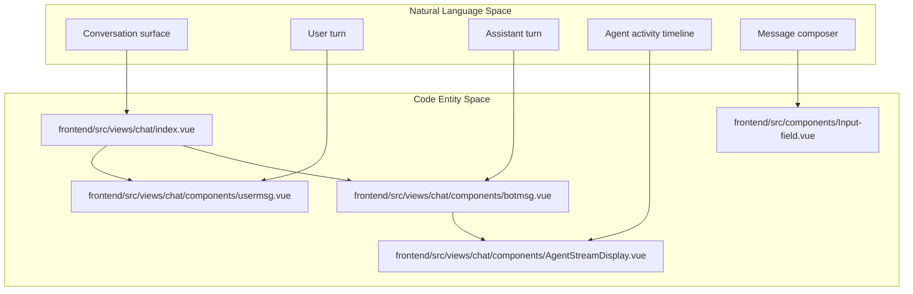
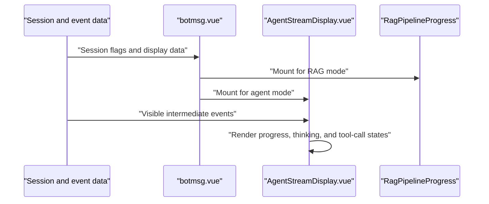
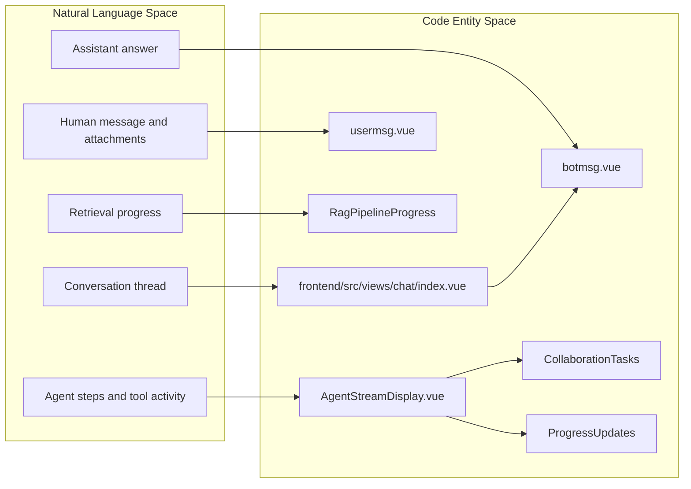

<!-- source: DeepWiki mcp.deepwiki.com · repo Tencent/WeKnora · page 7.3 Chat Interface and Agent Display · fetched 2026-10-29 -->

# Chat Interface and Agent Display

Relevant source files

The following files were used as context for generating this wiki page:

- [frontend/src/assets/img/screenshot-1.svg](frontend/src/assets/img/screenshot-1.svg)
- [frontend/src/assets/img/screenshot-2.svg](frontend/src/assets/img/screenshot-2.svg)
- [frontend/src/assets/img/screenshot-3.svg](frontend/src/assets/img/screenshot-3.svg)
- [frontend/src/assets/img/screenshot-4.svg](frontend/src/assets/img/screenshot-4.svg)
- [frontend/src/components/AgentSelector.vue](frontend/src/components/AgentSelector.vue)
- [frontend/src/components/GlobalCommandPalette/useHighlight.ts](frontend/src/components/GlobalCommandPalette/useHighlight.ts)
- [frontend/src/components/Input-field.vue](frontend/src/components/Input-field.vue)
- [frontend/src/components/css/chat-markdown.less](frontend/src/components/css/chat-markdown.less)
- [frontend/src/components/css/chat-timeline-loading.less](frontend/src/components/css/chat-timeline-loading.less)
- [frontend/src/components/css/chat-timeline-loading.test.mjs](frontend/src/components/css/chat-timeline-loading.test.mjs)
- [frontend/src/components/doc-content.vue](frontend/src/components/doc-content.vue)
- [frontend/src/components/knowledge-processing-timeline.vue](frontend/src/components/knowledge-processing-timeline.vue)
- [frontend/src/components/manual-knowledge-editor.vue](frontend/src/components/manual-knowledge-editor.vue)
- [frontend/src/components/settings/SettingDrawer.vue](frontend/src/components/settings/SettingDrawer.vue)
- [frontend/src/hooks/useKnowledgeBase.ts](frontend/src/hooks/useKnowledgeBase.ts)
- [frontend/src/types/tool-results.ts](frontend/src/types/tool-results.ts)
- [frontend/src/utils/_repro_gap.mjs](frontend/src/utils/_repro_gap.mjs)
- [frontend/src/utils/agent-readiness.test.mjs](frontend/src/utils/agent-readiness.test.mjs)
- [frontend/src/utils/agent-readiness.ts](frontend/src/utils/agent-readiness.ts)
- [frontend/src/utils/chatMarkdownRenderer.test.ts](frontend/src/utils/chatMarkdownRenderer.test.ts)
- [frontend/src/utils/chatMarkdownRenderer.ts](frontend/src/utils/chatMarkdownRenderer.ts)
- [frontend/src/utils/chatMessageShared.ts](frontend/src/utils/chatMessageShared.ts)
- [frontend/src/utils/citationMarkdown.ts](frontend/src/utils/citationMarkdown.ts)
- [frontend/src/utils/knowledgeTrace.test.ts](frontend/src/utils/knowledgeTrace.test.ts)
- [frontend/src/utils/knowledgeTrace.ts](frontend/src/utils/knowledgeTrace.ts)
- [frontend/src/utils/mermaidShared.ts](frontend/src/utils/mermaidShared.ts)
- [frontend/src/utils/mermaidStreaming.test.ts](frontend/src/utils/mermaidStreaming.test.ts)
- [frontend/src/utils/mermaidStreaming.ts](frontend/src/utils/mermaidStreaming.ts)
- [frontend/src/views/chat/components/AgentStreamDisplay.vue](frontend/src/views/chat/components/AgentStreamDisplay.vue)
- [frontend/src/views/chat/components/ToolResultRenderer.vue](frontend/src/views/chat/components/ToolResultRenderer.vue)
- [frontend/src/views/chat/components/botmsg.vue](frontend/src/views/chat/components/botmsg.vue)
- [frontend/src/views/chat/components/tool-results/ContentPopup.vue](frontend/src/views/chat/components/tool-results/ContentPopup.vue)
- [frontend/src/views/chat/components/tool-results/GrepResults.vue](frontend/src/views/chat/components/tool-results/GrepResults.vue)
- [frontend/src/views/chat/components/tool-results/SearchResults.vue](frontend/src/views/chat/components/tool-results/SearchResults.vue)
- [frontend/src/views/chat/components/usermsg.vue](frontend/src/views/chat/components/usermsg.vue)
- [frontend/src/views/chat/index.vue](frontend/src/views/chat/index.vue)
- [frontend/src/views/dev/MarkdownTestPage.vue](frontend/src/views/dev/MarkdownTestPage.vue)
- [frontend/src/views/platform/index.vue](frontend/src/views/platform/index.vue)
- [internal/application/service/knowledge_post_process_trace_test.go](internal/application/service/knowledge_post_process_trace_test.go)

## Purpose and Scope

This page describes the frontend chat surface: its message and input components, the branch between standard answers and agent timelines, the visible agent-event types, and the rendering and update behavior supported by the provided code. It focuses on `frontend/src/views/chat/index.vue`, `botmsg.vue`, `usermsg.vue`, `AgentStreamDisplay.vue`, and `Input-field.vue`. [frontend/src/views/chat/index.vue:1-101](), [frontend/src/views/chat/components/botmsg.vue:1-55](), [frontend/src/views/chat/components/usermsg.vue:1-80](), [frontend/src/views/chat/components/AgentStreamDisplay.vue:1-116](), [frontend/src/components/Input-field.vue:1-42]()

Sources: [frontend/src/views/chat/index.vue:1-101](), [frontend/src/views/chat/components/botmsg.vue:1-55](), [frontend/src/views/chat/components/usermsg.vue:1-80](), [frontend/src/views/chat/components/AgentStreamDisplay.vue:1-116](), [frontend/src/components/Input-field.vue:1-42]()

## Component Architecture

The chat view organizes the conversation thread and composer, while message components render user and assistant turns. `botmsg.vue` conditionally mounts `AgentStreamDisplay` for agent-mode sessions; `usermsg.vue` presents user content and attachments. The input component is `Input-field.vue`. [frontend/src/views/chat/index.vue:28-53](), [frontend/src/views/chat/components/botmsg.vue:17-54](), [frontend/src/views/chat/components/usermsg.vue:1-35](), [frontend/src/components/Input-field.vue:1-42]()

### Component Hierarchy and Code Mapping

The diagram maps user-facing concepts to concrete component names. It distinguishes what the provided templates show from backend or store behavior not established by the excerpts. [frontend/src/views/chat/index.vue:28-53](), [frontend/src/views/chat/components/botmsg.vue:17-54](), [frontend/src/views/chat/components/usermsg.vue:1-35](), [frontend/src/components/Input-field.vue:19-42](), [frontend/src/views/chat/components/AgentStreamDisplay.vue:1-8]()

**Diagram: Chat concepts mapped to frontend code entities**

Sources: [frontend/src/views/chat/index.vue:28-53](), [frontend/src/views/chat/components/botmsg.vue:17-54](), [frontend/src/views/chat/components/usermsg.vue:1-35](), [frontend/src/components/Input-field.vue:19-42](), [frontend/src/views/chat/components/AgentStreamDisplay.vue:1-8]()

### Message Display Branches

`botmsg.vue` uses session flags to select assistant presentation. In RAG mode it displays `RagPipelineProgress`; if the session is also agent mode, it mounts `AgentStreamDisplay` with `rag-mode` enabled. Outside RAG mode, it mounts the agent display for agent turns, or renders conventional answer markdown for non-agent turns. [frontend/src/views/chat/components/botmsg.vue:17-54]()

| Session/display condition | Rendered UI |
|---|---|
| `session.isRagMode` | `RagPipelineProgress`; also `AgentStreamDisplay` when `session.isAgentMode` is true. [frontend/src/views/chat/components/botmsg.vue:17-27]() |
| Not RAG mode, `session.isAgentMode` | `AgentStreamDisplay`. [frontend/src/views/chat/components/botmsg.vue:28-44]() |
| Not agent mode | Optional memory-only `RagPipelineProgress`, document references, and conventional markdown answer rendering. [frontend/src/views/chat/components/botmsg.vue:28-54]() |

The template also gates the conventional answer area on `!session.hideContent && !session.isAgentMode`, and shows its toolbar only after `answerFullyRendered` when answer content exists. [frontend/src/views/chat/components/botmsg.vue:47-56]()

Sources: [frontend/src/views/chat/components/botmsg.vue:17-56]()

### Message Data and Visible Fields

The user-message template accepts `content`, `mentioned_items`, `images`, and `attachments` as props and conditionally displays each category. The assistant template reads session properties including `isRagMode`, `isAgentMode`, `knowledge_references`, `used_memories`, and `hideContent` to select display elements. [frontend/src/views/chat/components/usermsg.vue:110-159](), [frontend/src/views/chat/components/usermsg.vue:1-35](), [frontend/src/views/chat/components/botmsg.vue:17-54]()

| Data or state | Display use |
|---|---|
| `content` | User text is displayed in `.user_msg`. [frontend/src/views/chat/components/usermsg.vue:33-35]() |
| `mentioned_items` | User message mentions are rendered as tagged items; the assistant also displays mentions for non-agent sessions. [frontend/src/views/chat/components/usermsg.vue:3-14](), [frontend/src/views/chat/components/botmsg.vue:4-16]() |
| `images`, `attachments` | User image thumbnails and attachment cards are conditionally rendered. [frontend/src/views/chat/components/usermsg.vue:15-31]() |
| `isAgentMode`, `isRagMode` | Select agent timeline and RAG progress branches. [frontend/src/views/chat/components/botmsg.vue:17-44]() |
| `knowledge_references`, `used_memories` | Enable document-reference display or memory progress display in the non-agent path. [frontend/src/views/chat/components/botmsg.vue:28-36]() |

Sources: [frontend/src/views/chat/components/usermsg.vue:1-35](), [frontend/src/views/chat/components/usermsg.vue:110-159](), [frontend/src/views/chat/components/botmsg.vue:4-54]()

## Streaming and Real-Time Display

The provided excerpts show reactive display surfaces for in-progress content, including pending tool-call styling, active thinking indicators, progress updates, and a RAG progress component. They do not show the chat SSE transport or the code that receives and mutates these event objects; therefore, the diagram describes the UI-facing update path, not a verified network protocol. [frontend/src/views/chat/components/AgentStreamDisplay.vue:67-116](), [frontend/src/views/chat/components/botmsg.vue:17-27]()

**Diagram: UI-facing agent and RAG update path**

Sources: [frontend/src/views/chat/components/botmsg.vue:17-44](), [frontend/src/views/chat/components/AgentStreamDisplay.vue:67-116]()

### Chat Thread and Loading Presentation

`index.vue` renders a chat thread and scroll container. When history is loading and the message list is empty, it shows skeleton rows; for a non-embedded, non-automation session with no messages and no active loading, it can show suggested questions and a refresh control. The excerpt also documents the use of session identity as a message-list key to avoid key drift when older messages are inserted. [frontend/src/views/chat/index.vue:30-101]()

Sources: [frontend/src/views/chat/index.vue:30-101]()

## Agent Mode Display

`AgentStreamDisplay.vue` renders agent activity as an event-oriented timeline. Its visible template supports an expandable collapsed-steps root, memory steps, child-task entries, plan-task changes, context compaction, progress updates, thinking events, and thinking tool calls. [frontend/src/views/chat/components/AgentStreamDisplay.vue:8-116]()

### Event Types and Rendering

| Event or UI state | Rendering behavior |
|---|---|
| Collapsed intermediate steps | A clickable tree-root summary toggles visibility of the intermediate event list. [frontend/src/views/chat/components/AgentStreamDisplay.vue:8-24]() |
| Memory | When `hasMemory` is true, `ChatMemoryStep` receives memory items, expansion state, and forget/toggle handlers. [frontend/src/views/chat/components/AgentStreamDisplay.vue:23-32]() |
| `child_task` | Renders `CollaborationTasks`, passing the task, motion state, embed-token-derived disabled state, tool label resolver, and open handler. [frontend/src/views/chat/components/AgentStreamDisplay.vue:33-39]() |
| `plan_task_change` | Renders the task text in a plan-task-change card. [frontend/src/views/chat/components/AgentStreamDisplay.vue:40-47]() |
| `context_compacted` | Renders a compaction card; when expanded and a summary exists, its summary is passed through `renderMarkdownContent`. [frontend/src/views/chat/components/AgentStreamDisplay.vue:49-65]() |
| `progress` | Renders `ProgressUpdates` when the event has content, with `progress_history` supplied as history. [frontend/src/views/chat/components/AgentStreamDisplay.vue:67-71]() |
| `thinking` | Renders an expandable thinking card with active-state styling; content is rendered through `renderMarkdownContent`. [frontend/src/views/chat/components/AgentStreamDisplay.vue:73-98]() |
| Thinking `tool_call` | A `tool_call` with `tool_name === 'thinking'` renders a thinking card, optional thought-number badge, and expandable thought detail. [frontend/src/views/chat/components/AgentStreamDisplay.vue:100-116]() |

Sources: [frontend/src/views/chat/components/AgentStreamDisplay.vue:8-116]()

### Child Agent Views and Timeline Modes

When a child task is selected and child-agent tabs are not enabled, the component opens a drawer containing `ChildAgentStream`. The selected child’s `id` and `runId` form its component key. The root element also receives classes for embedded mode, RAG mode, and a forked-steer session. [frontend/src/views/chat/components/AgentStreamDisplay.vue:1-6]()

`botmsg.vue` passes session and interaction props to `AgentStreamDisplay`, including `session-id`, `user-query`, `follow-up-loading`, `embedded-mode`, fork/rewind capability flags, and event handlers. [frontend/src/views/chat/components/botmsg.vue:19-26](), [frontend/src/views/chat/components/botmsg.vue:36-43]()

Sources: [frontend/src/views/chat/components/AgentStreamDisplay.vue:1-6](), [frontend/src/views/chat/components/botmsg.vue:17-44]()

### Tool Result Display Types

The frontend tool-result type definitions declare a `DisplayType` union covering retrieval results, plans, thinking, web operations, sandbox operations, MCP calls, and other tool outputs. These declarations describe supported display identifiers; the provided excerpt does not establish which renderer handles every type. [frontend/src/types/tool-results.ts:10-41]()

Sources: [frontend/src/types/tool-results.ts:10-41]()

## Markdown, LaTeX, and Mermaid Rendering

`AgentStreamDisplay.vue` calls `renderMarkdownContent` for visible context-compaction summaries and thinking content. The available excerpt does not include that function’s definition, so it does not establish its parser configuration, sanitization implementation, or Mermaid behavior. [frontend/src/views/chat/components/AgentStreamDisplay.vue:49-65](), [frontend/src/views/chat/components/AgentStreamDisplay.vue:73-98]()

The provided `doc-content.vue` excerpt imports `marked`, `marked-katex-extension`, KaTeX styles, `highlight.js`, Mermaid, and security helpers. This is evidence about document content rendering, not proof that chat answers use the same renderer. [frontend/src/components/doc-content.vue:1-21]()

| Rendering surface | Evidence in the provided files |
|---|---|
| Agent timeline markdown | `renderMarkdownContent` output is inserted for context-compaction and thinking details. [frontend/src/views/chat/components/AgentStreamDisplay.vue:49-65](), [frontend/src/views/chat/components/AgentStreamDisplay.vue:73-98]() |
| Non-agent answer | `botmsg.vue` binds `renderedHTML` to a stable HTML directive in the conventional answer area. [frontend/src/views/chat/components/botmsg.vue:47-54]() |
| Document content | `doc-content.vue` imports `marked`, KaTeX, `highlight.js`, Mermaid, and security utilities. [frontend/src/components/doc-content.vue:1-21]() |

Sources: [frontend/src/views/chat/components/AgentStreamDisplay.vue:49-65](), [frontend/src/views/chat/components/AgentStreamDisplay.vue:73-98](), [frontend/src/views/chat/components/botmsg.vue:47-54](), [frontend/src/components/doc-content.vue:1-21]()

## Input Field and Interaction

`Input-field.vue` imports selectors for knowledge bases, mentions, and agents, along with chat APIs, resource stores, attachment upload, and agent-readiness utilities. The shown excerpt also defines image and attachment state and routes dropped files into those categories. [frontend/src/components/Input-field.vue:1-42](), [frontend/src/components/Input-field.vue:79-124]()

### Input Capabilities

- **Agent selection:** `selectedAgentId` is derived from `settingsStore.selectedAgentId`, defaulting to `BUILTIN_QUICK_ANSWER_ID`, and its setter calls `settingsStore.selectAgent`. [frontend/src/components/Input-field.vue:167-170]()
- **Image upload:** Image files are checked against accepted MIME types and a 10 MiB size limit; the component limits the image collection to five items and creates object URLs for previews. [frontend/src/components/Input-field.vue:133-152]()
- **File drop:** `handleDroppedFiles` separates image files from other attachments. Images are added only when enabled by the selected agent; other files are sent to `AttachmentUpload`. [frontend/src/components/Input-field.vue:100-117]()
- **Chat file-drop event:** The component listens to the `weknora:chat-file-drop` event shape through `handleChatFileDrop` and forwards its `files` to `handleDroppedFiles`. [frontend/src/components/Input-field.vue:90-91](), [frontend/src/components/Input-field.vue:119-124]()
- **User-message attachments:** The user-message component renders image thumbnails and attachment cards and exposes preview behavior for attachments. [frontend/src/views/chat/components/usermsg.vue:15-31]()

Sources: [frontend/src/components/Input-field.vue:79-124](), [frontend/src/components/Input-field.vue:133-170](), [frontend/src/views/chat/components/usermsg.vue:15-31]()

## User Message Actions and Answer Controls

`usermsg.vue` displays timestamps and offers copy, fork, and rewind actions when their corresponding conditions are met. It also shows a steer-failure status with retry and removal actions. [frontend/src/views/chat/components/usermsg.vue:33-78]()

For non-agent answers, `botmsg.vue` provides an answer toolbar after rendering is complete and content exists. The shown toolbar includes fork and rewind controls, assistant invocation, copy, add-to-knowledge, and a conditional artifact control. [frontend/src/views/chat/components/botmsg.vue:47-109]()

Sources: [frontend/src/views/chat/components/usermsg.vue:33-78](), [frontend/src/views/chat/components/botmsg.vue:47-109]()

## Natural Language to Code Entity Map

This diagram connects visible concepts—conversation, user content, assistant answer, and agent work—to the identifiers used in the frontend. It does not imply a persistence or transport implementation beyond the shown component bindings. [frontend/src/views/chat/index.vue:28-53](), [frontend/src/views/chat/components/usermsg.vue:1-35](), [frontend/src/views/chat/components/botmsg.vue:17-54](), [frontend/src/views/chat/components/AgentStreamDisplay.vue:23-71]()

**Diagram: Visible chat concepts and searchable Vue entities**

Sources: [frontend/src/views/chat/index.vue:28-53](), [frontend/src/views/chat/components/usermsg.vue:1-35](), [frontend/src/views/chat/components/botmsg.vue:17-54](), [frontend/src/views/chat/components/AgentStreamDisplay.vue:23-71]()

## Implementation Boundaries

The excerpts support documenting Vue templates, component props, conditional display paths, visible event types, and input handling. They do not show the chat request lifecycle, SSE event parser, backend message persistence, the full `messagesList` construction logic, or the implementations of `renderMarkdownContent` and Mermaid rendering for chat. Those details should not be inferred from the UI call sites alone. [frontend/src/views/chat/index.vue:28-53](), [frontend/src/views/chat/components/AgentStreamDisplay.vue:49-116](), [frontend/src/views/chat/components/botmsg.vue:47-54]()

Sources: [frontend/src/views/chat/index.vue:28-53](), [frontend/src/views/chat/components/AgentStreamDisplay.vue:49-116](), [frontend/src/views/chat/components/botmsg.vue:47-54]()

---

