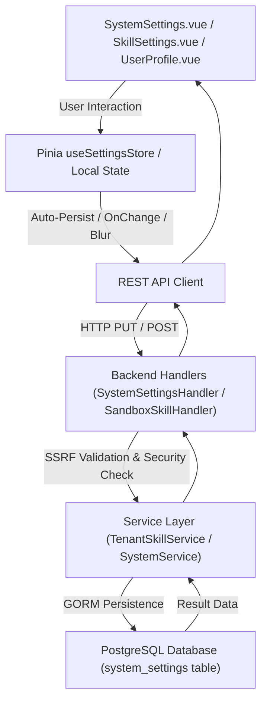
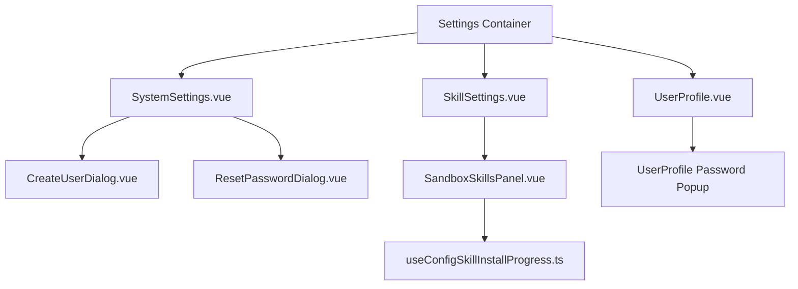
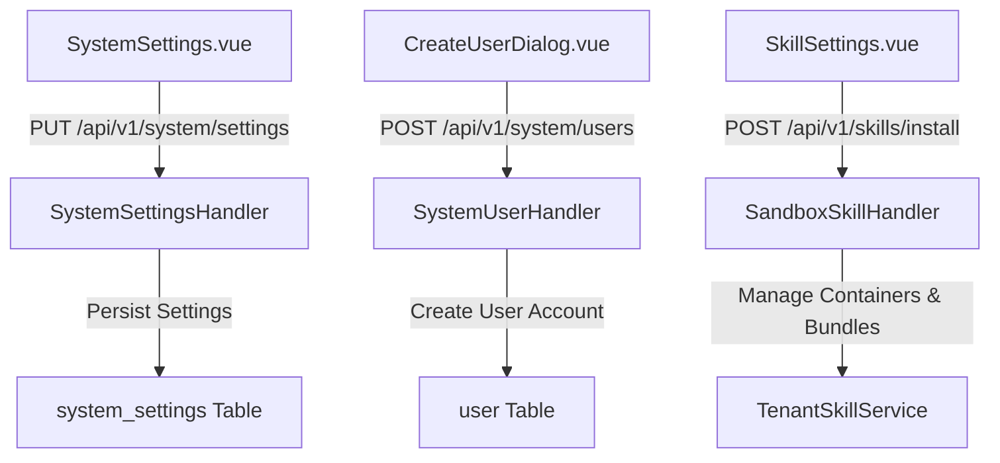

<!-- source: DeepWiki mcp.deepwiki.com · repo Tencent/WeKnora · page 7.4 Settings and Configuration Interface · fetched 2026-10-29 -->

# Settings and Configuration Interface

Relevant source files

The following files were used as context for generating this wiki page:

- [docs/assets/knowledge-tag-popover.png](docs/assets/knowledge-tag-popover.png)
- [frontend/src/assets/theme/tdesign-overrides.less](frontend/src/assets/theme/tdesign-overrides.less)
- [frontend/src/components/KBSwitcherDropdown.vue](frontend/src/components/KBSwitcherDropdown.vue)
- [frontend/src/components/SandboxSkillsPanel.test.mjs](frontend/src/components/SandboxSkillsPanel.test.mjs)
- [frontend/src/components/settings/SettingDrawer.test.mjs](frontend/src/components/settings/SettingDrawer.test.mjs)
- [frontend/src/composables/skillInstallProgress.ts](frontend/src/composables/skillInstallProgress.ts)
- [frontend/src/composables/useConfigSkillInstallProgress.test.mjs](frontend/src/composables/useConfigSkillInstallProgress.test.mjs)
- [frontend/src/composables/useConfigSkillInstallProgress.test.ts](frontend/src/composables/useConfigSkillInstallProgress.test.ts)
- [frontend/src/composables/useConfigSkillInstallProgress.ts](frontend/src/composables/useConfigSkillInstallProgress.ts)
- [frontend/src/config/settingsAccess.test.ts](frontend/src/config/settingsAccess.test.ts)
- [frontend/src/config/settingsAccess.ts](frontend/src/config/settingsAccess.ts)
- [frontend/src/views/agent/AgentEditorModal.test.mjs](frontend/src/views/agent/AgentEditorModal.test.mjs)
- [frontend/src/views/settings/SkillSettings.test.mjs](frontend/src/views/settings/SkillSettings.test.mjs)
- [frontend/src/views/settings/SkillSettings.vue](frontend/src/views/settings/SkillSettings.vue)
- [frontend/src/views/system/CreateUserDialog.vue](frontend/src/views/system/CreateUserDialog.vue)
- [frontend/src/views/system/ResetPasswordDialog.test.mjs](frontend/src/views/system/ResetPasswordDialog.test.mjs)
- [frontend/src/views/system/ResetPasswordDialog.vue](frontend/src/views/system/ResetPasswordDialog.vue)
- [frontend/src/views/system/SystemSettings.vue](frontend/src/views/system/SystemSettings.vue)
- [frontend/src/views/system/systemAdminDialog.less](frontend/src/views/system/systemAdminDialog.less)

## Purpose and Scope

The **Settings and Configuration Interface** offers a unified, centralized modal-based and view-based UI for managing system-wide and tenant-specific configurations. It encompasses agent setup, conversation behavior, model selection, sandbox and skill management, MCP services, user profile settings, and global system preferences [frontend/src/views/system/SystemSettings.vue:1-34](), [frontend/src/views/settings/SkillSettings.vue:1-12](), [frontend/src/views/settings/UserProfile.vue:1-10]().

The settings interface organizes configuration into:
- **Workspace/Tenant-scoped configurations:** Stored and persisted in the database as entities or JSONB metadata within tenant tables [frontend/src/stores/settings.ts:10-31]().
- **System-wide configurations:** Available only to system admins, guarded server-side and via route meta tags (`meta.requiresSystemAdmin`), and persisted in platform-wide tables [frontend/src/views/system/SystemSettings.vue:1-7]().
- **Frontend UI preferences:** Language, theme, drawer widths, and other transient or local preferences stored in reactive Pinia stores (`useSettingsStore`) and `localStorage` [frontend/src/stores/settings.ts:114-125]().

The UI follows a declarative auto-persistence pattern where single-pick selections and switches commit immediately via change events, while text inputs commit on blur or explicit actions [frontend/src/views/system/SystemSettings.vue:14-24]().

Sources:
- [frontend/src/views/system/SystemSettings.vue:1-34]()
- [frontend/src/views/settings/SkillSettings.vue:1-12]()
- [frontend/src/views/settings/UserProfile.vue:1-10]()
- [frontend/src/stores/settings.ts:10-31]()
- [frontend/src/stores/settings.ts:114-125]()

---

## Settings Interface Structure, Roles, and Access Control

Workspace-scoped settings access is governed by role keys (`viewer`, `contributor`, `admin`, `owner`) defined in `settingsAccess.ts`. Each section enforces a minimum required role, while backend route guards remain authoritative [frontend/src/config/settingsAccess.ts:1-35]().

| Section Key | Purpose / Content | Minimum Role / Access Level |
|---|---|---|
| `general` | General conversation defaults | `viewer` [frontend/src/config/settingsAccess.ts:10-11]() |
| `ollama` | Ollama service parameters | `admin` [frontend/src/config/settingsAccess.ts:10-12]() |
| `models` | Model registration, selection, and configuration | `viewer` (management requires `admin`) [frontend/src/config/settingsAccess.ts:14-44]() |
| `sandbox` | Sandbox environment configs and runtimes | `admin` [frontend/src/config/settingsAccess.ts:17-20]() |
| `skills` | Skill catalog and skill execution environment settings | `admin` [frontend/src/config/settingsAccess.ts:21-23]() |
| `mcp` | Model Context Protocol service integration | `admin` [frontend/src/config/settingsAccess.ts:24-24]() |
| `system` | Platform-wide global settings | System Admin only [frontend/src/views/system/SystemSettings.vue:1-6]() |
| `userprofile` | User profile and password management | `viewer` [frontend/src/views/settings/UserProfile.vue:1-10]() |
| `members` | Workspace member management | `viewer` (shortcuts require `owner`) [frontend/src/config/settingsAccess.ts:29-44]()
| `envvars` | Personal skill environment variables | `viewer` [frontend/src/config/settingsAccess.ts:33-33]()

Management shortcuts on avatar menus enforce stricter thresholds than corresponding read-only settings pages [frontend/src/config/settingsAccess.ts:37-44](). The skill catalog is admin-only, mirroring the sandbox it installs into [frontend/src/config/settingsAccess.test.ts:17-19](). Personal skill environment variables are visible to all members, but workspace-wide values are managed on the Admin+ skills page [frontend/src/config/settingsAccess.test.ts:23-25]().

Sources:
- [frontend/src/config/settingsAccess.ts:1-44]()
- [frontend/src/views/system/SystemSettings.vue:1-6]()
- [frontend/src/views/settings/UserProfile.vue:1-10]()
- [frontend/src/config/settingsAccess.test.ts:17-19]()
- [frontend/src/config/settingsAccess.test.ts:23-25]()

---

## Agent Configuration and Conversation Settings

Agent and conversation parameters are managed within agent editor modals and workspace settings. Key attributes include:
- Agent modes and reasoning efforts (`reasoningEffortOverride`, `selectedAgentId`) [frontend/src/stores/settings.ts:28-124]()
- Multi-turn enablement and history turn limits (`formData.config.multi_turn_enabled`, `history_turns`) [frontend/src/views/agent/AgentEditorModal.test.mjs:73-82](). The history turns input can be raised beyond the old 20-turn cap to 100 [frontend/src/views/agent/AgentEditorModal.test.mjs:98-104]().
- Retrieval retention policies (`retain_retrieval_history`) for agents linked to knowledge bases [frontend/src/views/agent/AgentEditorModal.test.mjs:104-110](). This setting is only offered to agents that actually have a knowledge base [frontend/src/views/agent/AgentEditorModal.test.mjs:108-110]().
- Conversation settings remain reachable in smart-reasoning mode, explaining that history follows the context window [frontend/src/views/agent/AgentEditorModal.test.mjs:54-69]().
- History turns, multi-turn switch, and query rewrite settings are hidden in smart-reasoning mode because they are not applicable or are internally managed [frontend/src/views/agent/AgentEditorModal.test.mjs:71-90]().

Sources:
- [frontend/src/stores/settings.ts:28-124]()
- [frontend/src/views/agent/AgentEditorModal.test.mjs:54-110]()

---

## Model Selection and Management

Model settings support managing both built-in and user-defined models for chat, embedding, reranking, and vision-language tasks [frontend/src/stores/settings.ts:47-66](). The Pinia store `useSettingsStore` manages active model selections (`conversationModels`), endpoint configurations, API keys, and fallback parameters [frontend/src/stores/settings.ts:41-112]().

Sources:
- [frontend/src/stores/settings.ts:47-112]()

---

## Skills, Sandbox Panels, and Progress Streaming

Skill and sandbox configuration interfaces are handled via `SkillSettings.vue` and `SandboxSkillsPanel.vue`. They support:
- Catalog-based skill browsing, bundle verification, and status tracking [frontend/src/views/settings/SkillSettings.vue:43-86](). The skill settings list the catalog instead of switching sandboxes [frontend/src/views/settings/SkillSettings.test.mjs:7-12]().
- Multi-step skill registration and installation workflows [frontend/src/views/settings/SkillSettings.test.mjs:102-119](). The install step shows parsed skill and sandbox backend details [frontend/src/views/settings/SkillSettings.test.mjs:112-119]().
- Real-time Server-Sent Events (SSE) progress tracking via `useConfigSkillInstallProgress` [frontend/src/composables/useConfigSkillInstallProgress.ts:26-131](). This composable provides functions like `eventOf`, `percentOf`, `follow`, `sync`, `stopAll`, `reset`, `forget`, and `setEvent` to manage skill installation progress [frontend/src/composables/useConfigSkillInstallProgress.ts:34-152](). Progress percentages are clamped between 0-100 [frontend/src/composables/useConfigSkillInstallProgress.test.mjs:15-21]().
- Focused skill environment variable management and upgrade flows without mid-page save buttons [frontend/src/components/SandboxSkillsPanel.test.mjs:11-50](). Outdated installs can be upgraded from the catalog card [frontend/src/views/settings/SkillSettings.test.mjs:83-100](). A skill mid-upgrade or after a failed upgrade will indicate the previous version is still running [frontend/src/components/SandboxSkillsPanel.test.mjs:52-56]().

Sources:
- [frontend/src/views/settings/SkillSettings.vue:43-86]()
- [frontend/src/views/settings/SkillSettings.test.mjs:7-12]()
- [frontend/src/views/settings/SkillSettings.test.mjs:102-119]()
- [frontend/src/composables/useConfigSkillInstallProgress.ts:26-131]()
- [frontend/src/composables/useConfigSkillInstallProgress.ts:34-152]()
- [frontend/src/composables/useConfigSkillInstallProgress.test.mjs:15-21]()
- [frontend/src/components/SandboxSkillsPanel.test.mjs:11-50]()
- [frontend/src/views/settings/SkillSettings.test.mjs:83-100]()
- [frontend/src/components/SandboxSkillsPanel.test.mjs:52-56]()

---

## System Preferences and User Profile Management

Platform-wide configurations and user profile actions are implemented via components such as `SystemSettings.vue`, `CreateUserDialog.vue`, `ResetPasswordDialog.vue`, and `UserProfile.vue` [frontend/src/views/system/SystemSettings.vue:1-34](), [frontend/src/views/system/CreateUserDialog.vue:1-16](), [frontend/src/views/system/ResetPasswordDialog.vue:1-8](), [frontend/src/views/settings/UserProfile.vue:1-24]().

- **System Settings:** Gated server-side and routed via `meta.requiresSystemAdmin`, managing global tunables like SSRF whitelists and administrator email tag-inputs with confirmation pop-confirms [frontend/src/views/system/SystemSettings.vue:1-33](). The UI uses specific commit signals for different control types (e.g., `@change` for switches, `@blur` for inputs) [frontend/src/views/system/SystemSettings.vue:14-24]().
- **User Management Dialogs:** In-place popups supporting account creation with one-time password reveal views (`CreateUserDialog.vue`) [frontend/src/views/system/CreateUserDialog.vue:1-15]() and password resets (`ResetPasswordDialog.vue`) [frontend/src/views/system/ResetPasswordDialog.vue:1-8](). These dialogs handle form validation, API calls (`createSystemUser`, `resetUserPassword`), and display success/error messages [frontend/src/views/system/CreateUserDialog.vue:115-146](), [frontend/src/views/system/ResetPasswordDialog.vue:137-157](). Pending password resets survive tab changes and report their outcome [frontend/src/views/system/ResetPasswordDialog.test.mjs:119-158]().
- **User Profile:** Displays user ID, username, email, registration timestamp, and a secure password modification popup [frontend/src/views/settings/UserProfile.vue:24-167]().

Sources:
- [frontend/src/views/system/SystemSettings.vue:1-34]()
- [frontend/src/views/system/CreateUserDialog.vue:1-16]()
- [frontend/src/views/system/ResetPasswordDialog.vue:1-8]()
- [frontend/src/views/settings/UserProfile.vue:1-24]()
- [frontend/src/views/system/CreateUserDialog.vue:115-146]()
- [frontend/src/views/system/ResetPasswordDialog.vue:137-157]()
- [frontend/src/views/system/ResetPasswordDialog.test.mjs:119-158]()

---

## Data Flow Overview for Settings and Configuration Changes

Sources:
- [frontend/src/views/system/SystemSettings.vue:1-34]()
- [frontend/src/stores/settings.ts:187-191]()
- [frontend/src/composables/useConfigSkillInstallProgress.ts:87-130]()

---

## Component Diagram Mapping Natural Language to Code Entities

Title: "Natural Language Space to Frontend Component Space"

Sources:
- [frontend/src/views/system/SystemSettings.vue:1-34]()
- [frontend/src/views/settings/SkillSettings.vue:1-12]()
- [frontend/src/views/settings/UserProfile.vue:1-24]()
- [frontend/src/views/system/CreateUserDialog.vue:1-16]()
- [frontend/src/views/system/ResetPasswordDialog.vue:1-8]()
- [frontend/src/composables/useConfigSkillInstallProgress.ts:26-32]()

---

Title: "Frontend Component Space to Backend Handler and Entity Space"

Sources:
- [frontend/src/views/system/SystemSettings.vue:1-34]()
- [frontend/src/views/system/CreateUserDialog.vue:115-116]()
- [frontend/src/views/settings/SkillSettings.vue:43-86]()

---

## Summary

The **Settings and Configuration Interface** provides a structured, role-gated, and reactive configuration system across frontend Vue views, Pinia stores, and backend handlers. It ensures secure management of system parameters, agent properties, skills, and user profiles.

Sources:
- [frontend/src/views/system/SystemSettings.vue:1-34]()
- [frontend/src/stores/settings.ts:114-125]()
- [frontend/src/config/settingsAccess.ts:1-35]()

---

