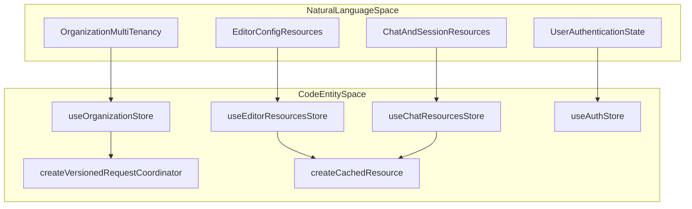
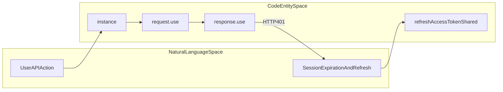

<!-- source: DeepWiki mcp.deepwiki.com · repo Tencent/WeKnora · page 7.5 State Management and API Integration · fetched 2026-10-29 -->

# State Management and API Integration

Relevant source files

The following files were used as context for generating this wiki page:

- [frontend/src/App.vue](frontend/src/App.vue)
- [frontend/src/api/auth/index.ts](frontend/src/api/auth/index.ts)
- [frontend/src/composables/useFont.ts](frontend/src/composables/useFont.ts)
- [frontend/src/composables/useTheme.ts](frontend/src/composables/useTheme.ts)
- [frontend/src/router/index.ts](frontend/src/router/index.ts)
- [frontend/src/stores/auth.ts](frontend/src/stores/auth.ts)
- [frontend/src/stores/menu.ts](frontend/src/stores/menu.ts)
- [frontend/src/utils/request.ts](frontend/src/utils/request.ts)
- [frontend/src/views/auth/Login.vue](frontend/src/views/auth/Login.vue)
- [frontend/src/views/settings/GeneralSettings.vue](frontend/src/views/settings/GeneralSettings.vue)
- [frontend/src/views/settings/UserProfile.vue](frontend/src/views/settings/UserProfile.vue)
- [internal/application/repository/user.go](internal/application/repository/user.go)
- [internal/application/service/user.go](internal/application/service/user.go)
- [internal/application/service/user_auth_token_test.go](internal/application/service/user_auth_token_test.go)
- [internal/handler/auth.go](internal/handler/auth.go)
- [internal/middleware/auth.go](internal/middleware/auth.go)
- [internal/types/interfaces/user.go](internal/types/interfaces/user.go)
- [internal/types/user.go](internal/types/user.go)

This wiki page documents the frontend's state management architecture using Pinia stores, API client organization, Axios request/response interceptors, authentication refresh mechanics, request coordination patterns, and streaming data flow in WeKnora.

For navigation and menu-specific state, see [7.1 Navigation and Menu System](). For component-specific UI interactions, see [7.3 Chat Interface and Agent Display]() and [7.2 Knowledge Base Interface]().

---

## Pinia Store Architecture

WeKnora uses **Pinia** for centralized state management across the Vue 3 frontend application. The state layer is modularized into domain-specific stores handling authentication (`useAuthStore`), multi-tenant organization workspaces (`useOrganizationStore`), navigation (`useMenuStore`), shared resources (`useEditorResourcesStore`), and chat resources (`useChatResourcesStore`).

### Store Subsystems and Code Mappings

The mapping between high-level application capabilities and their underlying Pinia store implementations is structured as follows:

**Title:** Natural Language to Code Entity Space: Store Subsystems
Sources: `[frontend/src/stores/organization.ts:56-127]`, `[frontend/src/stores/editorResources.ts:65-103]`, `[frontend/src/stores/chatResources.ts:32-101]()`, `[frontend/src/stores/auth.ts:32-70]()`

### Core Store Responsibilities

| Store Identifier | File Path / Role | Key State Fields & Methods |
|------------------|------------------|----------------------------|
| `useAuthStore` | Manages global user authentication state, active tokens, memberships, and active tenant context. | `user`, `token`, `tenant`, `memberships`, `selectedTenantId`, `isLoggedIn` `[frontend/src/stores/auth.ts:32-70]()` |
| `useOrganizationStore` | Manages multi-tenant organization switching, memberships, and shared resource counts. | `organizations`, `currentOrganization`, `fetchOrganizations()`, `create()` `[frontend/src/stores/organization.ts:56-127]()` |
| `useEditorResourcesStore` | Caches editor-level configuration assets, storage engines, MCP services, and skills. | `storageConfig`, `mcpServices`, `skills`, `skillCatalog` `[frontend/src/stores/editorResources.ts:65-103]()` |
| `useChatResourcesStore` | Manages tenant-level knowledge bases, custom agents, model lists, and sandbox configurations. | `rawKnowledgeBases`, `agents`, `allModels`, `ensureKnowledgeBases()` `[frontend/src/stores/chatResources.ts:32-120]()` |
| `useMenuStore` | Manages sidebar menu layout, session lists, active routes, and prefill query state. | `menuArr`, `visibleMenuArr`, `prefillQuery`, `updatemenuArr()` `[frontend/src/stores/menu.ts:23-172]()` |

Sources: `[frontend/src/stores/auth.ts:32-150]`, `[frontend/src/stores/organization.ts:56-184]`, `[frontend/src/stores/editorResources.ts:65-103]`, `[frontend/src/stores/chatResources.ts:32-120]`, `[frontend/src/stores/menu.ts:23-172]()`

---

## API Client and Request Interceptors

### Axios Instance Configuration

All HTTP communication with the backend is routed through a centrally configured Axios instance defined in `frontend/src/utils/request.ts`.

- **Base URL:** Dynamically configured via `getApiBaseUrl()` `[frontend/src/utils/request.ts:18-19]()`.
- **Timeout:** Set to `30000ms` for standard API requests `[frontend/src/utils/request.ts:59]()`.
- **Default Headers:**
  - `Content-Type: application/json` `[frontend/src/utils/request.ts:61]()`
  - `X-Request-ID`: Generated randomly per request using `generateRandomString(12)` `[frontend/src/utils/request.ts:62]()`.

**Title:** Natural Language to Code Entity Space: Request Interceptor Pipeline
Sources: `[frontend/src/utils/request.ts:56-184]()`

### Request Interceptor Injection Rules

The request interceptor dynamically injects contextual headers into outgoing requests prior to transmission:
1. **Authorization:** Injects `Bearer ${token}` retrieved from `localStorage`, except when explicit `Embed` tokens are present `[frontend/src/utils/request.ts:74-84]()`.
2. **Language Preference:** Appends `Accept-Language` using `getCurrentLanguage()` based on active i18n settings or `localStorage` `[frontend/src/utils/request.ts:67-69, 87]()`.
3. **Multi-Tenant Isolation:** Appends `X-Tenant-ID` sourced from `weknora_selected_tenant_id` for non-embed routes to ensure requests execute within the correct workspace scope `[frontend/src/utils/request.ts:98-103]()`.

Sources: `[frontend/src/utils/request.ts:56-111]()`

### Response Interceptor and Token Refresh

- **Status Augmentation:** Successful HTTP responses (`200-299`) are processed through `withHttpStatus()`, attaching a non-enumerable `$httpStatus` property to the JSON response object without mutating downstream payloads `[frontend/src/utils/request.ts:32-54, 125-134]()`.
- **Error Handling & Timeouts:** Network errors distinguish between request timeouts (`error.requestTimeout`) and general network drops (`error.networkError`) `[frontend/src/utils/request.ts:135-145]()`.
- **Token Refresh Flow:** Encountering an unauthorized HTTP `401` status on non-public paths triggers `refreshAccessTokenShared()` while marking `originalRequest._retry = true` to prevent infinite loops `[frontend/src/utils/request.ts:178-184]()`. Public auth paths (`PUBLIC_AUTH_PATHS`) and embed pages bypass token refreshing and surface errors directly `[frontend/src/utils/request.ts:117-176]()`.

Sources: `[frontend/src/utils/request.ts:113-184]()`

---

## Caching and Request Coordination Patterns

To prevent duplicate network requests during burst component mounts, WeKnora employs request coordinators and cached resource utilities:

- **Versioned Request Coordination:** `createVersionedRequestCoordinator` handles concurrent API calls by deduplicating inflight promises and maintaining execution ordering `[frontend/src/stores/organization.ts:100-127]()`.
- **Cached Resource Snapshots:** `createCachedResource` manages space-level resources (such as knowledge bases, models, and sandbox configurations) without TTL expiration windows, ensuring that UI components immediately render existing snapshots while background refreshes execute `[frontend/src/stores/chatResources.ts:25-51, 81-120]()`.
- **Graceful Degradation:** Privilege-restricted endpoints (such as admin storage configuration checks) gracefully catch permission rejections (`isStorageConfigDenied`) to avoid breaking the editor initialization dependency chain `[frontend/src/stores/editorResources.ts:82-93]()`.

Sources: `[frontend/src/stores/organization.ts:100-127]`, `[frontend/src/stores/editorResources.ts:82-103]`, `[frontend/src/stores/chatResources.ts:43-120]()`

---

## Streaming API Integration and SSE Data Flow

Real-time chat interactions, multi-step agent reasoning thoughts, and streaming tool invocations rely on Server-Sent Events (SSE):

- **The `useStream` Composable:** Manages real-time data flow, exposing reactive state variables such as `output`, `isStreaming`, `isLoading`, and `error` `[frontend/src/api/chat/streame.ts:28-34]()`.
- **Payload Construction:** `startStream()` constructs a structured JSON request payload encompassing user prompts, knowledge base scope IDs (`knowledge_base_ids`), active agent parameters, and attached files `[frontend/src/api/chat/streame.ts:43-151]()`.
- **Transport Mechanism:** Utilizes `@microsoft/fetch-event-source` to maintain persistent SSE connections while forwarding session tokens and tenant tracking identifiers across event chunks `[frontend/src/api/chat/streame.ts:1-154]()`.

Sources: `[frontend/src/api/chat/streame.ts:28-154]()`

---

