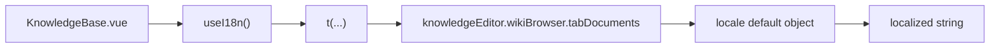
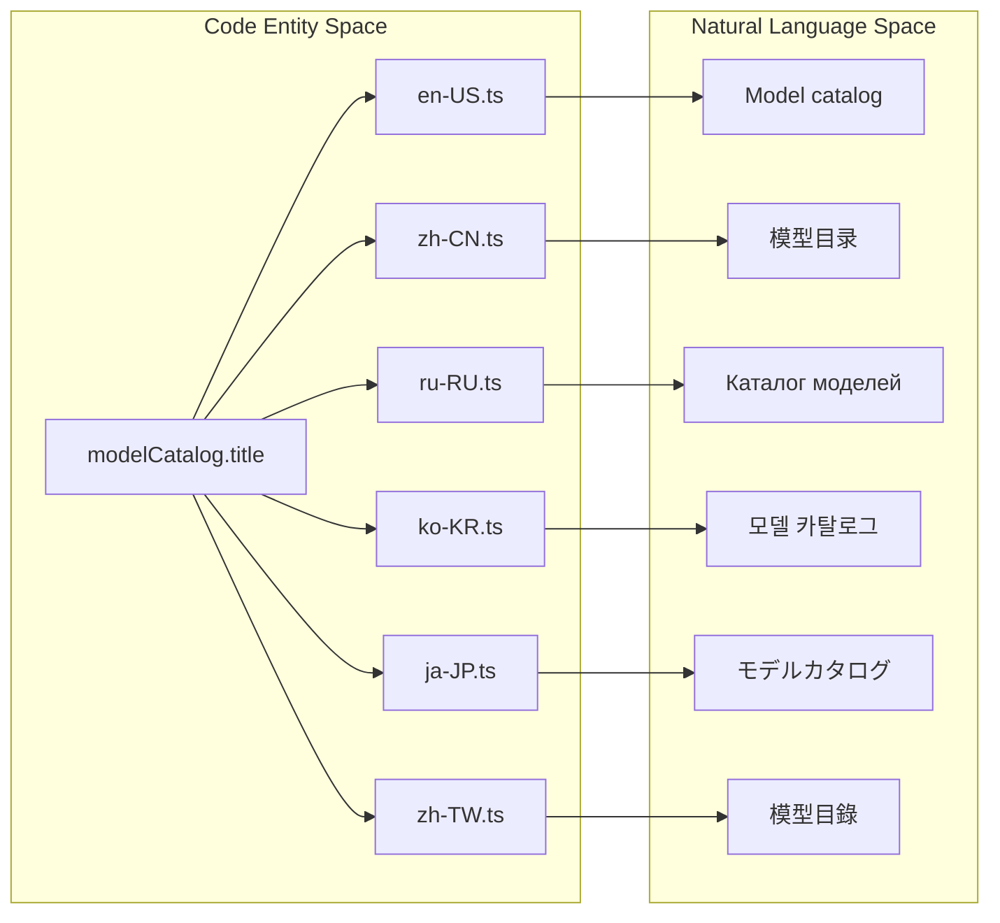
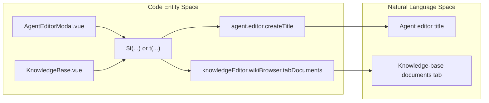

<!-- source: DeepWiki mcp.deepwiki.com · repo Tencent/WeKnora · page 7.6 Internationalization System · fetched 2026-10-29 -->

# Internationalization System

Relevant source files

The following files were used as context for generating this wiki page:

- [frontend/src/components/menu.vue](frontend/src/components/menu.vue)
- [frontend/src/i18n/embed.ts](frontend/src/i18n/embed.ts)
- [frontend/src/i18n/locales/en-US.ts](frontend/src/i18n/locales/en-US.ts)
- [frontend/src/i18n/locales/ja-JP.ts](frontend/src/i18n/locales/ja-JP.ts)
- [frontend/src/i18n/locales/ko-KR.ts](frontend/src/i18n/locales/ko-KR.ts)
- [frontend/src/i18n/locales/ru-RU.ts](frontend/src/i18n/locales/ru-RU.ts)
- [frontend/src/i18n/locales/zh-CN.ts](frontend/src/i18n/locales/zh-CN.ts)
- [frontend/src/i18n/locales/zh-TW.ts](frontend/src/i18n/locales/zh-TW.ts)
- [frontend/src/utils/agent-tool-display.test.mjs](frontend/src/utils/agent-tool-display.test.mjs)
- [frontend/src/utils/agent-tool-display.ts](frontend/src/utils/agent-tool-display.ts)
- [frontend/src/utils/agent-tool-icons.ts](frontend/src/utils/agent-tool-icons.ts)
- [frontend/src/utils/rag-pipeline-history.test.mjs](frontend/src/utils/rag-pipeline-history.test.mjs)
- [frontend/src/views/agent/AgentEditorModal.vue](frontend/src/views/agent/AgentEditorModal.vue)
- [frontend/src/views/agent/AgentList.vue](frontend/src/views/agent/AgentList.vue)
- [frontend/src/views/chat/components/AgentStreamDisplay.style.test.mjs](frontend/src/views/chat/components/AgentStreamDisplay.style.test.mjs)
- [frontend/src/views/chat/components/RagPipelineProgress.style.test.mjs](frontend/src/views/chat/components/RagPipelineProgress.style.test.mjs)
- [frontend/src/views/chat/components/RagPipelineProgress.vue](frontend/src/views/chat/components/RagPipelineProgress.vue)
- [frontend/src/views/knowledge/KnowledgeBase.vue](frontend/src/views/knowledge/KnowledgeBase.vue)
- [frontend/src/views/knowledge/KnowledgeBaseList.vue](frontend/src/views/knowledge/KnowledgeBaseList.vue)
- [frontend/src/views/knowledge/components/FAQEntryManager.vue](frontend/src/views/knowledge/components/FAQEntryManager.vue)
- [frontend/src/views/knowledge/settings/DataSourceEditorDialog.test.ts](frontend/src/views/knowledge/settings/DataSourceEditorDialog.test.ts)
- [frontend/src/views/knowledge/settings/DataSourceEditorDialog.vue](frontend/src/views/knowledge/settings/DataSourceEditorDialog.vue)
- [frontend/src/views/organization/OrganizationList.vue](frontend/src/views/organization/OrganizationList.vue)
- [internal/application/service/chat_pipeline/progress.go](internal/application/service/chat_pipeline/progress.go)
- [internal/application/service/chat_pipeline/progress_test.go](internal/application/service/chat_pipeline/progress_test.go)
- [website-docs/03-features/10-datasource.md](website-docs/03-features/10-datasource.md)

## Purpose and scope

WeKnora’s frontend internationalization system maps namespaced translation keys to localized text used by Vue components. This page documents the locale files and usage patterns evidenced in the supplied code. The supplied files do not show locale initialization, language selection or persistence, fallback configuration, or backend localization behavior, so those mechanisms are not specified here. [frontend/src/i18n/locales/zh-CN.ts:1-4](), [frontend/src/views/knowledge/KnowledgeBase.vue:86-92]()

Sources: [frontend/src/i18n/locales/zh-CN.ts:1-4](), [frontend/src/views/knowledge/KnowledgeBase.vue:86-92]()

## Architecture overview

Locale resources are TypeScript modules under `frontend/src/i18n/locales/`; each shown locale module exports a default object with nested keys. Vue components use `useI18n()` to obtain `t` or use the template’s `$t(...)` helper. The examples show translations being requested by dotted key, including a key assembled from a local namespace prefix and a dynamic property. [frontend/src/i18n/locales/zh-CN.ts:1-4](), [frontend/src/i18n/locales/en-US.ts:1-4](), [frontend/src/views/knowledge/KnowledgeBase.vue:86-92](), [frontend/src/views/knowledge/KnowledgeBase.vue:116-132]()

### Locale lookup flow

**Diagram: Vue translation key to localized text**

Sources: [frontend/src/views/knowledge/KnowledgeBase.vue:86-92](), [frontend/src/views/knowledge/KnowledgeBase.vue:116-132](), [frontend/src/i18n/locales/zh-CN.ts:1-4]()

### Natural-language and code-entity mapping

This bridge associates visible text with the translation key and the locale modules that contain corresponding entries. For example, the model catalog’s `title` key is represented by localized values in English, Simplified Chinese, Russian, Korean, Japanese, and Traditional Chinese. [frontend/src/i18n/locales/en-US.ts:1-5](), [frontend/src/i18n/locales/zh-CN.ts:1-5](), [frontend/src/i18n/locales/ru-RU.ts:1-5](), [frontend/src/i18n/locales/ko-KR.ts:1-5](), [frontend/src/i18n/locales/ja-JP.ts:1-5](), [frontend/src/i18n/locales/zh-TW.ts:1-5]()

**Diagram: Natural language to locale key and files**

Sources: [frontend/src/i18n/locales/en-US.ts:1-5](), [frontend/src/i18n/locales/zh-CN.ts:1-5](), [frontend/src/i18n/locales/ru-RU.ts:1-5](), [frontend/src/i18n/locales/ko-KR.ts:1-5](), [frontend/src/i18n/locales/ja-JP.ts:1-5](), [frontend/src/i18n/locales/zh-TW.ts:1-5]()

## Translation structure and supported languages

### Locale files

The supplied locale modules establish at least six locale files. The language descriptions below identify the locale represented by each filename and are corroborated by the language of its sample strings. The supplied excerpts do not establish whether these are the only supported locales in the application. [frontend/src/i18n/locales/en-US.ts:1-5](), [frontend/src/i18n/locales/zh-CN.ts:1-5](), [frontend/src/i18n/locales/ru-RU.ts:1-5](), [frontend/src/i18n/locales/ko-KR.ts:1-5](), [frontend/src/i18n/locales/ja-JP.ts:1-5](), [frontend/src/i18n/locales/zh-TW.ts:1-5]()

| Locale file | Locale represented |
|---|---|
| `en-US.ts` | English (United States) |
| `zh-CN.ts` | Simplified Chinese |
| `zh-TW.ts` | Traditional Chinese |
| `ru-RU.ts` | Russian |
| `ko-KR.ts` | Korean |
| `ja-JP.ts` | Japanese |

Sources: [frontend/src/i18n/locales/en-US.ts:1-5](), [frontend/src/i18n/locales/zh-CN.ts:1-5](), [frontend/src/i18n/locales/zh-TW.ts:1-5](), [frontend/src/i18n/locales/ru-RU.ts:1-5](), [frontend/src/i18n/locales/ko-KR.ts:1-5](), [frontend/src/i18n/locales/ja-JP.ts:1-5]()

### Nested namespaces and keys

Translation objects organize strings into nested functional namespaces. The shown resources include top-level namespaces such as `modelCatalog` and `automation`; nested objects such as `modelCatalog.layers`, `modelCatalog.columns`, and `automation.editor` group related strings. Components refer to these paths using dotted keys. [frontend/src/i18n/locales/en-US.ts:1-126](), [frontend/src/i18n/locales/en-US.ts:127-181](), [frontend/src/i18n/locales/zh-CN.ts:1-126](), [frontend/src/views/agent/AgentEditorModal.vue:1-4]()

The following table illustrates keys supported by the shown resources and component references. [frontend/src/i18n/locales/en-US.ts:1-56](), [frontend/src/i18n/locales/en-US.ts:127-181](), [frontend/src/views/agent/AgentEditorModal.vue:1-4](), [frontend/src/views/knowledge/KnowledgeBase.vue:116-132]()

| Example key | Purpose evidenced by usage or text |
|---|---|
| `modelCatalog.title` | Model catalog page title |
| `modelCatalog.layers.builtin` | Description of the built-in model catalog layer |
| `automation.editor.createTitle` | Automation editor creation title |
| `agent.editor.createTitle` | Agent editor creation title |
| `knowledgeEditor.wikiBrowser.tabDocuments` | Knowledge-base document tab label |

Sources: [frontend/src/i18n/locales/en-US.ts:1-10](), [frontend/src/i18n/locales/en-US.ts:127-161](), [frontend/src/views/agent/AgentEditorModal.vue:1-4](), [frontend/src/views/knowledge/KnowledgeBase.vue:116-132]()

## Component integration and key resolution

### Composition API and template usage

`KnowledgeBase.vue` imports `useI18n` from `vue-i18n` and obtains `t` in its script setup. It uses `t(...)` for labels and status text, including a dynamically assembled key under `knowledgeEditor.wikiBrowser`. [frontend/src/views/knowledge/KnowledgeBase.vue:86-92](), [frontend/src/views/knowledge/KnowledgeBase.vue:110-132]()

`AgentEditorModal.vue` uses `$t(...)` directly in its template for editor titles and labels. Other supplied Vue components likewise use `$t(...)` for UI text, including the knowledge-base list and FAQ manager. [frontend/src/views/agent/AgentEditorModal.vue:1-4](), [frontend/src/views/knowledge/KnowledgeBaseList.vue:7-24](), [frontend/src/views/knowledge/components/FAQEntryManager.vue:37-39]()

**Diagram: Natural-language UI labels connected to component entities**

Sources: [frontend/src/views/agent/AgentEditorModal.vue:1-4](), [frontend/src/views/knowledge/KnowledgeBase.vue:86-92](), [frontend/src/views/knowledge/KnowledgeBase.vue:116-132]()

### Interpolation and dynamic keys

Locale strings can contain braced placeholders. For example, the model catalog summary uses `{count}` and `{version}`, while the automation text includes placeholders such as `{name}` and `{time}`. `KnowledgeBase.vue` passes an object containing `count` when translating the wiki queue-status key. These examples establish interpolation usage; they do not specify every formatting rule or fallback behavior of the i18n runtime. [frontend/src/i18n/locales/en-US.ts:21-23](), [frontend/src/i18n/locales/en-US.ts:127-138](), [frontend/src/views/knowledge/KnowledgeBase.vue:110-115]()

Sources: [frontend/src/i18n/locales/en-US.ts:21-23](), [frontend/src/i18n/locales/en-US.ts:127-138](), [frontend/src/views/knowledge/KnowledgeBase.vue:110-115]()

## Adding or updating translations

### Translation workflow

1. **Choose the namespace and key.** Add a string under the relevant nested object in the locale resources; for example, model catalog labels are grouped under `modelCatalog`. [frontend/src/i18n/locales/en-US.ts:1-56]()
2. **Keep locale object shapes aligned.** Add the corresponding key to each locale file that should provide the translation. The supplied locale files show matching top-level namespaces and overlapping key structures for the model catalog. [frontend/src/i18n/locales/en-US.ts:1-126](), [frontend/src/i18n/locales/zh-CN.ts:1-126](), [frontend/src/i18n/locales/ru-RU.ts:1-126](), [frontend/src/i18n/locales/ko-KR.ts:1-126](), [frontend/src/i18n/locales/ja-JP.ts:1-126](), [frontend/src/i18n/locales/zh-TW.ts:1-126]()
3. **Reference the key from the component.** Use the composition API `t(...)` pattern shown in `KnowledgeBase.vue` or the template `$t(...)` pattern shown in `AgentEditorModal.vue`. [frontend/src/views/knowledge/KnowledgeBase.vue:86-92](), [frontend/src/views/agent/AgentEditorModal.vue:1-4]()
4. **Preserve placeholders.** When a translation uses interpolated values, keep the same placeholder names across locale entries and pass matching values at the call site. The model summary and wiki queue-status call demonstrate the resource and call-site sides of this pattern. [frontend/src/i18n/locales/en-US.ts:21-23](), [frontend/src/views/knowledge/KnowledgeBase.vue:110-115]()

Sources: [frontend/src/i18n/locales/en-US.ts:1-126](), [frontend/src/i18n/locales/zh-CN.ts:1-126](), [frontend/src/i18n/locales/ru-RU.ts:1-126](), [frontend/src/i18n/locales/ko-KR.ts:1-126](), [frontend/src/i18n/locales/ja-JP.ts:1-126](), [frontend/src/i18n/locales/zh-TW.ts:1-126](), [frontend/src/views/knowledge/KnowledgeBase.vue:86-115](), [frontend/src/views/agent/AgentEditorModal.vue:1-4]()

### Adding a locale file

The supplied files demonstrate the locale filename convention and the default-object resource shape. They do not include the i18n plugin setup or locale registry, so adding a resource file alone cannot be asserted to register or activate a locale. To complete a new locale, locate and update the application’s locale registration and language-selection configuration as applicable; those files are not part of the supplied evidence. [frontend/src/i18n/locales/en-US.ts:1](), [frontend/src/i18n/locales/zh-CN.ts:1](), [frontend/src/i18n/locales/ru-RU.ts:1](), [frontend/src/i18n/locales/ko-KR.ts:1](), [frontend/src/i18n/locales/ja-JP.ts:1](), [frontend/src/i18n/locales/zh-TW.ts:1]()

Sources: [frontend/src/i18n/locales/en-US.ts:1](), [frontend/src/i18n/locales/zh-CN.ts:1](), [frontend/src/i18n/locales/ru-RU.ts:1](), [frontend/src/i18n/locales/ko-KR.ts:1](), [frontend/src/i18n/locales/ja-JP.ts:1](), [frontend/src/i18n/locales/zh-TW.ts:1]()

---

