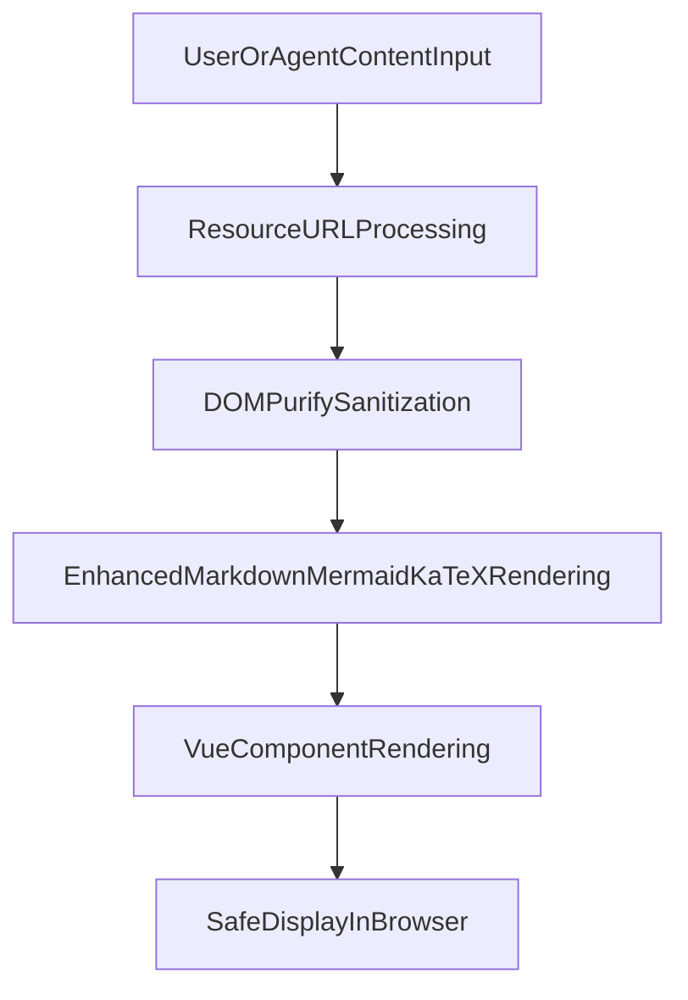
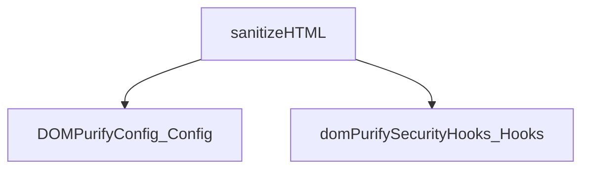
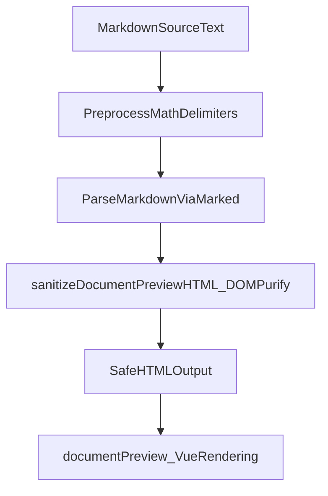
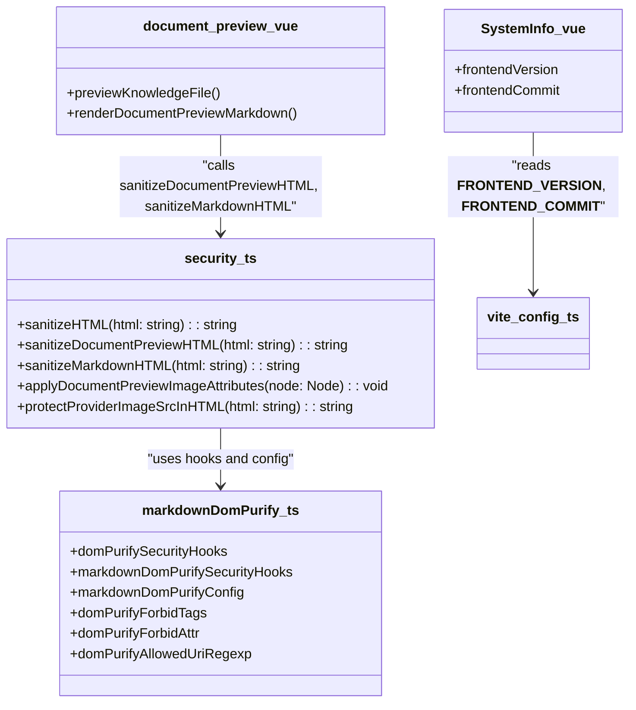

<!-- source: DeepWiki mcp.deepwiki.com · repo Tencent/WeKnora · page 7.7 Frontend Security and Markdown Sanitization · fetched 2026-10-29 -->

# Frontend Security and Markdown Sanitization

Relevant source files

The following files were used as context for generating this wiki page:

- [frontend/env.d.ts](frontend/env.d.ts)
- [frontend/scripts/copy-pdfjs-wasm.d.mts](frontend/scripts/copy-pdfjs-wasm.d.mts)
- [frontend/scripts/copy-pdfjs-wasm.mjs](frontend/scripts/copy-pdfjs-wasm.mjs)
- [frontend/scripts/copy-pdfjs-wasm.test.mjs](frontend/scripts/copy-pdfjs-wasm.test.mjs)
- [frontend/src/assets/theme/theme.css](frontend/src/assets/theme/theme.css)
- [frontend/src/components/css/chat-hljs-dark.less](frontend/src/components/css/chat-hljs-dark.less)
- [frontend/src/components/css/chat-hljs.less](frontend/src/components/css/chat-hljs.less)
- [frontend/src/components/css/markdown.less](frontend/src/components/css/markdown.less)
- [frontend/src/components/document-preview.vue](frontend/src/components/document-preview.vue)
- [frontend/src/components/source-preview/PdfSourceViewer.vue](frontend/src/components/source-preview/PdfSourceViewer.vue)
- [frontend/src/components/source-preview/pdfjsWasmAssets.test.mjs](frontend/src/components/source-preview/pdfjsWasmAssets.test.mjs)
- [frontend/src/utils/markdownDomPurify.test.mjs](frontend/src/utils/markdownDomPurify.test.mjs)
- [frontend/src/utils/markdownDomPurify.ts](frontend/src/utils/markdownDomPurify.ts)
- [frontend/src/utils/markdownEnhancements.ts](frontend/src/utils/markdownEnhancements.ts)
- [frontend/src/utils/security.test.ts](frontend/src/utils/security.test.ts)
- [frontend/src/utils/security.ts](frontend/src/utils/security.ts)
- [frontend/src/views/settings/SystemInfo.vue](frontend/src/views/settings/SystemInfo.vue)
- [frontend/vite.config.ts](frontend/vite.config.ts)

This section documents the security mechanisms implemented in the WeKnora frontend to prevent cross-site scripting (XSS) and other injection attacks, specifically focusing on DOMPurify-based HTML sanitization. It details how markdown content and document previews are safely rendered, how protected file resources are accessed securely, and how various safeguards are integrated across the rendering pipeline to ensure frontend security.

---

## 1. Overview of Frontend Security Architecture

The frontend employs **DOMPurify**, a robust, industry-standard HTML sanitization library, to cleanse any untrusted HTML input before insertion into the DOM. This is crucial in WeKnora because it renders content that often originates from user uploads, external knowledge bases, chat attachments, or skill-generated HTML fragments.

Key security goals include:
- **Preventing XSS attacks** via script insertion or malicious attribute injection.
- **Controlling allowed tags and attributes** to limit attack surface.
- **Ensuring safe loading of resource URLs** including images or protected files.
- **Supporting enhanced rendering for Markdown, Mermaid diagrams, and KaTeX math expressions** without compromising safety.
- **Sanitizing document previews with added performance image loading attributes.**

### High-Level Data Flow

User or agent-provided content (Markdown, HTML, or file blobs) flows into the frontend rendering components. Before rendering:
1. Resource URLs, especially for images, are processed to identify protected file access schemes.
2. Content is sanitized by DOMPurify with tailored configurations depending on context (standard HTML, markdown preview, document preview).
3. Enhanced features like Mermaid diagram SVGs and syntax-highlighted code blocks are safely injected.
4. The sanitized, safe HTML is rendered within Vue components, preventing unsafe content execution.

Sources: [frontend/src/utils/security.ts:1-181]()

---

## 2. DOMPurify-based Sanitization

WeKnora encapsulates DOMPurify usage through utility functions and configurations designed for different rendering contexts, applying fine-grained control over allowed tags, attributes, and URI schemes.

### 2.1 Core Sanitization Utilities

- `sanitizeHTML(html: string): string` [frontend/src/utils/security.ts:108-125]()

  Sanitizes arbitrary HTML content by first protecting provider image URLs and then applying DOMPurify with the core security configuration and hooks. If sanitization fails, it falls back to escaping HTML to prevent injection.

  Key steps:
  1. Replace external/protected image `src` attributes with a placeholder image and encode the real URL in `data-protected-src`.
  2. Sanitize using the full whitelist of tags and attributes.
  3. Add security hooks to remove dangerous elements and attributes.

- `sanitizeDocumentPreviewHTML(html: string): string` [frontend/src/utils/security.ts:151-167]()

  Similar to `sanitizeHTML` but adds image `loading="lazy"`, `decoding="async"`, and `fetchpriority="low"` attributes to images for better performance in document previews.

- `sanitizeMarkdownHTML(html: string): string` [frontend/src/utils/security.ts:170-181]()

  Used for sanitized chat/markdown HTML. It applies a stricter subset of tags and attributes suitable for inline markdown rendering with KaTeX and Mermaid SVG support.

### 2.2 DOMPurify Configuration Highlights

- **Allowed tags:** Include standard text formatting tags (`p`, `em`, `strong`, `ul`, `li`, etc.), SVG tags for diagrams, and KaTeX MathML tags [frontend/src/utils/security.ts:58-71](), [frontend/src/utils/markdownDomPurify.ts:79-89]().
- **Allowed attributes:** Includes `href`, `src`, `alt`, custom `data-*` attributes, and SVG-specific attributes crucial for Mermaid and math rendering [frontend/src/utils/security.ts:73-94](), [frontend/src/utils/markdownDomPurify.ts:90-109]().
- **Forbidden tags:** Script, style, object, embed, form, input, to block executable elements [frontend/src/utils/markdownDomPurify.ts:1-1]().
- **URI scheme allowance:** Custom regex validates allowed URL schemes such as `http`, `https`, `mailto`, plus storage and resource schemes like `local`, `storage`, `minio`, `cos`, etc. [frontend/src/utils/markdownDomPurify.ts:4-5]().
- **Security hooks:** Remove script tags, strip dangerous event handler attributes (e.g. `onerror`, `onclick`), and enforce `rel="noopener noreferrer"` with `target="_blank"` on external anchors [frontend/src/utils/markdownDomPurify.ts:22-56]().

These configurations ensure that malicious HTML or JavaScript embedded within user inputs cannot execute in the frontend environment.

Sources: [frontend/src/utils/security.ts:55-125](), [frontend/src/utils/markdownDomPurify.ts:1-116]()

---

## 3. Provider Image URL Protection and File Access Safeguards

Images referencing files managed by external or protected storage backends use special URI schemes (`local://`, `storage://`, `resource://`, etc.). These URLs cannot be directly embedded for security reasons.

### 3.1 Image Src Placeholder Replacement

The function `protectProviderImageSrcInHTML` scans the HTML for `` tags with `src` using one of these provider schemes. It replaces the `src` attribute with a transparent placeholder image (`1x1 pixel GIF`) and moves the original URL to a `data-protected-src` attribute on the `` tag [frontend/src/utils/security.ts:23-31]() (tested via [frontend/src/utils/security.test.ts:6-38]()).

This placeholder strategy enables:
- Deferring actual image loading.
- Controlled, authenticated fetching of protected images.
- Protection against arbitrary external resource loading that may leak tenant or user data.

### 3.2 Applying Protected File Access upon Rendering

When `` tags with `data-protected-src` attributes appear in the DOM, the frontend intercepts their loading process to request the protected resource content safely, respecting access control and network policies.

This is done by:
- Identifying such images at runtime.
- Building special authenticated requests for file content via protected file access helpers [frontend/src/utils/security.ts:14-21]().
- Ensuring only authorized users can fetch and view these protected images.
- Supporting retries and request lifecycle events for robustness.

```mermaid
sequenceDiagram
  participant Renderer as VueRenderer
  participant Sanitizer as DOMPurifySanitizer
  participant ProtectedFileUtils as ProtectedFileUtils
  participant FileServer as BackendFileServer

  Renderer->>Sanitizer: "Provide HTML with provider URLs"
  Sanitizer->>ProtectedFileUtils: "protectProviderImageSrcInHTML()"
  Note right of ProtectedFileUtils: "Replace img src with placeholder, add data-protected-src"
  Sanitizer-->>Renderer: "Sanitized HTML with placeholders"
  Renderer->>Renderer: "Detect images with data-protected-src"
  Renderer->>ProtectedFileUtils: "buildProtectedFileRequest()"
  ProtectedFileUtils->>FileServer: "Fetch protected file securely"
  FileServer-->>Renderer: "Return file blob stream"
  Renderer-->>UserBrowser: "Display protected image safely"
```

Sources: [frontend/src/utils/security.ts:6-31](), [frontend/src/utils/security.test.ts:1-46]()

---

## 4. Document and Markdown Preview Rendering

WeKnora's frontend includes specialized components and utilities for document preview and markdown rendering while enforcing security.

### 4.1 Document Preview Component

- The Vue component `document-preview.vue` orchestrates fetching document blobs and rendering them based on file type (Markdown, DOCX, Excel, PPTX, PDF, code files) [frontend/src/components/document-preview.vue:1-60]().
- Markdown and document contents are sanitized using `sanitizeDocumentPreviewHTML()` [frontend/src/utils/security.ts:151-167]() or `sanitizeMarkdownHTML()` [frontend/src/utils/security.ts:170-181]() to strip scripts while permitting mathematical formulas and Mermaid diagrams.
- Images embedded in previews receive enforced attributes: `loading="lazy"`, `decoding="async"`, `fetchpriority="low"` via `applyDocumentPreviewImageAttributes()` [frontend/src/utils/security.ts:127-134]().
- Syntax highlighting is applied using `highlight.js`, and Mermaid diagrams are safely rendered as SVGs [frontend/src/components/document-preview.vue:8-18]().
- PDF rendering uses `pdf.js` with WASM assets copied during the build process [frontend/src/components/source-preview/PdfSourceViewer.vue:88-95](), [frontend/vite.config.ts:74-87](). Errors during PDF page rendering are reported to the user [frontend/src/components/source-preview/PdfSourceViewer.vue:168-172](), [frontend/src/components/source-preview/pdfjsWasmAssets.test.mjs:20-23]().

### 4.2 Markdown Rendering and Enhancements

- Markdown parsing is tuned to only allow safe image URLs and tags [frontend/src/utils/markdownDomPurify.ts:78-116]().
- Code blocks support syntax highlighting and copy capabilities.
- Mermaid diagrams and KaTeX math blocks are supported with SVG and MathML tags allowed [frontend/src/utils/security.ts:64-70]().
- The sanitized output ensures no executable scripts or unsafe attributes remain.

Sources: [frontend/src/components/document-preview.vue:1-50](), [frontend/src/utils/security.ts:127-181](), [frontend/src/utils/markdownDomPurify.ts:78-116](), [frontend/src/components/source-preview/PdfSourceViewer.vue:88-95](), [frontend/vite.config.ts:74-87](), [frontend/src/components/source-preview/pdfjsWasmAssets.test.mjs:20-23]()

---

## 5. XSS Defenses and Security Hooks in Detail

### 5.1 DOMPurify Security Hooks

- Before sanitizing elements, script tags are removed outright and forbidden attributes (e.g., `onerror`, `onclick`) are stripped [frontend/src/utils/markdownDomPurify.ts:22-34]().
- After sanitizing elements:
  - Anchor (`<a>`) tags linking to external HTTP URLs get `rel="noopener noreferrer"` and `target="_blank"` to prevent tabnabbing [frontend/src/utils/markdownDomPurify.ts:42-50](). Chat markdown links specifically always open in a new tab [frontend/src/utils/markdownDomPurify.test.mjs:65-79]().
  - Image (``) tags missing an `alt` attribute get an empty alt attribute to improve accessibility [frontend/src/utils/markdownDomPurify.ts:52-55]().
  - Special handling for protected resource download links and resource cards to preserve target configurations [frontend/src/utils/markdownDomPurify.ts:59-75](). Protected resource download cards stay in the current tab [frontend/src/utils/markdownDomPurify.test.mjs:81-99]().

These hooks are structured around `domPurifySecurityHooks` and `markdownDomPurifySecurityHooks` [frontend/src/utils/markdownDomPurify.ts:22-75]().

### 5.2 URI Scheme Restrictions

The URI regex whitelist allows only safe schemes like HTTP, HTTPS, mailto, tel, and custom resource/storage schemes (`storage://`, `local://`, `minio://`, `cos://`, `tos://`, `s3://`, `oss://`, `ks3://`, `obs://`, `blob:`) [frontend/src/utils/markdownDomPurify.ts:4-5]().

Any `javascript:` URI is forbidden and stripped [frontend/src/utils/markdownDomPurify.test.mjs:15-19]().

### 5.3 Image Attribute Enforcement

For `DocumentPreview` components, image tags receive enforced performance attributes (`loading=lazy`, `decoding=async`, `fetchpriority=low`) regardless of input HTML [frontend/src/utils/security.ts:127-148](). These attributes are explicitly added to `documentPreviewDomPurifyConfig.ADD_ATTR` to ensure they are not stripped by DOMPurify [frontend/src/utils/security.test.ts:40-45]().

Sources: [frontend/src/utils/security.ts:127-181](), [frontend/src/utils/markdownDomPurify.ts:1-116](), [frontend/src/utils/markdownDomPurify.test.mjs:65-79](), [frontend/src/utils/markdownDomPurify.test.mjs:81-99](), [frontend/src/utils/markdownDomPurify.test.mjs:15-19](), [frontend/src/utils/security.test.ts:40-45]()

---

## 6. Summary of Key Code Entities and Relationships

Sources: [frontend/src/utils/security.ts:1-181](), [frontend/src/utils/markdownDomPurify.ts:1-116](), [frontend/src/components/document-preview.vue:1-50](), [frontend/src/views/settings/SystemInfo.vue:48-66](), [frontend/vite.config.ts:14-32]()

---

## 7. Conclusion

The WeKnora frontend implements a comprehensive and layered approach to security around HTML and Markdown rendering:

- DOMPurify sanitization with fine-tuned configuration and hooks for removing dangerous tags and attributes.
- A strategy to protect images referencing controlled file storage systems by replacing `src` and safely fetching resources with access control.
- Careful rendering of rich content like Mermaid diagrams, KaTeX math, and syntax-highlighted code within safe boundaries.
- Enforced attributes in document previews to balance security, accessibility, and performance.
- Dedicated utilities and Vue components integrate these measures transparently for a secure and user-friendly experience.

This architecture effectively mitigates XSS risks while preserving rich content capabilities and improves trusted file access in a multi-tenant environment.

Sources: [frontend/src/utils/security.ts:1-181](), [frontend/src/utils/markdownDomPurify.ts:1-116]()

---

