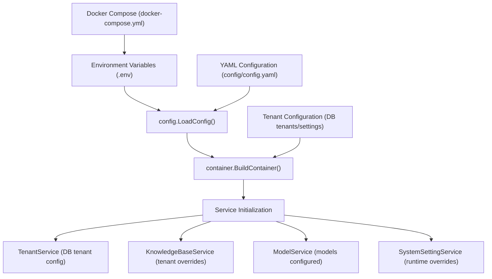
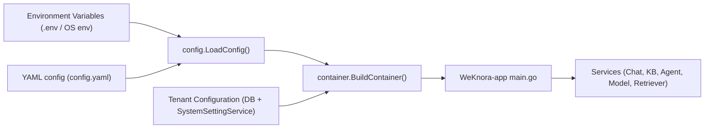
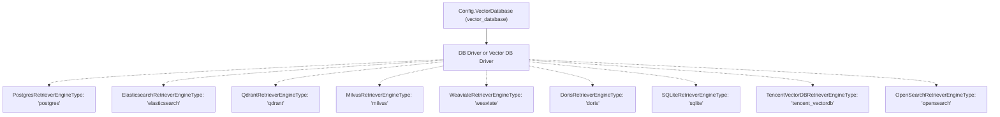

<!-- source: DeepWiki mcp.deepwiki.com · repo Tencent/WeKnora · page 8 Configuration Reference · fetched 2026-10-29 -->

# Configuration Reference

Relevant source files

The following files were used as context for generating this wiki page:

- [.env.example](.env.example)
- [config/config.yaml](config/config.yaml)
- [docker-compose.dev.yml](docker-compose.dev.yml)
- [docker-compose.yml](docker-compose.yml)
- [docreader/README.md](docreader/README.md)
- [docreader/config.py](docreader/config.py)
- [docreader/parser/docx_parser.py](docreader/parser/docx_parser.py)
- [docreader/parser/image_preprocess.py](docreader/parser/image_preprocess.py)
- [docreader/preprocess.py](docreader/preprocess.py)
- [docreader/preprocess_worker.py](docreader/preprocess_worker.py)
- [docreader/tests/test_config.py](docreader/tests/test_config.py)
- [docreader/tests/test_docx_tables.py](docreader/tests/test_docx_tables.py)
- [docreader/tests/test_preprocess_runner.py](docreader/tests/test_preprocess_runner.py)
- [go.mod](go.mod)
- [go.sum](go.sum)
- [internal/config/auth_legacy_env_test.go](internal/config/auth_legacy_env_test.go)
- [internal/config/config.go](internal/config/config.go)
- [internal/container/container.go](internal/container/container.go)
- [scripts/dev.sh](scripts/dev.sh)

This page serves as a high-level parent reference for all configuration options, environment variables, and deployment profiles in WeKnora. WeKnora relies on a layered configuration system that combines environment variables, static YAML configuration files, database-backed system settings, and tenant-level configurations.

For detailed domain-specific settings, refer to the child pages:
- [Environment Variables](#8.1)
- [Agent and Conversation Configuration](#8.2)
- [Model Configuration and Integration](#8.3)
- [Document Processing Configuration](#8.4)
- [Retrieval Engine Configuration](#8.5)

---

## Configuration Architecture Overview

WeKnora implements a centralized configuration loader powered by `viper` [internal/config/config.go:14]() which aggregates settings into a master `Config` struct [internal/config/config.go:19-42](). At application startup, configuration values are loaded, validated, and injected through the dependency injection container builder `container.BuildContainer()` [internal/container/container.go:103-144]().

The precedence order for configuration resolution from highest to lowest priority is:
1. **Tenant-level Configuration**: Database overrides per tenant [internal/types/tenant.go:86-125]()
2. **System Settings**: Dynamically editable runtime overrides [internal/application/service/system_setting.go:65-95]()
3. **Environment Variables**: Primary operational overrides (.env / OS environment) [.env.example:1-25]()
4. **YAML Configuration Files**: Static defaults defined in `config/config.yaml` [config/config.yaml:1-48]()
5. **Code Defaults**: Hardcoded internal fallbacks in Go packages [internal/config/config.go:44-79]()

Sources: [.env.example:1-185](), [docker-compose.yml:1-150](), [config/config.yaml:1-48](), [internal/config/config.go:1-79](), [internal/container/container.go:103-144]()

---

## Configuration Domains

### 1. Environment Variables
Environment variables control container runtimes, database connections, object storage credentials, system flags, and external endpoints. For complete specifications, see [Environment Variables](#8.1).

Sources: [.env.example:1-185](), [docker-compose.yml:1-150]()

### 2. Agent and Conversation Configuration
Defines dialogue bounds, RAG parameters, summary controls, prompt templates, and agent loop execution timeouts. For details, see [Agent and Conversation Configuration](#8.2).

Sources: [internal/config/config.go:44-123](), [config/config.yaml:6-39]()

### 3. Model Configuration and Integration
Covers declarations and tuning for LLMs, embedding models, VLMs, rerankers, and ASR engines from multiple providers, including builtin YAML declarations. For details, see [Model Configuration and Integration](#8.3).

Sources: [internal/config/config.go:27](), [config/config.yaml:1-48]()

### 4. Document Processing Configuration
Controls document parsing engine parameters, DocReader connectivity (`DocReaderConfig`), MinerU/OpenDataLoader integration, and file type handling. The `DocReaderConfig` struct [internal/config/config.go:125-130]() defines the address and transport for the DocReader service. DocReader itself uses environment variables for its internal configuration, such as `MINIO_ENDPOINT`, `MINERU_ENDPOINT`, and `MAX_FILE_SIZE_MB` [docreader/README.md:11-17](). For details, see [Document Processing Configuration](#8.4).

Sources: [internal/config/config.go:81-87](), [config/config.yaml:40-48](), [docreader/README.md:11-17](), [docreader/config.py:56-61]()

### 5. Retrieval Engine Configuration
Manages the vector store driver (`VectorDatabaseConfig`), hybrid search weighting, and index settings across supported backends like PostgreSQL (`pgvector`), Qdrant, Milvus, Weaviate, Elasticsearch, Doris, SQLite, Tencent VectorDB, and OpenSearch. For details, see [Retrieval Engine Configuration](#8.5).

Sources: [internal/types/retriever.go:4-27](), [internal/config/config.go:89-92]()

---

## Docker Compose Profiles

WeKnora uses Docker Compose profiles to manage optional infrastructure components in development and production deployments [docker-compose.dev.yml:51-225]().

| Profile | Description |
|---|---|
| `full` | Starts all optional auxiliary services (MinIO, Qdrant, Neo4j, SearXNG) [docker-compose.dev.yml:51-225]() |
| `minio` | Starts MinIO S3-compatible object storage [docker-compose.dev.yml:84-105]() |
| `qdrant` | Starts Qdrant vector database [docker-compose.dev.yml:107-120]() |
| `milvus` | Starts Milvus vector database [docker-compose.dev.yml:177-204]() |
| `neo4j` | Starts Neo4j graph database for GraphRAG [docker-compose.dev.yml:205-224]() |
| `searxng` | Starts SearXNG web search instance [docker-compose.dev.yml:38-81]() |
| `opensearch` | Starts OpenSearch k-NN cluster [docker-compose.dev.yml:122-176]() |
| `odl-hybrid` | Starts OpenDataLoader hybrid service for advanced parsing [scripts/dev.sh:241-245]() |

Sources: [docker-compose.dev.yml:38-225](), [scripts/dev.sh:213-245]()

---

## Bridging Natural Language Context to Code Entities

### Diagram 1: From Configuration Sources to the Application Container

This diagram maps user-facing configurations to `config.LoadConfig()` and dependency injection registration inside `container.BuildContainer()` [internal/container/container.go:103-144]().

Sources: [internal/container/container.go:103-144](), [internal/config/config.go:1-42](), [.env.example:1-185]()

---

### Diagram 2: Mapping Configuration to Supported Retrieval Engines

The vector store type specified in the configuration maps directly to `RetrieverEngineType` constants and initializes the corresponding repository adapters [internal/types/retriever.go:4-27](), [internal/container/container.go:35-48]().

Sources: [internal/types/retriever.go:1-27](), [internal/container/container.go:22-49]()

---

