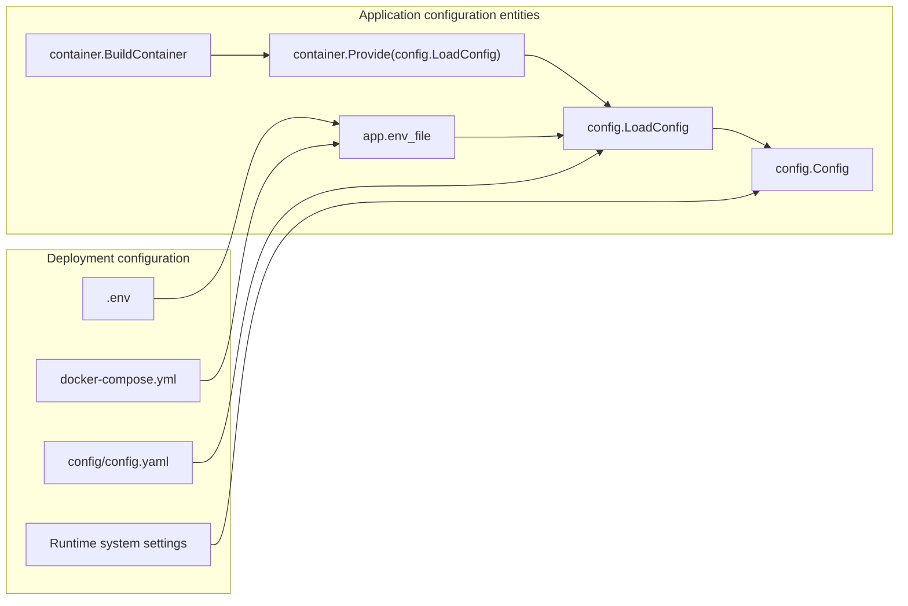
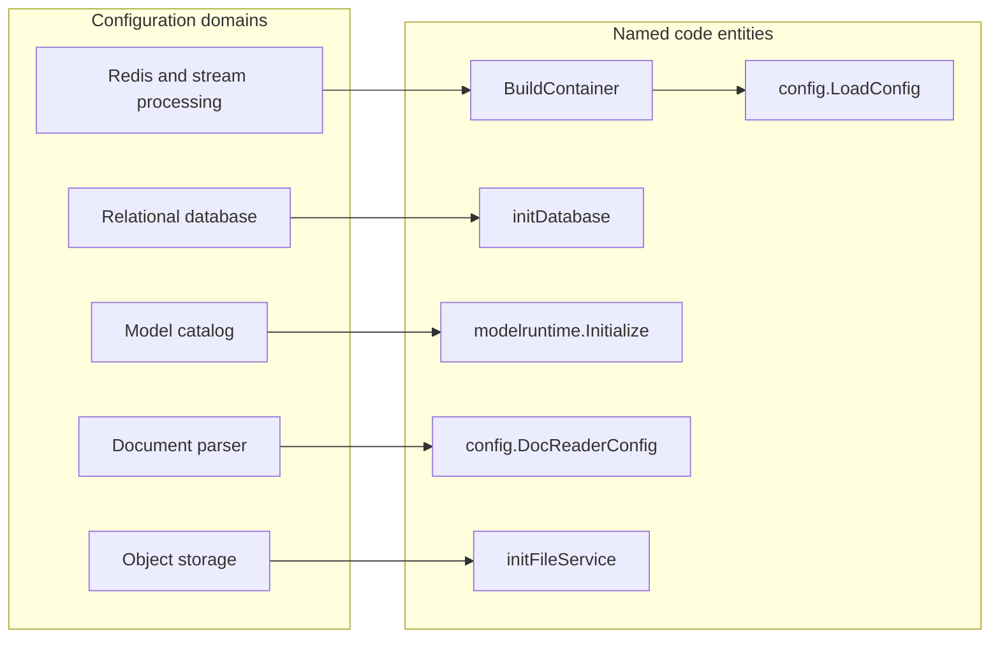

<!-- source: DeepWiki mcp.deepwiki.com · repo Tencent/WeKnora · page 8.1 Environment Variables · fetched 2026-10-29 -->

# Environment Variables

Relevant source files

The following files were used as context for generating this wiki page:

- [.env.example](.env.example)
- [config/config.yaml](config/config.yaml)
- [docker-compose.dev.yml](docker-compose.dev.yml)
- [docker-compose.yml](docker-compose.yml)
- [docreader/README.md](docreader/README.md)
- [docreader/config.py](docreader/config.py)
- [docreader/parser/docx_parser.py](docreader/parser/docx_parser.py)
- [docreader/parser/image_preprocess.py](docreader/parser/image_preprocess.py)
- [docreader/preprocess.py](docreader/preprocess.py)
- [docreader/preprocess_worker.py](docreader/preprocess_worker.py)
- [docreader/tests/test_config.py](docreader/tests/test_config.py)
- [docreader/tests/test_docx_tables.py](docreader/tests/test_docx_tables.py)
- [docreader/tests/test_preprocess_runner.py](docreader/tests/test_preprocess_runner.py)
- [frontend/src/views/chat/components/deepThink.vue](frontend/src/views/chat/components/deepThink.vue)
- [frontend/src/views/chat/components/docInfo.vue](frontend/src/views/chat/components/docInfo.vue)
- [frontend/src/views/chat/components/tool-results/KnowledgeBaseList.vue](frontend/src/views/chat/components/tool-results/KnowledgeBaseList.vue)
- [go.mod](go.mod)
- [go.sum](go.sum)
- [internal/agent/tools/web_fetch.go](internal/agent/tools/web_fetch.go)
- [internal/agent/tools/web_fetch_test.go](internal/agent/tools/web_fetch_test.go)
- [internal/agent/tools/web_pages_test.go](internal/agent/tools/web_pages_test.go)
- [internal/agent/tools/web_search.go](internal/agent/tools/web_search.go)
- [internal/agent/tools/web_search_test.go](internal/agent/tools/web_search_test.go)
- [internal/application/service/web_search.go](internal/application/service/web_search.go)
- [internal/config/auth_legacy_env_test.go](internal/config/auth_legacy_env_test.go)
- [internal/config/config.go](internal/config/config.go)
- [internal/container/container.go](internal/container/container.go)
- [internal/infrastructure/web_fetch/fetcher.go](internal/infrastructure/web_fetch/fetcher.go)
- [internal/infrastructure/web_fetch/fetcher_charset_test.go](internal/infrastructure/web_fetch/fetcher_charset_test.go)
- [internal/infrastructure/web_fetch/fetcher_test.go](internal/infrastructure/web_fetch/fetcher_test.go)
- [internal/utils/security.go](internal/utils/security.go)
- [internal/utils/security_dial_timeout_test.go](internal/utils/security_dial_timeout_test.go)
- [scripts/dev.sh](scripts/dev.sh)
- [website-docs/01-getting-started/04-configuration.md](website-docs/01-getting-started/04-configuration.md)
- [website-docs/02-architecture/02-backend-design.md](website-docs/02-architecture/02-backend-design.md)
- [website-docs/03-features/03-document-parsing.md](website-docs/03-features/03-document-parsing.md)
- [website-docs/03-features/07-agent.md](website-docs/03-features/07-agent.md)
- [website-docs/03-features/11-web-search.md](website-docs/03-features/11-web-search.md)
- [website-docs/03-features/16-observability.md](website-docs/03-features/16-observability.md)

## Purpose and Scope

This page documents the environment variables visible in the supplied deployment and configuration files, including how Docker Compose passes them to services and how the application’s configuration is represented in Go. The available file excerpts do not include every line of `.env.example` or `docker-compose.yml`; accordingly, this reference covers the variables evidenced in those excerpts rather than claiming an exhaustive inventory of all variables in the repository. [docker-compose.yml:1-148](), [.env.example:1-183](), [internal/config/config.go:19-42]()

Sources: [docker-compose.yml:1-148](), [.env.example:1-183](), [internal/config/config.go:19-42]()

## Configuration and Environment Delivery

The example configuration describes a layered configuration model: `config/config.yaml` provides structured defaults, environment variables provide deployment-level overrides, and supported runtime system settings can take precedence over environment variables. The example also documents `${ENV_VAR}` substitution in YAML and Viper’s `AutomaticEnv()` mapping of dotted keys to underscore-separated environment names. [website-docs/01-getting-started/04-configuration.md:3-25]()

In Docker Compose, the `app` service imports `.env` with `env_file`, then explicitly sets selected variables in its `environment` block. The frontend and other services do not receive the entire `.env` file through that mechanism; they consume variables explicitly listed in their Compose service definitions. [docker-compose.yml:68-80](), [.env.example:9-12]()

### Diagram: Deployment Configuration to Application Configuration

Sources: [docker-compose.yml:68-80](), [.env.example:9-12](), [website-docs/01-getting-started/04-configuration.md:16-25](), [internal/config/config.go:19-42](), [internal/container/container.go:121-137]()

The dependency-injection setup calls `container.Provide(config.LoadConfig)` during `BuildContainer`; the `Config` type groups application settings such as `Conversation`, `Server`, `KnowledgeBase`, `Tenant`, `Auth`, `Models`, `VectorDatabase`, `DocReader`, and `StreamManager`. [internal/container/container.go:121-137](), [internal/config/config.go:19-42]()

### Diagram: Environment Domains and Code Entities

Sources: [internal/container/container.go:113-137](), [internal/config/config.go:19-42](), [internal/config/config.go:124-130]()

## Application, Runtime, and Deployment Variables

The following variables are explicitly passed by the main Compose file or documented in the example environment file. Compose expressions such as `${NAME:-value}` provide a fallback when the variable is unset or empty; the exception `${WEKNORA_LOG_FORMAT-${LOG_FORMAT:-}}` uses an unset-only fallback for `WEKNORA_LOG_FORMAT`. [docker-compose.yml:11-26](), [docker-compose.yml:81-114]()

| Variable | Default or behavior | Purpose |
|---|---|---|
| `GIN_MODE` | `release` in Compose; `debug` is described as development mode | Gin mode. The example describes `debug` as providing detailed logs and Swagger, and `release` as disabling Swagger. [docker-compose.yml:91-93](), [.env.example:53-55]() |
| `LOG_LEVEL` | `debug` | Logging verbosity; documented values are `debug`, `info`, `warn`, `error`, and `fatal`. [docker-compose.yml:81-84](), [.env.example:56-57]() |
| `LOG_PATH` | Empty | Log file path; empty means stdout-only logging. [docker-compose.yml:84-86](), [.env.example:58-59]() |
| `WEKNORA_LOG_FORMAT` | Falls back to `LOG_FORMAT` when unset; empty selects the default format | Custom log format. The example says the template must contain `%msg` and that the legacy variable is supported when the new variable is unset. [docker-compose.yml:86-88](), [.env.example:60-62]() |
| `LLM_DEBUG_LOG` | `false` | Enables separate LLM request/response logging; `true` writes `llm_debug.log` in the `LOG_PATH` directory, or a supplied value can specify a path. [docker-compose.yml:88-90](), [.env.example:63-65]() |
| `TZ` | `Asia/Shanghai` | Runtime timezone, affecting displayed system time and log timestamps per the example. [docker-compose.yml:94-96](), [.env.example:66-68]() |
| `WEKNORA_LANGUAGE` | Empty | Deployment-level document-processing language override. Compose comments describe precedence over `Accept-Language`; the example describes prompt-language precedence as `Accept-Language`, then this variable, then an internal default. [docker-compose.yml:96-99](), [.env.example:69-71]() |
| `DEFAULT_LOCALE` | Empty | Frontend initial locale, passed to the frontend container. The example says a previously selected user locale takes precedence and lists supported locale values. [docker-compose.yml:17-21](), [.env.example:72-75]() |
| `AUTO_MIGRATE` | `true` | Controls automatic database migrations at startup; setting it to `false` disables them. [docker-compose.yml:107-108](), [.env.example:78-79]() |
| `AUTO_RECOVER_DIRTY` | `true` in the example | Example-documented control for automatic recovery of dirty migration state. [ .env.example:80-81]() |
| `WEKNORA_BOOTSTRAP_SYSTEM_ADMIN_EMAIL` | Unset in the example | Example-documented startup bootstrap for promoting the specified email to system administrator; described as idempotent and promotion-only. [ .env.example:82-84]() |
| `WEKNORA_OUTBOUND_DIAL_TIMEOUT` | Empty; Compose comment says empty uses the default | Go duration for outbound connection attempts to external endpoints. [docker-compose.yml:101-104]() |
| `WEKNORA_SANDBOX_DOCKER_ENABLED` | `false` | Enables Docker sandbox support. Compose warns that using the host Docker socket is equivalent to host-root access and that the socket must be mounted when this feature is enabled. [docker-compose.yml:51-54](), [docker-compose.yml:99-102]() |
| `WEKNORA_TRUSTED_PROXIES` | Not set in the shown Compose block | Comma-separated trusted proxy CIDRs; Compose comments say explicitly setting an empty string disables proxy trust. [docker-compose.yml:104-106]() |
| `FRONTEND_BASE_URL` | Empty | External frontend origin for absolute links such as invitations; empty falls back to host-relative URLs according to the example. [docker-compose.yml:113-114](), [.env.example:111-112]() |
| `APP_HOST` | `app` | Host used by the frontend’s NGINX proxy; may be changed for a remote backend. [docker-compose.yml:21-25](), [.env.example:86-89]() |
| `APP_PORT` | `8080` | Host-side port mapping for the app service. It is distinct from the frontend’s NGINX backend port. [docker-compose.yml:45-46](), [.env.example:89-90]() |
| `APP_BACKEND_PORT` | `8080` | Compose input used as the frontend container’s `APP_PORT`, which is the NGINX proxy target port. [docker-compose.yml:22-26](), [.env.example:91-93]() |
| `APP_SCHEME` | `http` | Protocol used by frontend NGINX when proxying to the backend. [docker-compose.yml:25-26](), [.env.example:94-95]() |
| `FRONTEND_PORT` | `80` | Host-side frontend port mapping. [docker-compose.yml:15-16](), [.env.example:96-97]() |
| `APP_EXTERNAL_URL` | Not set in the shown Compose block | Example-documented externally reachable application URL for file links used by IM integrations; the example describes object-storage public URLs as an alternative. [docker-compose.yml:109-112](), [.env.example:102-110]() |
| `RESOURCE_URL_MODE` | Example default `handle` | Example-documented default form for file references in API responses; per-request `resource_urls` can override it. [ .env.example:113-122]() |
| `MCP_PORT` | Example default `8082` | Example-documented external port for the MCP server. [ .env.example:123-124]() |

Sources: [docker-compose.yml:11-26](), [docker-compose.yml:81-114](), [.env.example:53-124]()

## Authentication, Tenant, and Audit Variables

The main Compose file passes the following authentication, tenant, and audit controls to the application. The configuration guide notes that supported runtime system settings can supersede environment variables; resetting the corresponding setting restores the environment/default value. [docker-compose.yml:125-141](), [website-docs/01-getting-started/04-configuration.md:9-14]()

| Variable | Default | Purpose |
|---|---:|---|
| `DISABLE_REGISTRATION` | `false` | Disables new-user registration when enabled. [docker-compose.yml:125-128]() |
| `WEKNORA_AUTH_COMPLEX_PASSWORD_ENABLED` | `false` | Requires passwords to include uppercase and lowercase letters, digits, and special characters when enabled. [docker-compose.yml:128-130]() |
| `WEKNORA_AUTH_DEFAULT_TENANT_MODE` | `create_personal` | Default tenant mode for public registration; the Compose comment lists `create_personal` and `tenantless`. [docker-compose.yml:130-132]() |
| `WEKNORA_TENANT_SELF_SERVICE_CREATION_ENABLED` | `true` | Controls whether ordinary users may create a tenant after login; the Compose comment says disabling it restricts them to invitation-based joining. [docker-compose.yml:132-134]() |
| `WEKNORA_TENANT_ENABLE_CROSS_TENANT_ACCESS` | `false` | Enables cross-tenant access, subject to the user’s `CanAccessAllTenants` permission according to the Compose comment. [docker-compose.yml:134-136]() |
| `WEKNORA_TENANT_DEFAULT_STORAGE_QUOTA_GB` | `10` | Default storage quota for a newly created tenant, in GB. [docker-compose.yml:136-138]() |
| `WEKNORA_INVITATION_TTL` | `168h` | Invitation link lifetime in Go duration syntax; the default is seven days. [docker-compose.yml:138-140]() |
| `WEKNORA_AUDIT_RETENTION_DAYS` | `90` | Audit log retention period in days; `0` disables cleanup. [docker-compose.yml:140-141]() |

Sources: [docker-compose.yml:125-141](), [website-docs/01-getting-started/04-configuration.md:9-14]()

## Database Variables

The main Compose excerpt shows PostgreSQL-oriented defaults and passes the database variables to the application. The example documents PostgreSQL and SQLite as supported `DB_DRIVER` values, with `DB_PATH` used for SQLite. The available Compose excerpt ends at `DB_NAME`; it does not show the subsequent Compose mapping for `DB_PATH`. [docker-compose.yml:142-148](), [.env.example:131-145]()

| Variable | Default or requirement | Purpose |
|---|---|---|
| `DB_DRIVER` | `postgres` | Primary database driver; the example lists `postgres` and `sqlite`. [docker-compose.yml:142-144](), [.env.example:131-133]() |
| `DB_HOST` | `postgres` | Database host. [docker-compose.yml:143-145](), [.env.example:134-135]() |
| `DB_PORT` | `5432` | Database port. [docker-compose.yml:144-146](), [.env.example:136-137]() |
| `DB_USER` | Required deployment value; Compose fallback is empty | Database username. [docker-compose.yml:145-147](), [.env.example:138-139]() |
| `DB_PASSWORD` | Required deployment value; Compose fallback is empty | Database password. [docker-compose.yml:146-148](), [.env.example:140-141]() |
| `DB_NAME` | Required deployment value; Compose fallback is empty | Database name. [docker-compose.yml:147-148](), [.env.example:142-143]() |
| `DB_PATH` | Example shows `./data/weknora.db` as a commented example | SQLite database file path; ignored by the PostgreSQL driver according to the example. [ .env.example:144-145]() |

Sources: [docker-compose.yml:142-148](), [.env.example:131-145]()

## Redis, Streams, and Asynq

The example environment file documents Redis settings for stream processing and the task queue. It describes `memory` and `redis` stream manager types, and states that Redis mode also supplies the Redis dependency for the Asynq queue. [ .env.example:147-172]()

| Variable | Example value or default | Purpose |
|---|---|---|
| `STREAM_MANAGER_TYPE` | `redis` | Selects the stream backend: `memory` or `redis`. [ .env.example:147-150]() |
| `REDIS_ADDR` | `redis:6379` | Redis address; the example says an empty value disables Redis and identifies memory mode with Lite mode. [ .env.example:151-152]() |
| `REDIS_USERNAME` | Empty / optional | Optional Redis ACL username for Redis 6.0 and later. [ .env.example:153-154]() |
| `REDIS_PASSWORD` | Example value supplied | Redis authentication password; the example says it may be empty if not configured. [ .env.example:155-156]() |
| `REDIS_DB` | `0` | Redis logical database index. [ .env.example:157-158]() |
| `REDIS_PREFIX` | `stream:` | Redis key prefix used for namespace separation. [ .env.example:159-160]() |
| `WEKNORA_REDIS_NAMESPACE` | Empty | Channel namespace suffix for deployments sharing one Redis instance. [ .env.example:161-162]() |
| `WEKNORA_REDIS_OP_TIMEOUT_MS` | Example default `500` ms | Asynq Redis read/write timeout; the example notes writes may be increased to 1000 ms. [ .env.example:163-164]() |
| `REDIS_USE_TLS` | `false` in the example comment | Enables Redis TLS. [ .env.example:166-168]() |
| `REDIS_TLS_SERVER_NAME` | Empty | TLS server name used for certificate verification and SNI. [ .env.example:169-170]() |
| `REDIS_TLS_INSECURE_SKIP_VERIFY` | `false` in the example comment | Skips Redis server certificate verification; the example warns against this in production. [ .env.example:171-172]() |
| `WEKNORA_ASYNQ_CORE_CONCURRENCY` | Example default `8` | Per-instance minimum concurrency for the default and `chat_attachment` queues. [ .env.example:174-177]() |
| `WEKNORA_ASYNQ_POSTPROCESS_CONCURRENCY` | Example default `2` | Per-instance concurrency for the postprocess queue. [ .env.example:178-179]() |
| `WEKNORA_ASYNQ_ENRICHMENT_CONCURRENCY` | Example default `12` | Per-instance concurrency for summary, multimodal, graph, and question-generation work. [ .env.example:180-181]() |
| `WEKNORA_ASYNQ_MAINTENANCE_CONCURRENCY` | Example default `4` | Per-instance concurrency for sync and maintenance work. [ .env.example:182-183]() |

The example characterizes each Asynq pool as an independent server and describes the values as per-instance minimum concurrency; across multiple replicas, total capacity accumulates by replica count. It also notes that system settings named `asynq.*_concurrency` can adjust concurrency at runtime. [ .env.example:174-183]()

Sources: [.env.example:147-183]()

## File and Object Storage Variables

The application Compose excerpt passes Tencent Cloud COS credentials and bucket settings to the `app` container. The frontend separately receives file-size limits. The supplied excerpts do not show the full application storage variable list or the storage-provider selection variable, so provider-specific variables beyond those shown here are not enumerated. [docker-compose.yml:17-20](), [docker-compose.yml:115-123]()

| Variable | Default | Purpose |
|---|---|---|
| `MAX_FILE_SIZE_MB` | `50` for the frontend | Frontend file-size limit in MB. DocReader documentation also describes this variable as a gRPC receive-size limit and recommends keeping frontend and backend limits aligned. [docker-compose.yml:17-19](), [docreader/README.md:60-69](), [docreader/README.md:224-226]() |
| `MAX_SKILL_BUNDLE_SIZE_MB` | `256` | Frontend skill-bundle upload size limit in MB. [docker-compose.yml:18-20]() |
| `COS_SECRET_ID` | Empty | Tencent Cloud COS credential ID. [docker-compose.yml:115-117]() |
| `COS_SECRET_KEY` | Empty | Tencent Cloud COS credential secret. [docker-compose.yml:116-118]() |
| `COS_REGION` | Empty | COS region. [docker-compose.yml:117-119]() |
| `COS_BUCKET_NAME` | Empty | COS bucket name. [docker-compose.yml:118-120]() |
| `COS_APP_ID` | Empty | COS application ID. [docker-compose.yml:119-121]() |
| `COS_PATH_PREFIX` | Empty | Prefix for COS object paths. [docker-compose.yml:120-122]() |
| `COS_TEMP_BUCKET_NAME` | Empty | Temporary COS bucket name. [docker-compose.yml:121-123]() |
| `COS_TEMP_REGION` | Empty | Region for the temporary COS bucket. [docker-compose.yml:122-123]() |

The DocReader README separately documents `STORAGE_TYPE` values for MinIO/S3, COS, and OSS, with corresponding provider credentials and bucket settings. Those are DocReader service configuration options; the README excerpt does not establish that every such variable is passed to the `app` container. [docreader/README.md:115-147]()

| DocReader variable | Documented use |
|---|---|
| `STORAGE_TYPE` | Selects `minio`, `cos`, or `oss` in the documented provider examples. [docreader/README.md:119-147]() |
| `MINIO_ENDPOINT` | Internal MinIO endpoint used by DocReader. [docreader/README.md:7-17](), [docreader/README.md:21-29]() |
| `MINIO_PUBLIC_ENDPOINT` | Publicly reachable MinIO endpoint used when generating externally accessible file URLs. [docreader/README.md:13-17](), [docreader/README.md:31-47]() |
| `MINIO_ACCESS_KEY_ID`, `MINIO_SECRET_ACCESS_KEY`, `MINIO_BUCKET_NAME`, `MINIO_PATH_PREFIX`, `MINIO_USE_SSL` | DocReader MinIO/S3 storage credentials and options. [docreader/README.md:115-126]() |
| `COS_SECRET_ID`, `COS_SECRET_KEY`, `COS_REGION`, `COS_BUCKET_NAME`, `COS_APP_ID`, `COS_PATH_PREFIX` | DocReader COS credentials and bucket/path settings. [docreader/README.md:128-137]() |
| `OSS_ACCESS_KEY_ID`, `OSS_ACCESS_KEY_SECRET`, `OSS_ENDPOINT`, `OSS_BUCKET_NAME`, `OSS_REGION`, `OSS_PATH_PREFIX` | DocReader OSS credentials and endpoint/bucket/path settings. [docreader/README.md:139-147]() |

Sources: [docker-compose.yml:17-20](), [docker-compose.yml:115-123](), [docreader/README.md:7-17](), [docreader/README.md:60-69](), [docreader/README.md:115-147]()

## Model and Model-Catalog Configuration

`BuildContainer` calls `modelruntime.Initialize(config.ConfigDir())` to initialize the model catalog overlay; failures are logged as warnings. The Compose file describes optional mounts for `config/builtin_models.yaml` and `config/models.json`. The supplied excerpts do not show a complete list of provider API-key environment variables, so those are intentionally not inferred here. [internal/container/container.go:121-127](), [docker-compose.yml:55-61]()

| Setting | Delivery and behavior |
|---|---|
| `config/builtin_models.yaml` | Optional declarative built-in model configuration, mounted read-only when enabled in Compose. [docker-compose.yml:55-58]() |
| `config/models.json` | Optional model catalog overlay for additional vendors or model overrides, mounted read-only when enabled in Compose. [docker-compose.yml:59-61]() |
| `${ENV}` references in model configuration | The `app` service receives `.env` through `env_file`, allowing deployment variables to reach the container for configuration references. [docker-compose.yml:68-79]() |
| `VITE_FRONTEND_COMMIT` | Frontend build argument, defaulting to `unknown`; it is build-time metadata rather than an application model-provider setting. [docker-compose.yml:6-13]() |
| `NPM_REGISTRY` | Frontend build argument for npm registry selection. [docker-compose.yml:8-13]() |
| `NODE_MAX_OLD_SPACE_SIZE` | Frontend build argument, default `4096` MB. [docker-compose.yml:11-13](), [.env.example:48-51]() |

Sources: [internal/container/container.go:121-127](), [docker-compose.yml:6-13](), [docker-compose.yml:55-79](), [.env.example:45-51]()

## DocReader and Document-Processing Variables

Compose passes DocReader connection settings through the app’s configuration environment, and the Go configuration model represents those settings as `DocReaderConfig` with `Addr` and `Transport` fields. DocReader has its own service-level environment variables for parser endpoints, upload limits, and worker/resource controls. [docker-compose.yml:1-1](), [.env.example:98-101](), [internal/config/config.go:124-130](), [docreader/README.md:5-17]()

| Variable | Default or documented behavior | Consumer / purpose |
|---|---|---|
| `DOCREADER_ADDR` | `docreader:50051` | App-side DocReader address. [ .env.example:98-100]() |
| `DOCREADER_TRANSPORT` | `grpc` | App-side transport selection; the configuration type documents `grpc` as the default and `http` as an alternative. [ .env.example:100-101](), [internal/config/config.go:124-130]() |
| `MINERU_ENDPOINT` | Empty | Optional MinerU service endpoint passed to DocReader by Compose. [docreader/README.md:7-17](), [docreader/README.md:49-58]() |
| `MAX_FILE_SIZE_MB` | `50` in the DocReader README | Maximum file size in MB for the documented DocReader gRPC configuration. [docreader/README.md:60-69]() |
| `DOCREADER_GRPC_MAX_WORKERS` | `4` | DocReader gRPC worker limit. [docreader/README.md:71-78]() |
| `DOCREADER_GRPC_PORT` | `50051` | DocReader gRPC listening port. [docreader/README.md:75-78]() |
| `DOCREADER_MARKITDOWN_MAX_WORKERS` | `1` | MarkItDown parsing concurrency; the README says `0` disables its limit. [docreader/README.md:80-85]() |
| `DOCREADER_PDF_RENDER_MAX_WORKERS` | `1` | Scanned-PDF rendering concurrency; the README says `0` disables its limit. [docreader/README.md:80-85]() |
| `DOCREADER_PDF_RENDER_DPI` | `200` | Scanned-PDF render resolution. [docreader/README.md:80-85]() |
| `DOCREADER_PDF_JPEG_QUALITY` | `85` | JPEG quality for rendered scanned PDFs; the README says values are constrained to 1–95. [docreader/README.md:80-85]() |
| `DOCREADER_HTML_MAIN_CONTENT` | `false` | Enables main-content extraction for uploaded HTML files, according to the DocReader README. [docreader/README.md:87-90]() |
| `DOCREADER_PREPROCESS_MAX_WORKERS` | `1` | Maximum concurrent image-preprocessing subprocesses per DocReader instance. [docreader/README.md:99-104]() |
| `DOCREADER_PREPROCESS_TIMEOUT_SECONDS` | `30` | Per-image preprocessing time limit in seconds. [docreader/README.md:99-104]() |
| `DOCREADER_PREPROCESS_THREADS` | `2` | Per-model operator thread count and numerical-library thread settings. [docreader/README.md:99-104]() |
| `DOCREADER_PREPROCESS_MEMORY_MB` | `2048` | Per-subprocess memory budget in MiB. [docreader/README.md:99-104]() |
| `DOCREADER_PREPROCESS_MAX_PIXELS` | `16000000` | Maximum image pixel count checked before decoding. [docreader/README.md:99-105]() |
| `DOCREADER_PREPROCESS_PROBE_EDGE` | `2000` | Longest edge for the image used in detection. [docreader/README.md:105-107]() |
| `DOCREADER_PREPROCESS_MAX_EDGE` | `2000` | Maximum longest edge for the preprocessing crop result. [docreader/README.md:105-108]() |

Sources: [.env.example:98-101](), [internal/config/config.go:124-130](), [docreader/README.md:5-17](), [docreader/README.md:49-109]()

## Development and Optional-Service Variables

The development Compose file uses environment variables to configure host port mappings and optional infrastructure services. The development startup script loads `.env`, then optionally loads `.env.local` so that the latter overrides the former. [docker-compose.dev.yml:1-16](), [scripts/dev.sh:88-117]()

| Variable | Default or behavior | Purpose |
|---|---|---|
| `DEV_REMOTE_HOST` | Unset | When set, `scripts/dev.sh` skips starting local Docker infrastructure and reports the remote services host. [scripts/dev.sh:202-206]() |
| `MINIO_PORT` | `9000` | Host port for the MinIO API in the development Compose file. [docker-compose.dev.yml:84-93]() |
| `MINIO_CONSOLE_PORT` | `9001` | Host port for the MinIO console. [docker-compose.dev.yml:87-90]() |
| `SEARXNG_BIND` | `127.0.0.1` | SearXNG host bind address in the development Compose file. [docker-compose.dev.yml:54-61]() |
| `SEARXNG_PORT` | `8888` | SearXNG host port; also used in its development base URL. [docker-compose.dev.yml:59-65]() |
| `SEARXNG_SECRET` | Development fallback secret | SearXNG secret configured by the development Compose file. The file warns to rotate the fallback before public exposure. [docker-compose.dev.yml:63-68]() |
| `QDRANT_REST_PORT` | `6333` | Development host port for Qdrant REST. [docker-compose.dev.yml:107-114]() |
| `QDRANT_PORT` | `6334` | Development host port for Qdrant’s other exposed service port. [docker-compose.dev.yml:110-112]() |
| `OPENSEARCH_PORT` | `9200` | Development host port for OpenSearch. [docker-compose.dev.yml:126-145]() |
| `OPENSEARCH_DASHBOARDS_PORT` | `5601` | Development host port for OpenSearch Dashboards. [docker-compose.dev.yml:161-169]() |
| `MILVUS_PORT` | `19530` | Development host port for Milvus. [docker-compose.dev.yml:177-198]() |
| `MILVUS_HEALTH_PORT` | `9091` | Development host port for Milvus health checks. [docker-compose.dev.yml:188-198]() |
| `NEO4J_USERNAME` | `neo4j` | Development Neo4j username, used to form the container’s `NEO4J_AUTH` value. [docker-compose.dev.yml:206-212]() |
| `NEO4J_PASSWORD` | `password` | Development Neo4j password, used to form the container’s `NEO4J_AUTH` value. [docker-compose.dev.yml:206-212]() |

Sources: [docker-compose.dev.yml:54-68](), [docker-compose.dev.yml:84-120](), [docker-compose.dev.yml:126-169](), [docker-compose.dev.yml:177-212](), [scripts/dev.sh:88-117](), [scripts/dev.sh:202-206]()

## Configuration Maintenance Notes

Treat `.env` as deployment-specific configuration: the example instructs operators to copy `.env.example`, replace placeholders (especially required values), and avoid committing `.env` to version control. [ .env.example:4-7]()

When an environment variable appears not to take effect, check whether the setting is supported by the runtime system-settings layer, which the configuration guide says takes precedence over environment variables. Also verify that the relevant container actually receives the variable: the `app` imports `.env`, whereas other services rely on explicitly listed Compose environment entries. [website-docs/01-getting-started/04-configuration.md:9-14](), [.env.example:9-12](), [docker-compose.yml:68-80]()

Sources: [.env.example:4-12](), [website-docs/01-getting-started/04-configuration.md:9-14](), [docker-compose.yml:68-80]()

---

