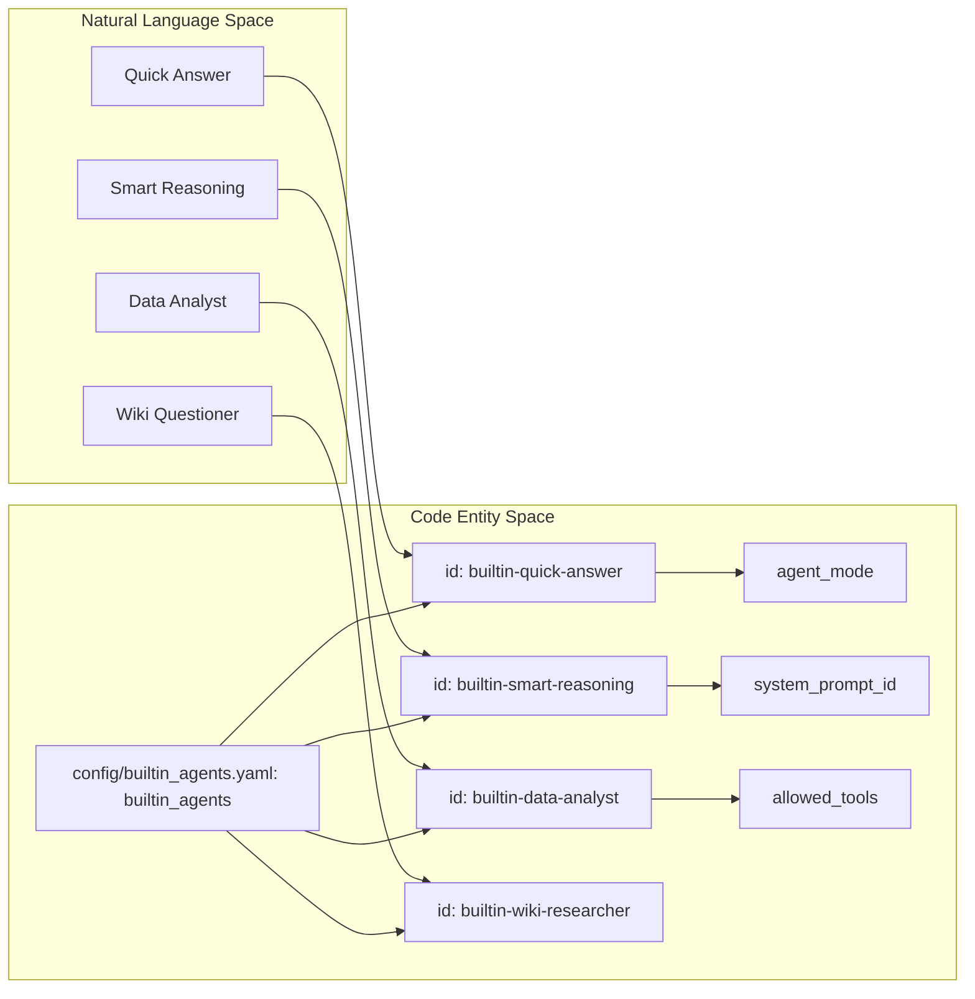
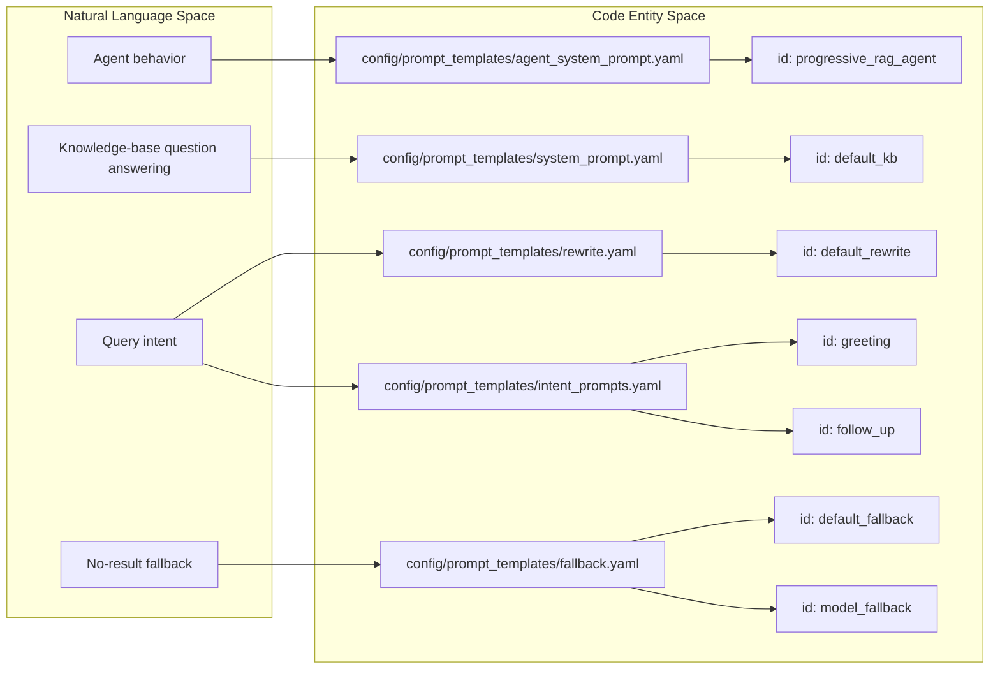
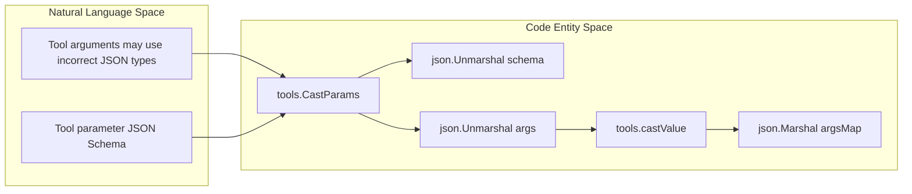
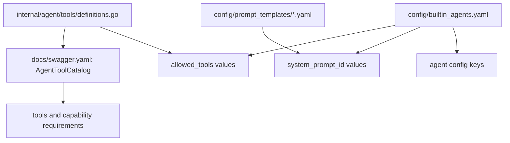

<!-- source: DeepWiki mcp.deepwiki.com · repo Tencent/WeKnora · page 8.2 Agent and Conversation Configuration · fetched 2026-10-29 -->

# Agent and Conversation Configuration

Relevant source files

The following files were used as context for generating this wiki page:

- [config/builtin_agents.yaml](config/builtin_agents.yaml)
- [config/prompt_templates/agent_system_prompt.yaml](config/prompt_templates/agent_system_prompt.yaml)
- [config/prompt_templates/context_template.yaml](config/prompt_templates/context_template.yaml)
- [config/prompt_templates/fallback.yaml](config/prompt_templates/fallback.yaml)
- [config/prompt_templates/intent_prompts.yaml](config/prompt_templates/intent_prompts.yaml)
- [config/prompt_templates/rewrite.yaml](config/prompt_templates/rewrite.yaml)
- [config/prompt_templates/system_prompt.yaml](config/prompt_templates/system_prompt.yaml)
- [docs/docs.go](docs/docs.go)
- [docs/swagger.json](docs/swagger.json)
- [docs/swagger.yaml](docs/swagger.yaml)
- [internal/agent/tools/definitions.go](internal/agent/tools/definitions.go)
- [internal/agent/tools/param_cast.go](internal/agent/tools/param_cast.go)
- [internal/agent/tools/param_cast_preserve_test.go](internal/agent/tools/param_cast_preserve_test.go)
- [internal/agent/tools/param_cast_test.go](internal/agent/tools/param_cast_test.go)
- [internal/agent/tools/sequentialthinking.go](internal/agent/tools/sequentialthinking.go)
- [internal/agent/tools/todo_write.go](internal/agent/tools/todo_write.go)

## Purpose and scope

This page describes the agent presets, prompt-template files, conversation-related settings, and selectable tool metadata visible in the supplied configuration and API-schema excerpts. The excerpts show defaults and schema descriptions, but do not establish how tenant-level configuration is persisted, which routes update it, or how all settings are applied at runtime. [config/builtin_agents.yaml:1-219](), [config/prompt_templates/agent_system_prompt.yaml:1-104](), [docs/swagger.yaml:1-64]()

Sources: [config/builtin_agents.yaml:1-219](), [config/prompt_templates/agent_system_prompt.yaml:1-104](), [docs/swagger.yaml:1-64]()

---

## Agent configuration structure

`config/builtin_agents.yaml` defines built-in agents as entries under `builtin_agents`. Each shown entry has an `id`, `is_builtin` marker, localized display metadata under `i18n`, and a `config` map containing agent behavior settings. The excerpt does not show the Go configuration type or the service that loads these entries. [config/builtin_agents.yaml:1-5]()

The shown configuration keys cover mode and type, prompt selection, sampling and completion limits, iteration limits, knowledge-base selection, tool allowlists, web search, multi-turn behavior, and retrieval thresholds. These YAML keys describe preset values; they should not be read as a complete schema for every agent or every tenant override. [config/builtin_agents.yaml:25-47](), [config/builtin_agents.yaml:68-94](), [config/builtin_agents.yaml:115-139](), [config/builtin_agents.yaml:160-182]()

### Core settings visible in built-in presets

| Setting | Example values or purpose | Example preset |
|---|---|---|
| `agent_mode` | `quick-answer` or `smart-reasoning` | Quick Answer, Smart Reasoning [config/builtin_agents.yaml:25-27](), [config/builtin_agents.yaml:68-70]() |
| `agent_type` | Agent specialization such as `rag-qa`, `data-analysis`, `wiki-qa`, or `custom` | Smart Reasoning, Data Analyst, Wiki Questioner, Wiki Fixer [config/builtin_agents.yaml:68-71](), [config/builtin_agents.yaml:115-118](), [config/builtin_agents.yaml:160-163](), [config/builtin_agents.yaml:203-206]() |
| `system_prompt_id` | Identifier for a prompt template | `default_kb`, `data_analyst`, `wiki_researcher`, `wiki_fixer` [config/builtin_agents.yaml:25-28](), [config/builtin_agents.yaml:115-119](), [config/builtin_agents.yaml:160-164](), [config/builtin_agents.yaml:203-207]() |
| `system_prompt` | Inline prompt value, shown as an empty string for Smart Reasoning | Smart Reasoning [config/builtin_agents.yaml:68-73]() |
| `allowed_tools` | List of tool names assigned to the preset | Smart Reasoning, Data Analyst, Wiki Questioner [config/builtin_agents.yaml:75-82](), [config/builtin_agents.yaml:127-130](), [config/builtin_agents.yaml:169-173]() |
| `max_iterations` | Agent iteration limit | Smart Reasoning: `50`; Data Analyst, Wiki Questioner, Wiki Fixer: `30` [config/builtin_agents.yaml:68-75](), [config/builtin_agents.yaml:115-122](), [config/builtin_agents.yaml:160-168](), [config/builtin_agents.yaml:203-211]() |
| `multi_turn_enabled` | Whether the preset enables multi-turn behavior | Shown as `true` in Quick Answer, Smart Reasoning, Data Analyst, and Wiki Questioner [config/builtin_agents.yaml:31-36](), [config/builtin_agents.yaml:83-88](), [config/builtin_agents.yaml:131-139](), [config/builtin_agents.yaml:174-182]() |
| Retrieval settings | Top-k counts, thresholds, FAQ behavior, rewrite and expansion flags | Quick Answer and Smart Reasoning [config/builtin_agents.yaml:37-47](), [config/builtin_agents.yaml:87-94]() |

**Natural-language-to-code map: preset identity and configuration.** The labels in the diagram connect recognizable agent names to their YAML identifiers and config keys. The file excerpt shows these associations; it does not show a runtime loader or persistence flow. [config/builtin_agents.yaml:5-47](), [config/builtin_agents.yaml:49-94]()

Sources: [config/builtin_agents.yaml:5-47](), [config/builtin_agents.yaml:49-94](), [config/builtin_agents.yaml:95-139](), [config/builtin_agents.yaml:141-182]()

---

## Built-in agents and localization

The supplied YAML excerpt shows these built-in agents:

| YAML ID | Display name in default locale | Specialization shown in configuration |
|---|---|---|
| `builtin-quick-answer` | Quick Answer | Knowledge-base RAG Q&A; `agent_mode: quick-answer` [config/builtin_agents.yaml:5-28]() |
| `builtin-smart-reasoning` | Smart Reasoning | ReAct-style tool calling; `agent_mode: smart-reasoning`, `agent_type: rag-qa` [config/builtin_agents.yaml:49-82]() |
| `builtin-data-analyst` | Data Analyst | CSV/Excel analysis; `agent_type: data-analysis`; supported file types `csv` and `xlsx` [config/builtin_agents.yaml:96-129]() |
| `builtin-wiki-researcher` | Wiki Questioner | Wiki knowledge-base Q&A; `agent_type: wiki-qa` [config/builtin_agents.yaml:141-173]() |
| `builtin-wiki-fixer` | Wiki Fixer | Wiki-page revision; `agent_type: custom`; selected KB mode and retrieval-history retention are configured [config/builtin_agents.yaml:184-218]() |

Each shown agent sets `is_builtin: true`. The YAML supplies localized `name` and `description` values in `i18n`; the excerpt includes several language-specific entries and, for Quick Answer, a `default` locale. The available lines do not establish the locale-resolution algorithm or how users edit built-in entries. [config/builtin_agents.yaml:1-24](), [config/builtin_agents.yaml:49-67](), [config/builtin_agents.yaml:96-114](), [config/builtin_agents.yaml:141-159](), [config/builtin_agents.yaml:184-202]()

Sources: [config/builtin_agents.yaml:1-24](), [config/builtin_agents.yaml:49-67](), [config/builtin_agents.yaml:96-129](), [config/builtin_agents.yaml:141-182](), [config/builtin_agents.yaml:184-218]()

### Preset tool allowlists

The shown presets choose tools by string name in `allowed_tools`. Smart Reasoning includes knowledge search and reading, document listing, knowledge-graph querying, and asking the user. Data Analyst includes `data_schema`, `data_analysis`, and `ask_user`; Wiki Questioner includes Wiki search/read and document reading tools. [config/builtin_agents.yaml:75-82](), [config/builtin_agents.yaml:127-130](), [config/builtin_agents.yaml:169-173]()

`internal/agent/tools/definitions.go` declares tool-name constants and documents `AvailableToolDefinitions()` as the ordered set of tools that an agent’s `allowed_tools` list may select; the available list is also described as the source for the agent editor’s checkboxes. Some tools are explicitly documented as not selectable through that list because they are registered based on runtime capabilities or modes instead. [internal/agent/tools/definitions.go:7-23](), [internal/agent/tools/definitions.go:32-71](), [internal/agent/tools/definitions.go:92-116]()

The API schema describes an `AgentToolCatalog` with `default_tools`, `switch_managed_tools`, and ordered `tools`. Its descriptions distinguish tools that apply when `allowed_tools` has never been set from switch-managed tools, which follow other agent settings and are not registered merely by naming them. `AgentToolInfo` carries display and requirement metadata, including `danger`, `group`, and capability requirements. [docs/swagger.yaml:3-50]()

Sources: [config/builtin_agents.yaml:75-82](), [config/builtin_agents.yaml:127-130](), [config/builtin_agents.yaml:169-173](), [internal/agent/tools/definitions.go:7-23](), [internal/agent/tools/definitions.go:32-71](), [internal/agent/tools/definitions.go:92-116](), [docs/swagger.yaml:3-50]()

---

## Prompt management and templates

Prompt templates are represented in the supplied files as YAML entries under `templates`. Entries can include an `id`, display name, description, localized metadata, a default marker, a mode, and prompt content. The exact set of fields varies by template file and entry. [config/prompt_templates/agent_system_prompt.yaml:1-44](), [config/prompt_templates/system_prompt.yaml:1-27]()

### Agent system prompts

`config/prompt_templates/agent_system_prompt.yaml` describes defaults for Agent mode and includes distinct prompt entries for `pure_agent`, `progressive_rag_agent`, `data_analyst`, and `wiki_researcher` in the supplied excerpt. Their `mode` values distinguish `pure`, `rag`, `data_analyst`, and `wiki_researcher`; `progressive_rag_agent` is marked `default: true`. [config/prompt_templates/agent_system_prompt.yaml:1-20](), [config/prompt_templates/agent_system_prompt.yaml:26-44](), [config/prompt_templates/agent_system_prompt.yaml:53-69](), [config/prompt_templates/agent_system_prompt.yaml:80-96]()

The prompt bodies describe behavioral guidance. For example, the RAG agent prompt explains source selection and knowledge search, while the data analyst prompt directs the agent to inspect schemas and use read-only analysis. These are prompt contents, not executable enforcement mechanisms in the excerpt. [config/prompt_templates/agent_system_prompt.yaml:44-51](), [config/prompt_templates/agent_system_prompt.yaml:70-78]()

### System, rewrite, intent, and fallback templates

| Template file | Purpose and visible identifiers |
|---|---|
| `system_prompt.yaml` | General system prompts, including `default_kb` (`default: true`), `expert_assistant`, `customer_service`, `technical_support`, and `pure_chat`. The shown entries distinguish whether a knowledge base is expected with `has_knowledge_base`. [config/prompt_templates/system_prompt.yaml:1-27](), [config/prompt_templates/system_prompt.yaml:29-60](), [config/prompt_templates/system_prompt.yaml:62-93](), [config/prompt_templates/system_prompt.yaml:95-155]() |
| `rewrite.yaml` | Query-rewrite and intent-classification prompt pair; `default_rewrite` is marked as the runtime default in the file comment and entry metadata. Its content covers question rewriting and intent classes such as `kb_search`, `follow_up`, and `web_search`. [config/prompt_templates/rewrite.yaml:1-8](), [config/prompt_templates/rewrite.yaml:23-54]() |
| `intent_prompts.yaml` | Intent-specific system prompts whose IDs correspond to intent values, as stated in the file comment; shown IDs include `greeting`, `chitchat`, `follow_up`, `image_only`, `summarize`, and `web_search`. [config/prompt_templates/intent_prompts.yaml:1-5](), [config/prompt_templates/intent_prompts.yaml:6-28](), [config/prompt_templates/intent_prompts.yaml:30-80](), [config/prompt_templates/intent_prompts.yaml:82-105](), [config/prompt_templates/intent_prompts.yaml:107-152]() |
| `fallback.yaml` | Fixed-response and model-fallback templates; the file distinguishes the two uses in its comments. Shown IDs include `default_fallback`, `polite_fallback`, `brief_fallback`, `model_fallback`, and `default_fallback_prompt`. [config/prompt_templates/fallback.yaml:1-9](), [config/prompt_templates/fallback.yaml:37-40](), [config/prompt_templates/fallback.yaml:68-90](), [config/prompt_templates/fallback.yaml:120-138]() |

The YAML files document prompt content and selection metadata. The available excerpts do not show the loader, interpolation implementation, or tenant-level editing API, so those runtime details cannot be established here. [config/prompt_templates/agent_system_prompt.yaml:1-4](), [config/prompt_templates/system_prompt.yaml:1-5](), [config/prompt_templates/rewrite.yaml:1-8](), [config/prompt_templates/intent_prompts.yaml:1-5](), [config/prompt_templates/fallback.yaml:1-5]()

Sources: [config/prompt_templates/agent_system_prompt.yaml:1-104](), [config/prompt_templates/system_prompt.yaml:1-155](), [config/prompt_templates/rewrite.yaml:1-54](), [config/prompt_templates/intent_prompts.yaml:1-152](), [config/prompt_templates/fallback.yaml:1-153]()

**Natural-language-to-code map: prompt choice and intent names.** The diagram relates prompt families and intent labels appearing in natural-language descriptions to the YAML file and template IDs. It maps configuration identifiers, not a runtime call graph. [config/prompt_templates/agent_system_prompt.yaml:1-44](), [config/prompt_templates/rewrite.yaml:1-8](), [config/prompt_templates/intent_prompts.yaml:1-8](), [config/prompt_templates/fallback.yaml:1-9]()

Sources: [config/prompt_templates/agent_system_prompt.yaml:1-44](), [config/prompt_templates/system_prompt.yaml:1-27](), [config/prompt_templates/rewrite.yaml:1-23](), [config/prompt_templates/intent_prompts.yaml:1-8](), [config/prompt_templates/intent_prompts.yaml:56-80](), [config/prompt_templates/fallback.yaml:1-9](), [config/prompt_templates/fallback.yaml:86-118]()

---

## Conversation and retrieval settings

The built-in presets include settings relevant to multi-turn behavior and retrieval. Quick Answer sets `multi_turn_enabled: true`, `history_turns: 5`, and retrieval parameters such as `embedding_top_k`, `keyword_threshold`, `vector_threshold`, `rerank_top_k`, and `rerank_threshold`. The excerpt does not specify the runtime interpretation of `history_turns` or the thresholds. [config/builtin_agents.yaml:25-47]()

Other presets demonstrate that these values can differ: Data Analyst uses `embedding_top_k: 5` and `rerank_top_k: 5`, while Wiki Questioner uses `embedding_top_k: 10` and `rerank_top_k: 10`. [config/builtin_agents.yaml:115-139](), [config/builtin_agents.yaml:160-182]()

| Setting | Meaning supported by the available configuration |
|---|---|
| `multi_turn_enabled` | Boolean preset setting for multi-turn behavior; shown as `true` in several presets. [config/builtin_agents.yaml:31-36](), [config/builtin_agents.yaml:83-88]() |
| `history_turns` | Numeric history-related setting; Quick Answer sets it to `5`. Its precise windowing semantics are not shown. [config/builtin_agents.yaml:31-35]() |
| `embedding_top_k` | Numeric retrieval setting; values vary across presets. [config/builtin_agents.yaml:40-44](), [config/builtin_agents.yaml:135-139]() |
| `keyword_threshold`, `vector_threshold` | Retrieval threshold settings present in the shown presets. The excerpts do not define scoring semantics or valid ranges. [config/builtin_agents.yaml:40-44]() |
| `rerank_top_k`, `rerank_threshold` | Reranking settings present in the shown presets. The excerpts do not define the reranking implementation. [config/builtin_agents.yaml:42-44]() |
| `retain_retrieval_history` | Wiki Fixer enables this setting; its exact storage and lifetime behavior are not specified in the excerpt. [config/builtin_agents.yaml:203-213]() |

Sources: [config/builtin_agents.yaml:25-47](), [config/builtin_agents.yaml:83-94](), [config/builtin_agents.yaml:115-139](), [config/builtin_agents.yaml:160-182](), [config/builtin_agents.yaml:203-213]()

---

## Agent tools and parameter handling

`internal/agent/tools/definitions.go` defines names for tools such as `search_knowledge`, `read_document`, `list_documents`, `query_knowledge_graph`, `ask_user`, `data_analysis`, `web_search`, and Wiki operations. It also distinguishes selectable tools from capability- or mode-managed tools: sandbox file tools and shell tools, for example, are documented as absent from `AvailableToolDefinitions` and registered according to runtime capabilities or switches instead. [internal/agent/tools/definitions.go:14-31](), [internal/agent/tools/definitions.go:32-79](), [internal/agent/tools/definitions.go:80-90]()

`AvailableToolDefinitions()` returns the selectable tool definitions in editor display order. The `AvailableTool` structure includes a name, label, description, group, and optional `Danger` marker for tools that modify content. [internal/agent/tools/definitions.go:92-116]()

The API schema’s `AgentToolCatalog` exposes `default_tools`, `switch_managed_tools`, and `tools`; its `AgentToolRequirement` can express `all_of` and `any_of` knowledge-base capabilities. The capability values shown are `vector`, `keyword`, `wiki`, `graph`, and `faq`. [docs/swagger.yaml:3-64]()

### Schema-driven argument casting

`tools.CastParams` accepts tool arguments and a JSON Schema payload. If either input is empty, schema parsing fails, or no properties are available, it returns the original arguments. Otherwise it examines schema-declared properties and attempts type conversions; if changes are made, it serializes the updated argument map. [internal/agent/tools/param_cast.go:9-35](), [internal/agent/tools/param_cast.go:36-75]()

`tools.castValue` handles conversions for arrays, booleans, integers, numbers, and strings. For example, string values such as `"true"` and `"false"` can be converted to booleans, while a string that begins with `[` but is invalid JSON is left unconverted rather than treated as a single-item array. [internal/agent/tools/param_cast.go:77-115](), [internal/agent/tools/param_cast.go:117-152]()

**Argument-shape-to-code map.** The diagram associates an LLM-produced argument payload with the named casting functions and their JSON-schema input. [internal/agent/tools/param_cast.go:9-75](), [internal/agent/tools/param_cast.go:77-152]()

Sources: [internal/agent/tools/param_cast.go:9-75](), [internal/agent/tools/param_cast.go:77-152]()

---

## Configuration-to-execution view

The supplied sources establish the configuration files, preset fields, tool-name definitions, and API-schema shapes shown below. They do not show the complete execution path from tenant configuration through prompt loading to a chat request, so the diagram intentionally represents references and associations rather than asserting runtime calls. [config/builtin_agents.yaml:1-47](), [config/prompt_templates/agent_system_prompt.yaml:1-44](), [internal/agent/tools/definitions.go:92-116](), [docs/swagger.yaml:3-64]()

Sources: [config/builtin_agents.yaml:1-47](), [config/prompt_templates/agent_system_prompt.yaml:1-44](), [config/prompt_templates/system_prompt.yaml:1-27](), [internal/agent/tools/definitions.go:92-116](), [docs/swagger.yaml:3-64]()

---

