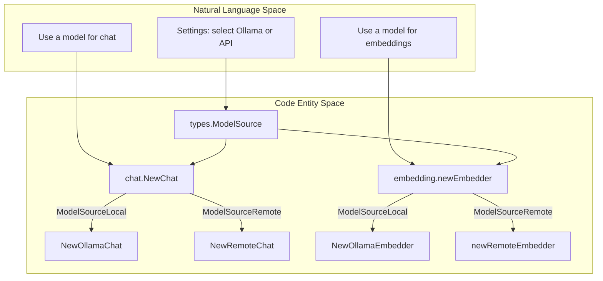
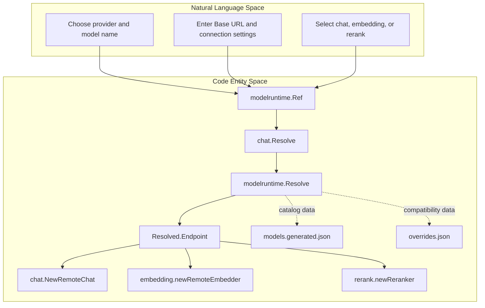
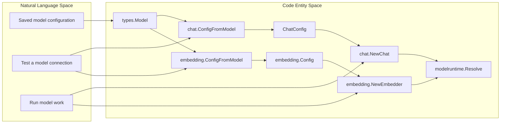

<!-- source: DeepWiki mcp.deepwiki.com · repo Tencent/WeKnora · page 8.3 Model Configuration and Integration · fetched 2026-10-29 -->

# Model Configuration and Integration

Relevant source files

The following files were used as context for generating this wiki page:

- [internal/application/service/image_ocr_live_test.go](internal/application/service/image_ocr_live_test.go)
- [internal/application/service/image_ocr_validation_test.go](internal/application/service/image_ocr_validation_test.go)
- [internal/application/service/ocr_sanitizer.go](internal/application/service/ocr_sanitizer.go)
- [internal/application/service/ocr_sanitizer_test.go](internal/application/service/ocr_sanitizer_test.go)
- [internal/application/service/temporary_document.go](internal/application/service/temporary_document.go)
- [internal/models/api/pineconerank/client.go](internal/models/api/pineconerank/client.go)
- [internal/models/api/pineconerank/golden_test.go](internal/models/api/pineconerank/golden_test.go)
- [internal/models/api/rerank.go](internal/models/api/rerank.go)
- [internal/models/catalog/data/models.generated.json](internal/models/catalog/data/models.generated.json)
- [internal/models/catalog/data/overrides.json](internal/models/catalog/data/overrides.json)
- [internal/models/catalog/data/seed.json](internal/models/catalog/data/seed.json)
- [internal/models/chat/chat.go](internal/models/chat/chat.go)
- [internal/models/chat/concurrency_wrapper.go](internal/models/chat/concurrency_wrapper.go)
- [internal/models/embedding/concurrency_wrapper.go](internal/models/embedding/concurrency_wrapper.go)
- [internal/models/embedding/concurrency_wrapper_test.go](internal/models/embedding/concurrency_wrapper_test.go)
- [internal/models/embedding/embedder.go](internal/models/embedding/embedder.go)
- [internal/models/limiter/governor.go](internal/models/limiter/governor.go)
- [internal/models/limiter/limiter.go](internal/models/limiter/limiter.go)
- [internal/models/parity/rerank_test.go](internal/models/parity/rerank_test.go)
- [internal/models/parity/testdata/catalog-baseline.json](internal/models/parity/testdata/catalog-baseline.json)
- [internal/models/providers/assets/pinecone.svg](internal/models/providers/assets/pinecone.svg)
- [internal/models/providers/builtin.go](internal/models/providers/builtin.go)
- [internal/models/providers/pinecone.go](internal/models/providers/pinecone.go)
- [internal/models/providers/providers_test.go](internal/models/providers/providers_test.go)
- [internal/models/rerank/reranker.go](internal/models/rerank/reranker.go)
- [internal/models/rerank/wire_test.go](internal/models/rerank/wire_test.go)
- [internal/models/vlm/concurrency_wrapper.go](internal/models/vlm/concurrency_wrapper.go)
- [internal/models/vlm/remote_api.go](internal/models/vlm/remote_api.go)
- [internal/models/vlm/remote_api_reasoning_test.go](internal/models/vlm/remote_api_reasoning_test.go)
- [internal/models/vlm/vlm.go](internal/models/vlm/vlm.go)
- [internal/models/vlm/weknoracloud.go](internal/models/vlm/weknoracloud.go)
- [website-docs/03-features/06-models.md](website-docs/03-features/06-models.md)

## Purpose and Scope

This page explains how WeKnora configures and instantiates chat/LLM, embedding, vision-language (VLM), rerank, and speech-recognition models. It covers provider resolution, per-model settings and compatibility overrides, and the built-in model catalog declarations visible in the provided code. The model settings guide describes selecting a model type and source, configuring a provider connection, testing it, and then selecting the model for a knowledge base or agent. [website-docs/03-features/06-models.md:1-15]()

The available catalog files here are JSON (`models.generated.json`, `seed.json`, and `overrides.json`), not YAML. This page therefore documents the supplied JSON catalog declarations; it does not infer a YAML format that is not present in the provided files. [internal/models/catalog/data/models.generated.json:1-4]()

Sources: [website-docs/03-features/06-models.md:1-15](), [internal/models/catalog/data/models.generated.json:1-4]()

---

## Model Types and Architecture

WeKnora’s model settings distinguish five user-facing types. Chat models generate answers and reasoning; embedding models produce vectors; rerank models reorder retrieved passages; visual models analyze images; and speech models transcribe audio. The backend interfaces shown in the provided files cover chat, embedding, rerank, and VLM. The supplied evidence for ASR is limited to a catalog parity entry for Aliyun’s `qwen3-asr-flash`; it does not include the ASR factory or interface implementation. [website-docs/03-features/06-models.md:17-26](), [internal/models/chat/chat.go:61-74](), [internal/models/embedding/embedder.go:17-35](), [internal/models/rerank/reranker.go:26-36](), [internal/models/vlm/vlm.go:21-32](), [internal/models/parity/testdata/catalog-baseline.json:1-4]()

| User-facing type | Backend model type or interface shown | Purpose |
| --- | --- | --- |
| Chat / conversation | `types.ModelTypeKnowledgeQA`; `chat.Chat` | Non-streaming and streaming chat calls |
| Embedding | `embedding.Embedder` | Single-text and batch vectorization |
| Rerank | `types.ModelTypeRerank`; `rerank.Reranker` | Relevance-based document reordering |
| Vision | `vlm.VLM` | Image-and-prompt prediction |
| Speech | ASR catalog entry shown for `aliyun/qwen3-asr-flash` | Audio transcription; implementation details are not in the supplied files |

[internal/models/chat/chat.go:61-74](), [internal/models/embedding/embedder.go:17-35](), [internal/models/rerank/reranker.go:26-36](), [internal/models/rerank/reranker.go:171-178](), [internal/models/vlm/vlm.go:21-32](), [internal/models/parity/testdata/catalog-baseline.json:1-4]()

Model configuration also distinguishes local and remote sources. `chat.NewChat` branches on `config.Source` to select `NewOllamaChat` or `NewRemoteChat`; `embedding.newEmbedder` similarly selects `NewOllamaEmbedder` or `newRemoteEmbedder`. [internal/models/chat/chat.go:120-137](), [internal/models/embedding/embedder.go:165-175]()

### Natural-language choices mapped to backend entities

The user-facing choice “local Ollama or remote API” maps to `types.ModelSourceLocal` or `types.ModelSourceRemote`. Those source values are consumed by the chat and embedding factories to choose the implementation path. This diagram links those configuration terms to code entities. [internal/models/chat/chat.go:120-137](), [internal/models/embedding/embedder.go:165-175]()

**Diagram: Model source selection from settings to factories**

Sources: [internal/models/chat/chat.go:120-137](), [internal/models/embedding/embedder.go:165-175]()

---

## Provider Integration Framework and Registry

Model settings let an operator select a provider, model name, connection URL, credentials, and—where needed—custom headers and provider-specific fields. If a provider is not listed, the settings guide describes selecting the custom OpenAI-compatible option. [website-docs/03-features/06-models.md:27-35]()

The provider test file enumerates built-in provider IDs, including `generic`, `weknoracloud`, `huggingface_tei`, `aliyun`, `openai`, `anthropic`, `gemini`, `cohere`, and others. It also verifies that these IDs resolve to registered vendors. [internal/models/providers/providers_test.go:17-25](), [internal/models/providers/providers_test.go:86-133]()

### Provider detection and catalog resolution

`chat.Resolve` constructs a `modelruntime.Ref` from the chat configuration—including provider, model name, base URL, model type, extra configuration, and model-spec override—and calls `modelruntime.Resolve`. For remote chat, `NewRemoteChat` uses that resolved information to validate the URL, obtain an endpoint, and select a protocol client. [internal/models/chat/chat.go:139-153](), [internal/models/chat/chat.go:169-194]()

The rerank factory follows the same general pattern: `newReranker` resolves a `ModelTypeRerank` reference, validates the resulting base URL, creates an endpoint, and dispatches on the resolved rerank API. [internal/models/rerank/reranker.go:163-202]()

**Diagram: Provider and catalog resolution mapped to factories**

The catalog JSON contains provider-scoped model records and capability metadata. For example, the supplied generated catalog declares Aliyun model families using `match` patterns, and includes fields such as supported inputs and reasoning capability. The supplied `overrides.json` adds compatibility settings and thinking-level mappings for matching models. [internal/models/catalog/data/models.generated.json:1-16](), [internal/models/catalog/data/overrides.json:1-49]()

Sources: [website-docs/03-features/06-models.md:27-35](), [internal/models/providers/providers_test.go:17-25](), [internal/models/providers/providers_test.go:86-133](), [internal/models/chat/chat.go:139-194](), [internal/models/rerank/reranker.go:163-202](), [internal/models/catalog/data/models.generated.json:1-16](), [internal/models/catalog/data/overrides.json:1-49]()

---

## Configuring a Model

The model-settings workflow is: choose the model type and source, select a provider, choose or enter a model name, fill in the connection settings, test the current configuration, and save it. The guide says the model directory can populate fields such as context window, maximum output tokens, visual support, and embedding dimensions when a listed model is selected. [website-docs/03-features/06-models.md:27-35]()

| Setting | Applicability | Configuration guidance |
| --- | --- | --- |
| Source | All applicable model types | Choose API for a remote service or Ollama for a local model. The settings guide says rerank does not support Ollama. [website-docs/03-features/06-models.md:27-30]() |
| Provider and model name | Remote models | Select a supported provider and a listed model, or enter an unlisted model name. A custom OpenAI-compatible provider is available when no listed provider applies. [website-docs/03-features/06-models.md:29-33]() |
| Base URL and API key | Remote models | Provide the service endpoint and credentials. Provider-specific fields and custom HTTP headers may also be needed. [website-docs/03-features/06-models.md:33-35]() |
| Vector dimensions | Embedding | Keep the output dimension compatible with the index. Enable a custom output dimension only when the model supports it. [website-docs/03-features/06-models.md:42-50]() |
| Context window | Chat and vision | Enter the actual supported value. The guide warns that an overlarge value can prevent agent history compression from triggering before the upstream service rejects the request. [website-docs/03-features/06-models.md:46-48]() |
| Image and multimodal support | Chat and embedding | Declare image support where the model accepts images. For image-vector retrieval, the knowledge base must also have its image-vector setting enabled. [website-docs/03-features/06-models.md:48-50]() |
| Maximum output tokens | Chat and vision | Set an output limit or leave it blank to use the model-directory default. [website-docs/03-features/06-models.md:50-50]() |
| Background concurrency | Chat, vision, embedding | A per-model cap limits background work; zero or blank uses the global default and does not limit interactive chat. [website-docs/03-features/06-models.md:51-51]() |
| Protocol override | Chat and vision | Use the advanced protocol override only when automatic protocol resolution is unsuitable. [website-docs/03-features/06-models.md:52-52]() |
| Remote model name | Remote models | Set this when the ID sent to the provider differs from the model’s configured name. [website-docs/03-features/06-models.md:53-53]() |

Test the connection before saving, and test again after changing configuration. The test uses the current form values; when editing a saved model, the API key is handled as a separately saved value. [website-docs/03-features/06-models.md:35-35]()

Changing an embedding model requires rebuilding the index: the model determines the vector space and dimensions, so vectors from different models should not be mixed. The same applies when changing a configured output dimension. [website-docs/03-features/06-models.md:10-13](), [website-docs/03-features/06-models.md:126-134]()

### Configuration data flow

The factories provide `ConfigFromModel` helpers that map persisted `types.Model` values into runtime configs. The chat helper maps source, name, credentials, provider, concurrency, extra configuration, custom headers, and model-spec overrides. The embedding helper additionally maps dimensions, dimension-override support, and prompt truncation settings. [internal/models/chat/chat.go:76-118](), [internal/models/embedding/embedder.go:95-141]()

**Diagram: Stored model settings to runtime configuration**

Sources: [website-docs/03-features/06-models.md:27-53](), [website-docs/03-features/06-models.md:10-13](), [website-docs/03-features/06-models.md:126-134](), [internal/models/chat/chat.go:76-118](), [internal/models/embedding/embedder.go:95-141]()

---

## Protocol Compatibility and Override Mechanics (`compat` JSON)

Different services that describe themselves as OpenAI-compatible can still differ in request fields and behavior. The model guide provides a compatibility JSON field for remote models, and says to use it when a self-hosted inference service, gateway, unlisted model, or provider change needs a request adjustment. [website-docs/03-features/06-models.md:60-78]()

The guide describes these rules:

- The applicable keys depend on the effective request protocol; changing the protocol override may require changing the compatibility JSON too. [website-docs/03-features/06-models.md:68-70]()
- Only keys that need changing should be supplied. Unspecified keys keep their existing defaults; nested objects merge by key, while arrays are replaced. [website-docs/03-features/06-models.md:71-71]()
- The value must be a JSON object and is validated when saved. [website-docs/03-features/06-models.md:72-73]()
- The compatibility override takes precedence over provider defaults and model-catalog values. The guide notes that legacy thinking-format and remote-model-name settings still apply last. [website-docs/03-features/06-models.md:75-77]()

| Compatibility example | Purpose described by the model guide |
| --- | --- |
| `{"max_tokens_field": "max_tokens"}` | Use `max_tokens` where the service rejects `max_completion_tokens`. [website-docs/03-features/06-models.md:81-84]() |
| `{"supports_temperature": false}` | Avoid sending sampling parameters to a reasoning model that rejects them. [website-docs/03-features/06-models.md:84-85]() |
| `{"thinking_format": "chat-template-kwargs"}` | Adjust thinking-control encoding for some self-hosted Qwen3 deployments. [website-docs/03-features/06-models.md:86-86]() |
| `{"supports_usage_in_streaming": false}` | Avoid requesting streaming usage from a gateway that does not support it. [website-docs/03-features/06-models.md:87-87]() |
| `{"supports_multi_content": false}` | Avoid multimodal message structure when a gateway rejects it; the guide says images are then discarded. [website-docs/03-features/06-models.md:88-88]() |
| `{"max_batch_size": 16}` | Limit the batch size sent to a custom embedding service. [website-docs/03-features/06-models.md:91-91]() |
| `{"request_timeout_seconds": 120}` | Increase timeout for slow embedding or rerank services. [website-docs/03-features/06-models.md:95-96]() |
| `{"score_scale": "logit"}` | Indicate that a custom rerank service returns unnormalized logit scores. [website-docs/03-features/06-models.md:95-96]() |

The catalog also supports model-specific compatibility and thinking-level declarations. For example, the supplied Aliyun overrides declare `thinking_always_send`, `thinking_disable_on_non_stream`, reasoning-effort support for some families, and mappings from application thinking levels to provider levels. [internal/models/catalog/data/overrides.json:4-49]()

Sources: [website-docs/03-features/06-models.md:60-96](), [internal/models/catalog/data/overrides.json:4-49]()

---

## Model Implementations

### Chat and LLM Integration

`chat.Chat` defines non-streaming `Chat`, streaming `ChatStream`, and model identity methods. `ChatConfig` carries the model source, endpoint, name, API key, model ID, provider, per-model background concurrency, extra configuration, custom headers, cloud credentials, and catalog/spec overrides. [internal/models/chat/chat.go:61-94]()

`ConfigFromModel` maps a stored `types.Model` to `ChatConfig`, keeping the production model-loading path and the form-based test path aligned. `NewChat` dispatches to local Ollama or remote chat and then applies debug, Langfuse, and concurrency wrappers. [internal/models/chat/chat.go:96-137]()

For remote models, `NewRemoteChat` resolves the model, validates a non-empty base URL with `ValidateURLForSSRF`, creates the resolved endpoint with credentials and custom headers, and dispatches based on the resolved API protocol. The supplied excerpt shows the protocol switch beginning with `api.APIOpenAICompletions`; the imported protocol packages include OpenAI completions, OpenAI responses, Anthropic messages, and Google GenAI. [internal/models/chat/chat.go:169-194](), [internal/models/chat/chat.go:12-22]()

### Embedding Model Integration

`embedding.Embedder` defines single-text and batch embedding operations, model name and ID accessors, dimensions, and a pooler interface. `ImageEmbedder` is a separate capability for models that can embed images into a vector space comparable with their text vectors; `AsImageEmbedder` checks that the implementation both has the capability and reports that it accepts images. [internal/models/embedding/embedder.go:17-35](), [internal/models/embedding/embedder.go:44-69]()

`embedding.Config` includes source, endpoint, model name, API key, prompt truncation, dimensions, dimension-override support, provider, concurrency, model-spec overrides, extra configuration, custom headers, and cloud credentials. `NewEmbedder` builds the local or remote implementation, applies dimension-override support where supported, and then wraps execution with concurrency control and optional debug and Langfuse decorators. [internal/models/embedding/embedder.go:95-115](), [internal/models/embedding/embedder.go:143-175]()

The model guide warns that image-vector retrieval requires both an image-capable embedding model and the knowledge base’s image-vector retrieval setting. Declaring image support on the model alone does not change the behavior of existing knowledge bases. [website-docs/03-features/06-models.md:48-50]()

### Rerank Model Integration

`rerank.Reranker` defines `Rerank`, `GetModelName`, and `GetModelID`. `RerankerConfig` carries the provider connection and model-spec settings. `ConfigFromModel` maps a stored model to that config, and `NewReranker` constructs the implementation, optionally wraps it in debug logging, and adds Langfuse tracing. [internal/models/rerank/reranker.go:26-36](), [internal/models/rerank/reranker.go:114-160]()

`newReranker` resolves a `ModelTypeRerank` catalog reference, validates the base URL, creates an endpoint, and dispatches based on the resolved rerank API. The shown imports include protocol packages for Cohere, DashScope, NVIDIA NIM, Pinecone, and TEI; the excerpted switch begins at the Cohere case. [internal/models/rerank/reranker.go:10-17](), [internal/models/rerank/reranker.go:163-202]()

The rerank result decoder accepts either `relevance_score` or `score`, and accepts document content as either a string or an object containing `text`. This normalizes differing provider response shapes into `RankResult` and `DocumentInfo`. [internal/models/rerank/reranker.go:58-112]()

### VLM Integration

`vlm.VLM` defines `Predict` and `PredictWithOptions`, which accept image bytes and a prompt and return generated text. `vlm.ConfigFromModel` maps a stored model to a VLM config and defaults the interface type to `ollama` for local models or `openai` for remote models when it is unset. `NewVLM` selects an Ollama implementation for local/Ollama configuration, a WeKnora Cloud implementation for that provider, or `NewRemoteAPIVLM` otherwise. [internal/models/vlm/vlm.go:21-32](), [internal/models/vlm/vlm.go:48-103](), [internal/models/vlm/vlm.go:116-147]()

`RemoteAPIVLM` builds its remote client through `chat.NewRemoteChat`, so it uses the chat model’s catalog-driven protocol resolution. `PredictWithOptions` encodes non-empty image bytes as base64 data URIs, sends them as image content parts alongside the prompt, and forwards an explicit thinking preference when provided. It applies an HTTP timeout from `VLM_HTTP_TIMEOUT_SECONDS` when that value is a positive integer, otherwise using the 180-second default. A response ending with `finish_reason=length` is returned as `ErrTruncatedCompletion` rather than treated as successful OCR output. [internal/models/vlm/remote_api.go:18-43](), [internal/models/vlm/remote_api.go:51-92](), [internal/models/vlm/remote_api.go:94-147]()

### ASR and supported evidence

The supplied model guide identifies speech models as a category used to transcribe audio. The catalog parity baseline includes an Aliyun `ASR` entry for `qwen3-asr-flash` and records an error for an empty-model snapshot case, explaining that only `qwen3-asr-flash` accepts audio in the request among the referenced recognition models. The ASR interface and factory are not included in the supplied code excerpts, so this page does not describe their implementation. [website-docs/03-features/06-models.md:17-26](), [internal/models/parity/testdata/catalog-baseline.json:1-4]()

Sources: [internal/models/chat/chat.go:12-22](), [internal/models/chat/chat.go:61-137](), [internal/models/chat/chat.go:169-194](), [internal/models/embedding/embedder.go:17-35](), [internal/models/embedding/embedder.go:44-69](), [internal/models/embedding/embedder.go:95-175](), [internal/models/rerank/reranker.go:26-36](), [internal/models/rerank/reranker.go:58-112](), [internal/models/rerank/reranker.go:114-202](), [internal/models/vlm/vlm.go:21-32](), [internal/models/vlm/vlm.go:48-147](), [internal/models/vlm/remote_api.go:18-43](), [internal/models/vlm/remote_api.go:51-147](), [website-docs/03-features/06-models.md:17-26](), [internal/models/parity/testdata/catalog-baseline.json:1-4]()

---

## Built-in Model Catalog Declarations

The supplied catalog data is organized as JSON with a `version` and provider-keyed `providers` object. `models.generated.json` and `seed.json` contain model and family declarations; `overrides.json` contains separate compatibility and thinking-level overrides. [internal/models/catalog/data/models.generated.json:1-4](), [internal/models/catalog/data/seed.json:1-4](), [internal/models/catalog/data/overrides.json:1-4]()

| Catalog declaration | Example from supplied files | What it expresses |
| --- | --- | --- |
| Provider key | `aliyun` | Associates entries with a provider. [internal/models/catalog/data/models.generated.json:1-5]() |
| Family match | `qwen3*` | Applies a declaration to model names matching a family pattern. [internal/models/catalog/data/models.generated.json:5-16]() |
| Model ID | `qwen3.8-max` | Declares a specific model entry. [internal/models/catalog/data/models.generated.json:189-220]() |
| Input capabilities | `text`, `image`, `video` | Describes the input modalities declared for a catalog entry. [internal/models/catalog/data/models.generated.json:189-199]() |
| Context and output limits | `context_window`, `max_output_tokens` | Provides model metadata used for configuration defaults. [internal/models/catalog/data/models.generated.json:189-199]() |
| Compatibility settings | `thinking_always_send`, `thinking_disable_on_non_stream` | Records provider-specific request compatibility behavior. [internal/models/catalog/data/overrides.json:4-17]() |
| Thinking-level mapping | `minimal` to `low`, `max` to `xhigh` | Maps application thinking levels to model/provider levels. [internal/models/catalog/data/overrides.json:34-49]() |

The generated catalog excerpt declares an Aliyun Qwen3 family pattern with text input and reasoning enabled. It also declares the Qwen3.8 family with text and image inputs, reasoning support, and compatibility fields; a specific `qwen3.8-max` entry additionally declares video input, a context window of 1,000,000, and a maximum output of 131,072 tokens. [internal/models/catalog/data/models.generated.json:5-16](), [internal/models/catalog/data/models.generated.json:61-83](), [internal/models/catalog/data/models.generated.json:189-220]()

The seed file contains catalog declarations as well, while the supplied overrides file adds or replaces compatibility information for matching families and individual model IDs. The model settings guide says that selecting a catalog entry can populate unset context, output-token, visual-support, and embedding-dimension fields in the editor. [internal/models/catalog/data/seed.json:1-13](), [internal/models/catalog/data/overrides.json:4-49](), [website-docs/03-features/06-models.md:31-35]()

### WeMM-Embedding preset guidance

The model guide lists three WeMM-Embedding presets for the custom (`generic`) provider: `tencent/WeMM-Embedding-2B` with native dimension 2048, `tencent/WeMM-Embedding-4B` with dimension 2560, and `tencent/WeMM-Embedding-9B` with dimension 4096. It describes configuring a compatible service URL and initially leaving custom output dimensions disabled. [website-docs/03-features/06-models.md:98-120]()

The guide lists supported reduced dimensions for each preset and says that changing output dimensions requires rebuilding existing vectors. It also notes that image-vector retrieval requires enabling image-vector indexing on the knowledge base. [website-docs/03-features/06-models.md:126-136]()

Sources: [internal/models/catalog/data/models.generated.json:1-16](), [internal/models/catalog/data/models.generated.json:61-83](), [internal/models/catalog/data/models.generated.json:189-220](), [internal/models/catalog/data/seed.json:1-13](), [internal/models/catalog/data/overrides.json:1-49](), [website-docs/03-features/06-models.md:31-35](), [website-docs/03-features/06-models.md:98-120](), [website-docs/03-features/06-models.md:126-136]()

---

## Security, Credentials, and Request Safety

The shown chat, embedding, rerank, and VLM configs carry API keys, custom headers, and—in applicable paths—WeKnora Cloud credentials. Their `ConfigFromModel` functions receive the cloud app ID and secret as arguments; the code comments identify those credentials as already decrypted by the caller. The supplied excerpts do not show the persistence encryption implementation, so no storage-encryption mechanism is specified here. [internal/models/chat/chat.go:76-118](), [internal/models/embedding/embedder.go:95-141](), [internal/models/rerank/reranker.go:114-149](), [internal/models/vlm/vlm.go:48-103]()

For remote chat, `NewRemoteChat` calls `ValidateURLForSSRF` on a non-empty resolved base URL before creating the provider endpoint. The rerank factory validates its resolved base URL through `validateRerankBaseURL`; the implementation of that validator is outside the provided excerpt. [internal/models/chat/chat.go:169-189](), [internal/models/rerank/reranker.go:163-193]()

Custom HTTP headers are carried in the model configs and passed into endpoint construction for remote chat and rerank. The model guide describes custom headers as an option for services accessed through an enterprise gateway. [internal/models/chat/chat.go:76-94](), [internal/models/chat/chat.go:182-187](), [internal/models/embedding/embedder.go:95-115](), [internal/models/rerank/reranker.go:114-127](), [internal/models/rerank/reranker.go:186-193](), [internal/models/vlm/vlm.go:48-70](), [website-docs/03-features/06-models.md:31-35]()

Sources: [internal/models/chat/chat.go:76-118](), [internal/models/chat/chat.go:169-189](), [internal/models/embedding/embedder.go:95-141](), [internal/models/rerank/reranker.go:114-149](), [internal/models/rerank/reranker.go:163-193](), [internal/models/vlm/vlm.go:48-103](), [website-docs/03-features/06-models.md:31-35]()

---

