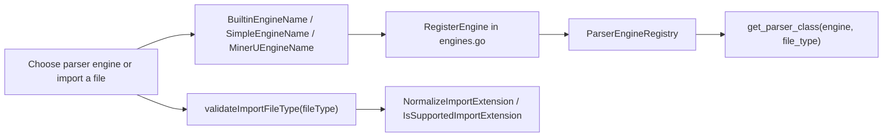
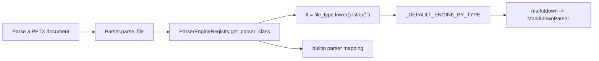
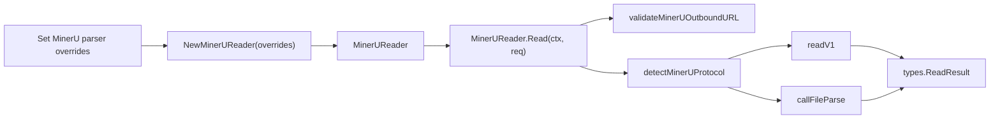

<!-- source: DeepWiki mcp.deepwiki.com · repo Tencent/WeKnora · page 8.4 Document Processing Configuration · fetched 2026-10-29 -->

# Document Processing Configuration

Relevant source files

The following files were used as context for generating this wiki page:

- [docreader/parser/opendataloader_parser.py](docreader/parser/opendataloader_parser.py)
- [docreader/parser/registry.py](docreader/parser/registry.py)
- [docreader/tests/test_opendataloader_parser.py](docreader/tests/test_opendataloader_parser.py)
- [docreader/tests/test_parser_routing.py](docreader/tests/test_parser_routing.py)
- [internal/application/repository/knowledgebase_sqlite_test.go](internal/application/repository/knowledgebase_sqlite_test.go)
- [internal/application/repository/retriever/opensearch/ssrf_test.go](internal/application/repository/retriever/opensearch/ssrf_test.go)
- [internal/application/service/file/endpoint_security_test.go](internal/application/service/file/endpoint_security_test.go)
- [internal/application/service/knowledge_process_inline_image_test.go](internal/application/service/knowledge_process_inline_image_test.go)
- [internal/application/service/knowledge_util.go](internal/application/service/knowledge_util.go)
- [internal/application/service/knowledge_util_filetype_test.go](internal/application/service/knowledge_util_filetype_test.go)
- [internal/handler/session/attachment_processor.go](internal/handler/session/attachment_processor.go)
- [internal/infrastructure/docparser/engine_registry_reader_test.go](internal/infrastructure/docparser/engine_registry_reader_test.go)
- [internal/infrastructure/docparser/engine_registry_test.go](internal/infrastructure/docparser/engine_registry_test.go)
- [internal/infrastructure/docparser/engines.go](internal/infrastructure/docparser/engines.go)
- [internal/infrastructure/docparser/image_resolver.go](internal/infrastructure/docparser/image_resolver.go)
- [internal/infrastructure/docparser/image_resolver_relative_html_test.go](internal/infrastructure/docparser/image_resolver_relative_html_test.go)
- [internal/infrastructure/docparser/image_resolver_test.go](internal/infrastructure/docparser/image_resolver_test.go)
- [internal/infrastructure/docparser/mineru_converter.go](internal/infrastructure/docparser/mineru_converter.go)
- [internal/infrastructure/docparser/mineru_converter_test.go](internal/infrastructure/docparser/mineru_converter_test.go)
- [internal/types/knowledgebase_test.go](internal/types/knowledgebase_test.go)
- [internal/types/parser_engine_config_test.go](internal/types/parser_engine_config_test.go)
- [internal/utils/import_filetypes.go](internal/utils/import_filetypes.go)
- [internal/utils/import_filetypes_test.go](internal/utils/import_filetypes_test.go)
- [migrations/versioned/000036_kb_vector_store_id.down.sql](migrations/versioned/000036_kb_vector_store_id.down.sql)
- [migrations/versioned/000036_kb_vector_store_id.up.sql](migrations/versioned/000036_kb_vector_store_id.up.sql)

## Purpose and Scope

This page documents the parser engines and file-type routing visible in the supplied code: the Go-side engine registry, the Python `DocReader` parser registry, self-hosted MinerU configuration, import-extension validation, and post-parse image resolution. It focuses on the implementation and data flow represented by those components. [internal/infrastructure/docparser/engines.go:12-42](), [docreader/parser/registry.py:35-115](), [internal/infrastructure/docparser/mineru_converter.go:34-73](), [internal/application/service/knowledge_util.go:25-80](), [internal/infrastructure/docparser/image_resolver.go:89-109]()

Sources: [internal/infrastructure/docparser/engines.go:12-42](), [docreader/parser/registry.py:35-115](), [internal/infrastructure/docparser/mineru_converter.go:34-73](), [internal/application/service/knowledge_util.go:25-80](), [internal/infrastructure/docparser/image_resolver.go:89-109]()

---

## Configuration Overview

Document parsing has two distinct engine registries in the supplied implementation:

- The Go registry names parser engines and constructs readers through `RegisterEngine` and engine-specific `NewReader` methods. [internal/infrastructure/docparser/engines.go:12-42]()
- The Python `ParserEngineRegistry` maps file extensions to parser classes, exposes engine metadata, and applies fallback routing when an engine does not support a requested type. [docreader/parser/registry.py:35-42](), [docreader/parser/registry.py:68-115](), [docreader/parser/registry.py:116-145]()

For file imports, `knowledge_util.go` normalizes extensions and delegates support checks to shared helpers in `internal/utils`. It rejects missing or unknown types, video types, and extensions outside the shared supported set. [internal/application/service/knowledge_util.go:25-71]()

### Core Processing Components and Configuration

| Component | Purpose | Code entity and evidence |
| --- | --- | --- |
| Go parser engines | Names and registers available Go-side readers | `BuiltinEngineName`, `SimpleEngineName`, `AnydocEngineName`, and other engine constants; `init` registers engine implementations. [internal/infrastructure/docparser/engines.go:12-42]() |
| Python parser registry | Maps extensions to parser classes and applies fallback routing | `ParserEngineRegistry.register`, `get_parser_class`, and `_build_default_registry`. [docreader/parser/registry.py:35-42](), [docreader/parser/registry.py:49-115](), [docreader/parser/registry.py:151-179]() |
| Go simple reader | Handles simple formats without an external service | `simpleEngine.NewReader` returns `SimpleFormatReader`. [internal/infrastructure/docparser/engines.go:99-127]() |
| Go builtin reader | Uses the remote reader for complex formats | `builtinEngine.NewReader` calls `remoteReader`; availability depends on the DocReader connection status. [internal/infrastructure/docparser/engines.go:66-97]() |
| Self-hosted MinerU reader | Builds a reader from parser-engine overrides and selects a protocol at request time | `NewMinerUReader` and `MinerUReader.Read`. [internal/infrastructure/docparser/mineru_converter.go:34-73](), [internal/infrastructure/docparser/mineru_converter.go:86-142]() |
| Import extension validation | Applies normalized, shared extension support checks to imports | `normalizeFileExtension`, `isSupportedImportExtension`, `isValidFileType`, and `validateImportFileType`. [internal/application/service/knowledge_util.go:34-71]() |
| Image resolution | Saves parsed image bytes and replaces Markdown references with storage URLs | `ImageResolver.ResolveAndStore` uses `interfaces.FileService`. [internal/infrastructure/docparser/image_resolver.go:89-109](), [internal/infrastructure/docparser/image_resolver.go:128-154]() |

### Configuration and Code-Entity Map

The diagram connects user-facing concepts—such as choosing an engine or importing a file—to the concrete registry and validation entities in the code. [internal/infrastructure/docparser/engines.go:12-42](), [docreader/parser/registry.py:35-115](), [internal/application/service/knowledge_util.go:34-71]()

Sources: [internal/infrastructure/docparser/engines.go:12-42](), [docreader/parser/registry.py:35-115](), [internal/application/service/knowledge_util.go:34-71]()

---

## DocReader Service Configuration

In the Go engine definitions, `builtin` is described as the DocReader-backed parser engine. Its `FileTypes` method advertises document, image, and audio extensions; `CheckAvailable` reports whether DocReader is connected; and `NewReader` returns `remoteReader(deps)`. [internal/infrastructure/docparser/engines.go:66-97]()

The supplied Python code describes a separate parser-class registry. `ParserEngineRegistry.register` records extension-to-class mappings and optional availability checks. `get_parser_class` normalizes the requested extension, tries the requested engine when it supports the type, then tries a type-level default, and finally checks `builtin`. If none can handle the extension, it raises `ValueError`. [docreader/parser/registry.py:35-42](), [docreader/parser/registry.py:49-115]()

The provided files do not show the DocReader service deployment, gRPC server setup, or Go-side remote-reader transport configuration; those details are therefore not specified here. The supported implementation boundary shown is the Go `builtinEngine` reader factory and the Python parser registry. [internal/infrastructure/docparser/engines.go:86-97](), [docreader/parser/registry.py:35-42]()

### Engine Routing and Parser Selection

In the Python registry, the built-in mappings include parsers such as `Docx2Parser`, `PDFParser`, `ExcelParser`, `HTMLParser`, `MarkitdownParser`, and `XMindParser`. The default registry registers these under `builtin`; it also defines type-level defaults routing `ppt`, `pptx`, and `csv` to `markitdown`. [docreader/parser/registry.py:25-32](), [docreader/parser/registry.py:151-179]()

| Routing stage | Behavior |
| --- | --- |
| Normalize extension | `get_parser_class` lowercases `file_type` and strips a leading dot. [docreader/parser/registry.py:68-77]() |
| Requested engine | If the named engine is registered and maps the extension to a parser class, that class is returned. [docreader/parser/registry.py:78-88]() |
| Type-level default | If the requested engine cannot serve the type, the registry checks `_DEFAULT_ENGINE_BY_TYPE`; the supplied defaults are `ppt`, `pptx`, and `csv` → `markitdown`. [docreader/parser/registry.py:25-32](), [docreader/parser/registry.py:89-98]() |
| Builtin fallback | If no type default applies, the registry checks the `builtin` mappings. [docreader/parser/registry.py:100-103]() |
| Unsupported type | If no parser is found, the registry raises `ValueError`; when other engines support the type, the error lists those engines. [docreader/parser/registry.py:105-114]() |

### Go Engine Names and Roles

The Go engine names are constants used as identifiers stored in knowledge-base parser rules and shown in the UI. `init` registers the corresponding engine implementations. [internal/infrastructure/docparser/engines.go:12-42]()

| Engine name | Go implementation role |
| --- | --- |
| `builtin` | DocReader-backed parser for complex formats; `NewReader` returns `remoteReader`. [internal/infrastructure/docparser/engines.go:66-97]() |
| `simple` | Go-native handling for simple formats and images; `NewReader` returns `SimpleFormatReader`. [internal/infrastructure/docparser/engines.go:99-127]() |
| `anydoc` | In-process office-document converter; its reader is constructed only when the anydoc binding is available. [internal/infrastructure/docparser/engines.go:129-156]() |
| `weknoracloud` | Tenant-scoped hosted document reader; availability checks for `weknoracloud_app_id`. [internal/infrastructure/docparser/engines.go:158-176]() |
| `mineru` | Self-hosted MinerU service engine. [internal/infrastructure/docparser/engines.go:22-24]() |
| `mineru_cloud` | MinerU Cloud engine identifier. [internal/infrastructure/docparser/engines.go:24-25]() |
| `paddleocr_vl` | Self-hosted PaddleOCR-VL engine identifier. [internal/infrastructure/docparser/engines.go:26-27]() |
| `paddleocr_vl_cloud` | PaddleOCR-VL cloud engine identifier. [internal/infrastructure/docparser/engines.go:28-29]() |

### Natural-Language Routing Concepts to Code Entities

This diagram maps a user’s request to parse a type such as `pptx` to the exact Python registry entities that implement routing. [docreader/parser/registry.py:25-32](), [docreader/parser/registry.py:68-115](), [docreader/tests/test_parser_routing.py:65-86]()

Sources: [docreader/parser/registry.py:25-32](), [docreader/parser/registry.py:68-115](), [docreader/tests/test_parser_routing.py:65-86]()

---

## Parser Engine Configuration

### Go-Side Engine Selection

`preferAnydocWhenAvailable` is installed through `types.SetPreferParserEngine`. It normalizes the file type, leaves simple formats and PDFs on the default path, and selects `anydoc` when the binding is available and supports the type. [internal/infrastructure/docparser/engines.go:32-64]()

The `builtin` engine advertises complex document types including `docx`, `doc`, `pdf`, spreadsheets, presentations, EPUB, HTML variants, XMind, images, and audio formats. The `simple` engine advertises Markdown, text, CSV, JSON, images, and audio formats. These are engine metadata declarations; the selected reader behavior is defined by each engine’s `NewReader` implementation. [internal/infrastructure/docparser/engines.go:66-127]()

### Python-Side Engine Registration

`ParserEngineRegistry.register` stores each engine’s file-type map and description, and optionally stores an availability-check function and fallback hint. `list_engines` evaluates those checks using the supplied overrides and returns engine names, descriptions, sorted file types, availability, and an unavailable reason. [docreader/parser/registry.py:49-66](), [docreader/parser/registry.py:116-145]()

The default Python `builtin` registration maps extensions to parser classes. For example, it maps `docx` to `Docx2Parser`, `pdf` to `PDFParser`, `xlsx` and `xls` to `ExcelParser`, and `pptx` and `ppt` to `MarkitdownParser`. [docreader/parser/registry.py:151-179]()

Sources: [internal/infrastructure/docparser/engines.go:32-64](), [internal/infrastructure/docparser/engines.go:66-127](), [docreader/parser/registry.py:49-66](), [docreader/parser/registry.py:116-179]()

---

## MinerU and PaddleOCR-VL Integration

### MinerU Configuration

`NewMinerUReader` constructs a self-hosted MinerU reader from a `map[string]string` of parser-engine overrides. It resolves the endpoint, timeout, API key, tier, legacy backend settings, OCR/formula/table options, parse method, and language. [internal/infrastructure/docparser/mineru_converter.go:34-73]()

| Override or setting | Behavior |
| --- | --- |
| `mineru_endpoint` | Endpoint is read from the overrides and trailing `/` characters are removed. `Read` returns a `ReadResult` error if the endpoint is empty. [internal/infrastructure/docparser/mineru_converter.go:61-63](), [internal/infrastructure/docparser/mineru_converter.go:86-89]() |
| `WEKNORA_MINERU_TIMEOUT` | Environment variable used by `requestTimeoutFromEnv`; the default self-hosted parse timeout is 1000 seconds. [internal/infrastructure/docparser/mineru_converter.go:25-27](), [internal/infrastructure/docparser/mineru_converter.go:61-64]() |
| `mineru_server_api_key` | Trimmed and stored as the V1 API key. [internal/infrastructure/docparser/mineru_converter.go:40-42](), [internal/infrastructure/docparser/mineru_converter.go:61-65]() |
| `mineru_tier` | Passed through `resolveMinerUTier`, which accepts recognized V1 tiers and otherwise returns an empty value for the server default. [internal/infrastructure/docparser/mineru_converter.go:76-84]() |
| `mineru_model` | Legacy backend selection; defaults to `pipeline`. [internal/infrastructure/docparser/mineru_converter.go:43-47](), [internal/infrastructure/docparser/mineru_converter.go:65-67]() |
| `mineru_vlm_server_url` | Stored as the legacy VLM server URL and validated as an outbound URL when non-empty. [internal/infrastructure/docparser/mineru_converter.go:45-46](), [internal/infrastructure/docparser/mineru_converter.go:66-67](), [internal/infrastructure/docparser/mineru_converter.go:90-97]() |
| `mineru_enable_formula` | Parsed as a boolean, defaulting to `true`. [internal/infrastructure/docparser/mineru_converter.go:68-69]() |
| `mineru_enable_table` | Parsed as a boolean, defaulting to `true`. [internal/infrastructure/docparser/mineru_converter.go:68-69]() |
| `mineru_parse_method` | Resolved by `types.ResolveMinerUParseMethod`; it is shared by legacy `parse_method` and V1 `ocr_mode`. [internal/infrastructure/docparser/mineru_converter.go:49-50](), [internal/infrastructure/docparser/mineru_converter.go:70]() |
| `mineru_enable_ocr` | Legacy compatibility input used when resolving the parse method. [internal/infrastructure/docparser/mineru_converter.go:55-59](), [internal/infrastructure/docparser/mineru_converter.go:70]() |
| `mineru_language` | Stored as the legacy language setting, defaulting to `ch`. [internal/infrastructure/docparser/mineru_converter.go:71]() |

### MinerU Request and Result Flow

`MinerUReader.Read` validates the configured endpoint and optional VLM URL, requires file content, and detects the MinerU protocol for each request. It dispatches to `readV1` for the V1 protocol or to the legacy `/file_parse` path otherwise. [internal/infrastructure/docparser/mineru_converter.go:86-124]()

Both paths normalize MinerU Markdown, ensure the original image reference is represented, and return a `types.ReadResult` containing Markdown, image references, and source blocks. The legacy path additionally processes the returned base64 images before constructing that result. [internal/infrastructure/docparser/mineru_converter.go:125-162]()

### Natural-Language MinerU Setup to Code Entities

This diagram connects the operational concept “configure MinerU and parse a document” to the actual constructor, fields, and methods that process the request. [internal/infrastructure/docparser/mineru_converter.go:34-73](), [internal/infrastructure/docparser/mineru_converter.go:86-162]()

Sources: [internal/infrastructure/docparser/mineru_converter.go:34-73](), [internal/infrastructure/docparser/mineru_converter.go:86-162]()

### PaddleOCR-VL

The supplied files identify `paddleocr_vl` and `paddleocr_vl_cloud` as Go engine names and show both implementations being registered. They do not include the PaddleOCR-VL reader implementation or its configuration fields, so this page does not infer endpoint or feature-toggle behavior for those engines. [internal/infrastructure/docparser/engines.go:26-29](), [internal/infrastructure/docparser/engines.go:32-42]()

Sources: [internal/infrastructure/docparser/engines.go:26-42]()

---

## File Type and Parser Engine UI Configuration

The import validation code extracts a filename extension, normalizes it through the shared extension helper, and checks it against the shared supported-import set. `validateImportFileType` rejects an empty or `unknown` type, rejects video types, and rejects unsupported extensions. [internal/application/service/knowledge_util.go:25-80]()

The shared extension set is exercised by tests that pin the supported list and check uppercase and dotted variants. The listed extensions are `bmp`, `csv`, `doc`, `docm`, `docx`, `epub`, `flac`, `gif`, `htm`, `html`, `jpeg`, `jpg`, `json`, `m4a`, `markdown`, `md`, `mhtml`, `mp3`, `odp`, `ods`, `odt`, `ogg`, `pdf`, `png`, `ppt`, `pptm`, `pptx`, `rtf`, `tiff`, `txt`, `wav`, `webp`, `xls`, `xlsm`, `xlsx`, and `xmind`. [internal/application/service/knowledge_util_filetype_test.go:64-90]()

| File-type behavior | Implementation |
| --- | --- |
| Extension extraction | `getFileType` returns the final dot-separated component, or `unknown` if there is no extension. [internal/application/service/knowledge_util.go:74-81]() |
| Normalization | `normalizeFileExtension` delegates to `secutils.NormalizeImportExtension`. [internal/application/service/knowledge_util.go:34-38]() |
| Shared support check | `isSupportedImportExtension` delegates to `secutils.IsSupportedImportExtension`. [internal/application/service/knowledge_util.go:40-45]() |
| Import rejection | `validateImportFileType` rejects unknown, video, and unsupported types. [internal/application/service/knowledge_util.go:58-71]() |
| Spreadsheet classification | `isDataTableFileType` recognizes `csv`, `xlsx`, and `xls` after normalization. [internal/application/service/knowledge_util.go:28-32](), [internal/application/service/knowledge_util.go:52-56]() |
| JSON upload validation | `ValidateJSONUploadContent` validates JSON upload content before storage and queueing, distinguishing empty and invalid JSON. [internal/application/service/knowledge_util.go:103-128]() |

The supplied code does not include the frontend parser-engine settings component, so UI-specific controls are not documented here. [internal/infrastructure/docparser/engines.go:12-42](), [docreader/parser/registry.py:116-145]()

Sources: [internal/application/service/knowledge_util.go:25-81](), [internal/application/service/knowledge_util.go:103-128](), [internal/application/service/knowledge_util_filetype_test.go:64-90](), [internal/infrastructure/docparser/engines.go:12-42](), [docreader/parser/registry.py:116-145]()

---

## Image Resolution and Storage Handling

`ImageResolver` reads image data from a DocReader `ReadResult`, persists images through `interfaces.FileService`, and replaces Markdown references with provider URLs. `StoredImage` records the original reference, serving URL, MIME type, inline/newly-stored flags, multimodal skip state, and source locators. [internal/infrastructure/docparser/image_resolver.go:69-94]()

### Image Resolution Pipeline

`ResolveAndStore` starts from the returned Markdown, unwraps linked images, and resolves embedded image forms in a deterministic order: Markdown data URIs, HTML data URIs, then bare Base64 content. It then handles `result.ImageRefs`, replacing resolvable references with stored serving URLs. [internal/infrastructure/docparser/image_resolver.go:101-154](), [internal/infrastructure/docparser/image_resolver.go:156-195]()

If resolution fails, the deferred cleanup restores the original Markdown and attempts to delete inline images already saved by this invocation, using a bounded rollback context. [internal/infrastructure/docparser/image_resolver.go:110-126]()

| Concern | Behavior |
| --- | --- |
| Small-image filtering | `isIconImage` uses decoded dimensions when available; images with both dimensions below `minImageDimension` are filtered. If dimensions cannot be decoded, it falls back to the byte-size threshold. [internal/infrastructure/docparser/image_resolver.go:42-67]() |
| Inline image storage | Inline data is saved using the supplied `FileService`; the resolver returns updated Markdown and `StoredImage` records. [internal/infrastructure/docparser/image_resolver.go:101-154]() |
| Existing URL handling | HTTP, HTTPS, and provider-scheme references are skipped by the referenced-image replacement path. [internal/infrastructure/docparser/image_resolver.go:167-182]() |
| Markdown replacement | A saved image’s `ServingURL` replaces the matched image target in the Markdown. [internal/infrastructure/docparser/image_resolver.go:184-195]() |
| Partial-save rollback | On an error, inline images saved during the invocation are deleted where possible, and the original Markdown is restored. [internal/infrastructure/docparser/image_resolver.go:110-126]() |

Sources: [internal/infrastructure/docparser/image_resolver.go:42-67](), [internal/infrastructure/docparser/image_resolver.go:69-94](), [internal/infrastructure/docparser/image_resolver.go:101-195]()

---

