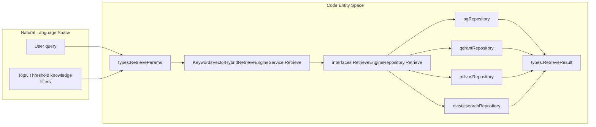
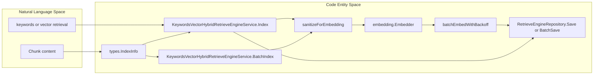

<!-- source: DeepWiki mcp.deepwiki.com · repo Tencent/WeKnora · page 8.5 Retrieval Engine Configuration · fetched 2026-10-29 -->

# Retrieval Engine Configuration

<details>
<summary>Relevant source files</summary>

The following files were used as context for generating this wiki page:

- [cmd/milvus-migrate/README.md](cmd/milvus-migrate/README.md)
- [cmd/milvus-migrate/main.go](cmd/milvus-migrate/main.go)
- [docs/assets/milvus-bm25-chinese-fixed.png](docs/assets/milvus-bm25-chinese-fixed.png)
- [internal/application/repository/retriever/elasticsearch/structs.go](internal/application/repository/retriever/elasticsearch/structs.go)
- [internal/application/repository/retriever/elasticsearch/v7/repository.go](internal/application/repository/retriever/elasticsearch/v7/repository.go)
- [internal/application/repository/retriever/elasticsearch/v8/repository.go](internal/application/repository/retriever/elasticsearch/v8/repository.go)
- [internal/application/repository/retriever/milvus/analyzer.go](internal/application/repository/retriever/milvus/analyzer.go)
- [internal/application/repository/retriever/milvus/analyzer_test.go](internal/application/repository/retriever/milvus/analyzer_test.go)
- [internal/application/repository/retriever/milvus/copy_test.go](internal/application/repository/retriever/milvus/copy_test.go)
- [internal/application/repository/retriever/milvus/migration.go](internal/application/repository/retriever/milvus/migration.go)
- [internal/application/repository/retriever/milvus/migration_test.go](internal/application/repository/retriever/milvus/migration_test.go)
- [internal/application/repository/retriever/milvus/move.go](internal/application/repository/retriever/milvus/move.go)
- [internal/application/repository/retriever/milvus/repository.go](internal/application/repository/retriever/milvus/repository.go)
- [internal/application/repository/retriever/milvus/repository_test.go](internal/application/repository/retriever/milvus/repository_test.go)
- [internal/application/repository/retriever/milvus/structs.go](internal/application/repository/retriever/milvus/structs.go)
- [internal/application/repository/retriever/postgres/keyword_score_integration_test.go](internal/application/repository/retriever/postgres/keyword_score_integration_test.go)
- [internal/application/repository/retriever/postgres/keyword_score_test.go](internal/application/repository/retriever/postgres/keyword_score_test.go)
- [internal/application/repository/retriever/postgres/repository.go](internal/application/repository/retriever/postgres/repository.go)
- [internal/application/repository/retriever/postgres/structs.go](internal/application/repository/retriever/postgres/structs.go)
- [internal/application/repository/retriever/qdrant/repository.go](internal/application/repository/retriever/qdrant/repository.go)
- [internal/application/repository/retriever/qdrant/repository_test.go](internal/application/repository/retriever/qdrant/repository_test.go)
- [internal/application/repository/retriever/qdrant/structs.go](internal/application/repository/retriever/qdrant/structs.go)
- [internal/application/repository/retriever/tencentvectordb/repository.go](internal/application/repository/retriever/tencentvectordb/repository.go)
- [internal/application/repository/retriever/tencentvectordb/repository_test.go](internal/application/repository/retriever/tencentvectordb/repository_test.go)
- [internal/application/repository/retriever/tencentvectordb/structs.go](internal/application/repository/retriever/tencentvectordb/structs.go)
- [internal/application/repository/vectorstore.go](internal/application/repository/vectorstore.go)
- [internal/application/service/knowledgebase_pr3_test.go](internal/application/service/knowledgebase_pr3_test.go)
- [internal/application/service/retriever/composite.go](internal/application/service/retriever/composite.go)
- [internal/application/service/retriever/keywords_vector_hybrid_indexer.go](internal/application/service/retriever/keywords_vector_hybrid_indexer.go)
- [internal/application/service/retriever/keywords_vector_hybrid_indexer_test.go](internal/application/service/retriever/keywords_vector_hybrid_indexer_test.go)
- [internal/application/service/retriever/keywords_vector_hybrid_indexer_window_test.go](internal/application/service/retriever/keywords_vector_hybrid_indexer_window_test.go)
- [internal/application/service/vectorstore.go](internal/application/service/vectorstore.go)
- [internal/application/service/vectorstore_healthcheck.go](internal/application/service/vectorstore_healthcheck.go)
- [internal/application/service/vectorstore_test.go](internal/application/service/vectorstore_test.go)
- [internal/container/engine_factory.go](internal/container/engine_factory.go)
- [internal/container/engine_factory_test.go](internal/container/engine_factory_test.go)
- [internal/models/rerank/langfuse_wrapper.go](internal/models/rerank/langfuse_wrapper.go)
- [internal/tracing/langfuse/retrieval_obs.go](internal/tracing/langfuse/retrieval_obs.go)
- [internal/tracing/langfuse/retrieval_obs_test.go](internal/tracing/langfuse/retrieval_obs_test.go)
- [internal/types/interfaces/retriever.go](internal/types/interfaces/retriever.go)
- [internal/types/interfaces/vectorstore.go](internal/types/interfaces/vectorstore.go)
- [internal/types/retriever.go](internal/types/retriever.go)
- [internal/types/vectorstore.go](internal/types/vectorstore.go)
- [internal/types/vectorstore_test.go](internal/types/vectorstore_test.go)
- [migrations/versioned/000032_vector_stores.down.sql](migrations/versioned/000032_vector_stores.down.sql)
- [migrations/versioned/000032_vector_stores.up.sql](migrations/versioned/000032_vector_stores.up.sql)
- [website-docs/03-features/05-retrieval-engines.md](website-docs/03-features/05-retrieval-engines.md)

</details>


## Purpose and scope

This page describes how WeKnora represents vector-store configuration, selects retrieval engines, and indexes and retrieves content. It covers the engine types and configuration fields visible in the supplied code, plus implementation details for PostgreSQL, Qdrant, Milvus, and Elasticsearch v7/v8. The supplied excerpts do not show the repository implementations for Weaviate, Doris, or Tencent VectorDB, so this page does not infer their engine-specific behavior.

Sources: [internal/types/vectorstore.go:36-56](), [internal/types/retriever.go:3-65](), [internal/application/service/retriever/keywords_vector_hybrid_indexer.go:41-83]()

---

## Supported Retrieval Engines

`RetrieverEngineType` defines engine identifiers including `postgres`, `elasticsearch`, `qdrant`, `milvus`, `weaviate`, `doris`, `sqlite`, and `tencent_vectordb`. The same type also declares `infinity`, `elasticfaiss`, and `opensearch`. [internal/types/retriever.go:3-27]()

The set accepted for persisted, tenant-managed `VectorStore` records is narrower: `validEngineTypes` includes Elasticsearch, Qdrant, Milvus, Weaviate, Doris, Tencent VectorDB, and OpenSearch. The code comments explain that PostgreSQL and SQLite are excluded from this managed-store validation because they are tied to the application’s default database connection; they remain available through the environment-store path. [internal/types/vectorstore.go:72-100]()

| Engine identifier | Configuration or implementation detail shown in the supplied code |
|---|---|
| `postgres` | `pgRepository` uses GORM and supports keyword and vector retrieval. [internal/application/repository/retriever/postgres/repository.go:20-30](), [internal/application/repository/retriever/postgres/repository.go:65-73]() |
| `elasticsearch` | Elasticsearch v7 and v8 repositories resolve an index name and initialize an index if needed. [internal/application/repository/retriever/elasticsearch/v7/repository.go:35-57](), [internal/application/repository/retriever/elasticsearch/v8/repository.go:31-55]() |
| `qdrant` | `NewQdrantRetrieveEngineRepository` resolves a collection base name; collections are named per vector dimension. [internal/application/repository/retriever/qdrant/repository.go:20-56]() |
| `milvus` | `NewMilvusRetrieveEngineRepository` resolves a collection base name and chooses a metric type. [internal/application/repository/retriever/milvus/repository.go:23-78]() |
| `weaviate` | The engine identifier is declared and the engine is allowed for a managed `VectorStore`; implementation details are not present in the supplied excerpts. [internal/types/retriever.go:12-17](), [internal/types/vectorstore.go:87-95]() |
| `doris` | The engine identifier is declared and the engine is allowed for a managed `VectorStore`; implementation details are not present in the supplied excerpts. [internal/types/retriever.go:12-17](), [internal/types/vectorstore.go:87-95]() |
| `tencent_vectordb` | The engine identifier is declared and the engine is allowed for a managed `VectorStore`; implementation details are not present in the supplied excerpts. [internal/types/retriever.go:12-17](), [internal/types/vectorstore.go:87-95]() |
| `sqlite` | The engine identifier is declared. The supplied excerpts do not include its repository implementation. [internal/types/retriever.go:7-17]() |
| `infinity`, `elasticfaiss` | Engine identifiers are declared; they are not in the managed-store validation set. [internal/types/retriever.go:7-17](), [internal/types/vectorstore.go:72-95]() |
| `opensearch` | The identifier is declared and included in managed-store validation. The supplied code comments describe it as a planned/forward-registered engine; no driver implementation is shown. [internal/types/retriever.go:18-26](), [internal/types/vectorstore.go:87-95]() |

Sources: [internal/types/retriever.go:3-27](), [internal/types/vectorstore.go:72-100](), [internal/application/repository/retriever/postgres/repository.go:20-30](), [internal/application/repository/retriever/elasticsearch/v7/repository.go:35-57](), [internal/application/repository/retriever/elasticsearch/v8/repository.go:31-55](), [internal/application/repository/retriever/qdrant/repository.go:20-56](), [internal/application/repository/retriever/milvus/repository.go:23-78]()

---

## Store Configuration Model

A `VectorStore` record identifies a configured store by tenant, name, and engine type. It holds driver connection parameters in `ConnectionConfig` and optional engine-specific index or collection settings in `IndexConfig`. The record maps to the `vector_stores` table. [internal/types/vectorstore.go:36-60]()

`VectorStore.Validate` requires a name, an engine type accepted by `validEngineTypes`, and a nonzero tenant ID. The connection configuration includes common address, username, password, and API key fields, along with Qdrant host/port/TLS fields, Weaviate gRPC address and scheme fields, a database name for engines that support database namespaces, a PostgreSQL default-connection flag, and a Doris HTTP port. Password and API-key fields are documented as encrypted at rest. [internal/types/vectorstore.go:102-114](), [internal/types/vectorstore.go:120-157]()

| Configuration field | Purpose indicated by the type definition |
|---|---|
| `EngineType` | Selects the retrieval engine. [internal/types/vectorstore.go:45-51]() |
| `ConnectionConfig.Addr` | Common connection address. [internal/types/vectorstore.go:120-137]() |
| `ConnectionConfig.Username`, `Password`, `APIKey` | Credentials; password and API key are documented as AES-GCM encrypted at rest. [internal/types/vectorstore.go:120-127]() |
| `ConnectionConfig.Host`, `Port`, `UseTLS` | Qdrant connection fields. [internal/types/vectorstore.go:138-141]() |
| `ConnectionConfig.GrpcAddress`, `Scheme` | Weaviate connection fields. [internal/types/vectorstore.go:142-144]() |
| `ConnectionConfig.Database` | Database namespace field for Milvus, Tencent VectorDB, and Doris. [internal/types/vectorstore.go:145-147]() |
| `ConnectionConfig.UseDefaultConnection` | PostgreSQL connection-selection field. [internal/types/vectorstore.go:148-149]() |
| `ConnectionConfig.HTTPPort` | Doris Stream Load HTTP port. [internal/types/vectorstore.go:150-153]() |
| `IndexConfig` | Optional engine-specific index or collection settings. [internal/types/vectorstore.go:49-51]() |

The type definitions distinguish `InsecureSkipVerify` from Qdrant’s `UseTLS`: the former controls certificate verification for an HTTPS connection, while `UseTLS` enables TLS for Qdrant gRPC. The comments caution that disabling certificate verification should be limited to self-signed development clusters. [internal/types/vectorstore.go:128-141]()

Sources: [internal/types/vectorstore.go:36-60](), [internal/types/vectorstore.go:102-157]()

---

## Environment-Backed Stores

`VectorStore` supports virtual IDs prefixed with `__env_`; `IsEnvStoreID` identifies these IDs by prefix. The test coverage demonstrates `BuildEnvVectorStores` accepting comma-separated driver names, trimming whitespace, skipping unknown drivers, returning no stores for an empty driver list, and recognizing PostgreSQL, SQLite, Elasticsearch v7/v8, Qdrant, Milvus, Weaviate, Doris, and Tencent VectorDB. [internal/types/vectorstore.go:19-34](), [internal/types/vectorstore_test.go:110-193]()

The tests show representative environment keys for Qdrant, Elasticsearch, Milvus, Tencent VectorDB, Weaviate, and Doris. They verify, for example, Qdrant host/port/API key/TLS/collection settings and Elasticsearch address/credentials/index settings. These tests document expected environment parsing without implying that every shown key is consumed by the repository constructors. [internal/types/vectorstore_test.go:44-80](), [internal/types/vectorstore_test.go:110-131](), [internal/types/vectorstore_test.go:148-193]()

| Driver | Environment keys demonstrated by tests |
|---|---|
| Qdrant | `QDRANT_HOST`, `QDRANT_PORT`, `QDRANT_API_KEY`, `QDRANT_USE_TLS`, `QDRANT_COLLECTION`. [internal/types/vectorstore_test.go:57-65]() |
| Elasticsearch | `ELASTICSEARCH_ADDR`, `ELASTICSEARCH_USERNAME`, `ELASTICSEARCH_PASSWORD`, `ELASTICSEARCH_INDEX`. [internal/types/vectorstore_test.go:110-116]() |
| Milvus | `MILVUS_ADDRESS`. [internal/types/vectorstore_test.go:116-119]() |
| Tencent VectorDB | `TENCENT_VECTORDB_ADDR`, `TENCENT_VECTORDB_USERNAME`, `TENCENT_VECTORDB_API_KEY`, `TENCENT_VECTORDB_DATABASE`, `TENCENT_VECTORDB_COLLECTION`. [internal/types/vectorstore_test.go:118-123]() |
| Weaviate | `WEAVIATE_HOST`. [internal/types/vectorstore_test.go:123-125]() |
| Doris | `DORIS_ADDR`, `DORIS_HTTP_PORT`, `DORIS_DATABASE`, `DORIS_USERNAME`, `DORIS_PASSWORD`, `DORIS_TABLE_PREFIX`. [internal/types/vectorstore_test.go:124-130]() |

Sources: [internal/types/vectorstore.go:19-34](), [internal/types/vectorstore_test.go:44-80](), [internal/types/vectorstore_test.go:110-193]()

---

## Engine-Specific Configuration and Initialization

### PostgreSQL with pgvector

`NewPostgresRetrieveEngineRepository` wraps a GORM database handle in `pgRepository`. The repository advertises support for both `keywords` and `vector` retrieval. [internal/application/repository/retriever/postgres/repository.go:20-30](), [internal/application/repository/retriever/postgres/repository.go:65-73]()

`Save` converts an `IndexInfo` into the repository’s database representation and writes it using `upsertBySource`. The conflict key is `(source_id, source_type)`; on conflict, the repository updates chunk, knowledge, tag, content, dimension, embedding, enabled-state, and timestamp fields. `BatchSave` deduplicates repeated source keys within a batch before issuing the upsert. [internal/application/repository/retriever/postgres/repository.go:114-169]()

Keyword retrieval depends on a compatible ParadeDB/`pg_search` score function. `resolveKeywordScoreFunction` probes for `paradedb.score` or `pgsearch.score`, caches a successful resolution per repository, and returns an error if neither supported function is found. The probe is lazy so vector-only use does not require keyword-score function resolution. [internal/application/repository/retriever/postgres/repository.go:33-63]()

Sources: [internal/application/repository/retriever/postgres/repository.go:20-30](), [internal/application/repository/retriever/postgres/repository.go:33-73](), [internal/application/repository/retriever/postgres/repository.go:114-169]()

### Elasticsearch v7 and v8

Both repository constructors resolve the index name from `IndexConfig`, falling back to the `ELASTICSEARCH_INDEX` environment variable and then `xwrag_default`. They obtain shard and replica settings from `IndexConfig`, attempt to create the index if it is absent, and inspect field mappings to determine how ID fields should be queried. [internal/application/repository/retriever/elasticsearch/v7/repository.go:35-57](), [internal/application/repository/retriever/elasticsearch/v8/repository.go:31-55]()

The v7 implementation uses the Elasticsearch v7 client and low-level `esapi` APIs for index creation. The v8 implementation uses `elasticsearch.TypedClient`. [internal/application/repository/retriever/elasticsearch/v7/repository.go:17-24](), [internal/application/repository/retriever/elasticsearch/v7/repository.go:129-170](), [internal/application/repository/retriever/elasticsearch/v8/repository.go:14-29]()

`detectFieldTypes` checks the `chunk_id` mapping. If it is `keyword`, `idField` uses the field name as-is; otherwise, it appends `.keyword`. Failures to read or interpret mappings default to using the suffix. [internal/application/repository/retriever/elasticsearch/v7/repository.go:60-127](), [internal/application/repository/retriever/elasticsearch/v8/repository.go:58-105]()

```text
ELASTICSEARCH_INDEX
  └─ fallback: xwrag_default
      └─ createIndexIfNotExists
          └─ detectFieldTypes(chunk_id)
              ├─ keyword mapping → idField(name)
              └─ other/unknown mapping → idField(name + ".keyword")
```

Sources: [internal/application/repository/retriever/elasticsearch/v7/repository.go:35-57](), [internal/application/repository/retriever/elasticsearch/v7/repository.go:60-127](), [internal/application/repository/retriever/elasticsearch/v7/repository.go:129-182](), [internal/application/repository/retriever/elasticsearch/v8/repository.go:31-55](), [internal/application/repository/retriever/elasticsearch/v8/repository.go:58-105]()

### Qdrant

`NewQdrantRetrieveEngineRepository` resolves a collection base name using `QDRANT_COLLECTION`, with `weknora_embeddings` as the default. `getCollectionName` appends the vector dimension to that base name, so different dimensions use separate collections. [internal/application/repository/retriever/qdrant/repository.go:20-56]()

`ensureCollection` checks whether the dimension-specific collection exists and creates it when absent. The visible creation configuration sets the vector size to the dimension and the distance metric to cosine; shard and replication settings are supplied from `IndexConfig`. [internal/application/repository/retriever/qdrant/repository.go:143-167]()

The delete path is designed to tolerate collections that have not yet been created. `deleteTarget` skips deletion for a missing collection; `deletePoints` also treats a missing-collection response as a no-op and clears the process-local initialized-collection cache so a later write can recreate the collection. [internal/application/repository/retriever/qdrant/repository.go:58-105](), [internal/application/repository/retriever/qdrant/repository.go:107-141]()

Sources: [internal/application/repository/retriever/qdrant/repository.go:20-56](), [internal/application/repository/retriever/qdrant/repository.go:58-105](), [internal/application/repository/retriever/qdrant/repository.go:107-167]()

### Milvus

`NewMilvusRetrieveEngineRepository` resolves a collection base name from `MILVUS_COLLECTION`, defaulting to `weknora_embeddings`. Collections are dimension-specific. The metric defaults to inner product (`IP`); `MILVUS_METRIC_TYPE` accepts `COSINE`, `L2`, or `IP`, while an unknown value logs a warning and retains the default. [internal/application/repository/retriever/milvus/repository.go:23-83]()

When creating a collection, `ensureCollection` defines a primary-key `id`, a dimensioned float vector `embedding`, content and language fields, a sparse vector field, and metadata fields such as `source_id`, `chunk_id`, `knowledge_id`, `knowledge_base_id`, `tag_id`, and `is_enabled`. The visible schema setup also enables a multilingual analyzer for `content` and adds a BM25 function for the sparse content vector. [internal/application/repository/retriever/milvus/repository.go:121-203]()

Milvus inspects and caches whether an existing collection uses the multilingual schema. The code notes that older collections without a language field must continue on legacy upsert and search paths until migrated. [internal/application/repository/retriever/milvus/repository.go:85-119]()

Sources: [internal/application/repository/retriever/milvus/repository.go:23-83](), [internal/application/repository/retriever/milvus/repository.go:85-119](), [internal/application/repository/retriever/milvus/repository.go:121-203]()

### Weaviate, Doris, and Tencent VectorDB

The supplied code identifies these engines in the retrieval type definitions and managed `VectorStore` validation set. The connection configuration includes Weaviate’s `GrpcAddress` and `Scheme`, and a `Database` field for Milvus, Tencent VectorDB, and Doris; Doris additionally has an `HTTPPort` field documented for its Stream Load API. Engine-specific repository behavior and complete environment-variable mappings are not included in the supplied implementation excerpts. [internal/types/retriever.go:7-27](), [internal/types/vectorstore.go:87-95](), [internal/types/vectorstore.go:138-153]()

Sources: [internal/types/retriever.go:7-27](), [internal/types/vectorstore.go:87-95](), [internal/types/vectorstore.go:138-153]()

---

## Registry and Retrieval Data Flow

A `RetrieveParams` value carries the query, optional query embedding, knowledge-base and knowledge filters, exclusions, `TopK`, similarity `Threshold`, knowledge type, additional parameters, and the requested retriever type. The repository result type records the engine and retriever type alongside results and may also carry a partial retrieval error. [internal/types/retriever.go:39-65](), [internal/types/retriever.go:111-124]()

`KeywordsVectorHybridRetrieveEngineService.Retrieve` forwards the parameters to its `indexRepository.Retrieve` method. Its `Index` method generates an embedding only when vector retrieval is enabled, places the embedding in additional parameters, and saves through the repository. [internal/application/service/retriever/keywords_vector_hybrid_indexer.go:41-83]()

### Retrieval request path



Sources: [internal/types/retriever.go:39-65](), [internal/types/retriever.go:111-124](), [internal/application/service/retriever/keywords_vector_hybrid_indexer.go:41-66](), [internal/application/repository/retriever/postgres/repository.go:20-30](), [internal/application/repository/retriever/qdrant/repository.go:34-51](), [internal/application/repository/retriever/milvus/repository.go:44-78](), [internal/application/repository/retriever/elasticsearch/v7/repository.go:27-57](), [internal/application/repository/retriever/elasticsearch/v8/repository.go:22-55]()

---

## Hybrid Search and Indexing

`KeywordsVectorHybridRetrieveEngineService` is the service-level indexer shown in the supplied code. It supports indexing content through a repository that can serve keyword and vector retrieval. [internal/application/service/retriever/keywords_vector_hybrid_indexer.go:41-83]()

For single-item indexing, `Index` embeds sanitized content when `VectorRetrieverType` is present, then passes the embedding map to `Save`. For batches, `BatchIndex` processes vector-enabled input in windows of up to 200 items (`batchSize` 40 × `maxConcurrency` 5), sanitizes content, embeds the window, validates the returned embedding count, and saves batches concurrently. When vector retrieval is not enabled, it saves entries in batches of 10 with concurrency bounded at five. [internal/application/service/retriever/keywords_vector_hybrid_indexer.go:68-153]()

`batchEmbedWithBackoff` retries embedding calls up to five times, starting at 200 ms and doubling the delay between attempts; it returns early if the context is cancelled. `sanitizeForEmbedding` is documented as capping embedding input at 20,000 characters; the file also defines patterns for identifying base64 image payloads. [internal/application/service/retriever/keywords_vector_hybrid_indexer.go:20-39](), [internal/application/service/retriever/keywords_vector_hybrid_indexer.go:155-182]()

### Indexing path from content to engine repository



Sources: [internal/application/service/retriever/keywords_vector_hybrid_indexer.go:20-39](), [internal/application/service/retriever/keywords_vector_hybrid_indexer.go:41-83](), [internal/application/service/retriever/keywords_vector_hybrid_indexer.go:86-153](), [internal/application/service/retriever/keywords_vector_hybrid_indexer.go:155-182]()

---

## Dimension-Specific Collection and Index Management

Qdrant and Milvus derive collection names by appending the embedding dimension to a configured base collection name. Qdrant’s `getCollectionName` and Milvus’s `getCollectionName` both implement this naming pattern. [internal/application/repository/retriever/qdrant/repository.go:53-56](), [internal/application/repository/retriever/milvus/repository.go:80-83]()

Elasticsearch v7 and v8 instead use an index name resolved from `IndexConfig`, the `ELASTICSEARCH_INDEX` environment variable, or the `xwrag_default` fallback. Both constructors attempt index creation and then inspect field mappings. [internal/application/repository/retriever/elasticsearch/v7/repository.go:35-57](), [internal/application/repository/retriever/elasticsearch/v8/repository.go:31-55]()

Milvus collection creation includes both dense and sparse retrieval-related fields, and adds a BM25 function for the sparse content vector. This schema supports the repository’s combination of vector and keyword-oriented content indexing. [internal/application/repository/retriever/milvus/repository.go:142-203]()

Sources: [internal/application/repository/retriever/qdrant/repository.go:53-56](), [internal/application/repository/retriever/qdrant/repository.go:143-167](), [internal/application/repository/retriever/milvus/repository.go:80-83](), [internal/application/repository/retriever/milvus/repository.go:142-203](), [internal/application/repository/retriever/elasticsearch/v7/repository.go:35-57](), [internal/application/repository/retriever/elasticsearch/v8/repository.go:31-55]()

---

## Configuration and Operation Notes

- For a persisted vector store, provide a nonempty name, a tenant ID, and an engine type accepted by `VectorStore.Validate`. [internal/types/vectorstore.go:87-114]()
- Treat credentials as sensitive configuration: `Password` and `APIKey` are documented as AES-GCM encrypted at rest in the managed-store model. [internal/types/vectorstore.go:120-127]()
- For Qdrant, use a collection base name consistently; the repository appends the vector dimension and creates collections lazily as writes require them. [internal/application/repository/retriever/qdrant/repository.go:53-56](), [internal/application/repository/retriever/qdrant/repository.go:143-167]()
- For Milvus, choose `MILVUS_METRIC_TYPE` from `IP`, `COSINE`, or `L2`; an unrecognized value falls back to `IP`. [internal/application/repository/retriever/milvus/repository.go:52-65]()
- For PostgreSQL keyword retrieval, verify that the installed extension exposes the supported `paradedb.score(anyelement)` or `pgsearch.score(anyelement)` function. [internal/application/repository/retriever/postgres/repository.go:33-63]()
- For Elasticsearch, allow the repository to inspect mappings so it can choose whether ID-field queries need the `.keyword` suffix. [internal/application/repository/retriever/elasticsearch/v7/repository.go:60-127](), [internal/application/repository/retriever/elasticsearch/v8/repository.go:58-105]()

Sources: [internal/types/vectorstore.go:87-127](), [internal/application/repository/retriever/qdrant/repository.go:53-56](), [internal/application/repository/retriever/qdrant/repository.go:143-167](), [internal/application/repository/retriever/milvus/repository.go:52-65](), [internal/application/repository/retriever/postgres/repository.go:33-63](), [internal/application/repository/retriever/elasticsearch/v7/repository.go:60-127](), [internal/application/repository/retriever/elasticsearch/v8/repository.go:58-105]()

---

## Summary

WeKnora models retrieval parameters and store configuration separately: `RetrieveParams` describes a search request, while `VectorStore` carries tenant-scoped engine and connection settings. The shown implementations cover PostgreSQL, Qdrant, Milvus, and Elasticsearch v7/v8; the type definitions also identify Weaviate, Doris, and Tencent VectorDB as supported engine identifiers, but their repository behavior is outside the supplied excerpts. [internal/types/retriever.go:39-65](), [internal/types/vectorstore.go:36-56](), [internal/types/vectorstore.go:87-100](), [internal/application/repository/retriever/postgres/repository.go:20-30](), [internal/application/repository/retriever/qdrant/repository.go:34-51](), [internal/application/repository/retriever/milvus/repository.go:44-78](), [internal/application/repository/retriever/elasticsearch/v7/repository.go:27-57](), [internal/application/repository/retriever/elasticsearch/v8/repository.go:22-55]()

Sources: [internal/types/retriever.go:39-65](), [internal/types/vectorstore.go:36-56](), [internal/types/vectorstore.go:87-100](), [internal/application/repository/retriever/postgres/repository.go:20-30](), [internal/application/repository/retriever/qdrant/repository.go:34-51](), [internal/application/repository/retriever/milvus/repository.go:44-78](), [internal/application/repository/retriever/elasticsearch/v7/repository.go:27-57](), [internal/application/repository/retriever/elasticsearch/v8/repository.go:22-55]()

---

