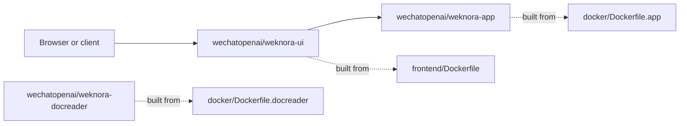
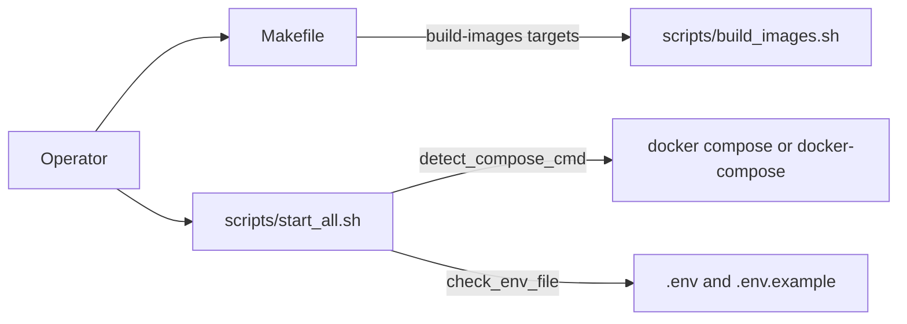
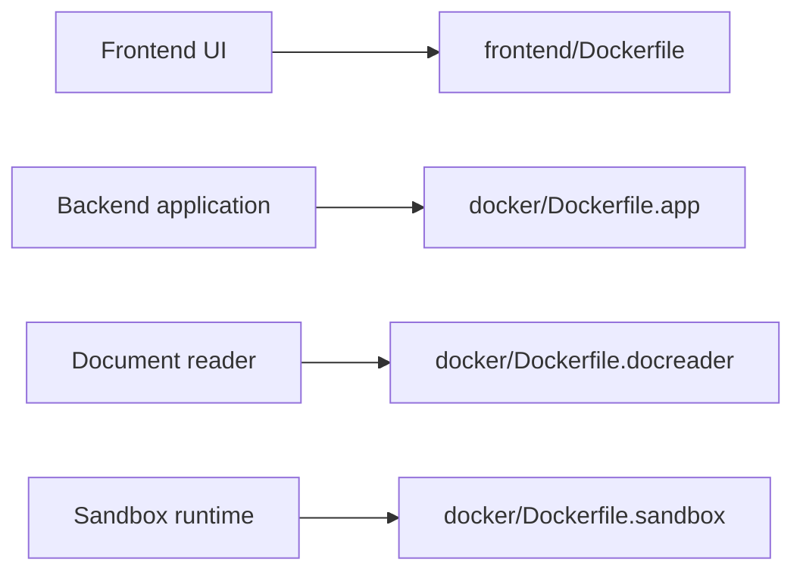
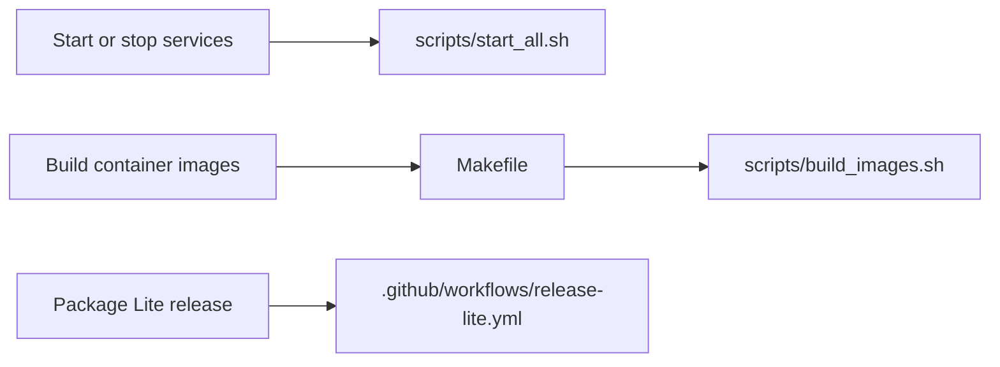

<!-- source: DeepWiki mcp.deepwiki.com · repo Tencent/WeKnora · page 9 Deployment and Operations · fetched 2026-10-29 -->

# Deployment and Operations

Relevant source files

The following files were used as context for generating this wiki page:

- [.github/workflows/cli.yml](.github/workflows/cli.yml)
- [.github/workflows/docker-image.yml](.github/workflows/docker-image.yml)
- [.github/workflows/release-lite.yml](.github/workflows/release-lite.yml)
- [.gitignore](.gitignore)
- [Formula/weknora-lite.rb](Formula/weknora-lite.rb)
- [Makefile](Makefile)
- [cli/internal/cmdutil/errors_doc_test.go](cli/internal/cmdutil/errors_doc_test.go)
- [cli/scripts/check-skill-wire-vocab.sh](cli/scripts/check-skill-wire-vocab.sh)
- [deploy/weknora-lite.service](deploy/weknora-lite.service)
- [docker/Dockerfile.app](docker/Dockerfile.app)
- [docker/Dockerfile.docreader](docker/Dockerfile.docreader)
- [docker/Dockerfile.sandbox](docker/Dockerfile.sandbox)
- [frontend/.dockerignore](frontend/.dockerignore)
- [frontend/Dockerfile](frontend/Dockerfile)
- [scripts/build_frontend_dist.sh](scripts/build_frontend_dist.sh)
- [scripts/build_images.sh](scripts/build_images.sh)
- [scripts/get_version.sh](scripts/get_version.sh)
- [scripts/package-lite.sh](scripts/package-lite.sh)
- [scripts/start_all.sh](scripts/start_all.sh)
- [scripts/test-homebrew.sh](scripts/test-homebrew.sh)
- [scripts/update-homebrew-formula.sh](scripts/update-homebrew-formula.sh)
- [scripts/verify_frontend_pr.sh](scripts/verify_frontend_pr.sh)

## Purpose and Scope

This page is the high-level entry point for deploying and operating WeKnora. It summarizes the available deployment paths, the main runtime components, and the build and operations entry points; scenario-specific instructions are covered by the child pages below. The repository provides Docker image builds, a Compose-oriented startup helper, and a Lite release workflow. [scripts/start_all.sh:20-35](), [Makefile:15-38](), [.github/workflows/release-lite.yml:1-7]()

Sources: [scripts/start_all.sh:20-35](), [Makefile:15-38](), [.github/workflows/release-lite.yml:1-7]()

---

## Service Topology

The container deployment is organized around a frontend image, a Go application image, and an optional document-reader image. The frontend image packages static assets in Nginx and exposes port 80; the application image exposes port 8080; the document-reader image exposes gRPC on port 50051. The supplied files establish these image roles and ports, but do not show the Compose service wiring, so refer to the Docker deployment guide for deployment-specific networking and profile details. [frontend/Dockerfile:51-77](), [docker/Dockerfile.app:153-169](), [docker/Dockerfile.docreader:160-170]()

**Diagram: Deployment components and code entities**

Sources: [frontend/Dockerfile:51-77](), [docker/Dockerfile.app:153-169](), [docker/Dockerfile.docreader:160-170]()

---

## Core Services Overview

The repository defines separate build artifacts for the frontend, backend, and document reader. It also includes sandbox image build targets and a Lite release workflow; these are different artifacts and should not be treated as required services in every deployment. [frontend/Dockerfile:1-77](), [docker/Dockerfile.app:104-169](), [docker/Dockerfile.docreader:79-170](), [.github/workflows/docker-image.yml:107-163](), [.github/workflows/release-lite.yml:25-48]()

| Component | Build or release definition | High-level role |
|---|---|---|
| Frontend | [`frontend/Dockerfile`](frontend/Dockerfile:1-77) | Builds static frontend assets and packages them in an Nginx runtime image. [frontend/Dockerfile:20-77]() |
| Application | [`docker/Dockerfile.app`](docker/Dockerfile.app:104-169) | Packages the `WeKnora` application binary in a runtime image that exposes port 8080. [docker/Dockerfile.app:153-169]() |
| Document reader | [`docker/Dockerfile.docreader`](docker/Dockerfile.docreader:79-170) | Packages the Python document-reader service and exposes gRPC port 50051. [docker/Dockerfile.docreader:160-170]() |
| Sandbox image variants | [`.github/workflows/docker-image.yml`](.github/workflows/docker-image.yml:107-163) | Builds sandbox image targets, including Cube and desktop variants. [.github/workflows/docker-image.yml:107-163]() |
| Lite release | [`.github/workflows/release-lite.yml`](.github/workflows/release-lite.yml:25-48) | Builds Lite binaries and packages frontend assets for release. [.github/workflows/release-lite.yml:25-48]() |

Sources: [frontend/Dockerfile:20-77](), [docker/Dockerfile.app:104-169](), [docker/Dockerfile.docreader:79-170](), [.github/workflows/docker-image.yml:107-163](), [.github/workflows/release-lite.yml:25-48]()

---

## Deployment Strategies

The repository includes a startup helper that can start or stop Docker services and optionally manage Ollama, along with Makefile targets for image building and migration commands. The Lite release workflow provides a separate binary packaging path. Choose the deployment model based on operational requirements, then follow the relevant child guide for its configuration and procedures. [scripts/start_all.sh:20-35](), [Makefile:15-38](), [.github/workflows/release-lite.yml:25-48]()

1. **Docker Deployment:** Compose-oriented startup and image deployment. For details, see [Docker Deployment](#9.1).
2. **Production Setup and Best Practices:** Production recommendations, including the deployment scenarios listed in the child page. For details, see [Production Setup and Best Practices](#9.2).
3. **Database Migrations and Maintenance:** Migration and database maintenance procedures. For details, see [Database Migrations and Maintenance](#9.3).
4. **Monitoring and Troubleshooting:** Operational observability and troubleshooting guidance. For details, see [Monitoring and Troubleshooting](#9.4).

Sources: [scripts/start_all.sh:20-35](), [Makefile:15-38]()

---

## Build and Operations Entry Points

For local image builds, the `Makefile` exposes targets such as `docker-build-app`, `docker-build-docreader`, `docker-build-frontend`, and `docker-build-all`. The startup helper checks for `.env` and can create it from `.env.example` when available; it also supports Docker Compose command detection. Use these entry points as orientation only—the Docker child page covers the deployment workflow in detail. [Makefile:15-22](), [Makefile:136-170](), [scripts/start_all.sh:75-125]()

**Diagram: Operations commands mapped to repository entities**

Sources: [Makefile:15-22](), [Makefile:192-198](), [scripts/start_all.sh:75-125]()

---

## Volume and Data Management

The application image creates `/data/files` and assigns it to `appuser`; the document-reader image creates `/tmp/docreader` for temporary images. Treat these paths as operationally relevant when configuring persistence or shared temporary storage. The provided Dockerfiles do not establish the deployment’s complete volume mapping, so consult the Docker deployment guide for the actual Compose volume configuration. [docker/Dockerfile.app:145-147](), [docker/Dockerfile.docreader:160-162]()

Sources: [docker/Dockerfile.app:145-147](), [docker/Dockerfile.docreader:160-162]()

---

## Subpages

- **[Docker Deployment](#9.1)** — Step-by-step guide to Docker Compose deployment, profile selection, volume management, and networking.
- **[Production Setup and Best Practices](#9.2)** — Production deployment recommendations, including Helm/Kubernetes charts, cloud image deployment via Tencent Lighthouse, security, scaling, and backup.
- **[Database Migrations and Maintenance](#9.3)** — Versioned migration system and database maintenance procedures.
- **[Monitoring and Troubleshooting](#9.4)** — Monitoring, logging, runtime queue inspection, and debugging guidance.

Sources: [Makefile:15-38](), [scripts/start_all.sh:20-35]()

---

## Natural Language Space to Code Entities

### Diagram 1: Runtime components and build definitions

Sources: [frontend/Dockerfile:20-77](), [docker/Dockerfile.app:104-169](), [docker/Dockerfile.docreader:79-170](), [.github/workflows/docker-image.yml:107-163]()

### Diagram 2: Deployment operations and build/release entities

Sources: [scripts/start_all.sh:20-35](), [Makefile:15-22](), [Makefile:192-198](), [scripts/build_images.sh:130-161](), [.github/workflows/release-lite.yml:25-48]()

---

