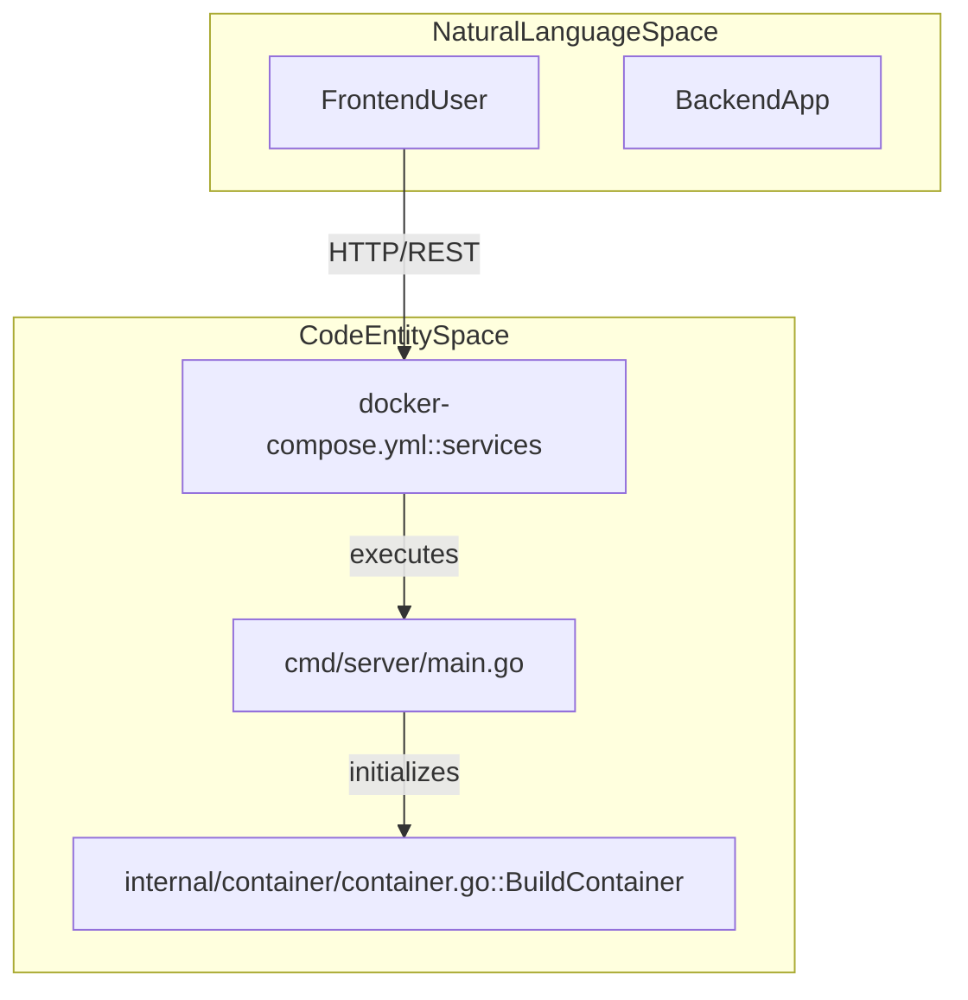
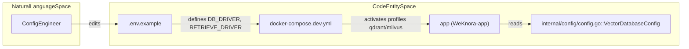
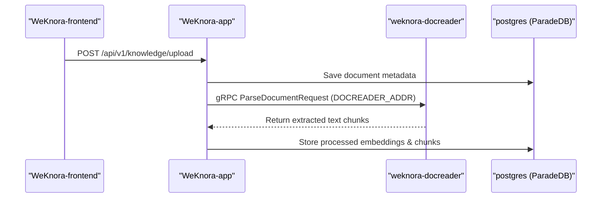

<!-- source: DeepWiki mcp.deepwiki.com · repo Tencent/WeKnora · page 9.1 Docker Deployment · fetched 2026-10-29 -->

# Docker Deployment

Relevant source files

The following files were used as context for generating this wiki page:

- [.env.example](.env.example)
- [.github/workflows/cli.yml](.github/workflows/cli.yml)
- [.github/workflows/docker-image.yml](.github/workflows/docker-image.yml)
- [.github/workflows/release-lite.yml](.github/workflows/release-lite.yml)
- [.gitignore](.gitignore)
- [Formula/weknora-lite.rb](Formula/weknora-lite.rb)
- [Makefile](Makefile)
- [cli/internal/cmdutil/errors_doc_test.go](cli/internal/cmdutil/errors_doc_test.go)
- [cli/scripts/check-skill-wire-vocab.sh](cli/scripts/check-skill-wire-vocab.sh)
- [config/config.yaml](config/config.yaml)
- [deploy/weknora-lite.service](deploy/weknora-lite.service)
- [docker-compose.dev.yml](docker-compose.dev.yml)
- [docker-compose.yml](docker-compose.yml)
- [docker/Dockerfile.app](docker/Dockerfile.app)
- [docker/Dockerfile.docreader](docker/Dockerfile.docreader)
- [docker/Dockerfile.sandbox](docker/Dockerfile.sandbox)
- [docreader/README.md](docreader/README.md)
- [docreader/config.py](docreader/config.py)
- [docreader/parser/docx_parser.py](docreader/parser/docx_parser.py)
- [docreader/parser/image_preprocess.py](docreader/parser/image_preprocess.py)
- [docreader/preprocess.py](docreader/preprocess.py)
- [docreader/preprocess_worker.py](docreader/preprocess_worker.py)
- [docreader/tests/test_config.py](docreader/tests/test_config.py)
- [docreader/tests/test_docx_tables.py](docreader/tests/test_docx_tables.py)
- [docreader/tests/test_preprocess_runner.py](docreader/tests/test_preprocess_runner.py)
- [frontend/.dockerignore](frontend/.dockerignore)
- [frontend/Dockerfile](frontend/Dockerfile)
- [go.mod](go.mod)
- [go.sum](go.sum)
- [internal/config/auth_legacy_env_test.go](internal/config/auth_legacy_env_test.go)
- [internal/config/config.go](internal/config/config.go)
- [internal/container/container.go](internal/container/container.go)
- [scripts/build_frontend_dist.sh](scripts/build_frontend_dist.sh)
- [scripts/build_images.sh](scripts/build_images.sh)
- [scripts/dev.sh](scripts/dev.sh)
- [scripts/get_version.sh](scripts/get_version.sh)
- [scripts/package-lite.sh](scripts/package-lite.sh)
- [scripts/start_all.sh](scripts/start_all.sh)
- [scripts/test-homebrew.sh](scripts/test-homebrew.sh)
- [scripts/update-homebrew-formula.sh](scripts/update-homebrew-formula.sh)
- [scripts/verify_frontend_pr.sh](scripts/verify_frontend_pr.sh)

This document provides a technical guide for deploying WeKnora using Docker and Docker Compose. It details the microservices architecture configured in `[docker-compose.yml]()`, profile selection options defined in `[docker-compose.dev.yml]()`, environment variable injection (`[.env.example]()`), volume management for data persistence, and networking considerations. It also documents how core application components are initialized via dependency injection in `[internal/container/container.go]()`.

---

## 1. Service Architecture and Container Orchestration

WeKnora is structured as a containerized microservices application where each runtime layer handles specific duties, orchestrated via Docker Compose. The application wiring and configuration loading are handled by `config.LoadConfig` and container initialization during startup (`[internal/container/container.go:135]()`).

### System-to-Code Entity Mapping

| System Name | Docker Container Name | Code Entity / Implementation Reference |
| :--- | :--- | :--- |
| Backend Application | `WeKnora-app` | `cmd/server/main.go`, `[internal/container/container.go:112-137]()` |
| Frontend UI | `WeKnora-frontend` | Vue.js SPA built via `[frontend/Dockerfile:1-50]()` and served by NGINX |
| Document Reader | `weknora-docreader` | Python gRPC parser service defined in `[docker/Dockerfile.docreader]()` |
| Primary Database | `postgres` | ParadeDB (PostgreSQL 17) |
| Task Queue | `redis` | Redis instance managing async tasks via Asynq |

Title: "Service Architecture and Code Mapping"

Sources: `[docker-compose.yml:1-35]`, `[internal/container/container.go:112-137]()`

---

## 2. Core Services and Build Pipelines

The backend container is built using `[docker/Dockerfile.app]()`, which compiles the Go server binary, links any optional parser libraries, and runs `scripts/docker-entrypoint.sh`. The frontend container utilizes a multi-stage build in `[frontend/Dockerfile]()` where Node.js compiles Vite static assets into an NGINX image.

- **`app` (`WeKnora-app`)**: Listens internally on port `8080`, performing health checks against `http://localhost:8080/health` (`[docker-compose.yml:62-67]()`). It reads configuration properties defined in `[internal/config/config.go]()` and injects database drivers and storage providers dynamically.
- **`frontend` (`WeKnora-frontend`)**: Serves the compiled SPA, proxying API calls to the backend via `APP_HOST` and `APP_BACKEND_PORT` (`[docker-compose.yml:21-25]()`).
- **`docreader` (`weknora-docreader`)**: Communicates with the backend service via gRPC on `DOCREADER_ADDR` (`[.env.example:99]()`).

Sources: `[docker-compose.yml:36-76]`, `[docker/Dockerfile.app:1-88]`, `[frontend/Dockerfile:1-60]`, `[.env.example:99]()`

---

## 3. Deployment Profiles and Driver Selection

WeKnora uses Docker Compose profiles (`[docker-compose.dev.yml]()`) to selectively launch auxiliary infrastructure such as vector databases (`qdrant`, `milvus`), graph databases (`neo4j`), search engines (`searxng`), object storage (`minio`), and observability tools (`langfuse`).

Title: "Profile and Driver Selection Flow"

Sources: `[docker-compose.dev.yml:1-120]`, `[internal/config/config.go:132-134]`, `[.env.example:131-145]()`

---

## 4. Data Flow: Document Ingestion and Indexing

When documents are uploaded, the backend app service coordinates persistence and chunk parsing through internal services and repositories.

Sources: `[docker-compose.yml:36-50]`, `[docker/Dockerfile.app:1-50]`, `[.env.example:99]()`

---

## 5. Networking, Volumes, and Runtime Persistence

- **Networking**: All services communicate over a shared user-defined Docker network (`WeKnora-network`) (`[docker-compose.yml:32-33]()`).
- **Volume Persistence**: Named volumes ensure relational data, vector indices, and uploaded files survive container updates:
  - `data-files`: Persistent storage for uploaded user documents (`[docker-compose.yml:48]()`).
  - `docreader-tmp`: Ephemeral storage for file extraction, shared between `app` and `docreader` (`[docker-compose.yml:49]()`).

Sources: `[docker-compose.yml:47-50]`, `[.env.example:123-140]()`

---

## 6. Build Workflows and Automation Scripts

Building and operating the containers is managed via `[Makefile]()`, `[scripts/dev.sh]()`, and GitHub Actions workflows (`[.github/workflows/docker-image.yml]()`).

- **`make docker-build-app`**: Compiles the Go server binary with build tags and version details (`[Makefile:137-148]()`).
- **`scripts/dev.sh`**: Helper script to initialize development environments, validate `.env` settings, and run backend components locally (`[scripts/dev.sh:1-117]()`). It supports various profiles for optional services (`[scripts/dev.sh:217-231]()`).
- **CI/CD**: `[.github/workflows/docker-image.yml]()` builds multi-architecture images (`linux/amd64`, `linux/arm64`) for the app, UI, and docreader components (`[.github/workflows/docker-image.yml:45-106]()`).

Sources: `[Makefile:137-148]`, `[scripts/dev.sh:1-117]`, `[scripts/dev.sh:217-231]`, `[.github/workflows/docker-image.yml:45-106]()`

---

