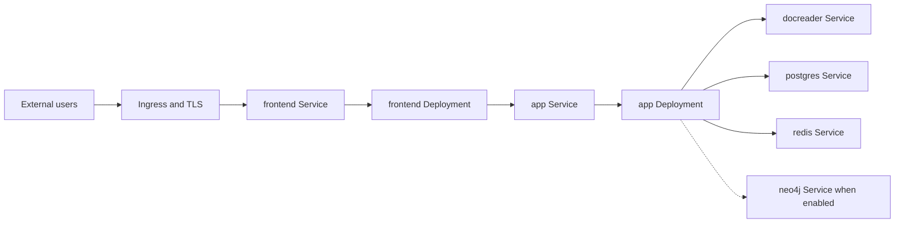
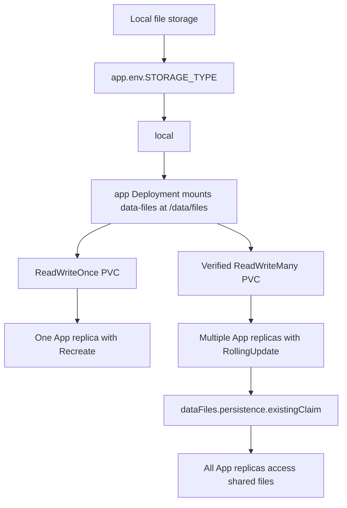

<!-- source: DeepWiki mcp.deepwiki.com · repo Tencent/WeKnora · page 9.2 Production Setup and Best Practices · fetched 2026-10-29 -->

# Production Setup and Best Practices

Relevant source files

The following files were used as context for generating this wiki page:

- [.github/workflows/helm.yml](.github/workflows/helm.yml)
- [helm/.helmignore](helm/.helmignore)
- [helm/README.md](helm/README.md)
- [helm/templates/NOTES.txt](helm/templates/NOTES.txt)
- [helm/templates/_helpers.tpl](helm/templates/_helpers.tpl)
- [helm/templates/app.yaml](helm/templates/app.yaml)
- [helm/templates/docreader.yaml](helm/templates/docreader.yaml)
- [helm/templates/frontend.yaml](helm/templates/frontend.yaml)
- [helm/templates/ingress.yaml](helm/templates/ingress.yaml)
- [helm/templates/neo4j.yaml](helm/templates/neo4j.yaml)
- [helm/templates/postgres.yaml](helm/templates/postgres.yaml)
- [helm/templates/pvc.yaml](helm/templates/pvc.yaml)
- [helm/templates/redis.yaml](helm/templates/redis.yaml)
- [helm/templates/secrets.yaml](helm/templates/secrets.yaml)
- [helm/tests/test_app_storage.py](helm/tests/test_app_storage.py)
- [helm/values.yaml](helm/values.yaml)

## Purpose and scope

This page describes production-oriented deployment practices supported by the provided WeKnora Helm chart: Kubernetes installation, component connectivity, secret handling, storage and scaling trade-offs, and operational backup considerations. The available files document Helm deployment, not the Tencent Lighthouse cloud-image workflow, so Lighthouse-specific provisioning and first-boot steps are not described here.

Sources: [helm/README.md:16-21](), [helm/values.yaml:11-53]()

---

## Kubernetes deployment with Helm

The chart documents Kubernetes 1.25+, Helm 3.10+, a persistent-volume provisioner, and an ingress controller for external access as prerequisites. It deploys the backend API, frontend, document reader, PostgreSQL/ParadeDB, and Redis; optional components include Neo4j, MinIO, and Qdrant. [helm/README.md:16-21](), [helm/README.md:51-79]()

For a production release, keep deployment-specific settings in a values file and provide secrets through a pre-created Kubernetes Secret or a secret-management integration. The chart README’s production example uses a single App replica, `Recreate` updates, persistent storage, TLS-enabled Ingress, and `secrets.existingSecret`. [helm/README.md:102-145]()

| Setting | Production consideration |
|---|---|
| `global.storageClass` | Select an appropriate storage class for chart-managed PVCs, or use `-` to request the cluster default. [helm/values.yaml:11-16]() |
| `app.replicaCount` and `app.strategy` | Match the App rollout strategy to the storage access mode; see [Persistent storage and App scaling](#persistent-storage-and-app-scaling). [helm/values.yaml:62-75]() |
| `app.resources` | Set CPU and memory requests and limits based on measured workload. The chart supplies defaults, not a workload-specific sizing guarantee. [helm/values.yaml:85-93]() |
| `ingress.enabled` and TLS settings | Enable Ingress and configure TLS for external access. The README’s production example uses a host and TLS Secret. [helm/README.md:129-138]() |
| `secrets.existingSecret` | Reference a Secret managed outside the chart when using an external secrets workflow. [helm/README.md:136-138](), [helm/templates/secrets.yaml:7-12]() |

The chart’s installation instructions require database, Redis, and JWT secrets when it creates a Secret. Avoid placing production credentials directly in shell history or checked-in values files; prefer a controlled secret-delivery process. [helm/templates/secrets.yaml:37-50](), [helm/templates/secrets.yaml:7-12]()

Sources: [helm/README.md:16-21](), [helm/README.md:102-145](), [helm/values.yaml:11-16](), [helm/values.yaml:62-93](), [helm/templates/secrets.yaml:7-12](), [helm/templates/secrets.yaml:37-50]()

---

## Production request and service topology

The chart connects the frontend to the App service using `APP_HOST` and `APP_PORT`. The App is configured to connect to PostgreSQL, Redis, and the Docreader gRPC service; the App template also conditionally configures Neo4j when `neo4j.enabled` is true. [helm/templates/frontend.yaml:44-50](), [helm/templates/app.yaml:62-103](), [helm/templates/app.yaml:122-124](), [helm/templates/app.yaml:135-153]()

### Diagram: External traffic to Helm-managed services

Sources: [helm/README.md:72-85](), [helm/templates/frontend.yaml:44-54](), [helm/templates/app.yaml:62-103](), [helm/templates/app.yaml:122-124](), [helm/templates/app.yaml:135-153](), [helm/templates/docreader.yaml:86-103](), [helm/templates/neo4j.yaml:114-134]()

### Natural language concepts mapped to chart entities

| Deployment concept | Searchable chart entity | Role |
|---|---|---|
| Backend API | `helm/templates/app.yaml`, `app` Deployment | Serves the API on container port `8080` and receives database, Redis, storage, and Docreader configuration. [helm/templates/app.yaml:42-54](), [helm/templates/app.yaml:62-129]() |
| Web UI | `helm/templates/frontend.yaml`, `frontend` Deployment | Serves HTTP on port `80` and receives the App host and port through `APP_HOST` and `APP_PORT`. [helm/templates/frontend.yaml:36-54]() |
| Document parsing | `helm/templates/docreader.yaml`, `docreader` Deployment | Provides a gRPC service on port `50051`. [helm/templates/docreader.yaml:36-52]() |
| Release-wide settings | `helm/values.yaml`, `global` | Defines shared storage class, pull secrets, upload limit, and default security contexts. [helm/values.yaml:11-40]() |
| Secret references | `helm/templates/secrets.yaml`, `weknora.secretName` | Provides DB, Redis, JWT, and AES key values to chart resources. [helm/templates/secrets.yaml:28-50](), [helm/templates/_helpers.tpl:108-117]() |

Sources: [helm/templates/app.yaml:42-54](), [helm/templates/app.yaml:62-129](), [helm/templates/frontend.yaml:36-54](), [helm/templates/docreader.yaml:36-52](), [helm/values.yaml:11-40](), [helm/templates/secrets.yaml:28-50](), [helm/templates/_helpers.tpl:108-117]()

---

## Security hardening

### Network exposure

Use Ingress as the external entry point and configure TLS for production. The chart README demonstrates Ingress with a host and TLS Secret; its component Services are configured as `ClusterIP` by default for the App, frontend, and Docreader. [helm/README.md:72-85](), [helm/README.md:129-138](), [helm/values.yaml:127-132](), [helm/values.yaml:196-201](), [helm/values.yaml:248-253]()

The intended application path is Ingress → frontend → App. Keep database, Redis, and Docreader access internal to the cluster unless the deployment has a specific, controlled operational need to expose them. The App’s configured backend endpoints and the component Service definitions are shown in the chart templates. [helm/templates/frontend.yaml:44-54](), [helm/templates/app.yaml:62-103](), [helm/templates/app.yaml:122-124]()

Sources: [helm/README.md:72-85](), [helm/README.md:129-138](), [helm/values.yaml:127-132](), [helm/values.yaml:196-201](), [helm/values.yaml:248-253](), [helm/templates/frontend.yaml:44-54](), [helm/templates/app.yaml:62-103]()

### Secret and encryption-key management

The chart Secret contains database credentials, Redis credentials, `JWT_SECRET`, and `SYSTEM_AES_KEY`. The chart comments identify `SYSTEM_AES_KEY` as the key used for encrypting tenant API keys, model API keys, vector-store credentials, web-search provider keys, and other application secrets. [helm/templates/secrets.yaml:37-50]()

If the chart generates the Secret, its template uses Helm’s `lookup` to reuse the existing `SYSTEM_AES_KEY` on upgrade; this prevents an upgrade from replacing the key and making previously encrypted data unreadable. Alternatively, `secrets.existingSecret` lets operators provide an existing Secret. Back up the Secret securely and preserve `SYSTEM_AES_KEY` during restoration. [helm/templates/secrets.yaml:13-28](), [helm/templates/secrets.yaml:47-50](), [helm/templates/_helpers.tpl:108-117]()

For production, the chart recommends external secret-management approaches such as an External Secrets Operator or sealed secrets, or a pre-created Secret. [helm/templates/secrets.yaml:7-12]()

Sources: [helm/templates/secrets.yaml:7-12](), [helm/templates/secrets.yaml:13-28](), [helm/templates/secrets.yaml:37-50](), [helm/templates/_helpers.tpl:108-117]()

### Pod and container security settings

The global pod security context sets `seccompProfile.type` to `RuntimeDefault`; the global container security context disables privilege escalation. The chart notes that the official images run as root by default and that `readOnlyRootFilesystem` is disabled because images require writable filesystems. Enable non-root execution only after verifying compatibility with the selected images. [helm/values.yaml:28-40]()

The chart’s ServiceAccount defaults to not automounting its API token. The App’s Docker sandbox is disabled by default; the App template warns that access to a Docker Engine API can grant substantial host-level capability, so do not enable it without reviewing the threat model and daemon access. [helm/values.yaml:41-53](), [helm/values.yaml:117-120](), [helm/templates/app.yaml:130-134]()

Sources: [helm/values.yaml:28-53](), [helm/values.yaml:117-120](), [helm/templates/app.yaml:130-134]()

---

## Persistent storage and App scaling

### App replicas and local file storage

The chart defaults to `STORAGE_TYPE: local`, with `LOCAL_STORAGE_BASE_DIR: /data/files`, and mounts the App’s `data-files` volume at `/data/files`. The README explains that the chart-created data-files PVC defaults to `ReadWriteOnce` (RWO). RWO storage is not shared writable storage across nodes, so multiple App replicas need an appropriate shared-storage configuration if they must access the same local files. [helm/values.yaml:108-113](), [helm/templates/app.yaml:158-160](), [helm/README.md:147-190]()

For the documented single-replica local-storage setup, use `app.replicaCount: 1` and `app.strategy.type: Recreate`. With a single-node-attach RWO volume, the default rolling update may leave the replacement Pod waiting for the old Pod’s volume attachment to be released. `Recreate` avoids overlapping old and new App Pods during upgrade but causes App downtime while the old Pod is replaced. [helm/README.md:102-123](), [helm/README.md:147-156]()

To run multiple App replicas with local file storage, provide a verified `ReadWriteMany` (RWX) filesystem claim that all replicas can read and write. The chart supports an existing claim through `dataFiles.persistence.existingClaim`; its README example combines a three-replica App Deployment with `RollingUpdate`. The claim must be in the release namespace and must provide shared access to `/data/files`. This addresses App file storage only, not high availability for the database or other components. [helm/README.md:158-190](), [helm/templates/pvc.yaml:65-81]()

### Rollout strategy and validation

The App Deployment accepts `RollingUpdate` or `Recreate`; the template rejects other strategy names. The default is `RollingUpdate` with `maxSurge: 1` and `maxUnavailable: 0`. [helm/templates/app.yaml:20-30](), [helm/values.yaml:65-75]()

Before adopting a rollout configuration, render the chart and verify the resulting replica count, Deployment strategy, PVC access mode, and claim reference. The chart’s render-only tests cover the default strategy, `Recreate`, configurable access modes, and the documented shared-claim topology. [helm/tests/test_app_storage.py:59-89](), [helm/tests/test_app_storage.py:91-140]()

### Diagram: Natural language scaling choices mapped to chart configuration

Sources: [helm/values.yaml:108-113](), [helm/templates/app.yaml:158-160](), [helm/templates/pvc.yaml:65-81](), [helm/README.md:147-190](), [helm/templates/app.yaml:20-30]()

Sources: [helm/values.yaml:62-75](), [helm/values.yaml:108-113](), [helm/templates/app.yaml:20-30](), [helm/templates/app.yaml:158-160](), [helm/templates/pvc.yaml:65-81](), [helm/README.md:102-123](), [helm/README.md:147-190](), [helm/tests/test_app_storage.py:59-140]()

---

## Scaling and availability

The chart exposes `replicaCount`, resource requests and limits, node selectors, tolerations, and affinity settings for the App, frontend, and Docreader components. Scale these components independently where workload measurements justify it, and set resource requests and limits appropriate to the target environment. The chart’s default values are initial configuration, not production capacity guarantees. [helm/values.yaml:62-93](), [helm/values.yaml:154-161](), [helm/values.yaml:170-210](), [helm/values.yaml:215-223]()

For App replicas, account for file-storage sharing and the rollout constraints described above. The App defaults to `STREAM_MANAGER_TYPE: redis` and connects to the chart Redis Service; retain and validate the Redis-backed stream configuration when deploying multiple App instances. [helm/values.yaml:108-115](), [helm/templates/app.yaml:84-103]()

Do not treat scaling a stateless Deployment as proof that its dependencies are highly available. The chart templates provision persistent storage for stateful components, but the provided deployment examples do not establish database or Redis failover, replication, or a complete multi-zone availability design. [helm/templates/pvc.yaml:8-81](), [helm/README.md:183-190]()

Sources: [helm/values.yaml:62-93](), [helm/values.yaml:108-115](), [helm/values.yaml:154-161](), [helm/values.yaml:170-223](), [helm/templates/app.yaml:84-103](), [helm/templates/pvc.yaml:8-81](), [helm/README.md:183-190]()

---

## Health checks and release operations

The App uses HTTP `/health` liveness and readiness probes. The frontend probes `/`, and the Docreader uses `grpc_health_probe` against its local gRPC port. These probes allow Kubernetes to check component health before routing traffic or restarting a container. [helm/values.yaml:134-152](), [helm/templates/frontend.yaml:57-72](), [helm/templates/docreader.yaml:55-73]()

The chart README provides commands to check release Pods and follow App or frontend logs. Use the rendered release’s namespace and labels when inspecting deployment status. [helm/templates/NOTES.txt:133-138]()

The Helm CI workflow runs `helm lint ./helm`, the chart’s storage and rollout tests, and image-tag checks. Run equivalent chart validation as part of deployment change review. [`.github/workflows/helm.yml:30-42](), [`.github/workflows/helm.yml:43-73`]()

Sources: [helm/values.yaml:134-152](), [helm/templates/frontend.yaml:57-72](), [helm/templates/docreader.yaml:55-73](), [helm/templates/NOTES.txt:133-138](), [.github/workflows/helm.yml:30-72]()

---

## Tencent Lighthouse and cloud-image deployment

The supplied files describe the Helm chart and do not include Lighthouse provisioning instructions, cloud-image preparation scripts, or first-boot service definitions. Consequently, this page cannot verify a WeKnora-specific Lighthouse image workflow or its secret-generation and startup behavior.

For a Lighthouse-hosted Kubernetes cluster, the chart’s documented Kubernetes prerequisites and Helm deployment configuration are applicable. For a Lighthouse virtual machine, use a deployment guide that matches the actual image and runtime being deployed; do not infer VM initialization steps from this Helm chart. [helm/README.md:16-21]()

Sources: [helm/README.md:16-21]()

---

## Backup and disaster recovery

The chart provisions persistent claims for PostgreSQL, Redis, optional Neo4j, and App data files when the corresponding persistence settings are enabled and no existing claim is supplied. PVCs are configured with `ReadWriteOnce` by default for these components, except that App data-file access modes are configurable. [helm/templates/pvc.yaml:8-81]()

Treat backup as a coordinated operational responsibility:

| Data or configuration | Operational recommendation |
|---|---|
| PostgreSQL PVC | Back up the database using a database-consistent procedure or supported storage snapshots. The chart provisions persistent storage but does not define a backup schedule or restore procedure. [helm/templates/pvc.yaml:8-25]() |
| Redis PVC | Decide whether Redis data needs durable backup for the deployment’s recovery objectives; the chart provisions persistence but does not specify backup policy. [helm/templates/pvc.yaml:27-44]() |
| App file storage | Back up the data-files PVC or configured object-storage location. With local storage, the App uses `/data/files`; for multiple replicas, ensure the backed-up storage is the shared storage actually used by all replicas. [helm/values.yaml:108-113](), [helm/templates/app.yaml:158-160](), [helm/README.md:158-190]() |
| Kubernetes Secret | Securely back up the Secret containing `SYSTEM_AES_KEY` and the application credentials. Preserve the encryption key needed to decrypt stored credentials. [helm/templates/secrets.yaml:37-50]() |
| Neo4j data, if enabled | Include the Neo4j data volume in the backup plan; the chart mounts it at `/data` and can use a PVC when persistence is enabled. [helm/templates/neo4j.yaml:73-101](), [helm/templates/pvc.yaml:46-63]() |

Test restoration, including the application Secret and persistent data, in a non-production environment before relying on a backup plan. The supplied chart files do not define backup jobs, retention rules, or restore commands. [helm/templates/pvc.yaml:8-81](), [helm/templates/secrets.yaml:37-50]()

Sources: [helm/templates/pvc.yaml:8-81](), [helm/values.yaml:108-113](), [helm/templates/app.yaml:158-160](), [helm/templates/secrets.yaml:37-50](), [helm/templates/neo4j.yaml:73-101](), [helm/README.md:158-190]()

---

## Summary

For production Kubernetes deployments, use the Helm chart with deliberate resource settings, TLS-enabled external access, managed secrets, and persistent storage. Choose App replicas and rollout strategy together with the file-storage access mode: the documented local RWO setup uses one replica and `Recreate`, while multiple replicas require verified shared storage for local files. Back up persistent data and preserve `SYSTEM_AES_KEY`; the provided chart does not itself configure backup schedules or database high availability. [helm/README.md:102-190](), [helm/templates/secrets.yaml:37-50](), [helm/templates/pvc.yaml:8-81]()

Sources: [helm/README.md:102-190](), [helm/templates/secrets.yaml:37-50](), [helm/templates/pvc.yaml:8-81]()

---

