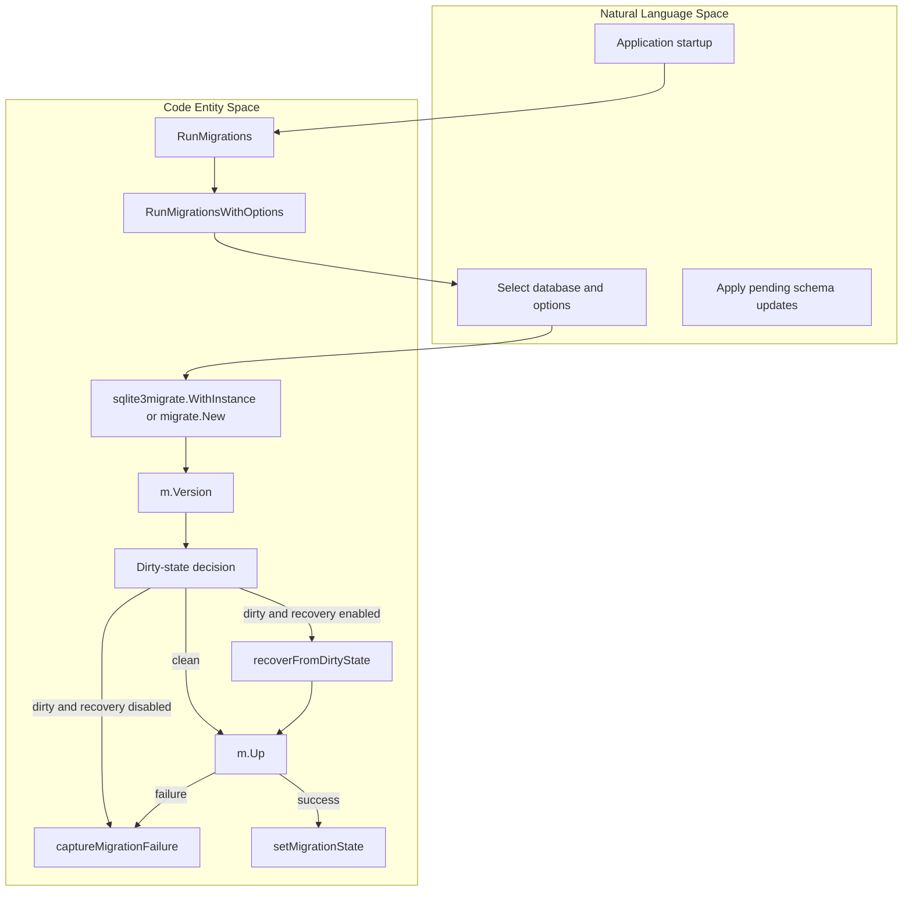
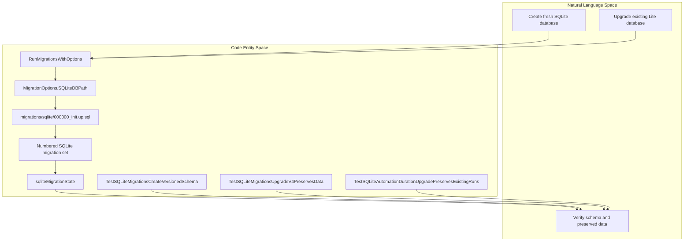
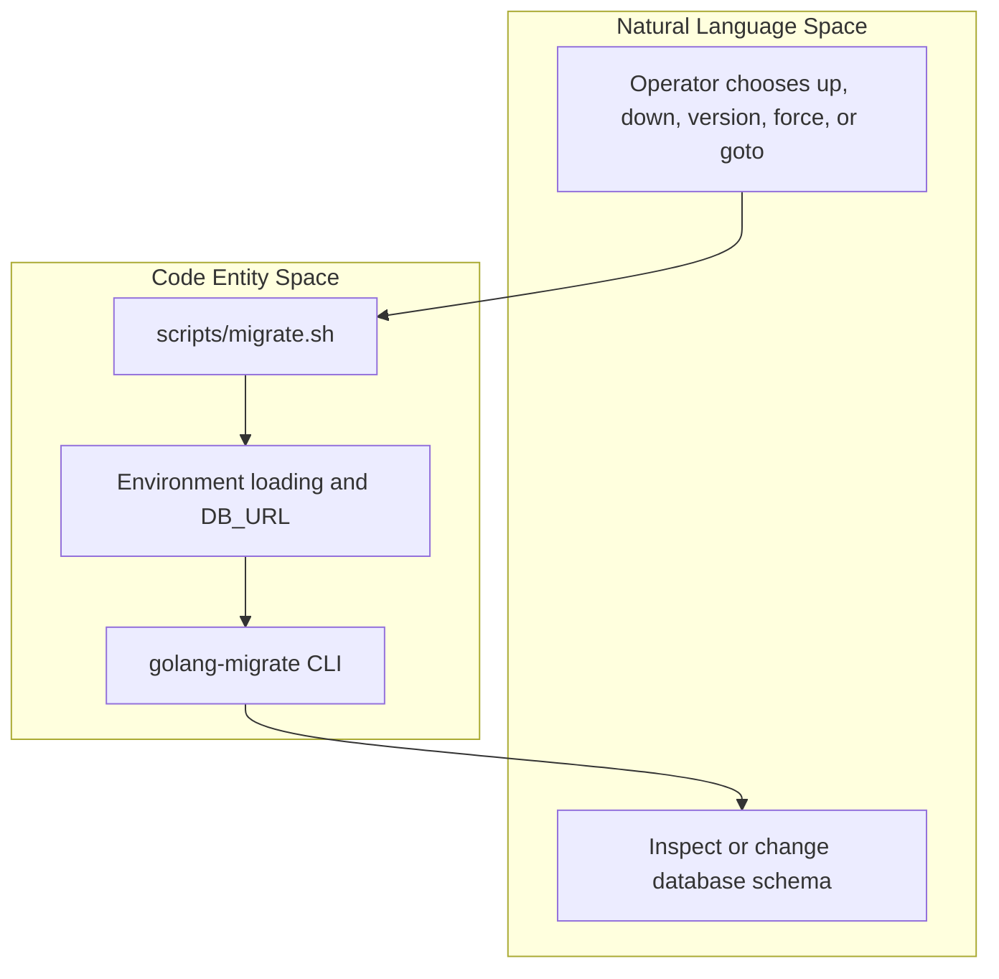

<!-- source: DeepWiki mcp.deepwiki.com · repo Tencent/WeKnora · page 9.3 Database Migrations and Maintenance · fetched 2026-10-29 -->

# Database Migrations and Maintenance

Relevant source files

The following files were used as context for generating this wiki page:

- [internal/application/service/agent_collaboration.go](internal/application/service/agent_collaboration.go)
- [internal/application/service/agent_collaboration_inherited.go](internal/application/service/agent_collaboration_inherited.go)
- [internal/application/service/agent_collaboration_recovery.go](internal/application/service/agent_collaboration_recovery.go)
- [internal/application/service/automation.go](internal/application/service/automation.go)
- [internal/application/service/automation_regression_test.go](internal/application/service/automation_regression_test.go)
- [internal/application/service/automation_runner.go](internal/application/service/automation_runner.go)
- [internal/application/service/automation_scheduler.go](internal/application/service/automation_scheduler.go)
- [internal/database/migration_source_test.go](internal/database/migration_source_test.go)
- [internal/database/migration_sqlite_automation_duration_test.go](internal/database/migration_sqlite_automation_duration_test.go)
- [internal/database/migration_sqlite_versioned_schema_test.go](internal/database/migration_sqlite_versioned_schema_test.go)
- [internal/types/agent_prompt.go](internal/types/agent_prompt.go)
- [internal/types/automation.go](internal/types/automation.go)
- [migrations/sqlite/000000_init.down.sql](migrations/sqlite/000000_init.down.sql)
- [migrations/sqlite/000000_init.up.sql](migrations/sqlite/000000_init.up.sql)

This page documents WeKnora’s versioned database migration system, database-engine support, migration runner, and operational maintenance. It covers schema evolution and the available SQLite migration verification. [internal/database/migration_sqlite_versioned_schema_test.go:16-24]()

---

## 1. Overview and Multi-Database Support

WeKnora uses `github.com/golang-migrate/migrate/v4` for schema migrations. [internal/database/migration.go:12-16]() Migration assets are organized by database engine:

- **PostgreSQL / ParadeDB:** The existing documentation identifies `migrations/versioned/` as the incremental migration set and `migrations/paradedb/` as containing ParadeDB initialization assets. [migrations/versioned/000000_init.up.sql:1-10](), [migrations/paradedb/00-init-db.sql:1-10]()
- **MySQL:** MySQL initialization assets are located in `migrations/mysql/`. [migrations/mysql/00-init-db.sql:1-15]()
- **SQLite:** `migrations/sqlite/000000_init.up.sql` defines a consolidated Lite schema, and `migrations/sqlite/000000_init.down.sql` drops its baseline tables. [migrations/sqlite/000000_init.up.sql:1-15](), [migrations/sqlite/000000_init.down.sql:1-34]()

The SQLite baseline includes core entities such as `tenants`, `models`, `knowledge_bases`, `knowledges`, and `sessions`. For example, tenant configuration and status fields are stored on `tenants`; knowledge-base configuration includes chunking, image processing, embedding, and indexing settings. [migrations/sqlite/000000_init.up.sql:3-25](), [migrations/sqlite/000000_init.up.sql:29-50](), [migrations/sqlite/000000_init.up.sql:52-88]()

SQLite also has subsequent versioned migrations. The schema test identifies tables and columns that those migrations add, including processing spans, multi-tag relations, browser authorization, message artifacts, and automation-related fields. [internal/database/migration_sqlite_versioned_schema_test.go:16-50](), [internal/database/migration_sqlite_versioned_schema_test.go:52-89]()

Sources: [internal/database/migration.go:12-16](), [migrations/paradedb/00-init-db.sql:1-10](), [migrations/versioned/000000_init.up.sql:1-10](), [migrations/mysql/00-init-db.sql:1-15](), [migrations/sqlite/000000_init.up.sql:1-25](), [migrations/sqlite/000000_init.down.sql:1-34](), [internal/database/migration_sqlite_versioned_schema_test.go:16-89]()

---

## 2. Migration Runner Implementation

Migration execution is centralized in `internal/database/migration.go`. The runner provides `RunMigrations` and `RunMigrationsWithOptions`, handles database-driver setup, reads the current migration version, and reports migration failures. [internal/database/migration.go:83-180]()

### Core Functions and Control Flow

- `RunMigrations(dsn string)` is the standard entry point and delegates to `RunMigrationsWithOptions` with default options. [internal/database/migration.go:83-85]()
- `RunMigrationsWithOptions(dsn string, opts MigrationOptions)` selects the migration connection and driver. For SQLite, `MigrationOptions.SQLiteDBPath` allows the runner to open the database file directly and create the migrate driver with `sqlite3migrate.WithInstance`. [internal/database/migration.go:101-145]()
- The runner checks the current version and dirty flag with `m.Version()`. When it detects a dirty migration, it either attempts recovery if `AutoRecoverDirty` is enabled or records the failure and returns an error. [internal/database/migration.go:148-176]()
- The runner applies pending migrations with `m.Up()` and updates cached migration state after execution. [internal/database/migration.go:177-180]()

### Migration Runner Execution: Natural Language and Code Entities

The diagram maps startup and migration decisions to the named runner functions and migration-library operations. [internal/database/migration.go:83-180]()

Sources: [internal/database/migration.go:83-180]()

---

## 3. Versioned Schema Files and Incremental Evolutions

The versioned migration directory contains incremental schema changes for PostgreSQL and ParadeDB. [migrations/versioned/000000_init.up.sql:1-10]()

### Baseline and Early Migrations

- `000000_init.up.sql` establishes core relational entities, including `tenants`, `models`, `knowledge_bases`, `knowledges`, `sessions`, and `messages`. [migrations/versioned/000000_init.up.sql:1-165]()
- `000001_agent.up.sql` introduces authentication structures and additional tenant configuration and agent-related schema. [migrations/versioned/000001_agent.up.sql:1-146]()
- `000002_embeddings.up.sql` contains vector-search setup, including conditional extension and index creation based on migration configuration. [migrations/versioned/000002_embeddings.up.sql:1-94]()

### SQLite Versioned Schema and Upgrade Guarantees

SQLite uses a consolidated baseline plus later numbered migrations. The test suite documents the SQLite schema additions expected to remain aligned with the versioned PostgreSQL migrations. Examples include `system_settings`, `knowledge_processing_spans`, `knowledge_tag_relations`, `browser_devices`, `message_artifacts`, and `agent_run_suspensions`. [internal/database/migration_sqlite_versioned_schema_test.go:16-50]()

The same test records columns introduced by later migrations across existing tables. Examples include `messages.run_state`, `sessions.parent_session_id`, `knowledge_bases.profile_config`, and `automations.model_id`. [internal/database/migration_sqlite_versioned_schema_test.go:52-89]()

`TestSQLiteMigrationsCreateVersionedSchema` runs migrations against a fresh SQLite database, checks the expected migration version and dirty flag, verifies required tables and columns, and checks indexes and selected data defaults. [internal/database/migration_sqlite_versioned_schema_test.go:91-137]()

`TestSQLiteMigrationsUpgradeV4PreservesData` exercises an upgrade from a legacy v4 migration root: it creates data using the older schema, runs the full migration set, and verifies the upgrade path. [internal/database/migration_sqlite_versioned_schema_test.go:139-168]()

A separate regression test upgrades SQLite databases from versions 45 and 47 and confirms that an existing automation run retains its answer and status while the new `execution_duration_ms` field is initialized to zero. [internal/database/migration_sqlite_automation_duration_test.go:11-35]()

### SQLite Migration Flow: Natural Language and Code Entities

This diagram connects fresh creation and legacy upgrade scenarios to the SQLite migration runner and migration-verification tests. [internal/database/migration_sqlite_versioned_schema_test.go:91-168](), [internal/database/migration_sqlite_automation_duration_test.go:11-35]()

Sources: [migrations/sqlite/000000_init.up.sql:1-25](), [internal/database/migration_sqlite_versioned_schema_test.go:91-168](), [internal/database/migration_sqlite_automation_duration_test.go:11-35]()

---

## 4. Maintenance Script and CLI Integration

The existing page documents `scripts/migrate.sh` as the shell entry point for manual migration operations. Its commands invoke the `migrate` CLI against a configured database URL. [scripts/migrate.sh:1-122]()

| Command | Description | Implementation |
|---|---|---|
| `up` | Apply pending migrations. | Invokes `migrate ... up`. [scripts/migrate.sh:64-74]() |
| `down` | Roll back the latest migration step. | Invokes `migrate ... down`. [scripts/migrate.sh:75-78]() |
| `version` | Display the current schema version and dirty status. | Invokes `migrate ... version`. [scripts/migrate.sh:91-94]() |
| `force <version>` | Set the migration version, including to clear a dirty state after operator review. | Invokes `migrate force`. [scripts/migrate.sh:95-106]() |
| `goto <version>` | Migrate to a target version. | Invokes `migrate ... goto`. [scripts/migrate.sh:107-115]() |

The `force` operation changes migration metadata; use it only after determining which schema changes actually completed. The script’s command behavior is defined in `scripts/migrate.sh`. [scripts/migrate.sh:95-115]()

### CLI Maintenance Workflow: Natural Language and Code Entities

The diagram maps an operator’s migration action to `scripts/migrate.sh`, its environment/database configuration, and the migration CLI. [scripts/migrate.sh:1-122]()

Sources: [scripts/migrate.sh:1-122]()

---

## 5. Migration State Caching and Diagnostics

`internal/database/migration.go` maintains an in-memory, thread-safe migration-state cache for reporting migration health without querying the database on every request. [internal/database/migration.go:18-24]()

- `CachedMigrationVersion()` returns the cached version, dirty flag, and whether the cache contains a value. [internal/database/migration.go:33-37]()
- `CachedMigrationError()` returns the last migration failure message, if one was recorded. [internal/database/migration.go:39-46]()
- `setMigrationState(...)` updates the cached state while holding `migrationStateMu`. [internal/database/migration.go:48-61]()

The cache is diagnostic state for the running process. It is not a replacement for checking the migration version and dirty flag in the target database. [internal/database/migration.go:18-61]()

Sources: [internal/database/migration.go:18-79]()

---

