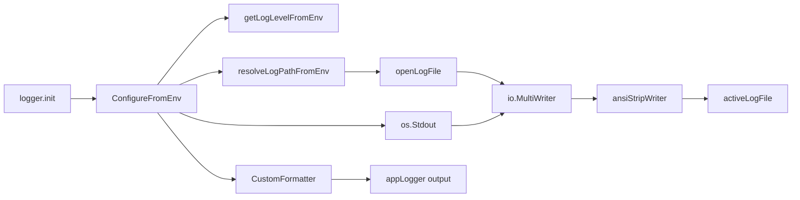
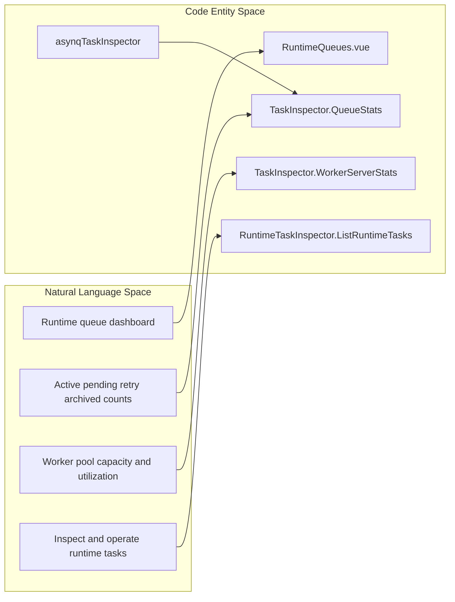
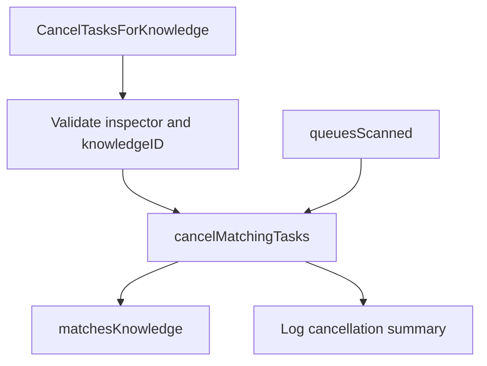

<!-- source: DeepWiki mcp.deepwiki.com · repo Tencent/WeKnora · page 9.4 Monitoring and Troubleshooting · fetched 2026-10-29 -->

# Monitoring and Troubleshooting

Relevant source files

The following files were used as context for generating this wiki page:

- [.github/workflows/anydoc.yml](.github/workflows/anydoc.yml)
- [.github/workflows/app.yml](.github/workflows/app.yml)
- [.github/workflows/docreader.yml](.github/workflows/docreader.yml)
- [.github/workflows/go-lint-cache.yml](.github/workflows/go-lint-cache.yml)
- [.github/workflows/go-lint.yml](.github/workflows/go-lint.yml)
- [.golangci.yml](.golangci.yml)
- [docs/swag.overrides](docs/swag.overrides)
- [frontend/src/views/knowledge/settings/chunkingSamples.ts](frontend/src/views/knowledge/settings/chunkingSamples.ts)
- [frontend/src/views/system/RuntimeQueues.vue](frontend/src/views/system/RuntimeQueues.vue)
- [internal/application/service/knowledgebase_search_partial_test.go](internal/application/service/knowledgebase_search_partial_test.go)
- [internal/application/service/shell_job_followup_test.go](internal/application/service/shell_job_followup_test.go)
- [internal/datasource/connector/yuque/client_test.go](internal/datasource/connector/yuque/client_test.go)
- [internal/handler/system_runtime_test.go](internal/handler/system_runtime_test.go)
- [internal/logger/logger.go](internal/logger/logger.go)
- [internal/logger/logger_test.go](internal/logger/logger_test.go)
- [internal/router/task_inspector.go](internal/router/task_inspector.go)
- [internal/types/interfaces/task_inspector.go](internal/types/interfaces/task_inspector.go)
- [scripts/git-hooks/common.sh](scripts/git-hooks/common.sh)
- [scripts/test-git-hooks.sh](scripts/test-git-hooks.sh)

## Purpose and scope

This page describes the observability mechanisms evidenced in the provided code: application logging, the runtime queue dashboard, and the queue-inspection interfaces. The available files do not establish how Jaeger or Langfuse is configured or how tracing data flows through the application, so those integrations are not documented here. [internal/logger/logger.go:22-28](), [internal/types/interfaces/task_inspector.go:67-84](), [frontend/src/views/system/RuntimeQueues.vue:1-17]()

Sources: [internal/logger/logger.go:22-28](), [internal/types/interfaces/task_inspector.go:67-84](), [frontend/src/views/system/RuntimeQueues.vue:1-17]()

## Overview

WeKnora exposes operational signals through application logs and, when queue inspection is supported, a runtime dashboard. The `TaskInspector` interface provides queue snapshots and worker-server statistics; its documentation distinguishes Redis-backed Asynq mode from Lite mode, where there is no queue to inspect. [internal/types/interfaces/task_inspector.go:67-84]()

| Monitoring surface | Code entity | What it provides |
|---|---|---|
| Application logs | `appLogger`, `CustomFormatter` | Log levels, timestamps, caller and structured fields; optional request ID formatting. [internal/logger/logger.go:22-28](), [internal/logger/logger.go:68-75](), [internal/logger/logger.go:94-109]() |
| Runtime queue dashboard | `RuntimeQueues.vue` | Aggregate active, pending, retry, and archived counts, plus worker-pool and queue details. [frontend/src/views/system/RuntimeQueues.vue:73-97](), [frontend/src/views/system/RuntimeQueues.vue:100-160]() |
| Queue inspection contract | `TaskInspector`, `RuntimeTaskInspector` | Queue statistics, worker statistics, runtime task listing and task operations. [internal/types/interfaces/task_inspector.go:67-84](), [internal/types/interfaces/task_inspector.go:105-131]() |
| Asynq inspection implementation | `asynqTaskInspector` | Asynq-backed task inspection and knowledge-scoped cancellation. [internal/router/task_inspector.go:18-43](), [internal/router/task_inspector.go:106-124]() |

The dashboard shows an unavailable state when inspection is not supported, rather than presenting that deployment mode as an empty queue. [internal/types/interfaces/task_inspector.go:67-79](), [frontend/src/views/system/RuntimeQueues.vue:65-71]()

Sources: [internal/logger/logger.go:22-28](), [internal/logger/logger.go:68-109](), [internal/types/interfaces/task_inspector.go:67-84](), [internal/types/interfaces/task_inspector.go:105-131](), [internal/router/task_inspector.go:18-43](), [frontend/src/views/system/RuntimeQueues.vue:65-97]()

## Logging and log analysis

### Logger setup and destinations

The logger uses a private Logrus instance, `appLogger`, to avoid external dependencies changing Logrus global state. During package initialization, it calls `ConfigureFromEnv`; that function closes any previously active log file, sets the logger level, and defaults output to stdout. If a log path resolves and the file opens successfully, output is sent both to stdout and through `ansiStripWriter` to the file. [internal/logger/logger.go:22-28](), [internal/logger/logger.go:230-264]()

`ConfigureFromEnv` is also documented as a way to reapply configuration after `.env` has been loaded. The visible implementation calls `getLogLevelFromEnv` and `resolveLogPathFromEnv`; their environment-variable parsing details are not included in the provided excerpt. [internal/logger/logger.go:235-253]()

| Configuration or behavior | Operational effect |
|---|---|
| Log level | `ConfigureFromEnv` obtains a level via `getLogLevelFromEnv` and applies it to `appLogger`. The available excerpt defines the level names `debug`, `info`, `warn`, `error`, and `fatal`. [internal/logger/logger.go:42-52](), [internal/logger/logger.go:246-249]() |
| Log path | `resolveLogPathFromEnv` supplies the path; when non-empty and successfully opened, the logger writes to stdout and the log file. [internal/logger/logger.go:250-263]() |
| ANSI handling | File output strips ANSI escape sequences; stdout can retain them for terminal output. [internal/logger/logger.go:31-40](), [internal/logger/logger.go:250-263]() |
| Reconfiguration | Calling `ConfigureFromEnv` closes the prior active file before applying the new configuration. [internal/logger/logger.go:235-244]() |

### Formatting and correlation fields

`CustomFormatter` supports a built-in format and an optional template. In template mode, the documented placeholders are `%d` for timestamp, `%level` for severity, `%thread` for goroutine ID, `%logger` for caller, `%traceId` for request ID, and `%msg` for the message and structured fields. [internal/logger/logger.go:68-75]()

The formatter reads `caller` and `request_id` from structured entry data. Other fields are sorted before output, making their order stable; in template mode they are appended to the message as `key=value` pairs. The `%traceId` placeholder is populated from `request_id`, so this is a request-correlation field in the logger—not evidence of an OpenTelemetry exporter or distributed-tracing backend. [internal/logger/logger.go:94-109](), [internal/logger/logger.go:111-144]()

When a custom template references `%thread`, the formatter obtains the goroutine ID; otherwise it avoids that lookup. Template replacement uses a single `strings.NewReplacer` pass. [internal/logger/logger.go:121-144]()

Sources: [internal/logger/logger.go:22-28](), [internal/logger/logger.go:31-40](), [internal/logger/logger.go:42-52](), [internal/logger/logger.go:68-75](), [internal/logger/logger.go:94-144](), [internal/logger/logger.go:230-264]()

### Logging data flow

**Diagram: Logger configuration and output paths**

Sources: [internal/logger/logger.go:230-264](), [internal/logger/logger.go:31-40]()

## Runtime queue inspection

### Inspection interfaces and deployment support

`TaskInspector` defines queue-level operations for statistics and worker-server statistics, as well as knowledge-scoped task inspection and cancellation. Its contract describes queue inspection as available in Asynq/Redis mode and unsupported in Lite mode, where tasks run inline and no queue exists. [internal/types/interfaces/task_inspector.go:21-84]()

`RuntimeTaskInspector` is a separate optional operator interface. It provides paginated task listing, task lookup, run-now and delete operations, force deletion for orphaned queue records, and archived-task purging. [internal/types/interfaces/task_inspector.go:105-131]()

`NewAsynqInspector` constructs an Asynq inspector using the Redis client. `NewAsynqTaskInspector` wraps that inspector and Redis client; if either is nil, it returns a no-op implementation. [internal/router/task_inspector.go:18-43]()

### Dashboard signals

`RuntimeQueues.vue` exposes a manual refresh action and an auto-refresh switch. Its overview presents active, pending, retry, and archived task totals. The pool cards show configured concurrency and queue count; when worker instances are present, they also show active workers, instance count, and utilization. [frontend/src/views/system/RuntimeQueues.vue:8-30](), [frontend/src/views/system/RuntimeQueues.vue:73-128]()

The detail area displays an update timestamp when available, a notice when archived tasks exist, and an empty-state message when there are no queue rows. It also has explicit loading, error/retry, and unsupported states. [frontend/src/views/system/RuntimeQueues.vue:34-71](), [frontend/src/views/system/RuntimeQueues.vue:131-160]()

### Natural Language Space to Code Entity Space: runtime operations

**Diagram: Runtime dashboard mapped to queue-inspection entities**

Sources: [frontend/src/views/system/RuntimeQueues.vue:73-160](), [internal/types/interfaces/task_inspector.go:67-84](), [internal/types/interfaces/task_inspector.go:105-131](), [internal/router/task_inspector.go:18-43]()

### Queue inspection and cancellation flow

`asynqTaskInspector` builds its scan list from `types.QueueDefinitions()`. Knowledge cancellation matches task payloads containing the target `knowledge_id`; the implementation logs a summary with deleted-from-queue and active-cancellation counts. Queue scan and cancellation errors are documented as best-effort so a flaky Redis backend does not prevent the cancellation API from succeeding. [internal/router/task_inspector.go:24-43](), [internal/router/task_inspector.go:70-81](), [internal/router/task_inspector.go:106-124]()

**Diagram: Knowledge-scoped task cancellation**

Sources: [internal/router/task_inspector.go:70-81](), [internal/router/task_inspector.go:106-124]()

Sources: [internal/router/task_inspector.go:18-43](), [internal/router/task_inspector.go:70-81](), [internal/router/task_inspector.go:106-124]()

## Troubleshooting workflow

Use the following sequence to distinguish logging/configuration problems from queue backlog or backend-support limitations. Each step corresponds to an observable mechanism in the supplied code. [internal/logger/logger.go:235-264](), [frontend/src/views/system/RuntimeQueues.vue:34-71](), [internal/types/interfaces/task_inspector.go:67-84]()

| Symptom | Check | Interpretation |
|---|---|---|
| Runtime dashboard reports unavailable | Confirm whether the deployment uses a backend with queue inspection support. Lite mode has no Redis-backed queue, and the interface reports queue statistics as unsupported. [internal/types/interfaces/task_inspector.go:67-79]() | Unavailable is different from an empty queue. |
| Dashboard displays an error | Read the displayed error and retry through the view’s reload action. [frontend/src/views/system/RuntimeQueues.vue:54-62]() | The UI exposes a retry path; the supplied excerpt does not identify the specific failing API call. |
| Retry or archived counts are nonzero | Compare the aggregate overview and queue details; archived tasks trigger a failure notice. [frontend/src/views/system/RuntimeQueues.vue:80-97](), [frontend/src/views/system/RuntimeQueues.vue:143-155]() | Use the runtime task inspection operations where supported. [internal/types/interfaces/task_inspector.go:105-131]() |
| Logs are missing from the expected file | Check whether the configured path resolves and whether `openLogFile` succeeds; failures are written to stderr. [internal/logger/logger.go:250-260]() | If no log file is configured or opened, output remains on stdout. [internal/logger/logger.go:250-263]() |
| File logs contain terminal escape sequences | Verify file output passes through `ansiStripWriter`. [internal/logger/logger.go:31-40](), [internal/logger/logger.go:250-259]() | The writer removes ANSI style sequences from the bytes written to the file. |
| Request correlation is needed | Include `request_id` in the structured log entry and use `%traceId` in a custom template. [internal/logger/logger.go:94-101](), [internal/logger/logger.go:136-144]() | The formatter maps `%traceId` to `request_id`; this does not itself establish Jaeger or Langfuse tracing. |

Sources: [internal/logger/logger.go:31-40](), [internal/logger/logger.go:94-101](), [internal/logger/logger.go:136-144](), [internal/logger/logger.go:235-264](), [internal/types/interfaces/task_inspector.go:67-84](), [internal/types/interfaces/task_inspector.go:105-131](), [frontend/src/views/system/RuntimeQueues.vue:34-71](), [frontend/src/views/system/RuntimeQueues.vue:80-97](), [frontend/src/views/system/RuntimeQueues.vue:143-155]()

---

