# Page: WeKnora Overview

# WeKnora Overview

<details>
<summary>Relevant source files</summary>

The following files were used as context for generating this wiki page:

- [CHANGELOG.md](CHANGELOG.md)
- [README.md](README.md)
- [README_CN.md](README_CN.md)
- [README_JA.md](README_JA.md)
- [README_KO.md](README_KO.md)
- [VERSION](VERSION)
- [frontend/package-lock.json](frontend/package-lock.json)
- [frontend/package.json](frontend/package.json)
- [helm/Chart.yaml](helm/Chart.yaml)

</details>


## Purpose and Scope

This document provides a high-level introduction to WeKnora, explaining its core purpose as an LLM-powered RAG (Retrieval-Augmented Generation) framework, the problems it addresses, and its fundamental architecture. This overview is designed for developers, architects, and technical stakeholders who want to understand what WeKnora is and how its components work together before diving into specific subsystems.

For detailed information about:
- Specific features and capabilities, see [Key Features and Capabilities](#1.1)
- System components and their interactions, see [System Components Overview](#1.2)
- Architecture patterns and design decisions, see [System Architecture](#3)
- Deployment and operations, see [Deployment and Operations](#9)

Sources: [README.md:41-50](), [README_CN.md:41-50]()

---

## What is WeKnora?

WeKnora is an open-source, LLM-powered knowledge framework built for enterprise-grade document understanding, semantic retrieval, and autonomous reasoning [README.md:43-44](). It transforms scattered organizational documents into a queryable, reasoning-capable, and continuously evolving knowledge asset [README.md:43-44]().

At its core, WeKnora integrates three primary interaction modes:

1. **RAG-based Quick Q&A**: Standard retrieval-augmented generation for everyday lookups, enabling fast and accurate question answering over knowledge bases created from diverse document sources [README.md:49-54]().

2. **ReAct Agent**: An autonomous agent engine implementing the ReAct (Reasoning and Acting) pattern. It orchestrates knowledge retrieval, Model Context Protocol (MCP) tools, tenant skill catalogs, and web search to handle complex multi-step tasks [README.md:49-57](), [CHANGELOG.md:9-10]().

3. **Wiki Mode**: A novel agent-driven mode where raw documents are distilled into a self-maintaining, interlinked Markdown wiki knowledge base, enhanced with an interactive knowledge graph visualization and revision history [README.md:49-54]().

Sources: [README.md:41-65](), [CHANGELOG.md:5-25]()

---

## Problems WeKnora Solves

WeKnora addresses several key challenges commonly encountered in enterprise knowledge management and AI-assisted document understanding:

### 1. The "Static Knowledge" Problem

Conventional RAG solutions return individual chunks without synthesizing underlying knowledge effectively. WeKnora solves this via **Wiki Mode**, where autonomous agents synthesize raw input documents into an evolving, structured Markdown wiki supplemented by a dynamic knowledge graph [README.md:51-54]().

### 2. Complex Multi-Step Reasoning

Many enterprise queries require multi-step reasoning and integration of external tools or web search beyond static retrieval. WeKnora's **ReAct Agent** and **Skill Sandbox Runtime** address this by supporting session-persistent sandboxes (Docker, E2B, Cube), parallel tool invocation, and standardized tool protocols [CHANGELOG.md:9-14]().

### 3. Enterprise Governance and Multi-Tenancy

WeKnora supports multi-tenant enterprise environments with robust security controls:
- **Tenant RBAC**: Enforces role-based access control with a four-tier matrix (`Owner`, `Admin`, `Contributor`, `Viewer`) [README.md:64]().
- **Scoped API Keys**: Fine-grained capability-level grants and per-KB restrictions for programmatic integrations [README.md:62]().
- **Audit Logging**: Platform-level and KB-level activity tracking [README.md:64]().

Sources: [README.md:56-65](), [CHANGELOG.md:5-25]()

---

## 1.1. Key Features and Capabilities

WeKnora provides an extensive feature set covering multimodal processing (PDF, Office, images, XMind), advanced hybrid retrieval, cross-session long-term memory, tenant skill catalogs, and flexible deployment options [README.md:60-65](). 

For detailed information about specific capabilities, including multimodal document parsers, agent execution modes, knowledge graph support, skill sandbox runtimes, and deployment configurations, see [Key Features and Capabilities](#1.1).

Sources: [README.md:60-65](), [CHANGELOG.md:5-25]()

---

## 1.2. System Components Overview

The system architecture spans a modular frontend built with Vue.js 3 [frontend/package.json:1-49](), a Go-based backend service layer using the Gin framework, a multi-database persistence tier (PostgreSQL, Redis, vector stores, graph databases, object storage), and external integrations including LLM providers, IM channels, and Langfuse observability [README.md:62-65]().

For a comprehensive breakdown of major system components, frontend architecture, backend services, storage layers, and external integrations, see [System Components Overview](#1.2).

Sources: [README.md:62-65](), [frontend/package.json:1-49]()

---

## Core Architecture Diagrams

### System Layer Map

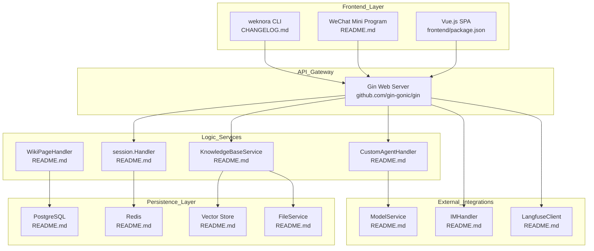
Sources: [frontend/package.json:1-49](), [README.md:53-65]()

---

### Bridging Natural Language Space to Code Entity Space - Retrieval Flow

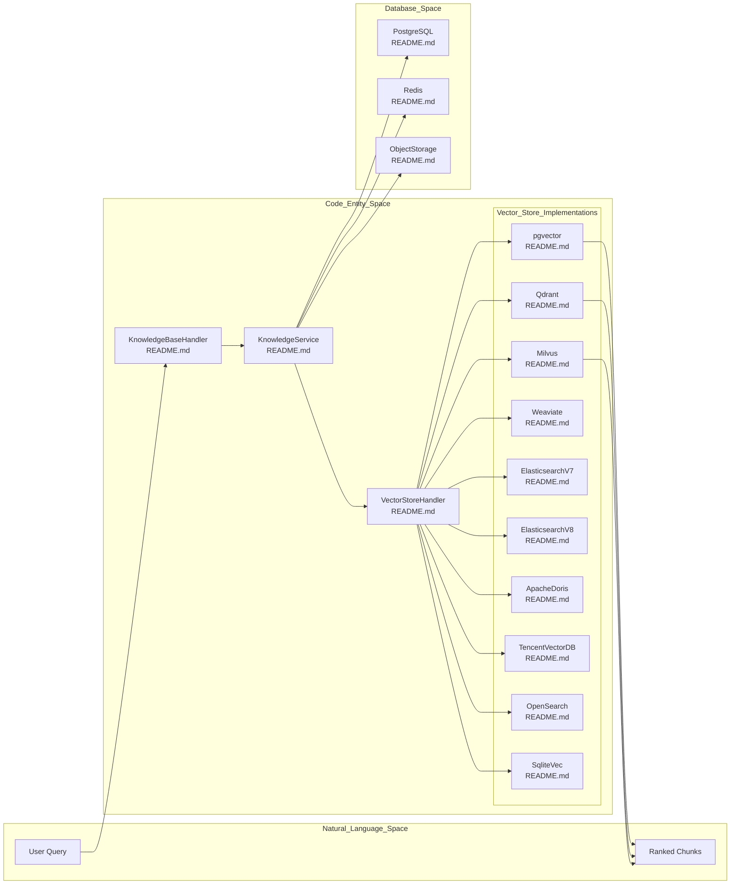
Sources: [README.md:60-65]()

---

This overview provides a foundation for understanding WeKnora’s purpose, architecture, and capabilities. For details on specific modules or deployment instructions, consult the child pages linked above.

---

# Page: Key Features and Capabilities

# Key Features and Capabilities

<details>
<summary>Relevant source files</summary>

The following files were used as context for generating this wiki page:

- [CHANGELOG.md](CHANGELOG.md)
- [README.md](README.md)
- [README_CN.md](README_CN.md)
- [README_JA.md](README_JA.md)
- [README_KO.md](README_KO.md)
- [VERSION](VERSION)
- [frontend/package-lock.json](frontend/package-lock.json)
- [frontend/package.json](frontend/package.json)
- [helm/Chart.yaml](helm/Chart.yaml)
- [internal/agent/tools/wiki_replace_text.go](internal/agent/tools/wiki_replace_text.go)
- [internal/agent/tools/wiki_replace_text_test.go](internal/agent/tools/wiki_replace_text_test.go)
- [internal/agent/tools/wiki_tools.go](internal/agent/tools/wiki_tools.go)
- [internal/agent/tools/wiki_write_page.go](internal/agent/tools/wiki_write_page.go)
- [website-docs/01-getting-started/01-introduction.md](website-docs/01-getting-started/01-introduction.md)
- [website-docs/03-features/14-wiki.md](website-docs/03-features/14-wiki.md)
- [website-docs/04-api/02-api-agent-mcp.md](website-docs/04-api/02-api-agent-mcp.md)
- [website-docs/06-development/03-extension-points.md](website-docs/06-development/03-extension-points.md)

</details>


This page documents the detailed technical capabilities of WeKnora as implemented in its core services, agents, and integration layers. It enumerates key features including multimodal processing, autonomous agent modes, session-persistent sandboxes, tenant skill catalogs, knowledge graph support, hybrid retrieval, and enterprise deployment options, while referencing key code artifacts and data flows.

For a broader architectural perspective, see [1.2 System Components Overview](). For initial setup and feature activation, see [2.3 Quick Start Guide]().

---

## Feature Overview

WeKnora is a modular, open-source knowledge framework empowered by Large Language Models (LLMs). It centers on four major axes:

1.  **Knowledge Ingestion and Indexing**:  
    A versatile ingestion pipeline that parses 10+ formats including PDF, Word, images, Excel, EPUB, MHTML, XMind, and others. Parsing is enhanced by:

    - In-process Office document parsing using the `anydoc` Go library for better performance and integration without external dependencies (`README.md:61]`, `CHANGELOG.md:12`).  
    - Adaptive three-tier chunking strategies (documents → parent chunks → child chunks) preserving semantic and structural context (`README.md:61]`).  
    - Auto-tagging of documents and automatic metadata extraction (`README.md:61]`).  
    - Indexing into multiple vector stores with flexibility to swap providers, supporting efficient semantic retrieval (`README.md:65]`).

2.  **Retrieval and QA**:  
    Implements a hybrid Retrieval-Augmented Generation (RAG) architecture combining:  

    - Vector similarity search for semantic matching (`README.md:43]`).  
    - BM25 keyword search powered by SQL full-text or external engines for exact keyword retrieval (`README_CN.md:61]`).  
    - Knowledge graph traversal when enabled (`README.md:53]`).  

    The retrieval process executes concurrent fan-out queries to multiple vector databases and merges the results. Outputs include source citations and multi-modal document support (`README.md:53]`).

3.  **Autonomous Reasoning & Agents**:  
    The agent subsystem orchestrates intelligent agents with multi-step reasoning and tooling:  

    - Implements a ReAct pattern reasoning loop combining thought, action, and observation to iteratively produce answers (`README.md:53]`).  
    - Supports diverse tools including built-in knowledge search, shell execution, web search, and external Model Context Protocol (MCP) tools (`README.md:56]`).  
    - Agent executions run within session-persistent sandboxes using Docker, E2B, or Cube runtime environments (`CHANGELOG.md:9]`, `README.md:56`).  
    - Agents leverage long-term memory for persistent facts, user profiles, and task traces across sessions (`README.md:56]`).  
    - Web search integration, tool invocation, and multi-modal interactions with Vision-Language Models (VLMs) and ASR models further augment agent capabilities (`README.md:56]`).

4.  **Wiki Mode**:  
    Enables autonomous conversion of documents and raw knowledge chunks into structured wiki pages:  

    - Agents distill content into interlinked Markdown Wiki pages with folders and navigation hierarchy (`README.md:53]`).  
    - A knowledge graph visualizes extracted entities and their relations, enabling semantic exploration (`README.md:53]`).  
    - Wiki pages support line-level diffs, snapshots, link linting, and one-click rollback for revision control (`README.md:53]`, `internal/agent/tools/wiki_write_page.go:34-75]`).  
    - Interactive UI components render the Wiki and graph visualization in the frontend (`README.md:53]`).

Sources: [README.md:43-65](), [CHANGELOG.md:9-12](), [README_CN.md:61](), [internal/agent/tools/wiki_write_page.go:34-75]()

---

### System Functional Spaces and Code Mapping

This diagram maps core natural language features in WeKnora to their main code entities (services, engines, registries) to clarify implementation locations and data flow points.

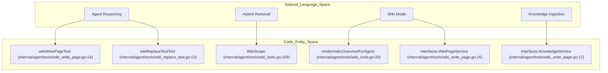

Sources: [internal/agent/tools/wiki_write_page.go:14-22](), [internal/agent/tools/wiki_replace_text.go:13-21](), [internal/agent/tools/wiki_tools.go:33-113]()

---

## Multimodal Document Processing and Parsing

WeKnora supports advanced multimodal content handling across knowledge ingestion and agent interaction:

- **In-Process anydoc Office Parsing**  
  Office files such as `.docx`, `.pptx`, `.xlsx` are parsed inside the Go app using anydoc without requiring a separate document reader service round-trip, improving efficiency and reliability (`README.md:61]`, `CHANGELOG.md:12`).  

- **Image and OCR Processing**  
  Handles PDFs with scanned pages via built-in OCR override, supports embedded images in documents, and integrates PaddleOCR and vision-language models (VLM) to describe image content automatically, enriching context (`CHANGELOG.md:11-32`).  

- **Automatic Speech Recognition (ASR)**  
  Audio attachments and embedded spoken content get automatically transcribed and indexed for search and retrieval (`README_CN.md:61]`).  

- **Support for Complex Document Formats**  
  EPUB, MHTML, XMind, and other semi-structured formats are parsed with semantic chunking and structure preservation for accurate context retrieval (`CHANGELOG.md:12]`).  

- **Session-Scoped Temporary Attachments**  
  Agents can handle ephemeral attachments linked to single queries with asynchronous parsing and multimodal chunk generation, enabling flexible conversational interactions with media (`CHANGELOG.md:14]`).  

Sources: [README.md:61](), [CHANGELOG.md:11-32](), [README_CN.md:61]()

---

## Agent Modes, Runtimes, and ReAct Engine

WeKnora implements a sophisticated agent execution framework combining reasoning, tooling, and sandboxed execution environments:

### ReAct Reasoning Loop and Memory

- The agent uses the ReAct (Reasoning and Acting) paradigm to decompose user requests iteratively into thoughts and actions invoking tools or sandbox commands (`README.md:53]`).  
- The long-term memory subsystem stores user profiles, facts, preferences, and task history and extracts relevant knowledge dynamically per session (`README.md:56]`).  

### Sandbox Runtimes and Tenant Skill Catalog

- Agent skills run in containerized, session-persistent sandboxes implemented with Docker, E2B, or Cube runtimes (`README.md:56]`, `CHANGELOG.md:9`). This supports isolated execution with runtime network policies enforced per tenant workspace (`README.md:56]`).  
- Skills are managed as tenant-scoped resources installed from ClawHub, SkillHub, Git repositories, or ZIPs with live install progress, direct file browsing/editing, and environment variable injection into runtimes (`README.md:56]`, `CHANGELOG.md:9`).  

### Tool & MCP Protocol Integration

- WeKnora maintains an extensible tool architecture supporting specialized wiki tools such as `wikiWritePageTool` (`[internal/agent/tools/wiki_write_page.go:14]()`) and `wikiReplaceTextTool` (`[internal/agent/tools/wiki_replace_text.go:13]()`), alongside shell execution, web search, and external MCP protocol tools (`README.md:56]`).  
- Model Context Protocol (MCP) support enables integration of remote MCP services with multi-transport layers (Stdio, SSE, HTTP) and mid-conversation OAuth authorization flows (`CHANGELOG.md:19-38`).  

Sources: [README.md:53-56](), [CHANGELOG.md:9-38](), [internal/agent/tools/wiki_write_page.go:14-22](), [internal/agent/tools/wiki_replace_text.go:13-21]()

---

### Diagram: Agent Reasoning Workflow and Code Entities

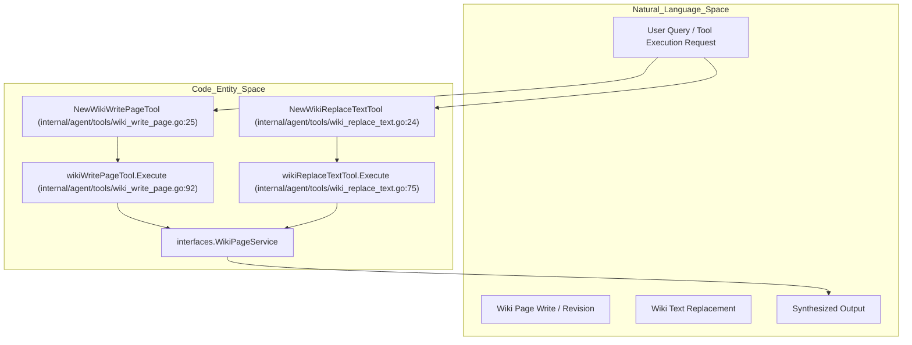

Sources: [internal/agent/tools/wiki_write_page.go:25-92](), [internal/agent/tools/wiki_replace_text.go:24-75]()

---

## Wiki Mode and Knowledge Graph

WeKnora's Wiki Mode supports organization and structuring of knowledge with the following features:

- **Autonomous Wiki Page Generation**:  
  Agents transform raw document chunks into interlinked Markdown pages with summaries, definitions, and entity extraction to build a semantic knowledge base. This is managed via `wikiWritePageTool` (`[internal/agent/tools/wiki_write_page.go:34]()`) and `renderIndexOverviewForAgent` (`[internal/agent/tools/wiki_tools.go:33]`).  

- **Foldered Wiki Navigation & Tree Structure**:  
  The Wiki supports folder trees and complex directory layouts using `WikiScope` definitions (`[internal/agent/tools/wiki_tools.go:109]`) to scope retrieval and page traversal.  

- **Knowledge Graph Visualization**:  
  Wiki pages render an interactive graph showing entities and their relationships, aiding semantic exploration of knowledge extracted during ingestion (`README.md:53]`).  

- **Wiki Linting, Revision History, and Rollback**:  
  Ingested wiki content is auto-checked for link integrity, slug duplication (`[internal/agent/tools/wiki_write_page.go:120]`), and versioned with diffs, enabling rollback to previous revisions.  

Sources: [README.md:53](), [internal/agent/tools/wiki_write_page.go:34-120](), [internal/agent/tools/wiki_tools.go:33-113]()

---

## Hybrid Retrieval and RAG Pipeline

The retrieval pipeline enhances knowledge access robustness:

- **Multi-Source Fan-out Retrieval**:  
  Queries fan out to multiple configured vector databases (pgvector, Qdrant, Milvus, Weaviate, Tencent VectorDB), returning merged and ranked hits (`README_CN.md:64]`).  

- **Hybrid Semantic and Keyword Search**:  
  Combines semantic vector search with keyword-based BM25 retrieval for improved precision and recall (`README_CN.md:61]`).  

- **Parent-Child Chunk Context**:  
  Maintains logical context by representing document chunks in a parent-child hierarchy; when a parent chunk matches a query, child chunks are also included for detailed context (`README.md:61]`).  

- **Reranking with External Services**:  
  Integrates with reranking services such as Volcengine, Tencent LKEAP, Hugging Face TEI, Pinecone Inference, and Cohere v2 that support request batching transparently (`CHANGELOG.md:18`).  

- **Chunk Editing and Versioning**:  
  Users can edit retrieved chunks directly in the UI with automatic versioning, diff comparisons, and reindexing to keep knowledge bases up to date (`README.md:60]`).  

Sources: [README.md:60-61](), [CHANGELOG.md:18](), [README_CN.md:61-64]()

---

## Deployment, Security, and Observability

- **Multi-Tenancy and RBAC**:  
  Enterprise-level role-based access control features define four roles with per-resource and per-workspace ownership, platform user management, and audit trails (`README.md:64]`, `CHANGELOG.md:15`).  

- **Scoped API Keys and Principal Model**:  
  Fine-grained API keys restrict capabilities and knowledge base scope, integrated with a principal model for automated programmatic access (`CHANGELOG.md:62]`).  

- **Multi-Instance Storage Backend Support**:  
  Each workspace supports multiple storage instances for scalable document, vector, and graph storage, with per-KB bindings (`CHANGELOG.md:64]`).  

- **Observability with Langfuse and OpenTelemetry**:  
  Full Langfuse integration enables tracing of agent reasoning steps, token usage, and retrieval pipelines via OTLP/OTel instrumentation for debugging and optimization (`README.md:64]`, `CHANGELOG.md:64`).  

- **Integration with IM Platforms**:  
  Supports WeCom, Feishu, Slack, Telegram and others with adapters and streaming/full output modes for chat sessions (`README.md:62]`, `CHANGELOG.md:64`).  

- **Flexible Deployment Options**:  
  Deploy with Docker Compose (profiles for optional components like Neo4j graph, MinIO storage, Langfuse tracing), Kubernetes Helm charts (`[helm/Chart.yaml:1-26]()`), or a Lite single binary version for minimal setup with SQLite and in-memory queues (`README.md:95-154`).  

Sources: [README.md:62-154](), [CHANGELOG.md:15-64](), [helm/Chart.yaml:1-26]()

---

This page covers the core feature set and code implementation pointers for WeKnora. For detailed component diagrams and deployment guides, see child pages [1.2 System Components Overview]() and [9.1 Docker Deployment]().

---

# Page: System Components Overview

# System Components Overview

<details>
<summary>Relevant source files</summary>

The following files were used as context for generating this wiki page:

- [.env.example](.env.example)
- [CHANGELOG.md](CHANGELOG.md)
- [README.md](README.md)
- [README_CN.md](README_CN.md)
- [README_JA.md](README_JA.md)
- [README_KO.md](README_KO.md)
- [VERSION](VERSION)
- [config/config.yaml](config/config.yaml)
- [docker-compose.dev.yml](docker-compose.dev.yml)
- [docker-compose.yml](docker-compose.yml)
- [docreader/README.md](docreader/README.md)
- [docreader/config.py](docreader/config.py)
- [docreader/parser/docx_parser.py](docreader/parser/docx_parser.py)
- [docreader/parser/image_preprocess.py](docreader/parser/image_preprocess.py)
- [docreader/preprocess.py](docreader/preprocess.py)
- [docreader/preprocess_worker.py](docreader/preprocess_worker.py)
- [docreader/tests/test_config.py](docreader/tests/test_config.py)
- [docreader/tests/test_docx_tables.py](docreader/tests/test_docx_tables.py)
- [docreader/tests/test_preprocess_runner.py](docreader/tests/test_preprocess_runner.py)
- [frontend/package-lock.json](frontend/package-lock.json)
- [frontend/package.json](frontend/package.json)
- [go.mod](go.mod)
- [go.sum](go.sum)
- [helm/Chart.yaml](helm/Chart.yaml)
- [internal/config/auth_legacy_env_test.go](internal/config/auth_legacy_env_test.go)
- [internal/config/config.go](internal/config/config.go)
- [internal/container/container.go](internal/container/container.go)
- [scripts/dev.sh](scripts/dev.sh)

</details>


## Purpose and Scope

This page provides a comprehensive technical overview of WeKnora's major system components, detailing their structure, responsibilities, and interconnections. It thoroughly describes architectural layers from the Vue.js frontend and API routing through backend services, multi-database storage layers, sandbox runtimes, and external integrations. Technical details include implementation, key classes/functions, data flow, and dependency injection. Mermaid diagrams illustrate the mapping between high-level concepts and concrete code entities to guide developers in navigating, extending, and maintaining WeKnora.

Sources: [internal/container/container.go:100-115](), [internal/router/router.go:28-91]()

---

## System Layer Architecture

WeKnora adopts a modular multi-tier architecture with strict separation of concerns across components: presentation, API gateway, handler orchestration, business service layer, data repositories, and persistent storage.

The dependency injection container, constructed by `container.BuildContainer` in `internal/container/container.go`, wires all components and manages lifecycles [internal/container/container.go:100-115]().

### Component Interaction Diagram Linking Natural Language and Code Entities

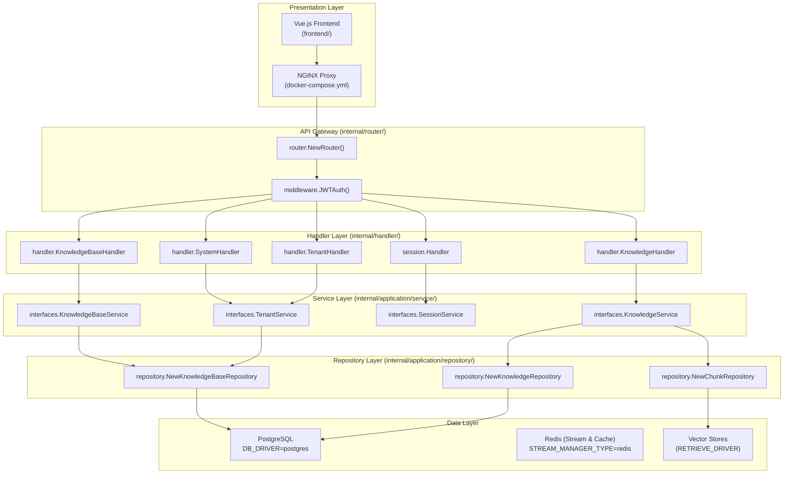

This architecture outlines the flow of requests from the Vue.js frontend through the NGINX reverse proxy into the Gin router created by `router.NewRouter()`. The router applies middlewares like JWT authentication then dispatches to domain-specific HTTP handlers such as `KnowledgeBaseHandler` or `SessionHandler`. Each handler delegates business logic to service interfaces (e.g., `KnowledgeBaseService`), which interact with repositories backed by PostgreSQL for metadata, Redis for caching and event streams, and various vector stores for embedding search.

Sources: [internal/container/container.go:100-150](), [internal/router/router.go:28-91](), [docker-compose.yml:1-35]()

---

## Frontend Layer

The frontend is built as a Vue.js Single Page Application (SPA) under the `frontend/` directory, delivering user interfaces for knowledge base management, chat, agent configuration, and administrative settings [frontend/package.json:1-17]().

### Frontend Technology Stack

| Component Group       | Implementation       | Description                                                 |
|----------------------|----------------------|-------------------------------------------------------------|
| **Core UI**           | `tdesign-vue-next`   | Enterprise-grade UI component library                        |
| **State Management**  | `Pinia`              | Reactive state stores managing menu, UI, auth, chat state   |
| **Internationalization** | `vue-i18n`         | Multi-language support including `en-US`, `zh-CN`, `ru-RU`, `ko-KR`, `ja-JP`, `zh-TW` |
| **Streaming Support** | `@microsoft/fetch-event-source` | SSE client for real-time chat streaming responses           |
| **Visualization**     | `mermaid`            | Rendering of diagrams and knowledge graphs in chat and docs |

### Frontend Deployment and Config

- The frontend runs as a dedicated container defined in `docker-compose.yml`, proxying API requests to the backend service using environment variables `APP_HOST` and `APP_PORT` [docker-compose.yml:2-34]().

- Multi-stage Docker builds compile the Vue.js app into static assets inside the container image, eliminating the need for Node.js on the host [docker-compose.yml:4-13]().

Sources: [docker-compose.yml:2-34](), [frontend/package.json:1-17]()

---

## Backend Application Layer

The backend is implemented in Go (minimum version 1.26) orchestrating REST APIs, RAG pipelines, agent execution loops, tool registries, and sandbox runtimes [go.mod:1-93]().

### Dependency Injection Container Setup (`internal/container/container.go`)

- WeKnora uses Uber's `dig` as the DI container. The container registers and wires core infrastructure, repositories, services, handlers, and external clients [internal/container/container.go:100-141]().

- Core components registered include:
  - Configuration loader (`config.LoadConfig`)
  - Langfuse tracing initialization (`initLangfuse`)
  - Database connections (`initDatabase` for PostgreSQL, vector stores)
  - Redis client (`initRedisClient`) for stream and cache
  - Goroutine pool through `ants` for background workers
  - Document parser gRPC clients and Ollama LLM service for embedding generation
  - Retrieval engine registry manages vector DB drivers dynamically

### HTTP API Routing (`internal/router/router.go`)

- `router.NewRouter` builds the Gin router instance injecting many handler structs that encapsulate domain behavior, including:
  - Knowledge management (`handler.KnowledgeBaseHandler`, `handler.KnowledgeHandler`)
  - Chat sessions (`session.Handler`)
  - Tenant and RBAC APIs (`handler.TenantHandler`)
  - Model catalog and credential management
  - Skill and sandbox configuration endpoints
  - External integrations including MCP, Web Search, IM platforms

- Middleware is applied for authentication, logging, CORS, and error handling [internal/router/router.go:28-91]().

Sources: [internal/container/container.go:100-145](), [internal/router/router.go:28-91](), [go.mod:1-93]()

---

## Storage and Database Layer

WeKnora employs a multi-backend storage strategy, decoupling relational data, vector embeddings, graph data, and object files.

### Vector Retrieval Engine Registry

- The retrieval system supports multiple vector search backends configurable via `RETRIEVE_DRIVER`, implemented as repository drivers under `internal/application/repository/retriever` [internal/container/container.go:40-51]().

```mermaid
graph TB
    subgraph RetrievalRegistry["RetrieveEngineRegistry"]
        Registry["container.initRetrieveEngineRegistry<br/>(internal/container/container.go)"]
    end
    
    subgraph VectorDrivers["Vector Repository Drivers"]
        PG["postgresRepo.NewRetrieveEngine"]
        QD["qdrantRepo.NewRetrieveEngine"]
        MV["milvusRepo.NewRetrieveEngine"]
        WV["weaviateRepo.NewRetrieveEngine"]
        ES7["elasticsearchRepoV7.NewRetrieveEngine"]
        ES8["elasticsearchRepoV8.NewRetrieveEngine"]
        DR["dorisRepo.NewRetrieveEngine"]
        TV["tencentVectorDBRepo.NewRetrieveEngine"]
        SQ["sqliteRetrieverRepo.NewRetrieveEngine"]
        OS["openSearchRepo.NewRetrieveEngine"]
    end
    
    Registry --> PG
    Registry --> QD
    Registry --> MV
    Registry --> WV
    Registry --> ES7
    Registry --> ES8
    Registry --> DR
    Registry --> TV
    Registry --> SQ
    Registry --> OS
```

- Supported vector stores include PostgreSQL, Qdrant, Milvus, Weaviate, Elasticsearch (v7/v8), Doris, Tencent VectorDB, SQLite, OpenSearch, and more.

### Databases Used

| Database Type      | Purpose                                             | Configuration Key / Notes                           |
|--------------------|-----------------------------------------------------|---------------------------------------------------|
| **Relational DB**  | Metadata storage, users, tenants, RBAC, audit logs  | PostgreSQL (default), GORM ORM [internal/container/container.go:35-37]() |
| **Redis**          | Cache, event streams, task queue (Asynq)            | Redis client handles session caching and pub/sub  |
| **Graph DB**       | Knowledge graph / GraphRAG                            | Neo4j integration supports relation/entity graph  |

### File Storage Backend Providers

- Flexible file storage backends are supported:
  - Local filesystem storage on mounted volumes
  - MinIO for S3-compatible object storage
  - Cloud object storage providers including Tencent COS, Alibaba OSS, and Huawei OBS [docker-compose.yml:47-50]()

Sources: [internal/container/container.go:38-48](), [docker-compose.yml:138-150](), [.env.example:126-160]()

---

## External Integrations & Advanced Subsystems

### Document Processing Pipelines

- **DocReader**: External microservice over gRPC for document parsing, controlled by `DOCREADER_ADDR`. Supports complex office formats like PDF, Word, images, Excel, and XMind [internal/container/container.go:85-86]().

- **AnyDoc**: In-process document parser embedded in Go for Office formats such as doc/docx/ppt/pptx enabled by `WITH_ANYDOC=1` config.

### Sandbox Runtime and Skill Catalog

- Session-persistent sandbox backends run arbitrary user-installed skills securely in Docker, E2B, or Cube sandboxes, exposing protocol-compatible client interfaces for integration [internal/container/container.go:95]().

- The catalog manages skill installation from multiple sources (ClawHub, SkillHub, Git, ZIP), background installation workflows, environment variable declarations, reaping idle sandboxes, and cleanup.

### Agent Tools and Protocols

- **MCP Server**: Implements the Model Context Protocol (MCP), enabling secure external tool integrations with streams and session context [internal/container/container.go:88-89]().

- **Web Search Integration**: Interfaces with DuckDuckGo, Exa, Metaso, Zhipu AI, configurable via environment and API handlers.

- **Data Connectors**: Automated synchronization connectors for popular enterprise sources such as Feishu Docs/Wiki, GitLab, Notion, Yuque, DingTalk Docs, RSS feeds, and web crawlers [internal/container/container.go:58-68]().

### Observability & Tracing

- Full distributed trace collection using Langfuse, built on OpenTelemetry OTLP exporters. Traces cover LLM calls, token use, agent step execution, and pipeline spans [internal/container/container.go:98-99](), [docker-compose.yml:146-150]().

Sources: [internal/container/container.go:58-142](), [docker-compose.yml:47-150](), [go.mod:37-78]()

---

## Summary

WeKnora's architecture integrates several cohesive subsystems:

- **Frontend (Vue.js SPA)**: Responsive UI for knowledge bases, chat interfaces, agent editors, and admin panels with streaming responses and internationalization.

- **Backend (Golang, Gin, Dig)**: Core application orchestrating API gateway, authentication, RAG pipelines, agent reasoning loops, task queues, and microservice clients.

- **Storage Layer**: Modular multi-backend support for relational metadata, session cache, vector embedding stores, graph databases, and file/object storage.

- **Advanced Subsystems**: Document parsers, sandboxed skill runtimes, agent tooling protocols (MCP), data source connectors, and observability integrations.

This design enables extensibility, scalability, and modular replaceability suitable for enterprise knowledge management deployments.

Sources: [internal/container/container.go:100-145](), [docker-compose.yml:1-150](), [go.mod:1-93]()

---

# Page: Getting Started

# Getting Started

<details>
<summary>Relevant source files</summary>

The following files were used as context for generating this wiki page:

- [internal/database/migration_postgres_test.go](internal/database/migration_postgres_test.go)
- [migrations/mysql/README.md](migrations/mysql/README.md)
- [migrations/versioned/000099_pg_search_0226.up.sql](migrations/versioned/000099_pg_search_0226.up.sql)
- [migrations/versioned/000115_pg_search_02511.down.sql](migrations/versioned/000115_pg_search_02511.down.sql)
- [migrations/versioned/000115_pg_search_02511.up.sql](migrations/versioned/000115_pg_search_02511.up.sql)
- [scripts/test_paradedb_upgrade.py](scripts/test_paradedb_upgrade.py)
- [website-docs/01-getting-started/02-installation.md](website-docs/01-getting-started/02-installation.md)
- [website-docs/01-getting-started/06-paradedb-upgrade.md](website-docs/01-getting-started/06-paradedb-upgrade.md)
- [website-docs/02-architecture/01-overview.md](website-docs/02-architecture/01-overview.md)
- [website-docs/05-clients/01-frontend.md](website-docs/05-clients/01-frontend.md)
- [website-docs/05-clients/02-cli.md](website-docs/05-clients/02-cli.md)
- [website-docs/06-development/01-dev-guide.md](website-docs/06-development/01-dev-guide.md)
- [website-docs/06-development/02-database-schema.md](website-docs/06-development/02-database-schema.md)

</details>


This page serves as a high-level overview for setting up, deploying, and initializing WeKnora. It outlines the core workflows from environment preparation and Docker Compose orchestration to initial system configuration and account registration.

As a parent overview page, this document summarizes key setup phases. For comprehensive details, please refer to the dedicated child pages:
- **System Requirements and Prerequisites**: For hardware, software, and external service requirements, see [System Requirements and Prerequisites](#2.1).
- **Installation and Deployment**: For step-by-step installation instructions, profile selections, and environment configurations, see [Installation and Deployment](#2.2).
- **Quick Start Guide**: For a fast-track guide to running WeKnora and creating your first knowledge base, see [Quick Start Guide](#2.3).
- **System Initialization and Configuration**: For setup wizards, model integrations, and Ollama configurations, see [System Initialization and Configuration](#2.4).

Sources: [website-docs/01-getting-started/02-installation.md:1-14]()

## Deployment Architecture

WeKnora runs as a multi-container system orchestrated by Docker Compose, designed to support both production and development workflows. The main components include the frontend SPA served by an Nginx container, a Go-based backend `app` container, a PostgreSQL-based ParadeDB for data persistence, a Redis container for caching and streaming, and a gRPC-based `docreader` service for document parsing [website-docs/01-getting-started/02-installation.md:16-38](). Optional profiles enable additional services such as MinIO for object storage, Neo4j for graph database support, Qdrant or Milvus for vector search, and the Langfuse observability stack [website-docs/01-getting-started/02-installation.md:94-111]().

Diagram: Deployment Architecture
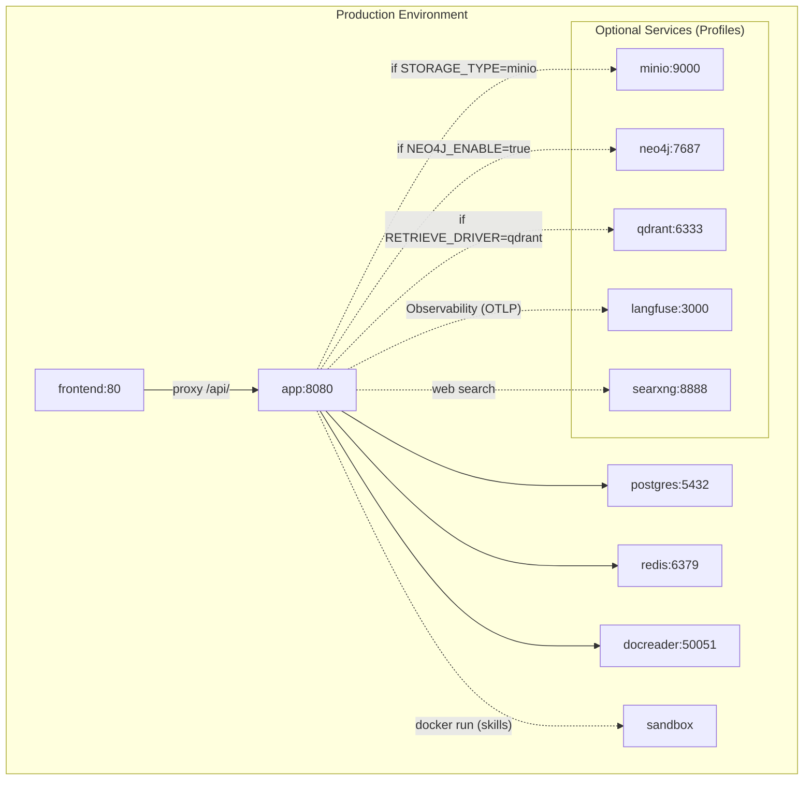
Sources: [website-docs/01-getting-started/02-installation.md:16-38](), [website-docs/01-getting-started/02-installation.md:86-111]()

| Service | Container Name | Ports | Profiles | Description |
|---|---|---|---|---|
| frontend | `wechatopenai/weknora-ui` | 80 | default | Nginx hosting SPA, reverse proxy to app [website-docs/01-getting-started/02-installation.md:88] |
| app | `wechatopenai/weknora-app` | 8080 | default | Main backend API server [website-docs/01-getting-started/02-installation.md:89] |
| postgres | `paradedb/paradedb:v0.25.11-pg17` | 5432 | default | ParadeDB (Postgres with pgvector extensions) [website-docs/01-getting-started/02-installation.md:91] |
| redis | `redis:7.0-alpine` | 6379 | default | Redis cache and streaming queue [website-docs/01-getting-started/02-installation.md:92] |
| docreader | `wechatopenai/weknora-docreader` | 50051 | default | Document parsing gRPC microservice [website-docs/01-getting-started/02-installation.md:90] |
| minio | `pgsty/minio` | 9000,9001 | minio, full | S3-compatible object storage [website-docs/06-development/01-dev-guide.md:88] |
| neo4j | `neo4j:latest` | 7474,7687 | neo4j, full | Graph database for knowledge graph (optional) [website-docs/06-development/01-dev-guide.md:93] |
| qdrant | `qdrant/qdrant` | 6333,6334 | qdrant, full | Vector search backend alternative [website-docs/06-development/01-dev-guide.md:89] |
| langfuse | `langfuse-web` | 3000 | langfuse | Observability stack with OTLP tracing [website-docs/06-development/01-dev-guide.md:95] |

Sources: [website-docs/01-getting-started/02-installation.md:86-111](), [website-docs/06-development/01-dev-guide.md:82-98]()

## Getting Started Workflow

The typical initial setup progresses through repository cloning, environment configuration, container orchestration, health verification, and browser-based initialization [website-docs/01-getting-started/02-installation.md:50-60]().

Diagram: Getting Started Workflow
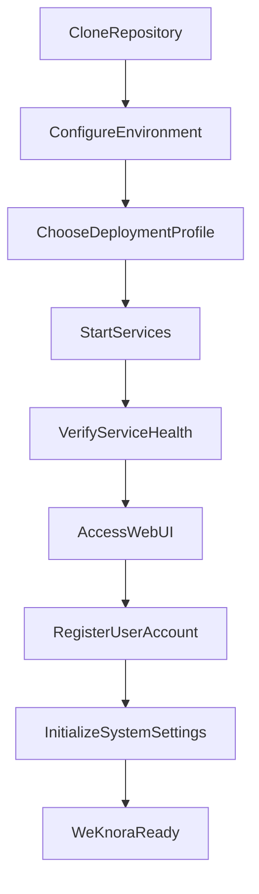
Sources: [website-docs/01-getting-started/02-installation.md:50-60]()

## Environment Configuration Overview

WeKnora is configured primarily via a `.env` file loaded into containers at runtime to set operational parameters. Key configuration parameters include core system toggles, storage backends, database connections, and cache settings [.env.example:1-50]().

| Category | Key Variables | Default | Purpose |
|---|---|---|---|
| Core System | `GIN_MODE`, `LOG_LEVEL`, `AUTO_MIGRATE` | release, debug, true | Server mode, logging verbosity, auto DB migration control [.env.example:1-20] |
| Storage | `STORAGE_TYPE`, `LOCAL_STORAGE_BASE_DIR` | local, /data/files | File storage backend and paths [.env.example:21-40] |
| Database | `DB_DRIVER`, `DB_HOST`, `DB_PORT`, `DB_USER`, `DB_PASSWORD`, `DB_NAME` | postgres, postgres, 5432, postgres, (secret), weknora | RDBMS connection [.env.example:41-60] |
| Cache & Queue | `REDIS_ADDR`, `REDIS_PASSWORD` | redis:6379, (secret) | Redis for streaming and Asynq queue [.env.example:61-80] |
| Vector Store | `RETRIEVE_DRIVER` | postgres | User choice of embedding vector DB backend [.env.example:81-100] |

Sources: [.env.example:1-100]()

## Bridging Natural Language Space to Code Entity Space

### Deployment Step to Code Entity Mapping

This diagram maps natural language concepts of deployment steps to source code artifacts and files:

Diagram: Deployment Step to Code Entity Mapping
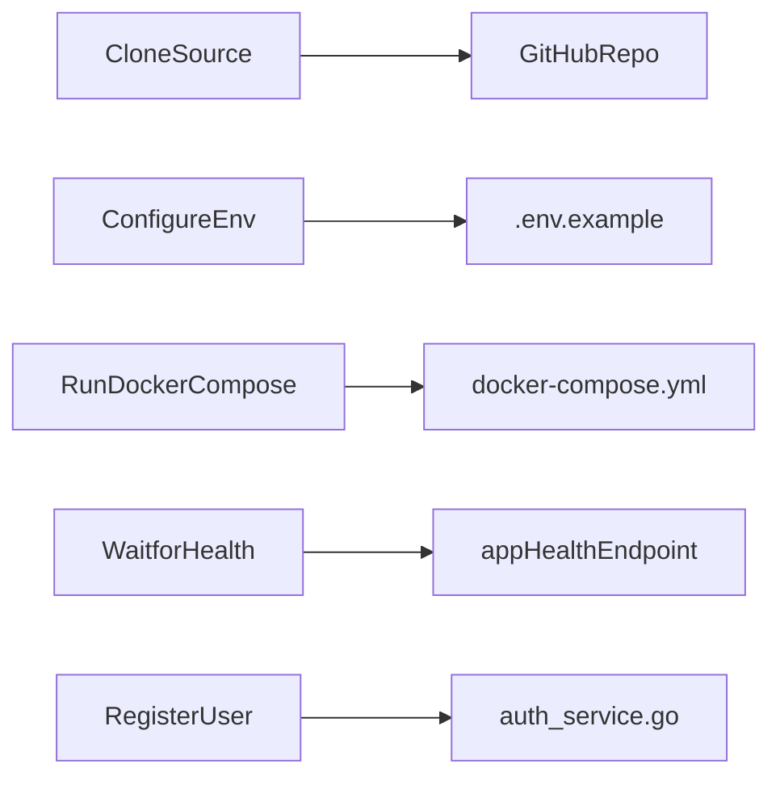
Sources: [website-docs/01-getting-started/02-installation.md:50-60](), [.env.example:1-25]()

### Container Initialization and Dependency Injection Mapping

Mapping core initialization stages in Go backend container to configuration and service setup code:

Diagram: Container Initialization and Dependency Injection Mapping
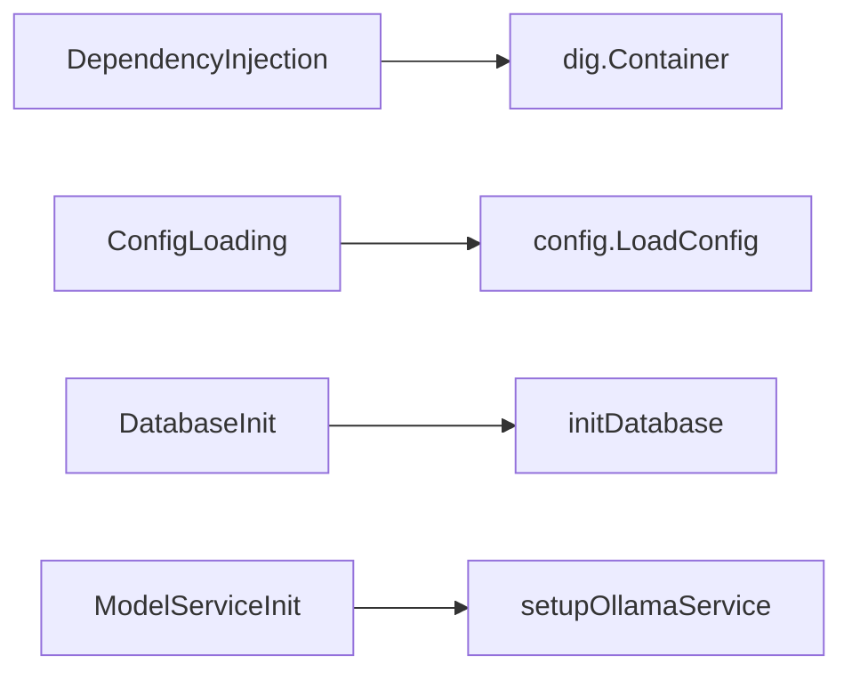
Sources: [internal/config/config.go:1-43]()

---

**Sources:**  
[website-docs/01-getting-started/02-installation.md:1-127](),  
[website-docs/06-development/01-dev-guide.md:82-98](),  
[.env.example:1-100](),  
[internal/config/config.go:1-43]()

---

# Page: System Requirements and Prerequisites

# System Requirements and Prerequisites

<details>
<summary>Relevant source files</summary>

The following files were used as context for generating this wiki page:

- [.env.example](.env.example)
- [config/config.yaml](config/config.yaml)
- [docker-compose.dev.yml](docker-compose.dev.yml)
- [docker-compose.yml](docker-compose.yml)
- [docreader/README.md](docreader/README.md)
- [docreader/config.py](docreader/config.py)
- [docreader/parser/docx_parser.py](docreader/parser/docx_parser.py)
- [docreader/parser/image_preprocess.py](docreader/parser/image_preprocess.py)
- [docreader/preprocess.py](docreader/preprocess.py)
- [docreader/preprocess_worker.py](docreader/preprocess_worker.py)
- [docreader/tests/test_config.py](docreader/tests/test_config.py)
- [docreader/tests/test_docx_tables.py](docreader/tests/test_docx_tables.py)
- [docreader/tests/test_preprocess_runner.py](docreader/tests/test_preprocess_runner.py)
- [go.mod](go.mod)
- [go.sum](go.sum)
- [internal/config/auth_legacy_env_test.go](internal/config/auth_legacy_env_test.go)
- [internal/config/config.go](internal/config/config.go)
- [internal/container/container.go](internal/container/container.go)
- [internal/database/migration_postgres_test.go](internal/database/migration_postgres_test.go)
- [migrations/mysql/README.md](migrations/mysql/README.md)
- [migrations/versioned/000099_pg_search_0226.up.sql](migrations/versioned/000099_pg_search_0226.up.sql)
- [migrations/versioned/000115_pg_search_02511.down.sql](migrations/versioned/000115_pg_search_02511.down.sql)
- [migrations/versioned/000115_pg_search_02511.up.sql](migrations/versioned/000115_pg_search_02511.up.sql)
- [scripts/dev.sh](scripts/dev.sh)
- [scripts/test_paradedb_upgrade.py](scripts/test_paradedb_upgrade.py)
- [website-docs/01-getting-started/02-installation.md](website-docs/01-getting-started/02-installation.md)
- [website-docs/01-getting-started/06-paradedb-upgrade.md](website-docs/01-getting-started/06-paradedb-upgrade.md)
- [website-docs/02-architecture/01-overview.md](website-docs/02-architecture/01-overview.md)
- [website-docs/05-clients/01-frontend.md](website-docs/05-clients/01-frontend.md)
- [website-docs/05-clients/02-cli.md](website-docs/05-clients/02-cli.md)
- [website-docs/06-development/01-dev-guide.md](website-docs/06-development/01-dev-guide.md)
- [website-docs/06-development/02-database-schema.md](website-docs/06-development/02-database-schema.md)

</details>


This page documents the hardware, software, and service requirements for running WeKnora. It details host-level prerequisites, Docker orchestration necessities, resource allocations based on deployment scale, and external service dependencies critical for full functionality.

---

## Overview

WeKnora is a modular LLM-powered knowledge framework primarily deployed through containerization. It offers flexible profiles from a minimal footprint for single users to a full enterprise-grade stack integrating distributed vector stores, graph databases, and observability tools.

The architecture follows a microservices pattern separating:
- Core backend services (`app`) `[docker-compose.yml:36-46]()`
- Frontend UI (`frontend`) `[docker-compose.yml:2-16]()`
- Document parsing engines (`docreader`) `[website-docs/02-architecture/01-overview.md:15-15]()`

It supports complex multi-tenant RBAC, fine-grained storage quotas, and secure encryption mechanisms for sensitive credentials configured via environment variables and configuration files `[.env.example:1-25]()`, `[internal/config/config.go:19-43]()`.

Sources: `[docker-compose.yml:2-46]`, `[.env.example:1-25]`, `[internal/config/config.go:19-43]`

---

## Host Software Requirements

Ensure the following software prerequisites are met on the host machine before deploying WeKnora.

### Required Tools

| Tool | Minimum Version | Purpose | Reference |
|---|---|---|---|
| **Docker** | 20.10+ | Container runtime for microservices | `[docker-compose.yml:1-34]()` |
| **Docker Compose** | v2.24+ (Recommended) | Multi-service orchestration with profile management | `[docker-compose.dev.yml:1-12]()` |
| **Git** | 2.x+ | Source code version control and repository management | `[scripts/dev.sh:11-14]()` |

### Development & Build Prerequisites

For building from source or extending, these environments are essential:

| Environment | Version | Purpose | Reference |
|---|---|---|---|
| **Go** | 1.26.0 | Backend application development and binary compilation | `[website-docs/06-development/01-dev-guide.md:10-11]()` |
| **Node.js** | 22+ | Frontend build system (Vite-based) | `[website-docs/06-development/01-dev-guide.md:12-13]()` |
| **Make** | 3.81+ | Build automation and task execution | `[scripts/dev.sh:80-83]()` |

Sources: `[docker-compose.yml:1-34]`, `[docker-compose.dev.yml:1-12]`, `[scripts/dev.sh:11-83]`, `[website-docs/06-development/01-dev-guide.md:5-15]`

---

## Hardware Recommendations

WeKnora's resource consumption depends on the number of users, scale of knowledge bases, and whether LLM inference runs locally.

### Resource Allocation Profiles

| Tier | RAM | CPU | Storage | Use Case Description | Reference |
|---|---|---|---|---|---|
| **Minimal** | 4 GB | 2 Cores | 20 GB | Single-user, basic RAG with cloud LLM | `[config/config.yaml:1-5]()` |
| **Standard** | 8 GB | 4 Cores | 50 GB | Small teams, local parsing, hybrid retrieval | `[website-docs/01-getting-started/02-installation.md:41-41]()` |
| **Enterprise** | 16+ GB | 8+ Cores | 100+ GB | Production, Wiki Mode at large scale | `[docker-compose.yml:77-105]()` |
| **Inference** | 32+ GB | 12+ Cores | 200+ GB | Local LLM (Ollama) hosting with multimodal | `[website-docs/01-getting-started/02-installation.md:42-42]()` |

### Hardware Notes

- **Disk I/O**: Use fast SSDs for `postgres` and vector stores for optimal low-latency retrieval and task queue handling.
- **Worker Pool Governance**: Asynq worker pools are configurable via environment variables (`WEKNORA_ASYNQ_CORE_CONCURRENCY`, `WEKNORA_ASYNQ_ENRICHMENT_CONCURRENCY`, etc.) to manage concurrency effectively `[.env.example:173-182]()`.
- **Architecture Support**: Supports `amd64` and `arm64` with automatic architecture detection during builds via Docker multi-stage builds.

Sources: `[docker-compose.yml:8-13]`, `[.env.example:173-182]`, `[website-docs/01-getting-started/02-installation.md:39-46]`, `[config/config.yaml:1-5]`

---

## Service Dependencies and Connectivity

WeKnora employs a microservice architecture orchestrated mostly through Docker Compose. The primary backend service (`app`) communicates with persistent stores, caching, parsing services, and frontends.

### Diagram: Natural Language Space to Code Entity Space (Service Mapping)

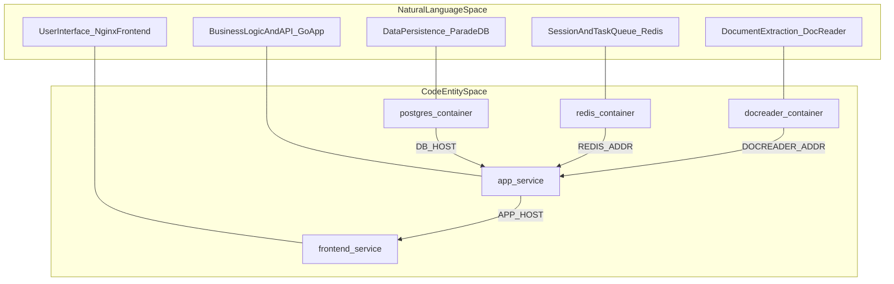

This diagram illustrates the mapping of natural language service requirements (data persistence, caching, extraction, core API, UI) onto precise Docker containers (`postgres`, `redis`, `docreader`, `app`, `frontend`) and environment variables (`DB_HOST`, `REDIS_ADDR`, `DOCREADER_ADDR`, `APP_HOST`) facilitating container-to-container service discovery and configuration.

Sources: `[docker-compose.yml:2-46]`, `[.env.example:76-131]`, `[website-docs/02-architecture/01-overview.md:10-21]`

---

## Advanced Feature Prerequisites

### Supported Vector and Graph Storage Backends

WeKnora can bind knowledge bases to multiple vector database engines for retrieval fan-out and supports graph databases for Wiki mode knowledge graphs.

| Component | Env Variable / Setting | Usage | Reference |
|---|---|---|---|
| PostgreSQL (pgvector) | `DB_DRIVER=postgres` | Default vector and relational backend | `[.env.example:130-138]()` |
| Apache Doris | `RETRIEVE_DRIVER=doris` | Stream-load and hybrid query backend | `[website-docs/02-architecture/01-overview.md:30-30]()` |
| Tencent VectorDB | `RETRIEVE_DRIVER=tencent_vectordb` | Enterprise vector search | `[website-docs/02-architecture/01-overview.md:35-35]()` |
| Neo4j | `NEO4J_AUTH` | Wiki Mode knowledge graph visualization | `[docker-compose.dev.yml:206-212]()` |
| Qdrant | `QDRANT_HOST` | Vector database | `[docker-compose.dev.yml:107-117]()` |
| Milvus | `MILVUS_PORT` | Vector database | `[docker-compose.dev.yml:177-195]()` |
| Weaviate | `RETRIEVE_DRIVER=weaviate` | Vector database | `[website-docs/01-getting-started/02-installation.md:105-105]()` |
| Elasticsearch | `ELASTICSEARCH_ADDR` | Vector database (v7/v8) | `[website-docs/02-architecture/01-overview.md:35-35]()` |
| SQLite (sqlite-vec) | `DB_DRIVER=sqlite` | Local vector storage | `[website-docs/06-development/02-database-schema.md:11-12]()` |

### Multi-Instance Storage Backends

Multiple object storage providers can be bound to tenants and knowledge bases through configuration settings.

| Storage Type | Environment Variables | Reference |
|---|---|---|
| Local Storage | `LOCAL_STORAGE_BASE_DIR` | `[docker-compose.yml:47-48]()` |
| MinIO | `MINIO_ROOT_USER` and related | `[docker-compose.dev.yml:84-93]()` |
| Tencent COS | `COS_SECRET_ID`, `COS_SECRET_KEY`, `COS_REGION`, etc. | `[docker-compose.yml:116-123]()` |

Sources: `[docker-compose.yml:47-123]`, `[docker-compose.dev.yml:84-212]`, `[website-docs/02-architecture/01-overview.md:25-36]`, `[website-docs/06-development/02-database-schema.md:7-14]`

---

## Environment and Security Configuration

### Diagram: System Capabilities to Code Entities (Configuration Mapping)

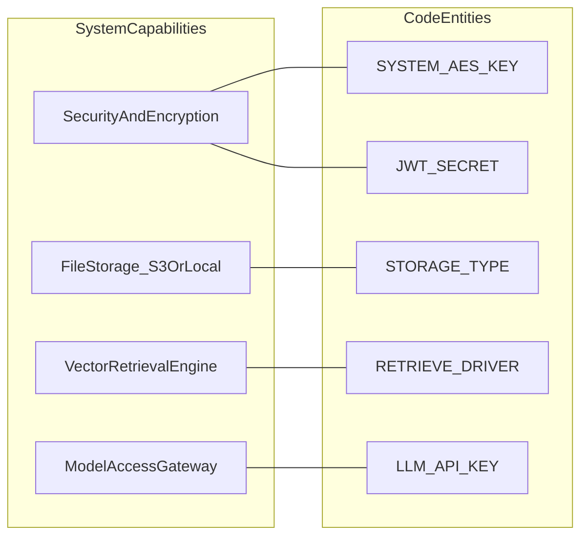

These environment variables configure critical aspects like credential encryption (`SYSTEM_AES_KEY`, `JWT_SECRET`), authenticated access, storage backend selection (`STORAGE_TYPE`), vector database choice (`RETRIEVE_DRIVER`), and LLM provider integration (`LLM_API_KEY`).

Sources: `[.env.example:126-184]`, `[docker-compose.yml:114-143]`

---

## Network and Port Requirements

- **Default Ports**  
  - Frontend UI: Port `80` (HTTP) or as configured via `FRONTEND_PORT` `[docker-compose.yml:16-16]`.  
  - Backend API Service (`app`): Port `8080` `[docker-compose.yml:46-46]`.  
  - DocReader gRPC Service: Port `50051` `[website-docs/02-architecture/01-overview.md:15-15]`.  
  - MCP Server (optional): Port `8082` `[.env.example:122-123]`.

- **Container Networking**  
  - All internal containers resolve each other by standardized service names within the Docker user-defined network `WeKnora-network` `[docker-compose.yml:32-33]`.

- **Outbound Connectivity**  
  - Access to LLM providers (OpenAI, Anthropic, DeepSeek, Zhipu, Ollama, etc.) over HTTPS.
  - Web Search providers and object storage endpoints.

- **Security Considerations**  
  - Redis TLS secured connections are supported and recommended for managed instances (`REDIS_USE_TLS`) `[.env.example:165-171]`.
  - Sensitive keys such as `JWT_SECRET` and `SYSTEM_AES_KEY` are required at deployment to enable encrypted credentials and secure authentication tokens `[website-docs/01-getting-started/02-installation.md:62-62]`.

Sources: `[docker-compose.yml:15-46]`, `[.env.example:94-171]`, `[website-docs/01-getting-started/02-installation.md:60-65]`, `[website-docs/02-architecture/01-overview.md:73-88]`

---

## References

- `[docker-compose.yml:1-150]()` — Base container image recipes and service setup  
- `[docker-compose.dev.yml:1-213]()` — Development infrastructure profiles and dependencies  
- `[scripts/dev.sh:11-83]()` — Orchestration script handling development lifecycle  
- `[frontend/vite.config.ts:1-191]()` — Frontend build tooling and proxy targets  
- `[.env.example:76-185]()` — Environment variable examples for service addresses and storage backends  
- `[internal/config/config.go:19-43]()` — Application configuration structures  
- `[website-docs/01-getting-started/02-installation.md:1-127]()` — Installation and deployment requirements guide  
- `[website-docs/02-architecture/01-overview.md:1-118]()` — Architecture overview and service components

---

# Page: Installation and Deployment

# Installation and Deployment

<details>
<summary>Relevant source files</summary>

The following files were used as context for generating this wiki page:

- [.env.example](.env.example)
- [.github/workflows/cli.yml](.github/workflows/cli.yml)
- [.github/workflows/docker-image.yml](.github/workflows/docker-image.yml)
- [.github/workflows/release-lite.yml](.github/workflows/release-lite.yml)
- [.gitignore](.gitignore)
- [Formula/weknora-lite.rb](Formula/weknora-lite.rb)
- [Makefile](Makefile)
- [cli/internal/cmdutil/errors_doc_test.go](cli/internal/cmdutil/errors_doc_test.go)
- [cli/scripts/check-skill-wire-vocab.sh](cli/scripts/check-skill-wire-vocab.sh)
- [config/config.yaml](config/config.yaml)
- [deploy/weknora-lite.service](deploy/weknora-lite.service)
- [docker-compose.dev.yml](docker-compose.dev.yml)
- [docker-compose.yml](docker-compose.yml)
- [docker/Dockerfile.app](docker/Dockerfile.app)
- [docker/Dockerfile.docreader](docker/Dockerfile.docreader)
- [docker/Dockerfile.sandbox](docker/Dockerfile.sandbox)
- [docreader/README.md](docreader/README.md)
- [docreader/config.py](docreader/config.py)
- [docreader/parser/docx_parser.py](docreader/parser/docx_parser.py)
- [docreader/parser/image_preprocess.py](docreader/parser/image_preprocess.py)
- [docreader/preprocess.py](docreader/preprocess.py)
- [docreader/preprocess_worker.py](docreader/preprocess_worker.py)
- [docreader/tests/test_config.py](docreader/tests/test_config.py)
- [docreader/tests/test_docx_tables.py](docreader/tests/test_docx_tables.py)
- [docreader/tests/test_preprocess_runner.py](docreader/tests/test_preprocess_runner.py)
- [frontend/.dockerignore](frontend/.dockerignore)
- [frontend/Dockerfile](frontend/Dockerfile)
- [go.mod](go.mod)
- [go.sum](go.sum)
- [internal/config/auth_legacy_env_test.go](internal/config/auth_legacy_env_test.go)
- [internal/config/config.go](internal/config/config.go)
- [internal/container/container.go](internal/container/container.go)
- [scripts/build_frontend_dist.sh](scripts/build_frontend_dist.sh)
- [scripts/build_images.sh](scripts/build_images.sh)
- [scripts/dev.sh](scripts/dev.sh)
- [scripts/get_version.sh](scripts/get_version.sh)
- [scripts/package-lite.sh](scripts/package-lite.sh)
- [scripts/start_all.sh](scripts/start_all.sh)
- [scripts/test-homebrew.sh](scripts/test-homebrew.sh)
- [scripts/update-homebrew-formula.sh](scripts/update-homebrew-formula.sh)
- [scripts/verify_frontend_pr.sh](scripts/verify_frontend_pr.sh)

</details>


## Purpose and Scope
This page provides detailed, step-by-step instructions for installing and deploying WeKnora using Docker Compose. It explains how to configure the environment with `.env`, select optional service profiles, understand container dependencies, and ensure the system starts in the correct order. The guide also clarifies how environment variables propagate into the application configuration and how container images are composed.

Sources: `[website-docs/01-getting-started/02-installation.md:1-46]()`, `[docker-compose.yml:1-35]()`

---

## Deployment Overview

WeKnora’s deployment consists of a set of containerized microservices orchestrated using Docker Compose. The core system includes:

- `frontend`: Vue.js SPA served via Nginx `[docker-compose.yml:2-34]()`
- `app`: Go backend application providing APIs and business logic `[docker-compose.yml:36-80]()`
- `postgres`: ParadeDB (PostgreSQL 17 + BM25/vector extensions) as main persistent store `[docker-compose.dev.yml:4-23]()`
- `redis`: Redis providing cache, streaming, and queue capabilities `[docker-compose.dev.yml:26-36]()`
- `docreader`: Document parser and extraction gRPC service `[docker/Dockerfile.docreader:164-168]()`

Additional optional components can be enabled by Docker Compose profiles to provide extended capabilities like vector search or knowledge graphs.

Title: "Standard Docker Compose Stack Architecture"
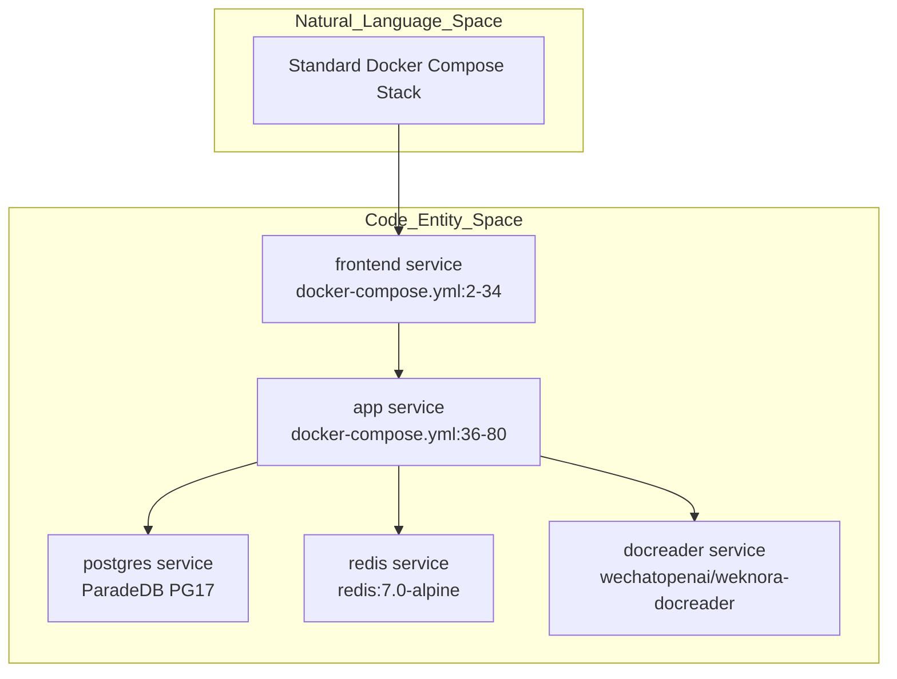

Sources: `[docker-compose.yml:2-34]()`, `[docker-compose.yml:36-80]`, `[website-docs/01-getting-started/02-installation.md:16-38]()`, `[docker-compose.dev.yml:4-36]()`

---

## Step 1: Clone the Repository

Start by obtaining WeKnora’s complete source code and Docker configurations from the official GitHub repository:

```bash
git clone https://github.com/Tencent/WeKnora.git
cd WeKnora
```

This step prepares your local environment for deployment or further build steps.

Sources: `[website-docs/01-getting-started/02-installation.md:51-54]()`

---

## Step 2: Environment Configuration

### Create and Customize `.env`

WeKnora uses a `.env` file to configure runtime environment variables injected into containers. This file controls database credentials, Redis settings, service URLs, feature toggles, and more critical options.

Create your `.env` from the example template:

```bash
cp .env.example .env
```

Edit `.env` to set at least:

- **Database**: `DB_USER`, `DB_PASSWORD`, `DB_NAME` `[.env.example:130-142]()`
- **Redis**: `REDIS_PASSWORD` `[.env.example:155]()`
- **JWT and AES secrets**: `JWT_SECRET`, `SYSTEM_AES_KEY` (generate securely) `[website-docs/01-getting-started/02-installation.md:62]()`
- **Network settings**: `APP_HOST`, `APP_PORT`, `FRONTEND_PORT` `[.env.example:87-96]()`
- Also consider setting localization and language preferences `[.env.example:67-74]()`

> **Security note:** Keep your `.env` private and do not commit it to version control as it contains secrets.

### Configuration Propagation Flow

Title: "Environment Configuration Propagation Flow"
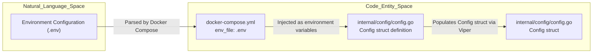

- The `app` container references `env_file: .env` in `[docker-compose.yml:78-79]()`, automatically receiving the environment variables.
- The Go backend parses and loads these variables via Viper into the `Config` struct defined at `[internal/config/config.go:19-43]()`.
- This ensures consistent configuration access across all backend modules.

Sources: `[.env.example:1-150]()`, `[docker-compose.yml:78-79]()`, `[internal/config/config.go:19-43]()`

---

## Step 3: Service Profiles for Optional Components

WeKnora uses Docker Compose profiles feature to allow selective enabling of optional service components. This lets you add advanced capabilities or integrations without affecting the core stack.

| Profile    | Service(s)                               | Purpose                                |
|------------|----------------------------------------|--------------------------------------|
| `minio`    | `minio`                                | S3-compatible object storage `[docker-compose.dev.yml:84-105]()` |
| `qdrant`   | `qdrant`                               | Vector search engine `[docker-compose.dev.yml:107-121]()` |
| `milvus`   | `milvus`                               | Vector search engine `[docker-compose.dev.yml:177-205]()` |
| `neo4j`    | `neo4j`                               | Knowledge graph database `[docker-compose.dev.yml:206-212]()` |
| `searxng`  | `searxng-init`, `searxng`              | Web search proxy `[docker-compose.dev.yml:40-83]()` |
| `odl-hybrid`| `odl-hybrid`                         | OpenDataLoader hybrid document parser `[website-docs/01-getting-started/02-installation.md:109]()` |

Activate profiles at runtime:

```bash
docker compose --profile minio --profile qdrant up -d
```

The `docker-compose.dev.yml` file contains examples of these optional services and their default ports `[docker-compose.dev.yml:1-212]()`, and the main `docker-compose.yml` references profile usage. This modular system supports team flexibility and resource management.

Sources: `[docker-compose.yml:1-1067]()`, `[docker-compose.dev.yml:1-212]()`, `[website-docs/01-getting-started/02-installation.md:94-111]()`

---

## Step 4: Service Dependencies and Startup Order

To maintain a robust startup sequence, WeKnora uses Docker Compose's `depends_on` with health check conditions to ensure containers only start after their prerequisites are healthy.

Title: "Container Health and Dependency Graph"
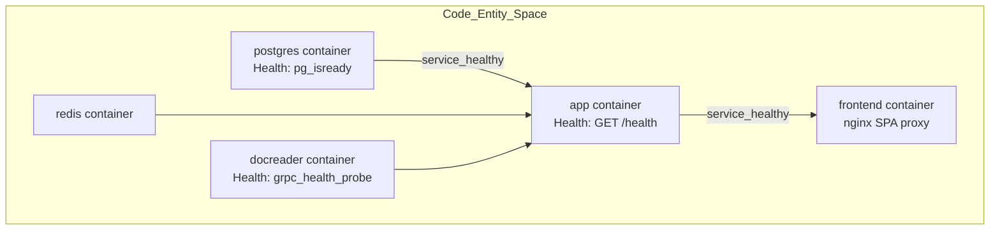

- The `app` container waits for `postgres` to be healthy before starting `[docker-compose.yml:29-31]()`.
- The `frontend` container depends on `app`’s health `[docker-compose.yml:29-31]()`.
- Health checks measure readiness:
  - `postgres`: health command uses `pg_isready` `[docker-compose.dev.yml:18]()`
  - `docreader`: uses `grpc_health_probe` `[docker/Dockerfile.docreader:135]()`
  - `app`: HTTP GET `/health` endpoint `[docker-compose.yml:62-63]()`

This guarantees that the system components are fully initialized and available before dependent services start.

Sources: `[docker-compose.yml:29-67]()`, `[docker-compose.dev.yml:18]()`, `[docker/Dockerfile.docreader:135]()`, `[website-docs/01-getting-started/02-installation.md:79-88]()`

---

## Step 5: Starting the System

Two main methods exist for launching WeKnora using Docker Compose.

### Using Docker Compose CLI

Pull the latest container images according to the version set in `.env` (default `latest`):

```bash
docker compose pull
docker compose up -d
```

Check container status:

```bash
docker compose ps
```

### Using Orchestration Script

The repo includes a convenient script `scripts/start_all.sh` that wraps Docker Compose commands and adds extra checks (e.g., Ollama service detection), environment file guard, and sandbox image pre-pulling:

```bash
./scripts/start_all.sh --all
```

This script handles `.env` fallback from `.env.example` if needed and ensures smoother startup.

### Persistent Storage

The `app` container mounts persistent volumes for:

- User uploaded files (`data-files`)
- Docreader temporary storage (`docreader-tmp`)
- Optional configuration overlays (`config.yaml`)

```yaml
volumes:
  - data-files:/data/files
  - docreader-tmp:/tmp/docreader:ro
  - ./config/config.yaml:/app/config/config.yaml
```

These volumes ensure data persistence across container restarts or recreations.

Sources: `[docker-compose.yml:47-50]()`, `[website-docs/01-getting-started/02-installation.md:52-61]()`

---

# Summary of Key Files and Concepts

| Filename                   | Role in Installation and Deployment                      |
|----------------------------|---------------------------------------------------------|
| `docker-compose.yml`       | Main Docker Compose file defining services and profiles. `[docker-compose.yml:1-35]()` |
| `.env.example`              | Template for environment variables controlling config. `[.env.example:1-25]()` |
| `docker/Dockerfile.app`    | Dockerfile for building the backend container image. `[docker/Dockerfile.app:26-97]()` |
| `docker/Dockerfile.docreader` | Dockerfile for building the document reader service image. `[docker/Dockerfile.docreader:1-80]()` |
| `frontend/Dockerfile`      | Dockerfile to build the Vue.js frontend container image. `[frontend/Dockerfile:1-49]()` |
| `docker-compose.dev.yml`   | Development Docker Compose setup with optional services. `[docker-compose.dev.yml:1-50]()` |
| `Makefile`                 | Build commands, including Docker image build and run. `[Makefile:1-30]()` |

Sources: `[docker-compose.yml:1-35]()`, `[.env.example:1-25]()`, `[docker/Dockerfile.app:26-97]()`, `[docker/Dockerfile.docreader:1-80]()`, `[frontend/Dockerfile:1-49]()`, `[docker-compose.dev.yml:1-50]()`, `[Makefile:1-30]()`

---

# Page: Quick Start Guide

# Quick Start Guide

<details>
<summary>Relevant source files</summary>

The following files were used as context for generating this wiki page:

- [CHANGELOG.md](CHANGELOG.md)
- [README.md](README.md)
- [README_CN.md](README_CN.md)
- [README_JA.md](README_JA.md)
- [README_KO.md](README_KO.md)
- [VERSION](VERSION)
- [frontend/package-lock.json](frontend/package-lock.json)
- [frontend/package.json](frontend/package.json)
- [helm/Chart.yaml](helm/Chart.yaml)

</details>


This page provides a technical walkthrough to get WeKnora running with a basic setup, guiding through initial service startup, system initialization, model configuration, knowledge base creation, and first interaction.

**Purpose and Scope:** This guide assumes the user has already installed WeKnora and started the required backing services. For installation and container orchestration details, refer to the official installation instructions `[README.md:62-65]()`. This guide focuses on post-installation bootstrapping, system initialization via `InitializationHandler`, and executing the first RAG pipeline ingestion.

Sources:  
- `[README.md:62-65]()`

---

## Prerequisites and Infrastructure Setup

WeKnora is architected as a set of Docker containers orchestrated via Docker Compose. The system supports modular profiles enabling optional services like vector databases, knowledge graph stores, and object storage solutions `[README.md:120-134]()`.

You start the environment using direct Docker Compose commands `[README.md:95-105]()`:

```bash
# Start core services including postgres, redis, and docreader for parsing
docker compose pull
docker compose up -d

# Start with optional profiles for vector database and graph storage
docker compose --profile neo4j --profile minio up -d
```

### Core Service Mapping

| System Name / Component          | Host Endpoint      | Container Name         | Code / Config Reference          |
|---------------------------------|-------------------|-----------------------|---------------------------------|
| Web UI (frontend)                | `http://localhost:80` | `WeKnora-frontend`      | `[docker-compose.yml:2-34]()`       |
| Backend API (Gin web server)     | `http://localhost:8080` | `WeKnora-app`           | `[docker-compose.yml:36-104]()`     |
| PostgreSQL (Relational DB)       | `localhost:5432`     | `WeKnora-postgres`      | `[docker-compose.dev.yml:4-23]()`   |
| Redis (Cache & Async Queue Broker) | `localhost:6379`     | `WeKnora-redis`         | `[docker-compose.dev.yml:26-36]()`  |
| DocReader (gRPC Parser Engine)   | `localhost:50051`    | `WeKnora-docreader`     | `[docker-compose.yml:36-104]()`     |

This infrastructure enables WeKnora to run in its full capacity with asynchronous document parsing, embedding computation, vector indexing, and chat server operation `[README.md:60-65]()`.

Sources:  
- `[README.md:60-65]()`  
- `[docker-compose.yml:2-104]()`  
- `[docker-compose.dev.yml:4-36]()`

---

## Step-by-Step User Flow and Code Entity Mapping

The next diagram bridges the Natural Language Space to the Code Entity Space, mapping the user's onboarding and initial knowledge ingestion journey from the frontend UI through backend handlers to persistent database entities:

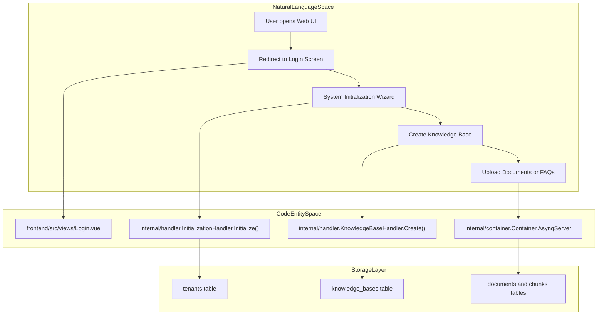

**Diagram: Natural Language to Code Entity Space - Quick Start Lifecycle**

Sources:  
- `[README.md:60-65]()`  
- `[CHANGELOG.md:9-25]()`

---

## 1. Register and Log In

- End-users first access the WeKnora frontend at `http://localhost` after deployment `[README.md:107]()`. If unauthenticated, the user is redirected to the login view `[frontend/src/views/Login.vue]()`.
- The initial registered user receives the `Owner` role on the default workspace tenant, enabling full control per the RBAC model `[README.md:64]()`.
- Upon first login, a guided onboarding experience helps configure the user's workspace and tenant settings `[README.md:107]()`.

Sources:  
- `[README.md:64-107]()`  
- `[frontend/package.json:1-49]()`

---

## 2. System Initialization

After login, the system initialization wizard guides creating the first knowledge base and configuring global parameters.

### Initialization Workflow

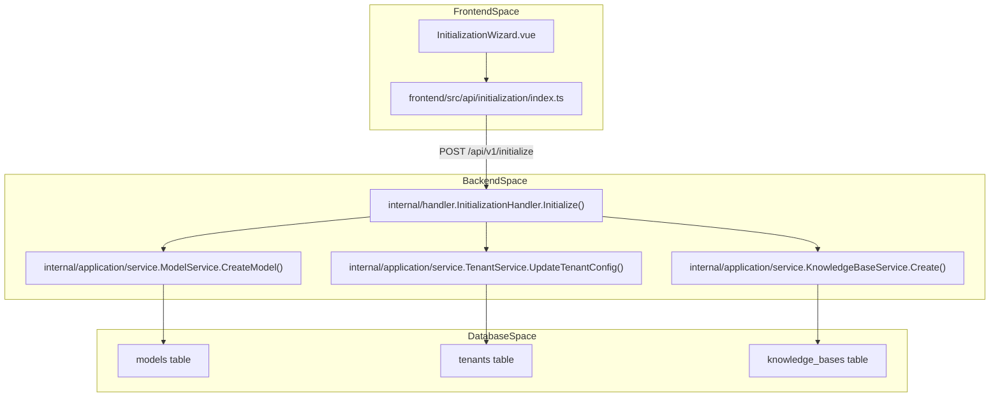

**Diagram: System Initialization Backend Workflow**

Key parameters configured during initialization include:

- **Model Provider Type:** Usually `remote` (API-based) or `local` (Ollama-based local model) `[README.md:63]()`.
- **Embedding Vector Dimension:** Must match the chosen vector model (e.g., 1536 for OpenAI, 1024 for BGE) `[CHANGELOG.md:9-11]()`.
- **Storage Backend:** Choose between local disk, MinIO object storage, or cloud provider `[README.md:60-65]()`.

Sources:  
- `[README.md:60-65]()`  
- `[CHANGELOG.md:9-25]()`

---

## 3. Configure AI Models

WeKnora requires both at least one embedding model for vectorization and one LLM for generation.

### Model Management Details

- The frontend dialog `ModelEditorDialog.vue` is used to register, edit, and validate AI model configurations `[CHANGELOG.md:16]()`.
- Connectivity to API-based models is verified via calls such as `checkRemoteAPI` before saving `[CHANGELOG.md:16]()`.
- Sensitive API keys are encrypted with AES-256-GCM at rest `[README.md:60-65]()`.
- The Ollama integration is handled via `OllamaService` initialized in the DI container `[README.md:63]()`.

Sources:  
- `[README.md:63-65]()`  
- `[CHANGELOG.md:16]()`

---

## 4. Create a Knowledge Base

The first knowledge base is created through the knowledge base management APIs and UI forms `[README.md:50-55]()`.

### Knowledge Base Configuration Options

| Parameter            | Description                                 | Example Values           |
|----------------------|---------------------------------------------|-------------------------|
| Base Type            | Defines knowledge base type                  | `document`, `faq`       |
| Vector Enabled       | Enable semantic vector search and embedding | `true` / `false`        |
| Wiki Enabled         | Enable knowledge graph or Wiki mode         | `true` / `false`        |
| Chunk Size           | Size of text chunks for embedding           | 512, 1024               |
| Chunk Overlap        | Overlap length between chunks                | 50, 100                 |
| Parent-Child Chunking| Enable hierarchical chunk structure          | `true` / `false`        |

These options determine how documents are processed and indexed, influencing retrieval quality `[README.md:50-55]()`.

Sources:  
- `[README.md:50-55]()`  
- `[CHANGELOG.md:9-25]()`

---

## 5. Upload and Process Documents

Uploading documents triggers asynchronous ingestion pipelines to parse, chunk, embed, and index content `[README.md:60-65]()`.

### Ingestion Pipeline Overview

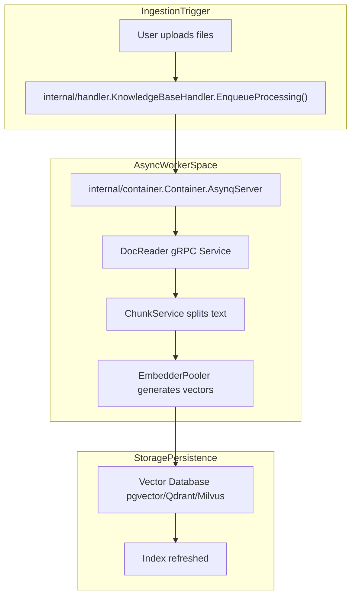

**Diagram: Asynchronous Document Ingestion Pipeline**

- File uploads occur via REST endpoints in the KnowledgeBase API `[README.md:60-65]()`.
- Background tasks are enqueued using the Asynq queue broker (Redis-based) `[README.md:64]()`.
- The DocReader service (gRPC) parses PDFs, Word files, and images asynchronously `[README.md:61]()`.
- Text is chunked into segments suitable for vector embedding `[README.md:60-65]()`.
- Embeddings are stored in configured vector databases allowing semantic similarity retrieval `[README.md:65]()`.

Sources:  
- `[README.md:60-65]()`  
- `[CHANGELOG.md:9-25]()`  

---

## 6. Interaction Modes

After setup, users can interact with the system in multiple modes `[README.md:49-55]()`:

| Mode           | Description                                         | Key Backend Components                  |
|----------------|-----------------------------------------------------|----------------------------------------|
| **Knowledge QA** | Search and retrieval over knowledge bases using RAG | ChatHandler, Retriever Plugins, LLM API |
| **Agent Mode**  | Multi-step reasoning with tool usage and skills    | ReAct Loop Engine, MCP Server, Skill Runtime |
| **Wiki Mode**   | Auto-generated Wiki pages with knowledge graph relations | AutoWiki Pipeline, Graph store (Neo4j) |

Additional features include temporary attachment handling directly in chat sessions, and scoped invocation of agent capabilities via `@Skill` or `@MCP` annotations `[README.md:56-62]()`.

Sources:  
- `[README.md:49-62]()`  
- `[CHANGELOG.md:9-25]()`

---

## Troubleshooting and Tips

| Symptom                                  | Possible Cause                                      | Resolution Steps                                  |
|------------------------------------------|---------------------------------------------------|--------------------------------------------------|
| Document parsing "Processing" stuck      | Worker queue saturation or dead worker process    | Inspect Runtime Queues, restart workers          |
| Model connection failures                 | Incorrect or invalid API credentials               | Validate credentials in `ModelEditorDialog.vue`  |
| Ollama local model unreachable            | Ollama service not running or API URL misconfigured | Start Ollama locally, set `OLLAMA_API_BASE_URL` in `.env` |
| Startup environment variables ignored    | Missing or invalid `.env` file                     | Copy `.env.example` to `.env` and update values  |

Sources:  
- `[README.md:62-111]()`  
- `[CHANGELOG.md:9-25]()`

---

# Summary

Getting WeKnora operational entails:

1. Deploying core services with Docker Compose (`WeKnora-frontend`, `WeKnora-app`, `postgres`, `redis`, `docreader`, optional vector/graph stores) `[README.md:95-135]()`.
2. Logging into the Web UI and completing the initialization wizard handled by `InitializationHandler` `[README.md:107]()`.
3. Configuring AI models including embedding and generation providers `[README.md:63]()`.
4. Creating a knowledge base with chunking and indexing parameters `[README.md:50-55]()`.
5. Uploading documents which are asynchronously parsed and embedded `[README.md:60-61]()`.
6. Interacting with knowledge bases via chat in Knowledge QA or Agent modes `[README.md:49-56]()`.

This technical quick start provides a foundation for understanding WeKnora's key runtime components and orchestration.

Sources:  
- `[README.md:49-135]()`  
- `[CHANGELOG.md:9-25]()`  
- `[docker-compose.yml:1-104]()`  
- `[docker-compose.dev.yml:1-36]()`

---

# Page: System Initialization and Configuration

# System Initialization and Configuration

<details>
<summary>Relevant source files</summary>

The following files were used as context for generating this wiki page:

- [frontend/src/api/initialization/index.ts](frontend/src/api/initialization/index.ts)
- [frontend/src/api/model/index.ts](frontend/src/api/model/index.ts)
- [frontend/src/components/ModelEditorDialog.vue](frontend/src/components/ModelEditorDialog.vue)
- [frontend/src/components/VectorStoreBadge.vue](frontend/src/components/VectorStoreBadge.vue)
- [frontend/src/components/modelSelectorClearability.test.ts](frontend/src/components/modelSelectorClearability.test.ts)
- [frontend/src/views/knowledge/KnowledgeBaseEditorModal.vue](frontend/src/views/knowledge/KnowledgeBaseEditorModal.vue)
- [frontend/src/views/knowledge/settings/GraphSettings.vue](frontend/src/views/knowledge/settings/GraphSettings.vue)
- [frontend/src/views/knowledge/settings/KBAdvancedSettings.vue](frontend/src/views/knowledge/settings/KBAdvancedSettings.vue)
- [frontend/src/views/knowledge/settings/KBChunkingSettings.vue](frontend/src/views/knowledge/settings/KBChunkingSettings.vue)
- [frontend/src/views/knowledge/settings/KBModelConfig.vue](frontend/src/views/knowledge/settings/KBModelConfig.vue)
- [frontend/src/views/knowledge/settings/KBStorageSettings.vue](frontend/src/views/knowledge/settings/KBStorageSettings.vue)
- [frontend/src/views/knowledge/settings/KBVectorStoreSettings.vue](frontend/src/views/knowledge/settings/KBVectorStoreSettings.vue)
- [frontend/src/views/settings/McpSettings.vue](frontend/src/views/settings/McpSettings.vue)
- [frontend/src/views/settings/ModelSettings.vue](frontend/src/views/settings/ModelSettings.vue)
- [frontend/src/views/settings/VectorStoreSettings.vue](frontend/src/views/settings/VectorStoreSettings.vue)
- [frontend/src/views/settings/WebSearchSettings.vue](frontend/src/views/settings/WebSearchSettings.vue)
- [internal/application/service/model.go](internal/application/service/model.go)
- [internal/application/service/weknoracloud.go](internal/application/service/weknoracloud.go)
- [internal/handler/initialization.go](internal/handler/initialization.go)
- [internal/handler/model.go](internal/handler/model.go)
- [internal/types/model.go](internal/types/model.go)
- [internal/types/weknoracloud.go](internal/types/weknoracloud.go)

</details>


## Purpose and Scope

This page documents the WeKnora system initialization and configuration process. It covers system startup infrastructure, Ollama local model management, AI model registration, the knowledge base setup wizard, document chunking and storage configuration, and knowledge graph extraction setup.

WeKnora uses a layered architecture:
- Deployment environment variables and Docker Compose launch system services `[docker-compose.yml:1-160]`.
- Ollama hosts local LLM models with a dedicated API service `[internal/handler/initialization.go:29]`, `[internal/models/chat/ollama.go:20-34]`.
- Backend services provide model and knowledge base management via `InitializationHandler` and `ModelHandler` `[internal/handler/initialization.go:56-96]`, `[internal/handler/model.go:28-42]`.
- Frontend components provide rich UI wizards to configure knowledge bases and models `[frontend/src/views/knowledge/KnowledgeBaseEditorModal.vue:1-35]`, `[frontend/src/components/ModelEditorDialog.vue:1-7]`.

Sources: `[docker-compose.yml:1-160]`, `[internal/handler/initialization.go:29]`, `[internal/handler/initialization.go:56-96]`, `[internal/handler/model.go:28-42]`, `[frontend/src/views/knowledge/KnowledgeBaseEditorModal.vue:1-35]`, `[frontend/src/components/ModelEditorDialog.vue:1-7]`, `[internal/models/chat/ollama.go:20-34]()`

---

## System Architecture Overview

The initialization system integrates deployment-level services, backend business logic, and frontend configuration, coordinated mainly by the backend `InitializationHandler` and `ModelHandler`.

### System Component Interaction (Natural Language to Code Entity Space)

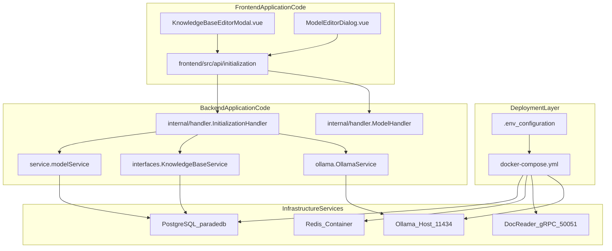

- The **deployment layer** configures environment variables and Docker Compose files that launch infrastructure services and application containers.
- Key **services include** PostgreSQL for persistence, Redis for stream management and caching, DocReader for document parsing, and Ollama for local LLM hosting.
- The **backend container** bootstraps core services coordinating system and knowledge base initialization.
- The **frontend** provides Vue.js components (`KnowledgeBaseEditorModal.vue` and `ModelEditorDialog.vue`) that call initialization and model REST APIs.

Sources: `[docker-compose.yml:1-160]`, `[internal/handler/initialization.go:56-96]`, `[frontend/src/api/initialization/index.ts:1-93]`, `[frontend/src/views/knowledge/KnowledgeBaseEditorModal.vue:1-35]`, `[frontend/src/components/ModelEditorDialog.vue:1-7]()`

---

## Initialization Workflow Overview

WeKnora’s initialization is composed of three main stages managed by the backend and surfaced to users via frontend UI:

1. **Infrastructure Setup**  
   - Core services like PostgreSQL, Redis, DocReader, and Ollama are launched via Docker Compose with configured `.env` files.  
   - The system automatically performs database migrations on startup if `AUTO_MIGRATE` is enabled.

2. **Model Registration and Ollama Setup**  
   - Models are registered via `ModelHandler` and `modelService` including LLMs, embedding engines, and reranking models `[internal/handler/model.go:28-123]`, `[internal/application/service/model.go:28-54]`.  
   - If Ollama is enabled, users can manage local models via `OllamaService` `[internal/models/utils/ollama/ollama.go]`.  
   - Ollama service status can be checked and models downloaded asynchronously by the frontend `[frontend/src/api/initialization/index.ts:198-209]()`.

3. **Knowledge Base Configuration**  
   - Each knowledge base configures AI models (LLM, embedding, VLM, ASR), document chunking, storage backends (e.g., `StorageBackendID`), and optional features like graph extraction and question generation `[internal/types/knowledgebase.go:59-122]`, `[internal/handler/initialization.go:98-150]`.  
   - This configuration is submitted via the knowledge base setup wizard and applied through the backend’s `InitializationHandler` `[internal/handler/initialization.go:56-96]`, `[frontend/src/api/initialization/index.ts:167-180]()`.

Sources: `[internal/handler/initialization.go:98-150]`, `[frontend/src/views/knowledge/KnowledgeBaseEditorModal.vue:1-134]`, `[docker-compose.yml:1-160]`, `[frontend/src/api/initialization/index.ts:198-209]`, `[internal/handler/model.go:28-123]`, `[internal/types/knowledgebase.go:59-122]()`

---

## Configuration Sections Summary

The knowledge base setup UI and backend handle multiple configuration domains, summarized as:

| Section               | UI Panel Key  | Backend Struct/Field                     | Purpose                                                                                  |
|-----------------------|--------------|-----------------------------------------|------------------------------------------------------------------------------------------|
| Basic info            | `basic`       | `formData.type`, `name`                 | Metadata and knowledge base type selection (Document, FAQ, Wiki)                        |
| Indexing strategy     | `basic`       | `indexingStrategy`                      | Enable vector indexing and/or wiki indexing modes                                       |
| Model selection       | `models`      | `LLMModelID`, `EmbeddingModelID`       | Selecting core AI models for LLM and embedding                                         |
| Chunking              | `chunking`    | `DocumentSplitting`                     | Document chunking parameters: sizes, overlap, parent-child chunking                     |
| Parser engine rules   | `parser`      | `ParserEngineRules`                     | File type to parser engine mappings                                                    |
| Storage provider      | `storage`     | `StorageProvider`, `StorageBackendId`   | Select storage backend instance for document/image persistence                          |
| Graph extraction      | `graph`       | `NodeExtract`                          | Knowledge graph entity and relation extraction configuration                            |
| Question generation   | `question`    | `QuestionGeneration`                   | Enable/disable automatic question generation                                          |

Sources: `[frontend/src/views/knowledge/KnowledgeBaseEditorModal.vue:1-134]`, `[internal/handler/initialization.go:98-150]`, `[frontend/src/api/initialization/index.ts:107-165]()`

---

## Model Management and Registration

WeKnora supports heterogeneous AI models registered via `modelService` (`[internal/application/service/model.go:28-54]`) and handled by `ModelHandler` (`[internal/handler/model.go:28-42]()`).

Supported model types include Chat LLMs, Embedding models, Reranking models, Vision Language Models (VLM), and ASR models (`[internal/types/model.go:14-23]()`).

### Model Sources
- **Local Ollama Models:** Hosted locally, managed through `OllamaService` (`[internal/types/model.go:93-115]`).  
- **Remote Providers:** Models provided by OpenAI, Aliyun, DeepSeek, SiliconFlow, and others configured via remote model parameters (`[internal/types/model.go:124-138]()`).

### Model Lifecycle and Registration Flow (Code Entities and System Components)

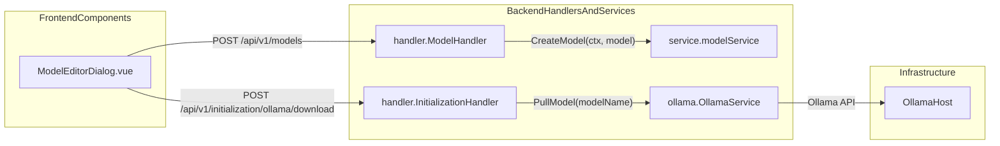

- `ModelEditorDialog.vue` provides the UI for selecting between remote and local model sources and triggers model creation or download via backend APIs `[frontend/src/components/ModelEditorDialog.vue:45-114]`.
- `ModelHandler` and `modelService` implement model CRUD operations, SSRF validation, and persist metadata (`[internal/handler/model.go:71-123]`, `[internal/application/service/model.go:101-141]`).
- `InitializationHandler` manages Ollama model downloads through `OllamaService`.

Sources: `[internal/handler/initialization.go:56-96]`, `[frontend/src/api/initialization/index.ts:107-119]`, `[frontend/src/components/ModelEditorDialog.vue:45-114]`, `[internal/handler/model.go:71-123]`, `[internal/application/service/model.go:101-141]`, `[internal/types/model.go:14-23]()`

---

## Document Chunking and Storage Configuration

The retrieval-augmented generation (RAG) pipeline requires detailed chunking and storage configuration per knowledge base.

### Chunking Configuration

- **Chunk Size & Overlap:** Defines the size of document chunks and overlap for retrieval context (`[internal/handler/initialization.go:106-107]`).
- **Splitting Strategy:** Supports `"auto"`, `"heading"`, `"heuristic"`, and legacy modes using pointer types (`[internal/handler/initialization.go:119-121]`).
- **Parent-Child Chunking:** Optional parent chunking feature (`EnableParentChild`, `ParentChunkSize`, `ChildChunkSize`) (`[internal/handler/initialization.go:111-113]`).
- **Token Limits:** Approximate per-chunk token budgets (`TokenLimit`) (`[internal/handler/initialization.go:120]`).
- **Parser Engine Rules:** Mapping of file types to specific parser engines (`ParserEngineRules`) (`[internal/handler/initialization.go:110]()`).
  
### Storage Engines

- Supports backends like local filesystem, MinIO, and COS configurable per knowledge base (`[internal/types/knowledgebase.go:90-96]`).  
- Selection is bound via `StorageBackendID` and `StorageProvider` fields (`[internal/types/knowledgebase.go:91-94]`).
- UI components such as `KBStorageSettings.vue` allow users to select active storage backend instances (`[frontend/src/views/knowledge/settings/KBStorageSettings.vue:33-64]()`).  

Sources: `[internal/handler/initialization.go:98-123]`, `[internal/types/knowledgebase.go:90-96]`, `[frontend/src/views/knowledge/settings/KBStorageSettings.vue:33-64]()`

---

## Backend: InitializationHandler Logic

The `InitializationHandler` struct manages the initialization workflow with dependencies injected via constructor (`[internal/handler/initialization.go:57-96]()`):

```go
type InitializationHandler struct {
	config           *config.Config
	tenantService    interfaces.TenantService
	modelService     interfaces.ModelService
	kbService        interfaces.KnowledgeBaseService
	kbRepository     interfaces.KnowledgeBaseRepository
	knowledgeService interfaces.KnowledgeService
	ollamaService    *ollama.OllamaService
	documentReader   interfaces.DocumentReader
	pooler           embedding.EmbedderPooler
	storageResolver  interfaces.StorageBackendResolver
}
```

- It handles requests to update knowledge base configuration with the `KBModelConfigRequest` type, which encapsulates model IDs, chunking settings, storage selections, and optional features (`[internal/handler/initialization.go:98-150]`).
- Maintains a global map `downloadTasks` protected by `tasksMutex` to track progress on asynchronous Ollama model downloads (`[internal/handler/initialization.go:40-55]()`).

Sources: `[internal/handler/initialization.go:39-96]`, `[internal/handler/initialization.go:98-150]()`

---

## Ollama Service Setup and Model Management

WeKnora integrates Ollama local LLM hosting, enabling users to manage models installed on the Ollama server (`[internal/models/chat/ollama.go:20-34]()`).

### Ollama Model Download and Status Tracking

- The backend tracks model download tasks asynchronously using `DownloadTask` structs stored in the `downloadTasks` map (`[internal/handler/initialization.go:40-49]`).
- `OllamaService` is the client interface for Ollama API operations such as listing available models and downloading them.
- Chat message conversion and image resolution are handled by `OllamaChat.convertMessages` and `resolveImageForOllama` (`[internal/models/chat/ollama.go:36-111]`).
- The frontend checks Ollama status and download progress via REST APIs (`[frontend/src/api/initialization/index.ts:198-209]()`).

### Ollama Integration Code & UI Mapping

| Code Entity                      | File                                    | Role                                          |
|---------------------------------|----------------------------------------|-----------------------------------------------|
| `OllamaChat`                    | `internal/models/chat/ollama.go`       | Chat execution and message conversion         |
| `DownloadTask`, `downloadTasks` | `internal/handler/initialization.go`   | Asynchronous model download task tracking     |
| `checkOllamaStatus()`            | `frontend/src/api/initialization/index.ts`| Frontend Ollama service health check           |

Sources: `[internal/handler/initialization.go:40-55]`, `[frontend/src/api/initialization/index.ts:198-209]`, `[internal/models/chat/ollama.go:20-111]()`

---

## Knowledge Base Setup Wizard

The frontend Vue component `KnowledgeBaseEditorModal.vue` manages the knowledge base configuration wizard UI, organized in multiple sections (`[frontend/src/views/knowledge/KnowledgeBaseEditorModal.vue:1-134]()`):

- **Basic info**: Knowledge base type (`document`, `faq`, `wiki`), name, description.
- **Indexing strategy**: Enable/disable vector and wiki indexing (`[frontend/src/views/knowledge/KnowledgeBaseEditorModal.vue:43-81]`).
- **Model selection**: Choose LLM and embedding models.
- **Chunking options**: Configure document chunk size, overlap, and splitting strategy.
- **Storage**: Select storage backends for document and image persistence via `KBStorageSettings.vue` (`[frontend/src/views/knowledge/settings/KBStorageSettings.vue:1-30]`).
- **Graph extraction**: Enable and configure entity and relation extraction settings via `GraphSettings.vue` (`[frontend/src/views/knowledge/settings/GraphSettings.vue:1-43]()`).

The wizard submits configuration changes via REST APIs (`[frontend/src/api/initialization/index.ts:167-180]()`).

Sources: `[frontend/src/views/knowledge/KnowledgeBaseEditorModal.vue:1-134]`, `[frontend/src/api/initialization/index.ts:167-180]`, `[frontend/src/views/knowledge/settings/KBStorageSettings.vue:1-30]`, `[frontend/src/views/knowledge/settings/GraphSettings.vue:1-43]()`

---

## Graph Extraction Configuration

WeKnora supports knowledge graph extraction during document ingestion, configured via the `NodeExtract` field in `KBModelConfigRequest` (`[internal/handler/initialization.go:135-142]()`).

- Users may enable entity-relation extraction features (`[frontend/src/views/knowledge/settings/GraphSettings.vue:30-43]`).
- Customize tags, entity nodes, relationships, and extraction instructions to tailor knowledge graph construction.
- Backend persists and applies configuration for structured graph extraction as part of knowledge base setup.

### Entity-Relation Configuration Fields

| Field                 | Description                                               |
| --------------------- | ---------------------------------------------------------|
| `enabled`             | Toggle graph entity and relation extraction feature      |
| `text`                | Text snippet example used during extraction              |
| `tags`                | Tags to label and filter entities                         |
| `nodes`               | List of entity types with attributes                      |
| `relations`           | Relationship types connecting nodes                       |
| `customInstructions`  | Custom LLM instructions for graph extraction             |

Sources: `[internal/handler/initialization.go:135-142]`, `[frontend/src/views/knowledge/settings/GraphSettings.vue:30-43]`, `[frontend/src/api/initialization/index.ts:151-164]()`

---

# Summary

System initialization and configuration in WeKnora encompass setting up deployment infrastructure, managing AI models (including Ollama local models), and user-guided knowledge base setup through a comprehensive wizard. The backend exposes REST APIs handled by `InitializationHandler` and `ModelHandler` to ensure secure, multi-tenant operation with a focus on document chunking, embedding model usage, storage engine selection, and knowledge graph extraction capabilities.

Sources: All above-cited files and code ranges

---

# Page: System Architecture

# System Architecture

<details>
<summary>Relevant source files</summary>

The following files were used as context for generating this wiki page:

- [.env.example](.env.example)
- [config/config.yaml](config/config.yaml)
- [docker-compose.dev.yml](docker-compose.dev.yml)
- [docker-compose.yml](docker-compose.yml)
- [docreader/README.md](docreader/README.md)
- [docreader/config.py](docreader/config.py)
- [docreader/parser/docx_parser.py](docreader/parser/docx_parser.py)
- [docreader/parser/image_preprocess.py](docreader/parser/image_preprocess.py)
- [docreader/preprocess.py](docreader/preprocess.py)
- [docreader/preprocess_worker.py](docreader/preprocess_worker.py)
- [docreader/tests/test_config.py](docreader/tests/test_config.py)
- [docreader/tests/test_docx_tables.py](docreader/tests/test_docx_tables.py)
- [docreader/tests/test_preprocess_runner.py](docreader/tests/test_preprocess_runner.py)
- [go.mod](go.mod)
- [go.sum](go.sum)
- [internal/config/auth_legacy_env_test.go](internal/config/auth_legacy_env_test.go)
- [internal/config/config.go](internal/config/config.go)
- [internal/container/container.go](internal/container/container.go)
- [scripts/dev.sh](scripts/dev.sh)

</details>


## Purpose and Scope

This document provides a comprehensive overview of WeKnora's technical architecture, design patterns, and component interactions. It focuses on the high-level system structure, architectural decisions, and how major subsystems work together to process documents into interactive knowledge.

As a parent page, this section introduces the core architectural foundations and links to dedicated child pages for deep technical dives into specific layers:

- **Service Architecture and Container Orchestration** ([Service Architecture and Container Orchestration](#3.1)) — Microservices architecture, Docker Compose setup, service dependencies, and container communication.
- **RAG Pipeline Architecture** ([RAG Pipeline Architecture](#3.2)) — Document ingestion, chunking, embedding, indexing, retrieval, and generation pipeline.
- **Agent System and ReAct Engine** ([Agent System and ReAct Engine](#3.3)) — Agent execution model, ReAct pattern, tool registry, and iterative reasoning.
- **Storage and Database Layer** ([Storage and Database Layer](#3.4)) — Multi-database architecture including PostgreSQL, Redis, vector stores, graph databases, and file storage.
- **Security and Multi-Tenancy** ([Security and Multi-Tenancy](#3.5)) — Tenant isolation, RBAC access control, organization sharing, SSRF protection, and best practices.
- **Dependency Injection and Service Layer** ([Dependency Injection and Service Layer](#3.6)) — Dependency injection container, service registration, and layered architecture.
- **Event-Driven Architecture and Chat Pipeline** ([Event-Driven Architecture and Chat Pipeline](#3.7)) — Event bus system, chat pipeline plugins, streaming architecture, and event types.

Sources: [internal/container/container.go:113-145]()

---

## Architectural Overview

WeKnora follows a **layered microservices-inspired architecture**, deployed via Docker Compose (`docker-compose.yml`). This enables easy startup and management of core services and optional components configured via profiles.

The backend is implemented in Go using a clean architecture approach with separation into HTTP handlers, application services, and repositories [internal/container/container.go:113-137](). Persistent storage uses multiple database backends, including relational (PostgreSQL), Redis, vector stores, and graph databases [internal/container/container.go:23-53](). 

### Application Layering and Code Entity Mapping

The following diagram bridges natural language architectural layers to specific code entities and packages in the codebase, enabling precise navigation:

```mermaid
graph TB
    subgraph PresentationLayer["Presentation Layer"]
        Frontend["Vue SPA frontend/src"]
        GinRouter["NewRouter internal/router/router.go"]
    end
    
    subgraph HandlerLayer["Handler Layer"]
        SessionHandler["session.Handler internal/handler/session/handler.go"]
        KBHandler["handler.KnowledgeBaseHandler internal/handler/"]
        SkillHandler["handler.SkillHandler internal/handler/"]
        AuthHandler["handler.AuthHandler internal/handler/"]
    end
    
    subgraph ServiceLayer["Service Layer"]
        SessionService["interfaces.SessionService internal/application/service/"]
        KBService["interfaces.KnowledgeBaseService internal/application/service/"]
        ChatPipeline["chatpipeline.EventManager internal/application/service/chat_pipeline/"]
        FileService["interfaces.FileService internal/application/service/file/"]
    end
    
    subgraph RepositoryLayer["Repository Layer"]
        SessionRepo["repository.sessionRepository internal/application/repository/"]
        KBRepo["repository.knowledgeBaseRepository internal/application/repository/"]
        ChunkRepo["repository.chunkRepository internal/application/repository/"]
    end
    
    subgraph DataLayer["Data Layer"]
        PostgreSQL["gorm.DB postgres internal/container/container.go"]
        Redis["redis.Client go-redis/v9 internal/container/container.go"]
        VectorDB["milvusclient / qdrant internal/container/container.go"]
        Neo4j["neo4j.Driver neo4j-go-driver/v6 internal/container/container.go"]
    end
    
    Frontend --> GinRouter
    GinRouter --> SessionHandler
    GinRouter --> SkillHandler
    GinRouter --> AuthHandler
    
    SessionHandler --> SessionService
    SkillHandler --> KBHandler
    
    SessionService --> ChatPipeline
    KBHandler --> KBService
    KBService --> FileService
    
    SessionService --> SessionRepo
    KBService --> KBRepo
    
    SessionRepo --> PostgreSQL
    KBRepo --> PostgreSQL
    ChunkRepo --> PostgreSQL
    
    SessionService --> Redis
```

For detailed information on DI and service layers, see [Dependency Injection and Service Layer](#3.6).

Sources: [internal/container/container.go:23-137]()

### Deployment Architecture

WeKnora is deployed as containerized microservices orchestrated by Docker Compose (`docker-compose.yml`). Profiles enable optional services and infrastructure components such as vector databases, document parsers, and observability tools.

The high-level deployment topology is structured as follows:

```mermaid
graph TB
    subgraph CoreServices["Core Services"]
        Frontend["frontend WeKnora-frontend docker-compose.yml:2"]
        App["app WeKnora-app docker-compose.yml:36"]
        Postgres["postgres paradedb/paradedb docker-compose.dev.yml:4"]
        Redis["redis redis:7.0-alpine docker-compose.dev.yml:26"]
    end
    
    subgraph ExternalIntegrationProfiles["External Integration Profiles"]
        Docreader["docreader docreader:50051 docreader/README.md:10"]
        MinIO["minio pgsty/minio docker-compose.dev.yml:84"]
        Qdrant["qdrant qdrant/qdrant docker-compose.dev.yml:107"]
        Milvus["milvus milvusdb/milvus docker-compose.dev.yml:177"]
        Neo4j["neo4j neo4j:latest docker-compose.dev.yml:206"]
        OpenSearch["opensearch opensearchproject/opensearch docker-compose.dev.yml:126"]
    end
    
    Frontend --> App
    App --> Postgres
    App --> Redis
    App -.->|"DOCREADER_ADDR"| Docreader
    App -.->|"RETRIEVE_DRIVER=qdrant"| Qdrant
    App -.->|"RETRIEVE_DRIVER=milvus"| Milvus
    App -.->|"STORAGE_TYPE=minio"| MinIO
    App -.->|"NEO4J_ENABLE"| Neo4j
    App -.->|"RETRIEVE_DRIVER=opensearch"| OpenSearch
```

For details on service orchestration, profiles, and inter-container communication, see [Service Architecture and Container Orchestration](#3.1).

Sources: [docker-compose.yml:1-67](), [docker-compose.dev.yml:1-212](), [docreader/README.md:1-15]()

---

## Core Architectural Patterns

### Dependency Injection with uber-go/dig

WeKnora leverages the `uber-go/dig` library for dependency injection and inversion of control [internal/container/container.go:33](). The container setup and service wiring are centralized in `internal/container/container.go` via `BuildContainer` [internal/container/container.go:113-137](). This modularizes application construction and supports lifecycle management of components such as database clients, repositories, services, and handlers.

For in-depth coverage, see [Dependency Injection and Service Layer](#3.6).

Sources: [internal/container/container.go:33-137]()

### Multi-Tenant Role-Based Access Control (RBAC)

WeKnora implements security by enforcing tenant isolation and role-based access control at the middleware and domain handler layers. Tenant-aware service interfaces and handlers verify permissions on every request, configured via environment defaults and database state.

For security details, see [Security and Multi-Tenancy](#3.5).

Sources: [internal/config/config.go:19-43]()

### Asynchronous Task and Event-Driven Pipeline

Background processing for document parsing, enrichment, vector embedding, and chunk indexing utilizes an asynchronous task queue backed by Redis and the `hibiken/asynq` Go library [go.mod:32](). An event bus propagates domain events and supports extensible chat pipeline plugins and streaming response mechanisms.

For further elaboration, see [Event-Driven Architecture and Chat Pipeline](#3.7) and [Async Task Processing with Asynq](#11.2).

Sources: [.env.example:147-182](), [go.mod:32-32]()

---

## Component Layers Detailed Overview

- **HTTP Handler Layer**  
  WeKnora uses the Gin web framework (`github.com/gin-gonic/gin`) to implement HTTP routing, request validation, authentication enforcement, and response formatting [go.mod:23](). Handlers are defined under `internal/handler/` and include domain-specific subpackages [internal/container/container.go:77-88]().

- **Service Layer**  
  Application business logic resides here, handling session orchestration, RAG workflows, chat pipelines, agent execution, and skill management. These services coordinate with repositories and infrastructure components [internal/container/container.go:54-60]().

- **Repository Layer & Storage**  
  Data persistence abstracts over multiple backends:  
  - Relational: PostgreSQL accessed through GORM [internal/container/container.go:35-37]()  
  - Key-Value and caching: Redis [internal/container/container.go:32-32]()  
  - Vector Stores: Qdrant, Milvus, Weaviate, Tencent VectorDB, SQLite-Vec [internal/container/container.go:23-53]()  
  - Graph DB: Neo4j [internal/container/container.go:29-29]()  
  - Object Storage: MinIO, S3, COS, OSS  
  Retrieval engines are abstracted behind a common repository interface, allowing pluggable drivers [internal/container/container.go:43-53]().  
  For details, see [Storage and Database Layer](#3.4).

Sources: [internal/container/container.go:23-88](), [go.mod:23-23]()

---

## Bridging Natural Language Concepts to Code Entities

The following diagrams map abstract domain concepts to concrete code artifacts in the repository.

### From Natural Language System to Code Entities (High-Level)

```mermaid
graph TB
    NL_NaturalLanguageSpace["Natural Language Space"]
    KB_KnowledgeBase["Knowledge Base"]
    Chat_ChatSystem["Chat and Query System"]
    Agent_AgentSystem["Agent System"]
    Storage_StorageLayer["Storage and Database Layer"]
    Sec_Security["Security and Multi-Tenancy"]

    KB_KnowledgeBase -->|API routes & handlers| KBHandler["KnowledgeBaseHandler internal/handler/"]
    Chat_ChatSystem -->|Chat pipeline service| ChatPipeline["chatpipeline.EventManager internal/application/service/chat_pipeline/"]
    Agent_AgentSystem -->|Agent execution services| AgentService["Agent Services internal/agent/"]
    Storage_StorageLayer -->|Repo interfaces| KBRepo["knowledgeBaseRepository internal/application/repository/"]
    Storage_StorageLayer -->|Vector Store clients| VectorDB["Milvus / Qdrant Clients internal/container/container.go"]
    Sec_Security -->|Config and middleware| AuthConfig["TenantConfig internal/config/config.go"]
    
    NL_NaturalLanguageSpace --> KB_KnowledgeBase
    NL_NaturalLanguageSpace --> Chat_ChatSystem
    NL_NaturalLanguageSpace --> Agent_AgentSystem
    KB_KnowledgeBase --> Storage_StorageLayer
    Chat_ChatSystem --> Storage_StorageLayer
    Agent_AgentSystem --> Storage_StorageLayer
    Sec_Security --> Storage_StorageLayer
```

Sources: [internal/container/container.go:28-53](), [internal/config/config.go:19-25]()

### Mapping Service Names to Concrete Code Entities

```mermaid
graph LR
    App["WeKnora Application"]
    Router["Gin Router internal/router/"]
    Containers["Dependency Injection Container internal/container/container.go"]
    Handlers["HTTP Handlers internal/handler/"]
    Services["Application Services internal/application/service/"]
    Repository["Repositories internal/application/repository/"]
    Databases["Databases and Vector Stores internal/database/"]

    App --> Router
    Router --> Handlers
    Handlers --> Services
    Services --> Repository
    Repository --> Databases
    Containers -->|Provide wiring and config| Services
    Containers -->|Provide wiring and config| Repository
```

Sources: [internal/container/container.go:113-137](), [internal/database/databasemigration.go:1-1]()

---

## Further Reading

Explore detailed architecture and design in the related child pages:

- [Service Architecture and Container Orchestration](#3.1)
- [RAG Pipeline Architecture](#3.2)
- [Agent System and ReAct Engine](#3.3)
- [Storage and Database Layer](#3.4)
- [Security and Multi-Tenancy](#3.5)
- [Dependency Injection and Service Layer](#3.6)
- [Event-Driven Architecture and Chat Pipeline](#3.7)

---

## Summary

WeKnora's architecture bridges modern LLM-powered RAG concepts with well-established backend engineering practices:

- Modular layers spanning from frontend single-page applications to backend handlers, services, repositories, and multi-database persistence [internal/container/container.go:23-53]().
- Containerized microservices with profile configurations for optional auxiliary components [docker-compose.yml:1-67]().
- Robust multi-tenancy controls and asynchronous task processing pipelines.
- Dependency injection via `uber-go/dig` ensuring clean service separation and lifecycle management [internal/container/container.go:33-33]().

Sources: [internal/container/container.go:23-137](), [docker-compose.yml:1-67]()

---

# Page: Service Architecture and Container Orchestration

# Service Architecture and Container Orchestration

<details>
<summary>Relevant source files</summary>

The following files were used as context for generating this wiki page:

- [.env.example](.env.example)
- [.github/workflows/cli.yml](.github/workflows/cli.yml)
- [.github/workflows/docker-image.yml](.github/workflows/docker-image.yml)
- [.github/workflows/release-lite.yml](.github/workflows/release-lite.yml)
- [.gitignore](.gitignore)
- [Formula/weknora-lite.rb](Formula/weknora-lite.rb)
- [Makefile](Makefile)
- [cli/internal/cmdutil/errors_doc_test.go](cli/internal/cmdutil/errors_doc_test.go)
- [cli/scripts/check-skill-wire-vocab.sh](cli/scripts/check-skill-wire-vocab.sh)
- [config/config.yaml](config/config.yaml)
- [deploy/weknora-lite.service](deploy/weknora-lite.service)
- [docker-compose.dev.yml](docker-compose.dev.yml)
- [docker-compose.yml](docker-compose.yml)
- [docker/Dockerfile.app](docker/Dockerfile.app)
- [docker/Dockerfile.docreader](docker/Dockerfile.docreader)
- [docker/Dockerfile.sandbox](docker/Dockerfile.sandbox)
- [docreader/README.md](docreader/README.md)
- [docreader/config.py](docreader/config.py)
- [docreader/parser/docx_parser.py](docreader/parser/docx_parser.py)
- [docreader/parser/image_preprocess.py](docreader/parser/image_preprocess.py)
- [docreader/preprocess.py](docreader/preprocess.py)
- [docreader/preprocess_worker.py](docreader/preprocess_worker.py)
- [docreader/tests/test_config.py](docreader/tests/test_config.py)
- [docreader/tests/test_docx_tables.py](docreader/tests/test_docx_tables.py)
- [docreader/tests/test_preprocess_runner.py](docreader/tests/test_preprocess_runner.py)
- [frontend/.dockerignore](frontend/.dockerignore)
- [frontend/Dockerfile](frontend/Dockerfile)
- [go.mod](go.mod)
- [go.sum](go.sum)
- [internal/config/auth_legacy_env_test.go](internal/config/auth_legacy_env_test.go)
- [internal/config/config.go](internal/config/config.go)
- [internal/container/container.go](internal/container/container.go)
- [scripts/build_frontend_dist.sh](scripts/build_frontend_dist.sh)
- [scripts/build_images.sh](scripts/build_images.sh)
- [scripts/dev.sh](scripts/dev.sh)
- [scripts/get_version.sh](scripts/get_version.sh)
- [scripts/package-lite.sh](scripts/package-lite.sh)
- [scripts/start_all.sh](scripts/start_all.sh)
- [scripts/test-homebrew.sh](scripts/test-homebrew.sh)
- [scripts/update-homebrew-formula.sh](scripts/update-homebrew-formula.sh)
- [scripts/verify_frontend_pr.sh](scripts/verify_frontend_pr.sh)

</details>


## Purpose and Scope

This page details the microservices architecture of WeKnora, highlighting its Docker Compose-based container orchestration setup, service dependencies, and inter-container communication mechanisms. It explains the multiple containerized service roles, startup ordering through health checks, and how configuration via environment variables and `spf13/viper` drives deployments.

For detailed explanations of underlying subsystems, including the RAG pipeline, agent system, storage layer, and more, consult related architectural pages.

Sources: `docker-compose.yml:1-35`, `internal/config/config.go:19-43`

---

## Multi-Service Layout

WeKnora employs a microservices architecture with multiple containerized components orchestrated using Docker Compose. The main orchestration definition is in `docker-compose.yml`, which configures essential runtime services plus optional profile-activated extras [docker-compose.yml:1-35]().

Key services include:
- **Frontend:** A Vue.js SPA served via Nginx (`wechatopenai/weknora-ui`) [docker-compose.yml:2-16]().
- **App:** The main Go backend API/service binary (`wechatopenai/weknora-app`) [docker-compose.yml:36-46]().
- **DocReader:** A Python-based gRPC document parsing service (`wechatopenai/weknora-docreader`) [docker/Dockerfile.docreader:160-170]().
- **Postgres (ParadeDB):** The primary relational metadata store (`paradedb/paradedb:v0.25.11-pg17`) [docker-compose.dev.yml:4-5]().
- **Redis:** Caching, session state, and streaming message broker [docker-compose.dev.yml:26-37]().
- **Optional services:** Vector stores (Qdrant, Milvus, Weaviate, OpenSearch), graph DB (Neo4j), object storage (MinIO), search (SearxNG), and observability (Langfuse) [docker-compose.dev.yml:84-212]().

### Service Topology Diagram

```mermaid
graph TD
  subgraph "Natural Language Space: Client & Proxy"
    browser["BrowserAPIClient"]
    frontend["frontend\n(WeKnora-frontend)\nNginx + Vue SPA\nport 80"]
  end

  subgraph "Code Entity Space: Backend & Processing"
    app["app\n(WeKnora-app)\nGo binary\nport 8080"]
    docreader["docreader\n(WeKnora-docreader)\ngRPC :50051"]
  end

  subgraph "System Component Space: Storage & Observability"
    postgres["postgres\n(WeKnora-postgres)\nParadeDB pg17"]
    redis["redis\n(WeKnora-redis)\nRedis 7.0"]
    minio["minio\n(WeKnora-minio)\nprofile: minio | full"]
    neo4j["neo4j\n(WeKnora-neo4j)\nprofile: neo4j | full"]
    qdrant["qdrant\n(WeKnora-qdrant)\nprofile: qdrant | full"]
    milvus["milvus\n(WeKnora-milvus)\nprofile: milvus"]
    searxng["searxng\n(WeKnora-searxng)\nprofile: searxng | full"]
    langfuse["langfuse-web\n(WeKnora-langfuse)\nprofile: langfuse"]
  end

  browser --> frontend
  frontend -->|"apiProxy"| app
  frontend -->|"filesProxy"| app
  app --> postgres
  app --> redis
  app -->|"grpc"| docreader
  app -.->|"optional"| minio
  app -.->|"optional"| neo4j
  app -.->|"optional"| qdrant
  app -.->|"optional"| milvus
  app -.->|"search"| searxng
  app -.->|"observability"| langfuse
```

**Explanation:**
- The `frontend` container serves the Vue SPA on port 80 and proxies API/file requests to the `app` container via environment-configured host and port variables [docker-compose.yml:2-26]().
- The `app` container listens on port 8080 exposing REST API endpoints and integrates with databases, caching, and parsing services [docker-compose.yml:36-46]().
- `docreader` listens on gRPC port 50051, processing documents asynchronously for ingestion [docker/Dockerfile.docreader:160-170]().
- Storage includes the ParadeDB-backed `postgres` container for relational data and `redis` for caching, streams, and queues [docker-compose.dev.yml:4-37]().
- Optional services are enabled via Docker Compose profiles, modularizing the deployment footprint [docker-compose.dev.yml:103-120]().

Sources: `docker-compose.yml:1-35`, `docker-compose.dev.yml:4-212`, `.env.example:1-183`, `docker/Dockerfile.docreader:160-170`

---

## Core Services and Profiles

WeKnora's deployment distinguishes core services required in every setup from optional services activated via Docker Compose profiles [docker-compose.dev.yml:103-120]().

### Core Services

| Service | Container Name | Image | Default Port | Description |
|:---|:---|:---|:---|:---|
| `frontend` | WeKnora-frontend | `wechatopenai/weknora-ui` | 80 | Nginx serving Vue SPA; proxies API calls to app [docker-compose.yml:2-16]() |
| `app` | WeKnora-app | `wechatopenai/weknora-app` | 8080 | Main Go backend handling API and internal logic [docker-compose.yml:36-46]() |
| `docreader` | WeKnora-docreader | `wechatopenai/weknora-docreader` | 50051 (gRPC) | Python document parser service [docker/Dockerfile.docreader:160-170]() |
| `postgres` | WeKnora-postgres-dev | `paradedb/paradedb:v0.25.11-pg17` | 5432 | Relational metadata storage (ParadeDB, PostgreSQL) [docker-compose.dev.yml:4-8]() |
| `redis` | WeKnora-redis-dev | `redis:7.0-alpine` | 6379 | Session/state cache and streaming backend [docker-compose.dev.yml:26-30]() |

### Profile-Activated Optional Services

| Service | Profile(s) | Purpose | Activation Command |
|:---|:---|:---|:---|
| `minio` | minio, full | S3-compatible object storage [docker-compose.dev.yml:84-105]() | `docker compose --profile minio up` |
| `neo4j` | neo4j, full | Graph database for KG [docker-compose.dev.yml:206-212]() | `docker compose --profile neo4j up` |
| `qdrant` | qdrant, full | Vector database for embeddings [docker-compose.dev.yml:107-121]() | `docker compose --profile qdrant up` |
| `milvus` | milvus, full | High-performance vector store [docker-compose.dev.yml:177-204]() | `docker compose --profile milvus up` |
| `searxng` | searxng, full | Web meta-search service [docker-compose.dev.yml:40-83]() | `docker compose --profile searxng up` |

Sources: `docker-compose.yml:1-46`, `docker-compose.dev.yml:4-212`, `docker/Dockerfile.docreader:160-170`

---

## Startup Dependencies and Health Checks

To ensure smooth deployment, WeKnora uses Docker Compose's `depends_on` with health checks to orchestrate container startup order and readiness [docker-compose.yml:29-67]().

### Dependency Enforcement
- The `frontend` container depends on `app` being healthy before accepting traffic, preventing failed proxies at startup via `depends_on.app.condition: service_healthy` [docker-compose.yml:29-34]().
- The `app` container defines a health check hitting its health endpoint [docker-compose.yml:62-67]().

### Health Checks
Services expose endpoints serving as readiness probes, monitored by Docker Compose:

| Service | Check Command | Interval | Retries | Remarks |
|:---|:---|:---|:---|:---|
| `app` | `curl -f http://localhost:8080/health` [docker-compose.yml:63]() | 30s [docker-compose.yml:64]() | 3 [docker-compose.yml:66]() | `app` readiness endpoint |
| `postgres` | `pg_isready -U ${DB_USER} -d ${DB_NAME}` [docker-compose.dev.yml:18]() | 10s [docker-compose.dev.yml:19]() | 3 [docker-compose.dev.yml:21]() | ParadeDB/Postgres standard probe |
| `minio` | `curl -f http://localhost:9000/minio/health/live` [docker-compose.dev.yml:97]() | 30s [docker-compose.dev.yml:98]() | 3 [docker-compose.dev.yml:100]() | Object storage health |
| `milvus` | `curl -f http://localhost:9091/healthz` [docker-compose.dev.yml:189]() | 30s [docker-compose.dev.yml:190]() | 3 [docker-compose.dev.yml:193]() | Vector store health probe |

Sources: `docker-compose.yml:29-67`, `docker-compose.dev.yml:17-204`

---

## Backend Dependency Injection and Initialization

The `app` backend service relies on modular wiring and container initialization patterns to manage infrastructure components and services. The configuration and container bootstrapping handle database drivers, Redis connections, gRPC clients for `DocReader`, and model providers within `BuildContainer` [internal/container/container.go:113-137]().

### Initialization and Service Map Diagram

```mermaid
graph LR
  subgraph "Code Entity Space: internal/config and internal/container"
    initDB["initDatabase()\ninternal/container/container.go"]
    initRedis["initRedisClient()\ninternal/container/container.go"]
    initDoc["initDocReaderClient()\ninternal/container/container.go"]
    buildCont["BuildContainer()\ninternal/container/container.go"]
  end

  subgraph "System Component Space"
    PostgresDB[("ParadeDB PostgreSQL\n(DB_DRIVER)")]
    RedisStream[("Redis Client\n(STREAM_MANAGER_TYPE)")]
    DocParser["DocReader Service\ngRPC Client"]
  end

  initDB --> PostgresDB
  initRedis --> RedisStream
  initDoc --> DocParser

  buildCont --> initDB
  buildCont --> initRedis
  buildCont --> initDoc
```

Sources: `internal/config/config.go:19-43`, `internal/container/container.go:113-137`

---

## Configuration Architecture and Binding

WeKnora's configuration framework leverages `spf13/viper` and `yaml.v3` for flexible file-based and environment variable-driven configuration [internal/config/config.go:13-16]().

### Core Config Struct
The main `Config` struct aggregates configuration for all subsystems [internal/config/config.go:19-43]():
- `Conversation`: conversation service parameters [internal/config/config.go:21]()
- `Server`: server ports and binding [internal/config/config.go:22]()
- `KnowledgeBase`: knowledge base parameters [internal/config/config.go:23]()
- `Tenant`, `Auth`, `Audit`, `OIDCAuth`: tenant, auth, audit, and OIDC configurations [internal/config/config.go:24-27]()
- `Models`: registered models [internal/config/config.go:28]()
- `VectorDatabase`: vector database drivers [internal/config/config.go:29]()
- `DocReader`, `StreamManager`: DocReader and stream manager options [internal/config/config.go:30-31]()
- `IM`, `Agent`: IM integration and agent settings [internal/config/config.go:35-36]()
- `FrontendBaseURL`: frontend base URL for sharing [internal/config/config.go:42]()

### Configuration Mapping Diagram

```mermaid
graph TD
  subgraph "Code EntitySpace: internal/config/config.go"
    LoadConfig["LoadConfig()\ninternal/config/config.go"]
    ConfigStruct["Config Struct\ninternal/config/config.go"]
    ServerCfg["ServerConfig\ninternal/config/config.go"]
    ConvCfg["ConversationConfig\ninternal/config/config.go"]
    TenantCfg["TenantConfig\ninternal/config/config.go"]
  end

  subgraph "Natural Language & Yaml Space"
    YamlFile["config/config.yaml"]
    EnvVars["Environment Variables (.env)"]
  end

  YamlFile --> LoadConfig
  EnvVars --> LoadConfig
  LoadConfig --> ConfigStruct
  ConfigStruct --> ServerCfg
  ConfigStruct --> ConvCfg
  ConfigStruct --> TenantCfg
```

Sources: `internal/config/config.go:13-43`

---

## Environment Variable Reference

The interaction and setup of these services is heavily influenced by environment variables defined primarily in `.env` (template at `.env.example`) [`.env.example:1-25`]().

### Key Environment Variables

| Variable | Default | Purpose / Notes |
|:---|:---|:---|
| `DB_DRIVER` | `postgres` [.env.example:132]() | Selects relational DB driver (`postgres` or `sqlite`) |
| `DB_HOST` | `postgres` [.env.example:134]() | Hostname of PostgreSQL container |
| `DB_PORT` | `5432` [.env.example:136]() | Port for PostgreSQL |
| `DB_USER` | — [.env.example:138]() | DB username |
| `DB_PASSWORD` | — [.env.example:140]() | DB user password |
| `DB_NAME` | — [.env.example:142]() | Database name |
| `REDIS_ADDR` | `redis:6379` [.env.example:151]() | Redis host and port |
| `REDIS_PASSWORD` | — [.env.example:155]() | Redis access password |
| `APP_HOST` | `app` [.env.example:87]() | Hostname for frontend proxy to backend (`app`) |
| `APP_PORT` | `8080` [.env.example:89]() | Backend API service port |
| `DOCREADER_ADDR` | `docreader:50051` [.env.example:98]() | gRPC address for docreader |
| `FRONTEND_PORT` | `80` [.env.example:96]() | Port exposed for frontend service |
| `WEKNORA_VERSION` | `latest` [.env.example:34]() | Image tag for WeKnora images |
| `WEKNORA_SANDBOX_DOCKER_ENABLED` | `false` [docker-compose.yml:101]() | Whether Docker sandbox enabled on app container |
| `COS_SECRET_ID` | — [docker-compose.yml:116]() | Tencent Cloud Object Storage (COS) credentials |
| `DISABLE_REGISTRATION` | `false` [docker-compose.yml:127]() | Disable open user registration |

These environment variables are injected into containers via `env_file` directives or explicit environment settings in `docker-compose.yml` [docker-compose.yml:17-130](), ensuring runtime configuration consistency.

Sources: `.env.example:1-183`, `docker-compose.yml:1-130`

---

# Summary

WeKnora's architecture follows a modular microservices model containerized with Docker Compose. Core containers serve the frontend, backend API, document parsing, and data stores, with optional services added through profiles.

Startup order and health are managed with Docker Compose's `depends_on` and health checks, ensuring smooth system bring-up. The backend app utilizes configuration binding via `spf13/viper` (`internal/config/config.go`) for clean initialization of services like databases, Redis, parsing clients, and model providers.

Configuration is unified through YAML files layered with environment variables. This supports flexible deployment and operational tuning across environments.

Sources:
- `docker-compose.yml:1-67`
- `docker-compose.dev.yml:4-212`
- `.env.example:1-183`
- `internal/config/config.go:13-43`
- `internal/container/container.go:113-137`

---

# Page: RAG Pipeline Architecture

# RAG Pipeline Architecture

<details>
<summary>Relevant source files</summary>

The following files were used as context for generating this wiki page:

- [client/retrieval.go](client/retrieval.go)
- [cmd/download/duckdb/duckdb.go](cmd/download/duckdb/duckdb.go)
- [config/prompt_templates/generate_summary.yaml](config/prompt_templates/generate_summary.yaml)
- [internal/agent/tools/data_analysis.go](internal/agent/tools/data_analysis.go)
- [internal/agent/tools/data_analysis_legacy_xls_test.go](internal/agent/tools/data_analysis_legacy_xls_test.go)
- [internal/agent/tools/data_analysis_storage_test.go](internal/agent/tools/data_analysis_storage_test.go)
- [internal/agent/tools/data_analysis_test.go](internal/agent/tools/data_analysis_test.go)
- [internal/agent/tools/image_markdown_output_test.go](internal/agent/tools/image_markdown_output_test.go)
- [internal/agent/tools/search_knowledge.go](internal/agent/tools/search_knowledge.go)
- [internal/agent/tools/search_knowledge_rerank_test.go](internal/agent/tools/search_knowledge_rerank_test.go)
- [internal/agent/tools/search_knowledge_test.go](internal/agent/tools/search_knowledge_test.go)
- [internal/application/repository/knowledgebase.go](internal/application/repository/knowledgebase.go)
- [internal/application/service/chat_pipeline/common.go](internal/application/service/chat_pipeline/common.go)
- [internal/application/service/chat_pipeline/data_analysis.go](internal/application/service/chat_pipeline/data_analysis.go)
- [internal/application/service/chat_pipeline/data_analysis_storage_test.go](internal/application/service/chat_pipeline/data_analysis_storage_test.go)
- [internal/application/service/chat_pipeline/extract_entity.go](internal/application/service/chat_pipeline/extract_entity.go)
- [internal/application/service/chat_pipeline/extract_entity_test.go](internal/application/service/chat_pipeline/extract_entity_test.go)
- [internal/application/service/chat_pipeline/filter_top_k.go](internal/application/service/chat_pipeline/filter_top_k.go)
- [internal/application/service/chat_pipeline/filter_top_k_test.go](internal/application/service/chat_pipeline/filter_top_k_test.go)
- [internal/application/service/chat_pipeline/into_chat_message.go](internal/application/service/chat_pipeline/into_chat_message.go)
- [internal/application/service/chat_pipeline/merge.go](internal/application/service/chat_pipeline/merge.go)
- [internal/application/service/chat_pipeline/merge_expand_edit_test.go](internal/application/service/chat_pipeline/merge_expand_edit_test.go)
- [internal/application/service/chat_pipeline/merge_history.go](internal/application/service/chat_pipeline/merge_history.go)
- [internal/application/service/chat_pipeline/merge_parent_resolve_test.go](internal/application/service/chat_pipeline/merge_parent_resolve_test.go)
- [internal/application/service/chat_pipeline/merge_parent_shared_test.go](internal/application/service/chat_pipeline/merge_parent_shared_test.go)
- [internal/application/service/chat_pipeline/query_understand.go](internal/application/service/chat_pipeline/query_understand.go)
- [internal/application/service/chat_pipeline/query_understand_test.go](internal/application/service/chat_pipeline/query_understand_test.go)
- [internal/application/service/chat_pipeline/references.go](internal/application/service/chat_pipeline/references.go)
- [internal/application/service/chat_pipeline/references_test.go](internal/application/service/chat_pipeline/references_test.go)
- [internal/application/service/chat_pipeline/rerank.go](internal/application/service/chat_pipeline/rerank.go)
- [internal/application/service/chat_pipeline/rerank_test.go](internal/application/service/chat_pipeline/rerank_test.go)
- [internal/application/service/chat_pipeline/search.go](internal/application/service/chat_pipeline/search.go)
- [internal/application/service/chat_pipeline/search_error_test.go](internal/application/service/chat_pipeline/search_error_test.go)
- [internal/application/service/chat_pipeline/shared_chat_model_test.go](internal/application/service/chat_pipeline/shared_chat_model_test.go)
- [internal/application/service/extract.go](internal/application/service/extract.go)
- [internal/application/service/extract_graph_declined_test.go](internal/application/service/extract_graph_declined_test.go)
- [internal/application/service/knowledge_bind_stored_images_test.go](internal/application/service/knowledge_bind_stored_images_test.go)
- [internal/application/service/knowledgebase.go](internal/application/service/knowledgebase.go)
- [internal/application/service/knowledgebase_search.go](internal/application/service/knowledgebase_search.go)
- [internal/application/service/knowledgebase_search_embedding_dimension_test.go](internal/application/service/knowledgebase_search_embedding_dimension_test.go)
- [internal/application/service/session_knowledge_qa.go](internal/application/service/session_knowledge_qa.go)
- [internal/application/service/session_knowledge_qa_test.go](internal/application/service/session_knowledge_qa_test.go)
- [internal/application/service/session_model_requirement_test.go](internal/application/service/session_model_requirement_test.go)
- [internal/application/service/session_qa_helpers.go](internal/application/service/session_qa_helpers.go)
- [internal/application/service/session_shared_chat_model_test.go](internal/application/service/session_shared_chat_model_test.go)
- [internal/handler/initialization_extract_relations_test.go](internal/handler/initialization_extract_relations_test.go)
- [internal/handler/knowledgebase.go](internal/handler/knowledgebase.go)
- [internal/infrastructure/docparser/resolve_remote_html_images_test.go](internal/infrastructure/docparser/resolve_remote_html_images_test.go)
- [internal/modelcontext/omitted_results_test.go](internal/modelcontext/omitted_results_test.go)
- [internal/models/chat/ollama.go](internal/models/chat/ollama.go)
- [internal/models/chat/ollama_test.go](internal/models/chat/ollama_test.go)
- [internal/searchutil/imageinfo.go](internal/searchutil/imageinfo.go)
- [internal/searchutil/imageinfo_disabled_test.go](internal/searchutil/imageinfo_disabled_test.go)
- [internal/searchutil/imageinfo_html_test.go](internal/searchutil/imageinfo_html_test.go)
- [internal/searchutil/imageinfo_match.go](internal/searchutil/imageinfo_match.go)
- [internal/searchutil/imageinfo_match_test.go](internal/searchutil/imageinfo_match_test.go)
- [internal/searchutil/textutil.go](internal/searchutil/textutil.go)
- [internal/types/chat_manage.go](internal/types/chat_manage.go)
- [internal/types/interfaces/knowledgebase.go](internal/types/interfaces/knowledgebase.go)
- [internal/types/knowledgebase.go](internal/types/knowledgebase.go)

</details>


## Purpose and Scope

This document details the Retrieval-Augmented Generation (RAG) pipeline architecture implemented in WeKnora. It covers the full process from document ingestion through chunking, embedding, indexing, hybrid multi-source retrieval, reranking, result fusion, context expansion, and final generation. The architecture leverages asynchronous task processing via `Asynq`, adaptive chunking strategies with parent-child relationships, hybrid vector and BM25 keyword retrieval fused via Reciprocal Rank Fusion (RRF), and a highly modular event-driven chat pipeline (`chatpipeline` package) with rich intermediate processing stages.

Sources:  
[internal/application/service/chat_pipeline/merge.go:1-48]() [internal/application/service/knowledgebase.go:115-181]()

---

## Document Ingestion and Processing

The ingestion pipeline transforms source data such as uploaded files, URLs, or manual entries into searchable knowledge chunks. The flow is orchestrated asynchronously by the knowledge service to optimize scalability and parallelism.

### Ingestion Entry Points

- **File Upload:** Initiated by methods that perform safety validation, file hash deduplication, raw file storage, and asynchronous parsing task enqueuing.
- **URL Ingestion:** Similar process for remote web URLs, downloading content prior to parsing.
- **Manual Entry:** Direct text or markdown ingestion handled directly.
- **Passage Processing:** String passages are converted into chunks, enabling direct ingestion of small text units.
- **FAQ Batch Import:** Supports asynchronous bulk import of FAQ entries.

### Processing Pipeline Overview

The pipeline resolves processing configurations by merging Knowledge Base-level defaults with per-ingestion overrides. After validation, documents are passed to the chunking layer, which applies the adaptive chunk splitting strategy.

Title: Document Ingestion and Asynchronous Processing Pipeline
```mermaid
graph TD
    subgraph Ingestion["Ingestion Layer"]
        S_Create["CreateKnowledgeBase"]
        S_Doc["processDocumentFromPassage"]
        S_Manual["CreateKnowledgeFromManual"]
        S_FAQ["UpsertFAQEntries"]
    end

    subgraph Config["Configuration Layer"]
        ResConfig["ResolveProcessConfig"]
        ValConfig["ValidateProcessOverrides"]
    end

    subgraph Chunker["Chunking Layer"]
        C_Strat["chunker.Split / chunker.SplitParentChild"]
    end

    subgraph Workers["Asynchronous Tasks (Asynq Queues)"]
        W_Core["TypeChunkExtract"]
        W_Post["TypeDataTableSummary"]
        W_FAQ["TypeFAQImport"]
    end

    S_Create --> ResConfig
    ResConfig --> ValConfig
    ValConfig --> S_Doc
    S_Manual --> S_Doc
    S_Doc --> C_Strat
    S_Doc --> W_Core
    S_Doc --> W_Post
    S_FAQ --> W_FAQ
```

Sources:  
[internal/application/service/knowledgebase.go:115-181]() [internal/application/service/extract.go:90-160]()

---

### Adaptive Chunking Strategy

WeKnora supports a multi-tier adaptive chunking strategy to preserve document structure and semantics:
- **Heading-based:** Parses Markdown with explicit headers (`#`, `##`, etc.) to split at logical sections.
- **Heuristic:** Uses heuristics such as numbered sections or page breaks for semi-structured docs.
- **Legacy Character-based:** Fall-back strategy with recursive splitting by characters or separators.

Additionally, a Parent-Child chunking mode (`SplitParentChild`) first divides into large parent chunks (`ChunkTypeParentText`) and further splits each parent into smaller child chunks (`ChunkTypeText`, `ChunkTypeImageOCR`, etc.) to support hierarchical retrieval context.

Sources:  
[internal/application/service/chat_pipeline/merge.go:13-97]() [internal/types/knowledgebase.go:58-114]()

---

## Indexing, Embedding, and Enrichment

After chunking, asynchronous worker pools handle embedding and content enrichment tasks across named queues (`core`, `enrichment`, `summary`, `graph`, `multimodal`).

- **Vector Embeddings:** Each chunk is embedded using the embedding model configured on the knowledge base, utilizing cached and validated embedding dimensions (`GetQueryEmbedding`, `ResolveEmbeddingModelKeys`) [internal/application/service/knowledgebase_search.go:26-120]().
- **Graph Extraction:** Neo4j integration extracts linked entities and relations via `NewChunkExtractTask` to populate the knowledge graph [internal/application/service/extract.go:92-128]().
- **Table Summarization:** Tabular data (CSV, XLSX) is processed via `NewDataTableSummaryTask` to create summaries and structured metadata, enriching the retrieval context [internal/application/service/extract.go:130-160]().

Sources:  
[internal/application/service/knowledgebase_search.go:26-120]() [internal/application/service/extract.go:92-160]()

---

## Retrieval, Deduplication, and Fusion Architecture

The chat pipeline integrates multiple plugins in an event-driven architecture managed by `EventManager` and `ChatManage`. Triggered stages include query understanding (`PluginQueryUnderstand`), parallel search (`PluginSearch`), reranking (`PluginRerank`), web fetch (`PluginWebFetch`), chunk merging (`PluginMerge`), top-K filtering (`PluginFilterTopK`), and answer generation (`PluginChatCompletionStream`).

Title: Retrieval, Fusion, and Parent-Child Resolution Architecture
```mermaid
graph TD
    subgraph ChatPipeline["Chat Pipeline Event-Driven Plugins"]
        SearchEV["PluginSearch.OnEvent"]
        RerankEV["PluginRerank.OnEvent"]
        MergeEV["PluginMerge.OnEvent"]
        FilterEV["PluginFilterTopK.OnEvent"]
    end

    subgraph RetrievalLayer["Retrieval & Fusion"]
        KBSearch["HybridSearch"]
        WebSearch["searchWebIfEnabled"]
        Fusion["fuseWithRRF"]
        Dedup["removeDuplicateResults"]
        ParentResolve["PluginMerge.resolveParentChunks"]
        GroupMerge["PluginMerge.groupAndMergeCurrentContent"]
    end

    SearchEV --> KBSearch
    SearchEV --> WebSearch
    KBSearch --> Fusion
    WebSearch --> Fusion
    Fusion --> RerankEV
    RerankEV --> MergeEV
    MergeEV --> ParentResolve
    ParentResolve --> GroupMerge
    GroupMerge --> Dedup
    Dedup --> FilterEV
```

Sources:  
[internal/application/service/chat_pipeline/merge.go:33-98]() [internal/application/service/knowledgebase_search.go:130-169]() [internal/application/service/chat_pipeline/query_understand.go:16-54]()

---

### Deduplication, Parent-Child Resolution, and Fusion

`PluginMerge` executes an 8-step merging pipeline:
1. **Input Selection:** Selects rerank results (`chatManage.RerankResult`), falling back to sorted search results cut to `RerankTopK` [internal/application/service/chat_pipeline/merge.go:100-138]().
2. **Initial Deduplication:** Removes duplicate chunks by ID and content signature [internal/application/service/chat_pipeline/merge.go:58-60]().
3. **History Injection:** Injects relevant past retrieval results from session history [internal/application/service/chat_pipeline/merge.go:155-170]().
4. **Parent Chunk Resolution:** Resolves retrieval hits that are child chunks by injecting their larger parent chunk context [internal/application/service/chat_pipeline/merge.go:76-78]().
5. **Grouping and Merge:** Groups chunks by `KnowledgeID` and `ChunkType`, merging sequential bodies [internal/application/service/chat_pipeline/merge.go:174-184]().
6. **FAQ Population:** Populates FAQ answers and boosts confidence scores.
7. **Context Expansion & Re-Merge:** Expands short contexts with neighboring chunks and re-merges overlapping ranges [internal/application/service/chat_pipeline/merge.go:85-90]().
8. **Final Deduplication & Partial Overlap Removal:** Cleans up exact duplicates and partial content overlaps [internal/application/service/chat_pipeline/merge.go:91-93]().

Hybrid search combines vector and keyword retrieval outputs via Reciprocal Rank Fusion, normalizing scores appropriately.

Sources:  
[internal/application/service/chat_pipeline/merge.go:33-98]() [internal/application/service/knowledgebase_search.go:130-169]()

---

## Post-Processing and Lifecycle Management

WeKnora tracks resource lifecycles carefully for knowledge entry cloning, moving, and deletion:
- **Dataset Cloning and Deep Copy:** Cloning copies knowledge base files and image blobs into new tenant ownership namespaces via deep copy strategies, rewriting chunk image URLs and cloning metadata [internal/types/interfaces/knowledgebase.go:118-132]().
- **Resource Deletion with Reference Counting:** The resource releaser tracks multi-claim resource usage for blobs and extracted images, ensuring deletion occurs only after all pending claims are released.

Sources:  
[internal/types/interfaces/knowledgebase.go:118-132]() [internal/application/service/knowledgebase.go:115-181]()

---

## Summary Table: Pipeline Components

| Component | Responsibility | Key Code Symbols / Files |
|--|--|--|
| **Ingestion Engine** | Intake, validation, deduplication, async task enqueuing | `knowledgeBaseService` [internal/application/service/knowledgebase.go:33-55]() |
| **Config Resolver** | Merge KB defaults with upload overrides and validate | `ResolveProcessConfig` [internal/application/service/knowledgebase.go:115-146]() |
| **Chunking Layer** | Adaptive multi-tier chunk splitting & parent-child chunking | `ChunkingConfig` [internal/types/knowledgebase.go:78-80]() |
| **Query Understanding** | Query rewrite, intent classification, entity extraction | `PluginQueryUnderstand` [internal/application/service/chat_pipeline/query_understand.go:19-24]() |
| **Search Plugin** | Parallel hybrid vector + keyword search, web searching | `HybridSearch` [internal/application/service/knowledgebase_search.go:130-154]() |
| **Rerank Plugin** | Reranking candidates with model scoring and thresholds | `PluginRerank` [internal/application/service/chat_pipeline/merge.go:100-138]() |
| **Merge Plugin** | Deduplication, parent-child resolution, grouping, FAQ enrichment | `PluginMerge` [internal/application/service/chat_pipeline/merge.go:13-16]() |
| **Fusion Engine** | Hybrid fusion via Reciprocal Rank Fusion (RRF) | `hybridSearchCandidates` [internal/application/service/knowledgebase_search.go:159-169]() |
| **Top-K Filter** | Truncation and deterministic tie-breaker sorting | `RetrievalStageFilterTopK` [internal/types/chat_manage.go:143-144]() |
| **Message Formatter** | Context template rendering and model context registry | `ChatModelContext` [internal/types/chat_manage.go:93-98]() |

Sources:  
[internal/application/service/knowledgebase.go:33-55]() [internal/types/knowledgebase.go:78-80]() [internal/application/service/chat_pipeline/query_understand.go:19-24]() [internal/application/service/knowledgebase_search.go:130-169]() [internal/application/service/chat_pipeline/merge.go:13-16]() [internal/types/chat_manage.go:93-144]()

---

## Bridging Natural Language Space to Code Entity Space

### Event-Driven RAG Pipeline Components in Code

Title: Event-Driven Chat Pipeline Execution Flow
```mermaid
graph LR
    A["Natural Language Query"] -->|HTTP POST| B["KnowledgeBaseHandler (internal/handler/knowledgebase.go)"]
    B --> C["KnowledgeQA (internal/application/service/session_knowledge_qa.go)"]
    C --> D["EventManager (chat_pipeline)"]

    subgraph Plugins
        P1["PluginQueryUnderstand\n(query_understand.go)"]
        P2["PluginSearch\n(search.go)"]
        P3["PluginRerank\n(rerank.go)"]
        P4["PluginMerge\n(merge.go)"]
        P5["PluginFilterTopK\n(filter_top_k.go)"]
        P6["PluginIntoChatMessage\n(into_chat_message.go)"]
        P7["PluginChatCompletionStream\n(chat_completion_stream.go)"]
    end

    D --> P1
    P1 --> P2
    P2 --> P3
    P3 --> P4
    P4 --> P5
    P5 --> P6
    P6 --> P7
    P7 -->|SSE Streaming| Client["Client UI"]
```

Sources:  
[internal/handler/knowledgebase.go:33-80]() [internal/application/service/session_knowledge_qa.go:24-55]() [internal/application/service/chat_pipeline/query_understand.go:34-49]()

---

### Chunk Indexing and Enrichment Flow in Code

Title: Document Indexing and Enrichment Flow
```mermaid
graph LR
    Doc["Raw Document File / URL"] -->|Async Parse| Chunker["DocParser Engine"]
    Chunker --> Chunks["Parsed Chunks (types.Chunk)"]

    Chunks -->|Embed Model| Embedder["ModelService / Embedding API"]
    Embedder --> Vectors["Vector DB Storage"]

    Chunks -->|Enrichment Tasks| Extractor["NewChunkExtractTask (internal/application/service/extract.go)"]
    Extractor --> Neo4j["Knowledge Graph Store"]

    Chunks --> ChunkRepo["Chunk Repository (interfaces.ChunkRepository)"]
    ChunkRepo --> SearchPlugin["PluginSearch"]
    SearchPlugin --> Fusion["HybridSearch (internal/application/service/knowledgebase_search.go)"]
```

Sources:  
[internal/application/service/extract.go:92-128]() [internal/application/service/knowledgebase_search.go:130-154]()

---

# Summary

WeKnora's RAG Pipeline combines event-driven plugin orchestration, adaptive chunking with parent-child hierarchies, asynchronous embedding and enrichment workers, robust hybrid retrieval, and sophisticated result merging and context formatting strategies. Each stage is modular and cleanly decoupled, ensuring high extensibility, scalability, and maintainability across tenants.

Sources:  
[internal/application/service/knowledgebase.go:115-181]() [internal/application/service/chat_pipeline/merge.go:33-98]()

---

# Page: Agent System and ReAct Engine

# Agent System and ReAct Engine

<details>
<summary>Relevant source files</summary>

The following files were used as context for generating this wiki page:

- [internal/agent/const.go](internal/agent/const.go)
- [internal/agent/const_test.go](internal/agent/const_test.go)
- [internal/agent/engine.go](internal/agent/engine.go)
- [internal/agent/engine_test.go](internal/agent/engine_test.go)
- [internal/agent/finalize.go](internal/agent/finalize.go)
- [internal/agent/observe.go](internal/agent/observe.go)
- [internal/agent/observe_test.go](internal/agent/observe_test.go)
- [internal/agent/operations/catalog.go](internal/agent/operations/catalog.go)
- [internal/agent/operations/catalog_test.go](internal/agent/operations/catalog_test.go)
- [internal/agent/operations/spec.go](internal/agent/operations/spec.go)
- [internal/agent/operations/spec_test.go](internal/agent/operations/spec_test.go)
- [internal/agent/prompts.go](internal/agent/prompts.go)
- [internal/agent/think.go](internal/agent/think.go)
- [internal/agent/tools/operations.go](internal/agent/tools/operations.go)
- [internal/agent/tools/operations_test.go](internal/agent/tools/operations_test.go)
- [internal/application/service/agent_history.go](internal/application/service/agent_history.go)
- [internal/application/service/agent_history_test.go](internal/application/service/agent_history_test.go)
- [internal/application/service/agent_service.go](internal/application/service/agent_service.go)
- [internal/application/service/session_agent_qa.go](internal/application/service/session_agent_qa.go)
- [internal/handler/swagger_bodies.go](internal/handler/swagger_bodies.go)
- [internal/models/api/anthropicmessages/anthropicmessages_test.go](internal/models/api/anthropicmessages/anthropicmessages_test.go)
- [internal/models/api/anthropicmessages/request.go](internal/models/api/anthropicmessages/request.go)
- [internal/models/api/compat_settings.go](internal/models/api/compat_settings.go)
- [internal/types/agent.go](internal/types/agent.go)
- [internal/types/chat.go](internal/types/chat.go)
- [internal/types/custom_agent.go](internal/types/custom_agent.go)

</details>


## Purpose and Scope

This document explains WeKnora's Agent System and its implementation of the ReAct (Reasoning + Acting) pattern for intelligent question answering. The agent system enables multi-step reasoning, tool usage, and iterative refinement to provide comprehensive answers across knowledge bases, databases, and external APIs.

For information about the normal RAG pipeline without agents, see [RAG Pipeline Architecture](3.2). For tool-specific integrations including MCP (Model Context Protocol) servers, see [MCP Tool Integration](5.5). For the chat interface that displays agent reasoning, see [Chat Interface and Agent Display](7.3).

Sources: `[internal/agent/engine.go:33-106]()`, `[internal/types/agent.go:102-130]()`, `[internal/application/service/agent_service.go:30-36]()`

---

## Overview

### ReAct Pattern

WeKnora implements the ReAct (Reasoning + Acting) pattern, which alternates between:

- **Reasoning**: The LLM generates reasoning content (including `thinking` response chunks and separated `reasoning_content`) to decide the next action. Prompts are constructed dynamically with stateful memory and knowledge embeddings (`AgentEngine`, `streamLLMResult`) `[internal/agent/engine.go:33-106]`, `[internal/agent/think.go:22-34]()`.
- **Acting**: The LLM uses the tool registry to select and invoke tools corresponding to discrete functions like knowledge retrieval, document reading, web searching, or skill execution `[internal/agent/tools/registry.go:1-25]()`.
- **Observing**: The engine processes tool results, adjusts the conversation context by running context window compaction (`manageContextWindow`) or trimming large results, and updates the runtime state for further reasoning loops `[internal/agent/observe.go:39-67]()`.

This iterative loop continues until a final answer is emitted or the iteration count reaches `MAX_ITERATIONS` (default `100`) to prevent infinite loops or runaway LLM calls `[internal/application/service/agent_service.go:30-36]()`.

Sources: `[internal/application/service/agent_service.go:30-184]()`, `[internal/agent/engine.go:33-106]()`, `[internal/agent/think.go:22-34]()`, `[internal/agent/observe.go:39-67]()`

### Agent Execution Model

The core execution logic is encapsulated in the `AgentEngine` struct and orchestrated by `agentService`:

- The `AgentEngine` manages the agent's conversation state for one turn, including injected user-selected documents, pinned MCP services, skills, and original question origin metadata `[internal/agent/engine.go:36-106]()`.
- The engine is stateless across turns; the entire conversation history is loaded from persistent storage and passed into the engine each turn `[internal/application/service/session_agent_qa.go:45-155]()`.
- Tool execution requests go through a centralized tool registry for schema validation, argument normalization, and safe execution.
- Window management is crucial for long conversations, handled by compaction to summarize history and trimming to limit tool result sizes `[internal/agent/observe.go:39-67]()`.

| Component       | Code Entity                                 | Role                                                   |
|-----------------|---------------------------------------------|--------------------------------------------------------|
| Service Wrapper | `agentService`                              | Business logic, agent lifecycle, config loading        |
| Engine Core     | `AgentEngine`                              | Orchestrates the ReAct loop, model interaction          |
| Tool Registry   | `agenttools.ToolRegistry`                   | Tool registration and invocation, argument validation  |
| Context Manager | `compaction.Compactor`, `manageContextWindow` | Context summarization and trimming                      |

Sources: `[internal/application/service/agent_service.go:94-188]()`, `[internal/application/service/session_agent_qa.go:45-155]()`, `[internal/agent/engine.go:36-106]()`, `[internal/agent/observe.go:39-67]()`

---

## Architecture Components

### System Architecture and Code Mapping

This diagram maps natural language system concepts to concrete code entities across the service layer, the core agent engine, and the tool subsystem:

```mermaid
graph TB
    subgraph "ServiceLayer"
        AgentService["agentService\ninternal/application/service/agent_service.go:101-140"]
        AgentQAHandler["AgentQA()\ninternal/application/service/session_agent_qa.go:45-155"]
    end

    subgraph "AgentEngineCore"
        AgentEngine["AgentEngine\ninternal/agent/engine.go:33-106"]
        ManageContext["manageContextWindow()\ninternal/agent/observe.go:39-67"]
        RunCompaction["runCompaction()\ninternal/agent/observe.go:73-111"]
        StreamLLM["streamLLMToEventBus()\ninternal/agent/think.go:38-191"]
    end

    subgraph "ToolSystem"
        ToolRegistry["ToolRegistry\ninternal/agent/tools/registry.go"]
        MCPTool["MCPTool\ninternal/agent/tools/mcp_tool.go"]
    end

    AgentQAHandler --> AgentService
    AgentService --> AgentEngine
    AgentEngine --> ManageContext
    ManageContext --> RunCompaction
    AgentEngine --> StreamLLM
    AgentEngine --> ToolRegistry
    ToolRegistry --> MCPTool
```

Sources: `[internal/application/service/agent_service.go:101-140]`, `[internal/application/service/session_agent_qa.go:45-155]`, `[internal/agent/engine.go:33-106]`, `[internal/agent/observe.go:39-111]`, `[internal/agent/think.go:38-191]`, `[internal/agent/tools/mcp_tool.go:1-50]`

### Core Components Detail

#### AgentEngine

- The `AgentEngine` struct manages the execution flow of a single agent turn `[internal/agent/engine.go:33-106]()`.
- It is constructed with agent configuration, the chat LLM instance (`chat.Chat`), tool registry (`agenttools.ToolRegistry`), and initial context like pinned documents and knowledge bases `[internal/agent/engine.go:118-139]()`.
- It runs the ReAct execution loop where:
  - Context window management (`manageContextWindow`) ensures the token budget is respected by summarization or trimming `[internal/agent/observe.go:39-67]()`.
  - LLM responses are streamed (`streamLLMToEventBus`), buffering reasoning and answer content `[internal/agent/think.go:38-191]()`.
  - Detected tool calls are executed and their results are appended back into the message sequence.
- Emits events through an `event.EventBus` for real-time streaming UI and logging.

Sources: `[internal/agent/engine.go:33-139]`, `[internal/agent/observe.go:39-67]`, `[internal/agent/think.go:38-191]`

#### ToolRegistry

- Keeps a catalog of available tools and their corresponding JSON schemas for arguments.
- Validates and normalizes LLM-invoked tool call arguments before execution.
- Integrates specialized tool wrappers such as `MCPTool` for dynamic Model Context Protocol servers with optional approval gates `[internal/agent/tools/mcp_tool.go:1-100]()`.

Sources: `[internal/agent/tools/mcp_tool.go:1-100]`

---

## Agent Execution Flow

### Iterative Reasoning and Acting (ReAct Loop)

The agent execution cycle consists of several steps repeated iteratively, bounded by iteration limits and contextual memory:

```mermaid
sequenceDiagram
    participant Service as agentService\ninternal/application/service/agent_service.go:101-140
    participant Engine as AgentEngine\ninternal/agent/engine.go:33-106
    participant Context as manageContextWindow()\ninternal/agent/observe.go:39-67
    participant Stream as streamLLMToEventBus()\ninternal/agent/think.go:38-191
    participant ToolReg as ToolRegistry\ninternal/agent/tools/registry.go

    Service->>Engine: "Execute turn with llmContext"
    loop "ReAct Iterations (max MAX_ITERATIONS=100)"
        Engine->>Context: "manageContextWindow() checks token budget"
        Context-->>Engine: "Returns adjusted/compacted message history"
        Engine->>Stream: "streamLLMToEventBus() requests LLM completion"
        Stream-->>Engine: "Returns streamLLMResult with thoughts & tool calls"
        alt "Tool Calls present"
            Engine->>ToolReg: "Execute tool calls"
            ToolReg-->>Engine: "Tool execution results"
            Engine->>Engine: "appendToolResults() updates context"
        end
        Engine->>Engine: "analyzeResponse() checks completion or continuation"
    end
```

Sources: `[internal/application/service/agent_service.go:30-140]`, `[internal/agent/engine.go:33-106]`, `[internal/agent/observe.go:39-67]`, `[internal/agent/think.go:38-191]`

### Streaming and Watchdog Protection

- The agent's call to the chat model is proxied via `streamLLMToEventBus`, which processes streamed tokens:
  - Maintains separate buffers for reasoning (`ResponseTypeThinking`) and answer content (`ResponseTypeAnswer`) `[internal/agent/think.go:22-34]`, `[internal/agent/think.go:112-145]()`.
  - Decodes tool calls from the stream and collects metadata.
- A stall-detection watchdog (`watchStreamStall`) cancels the call if no tokens arrive within the timeout threshold (`defaultLLMStallTimeout`), allowing recovery and retries `[internal/agent/think.go:67-77]`, `[internal/agent/const.go:31-38]()`.
- Finalized reasoning and answer content are returned alongside accumulated tool calls.

Sources: `[internal/agent/think.go:22-191]`, `[internal/agent/const.go:31-38]`

---

## Tool System and Registry

WeKnora supports multiple types of tools registered dynamically:
- **Built-in Knowledge Tools**: Knowledge search, grep chunks, list chunks, and document reading.
- **Data Analyst Tools**: DuckDB-powered SQL data analysis and schema inspection.
- **Wiki Tools**: Knowledge graph and wiki page traversal.
- **External MCP Tools**: Wrapped via `MCPTool` enforcing tenant scoping, name sanitation, and human-in-the-loop authorization gates (`approval.MCPApproval`).
- **Timeouts**: Individual tool execution timeouts are governed by `toolExecutionTimeout()`, supporting customized limits for long-running tools like `shell_exec` (10 minutes) or `web_fetch` `[internal/agent/const.go:41-54]`, `[internal/agent/const.go:101-124]()`.

Sources: `[internal/agent/const.go:41-124]`, `[internal/agent/tools/mcp_tool.go:1-150]`

---

## Agent Configuration and Prompts

### AgentConfig Structure

The `AgentConfig` (`types.AgentConfig`) governs agent runtime behavior:

- `MaxIterations`: Maximum ReAct loop rounds, default `20` (capped at `MAX_ITERATIONS` = `100`), negative value means unlimited `[internal/types/agent.go:95-108]`, `[internal/application/service/agent_service.go:30-36]()`.
- `AllowedTools`: List of permissible tool names for the agent `[internal/types/agent.go:107-109]()`.
- `Temperature`: Sampling temperature for LLM outputs `[internal/types/agent.go:108-110]()`.
- `KnowledgeBases` and `KnowledgeIDs`: Sets the retrieval scope to specific KBs or individual documents `[internal/types/agent.go:109-112]()`.
- `WebSearchEnabled`: Enables web search capabilities `[internal/types/agent.go:117-119]()`.
- `MCPSelectionMode`, `MCPServices`: Controls which MCP services are accessible during the turn `[internal/types/agent.go:124-127]()`.
- `MultiTurnEnabled`: Enables multi-turn conversational memory `[internal/types/agent.go:120-122]()`.

Sources: `[internal/types/agent.go:95-130]`, `[internal/application/service/agent_service.go:30-36]()`

---

## Context Management and Token Control

### Context Window Management

To handle lengthy conversations, WeKnora manages the token count using:

- **Threshold Checking**: When the token count crosses a configured threshold, compaction is triggered via `manageContextWindow` `[internal/agent/observe.go:39-45]()`.
- **Compaction**: Uses summarization techniques (`runCompaction`) to collapse older turns into a condensed form while retaining context fidelity (`compaction.Compactor`) `[internal/agent/observe.go:73-111]()`.
- **Tool Result Trimming**: If compaction is insufficient, large tool call outputs are truncated or partially dropped (`trimToolResults`) to stay within token limits (`minToolResultTokens` / `maxToolResultTokens`) `[internal/agent/observe.go:65-67]`, `[internal/agent/observe.go:22-31]()`.

Sources: `[internal/agent/observe.go:22-143]`

---

# Summary

The Agent System in WeKnora is a powerful orchestration of iterative reasoning and action powered by the ReAct pattern. At its core sits the `AgentEngine` which manages interaction with the LLM, execution of diverse tools through the tool registry, and careful management of conversational token context to stay within model limits. The entire flow integrates tightly with the wider codebase through the service layer and event bus, allowing multi-tenant usage, rich prompt customization, and streaming interaction visible in the frontend chat interface.

Sources:  
- `[internal/application/service/agent_service.go:30-184]()`  
- `[internal/application/service/session_agent_qa.go:45-155]()`  
- `[internal/agent/engine.go:33-139]()`  
- `[internal/agent/observe.go:22-143]()`  
- `[internal/agent/think.go:22-191]()`  
- `[internal/types/agent.go:95-130]()`  
- `[internal/agent/const.go:31-124]()`

---

# Page: Storage and Database Layer

# Storage and Database Layer

<details>
<summary>Relevant source files</summary>

The following files were used as context for generating this wiki page:

- [internal/application/repository/retriever/tencentvectordb/repository.go](internal/application/repository/retriever/tencentvectordb/repository.go)
- [internal/application/repository/retriever/tencentvectordb/repository_test.go](internal/application/repository/retriever/tencentvectordb/repository_test.go)
- [internal/application/repository/retriever/tencentvectordb/structs.go](internal/application/repository/retriever/tencentvectordb/structs.go)
- [internal/application/repository/vectorstore.go](internal/application/repository/vectorstore.go)
- [internal/application/service/file/backend_scoped.go](internal/application/service/file/backend_scoped.go)
- [internal/application/service/file/canonical_path_parse_test.go](internal/application/service/file/canonical_path_parse_test.go)
- [internal/application/service/file/cos.go](internal/application/service/file/cos.go)
- [internal/application/service/file/dummy.go](internal/application/service/file/dummy.go)
- [internal/application/service/file/ks3.go](internal/application/service/file/ks3.go)
- [internal/application/service/file/ks3_redirect_test.go](internal/application/service/file/ks3_redirect_test.go)
- [internal/application/service/file/local.go](internal/application/service/file/local.go)
- [internal/application/service/file/local_test.go](internal/application/service/file/local_test.go)
- [internal/application/service/file/minio.go](internal/application/service/file/minio.go)
- [internal/application/service/file/obs.go](internal/application/service/file/obs.go)
- [internal/application/service/file/obs_test.go](internal/application/service/file/obs_test.go)
- [internal/application/service/file/oss.go](internal/application/service/file/oss.go)
- [internal/application/service/file/oss_test.go](internal/application/service/file/oss_test.go)
- [internal/application/service/file/s3.go](internal/application/service/file/s3.go)
- [internal/application/service/file/s3_test.go](internal/application/service/file/s3_test.go)
- [internal/application/service/file/tos.go](internal/application/service/file/tos.go)
- [internal/application/service/knowledgebase_pr3_test.go](internal/application/service/knowledgebase_pr3_test.go)
- [internal/application/service/vectorstore.go](internal/application/service/vectorstore.go)
- [internal/application/service/vectorstore_healthcheck.go](internal/application/service/vectorstore_healthcheck.go)
- [internal/application/service/vectorstore_test.go](internal/application/service/vectorstore_test.go)
- [internal/container/engine_factory.go](internal/container/engine_factory.go)
- [internal/container/engine_factory_test.go](internal/container/engine_factory_test.go)
- [internal/types/interfaces/file.go](internal/types/interfaces/file.go)
- [internal/types/interfaces/vectorstore.go](internal/types/interfaces/vectorstore.go)
- [internal/types/vectorstore.go](internal/types/vectorstore.go)
- [internal/types/vectorstore_test.go](internal/types/vectorstore_test.go)
- [internal/utils/presign.go](internal/utils/presign.go)
- [internal/utils/presign_test.go](internal/utils/presign_test.go)
- [migrations/sqlite/000000_init.down.sql](migrations/sqlite/000000_init.down.sql)
- [migrations/sqlite/000000_init.up.sql](migrations/sqlite/000000_init.up.sql)
- [migrations/versioned/000032_vector_stores.down.sql](migrations/versioned/000032_vector_stores.down.sql)
- [migrations/versioned/000032_vector_stores.up.sql](migrations/versioned/000032_vector_stores.up.sql)

</details>


This page documents the multi-database architecture of WeKnora, including how various databases are initialized, the multi-tenant storage configuration, file storage and proxy mechanisms, and the dynamic selection of retrieval engines. WeKnora utilizes a diverse set of storage backends to handle relational data, vector embeddings, document files, graph entities, and analytical queries.

For how chunks are written into these stores during document ingestion, see [4.4 Chunk Management and Vector Indexing](). For retrieval configuration parameters such as top-k and thresholds, see [8.5 Retrieval Engine Configuration](). For how the dependency injection container wires these stores together, see [3.6 Dependency Injection and Service Layer]().

---

## Storage Backends at a Glance

WeKnora uses several distinct storage systems, each serving a different purpose.

| Backend | Role | Required | Config key |
| :--- | :--- | :--- | :--- |
| PostgreSQL | Relational data + optional pgvector | Yes | `DB_DRIVER=postgres` |
| SQLite | Lightweight alternative to PostgreSQL | Optional | `DB_DRIVER=sqlite` |
| Redis | Session context, async task queue | Optional | `REDIS_ADDR` |
| Local filesystem | File storage default | Default | `STORAGE_TYPE=local` |
| MinIO / S3 | S3-compatible object storage | Optional | `STORAGE_TYPE=minio` or `s3` |
| Aliyun OSS | Alibaba Cloud Object Storage | Optional | `STORAGE_TYPE=oss` |
| Tencent COS | Tencent Cloud Object Storage | Optional | `STORAGE_TYPE=cos` |
| Qdrant | Dedicated vector database | Optional | `RETRIEVE_DRIVER=qdrant` |
| Milvus | Dedicated vector database | Optional | `RETRIEVE_DRIVER=milvus` |
| Elasticsearch v7/v8 | Keyword + vector search | Optional | `RETRIEVE_DRIVER=elasticsearch_v7` or `_v8` |
| Weaviate | Vector search with `gse` tokenization | Optional | `RETRIEVE_DRIVER=weaviate` |
| Tencent VectorDB | Dedicated vector database | Optional | `RETRIEVE_DRIVER=tencent_vectordb` |
| Doris | OLAP database with vector capabilities | Optional | `RETRIEVE_DRIVER=doris` |
| Neo4j | Knowledge graph (GraphRAG) | Optional | `NEO4J_ENABLE=true` |
| DuckDB | In-memory analytics (data table tool) | Bundled | Always started |

Sources: [internal/types/vectorstore.go:87-95](), [internal/application/service/file/local.go:24-25](), [internal/application/service/file/oss.go:33-33]()

---

## Architecture Diagrams

The following diagrams bridge the Natural Language Space to the Code Entity Space by mapping system roles and architectural components directly to their implementing classes and functions.

### Storage Initialization and Component Mapping

Title: Storage Initialization and Component Mapping
```mermaid
graph TB
  subgraph "ContainerLayer"
    ID["initDatabase"]
    IFS["initFileService"]
    IRER["initRetrievalEngineRegistry"]
    IEF["NewEngineFactory"]
  end

  subgraph "ServiceLayer"
    VSS["vectorStoreService"]
    FSS["FileService"]
    TVDBR["repository"]
  end

  subgraph "PersistenceLayer"
    SQLR["sqliteRepository"]
    OSS["ossFileService"]
    LFS["localFileService"]
    S3FS["s3FileService"]
    COSFS["cosFileService"]
  end

  subgraph "ExternalStorageSpace"
    PG[("PostgreSQL")]
    SQL[("SQLite")]
    VS[("VectorDBs")]
    OS[("ObjectStorage")]
  end

  ID --> PG
  ID --> SQL
  IRER --> TVDBR
  IEF --> VSS
  VSS --> SQLR
  TVDBR --> VS
  IFS --> FSS
  FSS --> OSS
  FSS --> LFS
  FSS --> S3FS
  FSS --> COSFS
  OSS --> OS
  LFS --> OS
  S3FS --> OS
  COSFS --> OS
```

Sources: [internal/types/vectorstore.go:39-56](), [internal/application/service/vectorstore.go:20-51](), [internal/application/service/file/oss.go:25-31](), [internal/application/service/file/local.go:19-22]()

### File Storage and Proxy Authorization Flow

Title: File Storage and Proxy Authorization Flow
```mermaid
sequenceDiagram
    participant Client as "HTTPClient"
    participant Router as "newFileServeHandler"
    participant Validate as "ValidateStoragePathTenant"
    participant Presign as "VerifyFileURLSig"
    participant FileSvc as "FileService"
    participant FS as "os.File / external storage"

    Client->>Router: "GET /files?file_path=..."
    Router->>Validate: "ValidateStoragePathTenant(filePath, tenantID)"
    alt Invalid Tenant
        Validate-->>Router: "error"
        Router-->>Client: "HTTP 403 Forbidden"
    else Valid Scope
        Validate-->>Router: "OK"
        Router->>Presign: "VerifyFileURLSig(...)"
        Router->>FileSvc: "GetFile(ctx, filePath)"
        FileSvc->>FS: "Open file / fetch from external storage"
        FS-->>FileSvc: "io.ReadCloser stream"
        FileSvc-->>Router: "io.ReadCloser stream"
        Router->>Client: "Stream file response"
    end
```

Sources: [internal/utils/presign.go:88-107](), [internal/application/service/file/local.go:111-132](), [internal/application/service/file/oss.go:136-144]()

---

## PostgreSQL & SQLite — Relational Stores

### Schema Definition and Core Entities

The relational database stores core entity metadata and is initialized through versioned migrations (`migrations/sqlite/000000_init.up.sql`).
- **Tenants**: Organization-level configurations, storage quotas, `retriever_engines`, and agent settings [migrations/sqlite/000000_init.up.sql:3-25]().
- **Models**: Records configuration of AI models including LLMs, Embedding, and Rerank models [migrations/sqlite/000000_init.up.sql:29-45]().
- **Knowledge Bases**: Contains metadata linking documents to embedding models and their chunking configurations [migrations/sqlite/000000_init.up.sql:52-80]().
- **Knowledges**: Document metadata including parsing status (`unprocessed`, `processing`, `completed`) and file details [migrations/sqlite/000000_init.up.sql:90-118]().
- **Sessions**: Stores chat session metadata, including retrieval threshold values and model references [migrations/sqlite/000000_init.up.sql:127-155]().
- **Messages**: Stores chat messages, including message content, knowledge references, and agent execution steps [migrations/sqlite/000000_init.up.sql:163-169]().

### Connection and Features

- PostgreSQL acts as the default relational store and supports extensions like `pgvector` for vector embeddings.
- SQLite is implemented supporting both full-text search and vector capabilities via schema definitions [migrations/sqlite/000000_init.up.sql:1-25]().

Sources: [migrations/sqlite/000000_init.up.sql:1-169]()

---

## File Storage Layer

WeKnora abstracts file storage through a unified `interfaces.FileService` interface supporting multiple backend implementations that safely handle document binary data, proxy access, and presigned URL generation.

### Supported Backends and Implementations

- **Local FS**: Implemented by `localFileService`, storing files under `baseDir/{tenantID}/{knowledgeID}/` with path traversal protections using `secutils.SafePathUnderBase` [internal/application/service/file/local.go:19-63]().
- **Tencent COS**: Implemented by `cosFileService` using the Tencent Cloud COS SDK (`cos-go-sdk-v5`) and `newCOSHTTPClient` [internal/application/service/file/cos.go:22-47]().
- **Aliyun OSS**: Implemented by `ossFileService` using the official Aliyun OSS SDK v2 with automatic bucket checks and multipart upload support for files >10MB [internal/application/service/file/oss.go:23-206]().
- **AWS S3 / MinIO**: Implemented by `s3FileService` using AWS SDK v2, supporting automatic path-style addressing inference via `s3UsePathStyle` and static/default credential chains [internal/application/service/file/s3.go:27-108]().

### Presigned URLs and Security

- File URLs can be signed using HMAC-SHA256 signatures via `SignFileURL` based on deployment keys (`SYSTEM_AES_KEY` or `SYSTEM_SIGNING_KEY`) [internal/utils/presign.go:25-84]().
- Presigned URLs have strict expirations (default 2 hours) and are verified using `VerifyFileURLSig` [internal/utils/presign.go:86-107]().
- Path tenancy validation is enforced via `ValidateStoragePathTenant` and `ValidateKBScopedStoragePath` to prevent unauthorized access across tenants [internal/utils/presign.go:119-143]().

Sources: [internal/application/service/file/local.go:19-174](), [internal/application/service/file/cos.go:22-128](), [internal/application/service/file/oss.go:25-206](), [internal/application/service/file/s3.go:25-185](), [internal/utils/presign.go:25-143]()

---

## Vector Store & Retrieval Layer

WeKnora features a pluggable architecture to integrate multiple vector retrieval engines supporting semantic search and hybrid retrieval strategies.

### VectorStore Model

- Represented by `types.VectorStore`, each persistent vector database is registered with unique metadata including `ID`, `TenantID`, `Name`, `EngineType`, and `ConnectionConfig` [internal/types/vectorstore.go:39-56]().
- Connection credentials such as passwords or API keys are encrypted at rest using AES-GCM [internal/types/vectorstore.go:48-49]().
- Valid managed engine types are defined in `validEngineTypes` (including Elasticsearch, Qdrant, Milvus, Weaviate, Doris, Tencent VectorDB, and OpenSearch) [internal/types/vectorstore.go:87-95]().
- Environment virtual stores can be dynamically configured via environment variables with IDs prefixed by `__env_` [internal/types/vectorstore.go:19-30]().

### Retrieval Engine Implementations

- **Elasticsearch**: Supports keyword and vector search with automatic field mapping.
- **Qdrant**: Manages collections dynamically according to vector dimensions and supports payload filters.
- **Tencent VectorDB**: Implemented in `NewTencentVectorDBRetrieveEngineRepository`, handling sparse vectors, BM25 encoding, and upsert workflows [internal/application/repository/retriever/tencentvectordb/repository.go:25-47]().
- **Doris**: OLAP support includes batch streaming load APIs optimized for large-scale vector indexing.

Sources: [internal/types/vectorstore.go:19-95](), [internal/types/vectorstore_test.go:44-50](), [internal/application/repository/retriever/tencentvectordb/repository.go:25-47]()

---

## Storage Size Estimation

WeKnora estimates the storage footprint of indexed document chunks per engine to assess vector and metadata overhead.

| Engine | Estimation Logic (per chunk) |
| :--- | :--- |
| **PostgreSQL** | `content_size + (dim * 2 bytes) + 200 bytes metadata overhead` |
| **SQLite** | `content_size + 200 bytes metadata overhead` |
| **Elasticsearch** | `content_size + (dim * 4 bytes) + 250 bytes + overhead` |
| **Qdrant** | `content_size + (dim * 4 bytes) + metadata overhead` |
| **Tencent VectorDB** | `content_size + (dim * 4 bytes) + (content_size * 2 bytes)` sparse vector overhead [internal/application/repository/retriever/tencentvectordb/repository.go:121-132]() |

Sources: [internal/application/repository/retriever/tencentvectordb/repository.go:121-132]()

---

# Summary

The Storage and Database Layer of WeKnora is designed for extensibility, multi-tenancy, and performance. It incorporates traditional relational databases with specialized vector stores and flexible file object storage. Each component is implemented with robust tenancy and security checks, compatible with cloud object storage backends and advanced retrieval engines, enabling scalable knowledge ingestion, storage, and retrieval.

Sources:
- [internal/application/service/file/oss.go:1-206]()
- [internal/application/service/file/local.go:1-174]()
- [internal/application/service/file/cos.go:1-182]()
- [internal/application/service/file/s3.go:1-185]()
- [internal/utils/presign.go:1-143]()
- [internal/types/vectorstore.go:19-95]()
- [internal/types/vectorstore_test.go:44-50]()
- [internal/application/repository/retriever/tencentvectordb/repository.go:25-47]()
- [migrations/sqlite/000000_init.up.sql:1-169]()

---

# Page: Security and Multi-Tenancy

# Security and Multi-Tenancy

<details>
<summary>Relevant source files</summary>

The following files were used as context for generating this wiki page:

- [frontend/src/components/Input-field.agent-switch.test.mjs](frontend/src/components/Input-field.agent-switch.test.mjs)
- [frontend/src/views/chat/components/deepThink.vue](frontend/src/views/chat/components/deepThink.vue)
- [frontend/src/views/chat/components/docInfo.vue](frontend/src/views/chat/components/docInfo.vue)
- [frontend/src/views/chat/components/tool-results/KnowledgeBaseList.vue](frontend/src/views/chat/components/tool-results/KnowledgeBaseList.vue)
- [internal/agent/tools/web_fetch.go](internal/agent/tools/web_fetch.go)
- [internal/agent/tools/web_fetch_test.go](internal/agent/tools/web_fetch_test.go)
- [internal/agent/tools/web_pages_test.go](internal/agent/tools/web_pages_test.go)
- [internal/agent/tools/web_search.go](internal/agent/tools/web_search.go)
- [internal/agent/tools/web_search_test.go](internal/agent/tools/web_search_test.go)
- [internal/application/repository/tenant_api_key.go](internal/application/repository/tenant_api_key.go)
- [internal/application/repository/tenant_api_key_test.go](internal/application/repository/tenant_api_key_test.go)
- [internal/application/service/knowledge_delete_test.go](internal/application/service/knowledge_delete_test.go)
- [internal/application/service/knowledge_owner_chain_test.go](internal/application/service/knowledge_owner_chain_test.go)
- [internal/application/service/tenant.go](internal/application/service/tenant.go)
- [internal/application/service/tenant_api_key.go](internal/application/service/tenant_api_key.go)
- [internal/application/service/tenant_api_key_test.go](internal/application/service/tenant_api_key_test.go)
- [internal/application/service/web_search.go](internal/application/service/web_search.go)
- [internal/errors/errors.go](internal/errors/errors.go)
- [internal/handler/rbac_lookups.go](internal/handler/rbac_lookups.go)
- [internal/handler/rbac_lookups_test.go](internal/handler/rbac_lookups_test.go)
- [internal/handler/session/temporary_document.go](internal/handler/session/temporary_document.go)
- [internal/handler/task_progress_auth.go](internal/handler/task_progress_auth.go)
- [internal/handler/task_progress_auth_test.go](internal/handler/task_progress_auth_test.go)
- [internal/infrastructure/web_fetch/fetcher.go](internal/infrastructure/web_fetch/fetcher.go)
- [internal/infrastructure/web_fetch/fetcher_charset_test.go](internal/infrastructure/web_fetch/fetcher_charset_test.go)
- [internal/infrastructure/web_fetch/fetcher_test.go](internal/infrastructure/web_fetch/fetcher_test.go)
- [internal/middleware/kb_access.go](internal/middleware/kb_access.go)
- [internal/middleware/kb_access_test.go](internal/middleware/kb_access_test.go)
- [internal/middleware/rbac.go](internal/middleware/rbac.go)
- [internal/middleware/rbac_test.go](internal/middleware/rbac_test.go)
- [internal/router/rbac.go](internal/router/rbac.go)
- [internal/router/router_wiki_test.go](internal/router/router_wiki_test.go)
- [internal/types/agent_share_source.go](internal/types/agent_share_source.go)
- [internal/types/interfaces/tenant.go](internal/types/interfaces/tenant.go)
- [internal/utils/security.go](internal/utils/security.go)
- [internal/utils/security_dial_timeout_test.go](internal/utils/security_dial_timeout_test.go)
- [website-docs/01-getting-started/04-configuration.md](website-docs/01-getting-started/04-configuration.md)
- [website-docs/02-architecture/02-backend-design.md](website-docs/02-architecture/02-backend-design.md)
- [website-docs/03-features/03-document-parsing.md](website-docs/03-features/03-document-parsing.md)
- [website-docs/03-features/07-agent.md](website-docs/03-features/07-agent.md)
- [website-docs/03-features/11-web-search.md](website-docs/03-features/11-web-search.md)
- [website-docs/03-features/16-observability.md](website-docs/03-features/16-observability.md)

</details>


## Purpose and Scope
This document explains the security architecture, tenant isolation mechanisms, Role-Based Access Control (RBAC), organization sharing, and infrastructure defenses (such as SSRF protection, XSS mitigation, and path traversal validation) implemented across the WeKnora backend and frontend codebases.

Sources: [internal/utils/security.go:1-250](), [internal/router/rbac.go:1-151](), [internal/middleware/rbac.go:1-112]()

---

## Multi-Tenancy Model and Database Isolation

WeKnora uses a tenant-per-deployment schema strategy coupled with logical tenant scoping across all repository queries and agent tools. Users belong to a primary home tenant (`TenantID`) but can participate across multiple tenants via `TenantMember` relationships. All persistent resources—such as knowledge bases, chunks, chat sessions, and custom agents—carry a `tenant_id` field and are filtered by it.

Tenant creation and profile updates are managed by `tenantService` (`internal/application/service/tenant.go`), which ensures workspace uniqueness, validates storage buckets, and binds default storage backends [internal/application/service/tenant.go:35-102]().

### Automatic Tenant and Soft-Delete Injection in SQL

When agents execute SQL queries through the database tool, or when system queries are validated, WeKnora uses a SQL parsing and modification engine. The query validator intercepts queries to automatically inject tenant isolation clauses (`tenant_id = ?`) and soft-delete filters (`deleted_at IS NULL`), preventing cross-tenant data leakage even when AI-generated queries omit them.

#### Tenant SQL Isolation and Query Pipeline (Code Entity Space)
```mermaid
flowchart TD
    ToolLayer["DatabaseQueryTool.Execute"] --> Securing["DatabaseQueryTool.validateAndSecureSQL"]
    Securing --> Validator["utils.ValidateAndSecureSQL"]
    Validator --> Parser["utils.ParseSQL"]
    Parser --> SQLVal["sqlValidator struct"]
    SQLVal --> InjectTenant["Inject tenant_id = ?"]
    SQLVal --> InjectDelete["Inject deleted_at IS NULL"]
    InjectTenant --> Exec["gorm.DB.Raw(securedSQL).Rows()"]
    InjectDelete --> Exec
```
Sources: [internal/utils/security.go:1-250](), [internal/application/service/tenant.go:35-102]()

---

## Role-Based Access Control (RBAC) and API Key Authorization

WeKnora implements a fine-grained RBAC matrix distinguishing tenant-wide infrastructure roles and per-resource ownership. Centralized in the `rbacGuards` struct (`internal/router/rbac.go`), guards provide middleware handlers encapsulating authorization logic [internal/router/rbac.go:113-150]().

### Tenant Roles and Guard Selection

There are four key tenant roles:
- **Viewer** — Read-only access in the tenant.
- **Contributor** — Can create new owned resources (knowledge bases, agents) and modify resources they own.
- **Admin** — Tenant administrators who can manage tenant-wide infrastructure (models, vector stores, IM channels).
- **Owner** — Full administrative authority for the tenant.

The RBAC middleware (`internal/middleware/rbac.go`) distinguishes two core axes when selecting guards for each route:
1. **Resource Ownership**: Resources stamped with `creator_id` (knowledge bases, agents, documents) are protected by ownership guards (`OwnedXxxOrAdmin`) allowing creators and `Admin+` roles; tenant-wide infrastructure resources use an `Admin` guard [internal/router/rbac.go:19-46]().
2. **Action Scope**: Actions changing shared state or exposing resources beyond a user’s own require stricter guards. Private user actions require only `Contributor` [internal/router/rbac.go:54-70]().

### API Key Capabilities

Machine principals use API keys restricted by capability policies enforced by `APIKeyRouteAuthorizer`. Unlike JWT principals, API keys are authorized solely based on declared capabilities (e.g., `APIKeyCapabilityChat`, `APIKeyCapabilityManageAgents`) regardless of tenant roles [internal/middleware/rbac.go:71-78](), [internal/router/rbac.go:145-150]().

#### RBAC and API Key Authorization Architecture (Code Entity Space)
```mermaid
classDiagram
    class rbacGuards {
        +cfg *config.Config
        +Viewer() gin.HandlerFunc
        +Contributor() gin.HandlerFunc
        +Admin() gin.HandlerFunc
        +Owner() gin.HandlerFunc
        +OwnedKBOrAdmin() gin.HandlerFunc
    }

    class APIKeyRouteAuthorizer {
        +Lookup(method, path string) (APIKeyPolicy, bool)
    }

    class RequireRole {
        <<middleware>>
        +RequireRole(min types.TenantRole, cfg *config.Config) gin.HandlerFunc
    }

    class RequireSystemAdmin {
        <<middleware>>
        +RequireSystemAdmin(cfg *config.Config) gin.HandlerFunc
    }

    rbacGuards --> RequireRole : "uses"
    APIKeyRouteAuthorizer ..> types : "authorizes APIKeyCapability"
```
Sources: [internal/router/rbac.go:113-150](), [internal/middleware/rbac.go:48-112]()

---

## Knowledge Base Access and Organization Sharing

WeKnora allows resource sharing across tenant organizations with strict access control enforced through the `RequireKBAccess` middleware guard (`internal/middleware/kb_access.go`) [internal/middleware/kb_access.go:158-169]().

### Access Resolution Mechanism

Access to a Knowledge Base (`KB`) is resolved in layers:
1. **Direct Ownership**: The KB’s tenant ID matches the caller’s tenant, granting full rights.
2. **Organization Sharing**: The KB is shared with an organization that the tenant is a member of; permission is verified via shared KB permission checks.
3. **Agent Sharing**: A shared `CustomAgent` may grant access to a KB via agent-based sharing.

The guard collects these checks and stores the final `KBAccess` information under `KBAccessContextKey`, rewriting the request context with the authoritative tenant ID for downstream user-code resource scoping [internal/middleware/kb_access.go:20-36](), [internal/middleware/kb_access.go:158-169]().

Sources: [internal/middleware/kb_access.go:1-169]()

---

## Core Security Protections and Best Practices

### Input Sanitization and XSS Protection

Backend input validation utilities (`internal/utils/security.go`) enforce syntactic correctness and prevent Cross-Site Scripting (XSS) risks:
- **SanitizeHTML**: Inspects input strings against compiled regular expressions matching common XSS attack vectors (`<script>`, `<iframe>`, event handlers like `onload=`, and protocol handlers like `javascript:`), escaping strings into safe HTML if any malicious pattern is detected [internal/utils/security.go:28-72]().
- **ValidateInput**: Checks for control characters, valid UTF-8, and runs XSS pattern checks to reject unsafe user inputs outright [internal/utils/security.go:82-116]().

### Path Traversal Prevention

Filesystem and object storage operations rigorously enforce path restrictions using path cleaning and base directory assertions:
- **SafePathUnderBase** and **SafeJoinUnderBase**: Calculate absolute, canonical paths and verify that they remain inside designated base directories, rejecting absolute paths, parent-directory references (`../`), or escape attempts [internal/utils/security.go:118-156]().
- **SafeFileName**: Extracts and validates file basenames, rejecting empty names, dot-only names, or traversal sequences [internal/utils/security.go:158-175]().
- **SafeObjectKey**: Validates object storage keys for COS, MinIO, or S3 to disallow traversal tokens (`..`) [internal/utils/security.go:177-186]().

### SSRF and Network Request Protection

Outbound web fetching and HTTP clients protect against Server-Side Request Forgery (SSRF) via `internal/infrastructure/web_fetch/fetcher.go` and `internal/utils/security.go`:
- The **restrictedHostnames** list blocks requests to internal endpoints: `localhost`, loopback IPs (`127.0.0.1`, `::1`), cloud metadata services (`metadata.google.internal`, `metadata.tencentyun.com`), and Docker/Kubernetes internal hosts [internal/utils/security.go:226-244]().
- The **restrictedHostSuffixes** list blocks suffixes like `.local`, `.internal`, and `.svc.cluster.local` [internal/utils/security.go:245-250]().
- The `Fetcher` struct wraps an HTTP client with an SSRF-safe transport (`NewSSRFSafeTransport`) that applies these hostname/IP checks and limits redirects [internal/infrastructure/web_fetch/fetcher.go:119-174]().

Sources: [internal/utils/security.go:28-250](), [internal/infrastructure/web_fetch/fetcher.go:119-174]()

---

# Page: Dependency Injection and Service Layer

# Dependency Injection and Service Layer

<details>
<summary>Relevant source files</summary>

The following files were used as context for generating this wiki page:

- [.air.toml](.air.toml)
- [.env.example](.env.example)
- [cmd/desktop/app.go](cmd/desktop/app.go)
- [cmd/desktop/main.go](cmd/desktop/main.go)
- [cmd/desktop/prefs.go](cmd/desktop/prefs.go)
- [cmd/server/main.go](cmd/server/main.go)
- [config/config.yaml](config/config.yaml)
- [docker-compose.dev.yml](docker-compose.dev.yml)
- [docker-compose.yml](docker-compose.yml)
- [docreader/README.md](docreader/README.md)
- [docreader/config.py](docreader/config.py)
- [docreader/parser/docx_parser.py](docreader/parser/docx_parser.py)
- [docreader/parser/image_preprocess.py](docreader/parser/image_preprocess.py)
- [docreader/preprocess.py](docreader/preprocess.py)
- [docreader/preprocess_worker.py](docreader/preprocess_worker.py)
- [docreader/tests/test_config.py](docreader/tests/test_config.py)
- [docreader/tests/test_docx_tables.py](docreader/tests/test_docx_tables.py)
- [docreader/tests/test_preprocess_runner.py](docreader/tests/test_preprocess_runner.py)
- [docs/LITE.md](docs/LITE.md)
- [frontend/src/wailsjs/go/main/App.d.ts](frontend/src/wailsjs/go/main/App.d.ts)
- [frontend/src/wailsjs/go/main/App.js](frontend/src/wailsjs/go/main/App.js)
- [go.mod](go.mod)
- [go.sum](go.sum)
- [internal/common/redis_tls.go](internal/common/redis_tls.go)
- [internal/common/redis_tls_test.go](internal/common/redis_tls_test.go)
- [internal/config/auth_legacy_env_test.go](internal/config/auth_legacy_env_test.go)
- [internal/config/config.go](internal/config/config.go)
- [internal/container/container.go](internal/container/container.go)
- [internal/middleware/recovery.go](internal/middleware/recovery.go)
- [internal/runtime/startup.go](internal/runtime/startup.go)
- [scripts/dev.sh](scripts/dev.sh)
- [website-docs/01-getting-started/05-troubleshooting.md](website-docs/01-getting-started/05-troubleshooting.md)

</details>


## Purpose and Scope

The purpose of this page is to document the wiring, configuration, and structural patterns used in WeKnora's backend architecture. This includes the initialization sequence in the `container` package, service registration mechanisms, interface bindings, struct-based dependency injection via `dig.In`, and the layered architecture enforcing clean boundaries between HTTP handlers, business services, and data repositories [internal/container/container.go:1-141]().

Sources: [internal/container/container.go:1-141]()

---

## Overview

WeKnora uses Uber's `dig` library (`go.uber.org/dig`) to build a dependency injection container that manages component lifecycle and ensures clean dependency resolution [internal/container/container.go:33,78](). The DI container is constructed at application startup by the `container.BuildContainer()` function, which registers services, repositories, handlers, and infrastructure components [internal/container/container.go:113-142]().

Key container responsibilities include:

- **Component Registration**: Registering core configuration loaders (`config.LoadConfig`), database initializers (`initDatabase`), Redis clients, file services, retrieval registries, and business logic services [internal/container/container.go:133-137]().
- **Dependency Resolution**: Constructors and router parameter structs declare their dependencies using `dig.In`, allowing `dig` to recursively resolve and inject them [internal/container/container.go:33]().
- **Lifecycle Management**: Registering cleanup hooks for resources like database connections, goroutine pools (`ants.Pool`), and observability clients (`initLangfuse`) to ensure graceful shutdown [internal/container/container.go:30,131-136]().
- **Layered Architecture Enforced**: Clear structural separation between HTTP handlers (`handler.*`), business services (`interfaces.*`), and data repositories (`repository.*`).

Sources: [internal/container/container.go:1-142](), [cmd/server/main.go:58-60]()

---

## Container Architecture and Struct-Based Injection

### Container Initialization and Code Mapping

The following diagram bridges the natural language concept of application startup and container orchestration to the actual code entities in `cmd/server/main.go` and `internal/container/container.go`.

**Title: Natural Language Space to Code Entity Space Mapping (Container Initialization)**
```mermaid
graph TB
    subgraph "NaturalLanguageSpace"
        AppStartup["Application Startup"]
        ContainerOrchestration["Container Orchestration and Wiring"]
    end
    
    subgraph "CodeEntitySpace"
        MainFile["cmd/server/main.go:main()"] --> BuildContainerFunc["container.BuildContainer()"]
        BuildContainerFunc --> ProvideInfra["container.go:must(container.Provide(...))"]
        ProvideInfra --> DigContainer["go.uber.org/dig Container Instance"]
    end
    
    AppStartup --> MainFile
    ContainerOrchestration --> BuildContainerFunc
```
Sources: [internal/container/container.go:113-142](), [cmd/server/main.go:58-60]()

### Struct Injection with `dig.In`

WeKnora extensively uses `dig.In` embedded structs to organize complex dependency lists, particularly for HTTP routing and handler wiring. For example, router parameter structs gather required service and handler instances into a single parameter struct passed to routers [internal/container/container.go:33]().

Sources: [internal/container/container.go:33]()

---

## Service Layer Architecture

WeKnora adheres to a strict layered architecture with clearly separated concerns. Each layer depends only on the layer directly below it, communicating exclusively via interfaces.

### Layered Dependency Flow and Code Mapping

The diagram below maps high-level architectural concepts to specific interface and struct names in WeKnora, linking the Presentation layer, Service layer, Repository layer, and Infrastructure layer.

**Title: Natural Language Space to Code Entity Space Mapping (Layered Architecture)**
```mermaid
graph TB
    subgraph "NaturalLanguageSpace"
        PresLayer["Presentation Layer (HTTP Handlers)"]
        ServiceLayer["Service Layer (Business Logic)"]
        RepoLayer["Repository Layer (Data Access)"]
        InfraLayer["Infrastructure Layer (Storage and Drivers)"]
    end
    
    subgraph "CodeEntitySpace"
        KBHandler["handler.KnowledgeBaseHandler"] --> KBService["interfaces.KnowledgeBaseService"]
        KBService --> KBRepo["repository.KnowledgeBaseRepository"]
        KBRepo --> GormDB["gorm.DB"]
    end
    
    PresLayer --> KBHandler
    ServiceLayer --> KBService
    RepoLayer --> KBRepo
    InfraLayer --> GormDB
```
Sources: [internal/container/container.go:35-54](), [internal/router/router.go:29-97]()

### Dependency Rules and Interface Usage

- **Handlers** depend only on **Services** through interfaces defined in `internal/types/interfaces`, isolating controllers from business logic changes [internal/types/interfaces]() (referenced in [internal/container/container.go:105]()).
- **Services** depend on **Repositories** and infrastructure clients (e.g., `redis.Client`, `gorm.DB`) [internal/container/container.go:32,37]().
- **Repositories** interact directly with database drivers and ORMs [internal/container/container.go:35-37]().

Sources: [internal/container/container.go:32-54]()

---

## Component Registration Patterns

### Interface Binding with `dig.As`

WeKnora registers implementations against interfaces using `container.Provide` combined with `dig.As`. This allows the container to resolve dependencies by interface type rather than concrete struct type [internal/container/container.go:131]():

```go
must(container.Provide(NewResourceCleaner, dig.As(new(interfaces.ResourceCleaner))))
```

Sources: [internal/container/container.go:131]()

### Infrastructure Component Registration

| Category            | Registration Function       | Implementation Detail                           |
|---------------------|-----------------------------|-----------------------------------------------|
| Relational Database  | `initDatabase`              | GORM DB connection (`gorm.DB`, Postgres/SQLite) [internal/container/container.go:35-37,137]() |
| Vector Search Engines| `initRetrieveEngineRegistry`| Registry for vector stores (Qdrant, Milvus, etc.) [internal/container/container.go:44-53]() |
| Redis Client         | `initRedisClient`           | Redis client (`redis.Client`) for caching [internal/container/container.go:32]() |
| Goroutine Pool       | `initAntsPool`              | Worker pool (`ants.Pool`) initialization [internal/container/container.go:30]() |

Sources: [internal/container/container.go:30-53,137]()

---

## Lifecycle Management and Cleanup

To ensure graceful resource deallocation during application termination, WeKnora uses a centralized `ResourceCleaner` that aggregates cleanup handlers [internal/container/container.go:131](). 

- Observability tools like Langfuse register flush handlers (`registerLangfuseCleanup`) [internal/container/container.go:103,136]().
- Concurrency pools and database handles release resources via registered cleanup callbacks during server shutdown [cmd/server/main.go:123-132]().

Sources: [internal/container/container.go:103,131-136](), [cmd/server/main.go:123-132]()

---

# Summary

WeKnora's backend architecture relies on Uber's `dig` container to manage dependency wiring, struct injection (`dig.In`), and interface binding (`dig.As`) [internal/container/container.go:33,131](). A strict layered structure separates presentation handlers, business services, and data repositories, while a centralized `ResourceCleaner` handles shutdown lifecycle tasks [internal/container/container.go:131](), [cmd/server/main.go:123-132]().

Sources: [internal/container/container.go:1-142](), [cmd/server/main.go:58-145]()

---

# Page: Event-Driven Architecture and Chat Pipeline

# Event-Driven Architecture and Chat Pipeline

<details>
<summary>Relevant source files</summary>

The following files were used as context for generating this wiki page:

- [internal/application/service/chat_pipeline/search_entity.go](internal/application/service/chat_pipeline/search_entity.go)
- [internal/application/service/chat_pipeline/search_entity_metadata_test.go](internal/application/service/chat_pipeline/search_entity_metadata_test.go)
- [internal/application/service/knowledgebase_search_results.go](internal/application/service/knowledgebase_search_results.go)
- [internal/event/event.go](internal/event/event.go)
- [internal/event/event_data.go](internal/event/event_data.go)
- [internal/handler/chunk.go](internal/handler/chunk.go)
- [internal/handler/evaluation.go](internal/handler/evaluation.go)
- [internal/handler/message.go](internal/handler/message.go)
- [internal/handler/message_limit_cap_test.go](internal/handler/message_limit_cap_test.go)
- [internal/handler/message_session_not_found_test.go](internal/handler/message_session_not_found_test.go)
- [internal/handler/session/agent_stream_handler.go](internal/handler/session/agent_stream_handler.go)
- [internal/handler/session/helpers.go](internal/handler/session/helpers.go)
- [internal/handler/session/helpers_test.go](internal/handler/session/helpers_test.go)
- [internal/handler/session/resource_urls.go](internal/handler/session/resource_urls.go)
- [internal/handler/session/stream.go](internal/handler/session/stream.go)
- [internal/models/utils/ollama/ollama.go](internal/models/utils/ollama/ollama.go)
- [internal/storageurl/mode.go](internal/storageurl/mode.go)
- [internal/storageurl/storageurl.go](internal/storageurl/storageurl.go)
- [internal/storageurl/stream.go](internal/storageurl/stream.go)
- [internal/storageurl/stream_test.go](internal/storageurl/stream_test.go)
- [internal/types/search.go](internal/types/search.go)

</details>


This page details the event-driven architecture underpinning WeKnora's chat system, focusing on the centralized event bus, the plugin-based chat pipeline, the Server-Sent Events (SSE) streaming mechanism, and the various event types employed to coordinate components and provide real-time response updates.

---

## 1. Event Bus System

WeKnora decouples application logic and communication protocols using a centralized **`EventBus`** abstraction. This pub-sub system supports distributed event dispatching for asynchronous and streaming workflows, particularly within the agent execution and chat pipeline stages.

### Core Concepts and Implementation

- **EventBus**: Implemented as a central publish-subscribe mechanism that allows emitting, subscribing, and handling of events asynchronously (`[internal/event/event_data.go:73-80]()`).
- **Subscription Model**: Each chat interaction or agent request constructs an isolated `EventBus` instance to which components can subscribe.
- **EventManager**: Manages event plugins in the chat pipeline, dispatching events to active plugins registered to listen for specific event types (`[internal/application/service/chat_pipeline/search_entity.go:21-34]()`).

### EventBus Usage

Within the chat pipeline and agent loops, events such as agent thoughts, tool calls, tool results, knowledge references, and final agent answers are emitted on the `EventBus`. This enables:

- Streaming partial content to clients via `AgentStreamHandler.Subscribe()` (`[internal/handler/session/agent_stream_handler.go:157-172]()`).
- Updating intermediate pipeline state.
- Allowing plugins and handlers to react and augment processing.
- Coordinating lifecycle transitions.

### Relevant Code Entities and Files

- `Event` creation and metadata helper methods are defined at `[internal/event/event_data.go:73-104]()`.
- `EventManager` integration is present in chat pipeline plugins like `PluginSearchEntity` (`[internal/application/service/chat_pipeline/search_entity.go:21-34]()`).
- Events and types such as `EventAgentThought`, `EventAgentToolCall`, `EventAgentReferences`, `EventAgentFinalAnswer` are subscribed to and handled in `[internal/handler/session/agent_stream_handler.go:157-172]()`.

### Defined Event Types

Key event types handled and emitted during chat interactions and agent executions include:

| Event Type | Description | Reference Location |
|---|---|---|
| `IntentKBSearch` | User query indicates knowledge base retrieval | `[internal/types/chat_manage.go:87]()` |
| `IntentWebSearch` | User query indicates web search intent | `[internal/types/chat_manage.go:88]()` |
| `EventAgentThought` | Agent is generating thoughts/output fragments | `[internal/handler/session/agent_stream_handler.go:159]()` |
| `EventAgentToolCall` | Agent invokes a tool/plugin | `[internal/handler/session/agent_stream_handler.go:161]()` |
| `EventAgentToolResult` | Tool/plugin returns result | `[internal/handler/session/agent_stream_handler.go:162]()` |
| `EventAgentReferences` | References to knowledge base chunks emitted | `[internal/handler/session/agent_stream_handler.go:164]()` |
| `EventAgentFinalAnswer` | Agent completes generation with final answer | `[internal/handler/session/agent_stream_handler.go:168]()` |
| `EventAgentComplete` | Agent round or action is completed | `[internal/handler/session/agent_stream_handler.go:172]()` |
| `EventError` | Errors encountered in pipeline/agent | `[internal/handler/session/agent_stream_handler.go:170]()` |
| `EventSessionTitle` | Generated session title event | `[internal/handler/session/agent_stream_handler.go:171]()` |

Sources:
- `[internal/event/event_data.go:73-104]()`
- `[internal/application/service/chat_pipeline/search_entity.go:21-34]()`
- `[internal/handler/session/agent_stream_handler.go:157-172]()`
- `[internal/types/chat_manage.go:83-100]()`

---

## 2. Chat Pipeline Plugins and Pipeline State

The chat functionality is architected as a **plugin-based pipeline** where each plugin listens for specific event types and manipulates or observes `ChatManage` state accordingly.

### `ChatManage` Object

The `ChatManage` struct represents the canonical state container for the chat pipeline during a single chat request. It includes:

- **Pipeline Request Parameters**: Immutable input parameters including session and user identifiers, query text, knowledge base targets (`SearchTargets`), and model IDs (`[internal/types/chat_manage.go:1-154]()`).
- **Pipeline State**: Mutable state updated by pipeline plugins, including rewritten queries (`RewrittenQuery`), intent classifications, search results (`SearchResult`), history, and rerank results (`[internal/types/chat_manage.go:50-120]()`).
- **Runtime Context**: Handles such as the per-request `EventBus` interface, assistant message IDs, and tracing metadata (`[internal/types/chat_manage.go:120-154]()`).

### Chat Pipeline Flow

1. **Query & Context Initialization**: The request is parsed from the HTTP API controller into a `ChatManage` object with resolved parameters and session state (`[internal/handler/session/helpers.go:18-100]()`).
2. **Plugin Registration**: Plugins such as `PluginSearchEntity` register with an `EventManager`, declaring which event types they handle via `ActivationEvents()` (`[internal/application/service/chat_pipeline/search_entity.go:36-39]()`).
3. **Execution Lifecycle**: The pipeline executes stages sequentially: query understanding and rewriting, graph or vector search (`[internal/application/service/chat_pipeline/search_entity.go:68-128]()`), message preparation, and LLM generation with options.
4. **Event Emission & Streaming**: Plugins and handlers emit intermediate result events on the `EventBus`, streaming updates to clients asynchronously via SSE (`[internal/handler/session/agent_stream_handler.go:157-172]()`).

### Example Plugin: `PluginSearchEntity`

- Listens to the `ENTITY_SEARCH` event type via `ActivationEvents()` (`[internal/application/service/chat_pipeline/search_entity.go:36-39]()`).
- Performs concurrent graph node searches across multiple knowledge bases and individual knowledge files (`[internal/application/service/chat_pipeline/search_entity.go:61-128]()`).
- Enriches search results with chunk metadata and image information (`[internal/application/service/chat_pipeline/search_entity.go:187-190]()`).
- Updates `chatManage.SearchResult` and proceeds or terminates via `next()` (`[internal/application/service/chat_pipeline/search_entity.go:188-201]()`).

### Pipeline Internal State Diagram

Title: "Chat Pipeline State Structure"
```mermaid
graph TD
  ChatRequest["Chat Pipeline Entry (Handler)"] --> ChatManage["types.ChatManage State Container"]
  ChatManage --> PipelineRequest["Immutable Request Parameters"]
  ChatManage --> PipelineState["Mutable PipelineState (Search, Rerank, History)"]
  ChatManage --> PipelineContext["Runtime Context & EventBus"]
```
Sources:
- `[internal/types/chat_manage.go:1-154]()`
- `[internal/application/service/chat_pipeline/search_entity.go:21-203]()`

---

## 3. Streaming Architecture and SSE

WeKnora employs **Server-Sent Events (SSE)** to stream incremental chat responses (thoughts, search results, tool calls, and partial answers) from backend services to the frontend client.

### SSE Handling and Buffering

- **Endpoint**: The HTTP streaming endpoints serve SSE streams for ongoing responses (`[internal/handler/session/stream.go:156-173]()`).
- **Event Replay & Stream Management**: `AgentStreamHandler` subscribes to all agent events on a dedicated per-request `EventBus` (`[internal/handler/session/agent_stream_handler.go:157-172]()`).
- **SSE Headers**: Standard HTTP headers (`Content-Type: text/event-stream`, `Cache-Control: no-cache`, `Connection: keep-alive`) are set for SSE compliance (`[internal/handler/session/helpers.go:182-188]()`).
- **Event Construction**: Backend streaming events are formatted as `types.StreamResponse` objects via `buildStreamResponse` (`[internal/handler/session/helpers.go:191-222]()`).
- **Frontend Stream Handling**: The client uses streaming hooks to process incremental chunks, merge tool call arguments, and track active assistant messages.

### Flow Diagram: Streaming Data Flow from Agent to Client

Title: "Streaming Data Flow Architecture"
```mermaid
graph TD
    subgraph NaturalLanguageSpace["Natural Language Domain"]
        ClientBrowser["Browser Client (fetchEventSource)"]
        EventRouter["Event Routing & Replay"]
        StreamStorage["Stream Event Buffer (Redis/Memory)"]
    end

    subgraph CodeEntitySpace["Codebase Entities"]
        APIEndpoint["Gin Handler: session.Handler.ContinueStream()"]
        AgentStreamHandler["AgentStreamHandler.Subscribe() [internal/handler/session/agent_stream_handler.go:157]"]
        EventBus["EventBus [internal/event/event_data.go:77]"]
        StreamManager["interfaces.StreamManager"]
        SSEResponder["SSE Response Writer"]
    end

    ClientBrowser -->|Request SSE stream| APIEndpoint
    APIEndpoint --> AgentStreamHandler
    AgentStreamHandler --> EventBus
    EventBus --> StreamManager
    StreamManager -->|Persist/Replay| StreamStorage
    APIEndpoint --> SSEResponder
    SSEResponder --> ClientBrowser
```

Sources:
- `[internal/handler/session/stream.go:156-173]()`
- `[internal/handler/session/helpers.go:182-222]()`
- `[internal/handler/session/agent_stream_handler.go:157-172]()`
- `[internal/event/event_data.go:77-83]()`

---

## 4. Example: Knowledge QA Event Flow

The core chat request execution demonstrates the tight integration of the event-driven architecture and the chat pipeline:

1. **Request Parsing & State Initialization**: The user query and attachments are validated and converted into a `ChatManage` state container (`[internal/handler/session/helpers.go:18-100]()`).
2. **Model & Prompt Preparation**: Retrieves model options such as temperature, reasoning effort, and thinking parameters.
3. **History & System Prompt Construction**: Builds the final message array combining system instructions, history rounds, user queries, and vision attachments.
4. **Event Bus Initialization**: A dedicated `EventBus` is spun up for the request context, allowing background plugins and steps to emit events.
5. **Execution & Finalization**: Plugins execute sequentially (e.g., query rewriting, entity search, reranking), emitting progress events until completion.

Sources:
- `[internal/handler/session/helpers.go:18-100]()`

---

## 5. Event Type Summary for Chat Pipeline

| Event Category | Event Type | Description |
|---|---|---|
| **Intent Classifiers** | `IntentKBSearch` | User query classified as knowledge retrieval |
| | `IntentWebSearch` | User query classified as web retrieval |
| **Agent Progress** | `EventAgentThought` | Agent emits a thought or partial answer fragment |
| | `EventAgentToolCall` | Agent invokes external tool |
| | `EventAgentToolResult` | Tool returns result |
| | `EventAgentReferences` | Knowledge references included |
| | `EventAgentFinalAnswer` | Final answer completion |
| | `EventAgentComplete` | Agent process round complete |
| **Errors & Admin** | `EventError` | Pipeline or agent error |
| | `EventSessionTitle` | Session title generated event |

Sources:
- `[internal/handler/session/agent_stream_handler.go:157-172]()`
- `[internal/types/chat_manage.go:83-100]()`

---

## Additional Diagrams

### Chat Pipeline Logic to Code Entity Mapping

Title: "Chat Pipeline to Code Mapping"
```mermaid
graph TD
    subgraph NaturalLanguageSpace["Natural Language Space"]
        APIEntry["API Entry Point (/sessions/qa/{session_id})"]
        RequestContext["Context & Validation"]
        ServiceOrchestration["Chat & Agent Service Orchestration"]
        StateManagement["ChatManage State Container"]
    end

    subgraph CodeEntitySpace["Code Entity Space"]
        QAHandler["Handler.KnowledgeQA()"]
        SessionService["sessionService.KnowledgeQA()"]
        ChatManageStruct["types.ChatManage [internal/types/chat_manage.go:26]"]
        PipelinePlugins["PluginSearchEntity [internal/application/service/chat_pipeline/search_entity.go:14]"]
        StreamHandler["AgentStreamHandler [internal/handler/session/agent_stream_handler.go:35]"]
    end

    APIEntry --> QAHandler
    QAHandler --> SessionService
    SessionService --> ChatManageStruct
    SessionService --> PipelinePlugins
    PipelinePlugins --> StreamHandler
```
Sources:
- `[internal/application/service/chat_pipeline/search_entity.go:14-34]()`
- `[internal/handler/session/agent_stream_handler.go:35-73]()`
- `[internal/types/chat_manage.go:26-50]()`

### Streaming Event Architecture Mapping

Title: "Streaming Event Mapping"
```mermaid
graph LR
    BrowserClient["Browser Client (useStream)"]
    GinHandler["Gin HTTP Handler: ContinueStream() [internal/handler/session/stream.go:37]"]
    AgentStreamHandler["AgentStreamHandler [internal/handler/session/agent_stream_handler.go:35]"]
    EventBus["EventBus [internal/event/event_data.go:77]"]
    StreamManager["interfaces.StreamManager"]
    SSEWriter["SSE Response Writer"]

    BrowserClient -->|SSE Connection| GinHandler
    GinHandler --> AgentStreamHandler
    AgentStreamHandler --> EventBus
    EventBus --> StreamManager
    GinHandler --> SSEWriter
    SSEWriter --> BrowserClient
```
Sources:
- `[internal/handler/session/stream.go:37-45]()`
- `[internal/handler/session/agent_stream_handler.go:35-73]()`
- `[internal/event/event_data.go:77-83]()`

---

# Page: Knowledge Base Management

# Knowledge Base Management

<details>
<summary>Relevant source files</summary>

The following files were used as context for generating this wiki page:

- [client/retrieval.go](client/retrieval.go)
- [internal/agent/tools/search_knowledge.go](internal/agent/tools/search_knowledge.go)
- [internal/agent/tools/search_knowledge_rerank_test.go](internal/agent/tools/search_knowledge_rerank_test.go)
- [internal/agent/tools/search_knowledge_test.go](internal/agent/tools/search_knowledge_test.go)
- [internal/application/repository/knowledgebase.go](internal/application/repository/knowledgebase.go)
- [internal/application/service/chat_pipeline/merge_history.go](internal/application/service/chat_pipeline/merge_history.go)
- [internal/application/service/chat_pipeline/search.go](internal/application/service/chat_pipeline/search.go)
- [internal/application/service/chat_pipeline/search_error_test.go](internal/application/service/chat_pipeline/search_error_test.go)
- [internal/application/service/knowledgebase.go](internal/application/service/knowledgebase.go)
- [internal/application/service/knowledgebase_search.go](internal/application/service/knowledgebase_search.go)
- [internal/application/service/knowledgebase_search_embedding_dimension_test.go](internal/application/service/knowledgebase_search_embedding_dimension_test.go)
- [internal/handler/knowledgebase.go](internal/handler/knowledgebase.go)
- [internal/types/interfaces/knowledgebase.go](internal/types/interfaces/knowledgebase.go)
- [internal/types/knowledgebase.go](internal/types/knowledgebase.go)

</details>


This page provides a high-level overview of knowledge base (KB) management in WeKnora, serving as the LLM-powered RAG framework's foundational unit for organizing and indexing unstructured and structured documents. Knowledge bases govern chunking strategies, embedding models, vector store bindings, and storage backends.

This page acts as a parent page linking to detailed child pages:
- For creating and configuring knowledge bases, parsers, and embedding models, see [Knowledge Base Creation and Configuration](#4.1).
- For document upload, parsing selection, and asynchronous processing, see [Document Upload and Processing](#4.2).
- For FAQ knowledge base creation and entry management, see [FAQ Management](#4.3).
- For chunking strategies (parent-child), metadata, and vector indexing, see [Chunk Management and Vector Indexing](#4.4).
- For tag systems, folder trees, and filtering, see [Tag Management and Organization](#4.5).

Sources: [internal/types/interfaces/knowledgebase.go:16-77](), [internal/application/service/knowledgebase.go:33-55]()

---

## What Is a Knowledge Base?

A Knowledge Base is a tenant-scoped container that groups knowledge entries, governs their chunking, embedding, and indexing, and defines the AI models and storage backends involved. Queries in retrieval-augmented generation (RAG) modes target one or more knowledge bases.

The core data structure is defined as `types.KnowledgeBase` [internal/types/knowledgebase.go:58-114](). Key attributes include identification (`ID`), tenant ownership (`TenantID`), chunking configurations (`ChunkingConfig`), vector store references (`VectorStoreID`), and model settings [internal/application/service/knowledgebase.go:121-163]().

Sources: [internal/types/knowledgebase.go:58-114](), [internal/application/service/knowledgebase.go:121-163]()

---

## Knowledge Base Types

WeKnora supports multiple knowledge base types to handle different data modalities:
- **Document Knowledge Bases (`types.KnowledgeBaseTypeDocument`):** Consist of files, URLs, or manual text entries that are parsed, chunked, and embedded for hybrid search [internal/types/knowledgebase.go:30-33](). For details, see [Document Upload and Processing](#4.2).
- **FAQ Knowledge Bases (`types.KnowledgeBaseTypeFAQ`):** Manage question-answer pairs with specialized indexing strategies [internal/types/knowledgebase.go:34](). For details, see [FAQ Management](#4.3).
- **Wiki Knowledge Bases (`types.KnowledgeBaseTypeWiki`):** Support auto-wiki generation, folder trees, and knowledge graph extraction [internal/types/knowledgebase.go:35](). For details, see [Tag Management and Organization](#4.5).

Sources: [internal/types/knowledgebase.go:30-36]()

---

## Core Data Model & Code Mapping

This diagram correlates natural language management concepts for knowledge bases to the key structs in the codebase (`types.KnowledgeBase`).

### Knowledge Base Configuration to Code Entities

```mermaid
classDiagram
    class KnowledgeBase ["types.KnowledgeBase"] {
        +string ID
        +string Name
        +string Type
        +uint64 TenantID
        +ChunkingConfig ChunkingConfig
        +FAQConfig FAQConfig
        +string EmbeddingModelID
        +string SummaryModelID
        +string VectorStoreID
        +string StorageBackendID
    }

    class ChunkingConfig ["types.ChunkingConfig"] {
        +int ChunkSize
        +int ChunkOverlap
        +bool EnableParentChild
    }

    class FAQConfig ["types.FAQConfig"] {
        +string IndexMode
    }

    KnowledgeBase *-- ChunkingConfig
    KnowledgeBase *-- FAQConfig
```

Sources: [internal/types/knowledgebase.go:58-114]()

---

## Service Layer Architecture & Component Mapping

Knowledge base operations are coordinated by `knowledgeBaseService` [internal/application/service/knowledgebase.go:33-55](), handling business logic, validation, and invoking `knowledgeBaseRepository` [internal/application/repository/knowledgebase.go:15-23]() and HTTP handlers [internal/handler/knowledgebase.go:33-51]().

### Service Layer to Code Entities

```mermaid
flowchart TD
    Handler[""KnowledgeBaseHandler"\n(internal/handler/knowledgebase.go)"]
    Svc[""knowledgeBaseService"\n(internal/application/service/knowledgebase.go)"]
    Repo[""knowledgeBaseRepository"\n(internal/application/repository/knowledgebase.go)"]

    Handler -->|"Calls CreateKnowledgeBase"| Svc
    Svc -->|"Persistence via CreateKnowledgeBase"| Repo
    
    subgraph "Persistence Layer"
        Repo --- DB[("gorm.DB")]
    end
```

Sources: [internal/application/service/knowledgebase.go:33-113](), [internal/handler/knowledgebase.go:33-51](), [internal/application/repository/knowledgebase.go:15-28]()

---

## Sub-Topics and Child Pages

- [Knowledge Base Creation and Configuration](#4.1) — Configuring parsers, chunking strategies, embedding models, and storage providers.
- [Document Upload and Processing](#4.2) — File upload validation, parser engines, async task queue integration.
- [FAQ Management](#4.3) — FAQ entry management, import/export, and indexing.
- [Chunk Management and Vector Indexing](#4.4) — Parent-child chunking, metadata, vector generation.
- [Tag Management and Organization](#4.5) — Tag system, folder trees, and filtering.

Sources: [internal/types/interfaces/knowledgebase.go:16-143]()

---

# Page: Knowledge Base Creation and Configuration

# Knowledge Base Creation and Configuration

<details>
<summary>Relevant source files</summary>

The following files were used as context for generating this wiki page:

- [client/retrieval.go](client/retrieval.go)
- [frontend/src/api/initialization/index.ts](frontend/src/api/initialization/index.ts)
- [frontend/src/api/model/index.ts](frontend/src/api/model/index.ts)
- [frontend/src/components/ModelEditorDialog.vue](frontend/src/components/ModelEditorDialog.vue)
- [frontend/src/components/VectorStoreBadge.vue](frontend/src/components/VectorStoreBadge.vue)
- [frontend/src/components/modelSelectorClearability.test.ts](frontend/src/components/modelSelectorClearability.test.ts)
- [frontend/src/views/knowledge/KnowledgeBaseEditorModal.vue](frontend/src/views/knowledge/KnowledgeBaseEditorModal.vue)
- [frontend/src/views/knowledge/settings/GraphSettings.vue](frontend/src/views/knowledge/settings/GraphSettings.vue)
- [frontend/src/views/knowledge/settings/KBAdvancedSettings.vue](frontend/src/views/knowledge/settings/KBAdvancedSettings.vue)
- [frontend/src/views/knowledge/settings/KBChunkingSettings.vue](frontend/src/views/knowledge/settings/KBChunkingSettings.vue)
- [frontend/src/views/knowledge/settings/KBModelConfig.vue](frontend/src/views/knowledge/settings/KBModelConfig.vue)
- [frontend/src/views/knowledge/settings/KBStorageSettings.vue](frontend/src/views/knowledge/settings/KBStorageSettings.vue)
- [frontend/src/views/knowledge/settings/KBVectorStoreSettings.vue](frontend/src/views/knowledge/settings/KBVectorStoreSettings.vue)
- [frontend/src/views/settings/McpSettings.vue](frontend/src/views/settings/McpSettings.vue)
- [frontend/src/views/settings/ModelSettings.vue](frontend/src/views/settings/ModelSettings.vue)
- [frontend/src/views/settings/VectorStoreSettings.vue](frontend/src/views/settings/VectorStoreSettings.vue)
- [frontend/src/views/settings/WebSearchSettings.vue](frontend/src/views/settings/WebSearchSettings.vue)
- [internal/agent/tools/search_knowledge.go](internal/agent/tools/search_knowledge.go)
- [internal/agent/tools/search_knowledge_rerank_test.go](internal/agent/tools/search_knowledge_rerank_test.go)
- [internal/agent/tools/search_knowledge_test.go](internal/agent/tools/search_knowledge_test.go)
- [internal/application/repository/knowledgebase.go](internal/application/repository/knowledgebase.go)
- [internal/application/service/chat_pipeline/merge_history.go](internal/application/service/chat_pipeline/merge_history.go)
- [internal/application/service/chat_pipeline/search.go](internal/application/service/chat_pipeline/search.go)
- [internal/application/service/chat_pipeline/search_error_test.go](internal/application/service/chat_pipeline/search_error_test.go)
- [internal/application/service/knowledgebase.go](internal/application/service/knowledgebase.go)
- [internal/application/service/knowledgebase_search.go](internal/application/service/knowledgebase_search.go)
- [internal/application/service/knowledgebase_search_embedding_dimension_test.go](internal/application/service/knowledgebase_search_embedding_dimension_test.go)
- [internal/application/service/model.go](internal/application/service/model.go)
- [internal/application/service/weknoracloud.go](internal/application/service/weknoracloud.go)
- [internal/handler/initialization.go](internal/handler/initialization.go)
- [internal/handler/knowledgebase.go](internal/handler/knowledgebase.go)
- [internal/handler/model.go](internal/handler/model.go)
- [internal/types/interfaces/knowledgebase.go](internal/types/interfaces/knowledgebase.go)
- [internal/types/knowledgebase.go](internal/types/knowledgebase.go)
- [internal/types/model.go](internal/types/model.go)
- [internal/types/weknoracloud.go](internal/types/weknoracloud.go)

</details>


## Purpose and Scope

This document details the creation and configuration of knowledge bases within WeKnora. Knowledge bases serve as logical containers for organizing, chunking, parsing, and retrieving knowledge entities such as documents, FAQ items, and Wiki pages. This page explains the underlying data models, creation workflows, chunking strategies, parser rule engines, embedding model associations, and storage provider bindings.

For information about document ingestion, see [Document Upload and Processing](). For FAQ-specific workflows, see [FAQ Management](). For indexing and vector operations, see [Chunk Management and Vector Indexing]().

Sources: [internal/types/knowledgebase.go:30-36](), [internal/application/service/knowledgebase.go:121-180]()

---

## Knowledge Base Types

WeKnora supports three primary knowledge base types, defined in `internal/types/knowledgebase.go`:

| Type      | Identifier | Use Case                                                  | Storage Model                                                      |
|-----------|------------|-----------------------------------------------------------|-------------------------------------------------------------------|
| **Document** | `document` | General document collections (`.pdf`, `.docx`, `.txt`, etc.) | File-based with hierarchical chunking, vector embeddings, and optional graph extraction |
| **FAQ**      | `faq`      | Question-answer pairs with priority matching             | Direct structured chunk storage without file intermediaries       |
| **Wiki**     | `wiki`     | Structured technical documentation and cross-linked content | Specialized wiki generation pipeline and auto-link generation      |

- **Document Knowledge Bases** (`KnowledgeBaseTypeDocument`) manage unstructured files that undergo parsing, chunking, and vectorization.  
- **FAQ Knowledge Bases** (`KnowledgeBaseTypeFAQ`) manage structured Q&A entries optimized for fast matching.  
- **Wiki Knowledge Bases** (`KnowledgeBaseTypeWiki`) coordinate auto-wiki generation and hierarchical page storage.

Sources: [internal/types/knowledgebase.go:30-36]()

---

## Knowledge Base Creation Workflow

### Frontend Creation Flow

The creation of a knowledge base begins at the frontend within the `KnowledgeBaseEditorModal.vue` component, where users input key parameters such as the knowledge base name, type (document or FAQ), and indexing strategies including embedding model selection and wiki indexing options [frontend/src/views/knowledge/KnowledgeBaseEditorModal.vue:1-134]().

Once configured, these settings are submitted via API calls encapsulated in `updateKBConfig` or `initializeSystemByKB` methods within `frontend/src/api/initialization/index.ts` [frontend/src/api/initialization/index.ts:167-194](). This triggers backend initialization for the new knowledge base's configuration.

**Frontend Knowledge Base Creation and Configuration Sequence:**

```mermaid
flowchart TD
    UserClick["User clicks create button in KnowledgeBaseList.vue"]
    OpenModal["KnowledgeBaseEditorModal.vue opens in create mode"]
    UserConfig["User fills form: Name, Type, IndexingStrategy, EmbeddingModelID"]
    SubmitAPI["Call updateKBConfig or initializeSystemByKB"]
    BackendAPI["POST /api/v1/knowledge-bases or /initialization/config/:kbId"]
    StoreResponse["Store response and reload workspace view"]

    UserClick --> OpenModal
    OpenModal --> UserConfig
    UserConfig --> SubmitAPI
    SubmitAPI --> BackendAPI
    BackendAPI --> StoreResponse
```
Sources: [frontend/src/views/knowledge/KnowledgeBaseEditorModal.vue:1-134](), [frontend/src/api/initialization/index.ts:166-194]()

---

### Backend Creation and Persistence

On the server side, the `KnowledgeBaseHandler` (defined in `internal/handler/knowledgebase.go`) accepts the HTTP request and delegates actual creation to the `knowledgeBaseService.CreateKnowledgeBase` method (from `internal/application/service/knowledgebase.go`). This service method:

- Generates a unique UUID for the knowledge base (if not specified).  
- Enforces tenant-scoping by extracting tenant ID from the context (RBAC enforced globally).  
- Records the user as the creator if not a synthetic system identity.  
- Applies default storage provider configurations and validates vector store bindings.  
- Persists the knowledge base entity through the repository layer.

**Backend Knowledge Base Creation Architecture and Code Entity Mapping:**

```mermaid
sequenceDiagram
    participant Client as "Frontend Client"
    participant Handler as "KnowledgeBaseHandler [internal/handler/knowledgebase.go:34]"
    participant Service as "knowledgeBaseService [internal/application/service/knowledgebase.go:33]"
    participant Repo as "KnowledgeBaseRepository [internal/application/repository/knowledgebase.go]"
    participant DB as "GORM Database"

    Client->>Handler: POST /api/v1/knowledge-bases (create request)
    Handler->>Service: CreateKnowledgeBase(ctx, kb)
    Service->>Service: Generate UUID, set TenantID, Timestamps
    Service->>Service: EnsureDefaults, Apply/Validate StorageBackend
    Service->>Service: Validate VectorStoreID Binding
    Service->>Repo: CreateKnowledgeBase(ctx, kb)
    Repo->>DB: INSERT INTO knowledge_bases
    DB-->>Repo: success
    Repo-->>Service: success
    Service-->>Handler: returns *types.KnowledgeBase with ID
    Handler-->>Client: HTTP 201 Created response with KB data
```
Sources: [internal/handler/knowledgebase.go:34-80](), [internal/application/service/knowledgebase.go:33-180](), [internal/application/repository/knowledgebase.go]()

**Key Implementation Notes**:  
- Tenant and ownership enforcement ensures multi-tenancy isolation and RBAC compatibility.  
- Vector store binding, if specified, must be confirmed against tenant permissions to avoid unauthorized store access.  
- Storage backend defaults (e.g., Local, MinIO, COS) are automatically applied based on tenant environment and user choice.

Sources: [internal/handler/knowledgebase.go:34-80](), [internal/application/service/knowledgebase.go:33-180]()

---

## Configuration Architecture

### Knowledge Base Data Model

The core configuration and state schema for knowledge bases is defined in the `types.KnowledgeBase` struct (`internal/types/knowledgebase.go`). It encapsulates:

- Identification, type, name, and tenant ownership  
- Chunking and document splitting parameters  
- Embedding model IDs for vector representation  
- Multi-modal model configurations (e.g., VLM, ASR)  
- Storage backend and provider configuration  
- Indexing strategies (vector search, keyword/wiki enabled, knowledge graph extraction)  
- FAQ and Wiki specific settings  
- Auto-tagging and profile-generation options  

**Knowledge Base Configuration Schema and Substructures:**

```mermaid
classDiagram
    class KnowledgeBase {
        +string ID
        +string Name
        +string Type
        +uint64 TenantID
        +string EmbeddingModelID
        +string SummaryModelID
        +ChunkingConfig ChunkingConfig
        +IndexingStrategy IndexingStrategy
        +StorageProviderConfig StorageProviderConfig
        +string VectorStoreID
        +FAQConfig FAQConfig
        +WikiConfig WikiConfig
        +VLMConfig VLMConfig
        +ASRConfig ASRConfig
    }
    class ChunkingConfig {
        +int ChunkSize
        +int ChunkOverlap
        +[]string Separators
        +string Strategy
        +bool EnableParentChild
        +int ParentChunkSize
        +int ChildChunkSize
    }
    class IndexingStrategy {
        +bool VectorEnabled
        +bool WikiEnabled
        +bool KnowledgeGraphEnabled
    }
    KnowledgeBase --> ChunkingConfig
    KnowledgeBase --> IndexingStrategy
```
Sources: [internal/types/knowledgebase.go:58-122]()

---

### Chunking and Parser Configuration

WeKnora supports flexible document chunking controlled by parameters specified in the `KBModelConfigRequest` struct (`internal/handler/initialization.go`). These settings are applied to the knowledge base's chunking configuration.

| Parameter              | Type           | Description                                                                                   |
|------------------------|----------------|-----------------------------------------------------------------------------------------------|
| `chunkSize`            | `int`          | Target size (in characters) of text chunks for indexing                                      |
| `chunkOverlap`         | `int`          | Number of characters chunks overlap to enhance context continuity                            |
| `separators`           | `[]string`     | List of string delimiters used to split text for chunking                                   |
| `parserEngineRules`    | `[]ParserEngineRule` | Customizable mapping of file types (e.g., `.docx`) to specific parser engines             |
| `enableParentChild`    | `bool`         | Enables hierarchical chunking with parent and child chunks                                   |
| `parentChunkSize`      | `int`          | Size for parent chunks when hierarchical chunking enabled                                   |
| `childChunkSize`       | `int`          | Size for child chunks when hierarchical chunking enabled                                    |
| `strategy`             | `*string`      | Chunking strategy (e.g., "legacy", "auto", "heading", "heuristic")                         |
| `tokenLimit`           | `*int`         | Optional max token count per chunk, allowing dynamic chunking based on tokenizer output      |
| `languages`            | `*[]string`    | Optional list of language hints affecting heuristic chunking patterns                        |
| `tableMetadataInstructions` | `*string`  | Optional instructions for processing table metadata (e.g., for Excel files)                |

This chunking config enables WeKnora to handle diverse document structures and formats robustly.

Sources: [internal/handler/initialization.go:98-123](), [internal/types/knowledgebase.go:78-80]()

---

### Embedding Models Configuration

Knowledge bases specify embedding and LLM models for vector representation and generation.

- The embedding model ID (`embeddingModelID`) binds to a particular embedding model instance.  
- LLM model configuration (chat, summarization) is stored separately in model configurations linked to knowledge bases.  
- Multi-modal model configs such as Visual Language Models (VLM) and ASR models are encapsulated in `VLMConfig` and `ASRConfig` structs within the knowledge base.  
- Model parameters, including source, endpoint, and credentials, are managed externally and linked via IDs.

These settings are updated during KB initialization or configuration update via API.

Sources: [internal/types/knowledgebase.go:82-90](), [internal/handler/initialization.go:98-150]()

---

### Storage Providers and Vector Store Binding

Knowledge base file storage and indexing depend on storage and vector store providers:

- **Storage Provider Selection**: Indicated by `storageProvider` and `storageBackendId` fields which specify the backend location (e.g., local disk, MinIO, COS) responsible for storing uploaded original documents and images [internal/handler/initialization.go:131-133](), [internal/types/knowledgebase.go:90-95]().  
- **Vector Store Binding**: The `VectorStoreID` field binds the knowledge base to a configured vector store (such as pgvector, Qdrant, Milvus, etc). This binding is immutable once set, ensuring consistency of vector indexing.  
- The backend service validates tenant permission for vector store use on creation.  
- APIs enrich knowledge base responses with vector store metadata and visibility status, preventing leakage of sensitive vector store identifiers across tenants [internal/handler/knowledgebase.go:115-147]().

Sources: [internal/handler/initialization.go:131-133](), [internal/types/knowledgebase.go:97-103](), [internal/handler/knowledgebase.go:115-147]()

---

## Data Flow: From Natural Language Space to Code Entity Space

### Overview Diagram: Knowledge Base Creation Data Flow

Shows the roles of frontend, HTTP handler, service, repository, and database in the creation lifecycle.

```mermaid
flowchart TD
    NLUser["Natural Language User Input"]
    FEdit["KnowledgeBaseEditorModal.vue"]
    APIClient["updateKBConfig API Client"]
    HTTPHandler["KnowledgeBaseHandler"]
    KBService["knowledgeBaseService"]
    KBRepo["KnowledgeBaseRepository"]
    DB["GORM Database"]

    NLUser --> FEdit
    FEdit --> APIClient
    APIClient --> HTTPHandler
    HTTPHandler --> KBService
    KBService --> KBRepo
    KBRepo --> DB
```
Sources: [frontend/src/views/knowledge/KnowledgeBaseEditorModal.vue:1-134](), [internal/handler/knowledgebase.go:34-80](), [internal/application/service/knowledgebase.go:121-180](), [internal/application/repository/knowledgebase.go]()

---

### Component to Code Entity Bridge: Configuration Mapping

Matches logical entities to their main code definitions.

```mermaid
classDiagram
    class KnowledgeBaseEditorModal {
        +formData
        +toggleVectorIndexing()
        +toggleWikiIndexing()
    }

    class KBModelConfigRequest {
        +LLMModelID
        +EmbeddingModelID
        +DocumentSplitting
        +StorageProvider
    }

    class KnowledgeBaseHandler {
        +buildKBResponse()
        +buildKBListResponse()
    }

    class knowledgeBaseService {
        +CreateKnowledgeBase()
        +applyAndValidateStorageBackend()
        +validateVectorStoreBinding()
    }

    class KnowledgeBase {
        +ID
        +Name
        +Type
        +ChunkingConfig
        +StorageProviderConfig
        +VectorStoreID
    }

    KnowledgeBaseEditorModal --> KBModelConfigRequest : Sends DTO
    KBModelConfigRequest --> KnowledgeBaseHandler : HTTP Payload
    KnowledgeBaseHandler --> knowledgeBaseService : Invokes Method
    knowledgeBaseService --> KnowledgeBase : Persists Entity
```
Sources: [frontend/src/views/knowledge/KnowledgeBaseEditorModal.vue:1-134](), [internal/handler/initialization.go:98-150](), [internal/handler/knowledgebase.go:34-80](), [internal/application/service/knowledgebase.go:33-180](), [internal/types/knowledgebase.go:58-122]()

---

## Summary

WeKnora's knowledge base creation and configuration is a tightly integrated sequence spanning multiple layers:

- **Frontend UI**: An advanced, user-friendly editor supports configuration of KB type, chunking rules, indexing strategies, and model bindings.  
- **Backend API**: Typed DTOs deserialize frontend payloads and route operations through handlers enforcing RBAC, multi-tenancy, and data validation layers.  
- **Service Layer**: Implements the core creation logic with defaults, validations, and persistence, ensuring correct multi-tenant enforcement and resource binding.  
- **Data Model**: Encompasses detailed chunking and indexing strategies, storage and embedding model references, and specialized FAQ/wiki options.  
- **Storage and Vector Backend**: Bindings to external or integrated storage backends and vector stores are validated and managed to provide consistent query performance and security.  

This modular design allows flexibility in configuring KBs to meet diverse user scenarios from flat document repositories to structured FAQ or wiki-based knowledge systems.

Sources: [internal/types/knowledgebase.go:30-122](), [internal/application/service/knowledgebase.go:121-180](), [internal/handler/knowledgebase.go:34-80](), [frontend/src/views/knowledge/KnowledgeBaseEditorModal.vue:1-134](), [frontend/src/api/initialization/index.ts:166-194]()

---

# Page: Document Upload and Processing

# Document Upload and Processing

<details>
<summary>Relevant source files</summary>

The following files were used as context for generating this wiki page:

- [client/faq.go](client/faq.go)
- [frontend/src/api/knowledge-base/index.ts](frontend/src/api/knowledge-base/index.ts)
- [frontend/src/components/UploadConfirmHost.vue](frontend/src/components/UploadConfirmHost.vue)
- [frontend/src/stores/uploadConfirm.ts](frontend/src/stores/uploadConfirm.ts)
- [frontend/src/types/knowledgeProcess.ts](frontend/src/types/knowledgeProcess.ts)
- [frontend/src/views/knowledge/components/UploadConfirmDialog.test.ts](frontend/src/views/knowledge/components/UploadConfirmDialog.test.ts)
- [frontend/src/views/knowledge/components/UploadConfirmDialog.vue](frontend/src/views/knowledge/components/UploadConfirmDialog.vue)
- [internal/application/repository/chunk.go](internal/application/repository/chunk.go)
- [internal/application/service/chunk.go](internal/application/service/chunk.go)
- [internal/application/service/knowledge.go](internal/application/service/knowledge.go)
- [internal/application/service/knowledge_clone_image_test.go](internal/application/service/knowledge_clone_image_test.go)
- [internal/application/service/knowledge_clone_move.go](internal/application/service/knowledge_clone_move.go)
- [internal/application/service/knowledge_clone_rollback_test.go](internal/application/service/knowledge_clone_rollback_test.go)
- [internal/application/service/knowledge_create.go](internal/application/service/knowledge_create.go)
- [internal/application/service/knowledge_create_test.go](internal/application/service/knowledge_create_test.go)
- [internal/application/service/knowledge_delete.go](internal/application/service/knowledge_delete.go)
- [internal/application/service/knowledge_faq.go](internal/application/service/knowledge_faq.go)
- [internal/application/service/knowledge_faq_import.go](internal/application/service/knowledge_faq_import.go)
- [internal/application/service/knowledge_process.go](internal/application/service/knowledge_process.go)
- [internal/application/service/knowledge_process_config.go](internal/application/service/knowledge_process_config.go)
- [internal/application/service/knowledge_process_config_test.go](internal/application/service/knowledge_process_config_test.go)
- [internal/handler/faq.go](internal/handler/faq.go)
- [internal/handler/knowledge.go](internal/handler/knowledge.go)
- [internal/router/router.go](internal/router/router.go)
- [internal/types/faq.go](internal/types/faq.go)
- [internal/types/interfaces/chunk.go](internal/types/interfaces/chunk.go)
- [internal/types/interfaces/knowledge.go](internal/types/interfaces/knowledge.go)
- [internal/types/knowledge_process.go](internal/types/knowledge_process.go)

</details>


## Purpose and Scope

This document details the process of uploading and processing knowledge documents in WeKnora. It covers the lifecycle of document ingestion including file upload (`CreateKnowledgeFromFile`), URL import (`CreateKnowledgeFromURL`), text passage ingestion (`CreateKnowledgeFromPassage`), and manual markdown entry (`CreateKnowledgeFromManual`). The page further describes format validation, parser engine selection, asynchronous background processing via task queues (`asynq`), and fine-grained status tracking for parsing operations (`pending`, `processing`, `completed`, `failed`, `finalizing`, `cancelled`, `draft`), linking these stages to key code entities in the service and handler layers.

The information here serves as a technical reference for developers working on or extending the document ingestion and processing subsystem in WeKnora.

Sources:  
`[internal/handler/knowledge.go:30-38]()`  
`[internal/application/service/knowledge_create.go:25-78]()`  
`[internal/application/service/knowledge_process.go:154-200]()`  
`[internal/types/interfaces/knowledge.go:13-55]()`  

---

## Document Ingestion Overview

WeKnora supports four primary ingestion methods for importing knowledge content:

| Ingestion Method    | API Route                                                | Handler / Service Interface                                                     | Processing Mode          | Typical Use Case                                  |
|--------------------|----------------------------------------------------------|---------------------------------------------------------------------------------|--------------------------|--------------------------------------------------|
| File Upload        | POST `/api/v1/knowledge-bases/:id/knowledge/file`        | `KnowledgeHandler.CreateKnowledgeFromFile` / `interfaces.KnowledgeService.CreateKnowledgeFromFile` | Async via Asynq          | Upload binary or text files (pdf, docx, txt, md) |
| URL Import         | POST `/api/v1/knowledge-bases/:id/knowledge/url`         | `KnowledgeHandler.CreateKnowledgeFromURL` / `interfaces.KnowledgeService.CreateKnowledgeFromURL`  | Async via Asynq          | Import files or web pages by downloading URL     |
| Text Passages      | Internal API                                              | `interfaces.KnowledgeService.CreateKnowledgeFromPassage` / `processDocumentFromPassage`          | Async via Asynq          | Programmatic ingestion of text passages          |
| Manual Markdown    | POST `/api/v1/knowledge-bases/:id/knowledge/manual`      | `KnowledgeHandler.CreateManualKnowledge` / `interfaces.KnowledgeService.CreateManualKnowledge` | Sync; Draft state        | User-edited markdown entered manually            |

All ingestion methods first create a `types.Knowledge` record with initial `parse_status = "pending"` in the database (via `interfaces.KnowledgeRepository.CreateKnowledge`) and then enqueue asynchronous processing tasks using `asynq`.

Sources:  
`[internal/handler/knowledge.go:30-60]()`  
`[internal/types/interfaces/knowledge.go:13-55]()`  
`[internal/application/repository/chunk.go:42-69]()`  

---

## High-Level Document Processing Architecture

This diagram illustrates how document upload and processing flows from the client UI through handlers, service layers, async task queues, and finally into persistent chunk storage and vector indexing, bridging Natural Language Space to Code Entity Space.

Title: "Document Upload and Processing Flow Architecture"
```mermaid
flowchart TD
    Client["ClientUI"]
    
    subgraph HandlerLayer["Handler Layer"]
        FileRoute["KnowledgeHandler.CreateKnowledgeFromFile"]
        URLRoute["KnowledgeHandler.CreateKnowledgeFromURL"]
        ManualRoute["KnowledgeHandler.CreateManualKnowledge"]
    end
    
    subgraph ServiceLayer["Service Layer"]
        KService["knowledgeService.CreateKnowledgeFromFile"]
        CreateRepo["interfaces.KnowledgeRepository.CreateKnowledge"]
        TaskEnq["interfaces.TaskEnqueuer.Enqueue"]
    end
    
    subgraph QueueLayer["Asynq Task Orchestration"]
        AsynqQueue["asynq.Client"]
        WorkerProc["asynq.Server coreAsynqServer"]
    end
    
    subgraph ParsingLayer["Processing Pipeline"]
        DocReader["interfaces.DocumentReader.ReadDocument"]
        ChunkerEngine["chunker.Chunker.Chunk"]
        ChunkRepo["interfaces.ChunkRepository.CreateChunks"]
    end
    
    Client --> FileRoute
    Client --> URLRoute
    Client --> ManualRoute
    
    FileRoute --> KService
    URLRoute --> KService
    ManualRoute --> KService
    
    KService --> CreateRepo
    CreateRepo --> TaskEnq
    TaskEnq --> AsynqQueue
    
    AsynqQueue --> WorkerProc
    WorkerProc --> DocReader
    DocReader --> ChunkerEngine
    ChunkerEngine --> ChunkRepo
```

Sources:  
`[internal/handler/knowledge.go:30-60]()`  
`[internal/application/service/knowledge_create.go:25-187]()`  
`[internal/router/router.go:1-50]()`  
`[internal/application/repository/chunk.go:42-69]()`  

---

## File Upload Pipeline

### API Endpoint and Handler Validation

File uploads are performed via multipart HTTP POST to `POST /api/v1/knowledge-bases/{id}/knowledge/file`. The handler method `KnowledgeHandler.CreateKnowledgeFromFile` validates tenant permissions and access to the target knowledge base. The client submits the file as a `*multipart.FileHeader` alongside optional `process_overrides` for parser/chunking configuration, metadata, and tag IDs.

Sources:  
`[internal/handler/knowledge.go:30-105]()`  
`[internal/application/service/knowledge_create.go:25-45]()`  

### File Type Validation and Deduplication

Before storage, the file extension is validated against supported types by `isValidFileType()`:
- Supported formats include document types (pdf, doc, docx, txt, md, json), spreadsheets (xlsx, csv), images (png, jpg, gif), and audio (mp3, wav).
- Video file uploads are explicitly rejected with a bad request error.

The file's content MD5 hash is calculated by `calculateFileHash()` to detect duplicates within the tenant's knowledge base. Duplicate entries are checked via `CheckKnowledgeExists()` in the repository layer.

Sources:  
`[internal/application/service/knowledge_create.go:48-122]()`  

### Configuration Resolution and Parser Engine Selection

The effective parsing and chunking configuration is resolved by merging knowledge base defaults with per-upload `processOverrides`. The resolved configuration specifies chunk sizes, parser engine selection rules by file type (e.g., `"builtin"` or `"mineru"`), multimodal enablement, VLM and ASR models, and question generation toggles.

Sources:  
`[internal/application/service/knowledge_create.go:160-165]()`  

### File Storage and Knowledge Record Creation

The uploaded file is saved to storage via `FileService.SaveFile()`, and its path is stored in a new `types.Knowledge` record. The record is persisted with `CreateKnowledge()` and an asynchronous parsing task is enqueued.

Sources:  
`[internal/application/service/knowledge_create.go:167-187]()`  
`[internal/types/interfaces/knowledge.go:13-26]()`  

### Document Parsing and Chunking

Parsing executes asynchronously via background task handlers running on Asynq worker pools:
- Text content is extracted and chunked using `chunker.Chunker.Chunk()` and `processDocumentFromPassage()`.
- Chunks are persisted using `interfaces.ChunkRepository.CreateChunks()`.
- Embedding vectors are generated and indexed into the vector database.

Sources:  
`[internal/application/service/knowledge_process.go:165-200]()`  
`[internal/application/repository/chunk.go:55-96]()`  

---

## Status Tracking and Parse Lifecycle

Knowledge entries maintain detailed parse status states tracked in the database and surfaced through frontend interfaces:

| Parse Status        | Constant                             | Meaning                                                      |
|---------------------|------------------------------------|--------------------------------------------------------------|
| `pending`           | `types.ParseStatusPending`         | Initial state; waiting to start parsing                       |
| `processing`        | `types.ParseStatusProcessing`      | Parsing underway, or async enrichment subtasks ongoing       |
| `completed`         | `types.ParseStatusCompleted`       | Parse, chunking, embedding, and indexing finished successfully|
| `failed`            | `types.ParseStatusFailed`          | Unrecoverable error during parsing                            |
| `finalizing`        | `types.ParseStatusFinalizing`      | Primary ingestion done; background postprocessing underway    |
| `cancelled`         | `types.ParseStatusCancelled`       | User-requested cancellation; parse aborted                    |
| `draft`             | `types.ParseStatusDraft`           | Manual markdown saved as a draft, not yet published          |

Sources:  
`[internal/application/service/knowledge_process.go:168-174]()`  
`[internal/types/interfaces/knowledge.go:120-133]()`  

---

## Summary Diagrams

### Code Entity Mapping: Ingestion Initiation

Title: "Ingestion Initiation Code Mapping"
```mermaid
graph LR
    ClientUI["ClientUI"] --> Handler["KnowledgeHandler.CreateKnowledgeFromFile"]
    Handler --> Service["knowledgeService.CreateKnowledgeFromFile"]
    Service --> Repo["interfaces.KnowledgeRepository.CreateKnowledge"]
    Repo --> TaskEnqueuer["interfaces.TaskEnqueuer.Enqueue"]
```
Sources:  
`[internal/handler/knowledge.go:30-105]()`  
`[internal/application/service/knowledge_create.go:25-187]()`  

### Code Entity Mapping: Chunk Repository & Storage

Title: "Chunk Repository Code Mapping"
```mermaid
graph LR
    Worker["asynq.Server"] --> Chunker["chunker.Chunker.Chunk"]
    Chunker --> ChunkRepo["chunkRepository.CreateChunks"]
    ChunkRepo --> DB["gorm.DB"]
```
Sources:  
`[internal/application/repository/chunk.go:55-96]()`  
`[internal/types/interfaces/chunk.go:16-65]()`  

---

This document covers the full technical pipeline of document upload and processing, including file validation, storage, parser engine selection, async processing orchestration via Asynq, chunk and embedding management, and parse status tracking, as implemented in WeKnora.

---

# Page: FAQ Management

# FAQ Management

<details>
<summary>Relevant source files</summary>

The following files were used as context for generating this wiki page:

- [client/faq.go](client/faq.go)
- [frontend/src/api/knowledge-base/index.ts](frontend/src/api/knowledge-base/index.ts)
- [internal/application/repository/chunk.go](internal/application/repository/chunk.go)
- [internal/application/service/chunk.go](internal/application/service/chunk.go)
- [internal/application/service/knowledge.go](internal/application/service/knowledge.go)
- [internal/handler/faq.go](internal/handler/faq.go)
- [internal/handler/knowledge.go](internal/handler/knowledge.go)
- [internal/router/router.go](internal/router/router.go)
- [internal/types/faq.go](internal/types/faq.go)
- [internal/types/interfaces/chunk.go](internal/types/interfaces/chunk.go)
- [internal/types/interfaces/knowledge.go](internal/types/interfaces/knowledge.go)

</details>


## Purpose and Scope

This document details WeKnora's FAQ management system, which handles the creation, management, and retrieval of FAQ question-answer pairs within specialized knowledge bases of type `faq`. The FAQ Management subsystem provides functionality for synchronous and asynchronous single/batch FAQ entry operations, supports batch import/export, and incorporates FAQ-specific indexing and hybrid search strategies optimized for question recall.

Key covered topics:
- The FAQ data model stored as enriched `Chunk` objects with `chunk_type = "faq"` [internal/types/faq.go:17-25](), [internal/application/repository/chunk.go:180-186]().
- FAQ entry CRUD via the `FAQHandler` HTTP handlers [internal/handler/faq.go:24-38]() and the `knowledgeService` business logic [internal/application/service/knowledge.go:50-87]().
- Asynchronous batch import with progress tracking and validation [internal/handler/faq.go:149-176]().
- Batch tag updates and FAQ entry export [client/faq.go:74-87]().
- Hybrid FAQ retrieval combining vector similarity and JSON metadata filtering [internal/application/repository/chunk.go:175-187]().
- Content hash calculation for deduplication on import [internal/types/faq.go:208-236]().
- Frontend FAQ management UI component (`FAQEntryManager.vue`).

Sources:  
[internal/types/faq.go:17-25]()  
[internal/handler/faq.go:24-38]()  
[internal/application/service/knowledge.go:50-87]()  
[client/faq.go:13-170]()  
[internal/application/repository/chunk.go:175-215]()

---

## FAQ Data Model and Storage Architecture

### FAQ as Specialized Chunks

In WeKnora, FAQ knowledge bases store their entries as specialized `Chunk` entities, each with the `chunk_type` field set to `"faq"` [internal/application/repository/chunk.go:180-186](). These chunks encapsulate a full FAQ item: a canonical (standard) question, sets of similar and negative questions, one or more answers, and additional metadata fields [internal/types/faq.go:17-25]().

The enriched FAQ metadata is serialized as JSON into the `Chunk.Metadata` column using the struct `FAQChunkMetadata` [internal/types/faq.go:17-25](). This enables storing structured Q&A pairs alongside the chunk text content, facilitating fine-grained indexing and matching [internal/types/faq.go:170-206]().

Title: FAQ Chunk Entity Relationship
```mermaid
graph TB
    subgraph "NaturalLanguageSpace"
        UserReq[""FAQ Knowledge Base Entry""]
    end

    subgraph "CodeEntitySpace"
        KB[""types.KnowledgeBase""]
        Knowledge[""types.Knowledge""]
        Chunk[""types.Chunk (chunk_type = 'faq')""]
        Metadata[""types.FAQChunkMetadata (JSON in Chunk.Metadata)""]
        VectorIndex[""Vector Index (pgvector/Qdrant)""]
    end

    UserReq --> KB
    KB -->|"1:N"| Knowledge
    Knowledge -->|"1:N"| Chunk
    Chunk -->|"stores"| Metadata
    Chunk -->|"content_hash"| ContentHash[""ContentHash""]
    Chunk -->|"has"| TagID[""tag_id""]
    Chunk -->|"indexing"| VectorIndex

    Metadata -->|"fields"| StandardQ[""standard_question""]
    Metadata -->|"fields"| SimilarQ[""similar_questions""]
    Metadata -->|"fields"| NegativeQ[""negative_questions""]
    Metadata -->|"fields"| Answers[""answers""]
    Metadata -->|"fields"| AnswerStrategy[""answer_strategy""]
```
Sources:  
[internal/types/faq.go:17-25]()  
[internal/application/repository/chunk.go:180-186]()  
[internal/types/faq.go:170-206]()

### FAQChunkMetadata Structure

The `FAQChunkMetadata` struct defines the schema for FAQ content stored inside the chunk metadata JSON [internal/types/faq.go:17-25]():

| Field            | Type              | Description                                                  |
|------------------|-------------------|--------------------------------------------------------------|
| `standard_question` | `string`          | The primary canonical question text [internal/types/faq.go:18](). |
| `similar_questions` | `[]string`        | Alternative question phrasings or paraphrases [internal/types/faq.go:19](). |
| `negative_questions`| `[]string`        | Negative or anti-examples—questions this FAQ does *not* answer [internal/types/faq.go:20](). |
| `answers`          | `[]string`        | One or more answers associated with the FAQ [internal/types/faq.go:21](). |
| `answer_strategy`  | `AnswerStrategy`  | Strategy to select answers (e.g., "all", "random") [internal/types/faq.go:22](). |

The metadata is stored in its original sanitized form, while a normalized copy is used internally to generate the SHA256 `ContentHash` used for deduplication on import [internal/types/faq.go:184-206]().

Normalization transforms questions by stripping whitespace, converting traditional Chinese to simplified, and sorting arrays to ensure identical content always produces the same hash [internal/types/faq.go:131-144](), [internal/types/faq.go:208-236]().

This content hash is persisted in the chunk for fast duplication detection during batch imports [internal/types/faq.go:202-205]().

Sources:  
[internal/types/faq.go:17-25]()  
[internal/types/faq.go:116-236]()

---

## FAQ CRUD Operations

### Listing FAQ Entries

FAQ entries are listed via the HTTP endpoint:
```
GET /api/v1/knowledge-bases/:id/faq/entries
```

This endpoint supports filtering FAQ entries by:
- Pagination parameters (`page`, `page_size`) [internal/handler/faq.go:89-94]().
- Tag filters via tag UUIDs or legacy integer tag IDs [internal/handler/faq.go:96-106]().
- Keyword search scoped to certain metadata fields (`standard_question`, `similar_questions`, `answers`, or all) [internal/handler/faq.go:107-109]().
- Sorting by updated time ascending or descending [internal/handler/faq.go:109-109]().
- Enabled status filter [internal/handler/faq.go:110-114]().

The query handler in `FAQHandler.ListEntries()` parses and sanitizes query parameters, then delegates to `knowledgeService.ListFAQEntries()` which calls the underlying repository method `chunkRepository.ListPagedChunksByKnowledgeID()` with filtering options specific to FAQ chunk metadata [internal/handler/faq.go:85-127](), [internal/types/interfaces/knowledge.go:81-86](), [internal/application/repository/chunk.go:53-65]().

Title: FAQ List Request Execution Flow
```mermaid
graph LR
    subgraph "NaturalLanguageSpace"
        UserQuery[""User Query Parameters & Search Filter""]
    end

    subgraph "CodeEntitySpace"
        Handler[""FAQHandler.ListEntries()""]
        Service[""knowledgeService.ListFAQEntries()""]
        Repo[""chunkRepository.ListPagedChunksByKnowledgeID()""]
        Filter[""JSON metadata filters on standard_question/similar_questions/answers""]
    end

    UserQuery --> Handler
    Handler --> Service
    Service --> Repo
    Repo --> Filter
```

Sources:  
[internal/handler/faq.go:85-127]()  
[internal/application/repository/chunk.go:53-65]()  
[internal/types/interfaces/knowledge.go:81-86]()

### Creating and Updating FAQ Entries

- **Single FAQ Entry:** The synchronous creation of individual FAQ entries is exposed via HTTP handler endpoints which receive a single entry payload and invoke the underlying create/update service methods [internal/handler/faq.go:164-177](). Fields include standard question, similar questions, answers, answer strategy, and optional tag assignment [client/faq.go:39-52]().
- **Batch Field Updates:** Batch operations support bulk enabling/disabling and tag assignment for FAQ entries [client/faq.go:64-81](). This is implemented via structures like `FAQEntryFieldsBatchRequest` which maps entry IDs or tag IDs to update instructions [client/faq.go:74-81]().

Sources:  
[internal/handler/faq.go:164-177]()  
[client/faq.go:39-81]()

---

## Batch Import and Export

### Asynchronous Batch Import (Upsert)

To efficiently import or update large numbers of FAQ entries, WeKnora provides an asynchronous batch upsert method accessible via:
```
POST /api/v1/knowledge-bases/:id/faq/entries
```

This supports two modes:
- **Append:** New entries are added without removing existing ones. Duplicate FAQ content (by `ContentHash`) is skipped [client/faq.go:54-61]().
- **Replace:** Existing FAQ entries are deleted before inserting the new batch [client/faq.go:54-61]().

The batch size is limited to 50 entries per sub-batch (`faqImportBatchSize`) to balance database throughput and task granularity [internal/application/service/knowledge.go:89-93]().

Internally, when a batch import request is received:
1. The handler enqueues an asynchronous task via Asynq queue (using `interfaces.TaskEnqueuer`) to process the batch [internal/handler/faq.go:164-176]().
2. The task worker fetches existing FAQ entries to detect duplicates [internal/application/repository/chunk.go:175-187]().
3. New entries are created as `faq`-type chunks, and the import progress is recorded in Redis or in-memory fallback maps in Lite mode (`memFAQProgress`) [internal/application/service/knowledge.go:76-77](), [internal/application/repository/chunk.go:55-96]().
4. Validation checks reject malformed inputs or duplicate questions [internal/handler/faq.go:149-173]().

Sources:  
[internal/application/service/knowledge.go:76-93]()  
[internal/handler/faq.go:149-176]()  
[client/faq.go:54-61]()

### Batch Export and Download

For exporting FAQ entries, the system uses repository methods to retrieve all `faq` chunks under a given knowledge base with full metadata, tags, and enabled flags via core chunk retrieval functions [internal/types/interfaces/chunk.go:16-20]().

Sources:  
[internal/types/interfaces/chunk.go:16-20]()

---

## Hybrid Search and FAQ-Specific Indexing

### Search Strategy for FAQ Knowledge Bases

FAQ retrieval employs a hybrid search strategy combining:
- **Vector similarity search:** Embedding-based semantic similarity for the standard question field and associated metadata fields for better recall [client/faq.go:94-102]().
- **Keyword filtering:** JSON SQL queries filter FAQ entries by matching fields like `standard_question`, `similar_questions`, and `answers` for precise query scope [internal/handler/faq.go:74-75]().
- **Tag and recommended filters:** Priority tag IDs and recommended flags refine search results [client/faq.go:99-102]().

This is implemented via the `ListPagedChunksByKnowledgeID` repository method, which adapts query filters depending on the `knowledgeType == types.KnowledgeTypeFAQ` and the `searchField` parameter, leveraging PostgreSQL JSON operators to query nested metadata fields [internal/types/interfaces/chunk.go:44-65](), [internal/application/repository/chunk.go:175-187]().

Sources:  
[internal/application/repository/chunk.go:175-187]()  
[client/faq.go:94-102]()  
[internal/types/interfaces/chunk.go:44-65]()

---

# Summary

FAQ Management in WeKnora leverages a chunk-based FAQ data model, storing enriched FAQ metadata in specialized chunks with dedicated indexing strategies [internal/types/faq.go:17-25](), [internal/application/repository/chunk.go:180-186](). It provides robust synchronous and asynchronous CRUD operations [internal/handler/faq.go:85-177](), batch import/export capabilities [client/faq.go:39-61](), and a hybrid vector-augmented search optimized for question-answer retrieval [client/faq.go:94-102]().

The architecture tightly integrates:
- `FAQChunkMetadata` JSON metadata for structured FAQ data per chunk [internal/types/faq.go:17-25]().
- Hash and deduplication for import integrity [internal/types/faq.go:208-236]().
- Async batch import with progress tracking [internal/application/service/knowledge.go:76-93]().
- Hybrid search combining vector similarity and keyword metadata filtering [internal/application/repository/chunk.go:175-187]().

---

# References

- FAQ data model and metadata: [internal/types/faq.go:17-25](), [internal/types/faq.go:116-236]()
- FAQ CRUD handlers: [internal/handler/faq.go:85-177]()
- Knowledge service async batch import and progress: [internal/application/service/knowledge.go:76-93]()
- FAQ client API definitions: [client/faq.go:13-170]()
- Chunk repository FAQ-specific listing: [internal/application/repository/chunk.go:175-187]()
- FAQ hybrid search integration: [client/faq.go:94-102]()

---

# Page: Chunk Management and Vector Indexing

# Chunk Management and Vector Indexing

<details>
<summary>Relevant source files</summary>

The following files were used as context for generating this wiki page:

- [frontend/src/api/chunker/index.ts](frontend/src/api/chunker/index.ts)
- [frontend/src/types/chunker.ts](frontend/src/types/chunker.ts)
- [frontend/src/views/knowledge/settings/KBChunkingDebug.vue](frontend/src/views/knowledge/settings/KBChunkingDebug.vue)
- [internal/application/repository/chunk_insert_test.go](internal/application/repository/chunk_insert_test.go)
- [internal/application/repository/chunk_sqlite_test.go](internal/application/repository/chunk_sqlite_test.go)
- [internal/application/service/knowledge_faq_import_enabled_test.go](internal/application/service/knowledge_faq_import_enabled_test.go)
- [internal/application/service/knowledge_multimodal_slot_release_test.go](internal/application/service/knowledge_multimodal_slot_release_test.go)
- [internal/application/service/knowledge_post_process_summary_test.go](internal/application/service/knowledge_post_process_summary_test.go)
- [internal/application/service/knowledge_process_embedding_failure_test.go](internal/application/service/knowledge_process_embedding_failure_test.go)
- [internal/application/service/knowledge_process_index_retry_test.go](internal/application/service/knowledge_process_index_retry_test.go)
- [internal/application/service/knowledge_process_parent_child_test.go](internal/application/service/knowledge_process_parent_child_test.go)
- [internal/handler/chunker_debug.go](internal/handler/chunker_debug.go)
- [internal/handler/chunker_debug_test.go](internal/handler/chunker_debug_test.go)
- [internal/infrastructure/chunker/fenced_code.go](internal/infrastructure/chunker/fenced_code.go)
- [internal/infrastructure/chunker/fenced_code_test.go](internal/infrastructure/chunker/fenced_code_test.go)
- [internal/infrastructure/chunker/header_tracker.go](internal/infrastructure/chunker/header_tracker.go)
- [internal/infrastructure/chunker/heading_splitter.go](internal/infrastructure/chunker/heading_splitter.go)
- [internal/infrastructure/chunker/heading_splitter_test.go](internal/infrastructure/chunker/heading_splitter_test.go)
- [internal/infrastructure/chunker/heuristic_splitter.go](internal/infrastructure/chunker/heuristic_splitter.go)
- [internal/infrastructure/chunker/heuristic_splitter_test.go](internal/infrastructure/chunker/heuristic_splitter_test.go)
- [internal/infrastructure/chunker/parent_child_offsets_test.go](internal/infrastructure/chunker/parent_child_offsets_test.go)
- [internal/infrastructure/chunker/profiler.go](internal/infrastructure/chunker/profiler.go)
- [internal/infrastructure/chunker/protected_spans_order_test.go](internal/infrastructure/chunker/protected_spans_order_test.go)
- [internal/infrastructure/chunker/splitter.go](internal/infrastructure/chunker/splitter.go)
- [internal/infrastructure/chunker/splitter_test.go](internal/infrastructure/chunker/splitter_test.go)
- [internal/infrastructure/chunker/strategy.go](internal/infrastructure/chunker/strategy.go)
- [internal/infrastructure/chunker/strategy_diagnostics_test.go](internal/infrastructure/chunker/strategy_diagnostics_test.go)
- [internal/infrastructure/chunker/strategy_test.go](internal/infrastructure/chunker/strategy_test.go)
- [internal/infrastructure/docparser/builtin_converter.go](internal/infrastructure/docparser/builtin_converter.go)
- [internal/infrastructure/docparser/csv_converter_test.go](internal/infrastructure/docparser/csv_converter_test.go)
- [internal/types/chunk.go](internal/types/chunk.go)
- [internal/types/docparser.go](internal/types/docparser.go)
- [internal/types/tag.go](internal/types/tag.go)

</details>


## Purpose and Scope
This page details WeKnora's chunk management and vector indexing subsystem, which transforms raw document content into structurally sound, vectorized chunks stored and indexed across multiple retrieval engines (PostgreSQL/pgvector, Qdrant, Elasticsearch, and others). It covers adaptive chunking strategies (parent-child, heading-based, heuristic, and recursive), chunk metadata invariants, vector generation with backoff handling, and indexing engine repositories.

**Scope**: This page focuses on chunk splitting, adaptive strategies, data models, embedding pipelines, and storage engine repositories. For document upload and parser selection, see [4.2 Document Upload and Processing](); for FAQ-specific processing, see [4.3 FAQ Management]().

---

## 1. Chunk Lifecycle and Data Invariants

The lifecycle of a chunk spans raw document parsing, adaptive tier-based splitting, database persistence, and vector indexing. 

**Chunk Lifecycle and Indexing Architecture**
```mermaid
graph TB
    subgraph "Ingestion & Parsing"
        Doc["DocumentInput"]
        Parser["docparserEngine"]
        Doc --> Parser
    end
    
    subgraph "Chunking & Structuring"
        Parser --> Service["internal/application/service/knowledge.go"]
        Service --> Strategy["internal/infrastructure/chunker/strategy.go<br/>Split() / SplitParentChild()"]
        Strategy --> Tier1["heading_splitter.go"]
        Strategy --> Tier2["heuristic_splitter.go"]
        Strategy --> Tier3["splitter.go<br/>SplitText()"]
    end
    
    subgraph "Chunk Persistence"
        Strategy --> ChunkRepo["internal/application/repository/chunk.go"]
        ChunkRepo --> DB[("RelationalDB<br/>chunks table")]
    end
    
    subgraph "Vector Indexing"
        ChunkRepo --> Indexer["KeywordsVectorHybridRetrieveEngineService<br/>internal/application/service/retriever/keywords_vector_hybrid_indexer.go"]
        Indexer --> Backends["Qdrant / Elasticsearch / pgvector"]
    end
```
Sources: [internal/infrastructure/chunker/strategy.go:34-58](), [internal/infrastructure/chunker/splitter.go:14-32](), [internal/application/repository/knowledge.go:56-61]()

### Chunk Data Structure & Position Invariants
The `Chunk` struct tracks precise rune boundaries within the source document. This invariant is relied upon by document reconstruction paths (such as summary generation and UI highlighting) [internal/infrastructure/chunker/splitter.go:14-32](), [internal/types/chunk.go:132-180]().

```go
type Chunk struct {
	Content       string
	ContextHeader string
	Seq           int
	Start         int
	End           int
}
```

- **Position Invariant**: `End - Start == utf8.RuneCountInString(Content)` and `runes[Start:End] == Content` [internal/infrastructure/chunker/splitter.go:16-19]().
- **ContextHeader**: A Markdown heading breadcrumb tracked separately from `Content`. It is prepended at embedding/retrieval time via `EmbeddingContent()` without altering the raw rune position invariant [internal/infrastructure/chunker/splitter.go:21-49]().
- **Repository Management**: `chunkRepository` implements chunk persistence, revision snapshots (`CreateChunkRevision`), and querying (`ListPagedChunksByKnowledgeID`) [internal/types/chunk.go:132-180]().

Sources: [internal/infrastructure/chunker/splitter.go:14-49](), [internal/types/chunk.go:132-180]()

---

## 2. Adaptive Chunking Strategies and Sizing

WeKnora implements an adaptive chunking system managed by `SplitterConfig` and resolved through strategy tiers in `internal/infrastructure/chunker/strategy.go` [internal/infrastructure/chunker/splitter.go:59-74](), [internal/infrastructure/chunker/strategy.go:34-58]().

### Default Sizing Constants
- `DefaultChunkSize = 512` characters (approx. 100-130 English tokens, ~300 Chinese tokens) [internal/infrastructure/chunker/splitter.go:102-104]().
- `DefaultChunkOverlap = 80` characters (approx. 15% of chunk size) [internal/infrastructure/chunker/splitter.go:104-104]().

### Strategy Tiers
1. **`StrategyHeading` (`heading`)**: Splits Markdown documents at heading boundaries (`#`, `##`, etc.) and manages breadcrumbs via `internal/infrastructure/chunker/heading_splitter.go` [internal/infrastructure/chunker/strategy.go:18-24](), [internal/infrastructure/chunker/heading_splitter.go:1-16]().
2. **`StrategyHeuristic` (`heuristic`)**: Scans for structural markers (form feeds, chapter headers, bullet lists) while protecting atomic content blocks (LaTeX blocks, code fences, inline code, table rows) using `protectedSpansRune` [internal/infrastructure/chunker/splitter.go:116-126](), [internal/infrastructure/chunker/profiler.go:1-46]().
3. **`StrategyRecursive` / `StrategyLegacy` (`legacy`)**: Iteratively splits text using prioritized separators (`\n\n`, `\n`, `。`) [internal/infrastructure/chunker/splitter.go:112-114]().
4. **Parent-Child Chunking**: `SplitParentChild` splits documents into large parent chunks (broad context) and sub-divides them into smaller child chunks linked to the parent index [internal/infrastructure/chunker/strategy.go:135-186](). Frontend configuration for these strategies is handled via `KBChunkingDebug.vue` [frontend/src/views/knowledge/settings/KBChunkingDebug.vue:1-60]().

Sources: [internal/infrastructure/chunker/splitter.go:59-126](), [internal/infrastructure/chunker/strategy.go:18-186](), [internal/infrastructure/chunker/heading_splitter.go:1-16](), [internal/infrastructure/chunker/profiler.go:1-46](), [frontend/src/views/knowledge/settings/KBChunkingDebug.vue:1-60]()

---

## 3. Chunk Metadata and FAQ Mapping

Chunks can store extended metadata structures depending on their type, such as `DocumentChunkMetadata` for AI-generated questions or `FAQChunkMetadata` for structured QA items [internal/types/chunk.go:132-180]().

- **Document Metadata**: Tracks generated questions linked to chunk content revisions to improve retrieval recall without breaking base text invariants [internal/types/chunk.go:132-180]().
- **FAQ Metadata**: Manages standard questions, similar questions, negative questions, and answers with normalization functions to ensure consistent hashing and duplicate detection [internal/types/chunk.go:132-180]().
- **Service & Handler Integration**: `ChunkHandler` exposes batch operations and retrieval queries (`ListKnowledgeChunks`) [internal/handler/chunk.go:85-152]().

Sources: [internal/types/chunk.go:132-180](), [internal/handler/chunk.go:85-152]()

---

## 4. Natural Language to Code Entity Mapping

The following sections bridge user-facing queries and UI operations to underlying code symbols.

### Natural Language Space to Code Entity Space: Chunk Listing Flow
```mermaid
graph LR
    subgraph "Natural Language Space"
        UserReq["User requests chunks for a specific Knowledge ID"]
    end

    subgraph "Code Entity Space"
        Handler["internal/handler/chunk.go<br/>ChunkHandler.ListKnowledgeChunks"]
        Service["internal/application/service/chunk.go<br/>chunkService.ListPagedChunksByKnowledgeID"]
        Repo["internal/application/repository/chunk.go<br/>chunkRepository.ListPagedChunksByKnowledgeID"]
        DB[(Relational DB<br/>chunks table)]
    end

    UserReq --> Handler
    Handler --> Service
    Service --> Repo
    Repo --> DB
```
Sources: [internal/handler/chunk.go:85-152](), [internal/application/repository/knowledge.go:56-61]()

### Natural Language Space to Code Entity Space: Adaptive Chunking & Persistence Flow
```mermaid
graph TD
    subgraph "Natural Language Space"
        IngestDoc["Raw document text ingested for chunking"]
    end

    subgraph "Code Entity Space"
        Strategy["internal/infrastructure/chunker/strategy.go<br/>SplitParentChild() / Split()"]
        Splitter["internal/infrastructure/chunker/splitter.go<br/>SplitText() / Chunk.EmbeddingContent()"]
        ChunkSvc["internal/application/service/chunk.go<br/>chunkService.CreateChunks()"]
        ChunkRepo["internal/application/repository/chunk.go<br/>chunkRepository.CreateChunks()"]
        DB[(Relational DB<br/>chunks table)]
    end

    IngestDoc --> Strategy
    Strategy --> Splitter
    Splitter --> ChunkSvc
    ChunkSvc --> ChunkRepo
    ChunkRepo --> DB
```
Sources: [internal/infrastructure/chunker/strategy.go:34-186](), [internal/infrastructure/chunker/splitter.go:14-49]()

---

# Page: Tag Management and Organization

# Tag Management and Organization

<details>
<summary>Relevant source files</summary>

The following files were used as context for generating this wiki page:

- [client/tag.go](client/tag.go)
- [frontend/src/views/knowledge/components/BatchTagDialog.test.ts](frontend/src/views/knowledge/components/BatchTagDialog.test.ts)
- [frontend/src/views/knowledge/components/BatchTagDialog.vue](frontend/src/views/knowledge/components/BatchTagDialog.vue)
- [frontend/src/views/knowledge/components/DocumentBatchBar.vue](frontend/src/views/knowledge/components/DocumentBatchBar.vue)
- [frontend/src/views/knowledge/components/DocumentCardView.vue](frontend/src/views/knowledge/components/DocumentCardView.vue)
- [frontend/src/views/knowledge/components/DocumentListView.vue](frontend/src/views/knowledge/components/DocumentListView.vue)
- [frontend/src/views/knowledge/components/KbFolderTree.test.ts](frontend/src/views/knowledge/components/KbFolderTree.test.ts)
- [frontend/src/views/knowledge/components/KbFolderTree.vue](frontend/src/views/knowledge/components/KbFolderTree.vue)
- [frontend/src/views/knowledge/folderTree.test.ts](frontend/src/views/knowledge/folderTree.test.ts)
- [frontend/src/views/knowledge/folderTree.ts](frontend/src/views/knowledge/folderTree.ts)
- [internal/application/repository/tag.go](internal/application/repository/tag.go)
- [internal/application/service/tag.go](internal/application/service/tag.go)
- [internal/handler/tag.go](internal/handler/tag.go)
- [internal/types/interfaces/tag.go](internal/types/interfaces/tag.go)

</details>


## Purpose and Scope
This page documents the tag management system, folder hierarchies, document list and card views, batch operations, and tag-based filtering within WeKnora. It bridges the backend persistent storage layer (`[internal/application/repository/tag.go:1-204]()` and `[internal/application/service/tag.go:1-183]`) with the frontend UI layout components (`[frontend/src/views/knowledge/components/KbFolderTree.vue:1-174]`, `[frontend/src/views/knowledge/components/DocumentListView.vue:38-85]`, and `[frontend/src/views/knowledge/components/DocumentCardView.vue:40-84]`).

Sources: `[internal/types/interfaces/tag.go:10-65]()`, `[frontend/src/views/knowledge/components/DocumentListView.vue:1-68]()`

---

## 1. Tag Data Model and Persistence

The tag subsystem revolves around the `KnowledgeTag` entity, which represents categories scoped to specific knowledge bases and tenants `[internal/types/interfaces/tag.go:10-26]()`. Each tag maintains a unique UUID `ID` for internal routing, an auto-incrementing integer `SeqID` for external APIs, color designations, and sorting weights `[internal/application/repository/tag.go:33-80]()`.

### Extended Statistics (`KnowledgeTagWithStats`)
To display usage indicators across documents and FAQ chunks without N+1 query penalties, tags are enriched with reference metrics via `BatchCountReferences()` `[internal/application/service/tag.go:107-128]()`. The underlying repository computes these counts in batched SQL queries joining `knowledge_tag_relations` and `chunks` `[internal/application/repository/tag.go:175-207]()`.

Sources: `[internal/types/interfaces/tag.go:10-65]()`, `[internal/application/repository/tag.go:33-207]()`, `[internal/application/service/tag.go:107-128]()`

---

## 2. Tag Lifecycle and Backend Service Architecture

The backend implements CRUD workflows, bulk counting, and asynchronous index updates when tags or associated chunks are mutated `[internal/application/service/tag.go:65-231]()`. API requests pass through `[internal/handler/tag.go:18-43]()`, which handles parameter binding, logging sanitization, and `seq_id` resolution `[internal/handler/tag.go:45-65]()`.

### Natural Language Space to Code Entity Space: Tag Backend Operations

Title: "Tag Backend Service Data Flow"

```mermaid
graph TB
    subgraph "NaturalLanguageSpace"
        N1["List Knowledge Base Tags"]
        N2["Create Custom Tag"]
        N3["Batch Reference Counting"]
    end

    subgraph "CodeEntitySpace"
        H1["TagHandler.ListTags"]
        H2["TagHandler.CreateTag"]
        S1["knowledgeTagService.ListTags"]
        S2["knowledgeTagService.CreateTag"]
        R1["knowledgeTagRepository.ListByKB"]
        R2["knowledgeTagRepository.BatchCountReferences"]
        R3["knowledgeTagRepository.GetByName"]
        R4["knowledgeTagRepository.Create"]
        DB[(GORM Database)]
    end

    N1 --> H1
    N2 --> H2
    H1 --> S1
    H2 --> S2
    S1 --> R1
    S1 --> R2
    S2 --> R3
    S2 --> R4
    R1 --> DB
    R2 --> DB
    R3 --> DB
    R4 --> DB
```

Sources: `[internal/handler/tag.go:87-157]()`, `[internal/application/service/tag.go:65-183]()`, `[internal/application/repository/tag.go:94-136]()`

---

## 3. Folder Trees and Document Organization

Knowledge base folders are structured hierarchically using pure frontend helper utilities and rendered by components like `[frontend/src/views/knowledge/components/KbFolderTree.vue:1-134]()` and `[frontend/src/views/knowledge/components/DocumentListView.vue:38-85]()`.

### Core Folder Concepts
* **Root Folder Path**: Represented by an empty string `ROOT_FOLDER_PATH = ''`, which points to the base level of the knowledge base `[frontend/src/views/knowledge/folderTree.ts:11-12]()`.
* **Folder Picker Integration**: The `FolderPickerMenu.vue` component provides inline nesting, creation of subfolders on the fly, and depth calculation `[frontend/src/views/knowledge/folderTree.ts:13-18]()`.
* **Ancestor Expansion**: Ensures parent paths are automatically expanded when navigating deeply nested folders `[frontend/src/views/knowledge/folderTree.ts:99-105]()`.

### Natural Language Space to Code Entity Space: Folder Navigation and Tag Assignment

Title: "Folder Navigation and Batch Tagging Flow"

```mermaid
graph TB
    subgraph "NaturalLanguageSpace"
        NL1["Browse Folder Directory"]
        NL2["Pick Target Folder"]
        NL3["Batch Tag Documents"]
    end

    subgraph "CodeEntitySpace"
        UI1["FolderPickerMenu.vue"]
        UI2["DocumentBatchBar.vue"]
        UI3["BatchTagDialog.vue"]
        S3["knowledgeTagService.ListTags"]
        R5["knowledgeTagRepository.BatchCountReferences"]
    end

    NL1 --> UI1
    NL2 --> UI1
    NL3 --> UI2
    NL3 --> UI3
    UI1 --> S3
    UI2 --> UI3
    S3 --> R5
```

Sources: `[frontend/src/views/knowledge/folderTree.ts:1-198]()`, `[frontend/src/views/knowledge/components/KbFolderTree.vue:1-174]()`, `[frontend/src/views/knowledge/components/DocumentBatchBar.vue:82-95]()`

---

## 4. Document Views, Card Layouts, and Batch Management

Documents and items within a folder or tag filter can be viewed via `[frontend/src/views/knowledge/components/DocumentListView.vue:38-85]()` or `[frontend/src/views/knowledge/components/DocumentCardView.vue:40-84]()`, with batch actions managed via `[frontend/src/views/knowledge/components/DocumentBatchBar.vue:6-30]()` and `[frontend/src/views/knowledge/components/DocumentActionMenu.vue:1-31]()`.

### Batch Operations and UI Triggers
* **`DocumentBatchBar.vue`**: Allows multi-selection of documents for batch downloading, re-parsing, tagging, folder migration, and deletion `[frontend/src/views/knowledge/components/DocumentBatchBar.vue:53-106]()`.
* **`BatchTagDialog.vue`**: Integrates `KnowledgeTagPicker` to apply or remove tags across selected items in bulk `[frontend/src/views/knowledge/components/BatchTagDialog.vue:33-63]()`.
* **`DocumentActionMenu.vue`**: Renders individual row/card actions including downloading raw files, moving items between folders or knowledge bases, viewing traces, and managing parsing status.

Sources: `[frontend/src/views/knowledge/components/DocumentListView.vue:38-85]()`, `[frontend/src/views/knowledge/components/DocumentCardView.vue:40-84]()`, `[frontend/src/views/knowledge/components/DocumentBatchBar.vue:6-106]()`, `[frontend/src/views/knowledge/components/BatchTagDialog.vue:33-63]()`

---

## 5. Tag-Based Filtering and Retrieval Search

The system distinguishes between browsing direct folder contents and running tag-based filters across the knowledge base using repository constraints `[internal/application/repository/tag.go:94-136]()`. 

When `tagIds` or keywords are supplied, repository queries extend constraints to fetch matching items recursively from paths and join relation tables like `knowledge_tag_relations` `[internal/application/repository/tag.go:152-166]()`.

Sources: `[internal/application/repository/tag.go:94-204]()`, `[internal/application/service/tag.go:65-130]()`

---

# Page: Chat and Query System

# Chat and Query System

<details>
<summary>Relevant source files</summary>

The following files were used as context for generating this wiki page:

- [frontend/src/components/sessionGrouping.test.ts](frontend/src/components/sessionGrouping.test.ts)
- [frontend/src/components/sessionGrouping.ts](frontend/src/components/sessionGrouping.ts)
- [internal/application/repository/session.go](internal/application/repository/session.go)
- [internal/application/repository/session_test.go](internal/application/repository/session_test.go)
- [internal/application/service/session.go](internal/application/service/session.go)
- [internal/application/service/session_user_scope_test.go](internal/application/service/session_user_scope_test.go)
- [internal/handler/message_suggestion.go](internal/handler/message_suggestion.go)
- [internal/handler/message_suggestion_test.go](internal/handler/message_suggestion_test.go)
- [internal/handler/session/handler.go](internal/handler/session/handler.go)
- [internal/handler/session/qa.go](internal/handler/session/qa.go)
- [internal/types/interfaces/session.go](internal/types/interfaces/session.go)
- [internal/types/principal.go](internal/types/principal.go)
- [internal/types/session.go](internal/types/session.go)
- [internal/types/session_access_test.go](internal/types/session_access_test.go)

</details>


## Purpose and Scope

The Chat and Query System is WeKnora's conversational AI engine that coordinates natural language interaction, knowledge retrieval, autonomous agent execution, and real-time streaming over Server-Sent Events (SSE). It bridges client interfaces with backend retrieval pipelines, tool registries, and long-term memory systems [internal/handler/session/qa.go:34-133](), [internal/application/service/session.go:141-167]().

This page provides a high-level architectural overview of the chat and query subsystems. For detailed technical specifications, implementation details, and configuration, refer to the following child pages:
- [Chat Interface and User Experience](#5.1) — UI components, input features, streaming responses, and agent visualization.
- [Knowledge QA Mode](#5.2) — Normal RAG QA mode, query rewriting, retrieval strategies, and context formatting.
- [Agent Mode and Tool Integration](#5.3) — ReAct loop execution, tool registration, invocation, and skill sandboxes.
- [Session Management and Context](#5.4) — Session lifecycles, Redis context storage, history management, and auto-title generation.
- [MCP Tool Integration](#5.5) — Model Context Protocol tool registration, proxying, and agent usage.
- [Web Search Integration](#5.6) — Web search providers, web fetching, and tool workflow integration.
- [Embedded Chat Channels](#5.7) — Embeddable chat widgets, public session security, and external site embedding.

Sources:
- [internal/handler/session/qa.go:34-133]()
- [internal/application/service/session.go:141-167]()

---

## Architecture Overview

Conversational flows are initiated via REST endpoints handled by `Handler` [internal/handler/session/handler.go:23-84](), structured into `qaRequestContext` [internal/handler/session/qa.go:42-108](), and passed to `sessionService` implementing `interfaces.SessionService` [internal/application/service/session.go:141-167](), [internal/types/interfaces/session.go:12-78]().

### Chat Request Pipeline Architecture

```mermaid
graph TB
    subgraph NaturalLanguageSpace["Natural Language Space"]
        UserQuery["User Input & @Mentions"]
        ChatUI["Frontend Chat Interface"]
    end

    subgraph CodeEntitySpace["Code Entity Space"]
        RouteHandler["Handler.parseQARequest() \n internal/handler/session/qa.go"]
        RequestContext["qaRequestContext.buildQARequest() \n internal/handler/session/qa.go"]
        SessionSvc["sessionService.KnowledgeQA() / AgentQA() \n internal/application/service/session.go"]
        StreamMgr["interfaces.StreamManager"]
    end

    UserQuery --> ChatUI
    ChatUI -- "POST /sessions/:id/knowledge-qa" --> RouteHandler
    RouteHandler --> RequestContext
    RequestContext --> SessionSvc
    SessionSvc --> StreamMgr
```

Sources:
- [internal/handler/session/qa.go:34-160]()
- [internal/application/service/session.go:141-167]()
- [internal/types/interfaces/session.go:59-78]()

---

## Core Sub-Topics

### 5.1 Chat Interface and User Experience

The chat interface manages rich user interactions including Markdown rendering, multimodal image uploads, `@mention` tracking, and real-time streaming indicators. Client requests are dispatched using streaming clients, backed by message suggestion handlers (`MessageSuggestionHandler`) that asynchronously provide follow-up questions [internal/handler/message_suggestion.go:17-26]().

For detailed component breakdown, UI state handling, and rendering rules, see [Chat Interface and User Experience](#5.1).

Sources:
- [internal/handler/session/qa.go:135-163]()
- [internal/handler/message_suggestion.go:17-75]()

---

### 5.2 Knowledge QA Mode

Knowledge QA mode executes standard Retrieval-Augmented Generation (RAG). Queries are analyzed, optionally rewritten using query understanding models, matched against vector and keyword indexes, reranked, and injected into the LLM context via `KnowledgeQA` [internal/types/interfaces/session.go:59-61]().

For query rewriting, retrieval strategies, and prompt formatting, see [Knowledge QA Mode](#5.2).

Sources:
- [internal/types/interfaces/session.go:59-61]()

---

### 5.3 Agent Mode and Tool Integration

When agent mode is enabled via `AgentQA` [internal/types/interfaces/session.go:76-78](), execution transitions from static RAG to the ReAct (Reasoning and Acting) framework. The agent evaluates goals iteratively, invokes tools via event handlers, and manages intermediate thoughts, tool calls, and final answers.

For details on the ReAct loop, tool registration, and skill execution, see [Agent Mode and Tool Integration](#5.3).

Sources:
- [internal/application/service/session.go:141-167]()
- [internal/types/interfaces/session.go:76-78]()

---

### 5.4 Session Management and Context

Conversation sessions provide the container for message histories, metadata, and user scopes. Sessions are managed by `sessionService` and persisted via `SessionRepository` [internal/application/service/session.go:141-167](), [internal/types/interfaces/session.go:80-111](). Access control and isolation are enforced using principal context resolution (`types.PrincipalFromContext`) and scoped readers like `loadSessionForRead` [internal/application/service/session.go:95-134](), [internal/types/principal.go:85-96](). Furthermore, `SessionLastRequestState` persists input-bar configurations (such as model and agent parameters) in `sessions.agent_config` to enable exact UI state restoration [internal/types/session.go:115-121]().

### Session Scope and Context Resolution

```mermaid
graph TB
    subgraph NaturalLanguageSpace["Natural Language Space"]
        UserSession["User Conversation Session"]
        AccessQuery["Scoped Read/Write Request"]
    end

    subgraph CodeEntitySpace["Code Entity Space"]
        PrincipalCtx["types.PrincipalFromContext() \n internal/types/principal.go"]
        LoadRead["service.loadSessionForRead() \n internal/application/service/session.go"]
        SessionRepo["repository.sessionRepository.Get() \n internal/application/repository/session.go"]
    end

    UserSession --> AccessQuery
    AccessQuery --> PrincipalCtx
    PrincipalCtx --> LoadRead
    LoadRead --> SessionRepo
```

Sources:
- [internal/application/service/session.go:95-134]()
- [internal/types/principal.go:85-96]()
- [internal/types/session.go:115-121]()
- [internal/application/repository/session.go:51-65]()

For session lifecycles, history loading, and Redis context storage, see [Session Management and Context](#5.4).

Sources:
- [internal/application/service/session.go:94-145]()
- [internal/types/interfaces/session.go:11-40]()
- [internal/application/repository/session.go:51-65]()

---

### 5.5 MCP Tool Integration

WeKnora supports the Model Context Protocol (MCP), enabling external tool services to be discovered, registered, and invoked dynamically during agent execution. MCP services can be selected per-request via `@mentions` or bound at the agent configuration level.

For MCP server registration, configuration, and agent invocation protocols, see [MCP Tool Integration](#5.5).

Sources:
- [internal/application/service/session.go:141-167]()

---

### 5.6 Web Search Integration

Web search capabilities allow agents and RAG queries to augment local knowledge bases with live internet results. When search parameters are enabled on the request or agent configuration, queries route through configured search providers, optionally triggering automated full-page web fetches for reranking.

For web search provider setup, tool configurations, and agent workflow integration, see [Web Search Integration](#5.6).

Sources:
- [internal/handler/session/qa.go:60-62]()

---

### 5.7 Embedded Chat Channels

Embedded chat channels allow WeKnora chat interfaces to be deployed as embeddable widgets on external websites. This subsystem manages channel configurations, the UI components, secure public session flows, and script injection utilizing principal types such as `PrincipalEmbedSession` [internal/types/principal.go:126-131]().

For embed configuration, widget UI structures, and authentication protocols, see [Embedded Chat Channels](#5.7).

Sources:
- [internal/application/service/session.go:78-88]()
- [internal/types/principal.go:126-131]()

---

# Page: Chat Interface and User Experience

# Chat Interface and User Experience

<details>
<summary>Relevant source files</summary>

The following files were used as context for generating this wiki page:

- [frontend/src/components/AgentSelector.vue](frontend/src/components/AgentSelector.vue)
- [frontend/src/components/Input-field.vue](frontend/src/components/Input-field.vue)
- [frontend/src/components/doc-content.vue](frontend/src/components/doc-content.vue)
- [frontend/src/components/knowledge-processing-timeline.vue](frontend/src/components/knowledge-processing-timeline.vue)
- [frontend/src/composables/useChatStreamHandler.test.mjs](frontend/src/composables/useChatStreamHandler.test.mjs)
- [frontend/src/composables/useChatStreamHandler.ts](frontend/src/composables/useChatStreamHandler.ts)
- [frontend/src/composables/useEmbedChatSession.ts](frontend/src/composables/useEmbedChatSession.ts)
- [frontend/src/composables/useStickyBottomOnResize.test.ts](frontend/src/composables/useStickyBottomOnResize.test.ts)
- [frontend/src/composables/useStickyBottomOnResize.ts](frontend/src/composables/useStickyBottomOnResize.ts)
- [frontend/src/composables/useTypewriter.test.ts](frontend/src/composables/useTypewriter.test.ts)
- [frontend/src/composables/useTypewriter.ts](frontend/src/composables/useTypewriter.ts)
- [frontend/src/hooks/useKnowledgeBase.ts](frontend/src/hooks/useKnowledgeBase.ts)
- [frontend/src/utils/agent-readiness.test.mjs](frontend/src/utils/agent-readiness.test.mjs)
- [frontend/src/utils/agent-readiness.ts](frontend/src/utils/agent-readiness.ts)
- [frontend/src/utils/knowledgeTrace.test.ts](frontend/src/utils/knowledgeTrace.test.ts)
- [frontend/src/utils/knowledgeTrace.ts](frontend/src/utils/knowledgeTrace.ts)
- [frontend/src/utils/shellExecResult.test.ts](frontend/src/utils/shellExecResult.test.ts)
- [frontend/src/utils/shellExecResult.ts](frontend/src/utils/shellExecResult.ts)
- [frontend/src/views/chat/components/AgentStreamDisplay.vue](frontend/src/views/chat/components/AgentStreamDisplay.vue)
- [frontend/src/views/chat/components/botmsg.vue](frontend/src/views/chat/components/botmsg.vue)
- [frontend/src/views/chat/components/usermsg.vue](frontend/src/views/chat/components/usermsg.vue)
- [frontend/src/views/chat/index.vue](frontend/src/views/chat/index.vue)
- [frontend/src/views/platform/index.vue](frontend/src/views/platform/index.vue)
- [internal/agent/tools/persist.go](internal/agent/tools/persist.go)
- [internal/agent/tools/persist_test.go](internal/agent/tools/persist_test.go)
- [internal/application/service/knowledge_post_process_trace_test.go](internal/application/service/knowledge_post_process_trace_test.go)

</details>


This page documents the chat interface components, user interaction patterns, streaming response mechanisms, message attachments, tool result rendering, and agent visualization in WeKnora. It covers the frontend UI/UX layer of the chat system, including the input composer, message history layout, RAG pipeline progress, real-time streaming via Server-Sent Events (SSE), and tool output handling.

For backend query processing logic, see [Knowledge QA Mode](5.2) and [Agent Mode and Tool Integration](5.3). For session lifecycle management, see [Session Management and Context](5.4).

---

## Architecture Overview

The chat interface is built with Vue.js and Pinia stores, consisting of primary containers for conversation history, user query entry with context selection (`[frontend/src/components/Input-field.vue:1-61]()`), assistant response rendering (`[frontend/src/views/chat/components/botmsg.vue:1-35]()`), and agent execution stream visualization (`[frontend/src/views/chat/components/AgentStreamDisplay.vue:1-30]()`). Messages are delivered via SSE and organized inside the main view container (`[frontend/src/views/chat/index.vue:1-107]()`).

Title: "Chat Interface Component Relationship"
```mermaid
graph TB
    subgraph "Natural Language Space: Chat Interface"
        ChatContainer["Main Chat Thread Container"]
        InputArea["Query Input & Context Field"]
        AssistantBubble["Assistant Message & RAG Timeline"]
        AgentTimeline["Agent ReAct Execution Stream"]
    end

    subgraph "Code Entity Space: Frontend Components & Stores"
        ChatIndex["frontend/src/views/chat/index.vue"]
        InputField["frontend/src/components/Input-field.vue"]
        BotMsg["frontend/src/views/chat/components/botmsg.vue"]
        AgentStream["frontend/src/views/chat/components/AgentStreamDisplay.vue"]
        RagProgress["frontend/src/views/chat/components/RagPipelineProgress.vue"]
        SettingsStore["frontend/src/stores/settings.ts"]
    end

    ChatContainer --> ChatIndex
    InputArea --> InputField
    AssistantBubble --> BotMsg
    AgentTimeline --> AgentStream
    BotMsg --> RagProgress
    InputField -.reads.-> SettingsStore
```
Sources: `[frontend/src/views/chat/index.vue:1-107]`, `[frontend/src/components/Input-field.vue:1-61]`, `[frontend/src/views/chat/components/botmsg.vue:1-35]`, `[frontend/src/views/chat/components/AgentStreamDisplay.vue:1-30]`

---

## Input Field Component and User Messages

The input field (`[frontend/src/components/Input-field.vue:1-61]()`) serves as the primary user interaction point for context selection, agent configuration, and query submission. User messages (`[frontend/src/views/chat/components/usermsg.vue:1-76]()`) display the submitted text, mentioned items, uploaded images, and file attachments.

### Multimodal Input and Attachments
- **Images:** Supported via drag-and-drop or file selection, validated against size/type constraints (`[frontend/src/components/Input-field.vue:86-155]()`), and rendered as thumbnails with click-to-preview via `picturePreview` (`[frontend/src/views/chat/components/usermsg.vue:16-19]()`).
- **Attachments:** Managed by `AttachmentUpload.vue` and represented on user messages as file cards displaying file extension, size formatting, and preview drawers (`[frontend/src/views/chat/components/usermsg.vue:21-42]()`).
- **File Drops:** Global file drop events (`weknora:chat-file-drop`) are caught and dispatched into the input composer (`[frontend/src/components/Input-field.vue:119-124]()`).

Sources: `[frontend/src/components/Input-field.vue:1-181]`, `[frontend/src/views/chat/components/usermsg.vue:1-76]`

---

## Assistant Message Rendering and RAG Pipeline Progress

Assistant messages (`[frontend/src/views/chat/components/botmsg.vue:1-114]()`) manage the display of RAG pipelines, mentioned knowledge items, thinking blocks, markdown content, and action toolbars.

### RAG Pipeline Progress Timeline
The `RagPipelineProgress.vue` component renders retrieval steps (such as search queries, document fetching, and reranking) in a collapsible timeline (`[frontend/src/views/chat/components/botmsg.vue:17-26]()`).
- **Pre-pipeline Wait & Model Waiting:** Displays pending states while awaiting model connection or response generation.
- **Collapsed Root View:** After the answer arrives, the retrieval timeline collapses into a summary header with expansion toggles.
- **Memory Row Integration:** Manages conversation memories via specialized step components.

### Answer Toolbar & Artifacts
The answer toolbar provides copy actions, bookmarking into knowledge bases, fallback indicators, and skill artifact drawers. When a skill execution generates files, the `answer-toolbar__artifact` indicator appears with an animated badge displaying the file count (`[frontend/src/views/chat/components/botmsg.vue:56-101]()`).

Sources: `[frontend/src/views/chat/components/botmsg.vue:1-114]`, `[frontend/src/views/chat/components/usermsg.vue:1-159]`

---

## Tool Result Rendering System

Tool executions within agents produce structured results that are rendered by specialized sub-components.

Title: "Tool Result Display Mapping Data Flow"
```mermaid
graph TB
    subgraph "Natural Language Space: Tool Execution Results"
        SearchRes["Knowledge Search Results"]
        PlanRes["Agent Plan Steps"]
        WebRes["Web Search / Fetch Results"]
        SandboxRes["Sandbox Shell & File Results"]
    end

    subgraph "Code Entity Space: Renderer & Components"
        BotMsgComp["frontend/src/views/chat/components/botmsg.vue"]
        AgentStreamComp["frontend/src/views/chat/components/AgentStreamDisplay.vue"]
        ChatStreamHandler["frontend/src/composables/useChatStreamHandler.ts"]
    end

    SearchRes --> BotMsgComp
    PlanRes --> AgentStreamComp
    WebRes --> AgentStreamComp
    SandboxRes --> AgentStreamComp
    AgentStreamComp -.processes.-> ChatStreamHandler
```
Sources: `[frontend/src/views/chat/components/botmsg.vue:1-114]`, `[frontend/src/views/chat/components/AgentStreamDisplay.vue:1-123]`, `[frontend/src/composables/useChatStreamHandler.ts:1-76]`

---

## Streaming Response and Agent Visualization

In Agent Mode, `AgentStreamDisplay.vue` visualizes the agent's ReAct loop execution as a tree of intermediate events (`[frontend/src/views/chat/components/AgentStreamDisplay.vue:1-116]()`).

- **Event Types:** Supports `plan_task_change`, `context_compacted`, `thinking`, `tool_call`, and collaboration sub-tasks (`[frontend/src/views/chat/components/AgentStreamDisplay.vue:33-116]()`).
- **Human-in-the-Loop Approval:** Renders prompt cards via stream handlers like `pendingPromptEvents` for pending actions requiring explicit user grant or denial (`[frontend/src/composables/useChatStreamHandler.ts:70-137]()`).

Sources: `[frontend/src/views/chat/components/AgentStreamDisplay.vue:1-116]`, `[frontend/src/composables/useChatStreamHandler.ts:1-137]`

---

# Page: Knowledge QA Mode

# Knowledge QA Mode

<details>
<summary>Relevant source files</summary>

The following files were used as context for generating this wiki page:

- [cmd/download/duckdb/duckdb.go](cmd/download/duckdb/duckdb.go)
- [config/prompt_templates/context_template.yaml](config/prompt_templates/context_template.yaml)
- [config/prompt_templates/fallback.yaml](config/prompt_templates/fallback.yaml)
- [config/prompt_templates/intent_prompts.yaml](config/prompt_templates/intent_prompts.yaml)
- [config/prompt_templates/rewrite.yaml](config/prompt_templates/rewrite.yaml)
- [config/prompt_templates/system_prompt.yaml](config/prompt_templates/system_prompt.yaml)
- [internal/agent/tools/data_analysis.go](internal/agent/tools/data_analysis.go)
- [internal/agent/tools/data_analysis_legacy_xls_test.go](internal/agent/tools/data_analysis_legacy_xls_test.go)
- [internal/agent/tools/data_analysis_storage_test.go](internal/agent/tools/data_analysis_storage_test.go)
- [internal/agent/tools/data_analysis_test.go](internal/agent/tools/data_analysis_test.go)
- [internal/agent/tools/param_cast.go](internal/agent/tools/param_cast.go)
- [internal/agent/tools/param_cast_preserve_test.go](internal/agent/tools/param_cast_preserve_test.go)
- [internal/agent/tools/param_cast_test.go](internal/agent/tools/param_cast_test.go)
- [internal/agent/tools/sequentialthinking.go](internal/agent/tools/sequentialthinking.go)
- [internal/agent/tools/todo_write.go](internal/agent/tools/todo_write.go)
- [internal/application/service/chat_pipeline/common.go](internal/application/service/chat_pipeline/common.go)
- [internal/application/service/chat_pipeline/data_analysis.go](internal/application/service/chat_pipeline/data_analysis.go)
- [internal/application/service/chat_pipeline/data_analysis_storage_test.go](internal/application/service/chat_pipeline/data_analysis_storage_test.go)
- [internal/application/service/chat_pipeline/extract_entity.go](internal/application/service/chat_pipeline/extract_entity.go)
- [internal/application/service/chat_pipeline/extract_entity_test.go](internal/application/service/chat_pipeline/extract_entity_test.go)
- [internal/application/service/chat_pipeline/query_understand.go](internal/application/service/chat_pipeline/query_understand.go)
- [internal/application/service/chat_pipeline/query_understand_test.go](internal/application/service/chat_pipeline/query_understand_test.go)
- [internal/application/service/chat_pipeline/shared_chat_model_test.go](internal/application/service/chat_pipeline/shared_chat_model_test.go)
- [internal/application/service/extract.go](internal/application/service/extract.go)
- [internal/application/service/extract_graph_declined_test.go](internal/application/service/extract_graph_declined_test.go)
- [internal/application/service/session_knowledge_qa.go](internal/application/service/session_knowledge_qa.go)
- [internal/application/service/session_knowledge_qa_test.go](internal/application/service/session_knowledge_qa_test.go)
- [internal/application/service/session_model_requirement_test.go](internal/application/service/session_model_requirement_test.go)
- [internal/application/service/session_qa_helpers.go](internal/application/service/session_qa_helpers.go)
- [internal/application/service/session_shared_chat_model_test.go](internal/application/service/session_shared_chat_model_test.go)
- [internal/handler/initialization_extract_relations_test.go](internal/handler/initialization_extract_relations_test.go)
- [internal/models/chat/ollama.go](internal/models/chat/ollama.go)
- [internal/models/chat/ollama_test.go](internal/models/chat/ollama_test.go)
- [internal/types/chat_manage.go](internal/types/chat_manage.go)

</details>


## Purpose and Scope

Knowledge QA Mode is WeKnora's standard retrieval-augmented generation (RAG) mode for answering user queries using knowledge base content. It implements a linear, event-driven pipeline that retrieves relevant document chunks, runs query understanding and optional data analysis, reranks candidates, formats context, and streams LLM responses. This mode prioritizes accuracy through structured retrieval stages rather than iterative agentic reasoning.

For autonomous tool-using agents with ReAct loops, see [Agent Mode and Tool Integration](#5.3). For session lifecycle management, see [Session Management and Context](#5.4).

Sources:
- [internal/application/service/session_knowledge_qa.go:21-28]()
- [internal/types/chat_manage.go:10-89]()

---

## Architecture Overview

Knowledge QA Mode executes as a single-pass pipeline with discrete, sequential processing stages managed by `sessionService.KnowledgeQA`. Each stage is implemented as a plugin responding to specific event types via an event bus.

### System Components and Data Flow

```mermaid
graph TD
    subgraph "NaturalLanguageSpace"
        NLS1["UserQueryWithMentions"] --> NLS2["SessionKnowledgeQARequest"]
        NLS2 --> NLS3["SearchTargetsAndModelResolution"]
    end

    subgraph "CodeEntitySpace"
        NLS1 --> CE1["types.QARequest"]
        CE1 --> CE2["sessionService.KnowledgeQA"]
        CE2 --> CE3["sessionService.resolveKnowledgeBases"]
        CE3 --> CE4["types.ChatManage"]
        CE4 --> CE5["chatpipeline.EventManager"]
    end

    subgraph "ChatPipelineExecution"
        CE5 --> P1["PluginQueryUnderstand.OnEvent"]
        P1 --> P2["PluginExtractEntity.OnEvent"]
        P2 --> P3["PluginSearch.OnEvent"]
        P3 --> P4["PluginDataAnalysis.OnEvent"]
        P4 --> P5["PluginRerank.OnEvent"]
        P5 --> P6["PluginMerge.OnEvent"]
        P6 --> P7["PluginIntoChatMessage.OnEvent"]
        P7 --> P8["PluginChatCompletionStream.OnEvent"]
    end
```
**Title:** "KnowledgeQADataFlowAndCodeEntities"
**Sources:**
- [internal/application/service/session_knowledge_qa.go:24-174]()
- [internal/types/chat_manage.go:10-89]()
- [internal/application/service/chat_pipeline/query_understand.go:61-68]()
- [internal/application/service/chat_pipeline/extract_entity.go:55-70]()

### Code Entity Mapping

| Natural Language | Code Entity | File Location |
|-----------------|-------------|---------------|
| QA Orchestrator | `sessionService.KnowledgeQA` | [internal/application/service/session_knowledge_qa.go:24-28]() |
| Request Context | `types.QARequest` | [internal/application/service/session_knowledge_qa.go:26-26]() |
| KB Resolver | `sessionService.resolveKnowledgeBases` | [internal/application/service/session_qa_helpers.go:36-84]() |
| Model Resolver | `sessionService.resolveChatModelID` | [internal/application/service/session_qa_helpers.go:138-164]() |
| Context Object | `types.ChatManage` | [internal/types/chat_manage.go:10-89]() |
| Search Target Builder | `sessionService.buildSearchTargets` | [internal/application/service/session_knowledge_qa.go:113-116]() |
| Query Understanding | `PluginQueryUnderstand` | [internal/application/service/chat_pipeline/query_understand.go:19-24]() |
| Entity Extractor | `PluginExtractEntity` | [internal/application/service/chat_pipeline/extract_entity.go:19-27]() |
| Data Analysis | `PluginDataAnalysis` | [internal/application/service/chat_pipeline/data_analysis.go:19-28]() |

Sources:
- [internal/application/service/session_knowledge_qa.go:24-174]()
- [internal/types/chat_manage.go:10-89]()
- [internal/application/service/session_qa_helpers.go:36-84]()
- [internal/application/service/chat_pipeline/query_understand.go:19-24]()
- [internal/application/service/chat_pipeline/extract_entity.go:19-27]()
- [internal/application/service/chat_pipeline/data_analysis.go:19-28]()

---

## Retrieval Strategy and Query Understanding

The Knowledge QA mode utilizes a hybrid retrieval strategy combining vector similarity, BM25 keyword matching, and graph/entity extraction.

### Search Targets, Scoping, and Query Understanding

```mermaid
graph TD
    subgraph "NaturalLanguageSpace"
        NL1["UserQueryWithContext"] --> NL2["QueryRewriteAndIntentClassification"]
        NL2 --> NL3["EntityAndGraphExtraction"]
        NL3 --> NL4["HybridVectorAndKeywordSearch"]
    end

    subgraph "CodeEntitySpace"
        NL1 --> CE1["types.PipelineRequest"]
        CE1 --> CE2["PluginQueryUnderstand.OnEvent"]
        CE2 --> CE3["PluginExtractEntity.OnEvent"]
        CE3 --> CE4["PluginSearch.OnEvent"]
        CE4 --> CE5["types.SearchTarget"]
    end
```
**Title:** "NaturalLanguageToCodeEntityRetrieval"
**Sources:**
- [internal/types/chat_manage.go:10-89]()
- [internal/application/service/chat_pipeline/query_understand.go:61-167]()
- [internal/application/service/chat_pipeline/extract_entity.go:55-164]()
- [config/prompt_templates/rewrite.yaml:23-68]()

1. **Query Rewriting and Intent Classification (`PluginQueryUnderstand`):** Resolves coreferences and ellipsis against conversation history, generating a standalone `RewriteQuery` [internal/application/service/chat_pipeline/query_understand.go:64-67]() based on prompt templates [config/prompt_templates/rewrite.yaml:23-39](). It also classifies intent into categories such as `kb_search`, `web_search`, `greeting`, `chitchat`, `follow_up`, `image_only`, `doc_only`, `summarize`, or `clarification` [internal/types/chat_manage.go:108-118]() using prioritization rules [config/prompt_templates/rewrite.yaml:40-54]().
2. **Entity Extraction (`PluginExtractEntity`):** When Neo4j graph indexing is enabled, it extracts key nodes from the rewritten query to seed graph-based relationship lookups (`chatManage.Entity`) [internal/application/service/chat_pipeline/extract_entity.go:60-70, 151-162](). If the query intent does not require retrieval (e.g., `greeting`), this step is bypassed [internal/application/service/chat_pipeline/extract_entity.go:67-70]().
3. **Knowledge Base Resolution & Hybrid Search:** `sessionService.resolveKnowledgeBases` evaluates explicit `@mentions`, agent configurations (`RetrieveKBOnlyWhenMentioned`), and tenant API key scopes [internal/application/service/session_qa_helpers.go:36-84](). `PluginSearch` then executes vector and keyword searches across targets [internal/application/service/chat_pipeline/search.go:62-122]().

Sources:
- [internal/types/chat_manage.go:10-118]()
- [internal/application/service/session_qa_helpers.go:36-84]()
- [internal/application/service/chat_pipeline/query_understand.go:61-167]()
- [internal/application/service/chat_pipeline/extract_entity.go:55-164]()
- [config/prompt_templates/rewrite.yaml:23-68]()

---

## Pipeline Plugins and Data Analysis

### Pipeline Execution Mapping to Code Entities

```mermaid
graph TD
    subgraph "QueryUnderstandingAndExtraction"
        QU["PluginQueryUnderstand.OnEvent"] --> QE["PluginExtractEntity.OnEvent"]
    end

    subgraph "SearchAndDataAnalysis"
        QE --> SR["PluginSearch.OnEvent"]
        SR --> DA["PluginDataAnalysis.OnEvent"]
        DA --> TO["tools.DataAnalysisTool"]
    end

    subgraph "RerankMergeAndStream"
        DA --> RR["PluginRerank.OnEvent"]
        RR --> MG["PluginMerge.OnEvent"]
        MG --> IC["PluginIntoChatMessage.OnEvent"]
        IC --> CS["PluginChatCompletionStream.OnEvent"]
    end
```
**Title:** "PipelinePluginCodeMapping"
**Sources:**
- [internal/application/service/chat_pipeline/query_understand.go:61-167]()
- [internal/application/service/chat_pipeline/extract_entity.go:55-164]()
- [internal/application/service/chat_pipeline/data_analysis.go:59-148]()

### 1. Data Analysis Plugin (`chatpipeline.PluginDataAnalysis`)
When retrieved chunks contain CSV or Excel files (`isDataFile`), `PluginDataAnalysis` optionally invokes an integrated DuckDB query runner [internal/agent/tools/data_analysis.go:24-44]().
- **Loading:** Loads spreadsheet sheets into a temporary physical view named `dataset` [internal/agent/tools/data_analysis.go:24-40]().
- **Planning & Execution:** Asks the model to formulate a read-only SQL `SELECT` statement over `dataset` based on table schemas, runs validation, and injects statistical analysis results directly into `chatManage.MergeResult` [internal/application/service/chat_pipeline/data_analysis.go:83-146]().

### 2. Reranking, Merging, and Context Formatting
- **Reranking (`PluginRerank`):** Filters and scores retrieved chunks using cross-encoder models based on `RerankTopK` and `RerankThreshold` [internal/types/chat_manage.go:31-33]().
- **Merging (`PluginMerge`):** Deduplicates and orders passages, recording `RetrievalTruncation` metrics if candidate lists are cut [internal/types/chat_manage.go:136-161]().
- **Message Preparation (`PluginIntoChatMessage`):** Injects formatted context templates, history messages, and memory prompts into the final system/user payload [internal/application/service/chat_pipeline/common.go:72-105]().

Sources:
- [internal/types/chat_manage.go:31-33, 136-161]()
- [internal/agent/tools/data_analysis.go:24-44]()
- [internal/application/service/chat_pipeline/data_analysis.go:59-148]()
- [internal/application/service/chat_pipeline/common.go:72-105]()

---

## Context Formatting and Fallback

### Context Preparation and Templating
The prompt renderer combines system prompts, retrieved chunks (`RenderedContexts`), user queries, language settings, and long-term memory blocks [internal/application/service/chat_pipeline/common.go:77-87](). Vision-capable models also receive image URLs when attachments or context images are present [internal/application/service/chat_pipeline/common.go:96-101]().

### Fallback Mechanism
If retrieval yields no matches, the system evaluates `types.FallbackStrategy` [internal/application/service/session_knowledge_qa.go:89-93]().
- **Fixed Strategy (`types.FallbackStrategyFixed`):** Returns a static fallback response message [internal/application/service/session_knowledge_qa.go:89-93]().
- **Model Fallback:** Invokes the chat model using a `FallbackPrompt` that preserves conversation history, enabling the model to address the user question using internal knowledge [internal/application/service/session_knowledge_qa.go:80-93](), [internal/application/service/session_knowledge_qa_test.go:142-187]().

Sources:
- [internal/application/service/chat_pipeline/common.go:72-105]()
- [internal/application/service/session_knowledge_qa.go:80-93]()
- [internal/application/service/session_knowledge_qa_test.go:142-187]()

---

# Page: Agent Mode and Tool Integration

# Agent Mode and Tool Integration

<details>
<summary>Relevant source files</summary>

The following files were used as context for generating this wiki page:

- [frontend/src/views/creatChat/creatChat.vue](frontend/src/views/creatChat/creatChat.vue)
- [internal/agent/const.go](internal/agent/const.go)
- [internal/agent/const_test.go](internal/agent/const_test.go)
- [internal/agent/engine.go](internal/agent/engine.go)
- [internal/agent/engine_test.go](internal/agent/engine_test.go)
- [internal/agent/finalize.go](internal/agent/finalize.go)
- [internal/agent/observe.go](internal/agent/observe.go)
- [internal/agent/observe_test.go](internal/agent/observe_test.go)
- [internal/agent/prompts.go](internal/agent/prompts.go)
- [internal/agent/think.go](internal/agent/think.go)
- [internal/application/repository/custom_agent.go](internal/application/repository/custom_agent.go)
- [internal/application/service/agent_history.go](internal/application/service/agent_history.go)
- [internal/application/service/agent_history_test.go](internal/application/service/agent_history_test.go)
- [internal/application/service/agent_service.go](internal/application/service/agent_service.go)
- [internal/application/service/custom_agent.go](internal/application/service/custom_agent.go)
- [internal/application/service/model_delete_test.go](internal/application/service/model_delete_test.go)
- [internal/application/service/session_agent_qa.go](internal/application/service/session_agent_qa.go)
- [internal/handler/custom_agent.go](internal/handler/custom_agent.go)
- [internal/models/api/anthropicmessages/anthropicmessages_test.go](internal/models/api/anthropicmessages/anthropicmessages_test.go)
- [internal/models/api/anthropicmessages/request.go](internal/models/api/anthropicmessages/request.go)
- [internal/models/api/compat_settings.go](internal/models/api/compat_settings.go)
- [internal/types/agent.go](internal/types/agent.go)
- [internal/types/chat.go](internal/types/chat.go)
- [internal/types/custom_agent.go](internal/types/custom_agent.go)
- [internal/types/interfaces/custom_agent.go](internal/types/interfaces/custom_agent.go)

</details>


This page details the **smart-reasoning (ReAct) agent mode** in WeKnora, explaining the agent engine operation, ReAct loop execution, tool registration and invocation, prompt templates, and agent skills integration.

---

## Agent Modes and Architecture

WeKnora supports a sophisticated agent system primarily driven by `AgentEngine` [internal/agent/engine.go:33-106]() and orchestrated by `agentService` [internal/application/service/agent_service.go:101-140](). Unlike standard RAG, Agent mode enables the model to reason iteratively about tool selection and information retrieval.

The `AgentEngine` is stateless across turns; conversation history is rebuilt from the database once per turn by the caller via `LoadAgentHistory` and passed into `Execute` as `llmContext` [internal/agent/engine.go:33-39](), [internal/application/service/session_agent_qa.go:45-106]().

### Agent Modes and Presets
The system defines running modes and agent type presets in `internal/types/custom_agent.go`:
*   **Quick Answer (`AgentModeQuickAnswer`)**: A standard RAG mode for fast, single-turn Q&A [internal/types/custom_agent.go:70-76]().
*   **Smart Reasoning (`AgentModeSmartReasoning`)**: A ReAct mode for multi-step reasoning and tool invocation [internal/types/custom_agent.go:70-76]().
*   **Agent Types (`AgentTypeRAGQA`, `AgentTypeWikiQA`, `AgentTypeHybridRAGWiki`, `AgentTypeDataAnalysis`, `AgentTypeCustom`)**: Presets under smart-reasoning mode that bundle recommended system prompt templates, tool allowlists, and KB compatibility [internal/types/custom_agent.go:78-97]().

Sources: [internal/agent/engine.go:33-106](), [internal/application/service/agent_service.go:101-140](), [internal/types/custom_agent.go:13-97](), [internal/application/service/session_agent_qa.go:45-106]()

### ReAct Loop Architecture
The engine implements a **Reason-Act** loop capped by `MAX_ITERATIONS` (default 100) [internal/application/service/agent_service.go:36-37](). In each iteration, the LLM generates reasoning content and optional tool calls; the engine executes these tools and feeds results back into the context until a final answer is produced.

#### ReAct Loop Execution Flow

```mermaid
sequenceDiagram
    participant AE as "AgentEngine"
    participant LLM as "Chat"
    participant TR as "ToolRegistry"
    participant EB as "EventBus"

    AE->>LLM: "ChatStream(ctx, messages, opts)"
    LLM-->>AE: "Thinking/Reasoning + ToolCalls"
    AE->>EB: "Emit(EventAgentThought)"
    
    loop "Each ToolCall"
        AE->>TR: "GetTool(name)"
        TR->>AE: "Tool Instance"
        AE->>AE: "Execute Tool"
        AE->>EB: "Emit(EventAgentToolResult)"
    end
    
    AE->>AE: "Check for final_answer or max iterations"
    alt "isDone"
        AE->>EB: "Emit(EventAgentFinalAnswer)"
    else "Continue"
        AE->>AE: "manageContextWindow() & next iteration"
    end
```

Sources: [internal/agent/engine.go:33-106](), [internal/application/service/agent_service.go:30-37](), [internal/application/service/session_agent_qa.go:45-169]()

### Natural Language Space to Code Entity Mapping: Agent Modes

```mermaid
flowchart TD
    subgraph NaturalLanguageSpace["Natural Language Space"]
        M1["Quick Answer Mode"]
        M2["Smart Reasoning (ReAct) Mode"]
        M3["Data Analyst Preset"]
    end

    subgraph CodeEntitySpace["Code Entity Space"]
        CM1["AgentModeQuickAnswer"]
        CM2["AgentModeSmartReasoning"]
        CM3["BuiltinDataAnalystID"]
        EN["AgentEngine"]
        SV["agentService"]
    end

    M1 -.-> CM1
    M2 -.-> CM2
    M3 -.-> CM3
    CM1 --> SV
    CM2 --> EN
    CM3 --> EN
```

Sources: [internal/types/custom_agent.go:13-76](), [internal/agent/engine.go:33-106](), [internal/application/service/agent_service.go:101-140]()

---

## Tool Registration and Catalog

The `agentService` constructs a `ToolRegistry` for every request, populating it with tools allowed by the `AgentConfig` [internal/types/agent.go:102-125]().

### Core Retrieval & Data Analysis Tools

| Tool Name | Implementation | Description |
|---|---|---|
| `knowledge_search` | `KnowledgeSearchTool` | Semantic/vector search for retrieving knowledge by conceptual relevance, utilizing embeddings and rerankers. |
| `data_analysis` | `DataAnalysisTool` | Loads CSV/Excel files into DuckDB and executes read-only SQL queries against a unified dataset table view. |
| `grep_chunks` | `GrepChunksTool` | Regex-based literal search applied directly in the database using POSIX operators. |
| `list_knowledge_chunks` | `ListKnowledgeChunksTool` | Retrieves full chunk content for a document or a single FAQ entry by ID. |

Sources: [internal/types/agent.go:102-125]()

### Tool Integration Mapping

```mermaid
flowchart TD
    subgraph NaturalLanguageSpace["Natural Language Space"]
        T1["knowledge_search"]
        T2["data_analysis"]
        T3["grep_chunks"]
        T4["list_knowledge_chunks"]
    end

    subgraph CodeEntitySpace["Code Entity Space"]
        C1["KnowledgeSearchTool"]
        C2["DataAnalysisTool"]
        C3["GrepChunksTool"]
        C4["ListKnowledgeChunksTool"]
        S1["agentService"]
    end

    S1 -->|"CreateAgentEngine"| C1
    S1 -->|"CreateAgentEngine"| C2
    S1 -->|"CreateAgentEngine"| C3
    S1 -->|"CreateAgentEngine"| C4
    
    T1 -.-> C1
    T2 -.-> C2
    T3 -.-> C3
    T4 -.-> C4
```

Sources: [internal/application/service/agent_service.go:101-140]()

---

## MCP Tool Integration

WeKnora integrates with external services via the Model Context Protocol (MCP). MCP tools are dynamically discovered and registered into the agent's tool catalog based on tenant configuration and per-turn `@mention` pinning [internal/agent/engine.go:33-106]().

### MCP Approval Gate
Sensitive MCP tools are governed by a human approval gate implemented via `approval.MCPApproval`, pausing execution until user consent is granted [internal/application/service/agent_service.go:122]().

```mermaid
flowchart TD
    subgraph AgentExecution["Agent Execution"]
        A["AgentEngine"] --> B["ToolRegistry"]
    end

    subgraph MCPRegistration["MCP Tool Registration"]
        C["agentService"] --> D["NewMCPTool"]
        D --> B
    end

    subgraph MCPInvocation["MCP Tool Invocation"]
        B --> E["MCPTool.Execute"]
        E --> F["MCPApproval"]
        F -- "Approved" --> G["MCPManager.CallTool"]
        G --> I["ExternalMCPService"]
    end
```

Sources: [internal/application/service/agent_service.go:122](), [internal/agent/engine.go:33-106]()

---

## Agent Skills and Progressive Disclosure

WeKnora implements a **Progressive Disclosure** pattern for skills to avoid polluting the system prompt with excessive static instructions [internal/agent/engine.go:57]().

1.  **Discovery**: The skills subsystem scans available skill bundles and libraries.
2.  **Prompt Injection**: Lightweight metadata about available skills is formatted into the system prompt, enabling the LLM to understand what capabilities exist without loading full implementations [internal/agent/prompts.go:161-165]().
3.  **Pinned Mentions**: Per-request `@mentions` force-include specific skills in the engine's active tool scope [internal/agent/engine.go:49]().

Sources: [internal/agent/engine.go:43-57](), [internal/agent/prompts.go:161-165]()

---

## Advanced Execution Features

### Context Window Management and Compaction
When conversation history or tool outputs push token counts past configured thresholds, `AgentEngine.manageContextWindow` and `runCompaction` summarize older history or trim oversized tool outputs [internal/agent/observe.go:39-67]().

### Watchdog and Stream Stalls
During LLM output generation, `streamLLMToEventBus` uses `watchStreamStall` to monitor stream responsiveness against configured stall timeouts, preventing hung connections from blocking execution threads indefinitely [internal/agent/think.go:38-78]().

### VLM Image Analysis in Tools
When tool responses contain image artifacts, `AgentEngine` can leverage an injected image describer function (`ImageDescriberFunc`) to generate inline text descriptions for downstream reasoning [internal/agent/engine.go:59-60]().

Sources: [internal/agent/observe.go:39-67](), [internal/agent/think.go:38-78](), [internal/agent/engine.go:59-60]()

---

## Prompting and Context

### System Prompt Templates
Default system prompts are loaded from templates, supporting multi-language localization and role specialization [internal/types/custom_agent.go:13-36]().

### Runtime Context Injection
The engine injects structured context blocks into the user message turn to ground the agent:
*   **Knowledge Base Info**: Descriptions, types, and retrieval capabilities of bound KBs [internal/agent/prompts.go:167-186]().
*   **Selected Documents**: Metadata for individual documents referenced via `@` mentions [internal/agent/prompts.go:48-56]().
*   **Pinned Mentions**: Scope definitions for explicitly requested MCP services and skills [internal/agent/prompts.go:152-165]().

Sources: [internal/types/custom_agent.go:13-36](), [internal/agent/prompts.go:48-56](), [internal/agent/prompts.go:152-186]()

---

# Page: Session Management and Context

# Session Management and Context

<details>
<summary>Relevant source files</summary>

The following files were used as context for generating this wiki page:

- [frontend/src/components/sessionGrouping.test.ts](frontend/src/components/sessionGrouping.test.ts)
- [frontend/src/components/sessionGrouping.ts](frontend/src/components/sessionGrouping.ts)
- [internal/application/repository/message.go](internal/application/repository/message.go)
- [internal/application/repository/session.go](internal/application/repository/session.go)
- [internal/application/repository/session_test.go](internal/application/repository/session_test.go)
- [internal/application/service/message.go](internal/application/service/message.go)
- [internal/application/service/session.go](internal/application/service/session.go)
- [internal/application/service/session_user_scope_test.go](internal/application/service/session_user_scope_test.go)
- [internal/handler/message_suggestion.go](internal/handler/message_suggestion.go)
- [internal/handler/message_suggestion_test.go](internal/handler/message_suggestion_test.go)
- [internal/handler/session/handler.go](internal/handler/session/handler.go)
- [internal/handler/session/qa.go](internal/handler/session/qa.go)
- [internal/types/interfaces/message.go](internal/types/interfaces/message.go)
- [internal/types/interfaces/session.go](internal/types/interfaces/session.go)
- [internal/types/principal.go](internal/types/principal.go)
- [internal/types/session.go](internal/types/session.go)
- [internal/types/session_access_test.go](internal/types/session_access_test.go)

</details>


## Purpose and Scope

The session and context management subsystem in WeKnora handles conversation lifecycle management, state isolation, message persistence, context windowing, and automatic title generation across multi-turn interactions. Sessions act as persistent containers for chat transcripts, binding configuration state (such as selected knowledge bases, agents, and model choices) to user queries [internal/types/interfaces/session.go:12-78]().

The scope of this subsystem includes:
- **Session Lifecycle & Scoping**: Creating, loading, updating, and deleting conversation rows with multi-tenant isolation and principal-based scoping (`PrincipalIMUser`, `PrincipalAPITenant`, `PrincipalEmbedSession`) [internal/application/service/session.go:22-101]().
- **Conversation History Management**: Storing and retrieving user and assistant utterances via `messageService` and the `messages` table [internal/application/service/message.go:20-52]().
- **Context Storage and Windowing**: Managing intermediate pipeline configurations and mutable state structures (`SessionLastRequestState`, `ContextConfig`) to handle token limits and sliding windows [internal/types/session.go:63-75]().
- **Title Generation**: Deriving concise conversation titles synchronously (`GenerateTitle`) or asynchronously (`GenerateTitleAsync`) via background execution and event bus propagation [internal/types/interfaces/session.go:52-58]().

Sources: [internal/application/service/session.go:22-101](), [internal/application/service/message.go:20-52](), [internal/types/session.go:63-75](), [internal/types/interfaces/session.go:12-78]()

---

## Session Data Architecture and Principal Scoping

Sessions are persisted in PostgreSQL using the `sessions` table and linked to dialogue utterances in the `messages` table [internal/application/repository/session.go:33-58](). Access control is governed by workspace tenant IDs and user owner scopes evaluated during read and write paths [internal/application/service/session.go:22-101]().

| Data Structure / Component | Storage Layer / Role | Purpose & Scope |
|----------------------------|----------------------|-----------------|
| `types.Session` | PostgreSQL (`sessions`) | Stores session metadata, title, pinning status, and UI state restoration settings [internal/types/session.go:89-122]() |
| `types.Message` | PostgreSQL (`messages`) | Durable storage of user/assistant utterances, token counts, and file attachments [internal/application/repository/message.go:27-41]() |
| `Principal` | Runtime Context | Identifies the caller (`PrincipalIMUser`, `PrincipalAPITenant`, `PrincipalEmbedSession`) to enforce scoping rules [internal/types/principal.go:10-19]() |

Title for Diagram: Session Data Architecture Mapping (Natural Language to Code Entities)
```mermaid
flowchart TB
    subgraph "Natural Language Space"
        UserSession[""Conversation Session Container""]
        ChatHistory[""Durable Message Transcript""]
        AccessSecurity[""Tenant and Principal Isolation""]
    end

    subgraph "Code Entity Space"
        SessionStruct["types.Session<br/>internal/types/session.go"]
        MessageStruct["types.Message<br/>internal/types/message.go"]
        ReadFn["loadSessionForRead()<br/>internal/application/service/session.go"]
        SessionRepo["SessionRepository<br/>internal/types/interfaces/session.go"]
    end

    UserSession --> SessionStruct
    ChatHistory --> MessageStruct
    AccessSecurity --> ReadFn
    ReadFn --> SessionRepo

    SessionRepo --> PostgreSQL[("PostgreSQL DB<br/>sessions & messages tables")]
```

Sources: [internal/application/service/session.go:22-101](), [internal/application/repository/session.go:33-58](), [internal/types/session.go:89-122](), [internal/types/principal.go:10-19]()

---

## Session Lifecycle and Repository Operations

Sessions transition through creation, active querying, updating, and cleanup phases managed by `sessionService` [internal/application/service/session.go:141-167]() and enforced by `sessionRepository` [internal/application/repository/session.go:16-32]().

### Creation and Scoping
When a session is initialized, `sessionUserIDFromContext` extracts the owner ID from the request context [internal/application/service/session.go:23-25](). Write endpoints enforce strict owner scoping via `GetOwnedSession` to prevent tenant admins from modifying API-key or embedded sessions they are only permitted to read [internal/types/interfaces/session.go:19-22]().

### Retrieval and Tenant Isolation
Repository methods like `Get` and `GetByTenantID` enforce workspace `tenant_id` and `user_id` matching [internal/application/repository/session.go:52-65](). Non-admin callers attempting to access channel-managed sessions are restricted unless validated by `runtimeMayBypassAdminConsoleRead` [internal/application/service/session.go:59-88]().

Title for Diagram: Session Lifecycle and Scoping Enforcement (Natural Language to Code Entities)
```mermaid
flowchart TD
    subgraph "Natural Language Space"
        LifecycleAPI[""Session Creation and Retrieval Request""]
        ScopeValidation[""Owner and Tenant Permission Check""]
        QueryPersistence[""Database Row Mutation""]
    end

    subgraph "Code Entity Space"
        HandlerFn["Handler<br/>internal/handler/session/qa.go"]
        SessionSvc["sessionService<br/>internal/application/service/session.go"]
        LoadRead["loadSessionForRead()<br/>internal/application/service/session.go"]
        Repo["SessionRepository<br/>internal/types/interfaces/session.go"]
    end

    LifecycleAPI --> HandlerFn
    HandlerFn --> SessionSvc
    SessionSvc --> LoadRead
    LoadRead --> Repo
    Repo --> DB[("PostgreSQL<br/>sessions table")]
```

Sources: [internal/application/service/session.go:22-134](), [internal/application/repository/session.go:33-112](), [internal/types/interfaces/session.go:12-38]()

---

## Conversation History and Message Management

Conversation turns are stored as individual `types.Message` records linked by `session_id` and managed through `messageService` [internal/application/service/message.go:21-33]().

### Message Retrieval Functions
- `GetMessagesBySession`: Retrieves paginated message lists ordered chronologically for UI rendering [internal/application/service/message.go:133-160]().
- `GetRecentMessagesBySession`: Fetches a limited window of recent messages for context injection during agent execution [internal/application/service/message.go:162-173]().
- `CreateMessage`: Persists user utterances and assistant answers after validating session existence [internal/application/service/message.go:79-103]().
- `ListMessagesBySessionAfterCursor` / `ListMessagesBySessionBeforeCursor`: Uses stable time-and-ID composite cursors (`MemoryMessageCursor`) for lossless paging during background distillation and history traversal [internal/application/repository/message.go:176-199]().

Sources: [internal/application/service/message.go:21-173](), [internal/application/repository/message.go:176-199]()

---

## Context Management and Request State

To maintain conversation context across multi-turn exchanges while adhering to token limits, WeKnora manages request parameters and compression parameters via `ContextConfig` [internal/types/session.go:63-75]().

### Context Representation Structures
- `ContextConfig`: Configures LLM context parameters including `MaxTokens`, `CompressionStrategy` (`ContextCompressionSlidingWindow` or `ContextCompressionSmart`), `RecentMessageCount`, and `SummarizeThreshold` [internal/types/session.go:63-75]().
- `SessionLastRequestState`: Persists the input-bar configuration used during the most recent request (agent, model, KB scope, web search flags, MCP services) in the legacy `agent_config` JSONB column of `sessions` so the chat UI can restore state upon reopening [internal/types/session.go:115-121]().

Sources: [internal/types/session.go:63-75](), [internal/types/session.go:115-121]()

---

## Title Generation

New sessions are initialized without descriptive titles. Titles are generated automatically from initial conversation content.

### Implementation and Asynchronous Execution
- `GenerateTitle`: Invokes an active chat model to condense dialogue turns into a short title string [internal/types/interfaces/session.go:52-54]().
- `GenerateTitleAsync`: Executes title generation asynchronously in a background goroutine and emits workspace events via the event bus [internal/types/interfaces/session.go:55-58]().
- Event Propagation: Handlers subscribe to title generation events to stream updated metadata back to connected clients [internal/handler/session/handler.go:22-84]().

Sources: [internal/types/interfaces/session.go:52-58](), [internal/handler/session/handler.go:22-84]()

---

# Page: MCP Tool Integration

# MCP Tool Integration

<details>
<summary>Relevant source files</summary>

The following files were used as context for generating this wiki page:

- [frontend/src/api/mcp-service.ts](frontend/src/api/mcp-service.ts)
- [frontend/src/views/settings/components/McpServiceDialog.test.ts](frontend/src/views/settings/components/McpServiceDialog.test.ts)
- [frontend/src/views/settings/components/McpServiceDialog.vue](frontend/src/views/settings/components/McpServiceDialog.vue)
- [internal/agent/approval/gate.go](internal/agent/approval/gate.go)
- [internal/agent/approval/gate_test.go](internal/agent/approval/gate_test.go)
- [internal/agent/operations/infra_test.go](internal/agent/operations/infra_test.go)
- [internal/agent/tools/mcp_call_retry_test.go](internal/agent/tools/mcp_call_retry_test.go)
- [internal/agent/tools/mcp_oauth.go](internal/agent/tools/mcp_oauth.go)
- [internal/agent/tools/mcp_tool.go](internal/agent/tools/mcp_tool.go)
- [internal/application/repository/mcp_service_create_test.go](internal/application/repository/mcp_service_create_test.go)
- [internal/application/service/mcp_service.go](internal/application/service/mcp_service.go)
- [internal/application/service/mcp_service_test.go](internal/application/service/mcp_service_test.go)
- [internal/handler/mcp_service.go](internal/handler/mcp_service.go)
- [internal/handler/mcp_service_create_test.go](internal/handler/mcp_service_create_test.go)
- [internal/mcp/client.go](internal/mcp/client.go)
- [internal/mcp/client_call_error_test.go](internal/mcp/client_call_error_test.go)
- [internal/mcp/errors.go](internal/mcp/errors.go)
- [internal/mcp/errors_test.go](internal/mcp/errors_test.go)
- [internal/mcp/manager.go](internal/mcp/manager.go)
- [internal/mcp/manager_closeall_test.go](internal/mcp/manager_closeall_test.go)
- [internal/mcp/manager_disconnect_test.go](internal/mcp/manager_disconnect_test.go)
- [internal/mcpserver/server_test.go](internal/mcpserver/server_test.go)
- [internal/router/routes_mcp_endpoint_test.go](internal/router/routes_mcp_endpoint_test.go)
- [internal/types/interfaces/mcp_service.go](internal/types/interfaces/mcp_service.go)
- [internal/types/mcp.go](internal/types/mcp.go)
- [website-docs/03-features/08-mcp.md](website-docs/03-features/08-mcp.md)

</details>


## Purpose and Scope

This page documents the Model Context Protocol (MCP) tool integration subsystem within WeKnora. MCP provides a standardized protocol for external services to expose tools and resources that agents can dynamically discover and execute during reasoning loops.

**Topics covered:**
- MCP service configuration, SSRF protection, and separation of secrets via dedicated subresources (`types.MCPService`, `internal/types/mcp.go`).
- Client connection management, principal-scoped OAuth caching, and lifecycle handshakes (`mcp.MCPManager`, `mcp.MCPClient`).
- Tool wrapper implementation, name sanitization, first-wins collision defense, and timeout extensions (`tools.MCPTool`, `tools.ToolRegistry`).
- Human-in-the-loop (HITL) approval gating and OAuth runtime authorization (`approval.Gate`, `OAuthRequiredError`).

Sources: `[internal/agent/tools/mcp_tool.go:27-56]`, `[internal/mcp/client.go:24-52]`, `[internal/types/mcp.go:29-50]`

---

## MCP Architecture and Data Flow

The MCP subsystem bridges external tool servers with internal agent execution loops. The architecture relies on persistent service definitions stored in PostgreSQL, managed by `service.mcpServiceService`, instantiated through `mcp.MCPManager`, and exposed to agents via `tools.MCPTool` registered in `tools.ToolRegistry`.

Title: "MCPDataFlowArchitecture"
```mermaid
graph TB
    subgraph DatabaseLayer["Database Layer"]
        MCPServiceTable["types.MCPService<br/>internal/types/mcp.go:29-50"]
        MCPApprovalTable["types.MCPToolApproval<br/>internal/types/mcp.go:139-142"]
    end
    
    subgraph ServiceLayer["Service Layer"]
        MCPServiceSvc["service.mcpServiceService<br/>internal/application/service/mcp_service.go:19-23"]
        MCPMgr["mcp.MCPManager<br/>internal/mcp/manager.go:16-23"]
    end
    
    subgraph AgentIntegration["Agent Integration"]
        MCPToolWrap["tools.MCPTool<br/>internal/agent/tools/mcp_tool.go:27-41"]
        ToolRegistry["tools.ToolRegistry<br/>internal/agent/tools/registry.go:16-22"]
        ApprovalGate["approval.Gate<br/>internal/agent/approval/gate.go:140-148"]
    end
    
    subgraph ExternalWorld["External World"]
        MCPServer["mcp.mcpGoClient<br/>internal/mcp/client.go:70-82"]
    end

    MCPServiceTable -->|"reads/writes"| MCPServiceSvc
    MCPServiceSvc -->|"supplies config"| MCPMgr
    MCPMgr -->|"instantiates"| MCPToolWrap
    MCPToolWrap -->|"registers into"| ToolRegistry
    MCPMgr -->|"connects via transport"| MCPServer
    MCPToolWrap -->|"enforces policy"| ApprovalGate
```

Sources: `[internal/types/mcp.go:29-142]`, `[internal/application/service/mcp_service.go:19-23]`, `[internal/mcp/manager.go:16-23]`, `[internal/agent/tools/mcp_tool.go:27-41]`, `[internal/agent/tools/registry.go:16-22]`

---

## Service Configuration, Auth, and Security Constraints

MCP services are defined by the `types.MCPService` struct `[internal/types/mcp.go:29-50]`, which stores transport types, endpoints, custom headers, and authentication profiles.

### Transport Protocols and SSRF Protection
WeKnora supports Server-Sent Events (`sse`) and HTTP Streamable (`http-streamable`) transports `[internal/types/mcp.go:16-23]`. 

- **Stdio Ban:** The `stdio` transport is strictly disabled in both the service layer `[internal/application/service/mcp_service.go:40-43]` and manager `[internal/mcp/manager.go:104-107]` to prevent local command execution vulnerabilities on host environments.
- **SSRF Validation:** All outbound service URLs are validated against Server-Side Request Forgery (SSRF) rules via `mcp.ValidateServiceOutboundURLs` during creation `[internal/application/service/mcp_service.go:44-46]` and client creation `[internal/mcp/client.go]`.

### Authentication Strategies and Credential Separation
The `types.MCPAuthConfig` struct `[internal/types/mcp.go:80-121]` manages credentials. The `applyAuthHeaders` function `[internal/mcp/client.go:133-164]` injects authentication headers based on the selected `AuthType` (`api_key`, `bearer`, or `oauth`) while applying tenant-specific `CustomHeaders`. 

Secrets (`api_key`, `token`) are isolated behind a dedicated `/credentials` subresource handled by credential handlers and are omitted from the main resource responses via `dto.MCPServiceResponse` `[internal/application/service/mcp_service.go:67-71]`.

Sources: `[internal/types/mcp.go:16-121]`, `[internal/application/service/mcp_service.go:40-71]`, `[internal/mcp/manager.go:104-107]`, `[internal/mcp/client.go:133-164]`

---

## Client Connection Lifecycle and `MCPManager`

The `mcp.MCPManager` struct `[internal/mcp/manager.go:16-23]` caches and coordinates active `mcp.MCPClient` connections. For OAuth-enabled services, connections are keyed per user principal (`cacheKey` `[internal/mcp/manager.go:75-81]`) to maintain isolated tokens across principals.

Title: "MCPClientConnectionLifecycle"
```mermaid
graph TB
    AgentEngine["agent.Engine"] -->|"invokes"| GetOrCreate["mcp.MCPManager.GetOrCreateClient<br/>internal/mcp/manager.go:95-158"]
    GetOrCreate --> CheckKey["mcp.cacheKey<br/>internal/mcp/manager.go:75-81"]
    CheckKey --> CheckCache{"Client Cached & Connected?"}
    CheckCache -->|"Yes"| ReturnClient["Return cached MCPClient"]
    CheckCache -->|"No"| NewClient["mcp.NewMCPClient<br/>internal/mcp/client.go"]
    NewClient --> Connect["client.Connect<br/>internal/mcp/client.go:27"]
    Connect --> Initialize["manager.initializeClient<br/>internal/mcp/manager.go:204-211"]
    Initialize --> CacheStore["Store in MCPManager.clients<br/>internal/mcp/manager.go:180-198"]
    CacheStore --> ReturnClient
```

- **Connection Reuse:** Connections persist across agent turns unless `service.UpdatedAt` changes, which triggers a graceful disconnect and reconnect cycle `[internal/mcp/manager.go:122-135]`.
- **Initialization Timeout:** Client initialization enforces a strict timeout bounded by `AdvancedConfig.Timeout` (capped at 60 seconds) `[internal/mcp/manager.go:208-211]`.

Sources: `[internal/mcp/manager.go:16-211]`, `[internal/mcp/client.go:27]`

---

## Tool Wrapper, Registry, and Execution

Discovered tools from an MCP server are wrapped by `tools.MCPTool` `[internal/agent/tools/mcp_tool.go:27-41]` to satisfy the internal agent `types.Tool` interface.

### Name Sanitization, First-Wins, and Security Prefixing
- **Function Names:** The `Name()` method `[internal/agent/tools/mcp_tool.go:67-93]` formats tool names as `mcp_{service_name}_{tool_name}`. It sanitizes special characters and truncates strings to adhere to LLM provider function naming constraints (maximum 64 characters).
- **First-Wins Collision Policy:** The `ToolRegistry.RegisterTool` method implements first-wins semantics to reject duplicate registrations and prevent tool execution hijacking (`GHSA-67q9-58vj-32qx`) `[internal/agent/tools/registry.go]`.
- **Security Prefixing:** The `Description()` method `[internal/agent/tools/mcp_tool.go:95-103]` injects a mandatory `[MCP Service: ... (external)]` prefix to mitigate indirect prompt injection attacks.
- **Execution Timeouts:** Tool execution honors `AdvancedConfig.Timeout`. Through `callToolTimeout()`, the engine's default tool budget (60s) is extended when the service specifies a longer timeout value (`#3135`) `[internal/agent/tools/mcp_tool.go:135-143]`.

Sources: `[internal/agent/tools/mcp_tool.go:27-143]`, `[internal/agent/tools/registry.go]`

---

## Human-in-the-Loop Approval and OAuth Gating

When executing tools, `tools.MCPTool.Execute` `[internal/agent/tools/mcp_tool.go:146-185]` enforces runtime security policies and user interaction flows.

### Approval Gates
If a tool is configured to require human supervision (`MCPToolApproval`), execution suspends via `approval.Gate.RequestAndWait` (issue #1173). The execution thread blocks until the user approves or rejects the action in the frontend UI.

### OAuth Authorization Errors
When an MCP server returns an unauthorized response accompanied by RFC 9728 protected-resource metadata, the client raises an `OAuthRequiredError` `[internal/mcp/client.go:171-183]`, prompting the user to complete the OAuth2 authorization-code flow rather than failing with a generic error code.

Sources: `[internal/agent/tools/mcp_tool.go:146-185]`, `[internal/mcp/client.go:171-183]`

---

# Page: Web Search Integration

# Web Search Integration

<details>
<summary>Relevant source files</summary>

The following files were used as context for generating this wiki page:

- [frontend/src/api/web-search-provider.ts](frontend/src/api/web-search-provider.ts)
- [frontend/src/views/chat/components/deepThink.vue](frontend/src/views/chat/components/deepThink.vue)
- [frontend/src/views/chat/components/docInfo.vue](frontend/src/views/chat/components/docInfo.vue)
- [frontend/src/views/chat/components/tool-results/KnowledgeBaseList.vue](frontend/src/views/chat/components/tool-results/KnowledgeBaseList.vue)
- [internal/agent/tools/web_fetch.go](internal/agent/tools/web_fetch.go)
- [internal/agent/tools/web_fetch_test.go](internal/agent/tools/web_fetch_test.go)
- [internal/agent/tools/web_pages_test.go](internal/agent/tools/web_pages_test.go)
- [internal/agent/tools/web_search.go](internal/agent/tools/web_search.go)
- [internal/agent/tools/web_search_test.go](internal/agent/tools/web_search_test.go)
- [internal/application/service/web_search.go](internal/application/service/web_search.go)
- [internal/application/service/web_search_provider.go](internal/application/service/web_search_provider.go)
- [internal/application/service/web_search_provider_test.go](internal/application/service/web_search_provider_test.go)
- [internal/infrastructure/web_fetch/fetcher.go](internal/infrastructure/web_fetch/fetcher.go)
- [internal/infrastructure/web_fetch/fetcher_charset_test.go](internal/infrastructure/web_fetch/fetcher_charset_test.go)
- [internal/infrastructure/web_fetch/fetcher_test.go](internal/infrastructure/web_fetch/fetcher_test.go)
- [internal/types/web_search_provider.go](internal/types/web_search_provider.go)
- [internal/types/web_search_provider_test.go](internal/types/web_search_provider_test.go)
- [internal/utils/security.go](internal/utils/security.go)
- [internal/utils/security_dial_timeout_test.go](internal/utils/security_dial_timeout_test.go)
- [website-docs/01-getting-started/04-configuration.md](website-docs/01-getting-started/04-configuration.md)
- [website-docs/02-architecture/02-backend-design.md](website-docs/02-architecture/02-backend-design.md)
- [website-docs/03-features/03-document-parsing.md](website-docs/03-features/03-document-parsing.md)
- [website-docs/03-features/07-agent.md](website-docs/03-features/07-agent.md)
- [website-docs/03-features/11-web-search.md](website-docs/03-features/11-web-search.md)
- [website-docs/03-features/16-observability.md](website-docs/03-features/16-observability.md)

</details>


## Purpose and Scope

This page documents the web search integration capabilities within WeKnora, covering the pluggable search provider architecture, dynamic tenant configuration, the web fetch tooling (`WebFetchTool`), model context registry mapping, security safeguards (such as SSRF protection and AES-GCM encrypted credentials), and execution workflows within agents and the chat pipeline. Supported search providers include Brave, Bing, Google, DuckDuckGo, Tavily, Ollama, Baidu, Searxng, Keenable, Zhipu, Metaso, Exa, Bocha, and Serply `[internal/types/web_search_provider.go:17-33]`.

Sources: `[internal/types/web_search_provider.go:17-33]()`

---

## Architecture and Entity Space

The integration bridges high-level agent tool calls and chat pipeline events to external search APIs and web fetchers through a layered service architecture.

### Code Entity Mapping: Agent Workflow

This diagram illustrates how a natural language request triggers search and fetch tools within the agentic ReAct loop and interacts with the provider infrastructure and fetcher components.

```mermaid
graph TB
    subgraph "NaturalLanguageSpace"
        UserQuery[""What is the latest news on quantum computing?""]
        AgentThought[""I need to query the web and fetch the top results...""]
    end

    subgraph "CodeEntitySpaceAgentTools"
        AgentEngine["AgentEngine"]
        WebSearchTool["WebSearchTool"]
        WebFetchTool["WebFetchTool"]
    end

    subgraph "CodeEntitySpaceServices"
        WebSearchService["interfaces.WebSearchProviderService"]
        webSearchProviderService["webSearchProviderService"]
    end

    subgraph "CodeEntitySpaceInfrastructure"
        Fetcher["web_fetch.Fetcher"]
        SSRFSafeHTTPClient["SSRFSafeHTTPClient"]
    end

    UserQuery --> AgentEngine
    AgentEngine --> WebSearchTool
    AgentEngine --> WebFetchTool
    WebSearchTool -- "Search()" --> WebSearchService
    WebFetchTool -- "Execute()" --> Fetcher
    WebSearchService -- "GetByID()" --> webSearchProviderService
    Fetcher -- "DialContext()" --> SSRFSafeHTTPClient
```

Sources: `[internal/application/service/web_search_provider.go:14-22]`, `[internal/types/web_search_provider.go:39-58]`, `[internal/agent/tools/web_fetch.go:65-74]`, `[internal/infrastructure/web_fetch/fetcher.go:92-102]()`

### Code Entity Mapping: Chat Pipeline

The chat pipeline handles web search integration when enabled in standard Knowledge QA mode through asynchronous query execution and runner functions.

```mermaid
graph LR
    subgraph "ChatPipelineSpace"
        PluginSearch["PluginSearch"]
        ChatManage["ChatManage"]
    end

    subgraph "ExecutionSpace"
        SearchWeb["searchWebIfEnabled()"]
        WebSearchService["webSearchProviderService"]
    end

    ChatManage -- "WebSearchEnabled == true" --> PluginSearch
    PluginSearch -- "Concurrent Goroutine" --> SearchWeb
    SearchWeb -- "Search()" --> WebSearchService
```

Sources: `[internal/application/service/web_search_provider.go:14-22]`, `[internal/types/web_search_provider.go:14-33]()`

---

## Provider Configuration

WeKnora uses a CRUD-based entity model for search providers, allowing tenants to manage multiple credentials via the frontend settings UI `[internal/types/web_search_provider.go:35-38]`.

### WebSearchProviderEntity

The `WebSearchProviderEntity` stores configuration in the `web_search_providers` table `[internal/types/web_search_provider.go:39-58]`. API keys are encrypted at rest using AES-GCM via GORM hooks `[internal/types/web_search_provider.go:96-105]`.

| Field | Type | Description |
|-------|------|-------------|
| `ID` | `string` | Unique UUID generated in `BeforeCreate` `[internal/types/web_search_provider.go:41]`, `[internal/types/web_search_provider.go:65-72]` |
| `Provider` | `WebSearchProviderType` | Enum: `brave`, `bing`, `google`, `duckduckgo`, `tavily`, `ollama`, `baidu`, `searxng`, `keenable`, `zhipu`, `exa`, `metaso`, `bocha`, `serply` `[internal/types/web_search_provider.go:18-33]` |
| `Parameters` | `WebSearchProviderParameters` | JSON containing `APIKey`, `EngineID`, `BaseURL`, and `ProxyURL` `[internal/types/web_search_provider.go:81-94]` |
| `IsDefault` | `bool` | Fallback provider for the workspace `[internal/types/web_search_provider.go:53]` |

Sources: `[internal/types/web_search_provider.go:35-58]`, `[internal/application/service/web_search_provider.go:20-46]()`

### Supported Providers and Validation

Each provider has specific validation logic implemented in the application service layer `[internal/application/service/web_search_provider.go:152-193]`.

| Provider ID | Implementation / Type | Key Requirement | Config Fields / Notes |
|-------------|----------------------|-----------------|-----------------------|
| `duckduckgo`| `WebSearchProviderTypeDuckDuckGo` | None `[internal/application/service/web_search_provider.go:132-150]` | - |
| `google`    | `WebSearchProviderTypeGoogle`     | `APIKey` + `EngineID` `[internal/application/service/web_search_provider.go:167-173]` | Custom Search Engine ID required |
| `searxng`   | `WebSearchProviderTypeSearxng`    | `BaseURL` `[internal/types/web_search_provider.go:143-144]` | Self-hosted instance URL |
| `serply`    | `WebSearchProviderTypeSerply`     | `APIKey` `[internal/application/service/web_search_provider.go:159-162]` | Serply API key required |
| `exa`       | `WebSearchProviderTypeExa`        | `APIKey` `[internal/application/service/web_search_provider.go:186-189]` | Exa neural search |
| `zhipu`     | `WebSearchProviderTypeZhipu`      | Validated via `ValidateZhipuParameters` `[internal/application/service/web_search_provider.go:190-193]` | Zhipu web search parameters |

Sources: `[internal/application/service/web_search_provider.go:131-193]`, `[internal/types/web_search_provider.go:129-153]()`

---

## Web Fetch Tooling (`web_fetch`)

The `WebFetchTool` enables agents to read public web pages as Markdown, preserving headings, links, tables, and code structures `[internal/agent/tools/web_fetch.go:24-41]`.

### Key Features of `web_fetch`
- **Batch Processing**: Accepts up to 8 items per call with character offset pagination (`offset` and `limit`, default/max 8000 characters) `[internal/agent/tools/web_fetch.go:31-32]`.
- **Caching & Inflight Deduplication**: Caches retrieved pages for the duration of the Agent run (up to 8 pages) and deduplicates concurrent fetches using `pageFlight` coordination `[internal/agent/tools/web_fetch.go:21]`, `[internal/agent/tools/web_fetch.go:70-74]`, `[internal/agent/tools/web_fetch.go:119-128]`.
- **SSRF Protection & Chromium Fallback**: Powered by `internal/infrastructure/web_fetch.Fetcher` which validates URLs against SSRF policies, pins IP addresses during dialing, and falls back to headless Chromium rendering for dynamic JavaScript-heavy pages `[internal/infrastructure/web_fetch/fetcher.go:92-146]`, `[internal/infrastructure/web_fetch/fetcher.go:184-195]`.

Sources: `[internal/agent/tools/web_fetch.go:19-74]`, `[internal/infrastructure/web_fetch/fetcher.go:92-147]()`

---

## Security and Data Privacy

### Credential Management
The system enforces strict security boundaries for sensitive credentials like API keys.
- **Encryption**: API keys are encrypted using a system-level AES key before database insertion via `WebSearchProviderParameters.Value` `[internal/types/web_search_provider.go:96-105]`. Decryption occurs in `Scan` `[internal/types/web_search_provider.go:107-127]`.
- **Subresource Pattern**: Credentials are managed via a dedicated `/credentials` subresource (`PUT /api/v1/web-search-providers/:id/credentials`) handled by `webSearchProviderService.UpdateProviderCredentials` `[internal/application/service/web_search_provider.go:78-97]`, `[frontend/src/api/web-search-provider.ts:99-105]`.
- **Response Masking**: The standard provider response DTO omits the `api_key` field; the frontend only receives configuration status `[internal/types/web_search_provider.go:77-80]`, `[frontend/src/api/web-search-provider.ts:21-22]`.

### SSRF Protection
- **URL Validation**: Both `BaseURL` (for SearXNG) and `ProxyURL` are validated using `utils.ValidateURLForSSRF` `[internal/types/web_search_provider.go:86-91]`.
- **Restricted Hostnames**: Built-in blocklists in `internal/utils/security.go` prevent access to loopback, link-local, and cloud metadata services (`metadata.google.internal`, `metadata.tencentyun.com`, etc.) `[internal/utils/security.go:226-244]`.

Sources: `[internal/types/web_search_provider.go:74-127]`, `[internal/application/service/web_search_provider.go:75-123]`, `[frontend/src/api/web-search-provider.ts:99-112]`, `[internal/utils/security.go:226-244]()`

---

## Frontend Integration

The frontend dynamically adapts to the metadata provided by the backend for each search provider type.

### Dynamic Form Rendering
The `WebSearchProviderTypeInfo` structure allows the frontend to render appropriate input fields based on provider capabilities `[internal/types/web_search_provider.go:129-153]`.
- **Config Fields**: Supports complex field types like `select` with predefined options `[internal/types/web_search_provider.go:151-153]`, `[frontend/src/api/web-search-provider.ts:42-52]`.
- **Documentation Links**: Includes `docs_url` to guide users in obtaining API keys for specific providers `[internal/types/web_search_provider.go:148-150]`.

### API Client
The frontend interacts with providers via `frontend/src/api/web-search-provider.ts`:
- `listWebSearchProviderTypes()`: Fetches metadata for available provider types `[frontend/src/api/web-search-provider.ts:80-87]`.
- `testWebSearchProvider()`: Tests a provider configuration, supporting both existing IDs and raw unsaved parameters `[frontend/src/api/web-search-provider.ts:117-122]`.

Sources: `[frontend/src/api/web-search-provider.ts:4-52]`, `[frontend/src/api/web-search-provider.ts:80-122]`, `[internal/types/web_search_provider.go:129-153]()`

---

# Page: Embedded Chat Channels

# Embedded Chat Channels

<details>
<summary>Relevant source files</summary>

The following files were used as context for generating this wiki page:

- [docreader/parser/source_locator.py](docreader/parser/source_locator.py)
- [docreader/tests/test_source_locator.py](docreader/tests/test_source_locator.py)
- [frontend/src/api/embed/index.ts](frontend/src/api/embed/index.ts)
- [frontend/src/assets/img/im/qqbot.png](frontend/src/assets/img/im/qqbot.png)
- [frontend/src/components/AgentEmbedChannelPanel.vue](frontend/src/components/AgentEmbedChannelPanel.vue)
- [frontend/src/components/css/channel-panel-list.less](frontend/src/components/css/channel-panel-list.less)
- [frontend/src/components/source-preview/pdfjsLoader.ts](frontend/src/components/source-preview/pdfjsLoader.ts)
- [frontend/src/composables/useChatCitationPopover.ts](frontend/src/composables/useChatCitationPopover.ts)
- [frontend/src/composables/useCitationPopover.test.ts](frontend/src/composables/useCitationPopover.test.ts)
- [frontend/src/composables/useCitationPopover.ts](frontend/src/composables/useCitationPopover.ts)
- [frontend/src/composables/useEmbedBridge.ts](frontend/src/composables/useEmbedBridge.ts)
- [frontend/src/composables/useEmbedCitationPopover.ts](frontend/src/composables/useEmbedCitationPopover.ts)
- [frontend/src/utils/embedContext.test.ts](frontend/src/utils/embedContext.test.ts)
- [frontend/src/utils/embedContext.ts](frontend/src/utils/embedContext.ts)
- [frontend/src/views/embed/EmbedBotMessage.vue](frontend/src/views/embed/EmbedBotMessage.vue)
- [frontend/src/views/embed/EmbedChatCore.vue](frontend/src/views/embed/EmbedChatCore.vue)
- [frontend/src/views/embed/EmbedPage.vue](frontend/src/views/embed/EmbedPage.vue)
- [frontend/src/views/embed/EmbedUserMessage.vue](frontend/src/views/embed/EmbedUserMessage.vue)
- [frontend/src/views/embed/embedHostContext.test.mjs](frontend/src/views/embed/embedHostContext.test.mjs)
- [internal/application/service/embed_channel.go](internal/application/service/embed_channel.go)
- [internal/handler/embed_channel.go](internal/handler/embed_channel.go)
- [internal/handler/embed_flow_test.go](internal/handler/embed_flow_test.go)
- [internal/middleware/embed_auth_test.go](internal/middleware/embed_auth_test.go)

</details>


The embedded chat channels subsystem enables administrators to publish custom AI agents as embeddable web chat widgets on external websites. This page documents backend configuration handlers, service layer logic, public session flow, anonymous visitor management, streaming chat sessions via `useEmbedChatSession`, host context injection, and the frontend component architecture (`EmbedChatCore`, `EmbedBotMessage`, `EmbedUserMessage`).

---

### 5.7.1 Embed Channel Configuration and Management

Embed channels are bound to specific custom agents within a tenant. Administrators configure these channels through the management UI (`AgentEmbedChannelPanel.vue`), where settings such as allowed origins, rate limits, UI themes, welcome messages, and toggleable features (web search, file uploads) are defined [frontend/src/components/AgentEmbedChannelPanel.vue:1-120]().

Backend CRUD operations are managed by `EmbedChannelHandler` in `internal/handler/embed_channel.go` [internal/handler/embed_channel.go:28-60]() and executed through the embed channel service interface [internal/handler/embed_channel.go:30](). When a channel is created via `CreateEmbedChannel` [internal/handler/embed_channel.go:119-172](), the service generates a secure cryptographic publish token.

Origin security is enforced during channel creation and updates via `validateAllowedOrigins()`, which rejects wildcard entries (`*`) in production mode and validates well-formed http/https origins or subdomain wildcards [internal/handler/embed_channel.go:94-128]().

Title: "EmbedChannelManagementDataFlow"
```mermaid
graph TD
    subgraph "NaturalLanguageSpace"
        A["AgentSettingsPanel"] -->|"SubmitForm"| B["AgentEmbedChannelPanel.vue"]
    end

    subgraph "CodeEntitySpace"
        B -->|"POST /api/v1/agents/{id}/embed-channels"| C["EmbedChannelHandler.CreateEmbedChannel"]
        C -->|"ValidateOrigins"| D["validateAllowedOrigins"]
        C -->|"BusinessLogic"| E["embedChannelService.Create"]
        E -->|"PersistEntity"| F["EmbedChannelRepository"]
    end

    subgraph "DatabaseLayer"
        F -->|"SaveRecord"| G[("Database: EmbedChannels")]
    end
```
Sources: `internal/handler/embed_channel.go:28-183`, `frontend/src/components/AgentEmbedChannelPanel.vue:1-120`

---

### 5.7.2 Public Session Flow and Authentication

When an external website embeds the chat widget, the client-side widget initializes via `EmbedPage.vue` using the embed bridge composable. 

1. **Visitor Identification**: The client generates or retrieves a stable anonymous visitor UUID stored in `localStorage` scoped by the channel ID using `getOrCreateEmbedVisitorId()` [frontend/src/api/embed/index.ts:108-123]().
2. **Session Token Issuance**: Short-lived session tokens prefixed with `ems_` (`EMBED_SESSION_TOKEN_PREFIX`) are minted by the backend to authenticate runtime requests without exposing master credentials [frontend/src/api/embed/index.ts:59-60,155-158]().
3. **Protected File Access**: Because embed visitors do not possess standard Bearer user credentials, protected file rendering (such as inline images or attachments) is routed through an embed-scoped access context configured with the channel ID and token [frontend/src/views/embed/EmbedBotMessage.vue:165-171]().

Title: "PublicSessionBootstrapFlow"
```mermaid
sequenceDiagram
    participant Browser as "ExternalSite"
    participant API as "EmbedAPIClient"
    participant Handler as "EmbedChannelHandler"
    participant Service as "embedChannelService"

    Browser->>API: "getOrCreateEmbedVisitorId(channelId)"
    API-->>Browser: "Return visitorId UUID"
    Browser->>API: "Initialize session & fetch config"
    API->>Handler: "LookupForEmbed(channelID, token)"
    Handler->>Service: "Validate token & channel status"
    Service-->>Handler: "Return EmbedChannel config"
    Handler-->>API: "Return public config & issue session token (ems_...)"
    API-->>Browser: "Mount EmbedChatCore with session config"
```
Sources: `frontend/src/api/embed/index.ts:108-158`, `frontend/src/views/embed/EmbedBotMessage.vue:165-171`, `frontend/src/views/embed/EmbedPage.vue:1-94`

---

### 5.7.3 `EmbedChatCore` UI Architecture and Message Flow

The core chat interface for embedded channels is encapsulated in `EmbedChatCore.vue` [frontend/src/views/embed/EmbedChatCore.vue:1-114](). It coordinates conversation history, welcome messages, suggested questions, and scrolling behavior.

Additionally, `EmbedChatCore` supports host-context injection via `buildQueryWithHostContext` and strips the prefix for display using `stripHostContextFromQuery` [frontend/src/utils/embedContext.ts:1-22]().

#### Component Breakdown

| Component | File Path | Role & Responsibilities |
| :--- | :--- | :--- |
| `EmbedChatCore` | `frontend/src/views/embed/EmbedChatCore.vue` [frontend/src/views/embed/EmbedChatCore.vue:1-122]() | Main container managing chat message streams, auto-scrolling, suggestion grids, and input dispatch. |
| `EmbedUserMessage` | `frontend/src/views/embed/EmbedUserMessage.vue` | Renders user chat turns, attached files, image thumbnails, and handles protected file image hydration, stripping host context via `stripHostContextFromQuery` [frontend/src/utils/embedContext.ts:14-22](). |
| `EmbedBotMessage` | `frontend/src/views/embed/EmbedBotMessage.vue` [frontend/src/views/embed/EmbedBotMessage.vue:1-39]() | Renders assistant responses, markdown parsing, Mermaid diagrams, RAG progress pipelines, and citation popovers via `useEmbedCitationPopover` [frontend/src/views/embed/EmbedBotMessage.vue:127-139](). |

Title: "EmbeddedChatArchitecture"
```mermaid
graph TD
    subgraph "NaturalLanguageSpace"
        NL1["EmbedWidgetUserInterface"] -->|"UserInputOrStream"| NL2["EmbedChatCoreContainer"]
    end

    subgraph "CodeEntitySpace"
        NL2 -->|"EmbedChatCore.vue"| A["useEmbedChatSession.ts"]
        A -->|"Stream Handler"| C["useChatStreamHandler.ts"]
        NL2 -->|"Renders User Turns"| D["EmbedUserMessage.vue"]
        D -->|"Strip Host Context"| D1["stripHostContextFromQuery"]
        NL2 -->|"Renders Bot Turns"| E["EmbedBotMessage.vue"]
        E -->|"Citation Popover"| F["useEmbedCitationPopover.ts"]
        F -->|"Fetch Chunk"| G["getEmbedChunkById"]
    end
```
Sources: `frontend/src/views/embed/EmbedChatCore.vue:1-122`, `frontend/src/views/embed/EmbedBotMessage.vue:1-139`, `frontend/src/utils/embedContext.ts:1-22`

---

### 5.7.4 External Site Integration and Styling Injection

To integrate an embed channel into an external website, administrators embed an iframe or JavaScript snippet pointing to the public embed route handled by `EmbedPage.vue` [frontend/src/views/embed/EmbedPage.vue:1-53](). 

The frontend runtime dynamically injects custom theme variables—such as primary brand colors (`primary_color`)—into the document style root to ensure seamless visual alignment with the host site's branding guidelines [frontend/src/views/embed/EmbedPage.vue:106-116](). Furthermore, protected file access is globally configured for the embed scope via `setDefaultProtectedFileAccess()` [frontend/src/views/embed/EmbedPage.vue:86-92]().

Session state persistence is managed via localStorage keys generated by `embedChatSessionStorageKey()` [frontend/src/api/embed/index.ts:125-127](), with automatic mismatch clearing if the bound agent changes [frontend/src/api/embed/index.ts:139-153]().

Title: "ExternalIntegrationFlow"
```mermaid
graph TD
    subgraph "NaturalLanguageSpace"
        N1["ExternalWebsiteIframe"] -->|"LoadEmbedPage"| N2["EmbedWidgetRuntime"]
    end

    subgraph "CodeEntitySpace"
        N2 -->|"EmbedPage.vue"| S1["useEmbedBridge"]
        S1 -->|"Set Protected Files"| S2["setDefaultProtectedFileAccess"]
        S1 -->|"Inject Theme Styles"| S3["pageStyle Computed"]
        S1 -->|"Manage Session Keys"| S4["embedChatSessionStorageKey"]
    end
```
Sources: `frontend/src/views/embed/EmbedPage.vue:1-116`, `frontend/src/api/embed/index.ts:125-153`

---

# Page: API Reference

# API Reference

<details>
<summary>Relevant source files</summary>

The following files were used as context for generating this wiki page:

- [config/builtin_agents.yaml](config/builtin_agents.yaml)
- [config/prompt_templates/agent_system_prompt.yaml](config/prompt_templates/agent_system_prompt.yaml)
- [docs/docs.go](docs/docs.go)
- [docs/swagger.json](docs/swagger.json)
- [docs/swagger.yaml](docs/swagger.yaml)
- [internal/agent/complete_event_model_test.go](internal/agent/complete_event_model_test.go)
- [internal/agent/tools/definitions.go](internal/agent/tools/definitions.go)
- [internal/handler/session/complete_model_test.go](internal/handler/session/complete_model_test.go)
- [website-docs/03-features/02-knowledge-base.md](website-docs/03-features/02-knowledge-base.md)
- [website-docs/04-api/01-api-overview.md](website-docs/04-api/01-api-overview.md)
- [website-docs/04-api/02-api-chat.md](website-docs/04-api/02-api-chat.md)
- [website-docs/04-api/02-api-faq-wiki.md](website-docs/04-api/02-api-faq-wiki.md)
- [website-docs/04-api/02-api-knowledge.md](website-docs/04-api/02-api-knowledge.md)
- [website-docs/04-api/02-api-tenant.md](website-docs/04-api/02-api-tenant.md)
- [website-docs/05-clients/03-go-sdk.md](website-docs/05-clients/03-go-sdk.md)

</details>


## Purpose and Scope

This document provides a high-level overview of WeKnora's REST API. It outlines core architectural patterns, request/response formats, authentication mechanisms, and functional domains. The API enables programmatic access to knowledge base management, document processing, FAQ operations, conversational AI, and multi-tenant collaboration features.

WeKnora exposes a structured API organized into functional domains, primarily serving the frontend application and external integrations via platform-level or tenant-level credentials. Detailed endpoint specifications, parameter schemas, and code examples are maintained in the child pages.

For details on authentication and permissions, see [Authentication and Authorization](#6.1). For knowledge base operations, see [Knowledge Base Management APIs](#6.2). For file processing, see [Knowledge and Document APIs](#6.3). For conversational features, see [Chat and Query APIs](#6.4). For system settings, see [Model and Configuration APIs](#6.5). For FAQ and chunk details, see [FAQ and Chunk APIs](#6.6).

Sources: [website-docs/04-api/01-api-overview.md:1-15](), [internal/router/router.go:93-180]()

---

## API Architecture Overview

WeKnora exposes a RESTful API organized into functional groups, all prefixed with `/api/v1` [docs/swagger.yaml:1](). The system provides an interactive Swagger UI for exploring endpoints, available at `/swagger/index.html` when running in non-release modes [internal/router/router.go:137-144]().

### Route Registration and Handler Mapping

The following diagram bridges the natural language API functional domains to the code entities and router setup defined in `internal/router/router.go`.

```mermaid
graph TB
    subgraph "HTTP_Entry_Space"
        Router["internal/router/router.go:NewRouter"]
        AuthMW["internal/middleware/auth.go:Auth"]
    end
    
    subgraph "Code_Entity_Space"
        KBRoutes["internal/handler/knowledgebase.go"]
        KnowRoutes["internal/handler/knowledge.go"]
        FAQRoutes["internal/handler/faq.go"]
        ChatRoutes["internal/handler/session/handler.go"]
        ModelRoutes["internal/handler/model.go"]
        SysRoutes["internal/handler/system.go"]
    end
    
    Router --> AuthMW
    AuthMW --> KBRoutes
    AuthMW --> KnowRoutes
    AuthMW --> FAQRoutes
    AuthMW --> ChatRoutes
    AuthMW --> ModelRoutes
    AuthMW --> SysRoutes
```
Sources: [internal/router/router.go:93-180](), [docs/swagger.json:32-50]()

### Request Flow Architecture

The following sequence diagram bridges natural language API client actions to specific Go code entities (`SessionHandler`, `SessionService`, `SessionRepository`) during a session creation call.

```mermaid
sequenceDiagram
    participant Client as "API Client"
    participant Router as "internal/router/router.go:NewRouter"
    participant Auth as "internal/middleware/auth.go:Auth"
    participant Handler as "internal/handler/session/handler.go:CreateSession"
    participant Service as "internal/application/service/session.go:CreateSession"
    participant Repo as "internal/repository/session.go:Save"
    
    Client->>Router: "POST /api/v1/sessions"
    Router->>Auth: "Extract API Key / Bearer"
    Auth-->>Router: "Inject Principal"
    Router->>Handler: "Handle Request"
    Handler->>Service: "Call Application Service"
    Service->>Repo: "Persist Session Entity"
    Repo-->>Service: "Return Session Record"
    Service-->>Handler: "Return Session DTO"
    Handler-->>Client: "JSON Response"
```
Sources: [internal/router/router.go:113-120](), [docs/swagger.json:15-23](), [internal/handler/system.go:164-170]()

---

## 6.1 Authentication and Authorization

All API requests require identity verification via specific headers. The primary mechanisms include `X-API-Key` headers and `Authorization: Bearer` tokens [docs/swagger.json:17-23](). WeKnora implements a fine-grained principal model where API keys carry explicit role and capability grants [internal/handler/tenant.go:138-144]().

Requests are scoped to specific workspaces via the `X-Tenant-ID` header [internal/router/router.go:116](). Platform-level API keys allow control-plane automation across multiple tenants independently [website-docs/04-api/01-api-overview.md:37]().

For detailed documentation, parameter schemas, and permission models, see [Authentication and Authorization](#6.1).

Sources: [internal/router/router.go:113-120](), [internal/handler/tenant.go:138-144](), [website-docs/04-api/01-api-overview.md:30-40]()

---

## 6.2 Knowledge Base Management APIs

These endpoints manage the lifecycle of Knowledge Bases (KBs), including creation, deletion, configuration updates, cloning, and access control [website-docs/04-api/02-api-knowledge.md:13-138](). Administrators can configure indexing strategies and associate embedding or LLM models [website-docs/04-api/02-api-knowledge.md:20-30]().

For detailed endpoint listings and request payloads, see [Knowledge Base Management APIs](#6.2).

Sources: [website-docs/04-api/02-api-knowledge.md:13-138]()

---

## 6.3 Knowledge and Document APIs

This domain handles content ingestion from various sources, including file uploads, web URLs, and manual text entries [website-docs/04-api/02-api-knowledge.md:3](). It provides asynchronous status queries, parsing control, and document deletion.

For detailed endpoint documentation and status polling flows, see [Knowledge and Document APIs](#6.3).

Sources: [website-docs/04-api/02-api-knowledge.md:1-5]()

---

## 6.4 Chat and Query APIs

The chat and query subsystem exposes endpoints for session management, knowledge QA, agent reasoning loops, and real-time streaming via Server-Sent Events (SSE) [docs/swagger.json:15-35](). It also manages tool approvals and MCP (Model Context Protocol) interactions during conversational flows [docs/swagger.json:82-192]().

For complete reference on chat sessions, message handling, and SSE payloads, see [Chat and Query APIs](#6.4).

Sources: [docs/swagger.json:15-35](), [docs/swagger.json:82-192]()

---

## 6.5 Model and Configuration APIs

These administrative endpoints govern model provider credentials, tenant-level configurations, storage backend resolvers, parser engines, and system health status [website-docs/04-api/02-api-tenant.md:103-126]().

For full configuration reference and system administration endpoints, see [Model and Configuration APIs](#6.5).

Sources: [website-docs/04-api/02-api-tenant.md:103-126]()

---

## 6.6 FAQ and Chunk APIs

This domain provides specialized operations for FAQ entry management, batch import/export, granular document chunk queries, span inspection, and tag-based organization [website-docs/04-api/02-api-faq-wiki.md:7-170]().

For API specifications on batch operations and chunk filtering, see [FAQ and Chunk APIs](#6.6).

Sources: [website-docs/04-api/02-api-faq-wiki.md:7-170]()

---

## Error Handling

The API uses standard HTTP status codes and a uniform JSON error envelope defined by the `AppError` structure [docs/swagger.yaml:86-93]().

| HTTP Status | Error Code | Description |
|-------------|------------|-------------|
| 400 | 1000 | Bad Request (Validation failure) [docs/swagger.yaml:121]() |
| 401 | 1001 | Unauthorized (Invalid API Key/Token) [docs/swagger.yaml:122]() |
| 403 | 1002 | Forbidden (RBAC violation) [docs/swagger.yaml:123]() |
| 404 | 1003 | Not Found (Resource missing) [docs/swagger.yaml:124]() |
| 409 | 1005 | Conflict (Duplicate resource) [docs/swagger.yaml:126]() |
| 500 | 1007 | Internal Server Error [docs/swagger.yaml:128]() |

Sources: [docs/swagger.yaml:86-144]()

---

# Page: Authentication and Authorization

# Authentication and Authorization

<details>
<summary>Relevant source files</summary>

The following files were used as context for generating this wiki page:

- [frontend/src/App.vue](frontend/src/App.vue)
- [frontend/src/api/auth/index.ts](frontend/src/api/auth/index.ts)
- [frontend/src/composables/useFont.ts](frontend/src/composables/useFont.ts)
- [frontend/src/composables/useTheme.ts](frontend/src/composables/useTheme.ts)
- [frontend/src/router/index.ts](frontend/src/router/index.ts)
- [frontend/src/stores/auth.ts](frontend/src/stores/auth.ts)
- [frontend/src/stores/menu.ts](frontend/src/stores/menu.ts)
- [frontend/src/utils/protectedFileAccess.test.ts](frontend/src/utils/protectedFileAccess.test.ts)
- [frontend/src/utils/protectedFileAccess.ts](frontend/src/utils/protectedFileAccess.ts)
- [frontend/src/views/auth/Login.vue](frontend/src/views/auth/Login.vue)
- [frontend/src/views/settings/GeneralSettings.vue](frontend/src/views/settings/GeneralSettings.vue)
- [frontend/src/views/settings/UserProfile.vue](frontend/src/views/settings/UserProfile.vue)
- [internal/application/repository/user.go](internal/application/repository/user.go)
- [internal/application/service/user.go](internal/application/service/user.go)
- [internal/application/service/user_auth_token_test.go](internal/application/service/user_auth_token_test.go)
- [internal/handler/auth.go](internal/handler/auth.go)
- [internal/middleware/auth.go](internal/middleware/auth.go)
- [internal/router/files.go](internal/router/files.go)
- [internal/router/router_api_key_capabilities_test.go](internal/router/router_api_key_capabilities_test.go)
- [internal/router/routes_agent.go](internal/router/routes_agent.go)
- [internal/router/static.go](internal/router/static.go)
- [internal/types/interfaces/user.go](internal/types/interfaces/user.go)
- [internal/types/user.go](internal/types/user.go)
- [website-docs/03-features/01-tenant-auth.md](website-docs/03-features/01-tenant-auth.md)
- [website-docs/04-api/02-api-auth.md](website-docs/04-api/02-api-auth.md)
- [website-docs/04-api/02-api-org.md](website-docs/04-api/02-api-org.md)

</details>


This page documents WeKnora's authentication and authorization mechanisms, including bearer tokens, API keys, single sign-on (OIDC), multi-tenant permission models, and role-based access control (RBAC).

## Purpose and Scope

The authentication and authorization subsystem secures all control plane and data plane entry points in WeKnora. It governs how HTTP and API clients authenticate, how tenant context and user identities are propagated via `context.Context`, how fine-grained role-based access control (RBAC) and resource ownership are enforced across workspaces, and how platform-level system administrators are isolated from standard tenant users.

Sources: [internal/middleware/auth.go:107-207](), [internal/router/rbac.go:19-38]()

---

## Authentication Model

### Context Keys and Session Structs
Incoming requests that pass authentication populate the request context with an `authSession` containing the authenticated `types.User`, a `types.Principal` identifier, and administrative flags via `applyAuthSession` [internal/middleware/auth.go:107-113]().

| Session Attribute | Type / Entity | Purpose |
|-------------------|---------------|---------|
| `User` | `types.User` | The underlying user entity retrieved from persistence [internal/middleware/auth.go:109]() |
| `Principal` | `types.Principal` | Distinguishes between web user sessions and API key principals [internal/middleware/auth.go:110]() |
| `SystemAdmin` | `bool` | Platform-wide administrative flag independent of tenant roles [internal/middleware/auth.go:111]() |

Sources: [internal/middleware/auth.go:107-113](), [internal/application/service/user.go:182-195]()

### Authentication Methods
1. **Bearer JWT Token:** Validated via `userService.ValidateToken` [internal/middleware/auth.go:148-158](). JWT secrets are loaded from `JWT_SECRET` or generated securely at runtime [internal/application/service/user.go:80-95]().
2. **Tenant API Keys:** Validated via `apiKeyService` for service-to-service communication [internal/middleware/auth.go:161-171]().
3. **OIDC Single Sign-On:** Handled by `AuthHandler` endpoints (`/api/v1/auth/oidc/config`, `/api/v1/auth/oidc/url`) [internal/handler/auth.go:225-251](), with frontend session synchronization managed in `syncOIDCUserContext` [frontend/src/App.vue:52-97]().

Sources: [internal/middleware/auth.go:146-171](), [internal/application/service/user.go:80-95](), [internal/handler/auth.go:225-251](), [frontend/src/App.vue:52-97]()

### Authentication Flow

Title: "Authentication Middleware Execution Flow"
```mermaid
flowchart TD
    Req["HTTP Request"] --> NoAuth["middleware.isNoAuthAPI()"]
    NoAuth -- "True" --> Handler["Handler Layer"]
    NoAuth -- "False" --> CheckBearer["middleware.bearerToken()"]
    
    CheckBearer -- "True" --> ValToken["service.userService.ValidateToken()"]
    ValToken -- "Success" --> AuthJWT["middleware.authenticateJWTUser()"]
    AuthJWT --> SetCtx["middleware.applyAuthSession()"]
    
    CheckBearer -- "False" --> CheckKey["Header X-API-Key Present"]
    ValToken -- "Error" --> CheckKey
    
    CheckKey -- "True" --> ValKey["service.TenantAPIKeyService.Validate()"]
    ValKey -- "Success" --> AuthKey["middleware.authenticateAPIKeyRequest()"]
    AuthKey --> SetCtx
    
    CheckKey -- "False" --> Abort["c.AbortWithStatusJSON(401)"]
    SetCtx --> Handler

    subgraph CodeEntitySpace ["Code Entity Space"]
        NoAuth
        CheckBearer
        ValToken
        AuthJWT
        SetCtx
        CheckKey
        ValKey
        AuthKey
        Abort
    end
```

Sources: [internal/middleware/auth.go:36-181](), [internal/application/service/user.go:141-216]()

---

## Authorization and RBAC

WeKnora implements a centralized role-based access control matrix managed through `rbacGuards` [internal/router/rbac.go:113-149]().

### Tenant Roles
- **Viewer:** Read-only access to tenant resources.
- **Contributor:** Can create new resources and modify items they personally authored (`creator_id`).
- **Admin:** Full management of tenant-level infrastructure, members, and configurations.
- **Owner:** Ultimate authority over workspace lifecycle and settings.

### Guard Mechanisms & Ownership Lookups
Guards enforce permissions by inspecting tenant memberships or resolving resource authors via `CreatorLookup` closures [internal/router/rbac.go:119-132]().

| Guard / Lookup Symbol | Code Entity & Role | Purpose |
|-----------------------|--------------------|---------|
| `RequireRole` | `middleware.RequireRole` [internal/middleware/rbac.go:67]() | Enforces minimum tenant role floor |
| `RequireSystemAdmin` | `middleware.RequireSystemAdmin` [internal/middleware/rbac.go:147]() | Restricts endpoints to platform administrators |
| `kbCreator` | `middleware.CreatorLookup` [internal/router/rbac.go:119]() | Resolves Knowledge Base `:id` to `creator_id` |
| `knowledgeKBCreator` | `middleware.CreatorLookup` [internal/router/rbac.go:129]() | Resolves document parent KB creator |

Sources: [internal/router/rbac.go:113-149](), [internal/middleware/rbac.go:67-170]()

---

## System Administration

Platform administration is strictly gated behind the `IsSystemAdmin` flag on the `types.User` model [internal/types/user.go:23](). 

- **Backend Enforcement:** The `RequireSystemAdmin` middleware aborts non-admin requests with `403 Forbidden` [internal/middleware/rbac.go:147-170]().
- **Frontend Gating:** The Pinia store `useAuthStore` exposes an `isSystemAdmin` computed property [frontend/src/stores/auth.ts:121-123]() which the menu store `useMenuStore` uses to conditionally render administrative navigation links [frontend/src/stores/menu.ts:69-84]().

Sources: [internal/middleware/rbac.go:147-170](), [frontend/src/stores/auth.ts:121-123](), [frontend/src/stores/menu.ts:69-84]()

---

## API Key Capabilities

API keys utilize a granular capability model tested in test suites [internal/router/router_api_key_capabilities_test.go:14-116]().

| Capability Identifier | Scope Description | Example Endpoint |
|-----------------------|-------------------|------------------|
| `chat` | Conversation sessions & message suggestion events | `POST /api/v1/sessions` [internal/router/router_api_key_capabilities_test.go:27]() |
| `read_agents` | Agent configuration discovery | `GET /api/v1/agents` [internal/router/router_api_key_capabilities_test.go:161]() |
| `manage_agents` | Agent authoring and mutation | `PUT /api/v1/agents/:id` [internal/router/router_api_key_capabilities_test.go:185]() |
| `system_settings_manage` | Global system setting modifications | `PUT /api/v1/system/admin/settings/:key` [internal/router/router_api_key_capabilities_test.go:62]() |

Sources: [internal/router/router_api_key_capabilities_test.go:14-116](), [internal/router/rbac.go:144-149]()

Title: "Security Architecture Entity Mapping"
```mermaid
graph TD
    subgraph HttpRequestLayer ["HTTP Request Layer"]
        Req["HTTP Request"] --> Auth["middleware.Auth()"]
    end

    subgraph AuthorizationLayer ["Authorization Layer"]
        Auth --> RBAC["router.rbacGuards"]
        RBAC --> GuardRole["middleware.RequireRole()"]
        RBAC --> GuardSys["middleware.RequireSystemAdmin()"]
        RBAC --> Lookup["middleware.CreatorLookup"]
    end

    subgraph ApplicationServiceLayer ["Application Service Layer"]
        GuardRole --> UserSvc["service.userService"]
        GuardSys --> UserSvc
        Lookup --> Repo["interfaces.UserRepository"]
    end

    subgraph FrontendSecurityStore ["Frontend Security Store"]
        PiniaAuth["stores/auth.ts"] --> IsAdmin["isSystemAdmin"]
        PiniaAuth --> TenantRole["currentTenantRole"]
        PiniaMenu["stores/menu.ts"] --> VisibleMenu["visibleMenuArr"]
    end

    subgraph CodeEntitySpace ["Code Entity Space"]
        Auth
        RBAC
        GuardRole
        GuardSys
        Lookup
        UserSvc
        Repo
        PiniaAuth
        PiniaMenu
    end
```

Sources: [internal/middleware/auth.go:126-181](), [internal/router/rbac.go:113-149](), [internal/middleware/rbac.go:67-170](), [frontend/src/stores/auth.ts:65-124](), [frontend/src/stores/menu.ts:69-84]()

---

# Page: Knowledge Base Management APIs

# Knowledge Base Management APIs

<details>
<summary>Relevant source files</summary>

The following files were used as context for generating this wiki page:

- [client/retrieval.go](client/retrieval.go)
- [internal/agent/tools/search_knowledge.go](internal/agent/tools/search_knowledge.go)
- [internal/agent/tools/search_knowledge_rerank_test.go](internal/agent/tools/search_knowledge_rerank_test.go)
- [internal/agent/tools/search_knowledge_test.go](internal/agent/tools/search_knowledge_test.go)
- [internal/application/repository/knowledgebase.go](internal/application/repository/knowledgebase.go)
- [internal/application/service/chat_pipeline/merge_history.go](internal/application/service/chat_pipeline/merge_history.go)
- [internal/application/service/chat_pipeline/search.go](internal/application/service/chat_pipeline/search.go)
- [internal/application/service/chat_pipeline/search_error_test.go](internal/application/service/chat_pipeline/search_error_test.go)
- [internal/application/service/knowledgebase.go](internal/application/service/knowledgebase.go)
- [internal/application/service/knowledgebase_search.go](internal/application/service/knowledgebase_search.go)
- [internal/application/service/knowledgebase_search_embedding_dimension_test.go](internal/application/service/knowledgebase_search_embedding_dimension_test.go)
- [internal/handler/knowledgebase.go](internal/handler/knowledgebase.go)
- [internal/types/interfaces/knowledgebase.go](internal/types/interfaces/knowledgebase.go)
- [internal/types/knowledgebase.go](internal/types/knowledgebase.go)

</details>


The purpose of this page is to provide a complete API reference and technical implementation guide for knowledge base CRUD operations, configuration updates, cloning, duplication, hybrid search, and access management within WeKnora `[internal/application/service/knowledgebase.go:121-131]`, `[internal/types/interfaces/knowledgebase.go:18-86]()`.

---

## 1. Service and Handler Architecture

The knowledge base subsystem is organized into a layered architecture comprising HTTP handlers, application services, and persistent repositories:
- **`KnowledgeBaseHandler`**: Parses HTTP parameters, handles resource-URL rewriting (`resolveResourceRewriter`), enriches responses with vector store display data (`buildKBResponse`, `buildKBListResponse`), and enforces route-level input validation `[internal/handler/knowledgebase.go:34-80]()`.
- **`KnowledgeBaseService` (`knowledgeBaseService`)**: Implements business rules, tenant ownership attribution (`CreatorID`), default configuration application, vector store binding validation, and audit log recording `[internal/application/service/knowledgebase.go:33-103]()`.
- **`KnowledgeBaseRepository` (`knowledgeBaseRepository`)**: Executes GORM-backed data access operations against the underlying database for knowledge bases and user-level UI pin states (`user_kb_pins`) `[internal/application/repository/knowledgebase.go:16-145]()`.

Title: "Natural Language Space to Code Entity Space Mapping for KB Management"
```mermaid
flowchart TD
    subgraph NaturalLanguageSpace["Natural Language Space"]
        NL_Create[""Create Knowledge Base API""]
        NL_Update[""Update Knowledge Base Configuration""]
        NL_Delete[""Delete Knowledge Base Endpoint""]
    end

    subgraph CodeEntitySpace["Code Entity Space"]
        CE_Handler[""KnowledgeBaseHandler""]
        CE_Service[""knowledgeBaseService.CreateKnowledgeBase""]
        CE_Repo[""knowledgeBaseRepository.CreateKnowledgeBase""]
        CE_Type[""types.KnowledgeBase""]
    end

    NL_Create --> CE_Handler
    CE_Handler --> CE_Service
    CE_Service --> CE_Type
    CE_Service --> CE_Repo
    NL_Update --> CE_Handler
    NL_Delete --> CE_Handler
```
Sources: [internal/handler/knowledgebase.go:34-80](), [internal/application/service/knowledgebase.go:33-103](), [internal/application/repository/knowledgebase.go:16-28]()

---

## 2. Core CRUD and Configuration Endpoints

### Create Knowledge Base (`POST /api/v1/knowledge-bases`)
Creates a new knowledge base under the caller's tenant scope `[internal/application/service/knowledgebase.go:121-131]()`. Non-synthetic user IDs populate `CreatorID` to permit contributors to edit their created knowledge bases without tenant-wide edit rights `[internal/application/service/knowledgebase.go:139-141]()`. When `vector_store_id` is supplied, binding validation occurs against the tenant scope and engine registry `[internal/application/service/knowledgebase.go:158-162]()`.

```http
POST /api/v1/knowledge-bases
Content-Type: application/json
Authorization: Bearer <token>
```
Sources: [internal/application/service/knowledgebase.go:121-180](), [internal/types/interfaces/knowledgebase.go:18-26]()

### Get Knowledge Base Details (`GET /api/v1/knowledge-bases/:id`)
Retrieves a single knowledge base by ID, enriching the response payload with bound vector store display metadata (`vector_store_name`, `vector_store_source`, `vector_store_engine_type`, `vector_store_status`) and shared space permission hints (`my_permission`) via `buildKBResponse` `[internal/handler/knowledgebase.go:115-147]()`.

Sources: [internal/handler/knowledgebase.go:115-147](), [internal/types/interfaces/knowledgebase.go:28-36]()

### Update Knowledge Base (`PUT /api/v1/knowledge-bases/:id`)
Applies partial or wholesale updates to knowledge base configurations (chunking, image processing, VLM config, extraction rules, and metadata) `[internal/types/interfaces/knowledgebase.go:74-76]()`.

Sources: [internal/types/interfaces/knowledgebase.go:74-76](), [internal/application/repository/knowledgebase.go:170-173]()

### Delete Knowledge Base (`DELETE /api/v1/knowledge-bases/:id`)
Deletes a knowledge base and initiates background cleanup workflows via Asynq (`ProcessKBDelete`) to purge associated vector store indices and stored documents `[internal/types/interfaces/knowledgebase.go:78-84]()`.

Sources: [internal/types/interfaces/knowledgebase.go:78-84]()

### Pin Knowledge Base (`PUT /api/v1/knowledge-bases/:id/pin`)
Toggles user-level UI pinning state stored in the `user_kb_pins` table via `SetUserKBPin` `[internal/application/repository/knowledgebase.go:112-145]()`.

Sources: [internal/application/repository/knowledgebase.go:112-145](), [internal/types/interfaces/knowledgebase.go:86-88]()

Title: "Natural Language Space to Code Entity Space Mapping for Hybrid Search & Retrieval"
```mermaid
flowchart TD
    subgraph NaturalLanguageSpace["Natural Language Space"]
        NL_Search[""Hybrid Search Query Execution""]
        NL_Rewrite[""Resource URL Direct Link Resolution""]
    end

    subgraph CodeEntitySpace["Code Entity Space"]
        CE_Interface[""KnowledgeBaseService.HybridSearchWithRerank""]
        CE_Handler[""KnowledgeBaseHandler.resolveResourceRewriter""]
        CE_Rewriter[""storageurl.Rewriter""]
        CE_SearchTypes[""types.SearchParams""]
    end

    NL_Search --> CE_Interface
    CE_Interface --> CE_SearchTypes
    NL_Rewrite --> CE_Handler
    CE_Handler --> CE_Rewriter
```
Sources: [internal/handler/knowledgebase.go:82-96](), [internal/types/interfaces/knowledgebase.go:89-104]()

---

## 3. Hybrid Search and Resource Rewriting

### Hybrid Search (`POST /api/v1/knowledge-bases/:id/hybrid-search`)
Executes vector similarity combined with keyword matching via `HybridSearchWithRerank` `[internal/types/interfaces/knowledgebase.go:99-104]()`. Callers can pass pre-computed `query_embedding` or `query_text` alongside filtering rules (`tag_ids`, `knowledge_ids`, `vector_threshold`) `[internal/application/service/knowledgebase_search.go:130-154]()`.

### Resource URL Rewriting
The query parameter `resource_urls=handle|public` governs output formats. When `public` is requested, `resolveResourceRewriter` constructs a `storageurl.Rewriter` to convert internal `resource://` references into pre-signed loadable direct HTTP URLs `[internal/handler/knowledgebase.go:82-96]()`.

Title: "Resource URL Rewriting Flow in KB Handler"
```mermaid
flowchart TD
    subgraph RequestIngestion["Request Ingestion"]
        Req[""IncomingHTTPRequest""]
        Query[""QueryParam: resource_urls""]
    end

    subgraph HandlerLayer["API Handler Layer"]
        Rewriter[""KnowledgeBaseHandler.resolveResourceRewriter""]
        Builder[""KnowledgeBaseHandler.buildKBResponse""]
    end

    subgraph StorageOutput["Storage & Output"]
        Handle[""resource:// Internal Handle""]
        Public[""Signed HTTP(S) Direct URL""]
    end

    Req --> Query
    Query --> Rewriter
    Rewriter --> Builder
    Builder -- ""Mode: handle"" --> Handle
    Builder -- ""Mode: public"" --> Public
```
Sources: [internal/handler/knowledgebase.go:82-96](), [internal/handler/knowledgebase.go:115-147]()

---

## 4. Cloning, Duplication, and Access Control

### Cloning and Duplication
- **`CopyKnowledgeBase`**: Copies a knowledge base and its structured content between identifiers `[internal/types/interfaces/knowledgebase.go:118-126]()`.
- **`DuplicateKnowledgeBase`**: Creates a settings-only knowledge base duplicate without copying chunks, FAQ rows, wiki pages, or underlying data sources, generating a new UUID `[internal/types/interfaces/knowledgebase.go:128-132]()`.

### Access Control and RBAC
Endpoint access relies on workspace RBAC middleware coupled with knowledge base ownership checks (`RequireOwnershipOrRole`). Contributors possess write permissions exclusively over knowledge bases where they are recorded as the creator or possess tenant administrative roles `[internal/types/knowledgebase.go:72-77]()`.

Sources: [internal/types/interfaces/knowledgebase.go:118-132](), [internal/types/knowledgebase.go:72-77]()

---

# Page: Knowledge and Document APIs

# Knowledge and Document APIs

<details>
<summary>Relevant source files</summary>

The following files were used as context for generating this wiki page:

- [client/faq.go](client/faq.go)
- [frontend/src/api/knowledge-base/index.ts](frontend/src/api/knowledge-base/index.ts)
- [internal/application/repository/chunk.go](internal/application/repository/chunk.go)
- [internal/application/repository/knowledge.go](internal/application/repository/knowledge.go)
- [internal/application/repository/knowledge_duplicate_test.go](internal/application/repository/knowledge_duplicate_test.go)
- [internal/application/repository/knowledge_finalize_test.go](internal/application/repository/knowledge_finalize_test.go)
- [internal/application/service/chunk.go](internal/application/service/chunk.go)
- [internal/application/service/knowledge.go](internal/application/service/knowledge.go)
- [internal/application/service/knowledgebase_task_cancel_test.go](internal/application/service/knowledgebase_task_cancel_test.go)
- [internal/handler/faq.go](internal/handler/faq.go)
- [internal/handler/knowledge.go](internal/handler/knowledge.go)
- [internal/router/router.go](internal/router/router.go)
- [internal/router/task_inspector_errors.go](internal/router/task_inspector_errors.go)
- [internal/router/task_inspector_errors_test.go](internal/router/task_inspector_errors_test.go)
- [internal/router/task_inspector_runtime_test.go](internal/router/task_inspector_runtime_test.go)
- [internal/types/faq.go](internal/types/faq.go)
- [internal/types/interfaces/chunk.go](internal/types/interfaces/chunk.go)
- [internal/types/interfaces/knowledge.go](internal/types/interfaces/knowledge.go)
- [internal/types/knowledge.go](internal/types/knowledge.go)

</details>


This page documents the REST API endpoints for managing **knowledge entries** — individual documents, URLs, and manual content items residing within a knowledge base. It covers file upload, URL import, manual Markdown entry, retrieval, update, deletion, download, preview, and reparse operations.

For knowledge base management, see [Knowledge Base Management APIs](). For chunk-level and FAQ entry APIs, see [FAQ and Chunk APIs]().

Sources: `[internal/handler/knowledge.go:30-59]`, `[internal/application/service/knowledge.go:48-87]()`

---

## Handler Overview

All knowledge endpoint logic is implemented in `KnowledgeHandler` within `[internal/handler/knowledge.go:30-43]`. `KnowledgeHandler` coordinates between service interfaces to handle ingestion, storage, and permission resolution:

| Field | Interface | Role |
|---|---|---|
| `kgService` | `interfaces.KnowledgeService` | Core knowledge CRUD, file I/O, and search `[internal/handler/knowledge.go:33]()`. |
| `kbService` | `interfaces.KnowledgeBaseService` | Knowledge base metadata lookup for access checks `[internal/handler/knowledge.go:34]()`. |
| `kbShareService` | `interfaces.KBShareService` | Resolution of shared KB permissions `[internal/handler/knowledge.go:35]()`. |
| `agentShareService` | `interfaces.AgentShareService` | Cross-tenant access via shared agents `[internal/handler/knowledge.go:36]()`. |
| `asynqClient` | `interfaces.TaskEnqueuer` | Enqueueing asynchronous processing tasks `[internal/handler/knowledge.go:40]()`. |

Sources: `[internal/handler/knowledge.go:30-43]`, `[internal/application/service/knowledge.go:48-87]()`

---

## Access Control and Multi-Tenancy

Every endpoint executes an access-control helper to resolve the effective tenant ID and permission level:

1. **KB-Scoped Routes** (e.g., Create, List): Call `validateKnowledgeBaseAccessWithKBID` `[internal/handler/knowledge.go:145-155]()`. It verifies whether the caller owns the KB, has shared organization access, or reaches it via a shared agent.
2. **Item-Scoped Routes** (e.g., Get, Update, Delete): Call `resolveKnowledgeAndValidateKBAccess` `[internal/handler/knowledge.go:178-184]()` to retrieve document metadata and validate parent KB permissions.

**Required Roles:**
* **Viewer:** List, Get, Download, Preview, Batch Get, Search.
* **Editor/Admin:** Create, Update, Delete, Reparse, Tag Batch Update.

Sources: `[internal/handler/knowledge.go:113-184]()`

---

## Endpoint Map

**Route prefix:** `/api/v1`

| Method | Path | Handler Function | Min Role |
|---|---|---|---|
| `POST` | `/knowledge-bases/:id/knowledge/file` | `CreateKnowledgeFromFile` | Editor |
| `POST` | `/knowledge-bases/:id/knowledge/url` | `CreateKnowledgeFromURL` | Editor |
| `POST` | `/knowledge-bases/:id/knowledge/manual` | `CreateManualKnowledge` | Editor |
| `GET` | `/knowledge-bases/:id/knowledge` | `ListKnowledge` | Viewer |
| `GET` | `/knowledge/:id` | `GetKnowledge` | Viewer |
| `PUT` | `/knowledge/:id` | `UpdateKnowledge` | Editor |
| `PUT` | `/knowledge/manual/:id` | `UpdateManualKnowledge` | Editor |
| `DELETE` | `/knowledge/:id` | `DeleteKnowledge` | Editor |
| `GET` | `/knowledge/:id/download` | `DownloadKnowledgeFile` | Viewer |
| `GET` | `/knowledge/:id/preview` | `PreviewKnowledgeFile` | Viewer |
| `POST` | `/knowledge/:id/reparse` | `ReparseKnowledge` | Editor |
| `GET` | `/knowledge/batch` | `GetKnowledgeBatch` | Viewer |
| `PUT` | `/knowledge/tags` | `UpdateKnowledgeTagBatch` | Editor |
| `POST` | `/knowledge/:id/cancel-parse` | `CancelKnowledgeParse` | Editor |
| `POST` | `/knowledge/:id/summary/refresh` | `RefreshKnowledgeSummary` | Editor |
| `PUT` | `/knowledge/:knowledge_id/chunks/:chunk_id/image-info` | `UpdateChunkImageInfo` | Editor |
| `GET` | `/knowledge-bases/:id/knowledge/folders` | `ListKnowledgeFolderTree` | Viewer |
| `POST` | `/knowledge/folder` | `MoveKnowledgeToFolder` | Editor |
| `PUT` | `/knowledge-bases/:id/knowledge/folders` | `RenameKnowledgeFolder` | Editor |

Sources: `[internal/handler/knowledge.go:30-43]`, `[internal/types/interfaces/knowledge.go:13-133]()`

---

## Request and Data Flow

Title: "Document Ingestion Data Flow"
```mermaid
sequenceDiagram
    participant C as "Client"
    participant H as "KnowledgeHandler"
    participant S as "knowledgeService"
    participant R as "knowledgeRepository"
    participant T as "TaskEnqueuer"
    participant FS as "FileService"

    C->>H: "POST /knowledge-bases/{id}/knowledge/file"
    H->>H: "validateKnowledgeBaseAccessWithKBID()"
    H->>S: "CreateKnowledgeFromFile()"
    S->>R: "GetKnowledgeByFileHash()"
    alt Duplicate Found
        S-->>H: "ErrDuplicateFile"
        H-->>C: "409 Conflict"
    else New File
        S->>FS: "SaveFile()"
        S->>R: "CreateKnowledge()"
        S->>T: "Enqueue(TaskTypeDocumentParse)"
        S-->>H: "Knowledge Record"
        H-->>C: "200 OK"
    end
```

Sources: `[internal/handler/knowledge.go:145-155]`, `[internal/application/service/knowledge.go:48-87]`, `[internal/types/interfaces/knowledge.go:16-26]()`

---

## Key Operations

### Create Knowledge from File
**`POST /api/v1/knowledge-bases/:id/knowledge/file`**
Uploads a physical file via `multipart/form-data`. The service verifies file hashes to prevent duplicates (`ErrDuplicateFile`), saves the file via `FileService`, creates a `Knowledge` record (`[internal/application/repository/knowledge.go:57-61]()`), and enqueues an asynchronous parsing task (`[internal/router/task.go:95-103]()`).

Sources: `[internal/application/service/knowledge.go:16-26]`, `[internal/application/repository/knowledge.go:57-61]()`

### Create Knowledge from URL & Manual Entries
* **URL (`POST /api/v1/knowledge-bases/:id/knowledge/url`):** Ingests web content or direct file downloads depending on extension and configuration (`[internal/types/interfaces/knowledge.go:31-42]()`).
* **Manual (`POST /api/v1/knowledge-bases/:id/knowledge/manual`):** Stores raw Markdown content as a managed file for processing (`[internal/types/interfaces/knowledge.go:48-55]()`).

Sources: `[internal/types/interfaces/knowledge.go:27-55]()`

### Reparse and Cancellation
* **Reparse (`POST /api/v1/knowledge/:id/reparse`):** Deletes existing document content and triggers asynchronous re-parsing, accepting optional `KnowledgeProcessOverrides` (`[internal/types/interfaces/knowledge.go:126-130]()`).
* **Cancel Parse (`POST /api/v1/knowledge/:id/cancel-parse`):** Terminates or flags active parsing workflows as cancelled.

Sources: `[internal/types/interfaces/knowledge.go:126-133]()`

---

## API Entity Mapping

Title: "API Ingestion Route to Code Entity Mapping"
```mermaid
graph TD
    subgraph Natural_Language_Space
        API_FILE["POST /knowledge-bases/:id/knowledge/file"]
        API_URL["POST /knowledge-bases/:id/knowledge/url"]
        API_MANUAL["POST /knowledge-bases/:id/knowledge/manual"]
        API_LIST["GET /knowledge-bases/:id/knowledge"]
    end

    subgraph Code_Entity_Space
        KH["handler.KnowledgeHandler"]
        KS["service.knowledgeService"]
        KR["repository.knowledgeRepository"]
        TASK_Q["interfaces.TaskEnqueuer"]
        MODEL_K["types.Knowledge"]
    end

    API_FILE -->|invokes| KH
    API_URL -->|invokes| KH
    API_MANUAL -->|invokes| KH
    API_LIST -->|invokes| KH

    KH -->|calls| KS
    KS -->|persists| KR
    KS -->|enqueues| TASK_Q
    KR --|> MODEL_K
```

Sources: `[internal/handler/knowledge.go:30-43]`, `[internal/application/service/knowledge.go:48-87]`, `[internal/application/repository/knowledge.go:47-61]()`

Title: "Document Lifecycle Route to Code Entity Mapping"
```mermaid
graph TD
    subgraph Natural_Language_Space
        API_REPARSE["POST /knowledge/:id/reparse"]
        API_CANCEL["POST /knowledge/:id/cancel-parse"]
        API_DELETE["DELETE /knowledge/:id"]
        API_DOWNLOAD["GET /knowledge/:id/download"]
    end

    subgraph Code_Entity_Space
        KH["handler.KnowledgeHandler"]
        KS["service.knowledgeService"]
        CR["repository.chunkRepository"]
        FS["interfaces.FileService"]
        MODEL_PROC["types.KnowledgeProcessOverrides"]
    end

    API_REPARSE -->|invokes| KH
    API_CANCEL -->|invokes| KH
    API_DELETE -->|invokes| KH
    API_DOWNLOAD -->|invokes| KH

    KH -->|calls| KS
    KS -->|deletes/updates| CR
    KS -->|reads/writes| FS
    KH --|> MODEL_PROC
```

Sources: `[internal/handler/knowledge.go:30-43]`, `[internal/types/interfaces/knowledge.go:102-133]`, `[internal/application/repository/chunk.go:27-34]()`

---

## Error Handling

| Sentinel Error | Description | HTTP Status |
|---|---|---|
| `ErrDuplicateFile` | File content hash already exists in target KB `[internal/application/service/knowledge.go:41]()`. | 409 Conflict |
| `ErrDuplicateURL` | URL already ingested into target KB `[internal/application/service/knowledge.go:42]()`. | 409 Conflict |
| `ErrInvalidFileType` | Unsupported file extension provided `[internal/application/service/knowledge.go:32]()`. | 400 Bad Request |
| `ErrImageNotParse` | Image attribute/multimodal update requested without enabling multimodal `[internal/application/service/knowledge.go:44-45]()`. | 400 Bad Request |

Sources: `[internal/application/service/knowledge.go:30-46]`

---

# Page: Chat and Query APIs

# Chat and Query APIs

<details>
<summary>Relevant source files</summary>

The following files were used as context for generating this wiki page:

- [frontend/src/components/sessionGrouping.test.ts](frontend/src/components/sessionGrouping.test.ts)
- [frontend/src/components/sessionGrouping.ts](frontend/src/components/sessionGrouping.ts)
- [internal/application/repository/session.go](internal/application/repository/session.go)
- [internal/application/repository/session_test.go](internal/application/repository/session_test.go)
- [internal/application/service/session.go](internal/application/service/session.go)
- [internal/application/service/session_user_scope_test.go](internal/application/service/session_user_scope_test.go)
- [internal/handler/chunk.go](internal/handler/chunk.go)
- [internal/handler/evaluation.go](internal/handler/evaluation.go)
- [internal/handler/message.go](internal/handler/message.go)
- [internal/handler/message_limit_cap_test.go](internal/handler/message_limit_cap_test.go)
- [internal/handler/message_session_not_found_test.go](internal/handler/message_session_not_found_test.go)
- [internal/handler/message_suggestion.go](internal/handler/message_suggestion.go)
- [internal/handler/message_suggestion_test.go](internal/handler/message_suggestion_test.go)
- [internal/handler/session/handler.go](internal/handler/session/handler.go)
- [internal/handler/session/qa.go](internal/handler/session/qa.go)
- [internal/handler/session/resource_urls.go](internal/handler/session/resource_urls.go)
- [internal/handler/session/stream.go](internal/handler/session/stream.go)
- [internal/models/utils/ollama/ollama.go](internal/models/utils/ollama/ollama.go)
- [internal/storageurl/mode.go](internal/storageurl/mode.go)
- [internal/storageurl/storageurl.go](internal/storageurl/storageurl.go)
- [internal/storageurl/stream.go](internal/storageurl/stream.go)
- [internal/storageurl/stream_test.go](internal/storageurl/stream_test.go)
- [internal/types/interfaces/session.go](internal/types/interfaces/session.go)
- [internal/types/principal.go](internal/types/principal.go)
- [internal/types/session.go](internal/types/session.go)
- [internal/types/session_access_test.go](internal/types/session_access_test.go)

</details>


## Purpose and Scope
This page provides comprehensive technical documentation for the REST and Server-Sent Events (SSE) HTTP endpoints responsible for managing conversation sessions, executing KnowledgeQA and AgentQA inference, searching direct knowledge, handling media attachments, and continuing or replaying active stream sessions in WeKnora. It details the underlying handler structures, request/response data models, streaming execution flows, and integration patterns.

For pipeline architecture internals, see [5.2 Knowledge QA Mode]() and [5.3 Agent Mode and Tool Integration](). For conversation history and state management, see [5.4 Session Management and Context](). For authentication headers and token handling, see [6.1 Authentication and Authorization]().

Sources: `[internal/handler/session/handler.go:23-84]()`, `[internal/handler/message.go:51-64]()`

---

## Endpoint Summary

All routes are prefixed with `/api/v1` and managed by `Handler` [internal/handler/session/handler.go:23-84]() and `MessageHandler` [internal/handler/message.go:51-64]().

| Method | Path | Handler / Function | Description |
|---|---|---|---|
| `POST` | `/sessions` | `Handler.CreateSession` | Create a new conversation session |
| `GET` | `/sessions` | `Handler.GetSessionsByTenant` | List tenant sessions with pagination [internal/types/interfaces/session.go:29-30]() |
| `GET` | `/sessions/{id}` | `Handler.GetSession` | Fetch a single session by identifier honoring user/admin scope [internal/application/service/session.go:95-134]() |
| `PUT` | `/sessions/{id}` | `Handler.UpdateSession` | Update session title or description [internal/types/interfaces/session.go:31-32]() |
| `DELETE` | `/sessions/{id}` | `Handler.DeleteSession` | Delete a specific conversation session [internal/types/interfaces/session.go:37-38]() |
| `DELETE` | `/sessions/batch` | `Handler.BatchDeleteSessions` | Batch-delete multiple sessions [internal/types/interfaces/session.go:39-40]() |
| `POST` | `/knowledge-chat/{session_id}` | `Handler.KnowledgeQA` | Execute RAG-based QA with SSE streaming [internal/handler/session/qa.go:42-108]() |
| `POST` | `/agent-chat/{session_id}` | `Handler.AgentQA` | Execute ReAct agent QA with SSE streaming [internal/handler/session/qa.go:42-108]() |
| `GET` | `/sessions/continue-stream/{session_id}` | `Handler.ContinueStream` | Replay or continue an active stream via SSE [internal/handler/session/stream.go:21-37]() |
| `POST` | `/knowledge-search` | `Handler.SearchKnowledge` | Perform multi-KB search without summarization [internal/types/interfaces/session.go:68-75]() |
| `GET` | `/messages/{session_id}/load` | `MessageHandler.LoadMessages` | Load message history with optional time filtering [internal/handler/message.go:165-175]() |
| `POST` | `/sessions/{session_id}/generate_title` | `Handler.GenerateTitle` | Generate a title asynchronously from messages [internal/types/interfaces/session.go:52-58]() |

**Authentication**: All endpoints require a valid `Bearer` JWT token (`Authorization: Bearer <token>`) or API key.

Sources: `[internal/handler/session/handler.go:23-84]`, `[internal/handler/message.go:51-64]()`

---

## Handler Architecture and Route-to-Service Mapping

The HTTP request lifecycle for chat and session operations is orchestrated by `Handler` [internal/handler/session/handler.go:23-84]() and `MessageHandler` [internal/handler/message.go:51-64](). The `Handler` struct binds dependencies including `interfaces.SessionService`, `interfaces.MessageService`, `interfaces.StreamManager`, and related runtime components [internal/handler/session/handler.go:23-84]().

Title: "Session Creation Flow from Natural Language to Code Entity Space"
```mermaid
graph TD
  UserAction["ClickNewChat"] --> GinRoute["POST_/api/v1/sessions"]
  GinRoute --> HandlerCreate["Handler.CreateSession\ninternal/handler/session/handler.go"]
  HandlerCreate --> SvcCreate["sessionService.CreateSession\ninternal/application/service/session.go"]
  SvcCreate --> RepoCreate["sessionRepository.Create\ninternal/application/repository/session.go"]
  RepoCreate --> DB[("GormDB:sessionsTable")]
```
Sources: `[internal/handler/session/handler.go:23-84]`, `[internal/application/service/session.go:141-167]()`, `[internal/application/repository/session.go:37-49]()`

---

## Session Management Endpoints

Sessions operate as decoupled containers for multi-turn conversations. Configuration parameters such as knowledge bases, model instances, and agent selection are resolved dynamically per query rather than bound permanently at session creation [internal/types/session.go:89-155]().

### Visibility and Read Scoping
Session queries execute through `loadSessionForRead`, which enforces per-user ownership rules via `applySessionUserScope` while granting administrators access to tenant channel sessions (such as API keys, IM channels, and embedded chat widgets) [internal/application/service/session.go:29-134](). Mutation actions strictly invoke `GetOwnedSession` to protect system-managed sessions from administrative overwrite [internal/types/interfaces/session.go:19-22]().

Sources: `[internal/application/service/session.go:29-134]()`, `[internal/types/interfaces/session.go:11-42]()`, `[internal/application/repository/session.go:21-27]()`

---

## QA Endpoints and Streaming Execution

Both `KnowledgeQA` (`POST /api/v1/knowledge-chat/{session_id}`) and `AgentQA` (`POST /api/v1/agent-chat/{session_id}`) stream responses via Server-Sent Events (SSE). 

### Request Parsing and Context Building
When a QA request is received, the handler initializes a `qaRequestContext` structure holding immutable pipeline states, attachment metadata, and tracking IDs [internal/handler/session/qa.go:42-108]().
1. **Validation**: Validates path parameters and request bodies, rejecting empty queries [internal/handler/session/qa.go:42-108]().
2. **Resource Rewriting**: Resolves stream rewriters for outbound storage asset URLs (`resource_urls=public`) [internal/handler/message.go:149-163]().
3. **Payload Construction**: Converts `qaRequestContext` into a `types.QARequest` via `buildQARequest()` for service execution [internal/handler/session/qa.go:120-160]().

Title: "QA Execution Flow from Natural Language to Code Entity Space"
```mermaid
graph LR
  subgraph "NaturalLanguageSpace"
    NLQuery["UserPrompt:ExplainRAGPipeline"]
    NLImage["Base64ImageAttachment"]
  end

  subgraph "CodeEntitySpace"
    H["Handler.parseQARequest\ninternal/handler/session/qa.go"]
    RC["qaRequestContext\ninternal/handler/session/qa.go"]
    CM["types.QARequest\ninternal/types/chat_manage.go"]
    SS["sessionService.KnowledgeQA\ninternal/application/service/session.go"]
    SSE["SSEEventStream\ntext/event-stream"]
  end

  NLQuery --> H
  NLImage --> H
  H --> RC
  RC --> CM
  CM --> SS
  SS --> SSE
```
Sources: `[internal/handler/session/qa.go:42-160]`, `[internal/application/service/session.go:59-78]()`

---

## SSE Event Stream Format and Stream Continuation

Real-time streaming is managed by `StreamManager` and emitted using standard SSE headers. 

### `GET /sessions/continue-stream/{session_id}` — `ContinueStream`
Clients can reconnect or recover an ongoing or completed stream using `ContinueStream` [internal/handler/session/stream.go:21-37](). It loads the incomplete message via `MessageService.GetMessage`, queries `StreamManager.GetEvents` starting from offset `0` (or a given offset), replays existing frames, and polls for subsequent events until completion [internal/handler/session/stream.go:80-192]().

| Event Type | Description |
|---|---|
| `thinking` | Model reasoning thought chunks |
| `references` | Knowledge retrieval source results |
| `answer` | Final synthesized response chunks |
| `complete` | Stream termination event |

Sources: `[internal/handler/session/stream.go:21-192]()`

---

## Direct Knowledge Search

### `POST /knowledge-search` — `SearchKnowledge`
Executes vector and keyword retrieval across multiple knowledge bases without invoking an LLM summarization pass [internal/types/interfaces/session.go:68-75](). It accepts `knowledge_base_ids`, `knowledge_ids`, `tag_scopes`, and query parameters to filter retrieval targets [internal/types/interfaces/session.go:68-75]().

Sources: `[internal/types/interfaces/session.go:68-75]()`

---

## Generation Control, Multimodal, and Attachments

### Session Title Generation
Titles are generated via `GenerateTitleAsync`, which emits an event when text summary models finish evaluating the initial conversation turn [internal/types/interfaces/session.go:55-58]().

### Multimodal and File Attachments
Requests accept multimodal image attachments (`ImageAttachment`) and structured document uploads. Message history is retrieved via `MessageHandler.LoadMessages`, supporting pagination, limits, and time-based filtering [internal/handler/message.go:23-47,165-175](). Storage assets are dynamically signed and rewritten using `resolveResourceRewriter` [internal/handler/message.go:149-163]().

Sources: `[internal/handler/message.go:23-47,149-175]()`, `[internal/types/interfaces/session.go:55-58]()`

---

# Page: Model and Configuration APIs

# Model and Configuration APIs

<details>
<summary>Relevant source files</summary>

The following files were used as context for generating this wiki page:

- [client/tenant.go](client/tenant.go)
- [frontend/src/api/initialization/index.ts](frontend/src/api/initialization/index.ts)
- [frontend/src/api/model/index.ts](frontend/src/api/model/index.ts)
- [frontend/src/api/system/index.ts](frontend/src/api/system/index.ts)
- [frontend/src/api/tenant/index.ts](frontend/src/api/tenant/index.ts)
- [frontend/src/components/ModelEditorDialog.vue](frontend/src/components/ModelEditorDialog.vue)
- [frontend/src/components/VectorStoreBadge.vue](frontend/src/components/VectorStoreBadge.vue)
- [frontend/src/components/modelSelectorClearability.test.ts](frontend/src/components/modelSelectorClearability.test.ts)
- [frontend/src/views/integrations/ApiIntegrationSettings.vue](frontend/src/views/integrations/ApiIntegrationSettings.vue)
- [frontend/src/views/knowledge/KnowledgeBaseEditorModal.vue](frontend/src/views/knowledge/KnowledgeBaseEditorModal.vue)
- [frontend/src/views/knowledge/settings/GraphSettings.vue](frontend/src/views/knowledge/settings/GraphSettings.vue)
- [frontend/src/views/knowledge/settings/KBAdvancedSettings.vue](frontend/src/views/knowledge/settings/KBAdvancedSettings.vue)
- [frontend/src/views/knowledge/settings/KBChunkingSettings.vue](frontend/src/views/knowledge/settings/KBChunkingSettings.vue)
- [frontend/src/views/knowledge/settings/KBModelConfig.vue](frontend/src/views/knowledge/settings/KBModelConfig.vue)
- [frontend/src/views/knowledge/settings/KBStorageSettings.vue](frontend/src/views/knowledge/settings/KBStorageSettings.vue)
- [frontend/src/views/knowledge/settings/KBVectorStoreSettings.vue](frontend/src/views/knowledge/settings/KBVectorStoreSettings.vue)
- [frontend/src/views/settings/McpSettings.vue](frontend/src/views/settings/McpSettings.vue)
- [frontend/src/views/settings/ModelSettings.vue](frontend/src/views/settings/ModelSettings.vue)
- [frontend/src/views/settings/VectorStoreSettings.vue](frontend/src/views/settings/VectorStoreSettings.vue)
- [frontend/src/views/settings/WebSearchSettings.vue](frontend/src/views/settings/WebSearchSettings.vue)
- [internal/application/service/model.go](internal/application/service/model.go)
- [internal/application/service/weknoracloud.go](internal/application/service/weknoracloud.go)
- [internal/handler/initialization.go](internal/handler/initialization.go)
- [internal/handler/model.go](internal/handler/model.go)
- [internal/handler/system.go](internal/handler/system.go)
- [internal/handler/tenant.go](internal/handler/tenant.go)
- [internal/types/model.go](internal/types/model.go)
- [internal/types/tenant.go](internal/types/tenant.go)
- [internal/types/weknoracloud.go](internal/types/weknoracloud.go)

</details>


This page provides a technical reference for the REST APIs that manage AI models, tenant-specific configurations (such as agents, conversations, parsers, and storage engines), and system-level metadata in WeKnora. These endpoints enable administrators and advanced users to configure and operate the underlying AI services supporting Retrieval-Augmented Generation (RAG) and Agentic pipelines.

---

## System Information and Engine Discovery

The system-level APIs expose deployment metadata, including version information, migration status, and runtime engine detection for vector stores, parsers, and graph databases.

### Implementation and Data Flow

The system handler aggregates deployment state from static configuration, migration version caches, and environment parameters:

Title: "System Information Aggregation Flow"
```mermaid
graph TD
    Client["Client"]
    SH["SystemHandler.GetSystemInfo"]
    Cfg["config.Config"]
    DBM["database.CachedMigrationVersion"]
    Env["Environment Variables"]

    Client -- "GET /api/v1/system/info" --> SH
    SH --> Cfg
    SH --> DBM
    SH -- "Checks Env" --> Env

    subgraph EngineDetection ["Engine Detection"]
      RE["getKeywordIndexEngine"]
      VS["getVectorStoreEngine"]
      GE["getGraphDatabaseEngine"]
    end
    SH --> RE
    SH --> VS
    SH --> GE

    SH -- "Returns SystemInfoResponse" --> Client
```
**Diagram Sources:**
- [frontend/src/api/system/index.ts:27-46]()
- [internal/handler/system.go:40-70]()

**Key Functions:**
- `GetSystemInfo` returns system version, build time, database version, migration status, and detected backend engines [frontend/src/api/system/index.ts:27-46]().
- Helper detection routines derive active engines by inspecting environment variables and configuration settings [internal/handler/system.go:40-70]().
- `GetRuntimeQueues` reports background task queues and worker metrics backed by `interfaces.TaskInspector` [internal/handler/system.go:35-61]().

Sources:
- [internal/handler/system.go:35-70]()
- [frontend/src/api/system/index.ts:27-46]()

---

## Model Management API

WeKnora supports multi-tenant model management via `ModelHandler` and `interfaces.ModelService`. Models are categorized by `types.ModelType`, `types.ModelSource`, and parameters `types.ModelParameters` [internal/types/model.go:14-115]().

### Natural Language Space to Code Entity Space: Model Creation

Title: "Model Creation Flow"
```mermaid
graph LR
    User["UserOnModelSettingsUI"]
    AddModelBtn["ClicksAddModelButton"]
    ModelHandler["ModelHandler.CreateModel"]
    ModelService["modelService.CreateModel"]
    DTOResponse["dto.NewModelResponse"]
    OllamaDownload["ollama.OllamaService.PullModel"]
    BackendAPI["POST /models and GET /models"]

    User --> AddModelBtn --> ModelHandler
    ModelHandler --> ModelService
    ModelService --> OllamaDownload
    ModelHandler --> DTOResponse
    BackendAPI --> User
```
**Diagram Sources:**
- [internal/handler/model.go:71-132]()
- [internal/application/service/model.go:101-141]()
- [frontend/src/views/settings/ModelSettings.vue:53-57]()

### Implementation Details

- **SSRF Protection:** Model creation requests validate `BaseURL` against SSRF vulnerabilities [internal/handler/model.go:93-98]().
- **Asynchronous Ollama Downloads:** `modelService.CreateModel` initiates background model pulls when local sources are specified, tracking state transitions between active and failed [internal/application/service/model.go:101-141]().
- **Credential Injection:** `modelService.resolveWeKnoraCloudCredentials` automatically binds WeKnoraCloud credentials from workspace configurations if omitted [internal/application/service/model.go:69-96]().

Sources:
- [internal/handler/model.go:71-132]()
- [internal/application/service/model.go:69-141]()
- [internal/types/model.go:14-115]()

---

## Platform API Keys and Tenant API Principal Configurations

Platform-wide API keys and tenant-level API principal controls (such as header conventions, signed tokens, and HMAC secrets) are managed via designated admin routes [internal/handler/tenant.go:107-124]().

### Capability Model and Management Flow

- Capabilities for platform-scoped API keys are validated and enforced via `apiKeySvc.CreateAPIKey` [internal/handler/system.go:167-172]().
- System administrators manage platform keys using endpoints for listing (with masked secrets), creating, and revoking tokens [internal/handler/system.go:110-131]().
- API principal configurations enable tenants to customize authentication schemes and validation modes (`types.APIPrincipalMode`) [internal/handler/tenant.go:107-113]().

Sources:
- [internal/handler/system.go:110-172]()
- [internal/handler/tenant.go:107-113]()

---

## Runtime and Asynchronous Task Inspection

Background processing tasks (e.g., document parsing and chunk embedding) use Redis-backed `asynq` queues, inspected via system admin APIs.

Title: "Runtime Queue Inspection Flow"
```mermaid
graph TD
    UI["RuntimeQueuesView"]
    SH["SystemHandler.GetRuntimeQueues"]
    TI["interfaces.TaskInspector"]
    RedisDB["RedisAsynqNamespace"]

    UI -- "GET /api/v1/system/admin/runtime/queues" --> SH
    SH -- "Fetch QueueStats & WorkerServerStats" --> TI
    TI -- "Queries Redis for Queue Info" --> RedisDB
```
**Diagram Sources:**
- [internal/handler/system.go:35-61]()

- Active task counts, retry counters, and recent errors are aggregated per queue.
- Programmatic cancellation, such as `CancelKnowledgeParse`, handles business state updates prior to purging queue entries [internal/handler/system.go:35-61]().

Sources:
- [internal/handler/system.go:35-61]()

---

## Engine Configuration APIs

WeKnora exposes APIs for configuring vector databases, storage backends, document parsers, and web search integrations.

### Vector and Storage Engines

- Storage providers include `local`, `minio`, `cos`, `tos`, `s3`, `oss`, `ks3`, and `obs` [frontend/src/api/system/index.ts:179-180]().
- Workspaces define default concrete instances via `DefaultStorageBackendID` [internal/types/tenant.go:113-114]().
- Retriever engines map to appropriate driver capabilities using `GetRetrieverEngineMapping()` [internal/types/tenant.go:16-57]().

### Natural Language Space to Code Entity Space: Storage and Engine Persistence

Title: "Storage Configuration Persistence Flow"
```mermaid
graph TD
    UI["KBStorageSettingsVue"]
    ParserAPI["ParserEngineConfigAPIEndpoint"]
    TenantModel["types.TenantStruct"]
    StorageConfig["ParserEngineConfig / StorageEngineConfig"]
    GormDB["GORMJSONBStorage"]

    UI --> ParserAPI
    ParserAPI --> StorageConfig
    StorageConfig --> TenantModel
    TenantModel --> GormDB
```
**Diagram Sources:**
- [frontend/src/views/knowledge/settings/KBStorageSettings.vue:33-60]()
- [internal/types/tenant.go:104-112]()

### Document Parsing Engines

- Parser engines are integrated via `ParserEngineConfig`, supporting DocReader and MinerU connection parameters [frontend/src/api/system/index.ts:115-146]().
- Endpoints like `getParserEngines`, `checkParserEngines`, and `updateParserEngineConfig` permit real-time validation and configuration updates [frontend/src/api/system/index.ts:156-171]().

Sources:
- [frontend/src/api/system/index.ts:115-180]()
- [internal/types/tenant.go:16-57]()

---

## Tenant Configuration APIs

Tenant-scoped settings leverage generic key-value stores and typed schema definitions.

### Prompt Templates and Workspace Settings

- Tenant settings expose prompt templates, retrieval properties, and web search configurations [frontend/src/api/system/index.ts:80-94]().
- The `Tenant` struct persists configurations within `gorm:"type:jsonb"` columns, isolating context rules, memory policies, and parser overrides per workspace [internal/types/tenant.go:104-122]().

Sources:
- [frontend/src/api/system/index.ts:80-94]()
- [internal/types/tenant.go:104-122]()

---

# Page: FAQ and Chunk APIs

# FAQ and Chunk APIs

<details>
<summary>Relevant source files</summary>

The following files were used as context for generating this wiki page:

- [client/tag.go](client/tag.go)
- [internal/application/repository/tag.go](internal/application/repository/tag.go)
- [internal/application/service/tag.go](internal/application/service/tag.go)
- [internal/handler/chunk.go](internal/handler/chunk.go)
- [internal/handler/evaluation.go](internal/handler/evaluation.go)
- [internal/handler/message.go](internal/handler/message.go)
- [internal/handler/message_limit_cap_test.go](internal/handler/message_limit_cap_test.go)
- [internal/handler/message_session_not_found_test.go](internal/handler/message_session_not_found_test.go)
- [internal/handler/session/resource_urls.go](internal/handler/session/resource_urls.go)
- [internal/handler/session/stream.go](internal/handler/session/stream.go)
- [internal/handler/tag.go](internal/handler/tag.go)
- [internal/models/utils/ollama/ollama.go](internal/models/utils/ollama/ollama.go)
- [internal/storageurl/mode.go](internal/storageurl/mode.go)
- [internal/storageurl/storageurl.go](internal/storageurl/storageurl.go)
- [internal/storageurl/stream.go](internal/storageurl/stream.go)
- [internal/storageurl/stream_test.go](internal/storageurl/stream_test.go)
- [internal/types/interfaces/tag.go](internal/types/interfaces/tag.go)

</details>


This wiki page documents the REST API endpoints and backend implementations for managing **chunks** (document segments) and **FAQ entries** (question-answer pairs) within WeKnora knowledge bases. These APIs support full CRUD operations, batch processing, search, categorization, and metadata mapping.

For knowledge base management APIs, refer to [6.2 Knowledge Base Management APIs](). For document upload and processing, see [6.3 Knowledge and Document APIs](). For chat and retrieval operations, refer to [6.4 Chat and Query APIs]().

Sources: [internal/handler/chunk.go:31-43](), [internal/types/interfaces/tag.go:10-26]()

## API Overview

The following diagram illustrates the mapping from natural language REST request paths to backend handler structs and service interfaces, bridging natural language request routes to backend code entities.

```mermaid
graph TB
    subgraph "ChunkManagement [internal/handler/chunk.go]"
        ListChunks["GET /api/v1/chunks/:knowledge_id<br/>ChunkHandler.ListKnowledgeChunks"]
        GetChunk["GET /api/v1/chunks/by-id/:id<br/>ChunkHandler.GetChunkByIDOnly"]
    end
    
    subgraph "TagManagement [internal/handler/tag.go]"
        ListTags["GET /api/v1/knowledge-bases/:id/tags<br/>TagHandler.ListTags"]
        CreateTag["POST /api/v1/knowledge-bases/:id/tags<br/>TagHandler.CreateTag"]
        UpdateTag["PUT /api/v1/tags/:id<br/>TagHandler.UpdateTag"]
        DeleteTag["DELETE /api/v1/tags/:id<br/>TagHandler.DeleteTag"]
    end

    ListChunks -->|"Calls"| ChunkService["interfaces.ChunkService"]
    GetChunk -->|"Calls"| ChunkService
    ListTags -->|"Calls"| TagService["interfaces.KnowledgeTagService"]
    CreateTag -->|"Calls"| TagService
    UpdateTag -->|"Calls"| TagService
    DeleteTag -->|"Calls"| TagService
```

**Diagram: API Endpoint Organization and Code Entities**

All endpoints require authentication via JWT Bearer token or API Key, validated by the authentication middleware layer. Access to specific knowledge bases is controlled via RBAC guards that resolve the effective tenant ID in the request context [internal/handler/chunk.go:18-23]().

Sources: [internal/handler/chunk.go:18-152](), [internal/types/interfaces/tag.go:10-26](), [internal/handler/tag.go:18-43]()

## Chunk Management APIs

Chunks represent the primary retrieval units stored in the database. Document ingestion splits raw files into chunks that are indexed into vector engines.

### List Chunks by Knowledge ID

**Endpoint:** `GET /api/v1/chunks/:knowledge_id`

Retrieves paginated chunks for a specific document via `ChunkHandler.ListKnowledgeChunks` [internal/handler/chunk.go:99-152](). Filters apply based on status and chunk type [internal/handler/chunk.go:128-134]().

- **Parameters:**
  - `knowledge_id` (path, required): Target document UUID [internal/handler/chunk.go:110-115]()
  - `page` (query, optional): Page index [internal/handler/chunk.go:118-123]()
  - `page_size` (query, optional): Page limit [internal/handler/chunk.go:127-132]()
  - `chunk_type` (query, optional): Filter by type (e.g., `text`, `image_caption`) [internal/handler/chunk.go:136-141]()

Sources: [internal/handler/chunk.go:99-152]()

### Get Chunk by ID

**Endpoint:** `GET /api/v1/chunks/by-id/:id`

Retrieves a single chunk by its identifier using `ChunkHandler.GetChunkByIDOnly` [internal/handler/chunk.go:55-85](). It performs lookups without tenant filtering when required for permission resolution in shared contexts [internal/handler/chunk.go:66-69]().

Sources: [internal/handler/chunk.go:55-85]()

## FAQ Entry Management APIs

FAQ entries are stored as specialized chunks within FAQ-type knowledge bases. Each entry bundles a standard question, similar variations, negative constraints, and answers.

### Data Structure Mapping

The following diagram details how high-level FAQ structures map to internal storage entities.

```mermaid
classDiagram
    class FAQEntry {
        +int64 ID
        +string ChunkID
        +string StandardQuestion
        +string[] SimilarQuestions
        +string[] NegativeQuestions
        +string[] Answers
        +bool IsEnabled
        +int64 TagID
    }
    class Chunk {
        +string ID
        +string Content
        +string ChunkType
        +JSON Metadata
        +string ContentHash
    }
    class FAQChunkMetadata {
        +string StandardQuestion
        +string[] SimilarQuestions
        +string[] Answers
    }
    FAQEntry ..> Chunk : "Mapped to"
    Chunk *-- FAQChunkMetadata : "Stored in Metadata field"
```

**Diagram: FAQ Entry to Code Entity Mapping**

The `FAQEntry` maps to an underlying `types.Chunk`. Specific FAQ attributes serialize into `Chunk.Metadata` as `types.FAQChunkMetadata`.

Sources: [internal/handler/chunk.go:87-91](), [client/tag.go:13-30]()

### List FAQ Entries

**Endpoint:** `GET /api/v1/knowledge-bases/:id/faq/entries`

Retrieves paginated FAQ entries with specific query filters through corresponding application handlers and repository methods.

- **Query Parameters:**
  - `keyword`: Search query matching questions or answers [client/tag.go:88-90]()
  - `tag_id`: Filter by tag classification [internal/application/repository/tag.go:145-166]()

Sources: [client/tag.go:76-105](), [internal/application/repository/tag.go:145-166]()

## FAQ Batch Operations

### Batch Import (Upsert)

**Endpoint:** `POST /api/v1/knowledge-bases/:id/faq/entries`

Asynchronously imports or updates FAQ entries via designated service endpoints, supporting dry-run configurations to validate entries without committing database writes.

Sources: [client/tag.go:107-122]()

### Export FAQ Entries

**Endpoint:** `GET /api/v1/knowledge-bases/:id/faq/entries/export`

Exports all FAQ entries associated with a knowledge base. The application service transforms chunk payloads into exportable formats.

Sources: [internal/application/repository/tag.go:94-136]()

## Tag Management

Tags organize both document knowledge and FAQ entries inside knowledge bases, coordinated by `TagHandler` and implemented via `knowledgeTagService` [internal/application/service/tag.go:21-34]().

### Tag Operations Data Flow

The following diagram bridges the tag endpoints to repository calls, associating natural language requests with specific code structures.

```mermaid
graph TD
    subgraph "TagRoutingAndHandlers [internal/handler/tag.go]"
        A["GET /api/v1/knowledge-bases/:id/tags<br/>TagHandler.ListTags"] --> H["knowledgeTagService.ListTags"]
        B["POST /api/v1/knowledge-bases/:id/tags<br/>TagHandler.CreateTag"] --> I["knowledgeTagService.CreateTag"]
        C["PUT /api/v1/tags/:id<br/>TagHandler.UpdateTag"] --> J["knowledgeTagService.UpdateTag"]
        D["DELETE /api/v1/tags/:id<br/>TagHandler.DeleteTag"] --> K["knowledgeTagService.DeleteTag"]
    end

    subgraph "TagRepositoryLayer [internal/application/repository/tag.go]"
        H --> H2["knowledgeTagRepository.ListByKB"]
        H --> H3["knowledgeTagRepository.BatchCountReferences"]
        I --> I2["knowledgeTagRepository.GetByName"]
        I --> I3["knowledgeTagRepository.Create"]
        J --> J1["knowledgeTagRepository.GetByID"]
        J --> J2["knowledgeTagRepository.Update"]
        K --> K1["knowledgeTagRepository.GetByID"]
        K --> K2["knowledgeTagRepository.Delete"]
    end
```

**Diagram: Tag Management Data Flow and Code Entities**

- **List Tags:** `GET /api/v1/knowledge-bases/:id/tags` — Retrieves tags and computes usage metrics via `knowledgeTagRepository.ListByKB` and `knowledgeTagRepository.BatchCountReferences` [internal/application/service/tag.go:66-108](), [internal/application/repository/tag.go:175-204]().
- **Create Tag:** `POST /api/v1/knowledge-bases/:id/tags` — Inserts a tag record with a distinct name and sort order using `knowledgeTagRepository.Create` [internal/application/service/tag.go:133-177](), [internal/application/repository/tag.go:23-25]().
- **Update Tag:** `PUT /api/v1/tags/:id` — Modifies metadata through `knowledgeTagRepository.Update` [internal/application/service/tag.go:186-223](), [internal/application/repository/tag.go:27-30]().
- **Delete Tag:** `DELETE /api/v1/tags/:id` — Removes tag records and unlinks references via `knowledgeTagRepository.Delete` [internal/application/repository/tag.go:138-143]().

Sources: [internal/application/service/tag.go:66-229](), [internal/application/repository/tag.go:23-143](), [internal/handler/tag.go:89-163]()

---

# Page: Frontend Application

# Frontend Application

<details>
<summary>Relevant source files</summary>

The following files were used as context for generating this wiki page:

- [.github/workflows/frontend.yml](.github/workflows/frontend.yml)
- [frontend/docker-entrypoint.sh](frontend/docker-entrypoint.sh)
- [frontend/mcpProxy.test.ts](frontend/mcpProxy.test.ts)
- [frontend/nginx-api-proxy.conf](frontend/nginx-api-proxy.conf)
- [frontend/nginx.conf](frontend/nginx.conf)
- [frontend/public/config.js](frontend/public/config.js)
- [frontend/src/components/ModelDebugDrawer.vue](frontend/src/components/ModelDebugDrawer.vue)
- [frontend/src/components/menu.vue](frontend/src/components/menu.vue)
- [frontend/src/i18n/index.ts](frontend/src/i18n/index.ts)
- [frontend/src/i18n/locales/en-US.ts](frontend/src/i18n/locales/en-US.ts)
- [frontend/src/i18n/locales/ja-JP.ts](frontend/src/i18n/locales/ja-JP.ts)
- [frontend/src/i18n/locales/ko-KR.ts](frontend/src/i18n/locales/ko-KR.ts)
- [frontend/src/i18n/locales/ru-RU.ts](frontend/src/i18n/locales/ru-RU.ts)
- [frontend/src/i18n/locales/workspaceTerminology.test.ts](frontend/src/i18n/locales/workspaceTerminology.test.ts)
- [frontend/src/i18n/locales/zh-CN.ts](frontend/src/i18n/locales/zh-CN.ts)
- [frontend/src/i18n/locales/zh-TW.ts](frontend/src/i18n/locales/zh-TW.ts)
- [frontend/src/i18n/resolveDefaultLocale.test.ts](frontend/src/i18n/resolveDefaultLocale.test.ts)
- [frontend/src/i18n/resolveDefaultLocale.ts](frontend/src/i18n/resolveDefaultLocale.ts)
- [frontend/src/utils/index.ts](frontend/src/utils/index.ts)
- [frontend/src/views/agent/AgentEditorModal.vue](frontend/src/views/agent/AgentEditorModal.vue)
- [frontend/src/views/agent/AgentList.vue](frontend/src/views/agent/AgentList.vue)
- [frontend/src/views/knowledge/KnowledgeBase.vue](frontend/src/views/knowledge/KnowledgeBase.vue)
- [frontend/src/views/knowledge/KnowledgeBaseList.vue](frontend/src/views/knowledge/KnowledgeBaseList.vue)
- [frontend/src/views/knowledge/components/FAQEntryManager.vue](frontend/src/views/knowledge/components/FAQEntryManager.vue)
- [frontend/src/views/knowledge/settings/DataSourceEditorDialog.test.ts](frontend/src/views/knowledge/settings/DataSourceEditorDialog.test.ts)
- [frontend/src/views/knowledge/settings/DataSourceEditorDialog.vue](frontend/src/views/knowledge/settings/DataSourceEditorDialog.vue)
- [frontend/src/views/organization/OrganizationList.vue](frontend/src/views/organization/OrganizationList.vue)
- [scripts/test_embed_nginx.py](scripts/test_embed_nginx.py)
- [website-docs/03-features/10-datasource.md](website-docs/03-features/10-datasource.md)

</details>


The WeKnora frontend is a Vue 3 single-page application (SPA) built with TypeScript and Vite, providing the user interface for knowledge base management, conversational chat sessions, agent visualizers, and system configuration [frontend/src/utils/index.ts:5-14](). This parent page provides a high-level overview of the architecture, build setup, request pipeline, and core modules.

**Child Pages:**
- [Navigation and Menu System](#7.1) — Document the sidebar navigation, menu components, session management UI, and routing structure.
- [Knowledge Base Interface](#7.2) — Explain the knowledge base editor, document list view, tag sidebar, upload UI, settings panels, and image gallery.
- [Chat Interface and Agent Display](#7.3) — Document the chat interface components, markdown/mermaid rendering, agent stream visualization, and real-time updates.
- [Settings and Configuration Interface](#7.4) — Document the settings UI for agent configuration, conversation settings, model selection, sandbox/skills panels, and system preferences.
- [State Management and API Integration](#7.5) — Explain Pinia stores, API client organization, request interceptors/auth refresh, and data flow patterns.
- [Internationalization System](#7.6) — Document the i18n setup, translation structure, supported languages, and adding new translations.
- [Frontend Security and Markdown Sanitization](#7.7) — Document DOMPurify-based sanitization, document preview rendering, protected file access, and XSS defenses in the frontend.

---

## Technology Stack and Build Pipeline

The frontend application uses a modern build system powered by Vite, producing optimized assets wrapped in an Nginx production container [frontend/nginx.conf:16-36](). Runtime configurations such as maximum file sizes and default locales are injected dynamically via entrypoint scripts into `config.js` [frontend/docker-entrypoint.sh:19-25]().

| Category | Library / Tool | Configuration Source |
|---|---|---|
| Build & Bundler | `vite` | `frontend/vite.config.ts` |
| UI Framework | `vue` | `frontend/package.json` |
| Component Library | `tdesign-vue-next` | `frontend/src/utils/index.ts:1-2` |
| HTTP Transport | `axios` | `frontend/src/utils/request.ts:56-64` |
| Localization | `vue-i18n` | `frontend/src/i18n/index.ts:25-35` |
| Reverse Proxy | `nginx` | `frontend/nginx.conf:16-100` |

Sources: [frontend/nginx.conf:16-100](), [frontend/docker-entrypoint.sh:19-25](), [frontend/src/utils/request.ts:56-64](), [frontend/src/i18n/index.ts:25-35]()

---

## Request Handling and API Integration

HTTP requests are managed through a centralized Axios instance configured with request interceptors that attach Bearer tokens, language preferences, and tenant context headers [frontend/src/utils/request.ts:56-111](). Response interceptors manage error normalization, timeout detection, and token refresh workflows [frontend/src/utils/request.ts:125-183](). For detailed documentation on state management and API integration patterns, see [State Management and API Integration](#7.5).

Sources: [frontend/src/utils/request.ts:56-183]()

---

## Core Interface Modules

The application is structured around feature-specific views and components. For deep-dive documentation on each major functional area, refer to the respective child pages:
- **Navigation and Menu:** Managed via layout components and dynamic routing structures, including the main sidebar menu [frontend/src/components/menu.vue:1-2100](). For details, see [Navigation and Menu System](#7.1).
- **Knowledge Base Management:** Document processing, parsers, and tag views, including the `KnowledgeBase.vue` editor [frontend/src/views/knowledge/KnowledgeBase.vue:1-3583]() and `FAQEntryManager.vue` [frontend/src/views/knowledge/components/FAQEntryManager.vue:1-5607](). For details, see [Knowledge Base Interface](#7.2).
- **Chat and Agent Workflows:** Streaming bot responses, markdown rendering, and model debugging drawers [frontend/src/components/ModelDebugDrawer.vue:2-16](). Agent creation and editing are handled by `AgentEditorModal.vue` [frontend/src/views/agent/AgentEditorModal.vue:1-6831](). For details, see [Chat Interface and Agent Display](#7.3).
- **Settings and Administration:** Model definitions, sandbox options, and tenant preferences. This includes the model catalog settings [frontend/src/i18n/locales/en-US.ts:2-126](), [frontend/src/i18n/locales/zh-CN.ts:2-126](), [frontend/src/i18n/locales/ru-RU.ts:2-126](), [frontend/src/i18n/locales/ko-KR.ts:2-126](), [frontend/src/i18n/locales/ja-JP.ts:2-126](), [frontend/src/i18n/locales/zh-TW.ts:2-126](). For details, see [Settings and Configuration Interface](#7.4).

Sources: [frontend/src/components/ModelDebugDrawer.vue:2-16](), [frontend/src/components/menu.vue:1-2100](), [frontend/src/views/knowledge/KnowledgeBase.vue:1-3583](), [frontend/src/views/knowledge/components/FAQEntryManager.vue:1-5607](), [frontend/src/views/agent/AgentEditorModal.vue:1-6831](), [frontend/src/i18n/locales/en-US.ts:2-126](), [frontend/src/i18n/locales/zh-CN.ts:2-126](), [frontend/src/i18n/locales/ru-RU.ts:2-126](), [frontend/src/i18n/locales/ko-KR.ts:2-126](), [frontend/src/i18n/locales/ja-JP.ts:2-126](), [frontend/src/i18n/locales/zh-TW.ts:2-126]()

---

## Bridging Natural Language Space to Code Entity Space

### Diagram: Natural Language Architecture to Code Modules

Title: "NaturalLanguageToCodeArchitecture"
```mermaid
graph LR
    NL_Navigation[""Navigation & Sidebar""]
    NL_Knowledge[""Knowledge Base UI""]
    NL_ChatAgent[""Chat & Agent Display""]
    NL_Settings[""Settings & Model Debug""]

    Code_Menu[""menu.vue""]
    Code_KB[""KnowledgeBase.vue""]
    Code_FAQManager[""FAQEntryManager.vue""]
    Code_AgentEditor[""AgentEditorModal.vue""]
    Code_Debug[""ModelDebugDrawer.vue""]
    Code_KBList[""KnowledgeBaseList.vue""]
    Code_AgentList[""AgentList.vue""]
    Code_ModelCatalog[""i18n/locales/*.ts (modelCatalog)""]

    NL_Navigation --> Code_Menu
    NL_Knowledge --> Code_KB
    NL_Knowledge --> Code_FAQManager
    NL_Knowledge --> Code_KBList
    NL_ChatAgent --> Code_AgentEditor
    NL_ChatAgent --> Code_AgentList
    NL_ChatAgent --> Code_Debug
    NL_Settings --> Code_ModelCatalog
```
Sources: [frontend/src/components/ModelDebugDrawer.vue:2-16](), [frontend/src/components/menu.vue:1-2100](), [frontend/src/views/knowledge/KnowledgeBase.vue:1-3583](), [frontend/src/views/knowledge/components/FAQEntryManager.vue:1-5607](), [frontend/src/views/agent/AgentEditorModal.vue:1-6831](), [frontend/src/views/knowledge/KnowledgeBaseList.vue:1-2112](), [frontend/src/views/agent/AgentList.vue:1-1877](), [frontend/src/i18n/locales/en-US.ts:2-126](), [frontend/src/i18n/locales/zh-CN.ts:2-126](), [frontend/src/i18n/locales/ru-RU.ts:2-126](), [frontend/src/i18n/locales/ko-KR.ts:2-126](), [frontend/src/i18n/locales/ja-JP.ts:2-126](), [frontend/src/i18n/locales/zh-TW.ts:2-126]()

### Diagram: Request Lifecycle and API Interceptors

Title: "RequestLifecycleAndInterceptors"
```mermaid
graph TB
    NL_Request[""User API Request""]
    Code_Axios[""axios.create()""]
    Code_Interceptor[""instance.interceptors.request.use()""]
    Code_Response[""nginx.conf location /""]

    NL_Request --> Code_Axios
    Code_Axios --> Code_Interceptor
    Code_Interceptor --> Code_Response
```
Sources: [frontend/src/utils/request.ts:56-111](), [frontend/nginx.conf:87-100]()

---

For detailed technical descriptions, implementation patterns, and code structure across specific modules, follow the child page links provided above.

---

# Page: Navigation and Menu System

# Navigation and Menu System

<details>
<summary>Relevant source files</summary>

The following files were used as context for generating this wiki page:

- [frontend/src/components/TenantSelector.vue](frontend/src/components/TenantSelector.vue)
- [frontend/src/components/UserMenu.vue](frontend/src/components/UserMenu.vue)
- [frontend/src/components/menu.vue](frontend/src/components/menu.vue)
- [frontend/src/i18n/locales/en-US.ts](frontend/src/i18n/locales/en-US.ts)
- [frontend/src/i18n/locales/ja-JP.ts](frontend/src/i18n/locales/ja-JP.ts)
- [frontend/src/i18n/locales/ko-KR.ts](frontend/src/i18n/locales/ko-KR.ts)
- [frontend/src/i18n/locales/ru-RU.ts](frontend/src/i18n/locales/ru-RU.ts)
- [frontend/src/i18n/locales/zh-CN.ts](frontend/src/i18n/locales/zh-CN.ts)
- [frontend/src/i18n/locales/zh-TW.ts](frontend/src/i18n/locales/zh-TW.ts)
- [frontend/src/utils/tenantSwitch.ts](frontend/src/utils/tenantSwitch.ts)
- [frontend/src/views/agent/AgentEditorModal.vue](frontend/src/views/agent/AgentEditorModal.vue)
- [frontend/src/views/agent/AgentList.vue](frontend/src/views/agent/AgentList.vue)
- [frontend/src/views/knowledge/KnowledgeBase.vue](frontend/src/views/knowledge/KnowledgeBase.vue)
- [frontend/src/views/knowledge/KnowledgeBaseList.vue](frontend/src/views/knowledge/KnowledgeBaseList.vue)
- [frontend/src/views/knowledge/components/FAQEntryManager.vue](frontend/src/views/knowledge/components/FAQEntryManager.vue)
- [frontend/src/views/knowledge/settings/DataSourceEditorDialog.test.ts](frontend/src/views/knowledge/settings/DataSourceEditorDialog.test.ts)
- [frontend/src/views/knowledge/settings/DataSourceEditorDialog.vue](frontend/src/views/knowledge/settings/DataSourceEditorDialog.vue)
- [frontend/src/views/organization/OrganizationList.vue](frontend/src/views/organization/OrganizationList.vue)
- [frontend/src/views/settings/Settings.vue](frontend/src/views/settings/Settings.vue)
- [frontend/src/views/settings/TenantInfo.vue](frontend/src/views/settings/TenantInfo.vue)
- [frontend/src/views/settings/settingsNavigation.test.ts](frontend/src/views/settings/settingsNavigation.test.ts)
- [internal/application/repository/tenant.go](internal/application/repository/tenant.go)
- [internal/application/repository/tenant_member.go](internal/application/repository/tenant_member.go)
- [internal/application/repository/tenant_test.go](internal/application/repository/tenant_test.go)
- [internal/application/service/tenant_member.go](internal/application/service/tenant_member.go)
- [internal/application/service/tenant_member_test.go](internal/application/service/tenant_member_test.go)
- [internal/application/service/user_provisioning_test.go](internal/application/service/user_provisioning_test.go)
- [internal/types/interfaces/tenant_member.go](internal/types/interfaces/tenant_member.go)
- [internal/utils/crypto_test.go](internal/utils/crypto_test.go)
- [website-docs/03-features/10-datasource.md](website-docs/03-features/10-datasource.md)

</details>


## Purpose and Scope

The Navigation and Menu System serves as the primary structural interface for WeKnora's frontend application (`frontend/`). It manages layout states, collapsible sidebar rendering (`[frontend/src/components/menu.vue:2-59]()`), workspace switching, user profile actions, session list organization, and client-side routing (`[frontend/src/router/index.ts:44-184]()`). This system enforces multi-tenant access control, role-based visibility, and adapts between Standard and Lite deployment modes.

Sources: `[frontend/src/components/menu.vue:2-59](), [frontend/src/router/index.ts:44-184]()`

---

## Component Architecture and UI Flow

The navigation system integrates Vue components with Pinia state management stores to control layout dimensions, authentication context, and menu items.

### Component to Code Entity Mapping

The following diagram bridges high-level UI concepts to their concrete implementation classes, components, and store files:

```mermaid
graph TB
    subgraph "NaturalLanguageSpace: UI Concepts"
        Sidebar["Sidebar Navigation"]
        TenantSelector["Workspace Selector"]
        UserDropdown["Account & Settings Menu"]
    end

    subgraph "CodeEntitySpace: Implementation Files & Stores"
        MenuVue["frontend/src/components/menu.vue"]
        UserMenuVue["frontend/src/components/UserMenu.vue"]
        TenantSelectorVue["frontend/src/components/TenantSelector.vue"]
        UIStore["frontend/src/stores/ui.ts"]
        AuthStore["frontend/src/stores/auth.ts"]
        MenuStore["frontend/src/stores/menu.ts"]
    end

    Sidebar --> MenuVue
    TenantSelector --> TenantSelectorVue
    UserDropdown --> UserMenuVue

    MenuVue --> UIStore
    MenuVue --> AuthStore
    MenuVue --> MenuStore
    UserMenuVue --> AuthStore
    TenantSelectorVue --> AuthStore
    TenantSelectorVue --> UIStore
```

- `menu.vue`: Renders the main collapsible sidebar, logo row (`[frontend/src/components/menu.vue:4-31]()`), command search trigger (`[frontend/src/components/menu.vue:17-21]()`), and top menu items (`[frontend/src/components/menu.vue:97-110]()`).
- `UserMenu.vue`: Manages the user profile dropdown, displaying user information, tenant details, and quick navigation links to settings and administration pages (`[frontend/src/components/UserMenu.vue:1-133]()`).
- `TenantSelector.vue`: Provides a dropdown for switching between different tenants/workspaces, visible only when `canAccessAllTenants` is true (`[frontend/src/components/menu.vue:59]()`).
- `useUIStore`: Tracks `sidebarCollapsed` boolean state and toggles layout resizing (`[frontend/src/components/menu.vue:2-64]()`).
- `useAuthStore`: Exposes tenant memberships, active roles (`isSystemAdmin`, `canAccessAllTenants`), and deployment edition flags (`isLiteMode`) (`[frontend/src/components/UserMenu.vue:124]()`).

Sources: `[frontend/src/components/menu.vue:2-110](), [frontend/src/components/UserMenu.vue:1-133]()`

---

## Menu Structure, Visibility Rules, and Data Models

Menu items are centralized inside `useMenuStore` and rendered dynamically by `menu.vue` (`[frontend/src/components/menu.vue:97-110]()`).

### Primary Navigation Mapping

| Menu Identifier | Icon Resource | Visibility & Access Control Rule | Target View / Route |
|---|---|---|---|
| `creatChat` | `prefixIcon` | Always visible; initiates a new conversation session. | `/platform/creatChat` |
| `knowledge-bases` | `zhishiku` | Always visible; links to document and knowledge base management. | `/platform/knowledge-bases` |
| `agents` | `agent` | Visible if user has `agents` capability or required role. | `/platform/agents` |
| `organizations` | `organization` | Hidden in Lite mode or for users lacking admin permissions; displays pending join request counts (`[frontend/src/components/menu.vue:105-106]()`). | `/platform/organizations` |
| `settings` | `setting` | Always visible; links to configuration dashboards. | `/platform/settings` |
| `automation` | `automationIcon` | Visible if the automation feature is enabled. | `/platform/automations` |
| `toolbox` | `toolboxIcon` | Visible if the toolbox feature is enabled. | `/platform/toolbox` |
| `artifact` | `artifactIcon` | Visible if the artifact feature is enabled. | `/platform/artifacts` |

Sources: `[frontend/src/components/menu.vue:97-110](), [frontend/src/i18n/locales/zh-CN.ts:127-129](), [frontend/src/i18n/locales/en-US.ts:127-129](), [frontend/src/i18n/locales/ko-KR.ts:127-130](), [frontend/src/i18n/locales/ja-JP.ts:127-130](), [frontend/src/i18n/locales/ru-RU.ts:127-129]()`

---

## Session Management and Routing Structure

### Session Management UI

Chat sessions are grouped and rendered beneath the primary navigation items in `menu.vue`.
- `useMenuStore` provides methods to dynamically update session headings upon generation or renaming.
- Contextual actions include session renaming, message clearing, and bucket filtering.

Sources: `[frontend/src/components/menu.vue:97-110]()`

### Routing and Access Control Integration

Routing and server-side authorization mechanisms are mapped in the routing and middleware layers:

```mermaid
graph TB
    subgraph "NaturalLanguageSpace: Routing & Security"
        PlatformRoot["Platform Main Workspace"]
        SystemAdminRoute["System Administration View"]
        AuthGuards["Authentication & RBAC Guards"]
        KnowledgeBaseRoute["Knowledge Base Management"]
        AgentListRoute["Agent List"]
        FAQEntryManagerRoute["FAQ Entry Management"]
    end

    subgraph "CodeEntitySpace: Router & Middleware"
        RouterIndex["frontend/src/router/index.ts"]
        AuthMiddleware["internal/middleware/auth.go"]
        KnowledgeBaseVue["frontend/src/views/knowledge/KnowledgeBase.vue"]
        KnowledgeBaseListVue["frontend/src/views/knowledge/KnowledgeBaseList.vue"]
        AgentListVue["frontend/src/views/agent/AgentList.vue"]
        AgentEditorModalVue["frontend/src/views/agent/AgentEditorModal.vue"]
        FAQEntryManagerVue["frontend/src/views/knowledge/components/FAQEntryManager.vue"]
    end

    PlatformRoot --> RouterIndex
    SystemAdminRoute --> RouterIndex
    AuthGuards --> AuthMiddleware
    KnowledgeBaseRoute --> KnowledgeBaseVue
    KnowledgeBaseRoute --> KnowledgeBaseListVue
    AgentListRoute --> AgentListVue
    AgentListRoute --> AgentEditorModalVue
    FAQEntryManagerRoute --> FAQEntryManagerVue
```

- `router/index.ts`: Defines `/platform` layout routes, handling nested views for knowledge bases, agents, settings, and chat (`[frontend/src/router/index.ts:44-184]()`).
- `internal/middleware/auth.go`: Enforces JWT validation via `Auth()` middleware, tenant resolution via `X-Tenant-ID` headers or claims, and restricts system administration endpoints (`[internal/router/router.go:1-154]()`).
- `KnowledgeBaseList.vue`: Displays a list of knowledge bases, handling creation, sorting, and filtering (`[frontend/src/views/knowledge/KnowledgeBaseList.vue:1-121]()`).
- `KnowledgeBase.vue`: Manages the detailed view of a single knowledge base, including document management, wiki, and gallery tabs (`[frontend/src/views/knowledge/KnowledgeBase.vue:1-150]()`).
- `AgentList.vue`: Presents a list of agents, supporting creation, sorting, and filtering (`[frontend/src/views/agent/AgentList.vue:1-113]()`).
- `AgentEditorModal.vue`: Provides an interface for creating and editing agent configurations (`[frontend/src/views/agent/AgentEditorModal.vue:1-135]()`).
- `FAQEntryManager.vue`: Specifically handles the management of FAQ entries within a knowledge base (`[frontend/src/views/knowledge/components/FAQEntryManager.vue:1-127]()`).

Sources: `[frontend/src/router/index.ts:44-184](), [internal/router/router.go:1-154](), [frontend/src/views/knowledge/KnowledgeBaseList.vue:1-121](), [frontend/src/views/knowledge/KnowledgeBase.vue:1-150](), [frontend/src/views/agent/AgentList.vue:1-113](), [frontend/src/views/agent/AgentEditorModal.vue:1-135](), [frontend/src/views/knowledge/components/FAQEntryManager.vue:1-127]()`

---

## Global Command Palette and Quick Navigation

WeKnora features an integrated command search palette accessible across the application:
- Triggered via `Cmd/Ctrl + K` or by clicking the search icon button in the header (`[frontend/src/components/menu.vue:17-21](), [frontend/src/components/menu.vue:64-80]()`).
- Managed via `commandPaletteStore`, allowing users to jump directly to resources, knowledge bases, or agents without navigating deep hierarchical menus.

Sources: `[frontend/src/components/menu.vue:17-80]()`

---

# Page: Knowledge Base Interface

# Knowledge Base Interface

<details>
<summary>Relevant source files</summary>

The following files were used as context for generating this wiki page:

- [frontend/src/assets/img/toolbox-green.svg](frontend/src/assets/img/toolbox-green.svg)
- [frontend/src/assets/img/toolbox.svg](frontend/src/assets/img/toolbox.svg)
- [frontend/src/composables/useModalShell.test.ts](frontend/src/composables/useModalShell.test.ts)
- [frontend/src/composables/useModalShell.ts](frontend/src/composables/useModalShell.ts)
- [frontend/src/views/knowledge/components/BatchTagDialog.test.ts](frontend/src/views/knowledge/components/BatchTagDialog.test.ts)
- [frontend/src/views/knowledge/components/BatchTagDialog.vue](frontend/src/views/knowledge/components/BatchTagDialog.vue)
- [frontend/src/views/knowledge/components/DocumentBatchBar.vue](frontend/src/views/knowledge/components/DocumentBatchBar.vue)
- [frontend/src/views/knowledge/components/DocumentCardView.vue](frontend/src/views/knowledge/components/DocumentCardView.vue)
- [frontend/src/views/knowledge/components/DocumentListView.vue](frontend/src/views/knowledge/components/DocumentListView.vue)
- [frontend/src/views/knowledge/components/KbFolderTree.test.ts](frontend/src/views/knowledge/components/KbFolderTree.test.ts)
- [frontend/src/views/knowledge/components/KbFolderTree.vue](frontend/src/views/knowledge/components/KbFolderTree.vue)
- [frontend/src/views/knowledge/folderTree.test.ts](frontend/src/views/knowledge/folderTree.test.ts)
- [frontend/src/views/knowledge/folderTree.ts](frontend/src/views/knowledge/folderTree.ts)
- [frontend/src/views/knowledge/settings/KBParserSettings.vue](frontend/src/views/knowledge/settings/KBParserSettings.vue)
- [internal/infrastructure/docparser/engine_registry.go](internal/infrastructure/docparser/engine_registry.go)

</details>


## Purpose and Scope

Section 7.2 describes the knowledge-base document-management interface: folder navigation, document list and card presentations, batch actions, and parser-engine settings. The available source excerpts also show how folder paths are prepared for uploads. They do not include the knowledge-base editor’s full implementation or the image-gallery components, so those areas cannot be documented here at code-level detail.

Sources: `frontend/src/views/knowledge/components/DocumentListView.vue:1-85`, `frontend/src/views/knowledge/components/DocumentCardView.vue:1-84`, `frontend/src/views/knowledge/components/KbFolderTree.vue:1-174`, `frontend/src/views/knowledge/folderTree.ts:1-105`, `frontend/src/views/knowledge/settings/KBParserSettings.vue:1-161`

---

## Component Architecture

The available components divide document management into a folder sidebar, list or card views, and batch-action controls. The views communicate user actions through emitted events; their parent supplies the document items, selection state, permissions, and move-flow state. `KBParserSettings` separately presents parser rules and emits updated rules to its parent.

**Diagram: Knowledge-base UI components and event boundaries**

Sources: `frontend/src/views/knowledge/components/KbFolderTree.vue:136-166`, `frontend/src/views/knowledge/components/DocumentListView.vue:38-85`, `frontend/src/views/knowledge/components/DocumentCardView.vue:40-84`, `frontend/src/views/knowledge/components/DocumentBatchBar.vue:6-35`, `frontend/src/views/knowledge/settings/KBParserSettings.vue:102-118`

```mermaid
flowchart LR
    Parent["Knowledge base parent"]
    Tree["KbFolderTree.vue"]
    Helpers["folderTree.ts"]
    List["DocumentListView.vue"]
    Cards["DocumentCardView.vue"]
    Batch["DocumentBatchBar.vue"]
    Parser["KBParserSettings.vue"]
    Picker["FolderPickerMenu.vue"]
    Tags["KnowledgeTagPopover.vue"]
    Actions["DocumentActionMenu.vue"]

    Parent -->|"tree, selectedPath, loading"| Tree
    Tree -->|"buildFolderRows, select, rename"| Helpers
    Tree -->|"select, rename events"| Parent
    Parent -->|"items, selection, permissions"| List
    Parent -->|"items, selection, permissions"| Cards
    List -->|"open, action, tags-changed, move-to-folder"| Parent
    Cards -->|"open, action, tags-changed, move-to-folder"| Parent
    Batch -->|"delete, reparse, batchTag, download"| Parent
    List --> Batch
    Cards --> Actions
    List --> Actions
    List --> Picker
    Cards --> Picker
    List --> Tags
    Cards --> Tags
    Parent -->|"parserEngineRules"| Parser
    Parser -->|"update:parserEngineRules"| Parent
```

---

## Folder Sidebar and Document Organization

`KbFolderTree.vue` renders the folder tree as an `aside`. Its props include the knowledge-base folder tree, selected path, loading and collapsed state, and edit permission. It emits folder selection, collapse-state updates, and rename requests. Rows are keyboard-selectable; folders with children have a separate expand/collapse control. Rename controls are shown only for editable folder rows, not for the root row. [frontend/src/views/knowledge/components/KbFolderTree.vue:1-31]() [frontend/src/views/knowledge/components/KbFolderTree.vue:40-69]() [frontend/src/views/knowledge/components/KbFolderTree.vue:80-129]() [frontend/src/views/knowledge/components/KbFolderTree.vue:148-166]()

The underlying `folderTree.ts` helpers treat the empty string as the root path. `buildFolderRows` returns a root row and, when expanded, recursively flattened child rows. Each row keeps both a direct document count and a recursive total; this distinction lets a folder that contains only subfolders show its subtree count rather than appearing empty. `folderAncestorPaths` provides the root-to-selection path sequence used to expose a selected nested folder. [frontend/src/views/knowledge/folderTree.ts:3-18]() [frontend/src/views/knowledge/folderTree.ts:36-49]() [frontend/src/views/knowledge/folderTree.ts:95-105]() [frontend/src/views/knowledge/folderTree.ts:113-157]() [frontend/src/views/knowledge/folderTree.ts:185-198]()

`DocumentListView.vue` and `DocumentCardView.vue` accept direct subfolders as well as document items. Both describe a file-manager ordering in which subfolders precede documents; callers can pass an empty subfolder list while filtering across the subtree. Both views also accept folder options and expose folder navigation and move-to-folder events. [frontend/src/views/knowledge/components/DocumentListView.vue:38-60]() [frontend/src/views/knowledge/components/DocumentListView.vue:70-85]() [frontend/src/views/knowledge/components/DocumentCardView.vue:40-69]() [frontend/src/views/knowledge/components/DocumentCardView.vue:71-84]()

Sources: `frontend/src/views/knowledge/components/KbFolderTree.vue:1-31`, `frontend/src/views/knowledge/components/KbFolderTree.vue:40-69`, `frontend/src/views/knowledge/components/KbFolderTree.vue:80-129`, `frontend/src/views/knowledge/components/KbFolderTree.vue:136-166`, `frontend/src/views/knowledge/folderTree.ts:3-18`, `frontend/src/views/knowledge/folderTree.ts:36-49`, `frontend/src/views/knowledge/folderTree.ts:95-105`, `frontend/src/views/knowledge/folderTree.ts:113-157`, `frontend/src/views/knowledge/folderTree.ts:185-198`, `frontend/src/views/knowledge/components/DocumentListView.vue:38-85`, `frontend/src/views/knowledge/components/DocumentCardView.vue:40-84`

---

## Document List View, Card View, and Batch Operations

### Tabular List View (`DocumentListView.vue`)

`DocumentListView.vue` receives `items`, `kbId`, `selectedIds`, edit/download/mutation permissions, trace visibility, folder options, subfolders, and move-flow state. Its event contract lets the parent handle opening a document, toggling row or all-row selection, invoking document actions, probing traces, reacting to tag changes, navigating folders, and confirming folder moves. [frontend/src/views/knowledge/components/DocumentListView.vue:18-36]() [frontend/src/views/knowledge/components/DocumentListView.vue:38-85]()

The view maps source channels to localized labels and icons. The shown mappings include connectors such as Feishu, Notion, Yuque, Confluence, GitLab, Slack, and IM; URL and manual items receive their own labels, with upload as the fallback. `computeStatus` begins by checking `shownStall`, distinguishes queued and stalled items, and reports pending or processing parses as active processing. The available excerpt ends during this function, so it does not establish the complete status mapping. [frontend/src/views/knowledge/components/DocumentListView.vue:104-125]() [frontend/src/views/knowledge/components/DocumentListView.vue:127-160]()

### Card Grid View (`DocumentCardView.vue`)

`DocumentCardView.vue` accepts a similar item and permission model, with additional `batchMode` and trace-availability state. It computes formatted snippets from item descriptions and tracks the currently active action-menu index and folder-picker item locally. For parse status, it treats `pending`, `processing`, and `finalizing` as in-flight; trace access is available during those states or when the parent marks a trace available for the item. [frontend/src/views/knowledge/components/DocumentCardView.vue:14-38]() [frontend/src/views/knowledge/components/DocumentCardView.vue:40-69]() [frontend/src/views/knowledge/components/DocumentCardView.vue:86-123]()

### Batch Operation Toolbar (`DocumentBatchBar.vue`)

`DocumentBatchBar.vue` displays when it is explicitly visible or at least one item is selected. It emits events rather than performing document mutations itself. The toolbar exposes selection clearing and “select loaded” actions, and conditionally renders download, reparse, tag, move-to-folder, and delete controls according to the supplied permissions and folder availability. Download is disabled for zero selections, selections over 200 items, or while another batch operation is active. [frontend/src/views/knowledge/components/DocumentBatchBar.vue:6-35]() [frontend/src/views/knowledge/components/DocumentBatchBar.vue:37-63]() [frontend/src/views/knowledge/components/DocumentBatchBar.vue:65-109]()

Batch tagging is presented by `BatchTagDialog.vue`. When opened, the dialog initializes its selected tag IDs from `preSelectedTagIds`; it embeds `KnowledgeTagPicker`, emits tag-change notifications, and emits the selected IDs when confirmed. Confirm and close actions are blocked while confirmation or tag operations are busy. [frontend/src/views/knowledge/components/BatchTagDialog.vue:14-29]() [frontend/src/views/knowledge/components/BatchTagDialog.vue:33-63]()

Sources: `frontend/src/views/knowledge/components/DocumentListView.vue:18-36`, `frontend/src/views/knowledge/components/DocumentListView.vue:38-85`, `frontend/src/views/knowledge/components/DocumentListView.vue:104-160`, `frontend/src/views/knowledge/components/DocumentCardView.vue:14-38`, `frontend/src/views/knowledge/components/DocumentCardView.vue:40-69`, `frontend/src/views/knowledge/components/DocumentCardView.vue:86-123`, `frontend/src/views/knowledge/components/DocumentBatchBar.vue:6-35`, `frontend/src/views/knowledge/components/DocumentBatchBar.vue:37-109`, `frontend/src/views/knowledge/components/BatchTagDialog.vue:14-63`

---

## Upload Folder Paths and Folder Moves

The folder utilities define the path convention used by the upload flow. `isFolderUpload` identifies directory-sourced browser files by the presence of `webkitRelativePath`. `buildUploadFileName` combines an optional destination folder with the picked directory path and filename; for a plain single-file upload to the root it returns `undefined`, preserving the prior unqualified filename behavior. [frontend/src/views/knowledge/folderTree.ts:20-24]() [frontend/src/views/knowledge/folderTree.ts:51-80]()

The folder sidebar’s root path is `''`, and the frontend constants document limits of 16 path segments, 128 characters per segment, and 1024 characters per path, kept in sync with server-side limits. The supplied excerpts do not include the upload dialog or request call site, so they show how the path-qualified filename is prepared but not how upload requests are submitted. [frontend/src/views/knowledge/folderTree.ts:11-18]() [frontend/src/views/knowledge/folderTree.ts:61-80]()

Folder moves are exposed through the list and card event contracts. The batch toolbar’s folder picker is a popup; confirming a selected path closes it and emits `moveToFolder`. The parent owns the resulting operation. [frontend/src/views/knowledge/components/DocumentListView.vue:70-85]() [frontend/src/views/knowledge/components/DocumentCardView.vue:71-84]() [frontend/src/views/knowledge/components/DocumentBatchBar.vue:82-95]()

Sources: `frontend/src/views/knowledge/folderTree.ts:11-24`, `frontend/src/views/knowledge/folderTree.ts:51-80`, `frontend/src/views/knowledge/components/DocumentListView.vue:70-85`, `frontend/src/views/knowledge/components/DocumentCardView.vue:71-84`, `frontend/src/views/knowledge/components/DocumentBatchBar.vue:82-95`

---

## Parser Settings and File-Type Rules (`KBParserSettings.vue`)

`KBParserSettings.vue` accepts `parserEngineRules`, an `embedded` layout option, and optional `relevantExtensions`, then emits `update:parserEngineRules`. It uses `useEditorResourcesStore` and keeps local engine rules, parser-engine metadata, and loading state. The component builds a set of supported extensions from the engine metadata and groups recognized types into UI categories, including PDF, Word, PowerPoint, Excel, e-book, web archive, CSV, Markdown, text, JSON, image, and audio groups. [frontend/src/views/knowledge/settings/KBParserSettings.vue:68-123]() [frontend/src/views/knowledge/settings/KBParserSettings.vue:125-161]()

For each group, the UI offers an engine selector populated from the component’s engine-option helpers. If the group includes `xlsx` and the selected engine is `builtin`, it displays the first-row-as-header option. When no engine is available for a group, it shows a warning and a link to parser settings. The available excerpt does not include the component’s remaining script, so it does not establish the exact resource-loading call or rule-update implementation. [frontend/src/views/knowledge/settings/KBParserSettings.vue:32-60]() [frontend/src/views/knowledge/settings/KBParserSettings.vue:68-123]()

On the backend, `docparser.ListAllEngines` merges locally registered engines with engines discovered from the remote docreader. Local engines are included with availability checks; matching remote entries can override file types and descriptions, while remote-only engines are appended. `NewReader` uses a registered engine when found, selects `SimpleFormatReader` for eligible simple formats with no explicit engine, and otherwise routes to the remote reader. [internal/infrastructure/docparser/engine_registry.go:63-88]() [internal/infrastructure/docparser/engine_registry.go:90-145]()

Sources: `frontend/src/views/knowledge/settings/KBParserSettings.vue:32-60`, `frontend/src/views/knowledge/settings/KBParserSettings.vue:68-161`, `internal/infrastructure/docparser/engine_registry.go:63-88`, `internal/infrastructure/docparser/engine_registry.go:90-145`

---

## Image Gallery

The image-gallery implementation files are not included in the supplied source excerpts. Consequently, this page cannot verify the gallery’s component structure, image retrieval and caching behavior, viewer interactions, or backend query flow.

Sources: No image-gallery implementation source was provided.

---

## Architectural Bridges: Natural Language Space to Code Entity Space

### Bridge Diagram 1: Folder Navigation and Upload Naming

This diagram connects user-facing folder tasks to the concrete frontend symbols in the supplied implementation: selecting a folder, flattening tree rows, and constructing a path-qualified upload filename. [frontend/src/views/knowledge/components/KbFolderTree.vue:136-166]() [frontend/src/views/knowledge/folderTree.ts:51-80]() [frontend/src/views/knowledge/folderTree.ts:113-157]()

**Diagram: Folder selection to path-qualified filename**

Sources: `frontend/src/views/knowledge/components/KbFolderTree.vue:136-166`, `frontend/src/views/knowledge/folderTree.ts:51-80`, `frontend/src/views/knowledge/folderTree.ts:113-157`

```mermaid
flowchart TB
    User["User selects or expands a folder"]
    Tree["KbFolderTree.vue"]
    Select["emit select path"]
    Rows["buildFolderRows"]
    Root["ROOT_FOLDER_PATH = ''"]
    Upload["buildUploadFileName"]
    Relative["webkitRelativePath"]
    Result["Path-qualified fileName or undefined"]

    User --> Tree
    Tree --> Select
    Select --> Rows
    Root --> Rows
    Rows -->|"visible FolderRow values"| Tree
    Relative --> Upload
    Select -->|"destination folder path"| Upload
    Upload --> Result
```

### Bridge Diagram 2: Parser Settings to Reader Selection

This diagram maps the user-facing parser-engine selector to the backend registry entities that enumerate engines and select a reader. It expresses the documented component and registry boundaries; the supplied frontend excerpt does not show the exact API call connecting them. [frontend/src/views/knowledge/settings/KBParserSettings.vue:32-60]() [frontend/src/views/knowledge/settings/KBParserSettings.vue:68-123]() [internal/infrastructure/docparser/engine_registry.go:63-88]() [internal/infrastructure/docparser/engine_registry.go:90-145]()

**Diagram: Parser engine configuration and backend registry**

Sources: `frontend/src/views/knowledge/settings/KBParserSettings.vue:32-60`, `frontend/src/views/knowledge/settings/KBParserSettings.vue:68-123`, `internal/infrastructure/docparser/engine_registry.go:63-88`, `internal/infrastructure/docparser/engine_registry.go:90-145`

```mermaid
flowchart LR
    User["User chooses parser for file type"]
    UI["KBParserSettings.vue"]
    Rules["ParserEngineRule"]
    Resource["useEditorResourcesStore"]
    Registry["docparser.ListAllEngines"]
    Local["localEngines"]
    Remote["remoteEngines"]
    Reader["docparser.NewReader"]
    Simple["SimpleFormatReader"]
    DocReader["remoteReader"]

    User --> UI
    UI --> Rules
    UI --> Resource
    Local --> Registry
    Remote --> Registry
    Registry -->|"engine metadata"| Resource
    Rules -->|"engine choice"| Reader
    Reader -->|"registered engine"| Local
    Reader -->|"simple format, no explicit engine"| Simple
    Reader -->|"otherwise"| DocReader
```

---

## References and Coverage Notes

The supplied excerpts document the folder tree, document list and card component contracts, batch controls, parser settings interface, folder path helpers, and backend parser registry. They do not include the knowledge-base editor’s parent view, the upload dialog/request call site, or image-gallery implementation files; those details are intentionally left unspecified. [frontend/src/views/knowledge/components/DocumentListView.vue:38-85]() [frontend/src/views/knowledge/components/DocumentCardView.vue:40-84]() [frontend/src/views/knowledge/components/DocumentBatchBar.vue:6-35]() [frontend/src/views/knowledge/settings/KBParserSettings.vue:102-123]() [frontend/src/views/knowledge/folderTree.ts:51-80]() [internal/infrastructure/docparser/engine_registry.go:63-145]()

Sources: `frontend/src/views/knowledge/components/DocumentListView.vue:38-85`, `frontend/src/views/knowledge/components/DocumentCardView.vue:40-84`, `frontend/src/views/knowledge/components/DocumentBatchBar.vue:6-35`, `frontend/src/views/knowledge/settings/KBParserSettings.vue:102-123`, `frontend/src/views/knowledge/folderTree.ts:51-80`, `internal/infrastructure/docparser/engine_registry.go:63-145`

---

# Page: Chat Interface and Agent Display

# Chat Interface and Agent Display

<details>
<summary>Relevant source files</summary>

The following files were used as context for generating this wiki page:

- [frontend/src/assets/img/screenshot-1.svg](frontend/src/assets/img/screenshot-1.svg)
- [frontend/src/assets/img/screenshot-2.svg](frontend/src/assets/img/screenshot-2.svg)
- [frontend/src/assets/img/screenshot-3.svg](frontend/src/assets/img/screenshot-3.svg)
- [frontend/src/assets/img/screenshot-4.svg](frontend/src/assets/img/screenshot-4.svg)
- [frontend/src/components/AgentSelector.vue](frontend/src/components/AgentSelector.vue)
- [frontend/src/components/GlobalCommandPalette/useHighlight.ts](frontend/src/components/GlobalCommandPalette/useHighlight.ts)
- [frontend/src/components/Input-field.vue](frontend/src/components/Input-field.vue)
- [frontend/src/components/css/chat-markdown.less](frontend/src/components/css/chat-markdown.less)
- [frontend/src/components/css/chat-timeline-loading.less](frontend/src/components/css/chat-timeline-loading.less)
- [frontend/src/components/css/chat-timeline-loading.test.mjs](frontend/src/components/css/chat-timeline-loading.test.mjs)
- [frontend/src/components/doc-content.vue](frontend/src/components/doc-content.vue)
- [frontend/src/components/knowledge-processing-timeline.vue](frontend/src/components/knowledge-processing-timeline.vue)
- [frontend/src/components/manual-knowledge-editor.vue](frontend/src/components/manual-knowledge-editor.vue)
- [frontend/src/components/settings/SettingDrawer.vue](frontend/src/components/settings/SettingDrawer.vue)
- [frontend/src/hooks/useKnowledgeBase.ts](frontend/src/hooks/useKnowledgeBase.ts)
- [frontend/src/types/tool-results.ts](frontend/src/types/tool-results.ts)
- [frontend/src/utils/_repro_gap.mjs](frontend/src/utils/_repro_gap.mjs)
- [frontend/src/utils/agent-readiness.test.mjs](frontend/src/utils/agent-readiness.test.mjs)
- [frontend/src/utils/agent-readiness.ts](frontend/src/utils/agent-readiness.ts)
- [frontend/src/utils/chatMarkdownRenderer.test.ts](frontend/src/utils/chatMarkdownRenderer.test.ts)
- [frontend/src/utils/chatMarkdownRenderer.ts](frontend/src/utils/chatMarkdownRenderer.ts)
- [frontend/src/utils/chatMessageShared.ts](frontend/src/utils/chatMessageShared.ts)
- [frontend/src/utils/citationMarkdown.ts](frontend/src/utils/citationMarkdown.ts)
- [frontend/src/utils/knowledgeTrace.test.ts](frontend/src/utils/knowledgeTrace.test.ts)
- [frontend/src/utils/knowledgeTrace.ts](frontend/src/utils/knowledgeTrace.ts)
- [frontend/src/utils/mermaidShared.ts](frontend/src/utils/mermaidShared.ts)
- [frontend/src/utils/mermaidStreaming.test.ts](frontend/src/utils/mermaidStreaming.test.ts)
- [frontend/src/utils/mermaidStreaming.ts](frontend/src/utils/mermaidStreaming.ts)
- [frontend/src/views/chat/components/AgentStreamDisplay.vue](frontend/src/views/chat/components/AgentStreamDisplay.vue)
- [frontend/src/views/chat/components/ToolResultRenderer.vue](frontend/src/views/chat/components/ToolResultRenderer.vue)
- [frontend/src/views/chat/components/botmsg.vue](frontend/src/views/chat/components/botmsg.vue)
- [frontend/src/views/chat/components/tool-results/ContentPopup.vue](frontend/src/views/chat/components/tool-results/ContentPopup.vue)
- [frontend/src/views/chat/components/tool-results/GrepResults.vue](frontend/src/views/chat/components/tool-results/GrepResults.vue)
- [frontend/src/views/chat/components/tool-results/SearchResults.vue](frontend/src/views/chat/components/tool-results/SearchResults.vue)
- [frontend/src/views/chat/components/usermsg.vue](frontend/src/views/chat/components/usermsg.vue)
- [frontend/src/views/chat/index.vue](frontend/src/views/chat/index.vue)
- [frontend/src/views/dev/MarkdownTestPage.vue](frontend/src/views/dev/MarkdownTestPage.vue)
- [frontend/src/views/platform/index.vue](frontend/src/views/platform/index.vue)
- [internal/application/service/knowledge_post_process_trace_test.go](internal/application/service/knowledge_post_process_trace_test.go)

</details>


## Purpose and Scope

This page describes the frontend chat surface: its message and input components, the branch between standard answers and agent timelines, the visible agent-event types, and the rendering and update behavior supported by the provided code. It focuses on `frontend/src/views/chat/index.vue`, `botmsg.vue`, `usermsg.vue`, `AgentStreamDisplay.vue`, and `Input-field.vue`. [frontend/src/views/chat/index.vue:1-101](), [frontend/src/views/chat/components/botmsg.vue:1-55](), [frontend/src/views/chat/components/usermsg.vue:1-80](), [frontend/src/views/chat/components/AgentStreamDisplay.vue:1-116](), [frontend/src/components/Input-field.vue:1-42]()

Sources: [frontend/src/views/chat/index.vue:1-101](), [frontend/src/views/chat/components/botmsg.vue:1-55](), [frontend/src/views/chat/components/usermsg.vue:1-80](), [frontend/src/views/chat/components/AgentStreamDisplay.vue:1-116](), [frontend/src/components/Input-field.vue:1-42]()

## Component Architecture

The chat view organizes the conversation thread and composer, while message components render user and assistant turns. `botmsg.vue` conditionally mounts `AgentStreamDisplay` for agent-mode sessions; `usermsg.vue` presents user content and attachments. The input component is `Input-field.vue`. [frontend/src/views/chat/index.vue:28-53](), [frontend/src/views/chat/components/botmsg.vue:17-54](), [frontend/src/views/chat/components/usermsg.vue:1-35](), [frontend/src/components/Input-field.vue:1-42]()

### Component Hierarchy and Code Mapping

The diagram maps user-facing concepts to concrete component names. It distinguishes what the provided templates show from backend or store behavior not established by the excerpts. [frontend/src/views/chat/index.vue:28-53](), [frontend/src/views/chat/components/botmsg.vue:17-54](), [frontend/src/views/chat/components/usermsg.vue:1-35](), [frontend/src/components/Input-field.vue:19-42](), [frontend/src/views/chat/components/AgentStreamDisplay.vue:1-8]()

**Diagram: Chat concepts mapped to frontend code entities**

```mermaid
graph TB
    subgraph NaturalLanguageSpace["Natural Language Space"]
        ChatSurface["Conversation surface"]
        UserTurn["User turn"]
        AssistantTurn["Assistant turn"]
        AgentTimeline["Agent activity timeline"]
        Composer["Message composer"]
    end

    subgraph CodeEntitySpace["Code Entity Space"]
        ChatIndex["frontend/src/views/chat/index.vue"]
        UserMessage["frontend/src/views/chat/components/usermsg.vue"]
        BotMessage["frontend/src/views/chat/components/botmsg.vue"]
        AgentDisplay["frontend/src/views/chat/components/AgentStreamDisplay.vue"]
        InputField["frontend/src/components/Input-field.vue"]
    end

    ChatSurface --> ChatIndex
    UserTurn --> UserMessage
    AssistantTurn --> BotMessage
    AgentTimeline --> AgentDisplay
    Composer --> InputField
    ChatIndex --> UserMessage
    ChatIndex --> BotMessage
    BotMessage --> AgentDisplay
```

Sources: [frontend/src/views/chat/index.vue:28-53](), [frontend/src/views/chat/components/botmsg.vue:17-54](), [frontend/src/views/chat/components/usermsg.vue:1-35](), [frontend/src/components/Input-field.vue:19-42](), [frontend/src/views/chat/components/AgentStreamDisplay.vue:1-8]()

### Message Display Branches

`botmsg.vue` uses session flags to select assistant presentation. In RAG mode it displays `RagPipelineProgress`; if the session is also agent mode, it mounts `AgentStreamDisplay` with `rag-mode` enabled. Outside RAG mode, it mounts the agent display for agent turns, or renders conventional answer markdown for non-agent turns. [frontend/src/views/chat/components/botmsg.vue:17-54]()

| Session/display condition | Rendered UI |
|---|---|
| `session.isRagMode` | `RagPipelineProgress`; also `AgentStreamDisplay` when `session.isAgentMode` is true. [frontend/src/views/chat/components/botmsg.vue:17-27]() |
| Not RAG mode, `session.isAgentMode` | `AgentStreamDisplay`. [frontend/src/views/chat/components/botmsg.vue:28-44]() |
| Not agent mode | Optional memory-only `RagPipelineProgress`, document references, and conventional markdown answer rendering. [frontend/src/views/chat/components/botmsg.vue:28-54]() |

The template also gates the conventional answer area on `!session.hideContent && !session.isAgentMode`, and shows its toolbar only after `answerFullyRendered` when answer content exists. [frontend/src/views/chat/components/botmsg.vue:47-56]()

Sources: [frontend/src/views/chat/components/botmsg.vue:17-56]()

### Message Data and Visible Fields

The user-message template accepts `content`, `mentioned_items`, `images`, and `attachments` as props and conditionally displays each category. The assistant template reads session properties including `isRagMode`, `isAgentMode`, `knowledge_references`, `used_memories`, and `hideContent` to select display elements. [frontend/src/views/chat/components/usermsg.vue:110-159](), [frontend/src/views/chat/components/usermsg.vue:1-35](), [frontend/src/views/chat/components/botmsg.vue:17-54]()

| Data or state | Display use |
|---|---|
| `content` | User text is displayed in `.user_msg`. [frontend/src/views/chat/components/usermsg.vue:33-35]() |
| `mentioned_items` | User message mentions are rendered as tagged items; the assistant also displays mentions for non-agent sessions. [frontend/src/views/chat/components/usermsg.vue:3-14](), [frontend/src/views/chat/components/botmsg.vue:4-16]() |
| `images`, `attachments` | User image thumbnails and attachment cards are conditionally rendered. [frontend/src/views/chat/components/usermsg.vue:15-31]() |
| `isAgentMode`, `isRagMode` | Select agent timeline and RAG progress branches. [frontend/src/views/chat/components/botmsg.vue:17-44]() |
| `knowledge_references`, `used_memories` | Enable document-reference display or memory progress display in the non-agent path. [frontend/src/views/chat/components/botmsg.vue:28-36]() |

Sources: [frontend/src/views/chat/components/usermsg.vue:1-35](), [frontend/src/views/chat/components/usermsg.vue:110-159](), [frontend/src/views/chat/components/botmsg.vue:4-54]()

## Streaming and Real-Time Display

The provided excerpts show reactive display surfaces for in-progress content, including pending tool-call styling, active thinking indicators, progress updates, and a RAG progress component. They do not show the chat SSE transport or the code that receives and mutates these event objects; therefore, the diagram describes the UI-facing update path, not a verified network protocol. [frontend/src/views/chat/components/AgentStreamDisplay.vue:67-116](), [frontend/src/views/chat/components/botmsg.vue:17-27]()

**Diagram: UI-facing agent and RAG update path**

```mermaid
sequenceDiagram
    participant SessionData as "Session and event data"
    participant BotMsg as "botmsg.vue"
    participant AgentDisplay as "AgentStreamDisplay.vue"
    participant RagProgress as "RagPipelineProgress"

    SessionData->>BotMsg: "Session flags and display data"
    BotMsg->>RagProgress: "Mount for RAG mode"
    BotMsg->>AgentDisplay: "Mount for agent mode"
    SessionData->>AgentDisplay: "Visible intermediate events"
    AgentDisplay->>AgentDisplay: "Render progress, thinking, and tool-call states"
```

Sources: [frontend/src/views/chat/components/botmsg.vue:17-44](), [frontend/src/views/chat/components/AgentStreamDisplay.vue:67-116]()

### Chat Thread and Loading Presentation

`index.vue` renders a chat thread and scroll container. When history is loading and the message list is empty, it shows skeleton rows; for a non-embedded, non-automation session with no messages and no active loading, it can show suggested questions and a refresh control. The excerpt also documents the use of session identity as a message-list key to avoid key drift when older messages are inserted. [frontend/src/views/chat/index.vue:30-101]()

Sources: [frontend/src/views/chat/index.vue:30-101]()

## Agent Mode Display

`AgentStreamDisplay.vue` renders agent activity as an event-oriented timeline. Its visible template supports an expandable collapsed-steps root, memory steps, child-task entries, plan-task changes, context compaction, progress updates, thinking events, and thinking tool calls. [frontend/src/views/chat/components/AgentStreamDisplay.vue:8-116]()

### Event Types and Rendering

| Event or UI state | Rendering behavior |
|---|---|
| Collapsed intermediate steps | A clickable tree-root summary toggles visibility of the intermediate event list. [frontend/src/views/chat/components/AgentStreamDisplay.vue:8-24]() |
| Memory | When `hasMemory` is true, `ChatMemoryStep` receives memory items, expansion state, and forget/toggle handlers. [frontend/src/views/chat/components/AgentStreamDisplay.vue:23-32]() |
| `child_task` | Renders `CollaborationTasks`, passing the task, motion state, embed-token-derived disabled state, tool label resolver, and open handler. [frontend/src/views/chat/components/AgentStreamDisplay.vue:33-39]() |
| `plan_task_change` | Renders the task text in a plan-task-change card. [frontend/src/views/chat/components/AgentStreamDisplay.vue:40-47]() |
| `context_compacted` | Renders a compaction card; when expanded and a summary exists, its summary is passed through `renderMarkdownContent`. [frontend/src/views/chat/components/AgentStreamDisplay.vue:49-65]() |
| `progress` | Renders `ProgressUpdates` when the event has content, with `progress_history` supplied as history. [frontend/src/views/chat/components/AgentStreamDisplay.vue:67-71]() |
| `thinking` | Renders an expandable thinking card with active-state styling; content is rendered through `renderMarkdownContent`. [frontend/src/views/chat/components/AgentStreamDisplay.vue:73-98]() |
| Thinking `tool_call` | A `tool_call` with `tool_name === 'thinking'` renders a thinking card, optional thought-number badge, and expandable thought detail. [frontend/src/views/chat/components/AgentStreamDisplay.vue:100-116]() |

Sources: [frontend/src/views/chat/components/AgentStreamDisplay.vue:8-116]()

### Child Agent Views and Timeline Modes

When a child task is selected and child-agent tabs are not enabled, the component opens a drawer containing `ChildAgentStream`. The selected child’s `id` and `runId` form its component key. The root element also receives classes for embedded mode, RAG mode, and a forked-steer session. [frontend/src/views/chat/components/AgentStreamDisplay.vue:1-6]()

`botmsg.vue` passes session and interaction props to `AgentStreamDisplay`, including `session-id`, `user-query`, `follow-up-loading`, `embedded-mode`, fork/rewind capability flags, and event handlers. [frontend/src/views/chat/components/botmsg.vue:19-26](), [frontend/src/views/chat/components/botmsg.vue:36-43]()

Sources: [frontend/src/views/chat/components/AgentStreamDisplay.vue:1-6](), [frontend/src/views/chat/components/botmsg.vue:17-44]()

### Tool Result Display Types

The frontend tool-result type definitions declare a `DisplayType` union covering retrieval results, plans, thinking, web operations, sandbox operations, MCP calls, and other tool outputs. These declarations describe supported display identifiers; the provided excerpt does not establish which renderer handles every type. [frontend/src/types/tool-results.ts:10-41]()

Sources: [frontend/src/types/tool-results.ts:10-41]()

## Markdown, LaTeX, and Mermaid Rendering

`AgentStreamDisplay.vue` calls `renderMarkdownContent` for visible context-compaction summaries and thinking content. The available excerpt does not include that function’s definition, so it does not establish its parser configuration, sanitization implementation, or Mermaid behavior. [frontend/src/views/chat/components/AgentStreamDisplay.vue:49-65](), [frontend/src/views/chat/components/AgentStreamDisplay.vue:73-98]()

The provided `doc-content.vue` excerpt imports `marked`, `marked-katex-extension`, KaTeX styles, `highlight.js`, Mermaid, and security helpers. This is evidence about document content rendering, not proof that chat answers use the same renderer. [frontend/src/components/doc-content.vue:1-21]()

| Rendering surface | Evidence in the provided files |
|---|---|
| Agent timeline markdown | `renderMarkdownContent` output is inserted for context-compaction and thinking details. [frontend/src/views/chat/components/AgentStreamDisplay.vue:49-65](), [frontend/src/views/chat/components/AgentStreamDisplay.vue:73-98]() |
| Non-agent answer | `botmsg.vue` binds `renderedHTML` to a stable HTML directive in the conventional answer area. [frontend/src/views/chat/components/botmsg.vue:47-54]() |
| Document content | `doc-content.vue` imports `marked`, KaTeX, `highlight.js`, Mermaid, and security utilities. [frontend/src/components/doc-content.vue:1-21]() |

Sources: [frontend/src/views/chat/components/AgentStreamDisplay.vue:49-65](), [frontend/src/views/chat/components/AgentStreamDisplay.vue:73-98](), [frontend/src/views/chat/components/botmsg.vue:47-54](), [frontend/src/components/doc-content.vue:1-21]()

## Input Field and Interaction

`Input-field.vue` imports selectors for knowledge bases, mentions, and agents, along with chat APIs, resource stores, attachment upload, and agent-readiness utilities. The shown excerpt also defines image and attachment state and routes dropped files into those categories. [frontend/src/components/Input-field.vue:1-42](), [frontend/src/components/Input-field.vue:79-124]()

### Input Capabilities

- **Agent selection:** `selectedAgentId` is derived from `settingsStore.selectedAgentId`, defaulting to `BUILTIN_QUICK_ANSWER_ID`, and its setter calls `settingsStore.selectAgent`. [frontend/src/components/Input-field.vue:167-170]()
- **Image upload:** Image files are checked against accepted MIME types and a 10 MiB size limit; the component limits the image collection to five items and creates object URLs for previews. [frontend/src/components/Input-field.vue:133-152]()
- **File drop:** `handleDroppedFiles` separates image files from other attachments. Images are added only when enabled by the selected agent; other files are sent to `AttachmentUpload`. [frontend/src/components/Input-field.vue:100-117]()
- **Chat file-drop event:** The component listens to the `weknora:chat-file-drop` event shape through `handleChatFileDrop` and forwards its `files` to `handleDroppedFiles`. [frontend/src/components/Input-field.vue:90-91](), [frontend/src/components/Input-field.vue:119-124]()
- **User-message attachments:** The user-message component renders image thumbnails and attachment cards and exposes preview behavior for attachments. [frontend/src/views/chat/components/usermsg.vue:15-31]()

Sources: [frontend/src/components/Input-field.vue:79-124](), [frontend/src/components/Input-field.vue:133-170](), [frontend/src/views/chat/components/usermsg.vue:15-31]()

## User Message Actions and Answer Controls

`usermsg.vue` displays timestamps and offers copy, fork, and rewind actions when their corresponding conditions are met. It also shows a steer-failure status with retry and removal actions. [frontend/src/views/chat/components/usermsg.vue:33-78]()

For non-agent answers, `botmsg.vue` provides an answer toolbar after rendering is complete and content exists. The shown toolbar includes fork and rewind controls, assistant invocation, copy, add-to-knowledge, and a conditional artifact control. [frontend/src/views/chat/components/botmsg.vue:47-109]()

Sources: [frontend/src/views/chat/components/usermsg.vue:33-78](), [frontend/src/views/chat/components/botmsg.vue:47-109]()

## Natural Language to Code Entity Map

This diagram connects visible concepts—conversation, user content, assistant answer, and agent work—to the identifiers used in the frontend. It does not imply a persistence or transport implementation beyond the shown component bindings. [frontend/src/views/chat/index.vue:28-53](), [frontend/src/views/chat/components/usermsg.vue:1-35](), [frontend/src/views/chat/components/botmsg.vue:17-54](), [frontend/src/views/chat/components/AgentStreamDisplay.vue:23-71]()

**Diagram: Visible chat concepts and searchable Vue entities**

```mermaid
flowchart LR
    subgraph NaturalLanguageSpace["Natural Language Space"]
        Conversation["Conversation thread"]
        HumanInput["Human message and attachments"]
        Answer["Assistant answer"]
        RetrievalStatus["Retrieval progress"]
        AgentWork["Agent steps and tool activity"]
    end

    subgraph CodeEntitySpace["Code Entity Space"]
        ChatThread["frontend/src/views/chat/index.vue"]
        UserMessage["usermsg.vue"]
        AssistantMessage["botmsg.vue"]
        RagProgress["RagPipelineProgress"]
        AgentTimeline["AgentStreamDisplay.vue"]
        ChildTasks["CollaborationTasks"]
        ProgressUpdates["ProgressUpdates"]
    end

    Conversation --> ChatThread
    HumanInput --> UserMessage
    Answer --> AssistantMessage
    RetrievalStatus --> RagProgress
    AgentWork --> AgentTimeline
    AgentTimeline --> ChildTasks
    AgentTimeline --> ProgressUpdates
    ChatThread --> AssistantMessage
```

Sources: [frontend/src/views/chat/index.vue:28-53](), [frontend/src/views/chat/components/usermsg.vue:1-35](), [frontend/src/views/chat/components/botmsg.vue:17-54](), [frontend/src/views/chat/components/AgentStreamDisplay.vue:23-71]()

## Implementation Boundaries

The excerpts support documenting Vue templates, component props, conditional display paths, visible event types, and input handling. They do not show the chat request lifecycle, SSE event parser, backend message persistence, the full `messagesList` construction logic, or the implementations of `renderMarkdownContent` and Mermaid rendering for chat. Those details should not be inferred from the UI call sites alone. [frontend/src/views/chat/index.vue:28-53](), [frontend/src/views/chat/components/AgentStreamDisplay.vue:49-116](), [frontend/src/views/chat/components/botmsg.vue:47-54]()

Sources: [frontend/src/views/chat/index.vue:28-53](), [frontend/src/views/chat/components/AgentStreamDisplay.vue:49-116](), [frontend/src/views/chat/components/botmsg.vue:47-54]()

---

# Page: Settings and Configuration Interface

# Settings and Configuration Interface

<details>
<summary>Relevant source files</summary>

The following files were used as context for generating this wiki page:

- [docs/assets/knowledge-tag-popover.png](docs/assets/knowledge-tag-popover.png)
- [frontend/src/assets/theme/tdesign-overrides.less](frontend/src/assets/theme/tdesign-overrides.less)
- [frontend/src/components/KBSwitcherDropdown.vue](frontend/src/components/KBSwitcherDropdown.vue)
- [frontend/src/components/SandboxSkillsPanel.test.mjs](frontend/src/components/SandboxSkillsPanel.test.mjs)
- [frontend/src/components/settings/SettingDrawer.test.mjs](frontend/src/components/settings/SettingDrawer.test.mjs)
- [frontend/src/composables/skillInstallProgress.ts](frontend/src/composables/skillInstallProgress.ts)
- [frontend/src/composables/useConfigSkillInstallProgress.test.mjs](frontend/src/composables/useConfigSkillInstallProgress.test.mjs)
- [frontend/src/composables/useConfigSkillInstallProgress.test.ts](frontend/src/composables/useConfigSkillInstallProgress.test.ts)
- [frontend/src/composables/useConfigSkillInstallProgress.ts](frontend/src/composables/useConfigSkillInstallProgress.ts)
- [frontend/src/config/settingsAccess.test.ts](frontend/src/config/settingsAccess.test.ts)
- [frontend/src/config/settingsAccess.ts](frontend/src/config/settingsAccess.ts)
- [frontend/src/views/agent/AgentEditorModal.test.mjs](frontend/src/views/agent/AgentEditorModal.test.mjs)
- [frontend/src/views/settings/SkillSettings.test.mjs](frontend/src/views/settings/SkillSettings.test.mjs)
- [frontend/src/views/settings/SkillSettings.vue](frontend/src/views/settings/SkillSettings.vue)
- [frontend/src/views/system/CreateUserDialog.vue](frontend/src/views/system/CreateUserDialog.vue)
- [frontend/src/views/system/ResetPasswordDialog.test.mjs](frontend/src/views/system/ResetPasswordDialog.test.mjs)
- [frontend/src/views/system/ResetPasswordDialog.vue](frontend/src/views/system/ResetPasswordDialog.vue)
- [frontend/src/views/system/SystemSettings.vue](frontend/src/views/system/SystemSettings.vue)
- [frontend/src/views/system/systemAdminDialog.less](frontend/src/views/system/systemAdminDialog.less)

</details>


## Purpose and Scope

The **Settings and Configuration Interface** offers a unified, centralized modal-based and view-based UI for managing system-wide and tenant-specific configurations. It encompasses agent setup, conversation behavior, model selection, sandbox and skill management, MCP services, user profile settings, and global system preferences [frontend/src/views/system/SystemSettings.vue:1-34](), [frontend/src/views/settings/SkillSettings.vue:1-12](), [frontend/src/views/settings/UserProfile.vue:1-10]().

The settings interface organizes configuration into:
- **Workspace/Tenant-scoped configurations:** Stored and persisted in the database as entities or JSONB metadata within tenant tables [frontend/src/stores/settings.ts:10-31]().
- **System-wide configurations:** Available only to system admins, guarded server-side and via route meta tags (`meta.requiresSystemAdmin`), and persisted in platform-wide tables [frontend/src/views/system/SystemSettings.vue:1-7]().
- **Frontend UI preferences:** Language, theme, drawer widths, and other transient or local preferences stored in reactive Pinia stores (`useSettingsStore`) and `localStorage` [frontend/src/stores/settings.ts:114-125]().

The UI follows a declarative auto-persistence pattern where single-pick selections and switches commit immediately via change events, while text inputs commit on blur or explicit actions [frontend/src/views/system/SystemSettings.vue:14-24]().

Sources:
- [frontend/src/views/system/SystemSettings.vue:1-34]()
- [frontend/src/views/settings/SkillSettings.vue:1-12]()
- [frontend/src/views/settings/UserProfile.vue:1-10]()
- [frontend/src/stores/settings.ts:10-31]()
- [frontend/src/stores/settings.ts:114-125]()

---

## Settings Interface Structure, Roles, and Access Control

Workspace-scoped settings access is governed by role keys (`viewer`, `contributor`, `admin`, `owner`) defined in `settingsAccess.ts`. Each section enforces a minimum required role, while backend route guards remain authoritative [frontend/src/config/settingsAccess.ts:1-35]().

| Section Key | Purpose / Content | Minimum Role / Access Level |
|---|---|---|
| `general` | General conversation defaults | `viewer` [frontend/src/config/settingsAccess.ts:10-11]() |
| `ollama` | Ollama service parameters | `admin` [frontend/src/config/settingsAccess.ts:10-12]() |
| `models` | Model registration, selection, and configuration | `viewer` (management requires `admin`) [frontend/src/config/settingsAccess.ts:14-44]() |
| `sandbox` | Sandbox environment configs and runtimes | `admin` [frontend/src/config/settingsAccess.ts:17-20]() |
| `skills` | Skill catalog and skill execution environment settings | `admin` [frontend/src/config/settingsAccess.ts:21-23]() |
| `mcp` | Model Context Protocol service integration | `admin` [frontend/src/config/settingsAccess.ts:24-24]() |
| `system` | Platform-wide global settings | System Admin only [frontend/src/views/system/SystemSettings.vue:1-6]() |
| `userprofile` | User profile and password management | `viewer` [frontend/src/views/settings/UserProfile.vue:1-10]() |
| `members` | Workspace member management | `viewer` (shortcuts require `owner`) [frontend/src/config/settingsAccess.ts:29-44]()
| `envvars` | Personal skill environment variables | `viewer` [frontend/src/config/settingsAccess.ts:33-33]()

Management shortcuts on avatar menus enforce stricter thresholds than corresponding read-only settings pages [frontend/src/config/settingsAccess.ts:37-44](). The skill catalog is admin-only, mirroring the sandbox it installs into [frontend/src/config/settingsAccess.test.ts:17-19](). Personal skill environment variables are visible to all members, but workspace-wide values are managed on the Admin+ skills page [frontend/src/config/settingsAccess.test.ts:23-25]().

Sources:
- [frontend/src/config/settingsAccess.ts:1-44]()
- [frontend/src/views/system/SystemSettings.vue:1-6]()
- [frontend/src/views/settings/UserProfile.vue:1-10]()
- [frontend/src/config/settingsAccess.test.ts:17-19]()
- [frontend/src/config/settingsAccess.test.ts:23-25]()

---

## Agent Configuration and Conversation Settings

Agent and conversation parameters are managed within agent editor modals and workspace settings. Key attributes include:
- Agent modes and reasoning efforts (`reasoningEffortOverride`, `selectedAgentId`) [frontend/src/stores/settings.ts:28-124]()
- Multi-turn enablement and history turn limits (`formData.config.multi_turn_enabled`, `history_turns`) [frontend/src/views/agent/AgentEditorModal.test.mjs:73-82](). The history turns input can be raised beyond the old 20-turn cap to 100 [frontend/src/views/agent/AgentEditorModal.test.mjs:98-104]().
- Retrieval retention policies (`retain_retrieval_history`) for agents linked to knowledge bases [frontend/src/views/agent/AgentEditorModal.test.mjs:104-110](). This setting is only offered to agents that actually have a knowledge base [frontend/src/views/agent/AgentEditorModal.test.mjs:108-110]().
- Conversation settings remain reachable in smart-reasoning mode, explaining that history follows the context window [frontend/src/views/agent/AgentEditorModal.test.mjs:54-69]().
- History turns, multi-turn switch, and query rewrite settings are hidden in smart-reasoning mode because they are not applicable or are internally managed [frontend/src/views/agent/AgentEditorModal.test.mjs:71-90]().

Sources:
- [frontend/src/stores/settings.ts:28-124]()
- [frontend/src/views/agent/AgentEditorModal.test.mjs:54-110]()

---

## Model Selection and Management

Model settings support managing both built-in and user-defined models for chat, embedding, reranking, and vision-language tasks [frontend/src/stores/settings.ts:47-66](). The Pinia store `useSettingsStore` manages active model selections (`conversationModels`), endpoint configurations, API keys, and fallback parameters [frontend/src/stores/settings.ts:41-112]().

Sources:
- [frontend/src/stores/settings.ts:47-112]()

---

## Skills, Sandbox Panels, and Progress Streaming

Skill and sandbox configuration interfaces are handled via `SkillSettings.vue` and `SandboxSkillsPanel.vue`. They support:
- Catalog-based skill browsing, bundle verification, and status tracking [frontend/src/views/settings/SkillSettings.vue:43-86](). The skill settings list the catalog instead of switching sandboxes [frontend/src/views/settings/SkillSettings.test.mjs:7-12]().
- Multi-step skill registration and installation workflows [frontend/src/views/settings/SkillSettings.test.mjs:102-119](). The install step shows parsed skill and sandbox backend details [frontend/src/views/settings/SkillSettings.test.mjs:112-119]().
- Real-time Server-Sent Events (SSE) progress tracking via `useConfigSkillInstallProgress` [frontend/src/composables/useConfigSkillInstallProgress.ts:26-131](). This composable provides functions like `eventOf`, `percentOf`, `follow`, `sync`, `stopAll`, `reset`, `forget`, and `setEvent` to manage skill installation progress [frontend/src/composables/useConfigSkillInstallProgress.ts:34-152](). Progress percentages are clamped between 0-100 [frontend/src/composables/useConfigSkillInstallProgress.test.mjs:15-21]().
- Focused skill environment variable management and upgrade flows without mid-page save buttons [frontend/src/components/SandboxSkillsPanel.test.mjs:11-50](). Outdated installs can be upgraded from the catalog card [frontend/src/views/settings/SkillSettings.test.mjs:83-100](). A skill mid-upgrade or after a failed upgrade will indicate the previous version is still running [frontend/src/components/SandboxSkillsPanel.test.mjs:52-56]().

Sources:
- [frontend/src/views/settings/SkillSettings.vue:43-86]()
- [frontend/src/views/settings/SkillSettings.test.mjs:7-12]()
- [frontend/src/views/settings/SkillSettings.test.mjs:102-119]()
- [frontend/src/composables/useConfigSkillInstallProgress.ts:26-131]()
- [frontend/src/composables/useConfigSkillInstallProgress.ts:34-152]()
- [frontend/src/composables/useConfigSkillInstallProgress.test.mjs:15-21]()
- [frontend/src/components/SandboxSkillsPanel.test.mjs:11-50]()
- [frontend/src/views/settings/SkillSettings.test.mjs:83-100]()
- [frontend/src/components/SandboxSkillsPanel.test.mjs:52-56]()

---

## System Preferences and User Profile Management

Platform-wide configurations and user profile actions are implemented via components such as `SystemSettings.vue`, `CreateUserDialog.vue`, `ResetPasswordDialog.vue`, and `UserProfile.vue` [frontend/src/views/system/SystemSettings.vue:1-34](), [frontend/src/views/system/CreateUserDialog.vue:1-16](), [frontend/src/views/system/ResetPasswordDialog.vue:1-8](), [frontend/src/views/settings/UserProfile.vue:1-24]().

- **System Settings:** Gated server-side and routed via `meta.requiresSystemAdmin`, managing global tunables like SSRF whitelists and administrator email tag-inputs with confirmation pop-confirms [frontend/src/views/system/SystemSettings.vue:1-33](). The UI uses specific commit signals for different control types (e.g., `@change` for switches, `@blur` for inputs) [frontend/src/views/system/SystemSettings.vue:14-24]().
- **User Management Dialogs:** In-place popups supporting account creation with one-time password reveal views (`CreateUserDialog.vue`) [frontend/src/views/system/CreateUserDialog.vue:1-15]() and password resets (`ResetPasswordDialog.vue`) [frontend/src/views/system/ResetPasswordDialog.vue:1-8](). These dialogs handle form validation, API calls (`createSystemUser`, `resetUserPassword`), and display success/error messages [frontend/src/views/system/CreateUserDialog.vue:115-146](), [frontend/src/views/system/ResetPasswordDialog.vue:137-157](). Pending password resets survive tab changes and report their outcome [frontend/src/views/system/ResetPasswordDialog.test.mjs:119-158]().
- **User Profile:** Displays user ID, username, email, registration timestamp, and a secure password modification popup [frontend/src/views/settings/UserProfile.vue:24-167]().

Sources:
- [frontend/src/views/system/SystemSettings.vue:1-34]()
- [frontend/src/views/system/CreateUserDialog.vue:1-16]()
- [frontend/src/views/system/ResetPasswordDialog.vue:1-8]()
- [frontend/src/views/settings/UserProfile.vue:1-24]()
- [frontend/src/views/system/CreateUserDialog.vue:115-146]()
- [frontend/src/views/system/ResetPasswordDialog.vue:137-157]()
- [frontend/src/views/system/ResetPasswordDialog.test.mjs:119-158]()

---

## Data Flow Overview for Settings and Configuration Changes

```mermaid
flowchart TD
    UI["SystemSettings.vue / SkillSettings.vue / UserProfile.vue"] -->|User Interaction| Store["Pinia useSettingsStore / Local State"]
    Store -->|Auto-Persist / OnChange / Blur| APIClient["REST API Client"]
    APIClient -->|HTTP PUT / POST| Handlers["Backend Handlers (SystemSettingsHandler / SandboxSkillHandler)"]
    Handlers -->|SSRF Validation & Security Check| Services["Service Layer (TenantSkillService / SystemService)"]
    Services -->|GORM Persistence| DB["PostgreSQL Database (system_settings table)"]
    DB -->|Result Data| Services
    Services --> Handlers
    Handlers --> APIClient
    APIClient --> UI
```

Sources:
- [frontend/src/views/system/SystemSettings.vue:1-34]()
- [frontend/src/stores/settings.ts:187-191]()
- [frontend/src/composables/useConfigSkillInstallProgress.ts:87-130]()

---

## Component Diagram Mapping Natural Language to Code Entities

Title: "Natural Language Space to Frontend Component Space"

```mermaid
graph TD
    SettingsContainer["Settings Container"] --> SystemSettings["SystemSettings.vue"]
    SettingsContainer --> SkillSettings["SkillSettings.vue"]
    SettingsContainer --> UserProfile["UserProfile.vue"]

    SystemSettings --> CreateUser["CreateUserDialog.vue"]
    SystemSettings --> ResetPassword["ResetPasswordDialog.vue"]
    SkillSettings --> SkillPanel["SandboxSkillsPanel.vue"]
    SkillPanel --> ProgressHook["useConfigSkillInstallProgress.ts"]
    
    UserProfile --> PasswordPopup["UserProfile Password Popup"]
```

Sources:
- [frontend/src/views/system/SystemSettings.vue:1-34]()
- [frontend/src/views/settings/SkillSettings.vue:1-12]()
- [frontend/src/views/settings/UserProfile.vue:1-24]()
- [frontend/src/views/system/CreateUserDialog.vue:1-16]()
- [frontend/src/views/system/ResetPasswordDialog.vue:1-8]()
- [frontend/src/composables/useConfigSkillInstallProgress.ts:26-32]()

---

Title: "Frontend Component Space to Backend Handler and Entity Space"

```mermaid
graph TD
    SystemSettingsComp["SystemSettings.vue"] -->|PUT /api/v1/system/settings| SystemHandler["SystemSettingsHandler"]
    SystemHandler -->|Persist Settings| SystemDB["system_settings Table"]

    CreateUserComp["CreateUserDialog.vue"] -->|POST /api/v1/system/users| UserHandler["SystemUserHandler"]
    UserHandler -->|Create User Account| UserTable["user Table"]

    SkillSettingsComp["SkillSettings.vue"] -->|POST /api/v1/skills/install| SkillHandler["SandboxSkillHandler"]
    SkillHandler -->|Manage Containers & Bundles| SkillService["TenantSkillService"]
```

Sources:
- [frontend/src/views/system/SystemSettings.vue:1-34]()
- [frontend/src/views/system/CreateUserDialog.vue:115-116]()
- [frontend/src/views/settings/SkillSettings.vue:43-86]()

---

## Summary

The **Settings and Configuration Interface** provides a structured, role-gated, and reactive configuration system across frontend Vue views, Pinia stores, and backend handlers. It ensures secure management of system parameters, agent properties, skills, and user profiles.

Sources:
- [frontend/src/views/system/SystemSettings.vue:1-34]()
- [frontend/src/stores/settings.ts:114-125]()
- [frontend/src/config/settingsAccess.ts:1-35]()

---

# Page: State Management and API Integration

# State Management and API Integration

<details>
<summary>Relevant source files</summary>

The following files were used as context for generating this wiki page:

- [frontend/src/App.vue](frontend/src/App.vue)
- [frontend/src/api/auth/index.ts](frontend/src/api/auth/index.ts)
- [frontend/src/composables/useFont.ts](frontend/src/composables/useFont.ts)
- [frontend/src/composables/useTheme.ts](frontend/src/composables/useTheme.ts)
- [frontend/src/router/index.ts](frontend/src/router/index.ts)
- [frontend/src/stores/auth.ts](frontend/src/stores/auth.ts)
- [frontend/src/stores/menu.ts](frontend/src/stores/menu.ts)
- [frontend/src/utils/request.ts](frontend/src/utils/request.ts)
- [frontend/src/views/auth/Login.vue](frontend/src/views/auth/Login.vue)
- [frontend/src/views/settings/GeneralSettings.vue](frontend/src/views/settings/GeneralSettings.vue)
- [frontend/src/views/settings/UserProfile.vue](frontend/src/views/settings/UserProfile.vue)
- [internal/application/repository/user.go](internal/application/repository/user.go)
- [internal/application/service/user.go](internal/application/service/user.go)
- [internal/application/service/user_auth_token_test.go](internal/application/service/user_auth_token_test.go)
- [internal/handler/auth.go](internal/handler/auth.go)
- [internal/middleware/auth.go](internal/middleware/auth.go)
- [internal/types/interfaces/user.go](internal/types/interfaces/user.go)
- [internal/types/user.go](internal/types/user.go)

</details>


This wiki page documents the frontend's state management architecture using Pinia stores, API client organization, Axios request/response interceptors, authentication refresh mechanics, request coordination patterns, and streaming data flow in WeKnora.

For navigation and menu-specific state, see [7.1 Navigation and Menu System](). For component-specific UI interactions, see [7.3 Chat Interface and Agent Display]() and [7.2 Knowledge Base Interface]().

---

## Pinia Store Architecture

WeKnora uses **Pinia** for centralized state management across the Vue 3 frontend application. The state layer is modularized into domain-specific stores handling authentication (`useAuthStore`), multi-tenant organization workspaces (`useOrganizationStore`), navigation (`useMenuStore`), shared resources (`useEditorResourcesStore`), and chat resources (`useChatResourcesStore`).

### Store Subsystems and Code Mappings

The mapping between high-level application capabilities and their underlying Pinia store implementations is structured as follows:

```mermaid
graph TB
    subgraph "NaturalLanguageSpace"
        OrgMgmt["OrganizationMultiTenancy"]
        EditorRes["EditorConfigResources"]
        ChatRes["ChatAndSessionResources"]
        AuthMgmt["UserAuthenticationState"]
    end
    
    subgraph "CodeEntitySpace"
        OrgStore["useOrganizationStore"]
        EditorResStore["useEditorResourcesStore"]
        ChatResStore["useChatResourcesStore"]
        AuthStore["useAuthStore"]
        ReqCoordinator["createVersionedRequestCoordinator"]
        CachedRes["createCachedResource"]
    end
    
    OrgMgmt --> OrgStore
    EditorRes --> EditorResStore
    ChatRes --> ChatResStore
    AuthMgmt --> AuthStore
    OrgStore --> ReqCoordinator
    EditorResStore --> CachedRes
    ChatResStore --> CachedRes
```
**Title:** Natural Language to Code Entity Space: Store Subsystems
Sources: `[frontend/src/stores/organization.ts:56-127]`, `[frontend/src/stores/editorResources.ts:65-103]`, `[frontend/src/stores/chatResources.ts:32-101]()`, `[frontend/src/stores/auth.ts:32-70]()`

### Core Store Responsibilities

| Store Identifier | File Path / Role | Key State Fields & Methods |
|------------------|------------------|----------------------------|
| `useAuthStore` | Manages global user authentication state, active tokens, memberships, and active tenant context. | `user`, `token`, `tenant`, `memberships`, `selectedTenantId`, `isLoggedIn` `[frontend/src/stores/auth.ts:32-70]()` |
| `useOrganizationStore` | Manages multi-tenant organization switching, memberships, and shared resource counts. | `organizations`, `currentOrganization`, `fetchOrganizations()`, `create()` `[frontend/src/stores/organization.ts:56-127]()` |
| `useEditorResourcesStore` | Caches editor-level configuration assets, storage engines, MCP services, and skills. | `storageConfig`, `mcpServices`, `skills`, `skillCatalog` `[frontend/src/stores/editorResources.ts:65-103]()` |
| `useChatResourcesStore` | Manages tenant-level knowledge bases, custom agents, model lists, and sandbox configurations. | `rawKnowledgeBases`, `agents`, `allModels`, `ensureKnowledgeBases()` `[frontend/src/stores/chatResources.ts:32-120]()` |
| `useMenuStore` | Manages sidebar menu layout, session lists, active routes, and prefill query state. | `menuArr`, `visibleMenuArr`, `prefillQuery`, `updatemenuArr()` `[frontend/src/stores/menu.ts:23-172]()` |

Sources: `[frontend/src/stores/auth.ts:32-150]`, `[frontend/src/stores/organization.ts:56-184]`, `[frontend/src/stores/editorResources.ts:65-103]`, `[frontend/src/stores/chatResources.ts:32-120]`, `[frontend/src/stores/menu.ts:23-172]()`

---

## API Client and Request Interceptors

### Axios Instance Configuration

All HTTP communication with the backend is routed through a centrally configured Axios instance defined in `frontend/src/utils/request.ts`.

- **Base URL:** Dynamically configured via `getApiBaseUrl()` `[frontend/src/utils/request.ts:18-19]()`.
- **Timeout:** Set to `30000ms` for standard API requests `[frontend/src/utils/request.ts:59]()`.
- **Default Headers:**
  - `Content-Type: application/json` `[frontend/src/utils/request.ts:61]()`
  - `X-Request-ID`: Generated randomly per request using `generateRandomString(12)` `[frontend/src/utils/request.ts:62]()`.

```mermaid
graph LR
    subgraph "NaturalLanguageSpace"
        UserReq["UserAPIAction"]
        TokenRefresh["SessionExpirationAndRefresh"]
    end
    
    subgraph "CodeEntitySpace"
        AxiosInstance["instance"]
        ReqInterceptor["request.use"]
        RespInterceptor["response.use"]
        RefreshFn["refreshAccessTokenShared"]
    end
    
    UserReq --> AxiosInstance
    AxiosInstance --> ReqInterceptor
    ReqInterceptor --> RespInterceptor
    RespInterceptor -->|HTTP401| TokenRefresh
    TokenRefresh --> RefreshFn
```
**Title:** Natural Language to Code Entity Space: Request Interceptor Pipeline
Sources: `[frontend/src/utils/request.ts:56-184]()`

### Request Interceptor Injection Rules

The request interceptor dynamically injects contextual headers into outgoing requests prior to transmission:
1. **Authorization:** Injects `Bearer ${token}` retrieved from `localStorage`, except when explicit `Embed` tokens are present `[frontend/src/utils/request.ts:74-84]()`.
2. **Language Preference:** Appends `Accept-Language` using `getCurrentLanguage()` based on active i18n settings or `localStorage` `[frontend/src/utils/request.ts:67-69, 87]()`.
3. **Multi-Tenant Isolation:** Appends `X-Tenant-ID` sourced from `weknora_selected_tenant_id` for non-embed routes to ensure requests execute within the correct workspace scope `[frontend/src/utils/request.ts:98-103]()`.

Sources: `[frontend/src/utils/request.ts:56-111]()`

### Response Interceptor and Token Refresh

- **Status Augmentation:** Successful HTTP responses (`200-299`) are processed through `withHttpStatus()`, attaching a non-enumerable `$httpStatus` property to the JSON response object without mutating downstream payloads `[frontend/src/utils/request.ts:32-54, 125-134]()`.
- **Error Handling & Timeouts:** Network errors distinguish between request timeouts (`error.requestTimeout`) and general network drops (`error.networkError`) `[frontend/src/utils/request.ts:135-145]()`.
- **Token Refresh Flow:** Encountering an unauthorized HTTP `401` status on non-public paths triggers `refreshAccessTokenShared()` while marking `originalRequest._retry = true` to prevent infinite loops `[frontend/src/utils/request.ts:178-184]()`. Public auth paths (`PUBLIC_AUTH_PATHS`) and embed pages bypass token refreshing and surface errors directly `[frontend/src/utils/request.ts:117-176]()`.

Sources: `[frontend/src/utils/request.ts:113-184]()`

---

## Caching and Request Coordination Patterns

To prevent duplicate network requests during burst component mounts, WeKnora employs request coordinators and cached resource utilities:

- **Versioned Request Coordination:** `createVersionedRequestCoordinator` handles concurrent API calls by deduplicating inflight promises and maintaining execution ordering `[frontend/src/stores/organization.ts:100-127]()`.
- **Cached Resource Snapshots:** `createCachedResource` manages space-level resources (such as knowledge bases, models, and sandbox configurations) without TTL expiration windows, ensuring that UI components immediately render existing snapshots while background refreshes execute `[frontend/src/stores/chatResources.ts:25-51, 81-120]()`.
- **Graceful Degradation:** Privilege-restricted endpoints (such as admin storage configuration checks) gracefully catch permission rejections (`isStorageConfigDenied`) to avoid breaking the editor initialization dependency chain `[frontend/src/stores/editorResources.ts:82-93]()`.

Sources: `[frontend/src/stores/organization.ts:100-127]`, `[frontend/src/stores/editorResources.ts:82-103]`, `[frontend/src/stores/chatResources.ts:43-120]()`

---

## Streaming API Integration and SSE Data Flow

Real-time chat interactions, multi-step agent reasoning thoughts, and streaming tool invocations rely on Server-Sent Events (SSE):

- **The `useStream` Composable:** Manages real-time data flow, exposing reactive state variables such as `output`, `isStreaming`, `isLoading`, and `error` `[frontend/src/api/chat/streame.ts:28-34]()`.
- **Payload Construction:** `startStream()` constructs a structured JSON request payload encompassing user prompts, knowledge base scope IDs (`knowledge_base_ids`), active agent parameters, and attached files `[frontend/src/api/chat/streame.ts:43-151]()`.
- **Transport Mechanism:** Utilizes `@microsoft/fetch-event-source` to maintain persistent SSE connections while forwarding session tokens and tenant tracking identifiers across event chunks `[frontend/src/api/chat/streame.ts:1-154]()`.

Sources: `[frontend/src/api/chat/streame.ts:28-154]()`

---

# Page: Internationalization System

# Internationalization System

<details>
<summary>Relevant source files</summary>

The following files were used as context for generating this wiki page:

- [frontend/src/components/menu.vue](frontend/src/components/menu.vue)
- [frontend/src/i18n/embed.ts](frontend/src/i18n/embed.ts)
- [frontend/src/i18n/locales/en-US.ts](frontend/src/i18n/locales/en-US.ts)
- [frontend/src/i18n/locales/ja-JP.ts](frontend/src/i18n/locales/ja-JP.ts)
- [frontend/src/i18n/locales/ko-KR.ts](frontend/src/i18n/locales/ko-KR.ts)
- [frontend/src/i18n/locales/ru-RU.ts](frontend/src/i18n/locales/ru-RU.ts)
- [frontend/src/i18n/locales/zh-CN.ts](frontend/src/i18n/locales/zh-CN.ts)
- [frontend/src/i18n/locales/zh-TW.ts](frontend/src/i18n/locales/zh-TW.ts)
- [frontend/src/utils/agent-tool-display.test.mjs](frontend/src/utils/agent-tool-display.test.mjs)
- [frontend/src/utils/agent-tool-display.ts](frontend/src/utils/agent-tool-display.ts)
- [frontend/src/utils/agent-tool-icons.ts](frontend/src/utils/agent-tool-icons.ts)
- [frontend/src/utils/rag-pipeline-history.test.mjs](frontend/src/utils/rag-pipeline-history.test.mjs)
- [frontend/src/views/agent/AgentEditorModal.vue](frontend/src/views/agent/AgentEditorModal.vue)
- [frontend/src/views/agent/AgentList.vue](frontend/src/views/agent/AgentList.vue)
- [frontend/src/views/chat/components/AgentStreamDisplay.style.test.mjs](frontend/src/views/chat/components/AgentStreamDisplay.style.test.mjs)
- [frontend/src/views/chat/components/RagPipelineProgress.style.test.mjs](frontend/src/views/chat/components/RagPipelineProgress.style.test.mjs)
- [frontend/src/views/chat/components/RagPipelineProgress.vue](frontend/src/views/chat/components/RagPipelineProgress.vue)
- [frontend/src/views/knowledge/KnowledgeBase.vue](frontend/src/views/knowledge/KnowledgeBase.vue)
- [frontend/src/views/knowledge/KnowledgeBaseList.vue](frontend/src/views/knowledge/KnowledgeBaseList.vue)
- [frontend/src/views/knowledge/components/FAQEntryManager.vue](frontend/src/views/knowledge/components/FAQEntryManager.vue)
- [frontend/src/views/knowledge/settings/DataSourceEditorDialog.test.ts](frontend/src/views/knowledge/settings/DataSourceEditorDialog.test.ts)
- [frontend/src/views/knowledge/settings/DataSourceEditorDialog.vue](frontend/src/views/knowledge/settings/DataSourceEditorDialog.vue)
- [frontend/src/views/organization/OrganizationList.vue](frontend/src/views/organization/OrganizationList.vue)
- [internal/application/service/chat_pipeline/progress.go](internal/application/service/chat_pipeline/progress.go)
- [internal/application/service/chat_pipeline/progress_test.go](internal/application/service/chat_pipeline/progress_test.go)
- [website-docs/03-features/10-datasource.md](website-docs/03-features/10-datasource.md)

</details>


## Purpose and scope

WeKnora’s frontend internationalization system maps namespaced translation keys to localized text used by Vue components. This page documents the locale files and usage patterns evidenced in the supplied code. The supplied files do not show locale initialization, language selection or persistence, fallback configuration, or backend localization behavior, so those mechanisms are not specified here. [frontend/src/i18n/locales/zh-CN.ts:1-4](), [frontend/src/views/knowledge/KnowledgeBase.vue:86-92]()

Sources: [frontend/src/i18n/locales/zh-CN.ts:1-4](), [frontend/src/views/knowledge/KnowledgeBase.vue:86-92]()

## Architecture overview

Locale resources are TypeScript modules under `frontend/src/i18n/locales/`; each shown locale module exports a default object with nested keys. Vue components use `useI18n()` to obtain `t` or use the template’s `$t(...)` helper. The examples show translations being requested by dotted key, including a key assembled from a local namespace prefix and a dynamic property. [frontend/src/i18n/locales/zh-CN.ts:1-4](), [frontend/src/i18n/locales/en-US.ts:1-4](), [frontend/src/views/knowledge/KnowledgeBase.vue:86-92](), [frontend/src/views/knowledge/KnowledgeBase.vue:116-132]()

### Locale lookup flow

**Diagram: Vue translation key to localized text**

```mermaid
flowchart LR
    Component["KnowledgeBase.vue"] --> UseI18n["useI18n()"]
    UseI18n --> TFunction["t(...)"]
    TFunction --> Key["knowledgeEditor.wikiBrowser.tabDocuments"]
    Key --> LocaleObject["locale default object"]
    LocaleObject --> Text["localized string"]
```

Sources: [frontend/src/views/knowledge/KnowledgeBase.vue:86-92](), [frontend/src/views/knowledge/KnowledgeBase.vue:116-132](), [frontend/src/i18n/locales/zh-CN.ts:1-4]()

### Natural-language and code-entity mapping

This bridge associates visible text with the translation key and the locale modules that contain corresponding entries. For example, the model catalog’s `title` key is represented by localized values in English, Simplified Chinese, Russian, Korean, Japanese, and Traditional Chinese. [frontend/src/i18n/locales/en-US.ts:1-5](), [frontend/src/i18n/locales/zh-CN.ts:1-5](), [frontend/src/i18n/locales/ru-RU.ts:1-5](), [frontend/src/i18n/locales/ko-KR.ts:1-5](), [frontend/src/i18n/locales/ja-JP.ts:1-5](), [frontend/src/i18n/locales/zh-TW.ts:1-5]()

**Diagram: Natural language to locale key and files**

```mermaid
flowchart LR
    subgraph NaturalLanguageSpace["Natural Language Space"]
        English["Model catalog"]
        SimplifiedChinese["模型目录"]
        Russian["Каталог моделей"]
        Korean["모델 카탈로그"]
        Japanese["モデルカタログ"]
        TraditionalChinese["模型目錄"]
    end
    subgraph CodeEntitySpace["Code Entity Space"]
        Key["modelCatalog.title"]
        EnFile["en-US.ts"]
        ZhFile["zh-CN.ts"]
        RuFile["ru-RU.ts"]
        KoFile["ko-KR.ts"]
        JaFile["ja-JP.ts"]
        TwFile["zh-TW.ts"]
    end
    Key --> EnFile
    Key --> ZhFile
    Key --> RuFile
    Key --> KoFile
    Key --> JaFile
    Key --> TwFile
    EnFile --> English
    ZhFile --> SimplifiedChinese
    RuFile --> Russian
    KoFile --> Korean
    JaFile --> Japanese
    TwFile --> TraditionalChinese
```

Sources: [frontend/src/i18n/locales/en-US.ts:1-5](), [frontend/src/i18n/locales/zh-CN.ts:1-5](), [frontend/src/i18n/locales/ru-RU.ts:1-5](), [frontend/src/i18n/locales/ko-KR.ts:1-5](), [frontend/src/i18n/locales/ja-JP.ts:1-5](), [frontend/src/i18n/locales/zh-TW.ts:1-5]()

## Translation structure and supported languages

### Locale files

The supplied locale modules establish at least six locale files. The language descriptions below identify the locale represented by each filename and are corroborated by the language of its sample strings. The supplied excerpts do not establish whether these are the only supported locales in the application. [frontend/src/i18n/locales/en-US.ts:1-5](), [frontend/src/i18n/locales/zh-CN.ts:1-5](), [frontend/src/i18n/locales/ru-RU.ts:1-5](), [frontend/src/i18n/locales/ko-KR.ts:1-5](), [frontend/src/i18n/locales/ja-JP.ts:1-5](), [frontend/src/i18n/locales/zh-TW.ts:1-5]()

| Locale file | Locale represented |
|---|---|
| `en-US.ts` | English (United States) |
| `zh-CN.ts` | Simplified Chinese |
| `zh-TW.ts` | Traditional Chinese |
| `ru-RU.ts` | Russian |
| `ko-KR.ts` | Korean |
| `ja-JP.ts` | Japanese |

Sources: [frontend/src/i18n/locales/en-US.ts:1-5](), [frontend/src/i18n/locales/zh-CN.ts:1-5](), [frontend/src/i18n/locales/zh-TW.ts:1-5](), [frontend/src/i18n/locales/ru-RU.ts:1-5](), [frontend/src/i18n/locales/ko-KR.ts:1-5](), [frontend/src/i18n/locales/ja-JP.ts:1-5]()

### Nested namespaces and keys

Translation objects organize strings into nested functional namespaces. The shown resources include top-level namespaces such as `modelCatalog` and `automation`; nested objects such as `modelCatalog.layers`, `modelCatalog.columns`, and `automation.editor` group related strings. Components refer to these paths using dotted keys. [frontend/src/i18n/locales/en-US.ts:1-126](), [frontend/src/i18n/locales/en-US.ts:127-181](), [frontend/src/i18n/locales/zh-CN.ts:1-126](), [frontend/src/views/agent/AgentEditorModal.vue:1-4]()

The following table illustrates keys supported by the shown resources and component references. [frontend/src/i18n/locales/en-US.ts:1-56](), [frontend/src/i18n/locales/en-US.ts:127-181](), [frontend/src/views/agent/AgentEditorModal.vue:1-4](), [frontend/src/views/knowledge/KnowledgeBase.vue:116-132]()

| Example key | Purpose evidenced by usage or text |
|---|---|
| `modelCatalog.title` | Model catalog page title |
| `modelCatalog.layers.builtin` | Description of the built-in model catalog layer |
| `automation.editor.createTitle` | Automation editor creation title |
| `agent.editor.createTitle` | Agent editor creation title |
| `knowledgeEditor.wikiBrowser.tabDocuments` | Knowledge-base document tab label |

Sources: [frontend/src/i18n/locales/en-US.ts:1-10](), [frontend/src/i18n/locales/en-US.ts:127-161](), [frontend/src/views/agent/AgentEditorModal.vue:1-4](), [frontend/src/views/knowledge/KnowledgeBase.vue:116-132]()

## Component integration and key resolution

### Composition API and template usage

`KnowledgeBase.vue` imports `useI18n` from `vue-i18n` and obtains `t` in its script setup. It uses `t(...)` for labels and status text, including a dynamically assembled key under `knowledgeEditor.wikiBrowser`. [frontend/src/views/knowledge/KnowledgeBase.vue:86-92](), [frontend/src/views/knowledge/KnowledgeBase.vue:110-132]()

`AgentEditorModal.vue` uses `$t(...)` directly in its template for editor titles and labels. Other supplied Vue components likewise use `$t(...)` for UI text, including the knowledge-base list and FAQ manager. [frontend/src/views/agent/AgentEditorModal.vue:1-4](), [frontend/src/views/knowledge/KnowledgeBaseList.vue:7-24](), [frontend/src/views/knowledge/components/FAQEntryManager.vue:37-39]()

**Diagram: Natural-language UI labels connected to component entities**

```mermaid
flowchart LR
    subgraph NaturalLanguageSpace["Natural Language Space"]
        Label["Agent editor title"]
        TabLabel["Knowledge-base documents tab"]
    end
    subgraph CodeEntitySpace["Code Entity Space"]
        AgentView["AgentEditorModal.vue"]
        AgentKey["agent.editor.createTitle"]
        KnowledgeView["KnowledgeBase.vue"]
        KnowledgeKey["knowledgeEditor.wikiBrowser.tabDocuments"]
        TemplateCall["$t(...) or t(...)"]
    end
    AgentView --> TemplateCall
    KnowledgeView --> TemplateCall
    TemplateCall --> AgentKey
    TemplateCall --> KnowledgeKey
    AgentKey --> Label
    KnowledgeKey --> TabLabel
```

Sources: [frontend/src/views/agent/AgentEditorModal.vue:1-4](), [frontend/src/views/knowledge/KnowledgeBase.vue:86-92](), [frontend/src/views/knowledge/KnowledgeBase.vue:116-132]()

### Interpolation and dynamic keys

Locale strings can contain braced placeholders. For example, the model catalog summary uses `{count}` and `{version}`, while the automation text includes placeholders such as `{name}` and `{time}`. `KnowledgeBase.vue` passes an object containing `count` when translating the wiki queue-status key. These examples establish interpolation usage; they do not specify every formatting rule or fallback behavior of the i18n runtime. [frontend/src/i18n/locales/en-US.ts:21-23](), [frontend/src/i18n/locales/en-US.ts:127-138](), [frontend/src/views/knowledge/KnowledgeBase.vue:110-115]()

Sources: [frontend/src/i18n/locales/en-US.ts:21-23](), [frontend/src/i18n/locales/en-US.ts:127-138](), [frontend/src/views/knowledge/KnowledgeBase.vue:110-115]()

## Adding or updating translations

### Translation workflow

1. **Choose the namespace and key.** Add a string under the relevant nested object in the locale resources; for example, model catalog labels are grouped under `modelCatalog`. [frontend/src/i18n/locales/en-US.ts:1-56]()
2. **Keep locale object shapes aligned.** Add the corresponding key to each locale file that should provide the translation. The supplied locale files show matching top-level namespaces and overlapping key structures for the model catalog. [frontend/src/i18n/locales/en-US.ts:1-126](), [frontend/src/i18n/locales/zh-CN.ts:1-126](), [frontend/src/i18n/locales/ru-RU.ts:1-126](), [frontend/src/i18n/locales/ko-KR.ts:1-126](), [frontend/src/i18n/locales/ja-JP.ts:1-126](), [frontend/src/i18n/locales/zh-TW.ts:1-126]()
3. **Reference the key from the component.** Use the composition API `t(...)` pattern shown in `KnowledgeBase.vue` or the template `$t(...)` pattern shown in `AgentEditorModal.vue`. [frontend/src/views/knowledge/KnowledgeBase.vue:86-92](), [frontend/src/views/agent/AgentEditorModal.vue:1-4]()
4. **Preserve placeholders.** When a translation uses interpolated values, keep the same placeholder names across locale entries and pass matching values at the call site. The model summary and wiki queue-status call demonstrate the resource and call-site sides of this pattern. [frontend/src/i18n/locales/en-US.ts:21-23](), [frontend/src/views/knowledge/KnowledgeBase.vue:110-115]()

Sources: [frontend/src/i18n/locales/en-US.ts:1-126](), [frontend/src/i18n/locales/zh-CN.ts:1-126](), [frontend/src/i18n/locales/ru-RU.ts:1-126](), [frontend/src/i18n/locales/ko-KR.ts:1-126](), [frontend/src/i18n/locales/ja-JP.ts:1-126](), [frontend/src/i18n/locales/zh-TW.ts:1-126](), [frontend/src/views/knowledge/KnowledgeBase.vue:86-115](), [frontend/src/views/agent/AgentEditorModal.vue:1-4]()

### Adding a locale file

The supplied files demonstrate the locale filename convention and the default-object resource shape. They do not include the i18n plugin setup or locale registry, so adding a resource file alone cannot be asserted to register or activate a locale. To complete a new locale, locate and update the application’s locale registration and language-selection configuration as applicable; those files are not part of the supplied evidence. [frontend/src/i18n/locales/en-US.ts:1](), [frontend/src/i18n/locales/zh-CN.ts:1](), [frontend/src/i18n/locales/ru-RU.ts:1](), [frontend/src/i18n/locales/ko-KR.ts:1](), [frontend/src/i18n/locales/ja-JP.ts:1](), [frontend/src/i18n/locales/zh-TW.ts:1]()

Sources: [frontend/src/i18n/locales/en-US.ts:1](), [frontend/src/i18n/locales/zh-CN.ts:1](), [frontend/src/i18n/locales/ru-RU.ts:1](), [frontend/src/i18n/locales/ko-KR.ts:1](), [frontend/src/i18n/locales/ja-JP.ts:1](), [frontend/src/i18n/locales/zh-TW.ts:1]()

---

# Page: Frontend Security and Markdown Sanitization

# Frontend Security and Markdown Sanitization

<details>
<summary>Relevant source files</summary>

The following files were used as context for generating this wiki page:

- [frontend/env.d.ts](frontend/env.d.ts)
- [frontend/scripts/copy-pdfjs-wasm.d.mts](frontend/scripts/copy-pdfjs-wasm.d.mts)
- [frontend/scripts/copy-pdfjs-wasm.mjs](frontend/scripts/copy-pdfjs-wasm.mjs)
- [frontend/scripts/copy-pdfjs-wasm.test.mjs](frontend/scripts/copy-pdfjs-wasm.test.mjs)
- [frontend/src/assets/theme/theme.css](frontend/src/assets/theme/theme.css)
- [frontend/src/components/css/chat-hljs-dark.less](frontend/src/components/css/chat-hljs-dark.less)
- [frontend/src/components/css/chat-hljs.less](frontend/src/components/css/chat-hljs.less)
- [frontend/src/components/css/markdown.less](frontend/src/components/css/markdown.less)
- [frontend/src/components/document-preview.vue](frontend/src/components/document-preview.vue)
- [frontend/src/components/source-preview/PdfSourceViewer.vue](frontend/src/components/source-preview/PdfSourceViewer.vue)
- [frontend/src/components/source-preview/pdfjsWasmAssets.test.mjs](frontend/src/components/source-preview/pdfjsWasmAssets.test.mjs)
- [frontend/src/utils/markdownDomPurify.test.mjs](frontend/src/utils/markdownDomPurify.test.mjs)
- [frontend/src/utils/markdownDomPurify.ts](frontend/src/utils/markdownDomPurify.ts)
- [frontend/src/utils/markdownEnhancements.ts](frontend/src/utils/markdownEnhancements.ts)
- [frontend/src/utils/security.test.ts](frontend/src/utils/security.test.ts)
- [frontend/src/utils/security.ts](frontend/src/utils/security.ts)
- [frontend/src/views/settings/SystemInfo.vue](frontend/src/views/settings/SystemInfo.vue)
- [frontend/vite.config.ts](frontend/vite.config.ts)

</details>


This section documents the security mechanisms implemented in the WeKnora frontend to prevent cross-site scripting (XSS) and other injection attacks, specifically focusing on DOMPurify-based HTML sanitization. It details how markdown content and document previews are safely rendered, how protected file resources are accessed securely, and how various safeguards are integrated across the rendering pipeline to ensure frontend security.

---

## 1. Overview of Frontend Security Architecture

The frontend employs **DOMPurify**, a robust, industry-standard HTML sanitization library, to cleanse any untrusted HTML input before insertion into the DOM. This is crucial in WeKnora because it renders content that often originates from user uploads, external knowledge bases, chat attachments, or skill-generated HTML fragments.

Key security goals include:
- **Preventing XSS attacks** via script insertion or malicious attribute injection.
- **Controlling allowed tags and attributes** to limit attack surface.
- **Ensuring safe loading of resource URLs** including images or protected files.
- **Supporting enhanced rendering for Markdown, Mermaid diagrams, and KaTeX math expressions** without compromising safety.
- **Sanitizing document previews with added performance image loading attributes.**

### High-Level Data Flow

User or agent-provided content (Markdown, HTML, or file blobs) flows into the frontend rendering components. Before rendering:
1. Resource URLs, especially for images, are processed to identify protected file access schemes.
2. Content is sanitized by DOMPurify with tailored configurations depending on context (standard HTML, markdown preview, document preview).
3. Enhanced features like Mermaid diagram SVGs and syntax-highlighted code blocks are safely injected.
4. The sanitized, safe HTML is rendered within Vue components, preventing unsafe content execution.

```mermaid
flowchart TD
  A["UserOrAgentContentInput"] --> B["ResourceURLProcessing"]
  B --> C["DOMPurifySanitization"]
  C --> D["EnhancedMarkdownMermaidKaTeXRendering"]
  D --> E["VueComponentRendering"]
  E --> F["SafeDisplayInBrowser"]
```
Sources: [frontend/src/utils/security.ts:1-181]()

---

## 2. DOMPurify-based Sanitization

WeKnora encapsulates DOMPurify usage through utility functions and configurations designed for different rendering contexts, applying fine-grained control over allowed tags, attributes, and URI schemes.

### 2.1 Core Sanitization Utilities

- `sanitizeHTML(html: string): string` [frontend/src/utils/security.ts:108-125]()

  Sanitizes arbitrary HTML content by first protecting provider image URLs and then applying DOMPurify with the core security configuration and hooks. If sanitization fails, it falls back to escaping HTML to prevent injection.

  Key steps:
  1. Replace external/protected image `src` attributes with a placeholder image and encode the real URL in `data-protected-src`.
  2. Sanitize using the full whitelist of tags and attributes.
  3. Add security hooks to remove dangerous elements and attributes.

- `sanitizeDocumentPreviewHTML(html: string): string` [frontend/src/utils/security.ts:151-167]()

  Similar to `sanitizeHTML` but adds image `loading="lazy"`, `decoding="async"`, and `fetchpriority="low"` attributes to images for better performance in document previews.

- `sanitizeMarkdownHTML(html: string): string` [frontend/src/utils/security.ts:170-181]()

  Used for sanitized chat/markdown HTML. It applies a stricter subset of tags and attributes suitable for inline markdown rendering with KaTeX and Mermaid SVG support.

### 2.2 DOMPurify Configuration Highlights

- **Allowed tags:** Include standard text formatting tags (`p`, `em`, `strong`, `ul`, `li`, etc.), SVG tags for diagrams, and KaTeX MathML tags [frontend/src/utils/security.ts:58-71](), [frontend/src/utils/markdownDomPurify.ts:79-89]().
- **Allowed attributes:** Includes `href`, `src`, `alt`, custom `data-*` attributes, and SVG-specific attributes crucial for Mermaid and math rendering [frontend/src/utils/security.ts:73-94](), [frontend/src/utils/markdownDomPurify.ts:90-109]().
- **Forbidden tags:** Script, style, object, embed, form, input, to block executable elements [frontend/src/utils/markdownDomPurify.ts:1-1]().
- **URI scheme allowance:** Custom regex validates allowed URL schemes such as `http`, `https`, `mailto`, plus storage and resource schemes like `local`, `storage`, `minio`, `cos`, etc. [frontend/src/utils/markdownDomPurify.ts:4-5]().
- **Security hooks:** Remove script tags, strip dangerous event handler attributes (e.g. `onerror`, `onclick`), and enforce `rel="noopener noreferrer"` with `target="_blank"` on external anchors [frontend/src/utils/markdownDomPurify.ts:22-56]().

These configurations ensure that malicious HTML or JavaScript embedded within user inputs cannot execute in the frontend environment.

```mermaid
graph TD
  DOMPurifyConfig["DOMPurifyConfig_Config"]
  domPurifySecurityHooks["domPurifySecurityHooks_Hooks"]
  sanitizeHTML["sanitizeHTML"] --> DOMPurifyConfig
  sanitizeHTML --> domPurifySecurityHooks
```

Sources: [frontend/src/utils/security.ts:55-125](), [frontend/src/utils/markdownDomPurify.ts:1-116]()

---

## 3. Provider Image URL Protection and File Access Safeguards

Images referencing files managed by external or protected storage backends use special URI schemes (`local://`, `storage://`, `resource://`, etc.). These URLs cannot be directly embedded for security reasons.

### 3.1 Image Src Placeholder Replacement

The function `protectProviderImageSrcInHTML` scans the HTML for `` tags with `src` using one of these provider schemes. It replaces the `src` attribute with a transparent placeholder image (`1x1 pixel GIF`) and moves the original URL to a `data-protected-src` attribute on the `` tag [frontend/src/utils/security.ts:23-31]() (tested via [frontend/src/utils/security.test.ts:6-38]()).

This placeholder strategy enables:
- Deferring actual image loading.
- Controlled, authenticated fetching of protected images.
- Protection against arbitrary external resource loading that may leak tenant or user data.

### 3.2 Applying Protected File Access upon Rendering

When `` tags with `data-protected-src` attributes appear in the DOM, the frontend intercepts their loading process to request the protected resource content safely, respecting access control and network policies.

This is done by:
- Identifying such images at runtime.
- Building special authenticated requests for file content via protected file access helpers [frontend/src/utils/security.ts:14-21]().
- Ensuring only authorized users can fetch and view these protected images.
- Supporting retries and request lifecycle events for robustness.

```mermaid
sequenceDiagram
  participant Renderer as VueRenderer
  participant Sanitizer as DOMPurifySanitizer
  participant ProtectedFileUtils as ProtectedFileUtils
  participant FileServer as BackendFileServer

  Renderer->>Sanitizer: "Provide HTML with provider URLs"
  Sanitizer->>ProtectedFileUtils: "protectProviderImageSrcInHTML()"
  Note right of ProtectedFileUtils: "Replace img src with placeholder, add data-protected-src"
  Sanitizer-->>Renderer: "Sanitized HTML with placeholders"
  Renderer->>Renderer: "Detect images with data-protected-src"
  Renderer->>ProtectedFileUtils: "buildProtectedFileRequest()"
  ProtectedFileUtils->>FileServer: "Fetch protected file securely"
  FileServer-->>Renderer: "Return file blob stream"
  Renderer-->>UserBrowser: "Display protected image safely"
```

Sources: [frontend/src/utils/security.ts:6-31](), [frontend/src/utils/security.test.ts:1-46]()

---

## 4. Document and Markdown Preview Rendering

WeKnora's frontend includes specialized components and utilities for document preview and markdown rendering while enforcing security.

### 4.1 Document Preview Component

- The Vue component `document-preview.vue` orchestrates fetching document blobs and rendering them based on file type (Markdown, DOCX, Excel, PPTX, PDF, code files) [frontend/src/components/document-preview.vue:1-60]().
- Markdown and document contents are sanitized using `sanitizeDocumentPreviewHTML()` [frontend/src/utils/security.ts:151-167]() or `sanitizeMarkdownHTML()` [frontend/src/utils/security.ts:170-181]() to strip scripts while permitting mathematical formulas and Mermaid diagrams.
- Images embedded in previews receive enforced attributes: `loading="lazy"`, `decoding="async"`, `fetchpriority="low"` via `applyDocumentPreviewImageAttributes()` [frontend/src/utils/security.ts:127-134]().
- Syntax highlighting is applied using `highlight.js`, and Mermaid diagrams are safely rendered as SVGs [frontend/src/components/document-preview.vue:8-18]().
- PDF rendering uses `pdf.js` with WASM assets copied during the build process [frontend/src/components/source-preview/PdfSourceViewer.vue:88-95](), [frontend/vite.config.ts:74-87](). Errors during PDF page rendering are reported to the user [frontend/src/components/source-preview/PdfSourceViewer.vue:168-172](), [frontend/src/components/source-preview/pdfjsWasmAssets.test.mjs:20-23]().

### 4.2 Markdown Rendering and Enhancements

- Markdown parsing is tuned to only allow safe image URLs and tags [frontend/src/utils/markdownDomPurify.ts:78-116]().
- Code blocks support syntax highlighting and copy capabilities.
- Mermaid diagrams and KaTeX math blocks are supported with SVG and MathML tags allowed [frontend/src/utils/security.ts:64-70]().
- The sanitized output ensures no executable scripts or unsafe attributes remain.

```mermaid
graph TD
  MDInput["MarkdownSourceText"] --> Preprocessing["PreprocessMathDelimiters"]
  Preprocessing --> MarkedParse["ParseMarkdownViaMarked"]
  MarkedParse --> Sanitize["sanitizeDocumentPreviewHTML_DOMPurify"]
  Sanitize --> RenderHtml["SafeHTMLOutput"]
  RenderHtml --> VueComponent["documentPreview_VueRendering"]
```

Sources: [frontend/src/components/document-preview.vue:1-50](), [frontend/src/utils/security.ts:127-181](), [frontend/src/utils/markdownDomPurify.ts:78-116](), [frontend/src/components/source-preview/PdfSourceViewer.vue:88-95](), [frontend/vite.config.ts:74-87](), [frontend/src/components/source-preview/pdfjsWasmAssets.test.mjs:20-23]()

---

## 5. XSS Defenses and Security Hooks in Detail

### 5.1 DOMPurify Security Hooks

- Before sanitizing elements, script tags are removed outright and forbidden attributes (e.g., `onerror`, `onclick`) are stripped [frontend/src/utils/markdownDomPurify.ts:22-34]().
- After sanitizing elements:
  - Anchor (`<a>`) tags linking to external HTTP URLs get `rel="noopener noreferrer"` and `target="_blank"` to prevent tabnabbing [frontend/src/utils/markdownDomPurify.ts:42-50](). Chat markdown links specifically always open in a new tab [frontend/src/utils/markdownDomPurify.test.mjs:65-79]().
  - Image (``) tags missing an `alt` attribute get an empty alt attribute to improve accessibility [frontend/src/utils/markdownDomPurify.ts:52-55]().
  - Special handling for protected resource download links and resource cards to preserve target configurations [frontend/src/utils/markdownDomPurify.ts:59-75](). Protected resource download cards stay in the current tab [frontend/src/utils/markdownDomPurify.test.mjs:81-99]().

These hooks are structured around `domPurifySecurityHooks` and `markdownDomPurifySecurityHooks` [frontend/src/utils/markdownDomPurify.ts:22-75]().

### 5.2 URI Scheme Restrictions

The URI regex whitelist allows only safe schemes like HTTP, HTTPS, mailto, tel, and custom resource/storage schemes (`storage://`, `local://`, `minio://`, `cos://`, `tos://`, `s3://`, `oss://`, `ks3://`, `obs://`, `blob:`) [frontend/src/utils/markdownDomPurify.ts:4-5]().

Any `javascript:` URI is forbidden and stripped [frontend/src/utils/markdownDomPurify.test.mjs:15-19]().

### 5.3 Image Attribute Enforcement

For `DocumentPreview` components, image tags receive enforced performance attributes (`loading=lazy`, `decoding=async`, `fetchpriority=low`) regardless of input HTML [frontend/src/utils/security.ts:127-148](). These attributes are explicitly added to `documentPreviewDomPurifyConfig.ADD_ATTR` to ensure they are not stripped by DOMPurify [frontend/src/utils/security.test.ts:40-45]().

Sources: [frontend/src/utils/security.ts:127-181](), [frontend/src/utils/markdownDomPurify.ts:1-116](), [frontend/src/utils/markdownDomPurify.test.mjs:65-79](), [frontend/src/utils/markdownDomPurify.test.mjs:81-99](), [frontend/src/utils/markdownDomPurify.test.mjs:15-19](), [frontend/src/utils/security.test.ts:40-45]()

---

## 6. Summary of Key Code Entities and Relationships

```mermaid
classDiagram
  class security_ts {
    +sanitizeHTML(html: string): string
    +sanitizeDocumentPreviewHTML(html: string): string
    +sanitizeMarkdownHTML(html: string): string
    +applyDocumentPreviewImageAttributes(node: Node): void
    +protectProviderImageSrcInHTML(html: string): string
  }
  class markdownDomPurify_ts {
    +domPurifySecurityHooks
    +markdownDomPurifySecurityHooks
    +markdownDomPurifyConfig
    +domPurifyForbidTags
    +domPurifyForbidAttr
    +domPurifyAllowedUriRegexp
  }
  class document_preview_vue {
    +previewKnowledgeFile()
    +renderDocumentPreviewMarkdown()
  }
  class SystemInfo_vue {
    +frontendVersion
    +frontendCommit
  }
  
  security_ts --> markdownDomPurify_ts : "uses hooks and config"
  document_preview_vue --> security_ts : "calls sanitizeDocumentPreviewHTML, sanitizeMarkdownHTML"
  SystemInfo_vue --> vite_config_ts : "reads __FRONTEND_VERSION__, __FRONTEND_COMMIT__"
```

Sources: [frontend/src/utils/security.ts:1-181](), [frontend/src/utils/markdownDomPurify.ts:1-116](), [frontend/src/components/document-preview.vue:1-50](), [frontend/src/views/settings/SystemInfo.vue:48-66](), [frontend/vite.config.ts:14-32]()

---

## 7. Conclusion

The WeKnora frontend implements a comprehensive and layered approach to security around HTML and Markdown rendering:

- DOMPurify sanitization with fine-tuned configuration and hooks for removing dangerous tags and attributes.
- A strategy to protect images referencing controlled file storage systems by replacing `src` and safely fetching resources with access control.
- Careful rendering of rich content like Mermaid diagrams, KaTeX math, and syntax-highlighted code within safe boundaries.
- Enforced attributes in document previews to balance security, accessibility, and performance.
- Dedicated utilities and Vue components integrate these measures transparently for a secure and user-friendly experience.

This architecture effectively mitigates XSS risks while preserving rich content capabilities and improves trusted file access in a multi-tenant environment.

Sources: [frontend/src/utils/security.ts:1-181](), [frontend/src/utils/markdownDomPurify.ts:1-116]()

---

# Page: Configuration Reference

# Configuration Reference

<details>
<summary>Relevant source files</summary>

The following files were used as context for generating this wiki page:

- [.env.example](.env.example)
- [config/config.yaml](config/config.yaml)
- [docker-compose.dev.yml](docker-compose.dev.yml)
- [docker-compose.yml](docker-compose.yml)
- [docreader/README.md](docreader/README.md)
- [docreader/config.py](docreader/config.py)
- [docreader/parser/docx_parser.py](docreader/parser/docx_parser.py)
- [docreader/parser/image_preprocess.py](docreader/parser/image_preprocess.py)
- [docreader/preprocess.py](docreader/preprocess.py)
- [docreader/preprocess_worker.py](docreader/preprocess_worker.py)
- [docreader/tests/test_config.py](docreader/tests/test_config.py)
- [docreader/tests/test_docx_tables.py](docreader/tests/test_docx_tables.py)
- [docreader/tests/test_preprocess_runner.py](docreader/tests/test_preprocess_runner.py)
- [go.mod](go.mod)
- [go.sum](go.sum)
- [internal/config/auth_legacy_env_test.go](internal/config/auth_legacy_env_test.go)
- [internal/config/config.go](internal/config/config.go)
- [internal/container/container.go](internal/container/container.go)
- [scripts/dev.sh](scripts/dev.sh)

</details>


This page serves as a high-level parent reference for all configuration options, environment variables, and deployment profiles in WeKnora. WeKnora relies on a layered configuration system that combines environment variables, static YAML configuration files, database-backed system settings, and tenant-level configurations.

For detailed domain-specific settings, refer to the child pages:
- [Environment Variables](#8.1)
- [Agent and Conversation Configuration](#8.2)
- [Model Configuration and Integration](#8.3)
- [Document Processing Configuration](#8.4)
- [Retrieval Engine Configuration](#8.5)

---

## Configuration Architecture Overview

WeKnora implements a centralized configuration loader powered by `viper` [internal/config/config.go:14]() which aggregates settings into a master `Config` struct [internal/config/config.go:19-42](). At application startup, configuration values are loaded, validated, and injected through the dependency injection container builder `container.BuildContainer()` [internal/container/container.go:103-144]().

The precedence order for configuration resolution from highest to lowest priority is:
1. **Tenant-level Configuration**: Database overrides per tenant [internal/types/tenant.go:86-125]()
2. **System Settings**: Dynamically editable runtime overrides [internal/application/service/system_setting.go:65-95]()
3. **Environment Variables**: Primary operational overrides (.env / OS environment) [.env.example:1-25]()
4. **YAML Configuration Files**: Static defaults defined in `config/config.yaml` [config/config.yaml:1-48]()
5. **Code Defaults**: Hardcoded internal fallbacks in Go packages [internal/config/config.go:44-79]()

```mermaid
%% Configuration Layers and Initialization Flow

graph TB
    ENV["Environment Variables (.env)"]
    DC["Docker Compose (docker-compose.yml)"]
    YAML["YAML Configuration (config/config.yaml)"]
    TENANT["Tenant Configuration (DB tenants/settings)"]
    
    LOADCFG["config.LoadConfig()"]
    BUILDCONTAINER["container.BuildContainer()"]
    INITSERVICES["Service Initialization"]
    
    TENANTSVC["TenantService (DB tenant config)"]
    KBSVC["KnowledgeBaseService (tenant overrides)"]
    MODELSVC["ModelService (models configured)"]
    SYSTEMSETTINGSSVC["SystemSettingService (runtime overrides)"]
    
    DC --> ENV
    ENV --> LOADCFG
    YAML --> LOADCFG
    LOADCFG --> BUILDCONTAINER
    TENANT --> BUILDCONTAINER
    BUILDCONTAINER --> INITSERVICES
    
    INITSERVICES --> TENANTSVC
    INITSERVICES --> KBSVC
    INITSERVICES --> MODELSVC
    INITSERVICES --> SYSTEMSETTINGSSVC
```

Sources: [.env.example:1-185](), [docker-compose.yml:1-150](), [config/config.yaml:1-48](), [internal/config/config.go:1-79](), [internal/container/container.go:103-144]()

---

## Configuration Domains

### 1. Environment Variables
Environment variables control container runtimes, database connections, object storage credentials, system flags, and external endpoints. For complete specifications, see [Environment Variables](#8.1).

Sources: [.env.example:1-185](), [docker-compose.yml:1-150]()

### 2. Agent and Conversation Configuration
Defines dialogue bounds, RAG parameters, summary controls, prompt templates, and agent loop execution timeouts. For details, see [Agent and Conversation Configuration](#8.2).

Sources: [internal/config/config.go:44-123](), [config/config.yaml:6-39]()

### 3. Model Configuration and Integration
Covers declarations and tuning for LLMs, embedding models, VLMs, rerankers, and ASR engines from multiple providers, including builtin YAML declarations. For details, see [Model Configuration and Integration](#8.3).

Sources: [internal/config/config.go:27](), [config/config.yaml:1-48]()

### 4. Document Processing Configuration
Controls document parsing engine parameters, DocReader connectivity (`DocReaderConfig`), MinerU/OpenDataLoader integration, and file type handling. The `DocReaderConfig` struct [internal/config/config.go:125-130]() defines the address and transport for the DocReader service. DocReader itself uses environment variables for its internal configuration, such as `MINIO_ENDPOINT`, `MINERU_ENDPOINT`, and `MAX_FILE_SIZE_MB` [docreader/README.md:11-17](). For details, see [Document Processing Configuration](#8.4).

Sources: [internal/config/config.go:81-87](), [config/config.yaml:40-48](), [docreader/README.md:11-17](), [docreader/config.py:56-61]()

### 5. Retrieval Engine Configuration
Manages the vector store driver (`VectorDatabaseConfig`), hybrid search weighting, and index settings across supported backends like PostgreSQL (`pgvector`), Qdrant, Milvus, Weaviate, Elasticsearch, Doris, SQLite, Tencent VectorDB, and OpenSearch. For details, see [Retrieval Engine Configuration](#8.5).

Sources: [internal/types/retriever.go:4-27](), [internal/config/config.go:89-92]()

---

## Docker Compose Profiles

WeKnora uses Docker Compose profiles to manage optional infrastructure components in development and production deployments [docker-compose.dev.yml:51-225]().

| Profile | Description |
|---|---|
| `full` | Starts all optional auxiliary services (MinIO, Qdrant, Neo4j, SearXNG) [docker-compose.dev.yml:51-225]() |
| `minio` | Starts MinIO S3-compatible object storage [docker-compose.dev.yml:84-105]() |
| `qdrant` | Starts Qdrant vector database [docker-compose.dev.yml:107-120]() |
| `milvus` | Starts Milvus vector database [docker-compose.dev.yml:177-204]() |
| `neo4j` | Starts Neo4j graph database for GraphRAG [docker-compose.dev.yml:205-224]() |
| `searxng` | Starts SearXNG web search instance [docker-compose.dev.yml:38-81]() |
| `opensearch` | Starts OpenSearch k-NN cluster [docker-compose.dev.yml:122-176]() |
| `odl-hybrid` | Starts OpenDataLoader hybrid service for advanced parsing [scripts/dev.sh:241-245]() |

Sources: [docker-compose.dev.yml:38-225](), [scripts/dev.sh:213-245]()

---

## Bridging Natural Language Context to Code Entities

### Diagram 1: From Configuration Sources to the Application Container

```mermaid
%% Configuration Flow: from Environment to Application Config Container (Go)

graph LR
    ENV["Environment Variables (.env / OS env)"]
    YAML["YAML config (config.yaml)"]
    TENANT["Tenant Configuration (DB + SystemSettingService)"]
    LOADCFG["config.LoadConfig()"]
    BUILDCONTAINER["container.BuildContainer()"]
    APP["WeKnora-app main.go"]
    SERVICE["Services (Chat, KB, Agent, Model, Retriever)"]

    ENV --> LOADCFG
    YAML --> LOADCFG
    LOADCFG --> BUILDCONTAINER
    TENANT --> BUILDCONTAINER
    BUILDCONTAINER --> APP
    APP --> SERVICE
```

This diagram maps user-facing configurations to `config.LoadConfig()` and dependency injection registration inside `container.BuildContainer()` [internal/container/container.go:103-144]().

Sources: [internal/container/container.go:103-144](), [internal/config/config.go:1-42](), [.env.example:1-185]()

---

### Diagram 2: Mapping Configuration to Supported Retrieval Engines

```mermaid
%% Retrieval Engine Configuration Mapping

graph TB
    Config["Config.VectorDatabase (vector_database)"]
    DRV["DB Driver or Vector DB Driver"]
    Postgres["PostgresRetrieverEngineType: 'postgres'"]
    Elasticsearch["ElasticsearchRetrieverEngineType: 'elasticsearch'"]
    Qdrant["QdrantRetrieverEngineType: 'qdrant'"]
    Milvus["MilvusRetrieverEngineType: 'milvus'"]
    Weaviate["WeaviateRetrieverEngineType: 'weaviate'"]
    Doris["DorisRetrieverEngineType: 'doris'"]
    SQLite["SQLiteRetrieverEngineType: 'sqlite'"]
    TencentVectordb["TencentVectorDBRetrieverEngineType: 'tencent_vectordb'"]
    Opensearch["OpenSearchRetrieverEngineType: 'opensearch'"]

    Config --> DRV
    DRV -.-> Postgres
    DRV -.-> Elasticsearch
    DRV -.-> Qdrant
    DRV -.-> Milvus
    DRV -.-> Weaviate
    DRV -.-> Doris
    DRV -.-> SQLite
    DRV -.-> TencentVectordb
    DRV -.-> Opensearch
```

The vector store type specified in the configuration maps directly to `RetrieverEngineType` constants and initializes the corresponding repository adapters [internal/types/retriever.go:4-27](), [internal/container/container.go:35-48]().

Sources: [internal/types/retriever.go:1-27](), [internal/container/container.go:22-49]()

---

# Page: Environment Variables

# Environment Variables

<details>
<summary>Relevant source files</summary>

The following files were used as context for generating this wiki page:

- [.env.example](.env.example)
- [config/config.yaml](config/config.yaml)
- [docker-compose.dev.yml](docker-compose.dev.yml)
- [docker-compose.yml](docker-compose.yml)
- [docreader/README.md](docreader/README.md)
- [docreader/config.py](docreader/config.py)
- [docreader/parser/docx_parser.py](docreader/parser/docx_parser.py)
- [docreader/parser/image_preprocess.py](docreader/parser/image_preprocess.py)
- [docreader/preprocess.py](docreader/preprocess.py)
- [docreader/preprocess_worker.py](docreader/preprocess_worker.py)
- [docreader/tests/test_config.py](docreader/tests/test_config.py)
- [docreader/tests/test_docx_tables.py](docreader/tests/test_docx_tables.py)
- [docreader/tests/test_preprocess_runner.py](docreader/tests/test_preprocess_runner.py)
- [frontend/src/views/chat/components/deepThink.vue](frontend/src/views/chat/components/deepThink.vue)
- [frontend/src/views/chat/components/docInfo.vue](frontend/src/views/chat/components/docInfo.vue)
- [frontend/src/views/chat/components/tool-results/KnowledgeBaseList.vue](frontend/src/views/chat/components/tool-results/KnowledgeBaseList.vue)
- [go.mod](go.mod)
- [go.sum](go.sum)
- [internal/agent/tools/web_fetch.go](internal/agent/tools/web_fetch.go)
- [internal/agent/tools/web_fetch_test.go](internal/agent/tools/web_fetch_test.go)
- [internal/agent/tools/web_pages_test.go](internal/agent/tools/web_pages_test.go)
- [internal/agent/tools/web_search.go](internal/agent/tools/web_search.go)
- [internal/agent/tools/web_search_test.go](internal/agent/tools/web_search_test.go)
- [internal/application/service/web_search.go](internal/application/service/web_search.go)
- [internal/config/auth_legacy_env_test.go](internal/config/auth_legacy_env_test.go)
- [internal/config/config.go](internal/config/config.go)
- [internal/container/container.go](internal/container/container.go)
- [internal/infrastructure/web_fetch/fetcher.go](internal/infrastructure/web_fetch/fetcher.go)
- [internal/infrastructure/web_fetch/fetcher_charset_test.go](internal/infrastructure/web_fetch/fetcher_charset_test.go)
- [internal/infrastructure/web_fetch/fetcher_test.go](internal/infrastructure/web_fetch/fetcher_test.go)
- [internal/utils/security.go](internal/utils/security.go)
- [internal/utils/security_dial_timeout_test.go](internal/utils/security_dial_timeout_test.go)
- [scripts/dev.sh](scripts/dev.sh)
- [website-docs/01-getting-started/04-configuration.md](website-docs/01-getting-started/04-configuration.md)
- [website-docs/02-architecture/02-backend-design.md](website-docs/02-architecture/02-backend-design.md)
- [website-docs/03-features/03-document-parsing.md](website-docs/03-features/03-document-parsing.md)
- [website-docs/03-features/07-agent.md](website-docs/03-features/07-agent.md)
- [website-docs/03-features/11-web-search.md](website-docs/03-features/11-web-search.md)
- [website-docs/03-features/16-observability.md](website-docs/03-features/16-observability.md)

</details>


## Purpose and Scope

This page documents the environment variables visible in the supplied deployment and configuration files, including how Docker Compose passes them to services and how the application’s configuration is represented in Go. The available file excerpts do not include every line of `.env.example` or `docker-compose.yml`; accordingly, this reference covers the variables evidenced in those excerpts rather than claiming an exhaustive inventory of all variables in the repository. [docker-compose.yml:1-148](), [.env.example:1-183](), [internal/config/config.go:19-42]()

Sources: [docker-compose.yml:1-148](), [.env.example:1-183](), [internal/config/config.go:19-42]()

## Configuration and Environment Delivery

The example configuration describes a layered configuration model: `config/config.yaml` provides structured defaults, environment variables provide deployment-level overrides, and supported runtime system settings can take precedence over environment variables. The example also documents `${ENV_VAR}` substitution in YAML and Viper’s `AutomaticEnv()` mapping of dotted keys to underscore-separated environment names. [website-docs/01-getting-started/04-configuration.md:3-25]()

In Docker Compose, the `app` service imports `.env` with `env_file`, then explicitly sets selected variables in its `environment` block. The frontend and other services do not receive the entire `.env` file through that mechanism; they consume variables explicitly listed in their Compose service definitions. [docker-compose.yml:68-80](), [.env.example:9-12]()

### Diagram: Deployment Configuration to Application Configuration

```mermaid
flowchart LR
  subgraph NaturalLanguageSpace["Deployment configuration"]
    DotEnv[".env"]
    Compose["docker-compose.yml"]
    Yaml["config/config.yaml"]
    Runtime["Runtime system settings"]
  end
  subgraph CodeEntitySpace["Application configuration entities"]
    EnvFile["app.env_file"]
    LoadConfig["config.LoadConfig"]
    ConfigStruct["config.Config"]
    BuildContainer["container.BuildContainer"]
    ProvideConfig["container.Provide(config.LoadConfig)"]
  end
  DotEnv --> EnvFile
  Compose --> EnvFile
  Yaml --> LoadConfig
  EnvFile --> LoadConfig
  LoadConfig --> ConfigStruct
  BuildContainer --> ProvideConfig
  ProvideConfig --> LoadConfig
  Runtime --> ConfigStruct
```

Sources: [docker-compose.yml:68-80](), [.env.example:9-12](), [website-docs/01-getting-started/04-configuration.md:16-25](), [internal/config/config.go:19-42](), [internal/container/container.go:121-137]()

The dependency-injection setup calls `container.Provide(config.LoadConfig)` during `BuildContainer`; the `Config` type groups application settings such as `Conversation`, `Server`, `KnowledgeBase`, `Tenant`, `Auth`, `Models`, `VectorDatabase`, `DocReader`, and `StreamManager`. [internal/container/container.go:121-137](), [internal/config/config.go:19-42]()

### Diagram: Environment Domains and Code Entities

```mermaid
flowchart LR
  subgraph NaturalLanguageSpace["Configuration domains"]
    DB["Relational database"]
    Redis["Redis and stream processing"]
    Storage["Object storage"]
    Models["Model catalog"]
    DocReader["Document parser"]
  end
  subgraph CodeEntitySpace["Named code entities"]
    BuildContainer["BuildContainer"]
    InitDatabase["initDatabase"]
    LoadConfig["config.LoadConfig"]
    ModelInit["modelruntime.Initialize"]
    DocReaderConfig["config.DocReaderConfig"]
    FileService["initFileService"]
  end
  DB --> InitDatabase
  Redis --> BuildContainer
  Storage --> FileService
  Models --> ModelInit
  DocReader --> DocReaderConfig
  BuildContainer --> LoadConfig
```

Sources: [internal/container/container.go:113-137](), [internal/config/config.go:19-42](), [internal/config/config.go:124-130]()

## Application, Runtime, and Deployment Variables

The following variables are explicitly passed by the main Compose file or documented in the example environment file. Compose expressions such as `${NAME:-value}` provide a fallback when the variable is unset or empty; the exception `${WEKNORA_LOG_FORMAT-${LOG_FORMAT:-}}` uses an unset-only fallback for `WEKNORA_LOG_FORMAT`. [docker-compose.yml:11-26](), [docker-compose.yml:81-114]()

| Variable | Default or behavior | Purpose |
|---|---|---|
| `GIN_MODE` | `release` in Compose; `debug` is described as development mode | Gin mode. The example describes `debug` as providing detailed logs and Swagger, and `release` as disabling Swagger. [docker-compose.yml:91-93](), [.env.example:53-55]() |
| `LOG_LEVEL` | `debug` | Logging verbosity; documented values are `debug`, `info`, `warn`, `error`, and `fatal`. [docker-compose.yml:81-84](), [.env.example:56-57]() |
| `LOG_PATH` | Empty | Log file path; empty means stdout-only logging. [docker-compose.yml:84-86](), [.env.example:58-59]() |
| `WEKNORA_LOG_FORMAT` | Falls back to `LOG_FORMAT` when unset; empty selects the default format | Custom log format. The example says the template must contain `%msg` and that the legacy variable is supported when the new variable is unset. [docker-compose.yml:86-88](), [.env.example:60-62]() |
| `LLM_DEBUG_LOG` | `false` | Enables separate LLM request/response logging; `true` writes `llm_debug.log` in the `LOG_PATH` directory, or a supplied value can specify a path. [docker-compose.yml:88-90](), [.env.example:63-65]() |
| `TZ` | `Asia/Shanghai` | Runtime timezone, affecting displayed system time and log timestamps per the example. [docker-compose.yml:94-96](), [.env.example:66-68]() |
| `WEKNORA_LANGUAGE` | Empty | Deployment-level document-processing language override. Compose comments describe precedence over `Accept-Language`; the example describes prompt-language precedence as `Accept-Language`, then this variable, then an internal default. [docker-compose.yml:96-99](), [.env.example:69-71]() |
| `DEFAULT_LOCALE` | Empty | Frontend initial locale, passed to the frontend container. The example says a previously selected user locale takes precedence and lists supported locale values. [docker-compose.yml:17-21](), [.env.example:72-75]() |
| `AUTO_MIGRATE` | `true` | Controls automatic database migrations at startup; setting it to `false` disables them. [docker-compose.yml:107-108](), [.env.example:78-79]() |
| `AUTO_RECOVER_DIRTY` | `true` in the example | Example-documented control for automatic recovery of dirty migration state. [ .env.example:80-81]() |
| `WEKNORA_BOOTSTRAP_SYSTEM_ADMIN_EMAIL` | Unset in the example | Example-documented startup bootstrap for promoting the specified email to system administrator; described as idempotent and promotion-only. [ .env.example:82-84]() |
| `WEKNORA_OUTBOUND_DIAL_TIMEOUT` | Empty; Compose comment says empty uses the default | Go duration for outbound connection attempts to external endpoints. [docker-compose.yml:101-104]() |
| `WEKNORA_SANDBOX_DOCKER_ENABLED` | `false` | Enables Docker sandbox support. Compose warns that using the host Docker socket is equivalent to host-root access and that the socket must be mounted when this feature is enabled. [docker-compose.yml:51-54](), [docker-compose.yml:99-102]() |
| `WEKNORA_TRUSTED_PROXIES` | Not set in the shown Compose block | Comma-separated trusted proxy CIDRs; Compose comments say explicitly setting an empty string disables proxy trust. [docker-compose.yml:104-106]() |
| `FRONTEND_BASE_URL` | Empty | External frontend origin for absolute links such as invitations; empty falls back to host-relative URLs according to the example. [docker-compose.yml:113-114](), [.env.example:111-112]() |
| `APP_HOST` | `app` | Host used by the frontend’s NGINX proxy; may be changed for a remote backend. [docker-compose.yml:21-25](), [.env.example:86-89]() |
| `APP_PORT` | `8080` | Host-side port mapping for the app service. It is distinct from the frontend’s NGINX backend port. [docker-compose.yml:45-46](), [.env.example:89-90]() |
| `APP_BACKEND_PORT` | `8080` | Compose input used as the frontend container’s `APP_PORT`, which is the NGINX proxy target port. [docker-compose.yml:22-26](), [.env.example:91-93]() |
| `APP_SCHEME` | `http` | Protocol used by frontend NGINX when proxying to the backend. [docker-compose.yml:25-26](), [.env.example:94-95]() |
| `FRONTEND_PORT` | `80` | Host-side frontend port mapping. [docker-compose.yml:15-16](), [.env.example:96-97]() |
| `APP_EXTERNAL_URL` | Not set in the shown Compose block | Example-documented externally reachable application URL for file links used by IM integrations; the example describes object-storage public URLs as an alternative. [docker-compose.yml:109-112](), [.env.example:102-110]() |
| `RESOURCE_URL_MODE` | Example default `handle` | Example-documented default form for file references in API responses; per-request `resource_urls` can override it. [ .env.example:113-122]() |
| `MCP_PORT` | Example default `8082` | Example-documented external port for the MCP server. [ .env.example:123-124]() |

Sources: [docker-compose.yml:11-26](), [docker-compose.yml:81-114](), [.env.example:53-124]()

## Authentication, Tenant, and Audit Variables

The main Compose file passes the following authentication, tenant, and audit controls to the application. The configuration guide notes that supported runtime system settings can supersede environment variables; resetting the corresponding setting restores the environment/default value. [docker-compose.yml:125-141](), [website-docs/01-getting-started/04-configuration.md:9-14]()

| Variable | Default | Purpose |
|---|---:|---|
| `DISABLE_REGISTRATION` | `false` | Disables new-user registration when enabled. [docker-compose.yml:125-128]() |
| `WEKNORA_AUTH_COMPLEX_PASSWORD_ENABLED` | `false` | Requires passwords to include uppercase and lowercase letters, digits, and special characters when enabled. [docker-compose.yml:128-130]() |
| `WEKNORA_AUTH_DEFAULT_TENANT_MODE` | `create_personal` | Default tenant mode for public registration; the Compose comment lists `create_personal` and `tenantless`. [docker-compose.yml:130-132]() |
| `WEKNORA_TENANT_SELF_SERVICE_CREATION_ENABLED` | `true` | Controls whether ordinary users may create a tenant after login; the Compose comment says disabling it restricts them to invitation-based joining. [docker-compose.yml:132-134]() |
| `WEKNORA_TENANT_ENABLE_CROSS_TENANT_ACCESS` | `false` | Enables cross-tenant access, subject to the user’s `CanAccessAllTenants` permission according to the Compose comment. [docker-compose.yml:134-136]() |
| `WEKNORA_TENANT_DEFAULT_STORAGE_QUOTA_GB` | `10` | Default storage quota for a newly created tenant, in GB. [docker-compose.yml:136-138]() |
| `WEKNORA_INVITATION_TTL` | `168h` | Invitation link lifetime in Go duration syntax; the default is seven days. [docker-compose.yml:138-140]() |
| `WEKNORA_AUDIT_RETENTION_DAYS` | `90` | Audit log retention period in days; `0` disables cleanup. [docker-compose.yml:140-141]() |

Sources: [docker-compose.yml:125-141](), [website-docs/01-getting-started/04-configuration.md:9-14]()

## Database Variables

The main Compose excerpt shows PostgreSQL-oriented defaults and passes the database variables to the application. The example documents PostgreSQL and SQLite as supported `DB_DRIVER` values, with `DB_PATH` used for SQLite. The available Compose excerpt ends at `DB_NAME`; it does not show the subsequent Compose mapping for `DB_PATH`. [docker-compose.yml:142-148](), [.env.example:131-145]()

| Variable | Default or requirement | Purpose |
|---|---|---|
| `DB_DRIVER` | `postgres` | Primary database driver; the example lists `postgres` and `sqlite`. [docker-compose.yml:142-144](), [.env.example:131-133]() |
| `DB_HOST` | `postgres` | Database host. [docker-compose.yml:143-145](), [.env.example:134-135]() |
| `DB_PORT` | `5432` | Database port. [docker-compose.yml:144-146](), [.env.example:136-137]() |
| `DB_USER` | Required deployment value; Compose fallback is empty | Database username. [docker-compose.yml:145-147](), [.env.example:138-139]() |
| `DB_PASSWORD` | Required deployment value; Compose fallback is empty | Database password. [docker-compose.yml:146-148](), [.env.example:140-141]() |
| `DB_NAME` | Required deployment value; Compose fallback is empty | Database name. [docker-compose.yml:147-148](), [.env.example:142-143]() |
| `DB_PATH` | Example shows `./data/weknora.db` as a commented example | SQLite database file path; ignored by the PostgreSQL driver according to the example. [ .env.example:144-145]() |

Sources: [docker-compose.yml:142-148](), [.env.example:131-145]()

## Redis, Streams, and Asynq

The example environment file documents Redis settings for stream processing and the task queue. It describes `memory` and `redis` stream manager types, and states that Redis mode also supplies the Redis dependency for the Asynq queue. [ .env.example:147-172]()

| Variable | Example value or default | Purpose |
|---|---|---|
| `STREAM_MANAGER_TYPE` | `redis` | Selects the stream backend: `memory` or `redis`. [ .env.example:147-150]() |
| `REDIS_ADDR` | `redis:6379` | Redis address; the example says an empty value disables Redis and identifies memory mode with Lite mode. [ .env.example:151-152]() |
| `REDIS_USERNAME` | Empty / optional | Optional Redis ACL username for Redis 6.0 and later. [ .env.example:153-154]() |
| `REDIS_PASSWORD` | Example value supplied | Redis authentication password; the example says it may be empty if not configured. [ .env.example:155-156]() |
| `REDIS_DB` | `0` | Redis logical database index. [ .env.example:157-158]() |
| `REDIS_PREFIX` | `stream:` | Redis key prefix used for namespace separation. [ .env.example:159-160]() |
| `WEKNORA_REDIS_NAMESPACE` | Empty | Channel namespace suffix for deployments sharing one Redis instance. [ .env.example:161-162]() |
| `WEKNORA_REDIS_OP_TIMEOUT_MS` | Example default `500` ms | Asynq Redis read/write timeout; the example notes writes may be increased to 1000 ms. [ .env.example:163-164]() |
| `REDIS_USE_TLS` | `false` in the example comment | Enables Redis TLS. [ .env.example:166-168]() |
| `REDIS_TLS_SERVER_NAME` | Empty | TLS server name used for certificate verification and SNI. [ .env.example:169-170]() |
| `REDIS_TLS_INSECURE_SKIP_VERIFY` | `false` in the example comment | Skips Redis server certificate verification; the example warns against this in production. [ .env.example:171-172]() |
| `WEKNORA_ASYNQ_CORE_CONCURRENCY` | Example default `8` | Per-instance minimum concurrency for the default and `chat_attachment` queues. [ .env.example:174-177]() |
| `WEKNORA_ASYNQ_POSTPROCESS_CONCURRENCY` | Example default `2` | Per-instance concurrency for the postprocess queue. [ .env.example:178-179]() |
| `WEKNORA_ASYNQ_ENRICHMENT_CONCURRENCY` | Example default `12` | Per-instance concurrency for summary, multimodal, graph, and question-generation work. [ .env.example:180-181]() |
| `WEKNORA_ASYNQ_MAINTENANCE_CONCURRENCY` | Example default `4` | Per-instance concurrency for sync and maintenance work. [ .env.example:182-183]() |

The example characterizes each Asynq pool as an independent server and describes the values as per-instance minimum concurrency; across multiple replicas, total capacity accumulates by replica count. It also notes that system settings named `asynq.*_concurrency` can adjust concurrency at runtime. [ .env.example:174-183]()

Sources: [.env.example:147-183]()

## File and Object Storage Variables

The application Compose excerpt passes Tencent Cloud COS credentials and bucket settings to the `app` container. The frontend separately receives file-size limits. The supplied excerpts do not show the full application storage variable list or the storage-provider selection variable, so provider-specific variables beyond those shown here are not enumerated. [docker-compose.yml:17-20](), [docker-compose.yml:115-123]()

| Variable | Default | Purpose |
|---|---|---|
| `MAX_FILE_SIZE_MB` | `50` for the frontend | Frontend file-size limit in MB. DocReader documentation also describes this variable as a gRPC receive-size limit and recommends keeping frontend and backend limits aligned. [docker-compose.yml:17-19](), [docreader/README.md:60-69](), [docreader/README.md:224-226]() |
| `MAX_SKILL_BUNDLE_SIZE_MB` | `256` | Frontend skill-bundle upload size limit in MB. [docker-compose.yml:18-20]() |
| `COS_SECRET_ID` | Empty | Tencent Cloud COS credential ID. [docker-compose.yml:115-117]() |
| `COS_SECRET_KEY` | Empty | Tencent Cloud COS credential secret. [docker-compose.yml:116-118]() |
| `COS_REGION` | Empty | COS region. [docker-compose.yml:117-119]() |
| `COS_BUCKET_NAME` | Empty | COS bucket name. [docker-compose.yml:118-120]() |
| `COS_APP_ID` | Empty | COS application ID. [docker-compose.yml:119-121]() |
| `COS_PATH_PREFIX` | Empty | Prefix for COS object paths. [docker-compose.yml:120-122]() |
| `COS_TEMP_BUCKET_NAME` | Empty | Temporary COS bucket name. [docker-compose.yml:121-123]() |
| `COS_TEMP_REGION` | Empty | Region for the temporary COS bucket. [docker-compose.yml:122-123]() |

The DocReader README separately documents `STORAGE_TYPE` values for MinIO/S3, COS, and OSS, with corresponding provider credentials and bucket settings. Those are DocReader service configuration options; the README excerpt does not establish that every such variable is passed to the `app` container. [docreader/README.md:115-147]()

| DocReader variable | Documented use |
|---|---|
| `STORAGE_TYPE` | Selects `minio`, `cos`, or `oss` in the documented provider examples. [docreader/README.md:119-147]() |
| `MINIO_ENDPOINT` | Internal MinIO endpoint used by DocReader. [docreader/README.md:7-17](), [docreader/README.md:21-29]() |
| `MINIO_PUBLIC_ENDPOINT` | Publicly reachable MinIO endpoint used when generating externally accessible file URLs. [docreader/README.md:13-17](), [docreader/README.md:31-47]() |
| `MINIO_ACCESS_KEY_ID`, `MINIO_SECRET_ACCESS_KEY`, `MINIO_BUCKET_NAME`, `MINIO_PATH_PREFIX`, `MINIO_USE_SSL` | DocReader MinIO/S3 storage credentials and options. [docreader/README.md:115-126]() |
| `COS_SECRET_ID`, `COS_SECRET_KEY`, `COS_REGION`, `COS_BUCKET_NAME`, `COS_APP_ID`, `COS_PATH_PREFIX` | DocReader COS credentials and bucket/path settings. [docreader/README.md:128-137]() |
| `OSS_ACCESS_KEY_ID`, `OSS_ACCESS_KEY_SECRET`, `OSS_ENDPOINT`, `OSS_BUCKET_NAME`, `OSS_REGION`, `OSS_PATH_PREFIX` | DocReader OSS credentials and endpoint/bucket/path settings. [docreader/README.md:139-147]() |

Sources: [docker-compose.yml:17-20](), [docker-compose.yml:115-123](), [docreader/README.md:7-17](), [docreader/README.md:60-69](), [docreader/README.md:115-147]()

## Model and Model-Catalog Configuration

`BuildContainer` calls `modelruntime.Initialize(config.ConfigDir())` to initialize the model catalog overlay; failures are logged as warnings. The Compose file describes optional mounts for `config/builtin_models.yaml` and `config/models.json`. The supplied excerpts do not show a complete list of provider API-key environment variables, so those are intentionally not inferred here. [internal/container/container.go:121-127](), [docker-compose.yml:55-61]()

| Setting | Delivery and behavior |
|---|---|
| `config/builtin_models.yaml` | Optional declarative built-in model configuration, mounted read-only when enabled in Compose. [docker-compose.yml:55-58]() |
| `config/models.json` | Optional model catalog overlay for additional vendors or model overrides, mounted read-only when enabled in Compose. [docker-compose.yml:59-61]() |
| `${ENV}` references in model configuration | The `app` service receives `.env` through `env_file`, allowing deployment variables to reach the container for configuration references. [docker-compose.yml:68-79]() |
| `VITE_FRONTEND_COMMIT` | Frontend build argument, defaulting to `unknown`; it is build-time metadata rather than an application model-provider setting. [docker-compose.yml:6-13]() |
| `NPM_REGISTRY` | Frontend build argument for npm registry selection. [docker-compose.yml:8-13]() |
| `NODE_MAX_OLD_SPACE_SIZE` | Frontend build argument, default `4096` MB. [docker-compose.yml:11-13](), [.env.example:48-51]() |

Sources: [internal/container/container.go:121-127](), [docker-compose.yml:6-13](), [docker-compose.yml:55-79](), [.env.example:45-51]()

## DocReader and Document-Processing Variables

Compose passes DocReader connection settings through the app’s configuration environment, and the Go configuration model represents those settings as `DocReaderConfig` with `Addr` and `Transport` fields. DocReader has its own service-level environment variables for parser endpoints, upload limits, and worker/resource controls. [docker-compose.yml:1-1](), [.env.example:98-101](), [internal/config/config.go:124-130](), [docreader/README.md:5-17]()

| Variable | Default or documented behavior | Consumer / purpose |
|---|---|---|
| `DOCREADER_ADDR` | `docreader:50051` | App-side DocReader address. [ .env.example:98-100]() |
| `DOCREADER_TRANSPORT` | `grpc` | App-side transport selection; the configuration type documents `grpc` as the default and `http` as an alternative. [ .env.example:100-101](), [internal/config/config.go:124-130]() |
| `MINERU_ENDPOINT` | Empty | Optional MinerU service endpoint passed to DocReader by Compose. [docreader/README.md:7-17](), [docreader/README.md:49-58]() |
| `MAX_FILE_SIZE_MB` | `50` in the DocReader README | Maximum file size in MB for the documented DocReader gRPC configuration. [docreader/README.md:60-69]() |
| `DOCREADER_GRPC_MAX_WORKERS` | `4` | DocReader gRPC worker limit. [docreader/README.md:71-78]() |
| `DOCREADER_GRPC_PORT` | `50051` | DocReader gRPC listening port. [docreader/README.md:75-78]() |
| `DOCREADER_MARKITDOWN_MAX_WORKERS` | `1` | MarkItDown parsing concurrency; the README says `0` disables its limit. [docreader/README.md:80-85]() |
| `DOCREADER_PDF_RENDER_MAX_WORKERS` | `1` | Scanned-PDF rendering concurrency; the README says `0` disables its limit. [docreader/README.md:80-85]() |
| `DOCREADER_PDF_RENDER_DPI` | `200` | Scanned-PDF render resolution. [docreader/README.md:80-85]() |
| `DOCREADER_PDF_JPEG_QUALITY` | `85` | JPEG quality for rendered scanned PDFs; the README says values are constrained to 1–95. [docreader/README.md:80-85]() |
| `DOCREADER_HTML_MAIN_CONTENT` | `false` | Enables main-content extraction for uploaded HTML files, according to the DocReader README. [docreader/README.md:87-90]() |
| `DOCREADER_PREPROCESS_MAX_WORKERS` | `1` | Maximum concurrent image-preprocessing subprocesses per DocReader instance. [docreader/README.md:99-104]() |
| `DOCREADER_PREPROCESS_TIMEOUT_SECONDS` | `30` | Per-image preprocessing time limit in seconds. [docreader/README.md:99-104]() |
| `DOCREADER_PREPROCESS_THREADS` | `2` | Per-model operator thread count and numerical-library thread settings. [docreader/README.md:99-104]() |
| `DOCREADER_PREPROCESS_MEMORY_MB` | `2048` | Per-subprocess memory budget in MiB. [docreader/README.md:99-104]() |
| `DOCREADER_PREPROCESS_MAX_PIXELS` | `16000000` | Maximum image pixel count checked before decoding. [docreader/README.md:99-105]() |
| `DOCREADER_PREPROCESS_PROBE_EDGE` | `2000` | Longest edge for the image used in detection. [docreader/README.md:105-107]() |
| `DOCREADER_PREPROCESS_MAX_EDGE` | `2000` | Maximum longest edge for the preprocessing crop result. [docreader/README.md:105-108]() |

Sources: [.env.example:98-101](), [internal/config/config.go:124-130](), [docreader/README.md:5-17](), [docreader/README.md:49-109]()

## Development and Optional-Service Variables

The development Compose file uses environment variables to configure host port mappings and optional infrastructure services. The development startup script loads `.env`, then optionally loads `.env.local` so that the latter overrides the former. [docker-compose.dev.yml:1-16](), [scripts/dev.sh:88-117]()

| Variable | Default or behavior | Purpose |
|---|---|---|
| `DEV_REMOTE_HOST` | Unset | When set, `scripts/dev.sh` skips starting local Docker infrastructure and reports the remote services host. [scripts/dev.sh:202-206]() |
| `MINIO_PORT` | `9000` | Host port for the MinIO API in the development Compose file. [docker-compose.dev.yml:84-93]() |
| `MINIO_CONSOLE_PORT` | `9001` | Host port for the MinIO console. [docker-compose.dev.yml:87-90]() |
| `SEARXNG_BIND` | `127.0.0.1` | SearXNG host bind address in the development Compose file. [docker-compose.dev.yml:54-61]() |
| `SEARXNG_PORT` | `8888` | SearXNG host port; also used in its development base URL. [docker-compose.dev.yml:59-65]() |
| `SEARXNG_SECRET` | Development fallback secret | SearXNG secret configured by the development Compose file. The file warns to rotate the fallback before public exposure. [docker-compose.dev.yml:63-68]() |
| `QDRANT_REST_PORT` | `6333` | Development host port for Qdrant REST. [docker-compose.dev.yml:107-114]() |
| `QDRANT_PORT` | `6334` | Development host port for Qdrant’s other exposed service port. [docker-compose.dev.yml:110-112]() |
| `OPENSEARCH_PORT` | `9200` | Development host port for OpenSearch. [docker-compose.dev.yml:126-145]() |
| `OPENSEARCH_DASHBOARDS_PORT` | `5601` | Development host port for OpenSearch Dashboards. [docker-compose.dev.yml:161-169]() |
| `MILVUS_PORT` | `19530` | Development host port for Milvus. [docker-compose.dev.yml:177-198]() |
| `MILVUS_HEALTH_PORT` | `9091` | Development host port for Milvus health checks. [docker-compose.dev.yml:188-198]() |
| `NEO4J_USERNAME` | `neo4j` | Development Neo4j username, used to form the container’s `NEO4J_AUTH` value. [docker-compose.dev.yml:206-212]() |
| `NEO4J_PASSWORD` | `password` | Development Neo4j password, used to form the container’s `NEO4J_AUTH` value. [docker-compose.dev.yml:206-212]() |

Sources: [docker-compose.dev.yml:54-68](), [docker-compose.dev.yml:84-120](), [docker-compose.dev.yml:126-169](), [docker-compose.dev.yml:177-212](), [scripts/dev.sh:88-117](), [scripts/dev.sh:202-206]()

## Configuration Maintenance Notes

Treat `.env` as deployment-specific configuration: the example instructs operators to copy `.env.example`, replace placeholders (especially required values), and avoid committing `.env` to version control. [ .env.example:4-7]()

When an environment variable appears not to take effect, check whether the setting is supported by the runtime system-settings layer, which the configuration guide says takes precedence over environment variables. Also verify that the relevant container actually receives the variable: the `app` imports `.env`, whereas other services rely on explicitly listed Compose environment entries. [website-docs/01-getting-started/04-configuration.md:9-14](), [.env.example:9-12](), [docker-compose.yml:68-80]()

Sources: [.env.example:4-12](), [website-docs/01-getting-started/04-configuration.md:9-14](), [docker-compose.yml:68-80]()

---

# Page: Agent and Conversation Configuration

# Agent and Conversation Configuration

<details>
<summary>Relevant source files</summary>

The following files were used as context for generating this wiki page:

- [config/builtin_agents.yaml](config/builtin_agents.yaml)
- [config/prompt_templates/agent_system_prompt.yaml](config/prompt_templates/agent_system_prompt.yaml)
- [config/prompt_templates/context_template.yaml](config/prompt_templates/context_template.yaml)
- [config/prompt_templates/fallback.yaml](config/prompt_templates/fallback.yaml)
- [config/prompt_templates/intent_prompts.yaml](config/prompt_templates/intent_prompts.yaml)
- [config/prompt_templates/rewrite.yaml](config/prompt_templates/rewrite.yaml)
- [config/prompt_templates/system_prompt.yaml](config/prompt_templates/system_prompt.yaml)
- [docs/docs.go](docs/docs.go)
- [docs/swagger.json](docs/swagger.json)
- [docs/swagger.yaml](docs/swagger.yaml)
- [internal/agent/tools/definitions.go](internal/agent/tools/definitions.go)
- [internal/agent/tools/param_cast.go](internal/agent/tools/param_cast.go)
- [internal/agent/tools/param_cast_preserve_test.go](internal/agent/tools/param_cast_preserve_test.go)
- [internal/agent/tools/param_cast_test.go](internal/agent/tools/param_cast_test.go)
- [internal/agent/tools/sequentialthinking.go](internal/agent/tools/sequentialthinking.go)
- [internal/agent/tools/todo_write.go](internal/agent/tools/todo_write.go)

</details>


## Purpose and scope

This page describes the agent presets, prompt-template files, conversation-related settings, and selectable tool metadata visible in the supplied configuration and API-schema excerpts. The excerpts show defaults and schema descriptions, but do not establish how tenant-level configuration is persisted, which routes update it, or how all settings are applied at runtime. [config/builtin_agents.yaml:1-219](), [config/prompt_templates/agent_system_prompt.yaml:1-104](), [docs/swagger.yaml:1-64]()

Sources: [config/builtin_agents.yaml:1-219](), [config/prompt_templates/agent_system_prompt.yaml:1-104](), [docs/swagger.yaml:1-64]()

---

## Agent configuration structure

`config/builtin_agents.yaml` defines built-in agents as entries under `builtin_agents`. Each shown entry has an `id`, `is_builtin` marker, localized display metadata under `i18n`, and a `config` map containing agent behavior settings. The excerpt does not show the Go configuration type or the service that loads these entries. [config/builtin_agents.yaml:1-5]()

The shown configuration keys cover mode and type, prompt selection, sampling and completion limits, iteration limits, knowledge-base selection, tool allowlists, web search, multi-turn behavior, and retrieval thresholds. These YAML keys describe preset values; they should not be read as a complete schema for every agent or every tenant override. [config/builtin_agents.yaml:25-47](), [config/builtin_agents.yaml:68-94](), [config/builtin_agents.yaml:115-139](), [config/builtin_agents.yaml:160-182]()

### Core settings visible in built-in presets

| Setting | Example values or purpose | Example preset |
|---|---|---|
| `agent_mode` | `quick-answer` or `smart-reasoning` | Quick Answer, Smart Reasoning [config/builtin_agents.yaml:25-27](), [config/builtin_agents.yaml:68-70]() |
| `agent_type` | Agent specialization such as `rag-qa`, `data-analysis`, `wiki-qa`, or `custom` | Smart Reasoning, Data Analyst, Wiki Questioner, Wiki Fixer [config/builtin_agents.yaml:68-71](), [config/builtin_agents.yaml:115-118](), [config/builtin_agents.yaml:160-163](), [config/builtin_agents.yaml:203-206]() |
| `system_prompt_id` | Identifier for a prompt template | `default_kb`, `data_analyst`, `wiki_researcher`, `wiki_fixer` [config/builtin_agents.yaml:25-28](), [config/builtin_agents.yaml:115-119](), [config/builtin_agents.yaml:160-164](), [config/builtin_agents.yaml:203-207]() |
| `system_prompt` | Inline prompt value, shown as an empty string for Smart Reasoning | Smart Reasoning [config/builtin_agents.yaml:68-73]() |
| `allowed_tools` | List of tool names assigned to the preset | Smart Reasoning, Data Analyst, Wiki Questioner [config/builtin_agents.yaml:75-82](), [config/builtin_agents.yaml:127-130](), [config/builtin_agents.yaml:169-173]() |
| `max_iterations` | Agent iteration limit | Smart Reasoning: `50`; Data Analyst, Wiki Questioner, Wiki Fixer: `30` [config/builtin_agents.yaml:68-75](), [config/builtin_agents.yaml:115-122](), [config/builtin_agents.yaml:160-168](), [config/builtin_agents.yaml:203-211]() |
| `multi_turn_enabled` | Whether the preset enables multi-turn behavior | Shown as `true` in Quick Answer, Smart Reasoning, Data Analyst, and Wiki Questioner [config/builtin_agents.yaml:31-36](), [config/builtin_agents.yaml:83-88](), [config/builtin_agents.yaml:131-139](), [config/builtin_agents.yaml:174-182]() |
| Retrieval settings | Top-k counts, thresholds, FAQ behavior, rewrite and expansion flags | Quick Answer and Smart Reasoning [config/builtin_agents.yaml:37-47](), [config/builtin_agents.yaml:87-94]() |

**Natural-language-to-code map: preset identity and configuration.** The labels in the diagram connect recognizable agent names to their YAML identifiers and config keys. The file excerpt shows these associations; it does not show a runtime loader or persistence flow. [config/builtin_agents.yaml:5-47](), [config/builtin_agents.yaml:49-94]()

```mermaid
flowchart LR
    subgraph NaturalLanguageSpace["Natural Language Space"]
        QuickAnswerLabel["Quick Answer"]
        SmartReasoningLabel["Smart Reasoning"]
        DataAnalystLabel["Data Analyst"]
        WikiQuestionerLabel["Wiki Questioner"]
    end

    subgraph CodeEntitySpace["Code Entity Space"]
        BuiltinAgents["config/builtin_agents.yaml: builtin_agents"]
        QuickID["id: builtin-quick-answer"]
        SmartID["id: builtin-smart-reasoning"]
        DataID["id: builtin-data-analyst"]
        WikiID["id: builtin-wiki-researcher"]
        AgentMode["agent_mode"]
        SystemPromptID["system_prompt_id"]
        AllowedTools["allowed_tools"]
    end

    QuickAnswerLabel --> QuickID
    SmartReasoningLabel --> SmartID
    DataAnalystLabel --> DataID
    WikiQuestionerLabel --> WikiID
    BuiltinAgents --> QuickID
    BuiltinAgents --> SmartID
    BuiltinAgents --> DataID
    BuiltinAgents --> WikiID
    QuickID --> AgentMode
    SmartID --> SystemPromptID
    DataID --> AllowedTools
```

Sources: [config/builtin_agents.yaml:5-47](), [config/builtin_agents.yaml:49-94](), [config/builtin_agents.yaml:95-139](), [config/builtin_agents.yaml:141-182]()

---

## Built-in agents and localization

The supplied YAML excerpt shows these built-in agents:

| YAML ID | Display name in default locale | Specialization shown in configuration |
|---|---|---|
| `builtin-quick-answer` | Quick Answer | Knowledge-base RAG Q&A; `agent_mode: quick-answer` [config/builtin_agents.yaml:5-28]() |
| `builtin-smart-reasoning` | Smart Reasoning | ReAct-style tool calling; `agent_mode: smart-reasoning`, `agent_type: rag-qa` [config/builtin_agents.yaml:49-82]() |
| `builtin-data-analyst` | Data Analyst | CSV/Excel analysis; `agent_type: data-analysis`; supported file types `csv` and `xlsx` [config/builtin_agents.yaml:96-129]() |
| `builtin-wiki-researcher` | Wiki Questioner | Wiki knowledge-base Q&A; `agent_type: wiki-qa` [config/builtin_agents.yaml:141-173]() |
| `builtin-wiki-fixer` | Wiki Fixer | Wiki-page revision; `agent_type: custom`; selected KB mode and retrieval-history retention are configured [config/builtin_agents.yaml:184-218]() |

Each shown agent sets `is_builtin: true`. The YAML supplies localized `name` and `description` values in `i18n`; the excerpt includes several language-specific entries and, for Quick Answer, a `default` locale. The available lines do not establish the locale-resolution algorithm or how users edit built-in entries. [config/builtin_agents.yaml:1-24](), [config/builtin_agents.yaml:49-67](), [config/builtin_agents.yaml:96-114](), [config/builtin_agents.yaml:141-159](), [config/builtin_agents.yaml:184-202]()

Sources: [config/builtin_agents.yaml:1-24](), [config/builtin_agents.yaml:49-67](), [config/builtin_agents.yaml:96-129](), [config/builtin_agents.yaml:141-182](), [config/builtin_agents.yaml:184-218]()

### Preset tool allowlists

The shown presets choose tools by string name in `allowed_tools`. Smart Reasoning includes knowledge search and reading, document listing, knowledge-graph querying, and asking the user. Data Analyst includes `data_schema`, `data_analysis`, and `ask_user`; Wiki Questioner includes Wiki search/read and document reading tools. [config/builtin_agents.yaml:75-82](), [config/builtin_agents.yaml:127-130](), [config/builtin_agents.yaml:169-173]()

`internal/agent/tools/definitions.go` declares tool-name constants and documents `AvailableToolDefinitions()` as the ordered set of tools that an agent’s `allowed_tools` list may select; the available list is also described as the source for the agent editor’s checkboxes. Some tools are explicitly documented as not selectable through that list because they are registered based on runtime capabilities or modes instead. [internal/agent/tools/definitions.go:7-23](), [internal/agent/tools/definitions.go:32-71](), [internal/agent/tools/definitions.go:92-116]()

The API schema describes an `AgentToolCatalog` with `default_tools`, `switch_managed_tools`, and ordered `tools`. Its descriptions distinguish tools that apply when `allowed_tools` has never been set from switch-managed tools, which follow other agent settings and are not registered merely by naming them. `AgentToolInfo` carries display and requirement metadata, including `danger`, `group`, and capability requirements. [docs/swagger.yaml:3-50]()

Sources: [config/builtin_agents.yaml:75-82](), [config/builtin_agents.yaml:127-130](), [config/builtin_agents.yaml:169-173](), [internal/agent/tools/definitions.go:7-23](), [internal/agent/tools/definitions.go:32-71](), [internal/agent/tools/definitions.go:92-116](), [docs/swagger.yaml:3-50]()

---

## Prompt management and templates

Prompt templates are represented in the supplied files as YAML entries under `templates`. Entries can include an `id`, display name, description, localized metadata, a default marker, a mode, and prompt content. The exact set of fields varies by template file and entry. [config/prompt_templates/agent_system_prompt.yaml:1-44](), [config/prompt_templates/system_prompt.yaml:1-27]()

### Agent system prompts

`config/prompt_templates/agent_system_prompt.yaml` describes defaults for Agent mode and includes distinct prompt entries for `pure_agent`, `progressive_rag_agent`, `data_analyst`, and `wiki_researcher` in the supplied excerpt. Their `mode` values distinguish `pure`, `rag`, `data_analyst`, and `wiki_researcher`; `progressive_rag_agent` is marked `default: true`. [config/prompt_templates/agent_system_prompt.yaml:1-20](), [config/prompt_templates/agent_system_prompt.yaml:26-44](), [config/prompt_templates/agent_system_prompt.yaml:53-69](), [config/prompt_templates/agent_system_prompt.yaml:80-96]()

The prompt bodies describe behavioral guidance. For example, the RAG agent prompt explains source selection and knowledge search, while the data analyst prompt directs the agent to inspect schemas and use read-only analysis. These are prompt contents, not executable enforcement mechanisms in the excerpt. [config/prompt_templates/agent_system_prompt.yaml:44-51](), [config/prompt_templates/agent_system_prompt.yaml:70-78]()

### System, rewrite, intent, and fallback templates

| Template file | Purpose and visible identifiers |
|---|---|
| `system_prompt.yaml` | General system prompts, including `default_kb` (`default: true`), `expert_assistant`, `customer_service`, `technical_support`, and `pure_chat`. The shown entries distinguish whether a knowledge base is expected with `has_knowledge_base`. [config/prompt_templates/system_prompt.yaml:1-27](), [config/prompt_templates/system_prompt.yaml:29-60](), [config/prompt_templates/system_prompt.yaml:62-93](), [config/prompt_templates/system_prompt.yaml:95-155]() |
| `rewrite.yaml` | Query-rewrite and intent-classification prompt pair; `default_rewrite` is marked as the runtime default in the file comment and entry metadata. Its content covers question rewriting and intent classes such as `kb_search`, `follow_up`, and `web_search`. [config/prompt_templates/rewrite.yaml:1-8](), [config/prompt_templates/rewrite.yaml:23-54]() |
| `intent_prompts.yaml` | Intent-specific system prompts whose IDs correspond to intent values, as stated in the file comment; shown IDs include `greeting`, `chitchat`, `follow_up`, `image_only`, `summarize`, and `web_search`. [config/prompt_templates/intent_prompts.yaml:1-5](), [config/prompt_templates/intent_prompts.yaml:6-28](), [config/prompt_templates/intent_prompts.yaml:30-80](), [config/prompt_templates/intent_prompts.yaml:82-105](), [config/prompt_templates/intent_prompts.yaml:107-152]() |
| `fallback.yaml` | Fixed-response and model-fallback templates; the file distinguishes the two uses in its comments. Shown IDs include `default_fallback`, `polite_fallback`, `brief_fallback`, `model_fallback`, and `default_fallback_prompt`. [config/prompt_templates/fallback.yaml:1-9](), [config/prompt_templates/fallback.yaml:37-40](), [config/prompt_templates/fallback.yaml:68-90](), [config/prompt_templates/fallback.yaml:120-138]() |

The YAML files document prompt content and selection metadata. The available excerpts do not show the loader, interpolation implementation, or tenant-level editing API, so those runtime details cannot be established here. [config/prompt_templates/agent_system_prompt.yaml:1-4](), [config/prompt_templates/system_prompt.yaml:1-5](), [config/prompt_templates/rewrite.yaml:1-8](), [config/prompt_templates/intent_prompts.yaml:1-5](), [config/prompt_templates/fallback.yaml:1-5]()

Sources: [config/prompt_templates/agent_system_prompt.yaml:1-104](), [config/prompt_templates/system_prompt.yaml:1-155](), [config/prompt_templates/rewrite.yaml:1-54](), [config/prompt_templates/intent_prompts.yaml:1-152](), [config/prompt_templates/fallback.yaml:1-153]()

**Natural-language-to-code map: prompt choice and intent names.** The diagram relates prompt families and intent labels appearing in natural-language descriptions to the YAML file and template IDs. It maps configuration identifiers, not a runtime call graph. [config/prompt_templates/agent_system_prompt.yaml:1-44](), [config/prompt_templates/rewrite.yaml:1-8](), [config/prompt_templates/intent_prompts.yaml:1-8](), [config/prompt_templates/fallback.yaml:1-9]()

```mermaid
flowchart LR
    subgraph NaturalLanguageSpace["Natural Language Space"]
        AgentBehavior["Agent behavior"]
        KBQuestionAnswering["Knowledge-base question answering"]
        QueryIntent["Query intent"]
        NoMatchFallback["No-result fallback"]
    end

    subgraph CodeEntitySpace["Code Entity Space"]
        AgentPrompts["config/prompt_templates/agent_system_prompt.yaml"]
        ProgressiveRAG["id: progressive_rag_agent"]
        SystemPrompts["config/prompt_templates/system_prompt.yaml"]
        DefaultKB["id: default_kb"]
        RewritePrompts["config/prompt_templates/rewrite.yaml"]
        DefaultRewrite["id: default_rewrite"]
        IntentPrompts["config/prompt_templates/intent_prompts.yaml"]
        Greeting["id: greeting"]
        FollowUp["id: follow_up"]
        FallbackPrompts["config/prompt_templates/fallback.yaml"]
        DefaultFallback["id: default_fallback"]
        ModelFallback["id: model_fallback"]
    end

    AgentBehavior --> AgentPrompts
    AgentPrompts --> ProgressiveRAG
    KBQuestionAnswering --> SystemPrompts
    SystemPrompts --> DefaultKB
    QueryIntent --> RewritePrompts
    RewritePrompts --> DefaultRewrite
    QueryIntent --> IntentPrompts
    IntentPrompts --> Greeting
    IntentPrompts --> FollowUp
    NoMatchFallback --> FallbackPrompts
    FallbackPrompts --> DefaultFallback
    FallbackPrompts --> ModelFallback
```

Sources: [config/prompt_templates/agent_system_prompt.yaml:1-44](), [config/prompt_templates/system_prompt.yaml:1-27](), [config/prompt_templates/rewrite.yaml:1-23](), [config/prompt_templates/intent_prompts.yaml:1-8](), [config/prompt_templates/intent_prompts.yaml:56-80](), [config/prompt_templates/fallback.yaml:1-9](), [config/prompt_templates/fallback.yaml:86-118]()

---

## Conversation and retrieval settings

The built-in presets include settings relevant to multi-turn behavior and retrieval. Quick Answer sets `multi_turn_enabled: true`, `history_turns: 5`, and retrieval parameters such as `embedding_top_k`, `keyword_threshold`, `vector_threshold`, `rerank_top_k`, and `rerank_threshold`. The excerpt does not specify the runtime interpretation of `history_turns` or the thresholds. [config/builtin_agents.yaml:25-47]()

Other presets demonstrate that these values can differ: Data Analyst uses `embedding_top_k: 5` and `rerank_top_k: 5`, while Wiki Questioner uses `embedding_top_k: 10` and `rerank_top_k: 10`. [config/builtin_agents.yaml:115-139](), [config/builtin_agents.yaml:160-182]()

| Setting | Meaning supported by the available configuration |
|---|---|
| `multi_turn_enabled` | Boolean preset setting for multi-turn behavior; shown as `true` in several presets. [config/builtin_agents.yaml:31-36](), [config/builtin_agents.yaml:83-88]() |
| `history_turns` | Numeric history-related setting; Quick Answer sets it to `5`. Its precise windowing semantics are not shown. [config/builtin_agents.yaml:31-35]() |
| `embedding_top_k` | Numeric retrieval setting; values vary across presets. [config/builtin_agents.yaml:40-44](), [config/builtin_agents.yaml:135-139]() |
| `keyword_threshold`, `vector_threshold` | Retrieval threshold settings present in the shown presets. The excerpts do not define scoring semantics or valid ranges. [config/builtin_agents.yaml:40-44]() |
| `rerank_top_k`, `rerank_threshold` | Reranking settings present in the shown presets. The excerpts do not define the reranking implementation. [config/builtin_agents.yaml:42-44]() |
| `retain_retrieval_history` | Wiki Fixer enables this setting; its exact storage and lifetime behavior are not specified in the excerpt. [config/builtin_agents.yaml:203-213]() |

Sources: [config/builtin_agents.yaml:25-47](), [config/builtin_agents.yaml:83-94](), [config/builtin_agents.yaml:115-139](), [config/builtin_agents.yaml:160-182](), [config/builtin_agents.yaml:203-213]()

---

## Agent tools and parameter handling

`internal/agent/tools/definitions.go` defines names for tools such as `search_knowledge`, `read_document`, `list_documents`, `query_knowledge_graph`, `ask_user`, `data_analysis`, `web_search`, and Wiki operations. It also distinguishes selectable tools from capability- or mode-managed tools: sandbox file tools and shell tools, for example, are documented as absent from `AvailableToolDefinitions` and registered according to runtime capabilities or switches instead. [internal/agent/tools/definitions.go:14-31](), [internal/agent/tools/definitions.go:32-79](), [internal/agent/tools/definitions.go:80-90]()

`AvailableToolDefinitions()` returns the selectable tool definitions in editor display order. The `AvailableTool` structure includes a name, label, description, group, and optional `Danger` marker for tools that modify content. [internal/agent/tools/definitions.go:92-116]()

The API schema’s `AgentToolCatalog` exposes `default_tools`, `switch_managed_tools`, and `tools`; its `AgentToolRequirement` can express `all_of` and `any_of` knowledge-base capabilities. The capability values shown are `vector`, `keyword`, `wiki`, `graph`, and `faq`. [docs/swagger.yaml:3-64]()

### Schema-driven argument casting

`tools.CastParams` accepts tool arguments and a JSON Schema payload. If either input is empty, schema parsing fails, or no properties are available, it returns the original arguments. Otherwise it examines schema-declared properties and attempts type conversions; if changes are made, it serializes the updated argument map. [internal/agent/tools/param_cast.go:9-35](), [internal/agent/tools/param_cast.go:36-75]()

`tools.castValue` handles conversions for arrays, booleans, integers, numbers, and strings. For example, string values such as `"true"` and `"false"` can be converted to booleans, while a string that begins with `[` but is invalid JSON is left unconverted rather than treated as a single-item array. [internal/agent/tools/param_cast.go:77-115](), [internal/agent/tools/param_cast.go:117-152]()

**Argument-shape-to-code map.** The diagram associates an LLM-produced argument payload with the named casting functions and their JSON-schema input. [internal/agent/tools/param_cast.go:9-75](), [internal/agent/tools/param_cast.go:77-152]()

```mermaid
flowchart LR
    subgraph NaturalLanguageSpace["Natural Language Space"]
        ToolArguments["Tool arguments may use incorrect JSON types"]
        ExpectedSchema["Tool parameter JSON Schema"]
    end

    subgraph CodeEntitySpace["Code Entity Space"]
        CastParams["tools.CastParams"]
        SchemaDecode["json.Unmarshal schema"]
        ArgumentDecode["json.Unmarshal args"]
        CastValue["tools.castValue"]
        ResultEncode["json.Marshal argsMap"]
    end

    ToolArguments --> CastParams
    ExpectedSchema --> CastParams
    CastParams --> SchemaDecode
    CastParams --> ArgumentDecode
    ArgumentDecode --> CastValue
    CastValue --> ResultEncode
```

Sources: [internal/agent/tools/param_cast.go:9-75](), [internal/agent/tools/param_cast.go:77-152]()

---

## Configuration-to-execution view

The supplied sources establish the configuration files, preset fields, tool-name definitions, and API-schema shapes shown below. They do not show the complete execution path from tenant configuration through prompt loading to a chat request, so the diagram intentionally represents references and associations rather than asserting runtime calls. [config/builtin_agents.yaml:1-47](), [config/prompt_templates/agent_system_prompt.yaml:1-44](), [internal/agent/tools/definitions.go:92-116](), [docs/swagger.yaml:3-64]()

```mermaid
flowchart TD
    BuiltinYAML["config/builtin_agents.yaml"]
    PromptYAML["config/prompt_templates/*.yaml"]
    ToolDefinitions["internal/agent/tools/definitions.go"]
    ToolCatalogSchema["docs/swagger.yaml: AgentToolCatalog"]
    PresetConfig["agent config keys"]
    PromptIDs["system_prompt_id values"]
    Allowlist["allowed_tools values"]
    ToolCatalog["tools and capability requirements"]

    BuiltinYAML --> PresetConfig
    BuiltinYAML --> PromptIDs
    BuiltinYAML --> Allowlist
    PromptYAML --> PromptIDs
    ToolDefinitions --> Allowlist
    ToolDefinitions --> ToolCatalogSchema
    ToolCatalogSchema --> ToolCatalog
```

Sources: [config/builtin_agents.yaml:1-47](), [config/prompt_templates/agent_system_prompt.yaml:1-44](), [config/prompt_templates/system_prompt.yaml:1-27](), [internal/agent/tools/definitions.go:92-116](), [docs/swagger.yaml:3-64]()

---

# Page: Model Configuration and Integration

# Model Configuration and Integration

<details>
<summary>Relevant source files</summary>

The following files were used as context for generating this wiki page:

- [internal/application/service/image_ocr_live_test.go](internal/application/service/image_ocr_live_test.go)
- [internal/application/service/image_ocr_validation_test.go](internal/application/service/image_ocr_validation_test.go)
- [internal/application/service/ocr_sanitizer.go](internal/application/service/ocr_sanitizer.go)
- [internal/application/service/ocr_sanitizer_test.go](internal/application/service/ocr_sanitizer_test.go)
- [internal/application/service/temporary_document.go](internal/application/service/temporary_document.go)
- [internal/models/api/pineconerank/client.go](internal/models/api/pineconerank/client.go)
- [internal/models/api/pineconerank/golden_test.go](internal/models/api/pineconerank/golden_test.go)
- [internal/models/api/rerank.go](internal/models/api/rerank.go)
- [internal/models/catalog/data/models.generated.json](internal/models/catalog/data/models.generated.json)
- [internal/models/catalog/data/overrides.json](internal/models/catalog/data/overrides.json)
- [internal/models/catalog/data/seed.json](internal/models/catalog/data/seed.json)
- [internal/models/chat/chat.go](internal/models/chat/chat.go)
- [internal/models/chat/concurrency_wrapper.go](internal/models/chat/concurrency_wrapper.go)
- [internal/models/embedding/concurrency_wrapper.go](internal/models/embedding/concurrency_wrapper.go)
- [internal/models/embedding/concurrency_wrapper_test.go](internal/models/embedding/concurrency_wrapper_test.go)
- [internal/models/embedding/embedder.go](internal/models/embedding/embedder.go)
- [internal/models/limiter/governor.go](internal/models/limiter/governor.go)
- [internal/models/limiter/limiter.go](internal/models/limiter/limiter.go)
- [internal/models/parity/rerank_test.go](internal/models/parity/rerank_test.go)
- [internal/models/parity/testdata/catalog-baseline.json](internal/models/parity/testdata/catalog-baseline.json)
- [internal/models/providers/assets/pinecone.svg](internal/models/providers/assets/pinecone.svg)
- [internal/models/providers/builtin.go](internal/models/providers/builtin.go)
- [internal/models/providers/pinecone.go](internal/models/providers/pinecone.go)
- [internal/models/providers/providers_test.go](internal/models/providers/providers_test.go)
- [internal/models/rerank/reranker.go](internal/models/rerank/reranker.go)
- [internal/models/rerank/wire_test.go](internal/models/rerank/wire_test.go)
- [internal/models/vlm/concurrency_wrapper.go](internal/models/vlm/concurrency_wrapper.go)
- [internal/models/vlm/remote_api.go](internal/models/vlm/remote_api.go)
- [internal/models/vlm/remote_api_reasoning_test.go](internal/models/vlm/remote_api_reasoning_test.go)
- [internal/models/vlm/vlm.go](internal/models/vlm/vlm.go)
- [internal/models/vlm/weknoracloud.go](internal/models/vlm/weknoracloud.go)
- [website-docs/03-features/06-models.md](website-docs/03-features/06-models.md)

</details>


## Purpose and Scope

This page explains how WeKnora configures and instantiates chat/LLM, embedding, vision-language (VLM), rerank, and speech-recognition models. It covers provider resolution, per-model settings and compatibility overrides, and the built-in model catalog declarations visible in the provided code. The model settings guide describes selecting a model type and source, configuring a provider connection, testing it, and then selecting the model for a knowledge base or agent. [website-docs/03-features/06-models.md:1-15]()

The available catalog files here are JSON (`models.generated.json`, `seed.json`, and `overrides.json`), not YAML. This page therefore documents the supplied JSON catalog declarations; it does not infer a YAML format that is not present in the provided files. [internal/models/catalog/data/models.generated.json:1-4]()

Sources: [website-docs/03-features/06-models.md:1-15](), [internal/models/catalog/data/models.generated.json:1-4]()

---

## Model Types and Architecture

WeKnora’s model settings distinguish five user-facing types. Chat models generate answers and reasoning; embedding models produce vectors; rerank models reorder retrieved passages; visual models analyze images; and speech models transcribe audio. The backend interfaces shown in the provided files cover chat, embedding, rerank, and VLM. The supplied evidence for ASR is limited to a catalog parity entry for Aliyun’s `qwen3-asr-flash`; it does not include the ASR factory or interface implementation. [website-docs/03-features/06-models.md:17-26](), [internal/models/chat/chat.go:61-74](), [internal/models/embedding/embedder.go:17-35](), [internal/models/rerank/reranker.go:26-36](), [internal/models/vlm/vlm.go:21-32](), [internal/models/parity/testdata/catalog-baseline.json:1-4]()

| User-facing type | Backend model type or interface shown | Purpose |
| --- | --- | --- |
| Chat / conversation | `types.ModelTypeKnowledgeQA`; `chat.Chat` | Non-streaming and streaming chat calls |
| Embedding | `embedding.Embedder` | Single-text and batch vectorization |
| Rerank | `types.ModelTypeRerank`; `rerank.Reranker` | Relevance-based document reordering |
| Vision | `vlm.VLM` | Image-and-prompt prediction |
| Speech | ASR catalog entry shown for `aliyun/qwen3-asr-flash` | Audio transcription; implementation details are not in the supplied files |

[internal/models/chat/chat.go:61-74](), [internal/models/embedding/embedder.go:17-35](), [internal/models/rerank/reranker.go:26-36](), [internal/models/rerank/reranker.go:171-178](), [internal/models/vlm/vlm.go:21-32](), [internal/models/parity/testdata/catalog-baseline.json:1-4]()

Model configuration also distinguishes local and remote sources. `chat.NewChat` branches on `config.Source` to select `NewOllamaChat` or `NewRemoteChat`; `embedding.newEmbedder` similarly selects `NewOllamaEmbedder` or `newRemoteEmbedder`. [internal/models/chat/chat.go:120-137](), [internal/models/embedding/embedder.go:165-175]()

### Natural-language choices mapped to backend entities

The user-facing choice “local Ollama or remote API” maps to `types.ModelSourceLocal` or `types.ModelSourceRemote`. Those source values are consumed by the chat and embedding factories to choose the implementation path. This diagram links those configuration terms to code entities. [internal/models/chat/chat.go:120-137](), [internal/models/embedding/embedder.go:165-175]()

**Diagram: Model source selection from settings to factories**

```mermaid
flowchart TD
    subgraph "Natural Language Space"
        A["Settings: select Ollama or API"]
        B["Use a model for chat"]
        C["Use a model for embeddings"]
    end
    subgraph "Code Entity Space"
        D["types.ModelSource"]
        E["chat.NewChat"]
        F["NewOllamaChat"]
        G["NewRemoteChat"]
        H["embedding.newEmbedder"]
        I["NewOllamaEmbedder"]
        J["newRemoteEmbedder"]
    end
    A --> D
    B --> E
    D --> E
    E -->|"ModelSourceLocal"| F
    E -->|"ModelSourceRemote"| G
    C --> H
    D --> H
    H -->|"ModelSourceLocal"| I
    H -->|"ModelSourceRemote"| J
```

Sources: [internal/models/chat/chat.go:120-137](), [internal/models/embedding/embedder.go:165-175]()

---

## Provider Integration Framework and Registry

Model settings let an operator select a provider, model name, connection URL, credentials, and—where needed—custom headers and provider-specific fields. If a provider is not listed, the settings guide describes selecting the custom OpenAI-compatible option. [website-docs/03-features/06-models.md:27-35]()

The provider test file enumerates built-in provider IDs, including `generic`, `weknoracloud`, `huggingface_tei`, `aliyun`, `openai`, `anthropic`, `gemini`, `cohere`, and others. It also verifies that these IDs resolve to registered vendors. [internal/models/providers/providers_test.go:17-25](), [internal/models/providers/providers_test.go:86-133]()

### Provider detection and catalog resolution

`chat.Resolve` constructs a `modelruntime.Ref` from the chat configuration—including provider, model name, base URL, model type, extra configuration, and model-spec override—and calls `modelruntime.Resolve`. For remote chat, `NewRemoteChat` uses that resolved information to validate the URL, obtain an endpoint, and select a protocol client. [internal/models/chat/chat.go:139-153](), [internal/models/chat/chat.go:169-194]()

The rerank factory follows the same general pattern: `newReranker` resolves a `ModelTypeRerank` reference, validates the resulting base URL, creates an endpoint, and dispatches on the resolved rerank API. [internal/models/rerank/reranker.go:163-202]()

**Diagram: Provider and catalog resolution mapped to factories**

```mermaid
flowchart TD
    subgraph "Natural Language Space"
        A["Choose provider and model name"]
        B["Enter Base URL and connection settings"]
        C["Select chat, embedding, or rerank"]
    end
    subgraph "Code Entity Space"
        D["modelruntime.Ref"]
        E["chat.Resolve"]
        F["modelruntime.Resolve"]
        G["Resolved.Endpoint"]
        H["chat.NewRemoteChat"]
        I["embedding.newRemoteEmbedder"]
        J["rerank.newReranker"]
        K["models.generated.json"]
        L["overrides.json"]
    end
    A --> D
    B --> D
    C --> D
    D --> E
    E --> F
    F -. "catalog data" .-> K
    F -. "compatibility data" .-> L
    F --> G
    G --> H
    G --> I
    G --> J
```

The catalog JSON contains provider-scoped model records and capability metadata. For example, the supplied generated catalog declares Aliyun model families using `match` patterns, and includes fields such as supported inputs and reasoning capability. The supplied `overrides.json` adds compatibility settings and thinking-level mappings for matching models. [internal/models/catalog/data/models.generated.json:1-16](), [internal/models/catalog/data/overrides.json:1-49]()

Sources: [website-docs/03-features/06-models.md:27-35](), [internal/models/providers/providers_test.go:17-25](), [internal/models/providers/providers_test.go:86-133](), [internal/models/chat/chat.go:139-194](), [internal/models/rerank/reranker.go:163-202](), [internal/models/catalog/data/models.generated.json:1-16](), [internal/models/catalog/data/overrides.json:1-49]()

---

## Configuring a Model

The model-settings workflow is: choose the model type and source, select a provider, choose or enter a model name, fill in the connection settings, test the current configuration, and save it. The guide says the model directory can populate fields such as context window, maximum output tokens, visual support, and embedding dimensions when a listed model is selected. [website-docs/03-features/06-models.md:27-35]()

| Setting | Applicability | Configuration guidance |
| --- | --- | --- |
| Source | All applicable model types | Choose API for a remote service or Ollama for a local model. The settings guide says rerank does not support Ollama. [website-docs/03-features/06-models.md:27-30]() |
| Provider and model name | Remote models | Select a supported provider and a listed model, or enter an unlisted model name. A custom OpenAI-compatible provider is available when no listed provider applies. [website-docs/03-features/06-models.md:29-33]() |
| Base URL and API key | Remote models | Provide the service endpoint and credentials. Provider-specific fields and custom HTTP headers may also be needed. [website-docs/03-features/06-models.md:33-35]() |
| Vector dimensions | Embedding | Keep the output dimension compatible with the index. Enable a custom output dimension only when the model supports it. [website-docs/03-features/06-models.md:42-50]() |
| Context window | Chat and vision | Enter the actual supported value. The guide warns that an overlarge value can prevent agent history compression from triggering before the upstream service rejects the request. [website-docs/03-features/06-models.md:46-48]() |
| Image and multimodal support | Chat and embedding | Declare image support where the model accepts images. For image-vector retrieval, the knowledge base must also have its image-vector setting enabled. [website-docs/03-features/06-models.md:48-50]() |
| Maximum output tokens | Chat and vision | Set an output limit or leave it blank to use the model-directory default. [website-docs/03-features/06-models.md:50-50]() |
| Background concurrency | Chat, vision, embedding | A per-model cap limits background work; zero or blank uses the global default and does not limit interactive chat. [website-docs/03-features/06-models.md:51-51]() |
| Protocol override | Chat and vision | Use the advanced protocol override only when automatic protocol resolution is unsuitable. [website-docs/03-features/06-models.md:52-52]() |
| Remote model name | Remote models | Set this when the ID sent to the provider differs from the model’s configured name. [website-docs/03-features/06-models.md:53-53]() |

Test the connection before saving, and test again after changing configuration. The test uses the current form values; when editing a saved model, the API key is handled as a separately saved value. [website-docs/03-features/06-models.md:35-35]()

Changing an embedding model requires rebuilding the index: the model determines the vector space and dimensions, so vectors from different models should not be mixed. The same applies when changing a configured output dimension. [website-docs/03-features/06-models.md:10-13](), [website-docs/03-features/06-models.md:126-134]()

### Configuration data flow

The factories provide `ConfigFromModel` helpers that map persisted `types.Model` values into runtime configs. The chat helper maps source, name, credentials, provider, concurrency, extra configuration, custom headers, and model-spec overrides. The embedding helper additionally maps dimensions, dimension-override support, and prompt truncation settings. [internal/models/chat/chat.go:76-118](), [internal/models/embedding/embedder.go:95-141]()

**Diagram: Stored model settings to runtime configuration**

```mermaid
flowchart LR
    subgraph "Natural Language Space"
        A["Saved model configuration"]
        B["Test a model connection"]
        C["Run model work"]
    end
    subgraph "Code Entity Space"
        D["types.Model"]
        E["chat.ConfigFromModel"]
        F["embedding.ConfigFromModel"]
        G["ChatConfig"]
        H["embedding.Config"]
        I["chat.NewChat"]
        J["embedding.NewEmbedder"]
        K["modelruntime.Resolve"]
    end
    A --> D
    B --> E
    B --> F
    D --> E
    D --> F
    E --> G
    F --> H
    G --> I
    H --> J
    I --> K
    J --> K
    C --> I
    C --> J
```

Sources: [website-docs/03-features/06-models.md:27-53](), [website-docs/03-features/06-models.md:10-13](), [website-docs/03-features/06-models.md:126-134](), [internal/models/chat/chat.go:76-118](), [internal/models/embedding/embedder.go:95-141]()

---

## Protocol Compatibility and Override Mechanics (`compat` JSON)

Different services that describe themselves as OpenAI-compatible can still differ in request fields and behavior. The model guide provides a compatibility JSON field for remote models, and says to use it when a self-hosted inference service, gateway, unlisted model, or provider change needs a request adjustment. [website-docs/03-features/06-models.md:60-78]()

The guide describes these rules:

- The applicable keys depend on the effective request protocol; changing the protocol override may require changing the compatibility JSON too. [website-docs/03-features/06-models.md:68-70]()
- Only keys that need changing should be supplied. Unspecified keys keep their existing defaults; nested objects merge by key, while arrays are replaced. [website-docs/03-features/06-models.md:71-71]()
- The value must be a JSON object and is validated when saved. [website-docs/03-features/06-models.md:72-73]()
- The compatibility override takes precedence over provider defaults and model-catalog values. The guide notes that legacy thinking-format and remote-model-name settings still apply last. [website-docs/03-features/06-models.md:75-77]()

| Compatibility example | Purpose described by the model guide |
| --- | --- |
| `{"max_tokens_field": "max_tokens"}` | Use `max_tokens` where the service rejects `max_completion_tokens`. [website-docs/03-features/06-models.md:81-84]() |
| `{"supports_temperature": false}` | Avoid sending sampling parameters to a reasoning model that rejects them. [website-docs/03-features/06-models.md:84-85]() |
| `{"thinking_format": "chat-template-kwargs"}` | Adjust thinking-control encoding for some self-hosted Qwen3 deployments. [website-docs/03-features/06-models.md:86-86]() |
| `{"supports_usage_in_streaming": false}` | Avoid requesting streaming usage from a gateway that does not support it. [website-docs/03-features/06-models.md:87-87]() |
| `{"supports_multi_content": false}` | Avoid multimodal message structure when a gateway rejects it; the guide says images are then discarded. [website-docs/03-features/06-models.md:88-88]() |
| `{"max_batch_size": 16}` | Limit the batch size sent to a custom embedding service. [website-docs/03-features/06-models.md:91-91]() |
| `{"request_timeout_seconds": 120}` | Increase timeout for slow embedding or rerank services. [website-docs/03-features/06-models.md:95-96]() |
| `{"score_scale": "logit"}` | Indicate that a custom rerank service returns unnormalized logit scores. [website-docs/03-features/06-models.md:95-96]() |

The catalog also supports model-specific compatibility and thinking-level declarations. For example, the supplied Aliyun overrides declare `thinking_always_send`, `thinking_disable_on_non_stream`, reasoning-effort support for some families, and mappings from application thinking levels to provider levels. [internal/models/catalog/data/overrides.json:4-49]()

Sources: [website-docs/03-features/06-models.md:60-96](), [internal/models/catalog/data/overrides.json:4-49]()

---

## Model Implementations

### Chat and LLM Integration

`chat.Chat` defines non-streaming `Chat`, streaming `ChatStream`, and model identity methods. `ChatConfig` carries the model source, endpoint, name, API key, model ID, provider, per-model background concurrency, extra configuration, custom headers, cloud credentials, and catalog/spec overrides. [internal/models/chat/chat.go:61-94]()

`ConfigFromModel` maps a stored `types.Model` to `ChatConfig`, keeping the production model-loading path and the form-based test path aligned. `NewChat` dispatches to local Ollama or remote chat and then applies debug, Langfuse, and concurrency wrappers. [internal/models/chat/chat.go:96-137]()

For remote models, `NewRemoteChat` resolves the model, validates a non-empty base URL with `ValidateURLForSSRF`, creates the resolved endpoint with credentials and custom headers, and dispatches based on the resolved API protocol. The supplied excerpt shows the protocol switch beginning with `api.APIOpenAICompletions`; the imported protocol packages include OpenAI completions, OpenAI responses, Anthropic messages, and Google GenAI. [internal/models/chat/chat.go:169-194](), [internal/models/chat/chat.go:12-22]()

### Embedding Model Integration

`embedding.Embedder` defines single-text and batch embedding operations, model name and ID accessors, dimensions, and a pooler interface. `ImageEmbedder` is a separate capability for models that can embed images into a vector space comparable with their text vectors; `AsImageEmbedder` checks that the implementation both has the capability and reports that it accepts images. [internal/models/embedding/embedder.go:17-35](), [internal/models/embedding/embedder.go:44-69]()

`embedding.Config` includes source, endpoint, model name, API key, prompt truncation, dimensions, dimension-override support, provider, concurrency, model-spec overrides, extra configuration, custom headers, and cloud credentials. `NewEmbedder` builds the local or remote implementation, applies dimension-override support where supported, and then wraps execution with concurrency control and optional debug and Langfuse decorators. [internal/models/embedding/embedder.go:95-115](), [internal/models/embedding/embedder.go:143-175]()

The model guide warns that image-vector retrieval requires both an image-capable embedding model and the knowledge base’s image-vector retrieval setting. Declaring image support on the model alone does not change the behavior of existing knowledge bases. [website-docs/03-features/06-models.md:48-50]()

### Rerank Model Integration

`rerank.Reranker` defines `Rerank`, `GetModelName`, and `GetModelID`. `RerankerConfig` carries the provider connection and model-spec settings. `ConfigFromModel` maps a stored model to that config, and `NewReranker` constructs the implementation, optionally wraps it in debug logging, and adds Langfuse tracing. [internal/models/rerank/reranker.go:26-36](), [internal/models/rerank/reranker.go:114-160]()

`newReranker` resolves a `ModelTypeRerank` catalog reference, validates the base URL, creates an endpoint, and dispatches based on the resolved rerank API. The shown imports include protocol packages for Cohere, DashScope, NVIDIA NIM, Pinecone, and TEI; the excerpted switch begins at the Cohere case. [internal/models/rerank/reranker.go:10-17](), [internal/models/rerank/reranker.go:163-202]()

The rerank result decoder accepts either `relevance_score` or `score`, and accepts document content as either a string or an object containing `text`. This normalizes differing provider response shapes into `RankResult` and `DocumentInfo`. [internal/models/rerank/reranker.go:58-112]()

### VLM Integration

`vlm.VLM` defines `Predict` and `PredictWithOptions`, which accept image bytes and a prompt and return generated text. `vlm.ConfigFromModel` maps a stored model to a VLM config and defaults the interface type to `ollama` for local models or `openai` for remote models when it is unset. `NewVLM` selects an Ollama implementation for local/Ollama configuration, a WeKnora Cloud implementation for that provider, or `NewRemoteAPIVLM` otherwise. [internal/models/vlm/vlm.go:21-32](), [internal/models/vlm/vlm.go:48-103](), [internal/models/vlm/vlm.go:116-147]()

`RemoteAPIVLM` builds its remote client through `chat.NewRemoteChat`, so it uses the chat model’s catalog-driven protocol resolution. `PredictWithOptions` encodes non-empty image bytes as base64 data URIs, sends them as image content parts alongside the prompt, and forwards an explicit thinking preference when provided. It applies an HTTP timeout from `VLM_HTTP_TIMEOUT_SECONDS` when that value is a positive integer, otherwise using the 180-second default. A response ending with `finish_reason=length` is returned as `ErrTruncatedCompletion` rather than treated as successful OCR output. [internal/models/vlm/remote_api.go:18-43](), [internal/models/vlm/remote_api.go:51-92](), [internal/models/vlm/remote_api.go:94-147]()

### ASR and supported evidence

The supplied model guide identifies speech models as a category used to transcribe audio. The catalog parity baseline includes an Aliyun `ASR` entry for `qwen3-asr-flash` and records an error for an empty-model snapshot case, explaining that only `qwen3-asr-flash` accepts audio in the request among the referenced recognition models. The ASR interface and factory are not included in the supplied code excerpts, so this page does not describe their implementation. [website-docs/03-features/06-models.md:17-26](), [internal/models/parity/testdata/catalog-baseline.json:1-4]()

Sources: [internal/models/chat/chat.go:12-22](), [internal/models/chat/chat.go:61-137](), [internal/models/chat/chat.go:169-194](), [internal/models/embedding/embedder.go:17-35](), [internal/models/embedding/embedder.go:44-69](), [internal/models/embedding/embedder.go:95-175](), [internal/models/rerank/reranker.go:26-36](), [internal/models/rerank/reranker.go:58-112](), [internal/models/rerank/reranker.go:114-202](), [internal/models/vlm/vlm.go:21-32](), [internal/models/vlm/vlm.go:48-147](), [internal/models/vlm/remote_api.go:18-43](), [internal/models/vlm/remote_api.go:51-147](), [website-docs/03-features/06-models.md:17-26](), [internal/models/parity/testdata/catalog-baseline.json:1-4]()

---

## Built-in Model Catalog Declarations

The supplied catalog data is organized as JSON with a `version` and provider-keyed `providers` object. `models.generated.json` and `seed.json` contain model and family declarations; `overrides.json` contains separate compatibility and thinking-level overrides. [internal/models/catalog/data/models.generated.json:1-4](), [internal/models/catalog/data/seed.json:1-4](), [internal/models/catalog/data/overrides.json:1-4]()

| Catalog declaration | Example from supplied files | What it expresses |
| --- | --- | --- |
| Provider key | `aliyun` | Associates entries with a provider. [internal/models/catalog/data/models.generated.json:1-5]() |
| Family match | `qwen3*` | Applies a declaration to model names matching a family pattern. [internal/models/catalog/data/models.generated.json:5-16]() |
| Model ID | `qwen3.8-max` | Declares a specific model entry. [internal/models/catalog/data/models.generated.json:189-220]() |
| Input capabilities | `text`, `image`, `video` | Describes the input modalities declared for a catalog entry. [internal/models/catalog/data/models.generated.json:189-199]() |
| Context and output limits | `context_window`, `max_output_tokens` | Provides model metadata used for configuration defaults. [internal/models/catalog/data/models.generated.json:189-199]() |
| Compatibility settings | `thinking_always_send`, `thinking_disable_on_non_stream` | Records provider-specific request compatibility behavior. [internal/models/catalog/data/overrides.json:4-17]() |
| Thinking-level mapping | `minimal` to `low`, `max` to `xhigh` | Maps application thinking levels to model/provider levels. [internal/models/catalog/data/overrides.json:34-49]() |

The generated catalog excerpt declares an Aliyun Qwen3 family pattern with text input and reasoning enabled. It also declares the Qwen3.8 family with text and image inputs, reasoning support, and compatibility fields; a specific `qwen3.8-max` entry additionally declares video input, a context window of 1,000,000, and a maximum output of 131,072 tokens. [internal/models/catalog/data/models.generated.json:5-16](), [internal/models/catalog/data/models.generated.json:61-83](), [internal/models/catalog/data/models.generated.json:189-220]()

The seed file contains catalog declarations as well, while the supplied overrides file adds or replaces compatibility information for matching families and individual model IDs. The model settings guide says that selecting a catalog entry can populate unset context, output-token, visual-support, and embedding-dimension fields in the editor. [internal/models/catalog/data/seed.json:1-13](), [internal/models/catalog/data/overrides.json:4-49](), [website-docs/03-features/06-models.md:31-35]()

### WeMM-Embedding preset guidance

The model guide lists three WeMM-Embedding presets for the custom (`generic`) provider: `tencent/WeMM-Embedding-2B` with native dimension 2048, `tencent/WeMM-Embedding-4B` with dimension 2560, and `tencent/WeMM-Embedding-9B` with dimension 4096. It describes configuring a compatible service URL and initially leaving custom output dimensions disabled. [website-docs/03-features/06-models.md:98-120]()

The guide lists supported reduced dimensions for each preset and says that changing output dimensions requires rebuilding existing vectors. It also notes that image-vector retrieval requires enabling image-vector indexing on the knowledge base. [website-docs/03-features/06-models.md:126-136]()

Sources: [internal/models/catalog/data/models.generated.json:1-16](), [internal/models/catalog/data/models.generated.json:61-83](), [internal/models/catalog/data/models.generated.json:189-220](), [internal/models/catalog/data/seed.json:1-13](), [internal/models/catalog/data/overrides.json:1-49](), [website-docs/03-features/06-models.md:31-35](), [website-docs/03-features/06-models.md:98-120](), [website-docs/03-features/06-models.md:126-136]()

---

## Security, Credentials, and Request Safety

The shown chat, embedding, rerank, and VLM configs carry API keys, custom headers, and—in applicable paths—WeKnora Cloud credentials. Their `ConfigFromModel` functions receive the cloud app ID and secret as arguments; the code comments identify those credentials as already decrypted by the caller. The supplied excerpts do not show the persistence encryption implementation, so no storage-encryption mechanism is specified here. [internal/models/chat/chat.go:76-118](), [internal/models/embedding/embedder.go:95-141](), [internal/models/rerank/reranker.go:114-149](), [internal/models/vlm/vlm.go:48-103]()

For remote chat, `NewRemoteChat` calls `ValidateURLForSSRF` on a non-empty resolved base URL before creating the provider endpoint. The rerank factory validates its resolved base URL through `validateRerankBaseURL`; the implementation of that validator is outside the provided excerpt. [internal/models/chat/chat.go:169-189](), [internal/models/rerank/reranker.go:163-193]()

Custom HTTP headers are carried in the model configs and passed into endpoint construction for remote chat and rerank. The model guide describes custom headers as an option for services accessed through an enterprise gateway. [internal/models/chat/chat.go:76-94](), [internal/models/chat/chat.go:182-187](), [internal/models/embedding/embedder.go:95-115](), [internal/models/rerank/reranker.go:114-127](), [internal/models/rerank/reranker.go:186-193](), [internal/models/vlm/vlm.go:48-70](), [website-docs/03-features/06-models.md:31-35]()

Sources: [internal/models/chat/chat.go:76-118](), [internal/models/chat/chat.go:169-189](), [internal/models/embedding/embedder.go:95-141](), [internal/models/rerank/reranker.go:114-149](), [internal/models/rerank/reranker.go:163-193](), [internal/models/vlm/vlm.go:48-103](), [website-docs/03-features/06-models.md:31-35]()

---

# Page: Document Processing Configuration

# Document Processing Configuration

<details>
<summary>Relevant source files</summary>

The following files were used as context for generating this wiki page:

- [docreader/parser/opendataloader_parser.py](docreader/parser/opendataloader_parser.py)
- [docreader/parser/registry.py](docreader/parser/registry.py)
- [docreader/tests/test_opendataloader_parser.py](docreader/tests/test_opendataloader_parser.py)
- [docreader/tests/test_parser_routing.py](docreader/tests/test_parser_routing.py)
- [internal/application/repository/knowledgebase_sqlite_test.go](internal/application/repository/knowledgebase_sqlite_test.go)
- [internal/application/repository/retriever/opensearch/ssrf_test.go](internal/application/repository/retriever/opensearch/ssrf_test.go)
- [internal/application/service/file/endpoint_security_test.go](internal/application/service/file/endpoint_security_test.go)
- [internal/application/service/knowledge_process_inline_image_test.go](internal/application/service/knowledge_process_inline_image_test.go)
- [internal/application/service/knowledge_util.go](internal/application/service/knowledge_util.go)
- [internal/application/service/knowledge_util_filetype_test.go](internal/application/service/knowledge_util_filetype_test.go)
- [internal/handler/session/attachment_processor.go](internal/handler/session/attachment_processor.go)
- [internal/infrastructure/docparser/engine_registry_reader_test.go](internal/infrastructure/docparser/engine_registry_reader_test.go)
- [internal/infrastructure/docparser/engine_registry_test.go](internal/infrastructure/docparser/engine_registry_test.go)
- [internal/infrastructure/docparser/engines.go](internal/infrastructure/docparser/engines.go)
- [internal/infrastructure/docparser/image_resolver.go](internal/infrastructure/docparser/image_resolver.go)
- [internal/infrastructure/docparser/image_resolver_relative_html_test.go](internal/infrastructure/docparser/image_resolver_relative_html_test.go)
- [internal/infrastructure/docparser/image_resolver_test.go](internal/infrastructure/docparser/image_resolver_test.go)
- [internal/infrastructure/docparser/mineru_converter.go](internal/infrastructure/docparser/mineru_converter.go)
- [internal/infrastructure/docparser/mineru_converter_test.go](internal/infrastructure/docparser/mineru_converter_test.go)
- [internal/types/knowledgebase_test.go](internal/types/knowledgebase_test.go)
- [internal/types/parser_engine_config_test.go](internal/types/parser_engine_config_test.go)
- [internal/utils/import_filetypes.go](internal/utils/import_filetypes.go)
- [internal/utils/import_filetypes_test.go](internal/utils/import_filetypes_test.go)
- [migrations/versioned/000036_kb_vector_store_id.down.sql](migrations/versioned/000036_kb_vector_store_id.down.sql)
- [migrations/versioned/000036_kb_vector_store_id.up.sql](migrations/versioned/000036_kb_vector_store_id.up.sql)

</details>


## Purpose and Scope

This page documents the parser engines and file-type routing visible in the supplied code: the Go-side engine registry, the Python `DocReader` parser registry, self-hosted MinerU configuration, import-extension validation, and post-parse image resolution. It focuses on the implementation and data flow represented by those components. [internal/infrastructure/docparser/engines.go:12-42](), [docreader/parser/registry.py:35-115](), [internal/infrastructure/docparser/mineru_converter.go:34-73](), [internal/application/service/knowledge_util.go:25-80](), [internal/infrastructure/docparser/image_resolver.go:89-109]()

Sources: [internal/infrastructure/docparser/engines.go:12-42](), [docreader/parser/registry.py:35-115](), [internal/infrastructure/docparser/mineru_converter.go:34-73](), [internal/application/service/knowledge_util.go:25-80](), [internal/infrastructure/docparser/image_resolver.go:89-109]()

---

## Configuration Overview

Document parsing has two distinct engine registries in the supplied implementation:

- The Go registry names parser engines and constructs readers through `RegisterEngine` and engine-specific `NewReader` methods. [internal/infrastructure/docparser/engines.go:12-42]()
- The Python `ParserEngineRegistry` maps file extensions to parser classes, exposes engine metadata, and applies fallback routing when an engine does not support a requested type. [docreader/parser/registry.py:35-42](), [docreader/parser/registry.py:68-115](), [docreader/parser/registry.py:116-145]()

For file imports, `knowledge_util.go` normalizes extensions and delegates support checks to shared helpers in `internal/utils`. It rejects missing or unknown types, video types, and extensions outside the shared supported set. [internal/application/service/knowledge_util.go:25-71]()

### Core Processing Components and Configuration

| Component | Purpose | Code entity and evidence |
| --- | --- | --- |
| Go parser engines | Names and registers available Go-side readers | `BuiltinEngineName`, `SimpleEngineName`, `AnydocEngineName`, and other engine constants; `init` registers engine implementations. [internal/infrastructure/docparser/engines.go:12-42]() |
| Python parser registry | Maps extensions to parser classes and applies fallback routing | `ParserEngineRegistry.register`, `get_parser_class`, and `_build_default_registry`. [docreader/parser/registry.py:35-42](), [docreader/parser/registry.py:49-115](), [docreader/parser/registry.py:151-179]() |
| Go simple reader | Handles simple formats without an external service | `simpleEngine.NewReader` returns `SimpleFormatReader`. [internal/infrastructure/docparser/engines.go:99-127]() |
| Go builtin reader | Uses the remote reader for complex formats | `builtinEngine.NewReader` calls `remoteReader`; availability depends on the DocReader connection status. [internal/infrastructure/docparser/engines.go:66-97]() |
| Self-hosted MinerU reader | Builds a reader from parser-engine overrides and selects a protocol at request time | `NewMinerUReader` and `MinerUReader.Read`. [internal/infrastructure/docparser/mineru_converter.go:34-73](), [internal/infrastructure/docparser/mineru_converter.go:86-142]() |
| Import extension validation | Applies normalized, shared extension support checks to imports | `normalizeFileExtension`, `isSupportedImportExtension`, `isValidFileType`, and `validateImportFileType`. [internal/application/service/knowledge_util.go:34-71]() |
| Image resolution | Saves parsed image bytes and replaces Markdown references with storage URLs | `ImageResolver.ResolveAndStore` uses `interfaces.FileService`. [internal/infrastructure/docparser/image_resolver.go:89-109](), [internal/infrastructure/docparser/image_resolver.go:128-154]() |

### Configuration and Code-Entity Map

The diagram connects user-facing concepts—such as choosing an engine or importing a file—to the concrete registry and validation entities in the code. [internal/infrastructure/docparser/engines.go:12-42](), [docreader/parser/registry.py:35-115](), [internal/application/service/knowledge_util.go:34-71]()

```mermaid
flowchart LR
    User["Choose parser engine or import a file"]
    GoNames["BuiltinEngineName / SimpleEngineName / MinerUEngineName"]
    GoRegistry["RegisterEngine in engines.go"]
    PythonRegistry["ParserEngineRegistry"]
    Resolve["get_parser_class(engine, file_type)"]
    ImportGate["validateImportFileType(fileType)"]
    SharedHelpers["NormalizeImportExtension / IsSupportedImportExtension"]
    User --> GoNames
    GoNames --> GoRegistry
    GoRegistry --> PythonRegistry
    PythonRegistry --> Resolve
    User --> ImportGate
    ImportGate --> SharedHelpers
```

Sources: [internal/infrastructure/docparser/engines.go:12-42](), [docreader/parser/registry.py:35-115](), [internal/application/service/knowledge_util.go:34-71]()

---

## DocReader Service Configuration

In the Go engine definitions, `builtin` is described as the DocReader-backed parser engine. Its `FileTypes` method advertises document, image, and audio extensions; `CheckAvailable` reports whether DocReader is connected; and `NewReader` returns `remoteReader(deps)`. [internal/infrastructure/docparser/engines.go:66-97]()

The supplied Python code describes a separate parser-class registry. `ParserEngineRegistry.register` records extension-to-class mappings and optional availability checks. `get_parser_class` normalizes the requested extension, tries the requested engine when it supports the type, then tries a type-level default, and finally checks `builtin`. If none can handle the extension, it raises `ValueError`. [docreader/parser/registry.py:35-42](), [docreader/parser/registry.py:49-115]()

The provided files do not show the DocReader service deployment, gRPC server setup, or Go-side remote-reader transport configuration; those details are therefore not specified here. The supported implementation boundary shown is the Go `builtinEngine` reader factory and the Python parser registry. [internal/infrastructure/docparser/engines.go:86-97](), [docreader/parser/registry.py:35-42]()

### Engine Routing and Parser Selection

In the Python registry, the built-in mappings include parsers such as `Docx2Parser`, `PDFParser`, `ExcelParser`, `HTMLParser`, `MarkitdownParser`, and `XMindParser`. The default registry registers these under `builtin`; it also defines type-level defaults routing `ppt`, `pptx`, and `csv` to `markitdown`. [docreader/parser/registry.py:25-32](), [docreader/parser/registry.py:151-179]()

| Routing stage | Behavior |
| --- | --- |
| Normalize extension | `get_parser_class` lowercases `file_type` and strips a leading dot. [docreader/parser/registry.py:68-77]() |
| Requested engine | If the named engine is registered and maps the extension to a parser class, that class is returned. [docreader/parser/registry.py:78-88]() |
| Type-level default | If the requested engine cannot serve the type, the registry checks `_DEFAULT_ENGINE_BY_TYPE`; the supplied defaults are `ppt`, `pptx`, and `csv` → `markitdown`. [docreader/parser/registry.py:25-32](), [docreader/parser/registry.py:89-98]() |
| Builtin fallback | If no type default applies, the registry checks the `builtin` mappings. [docreader/parser/registry.py:100-103]() |
| Unsupported type | If no parser is found, the registry raises `ValueError`; when other engines support the type, the error lists those engines. [docreader/parser/registry.py:105-114]() |

### Go Engine Names and Roles

The Go engine names are constants used as identifiers stored in knowledge-base parser rules and shown in the UI. `init` registers the corresponding engine implementations. [internal/infrastructure/docparser/engines.go:12-42]()

| Engine name | Go implementation role |
| --- | --- |
| `builtin` | DocReader-backed parser for complex formats; `NewReader` returns `remoteReader`. [internal/infrastructure/docparser/engines.go:66-97]() |
| `simple` | Go-native handling for simple formats and images; `NewReader` returns `SimpleFormatReader`. [internal/infrastructure/docparser/engines.go:99-127]() |
| `anydoc` | In-process office-document converter; its reader is constructed only when the anydoc binding is available. [internal/infrastructure/docparser/engines.go:129-156]() |
| `weknoracloud` | Tenant-scoped hosted document reader; availability checks for `weknoracloud_app_id`. [internal/infrastructure/docparser/engines.go:158-176]() |
| `mineru` | Self-hosted MinerU service engine. [internal/infrastructure/docparser/engines.go:22-24]() |
| `mineru_cloud` | MinerU Cloud engine identifier. [internal/infrastructure/docparser/engines.go:24-25]() |
| `paddleocr_vl` | Self-hosted PaddleOCR-VL engine identifier. [internal/infrastructure/docparser/engines.go:26-27]() |
| `paddleocr_vl_cloud` | PaddleOCR-VL cloud engine identifier. [internal/infrastructure/docparser/engines.go:28-29]() |

### Natural-Language Routing Concepts to Code Entities

This diagram maps a user’s request to parse a type such as `pptx` to the exact Python registry entities that implement routing. [docreader/parser/registry.py:25-32](), [docreader/parser/registry.py:68-115](), [docreader/tests/test_parser_routing.py:65-86]()

```mermaid
flowchart LR
    Request["Parse a PPTX document"]
    Input["Parser.parse_file"]
    Registry["ParserEngineRegistry.get_parser_class"]
    Normalize["ft = file_type.lower().lstrip('.')"]
    DefaultMap["_DEFAULT_ENGINE_BY_TYPE"]
    Markitdown["markitdown -> MarkitdownParser"]
    Builtin["builtin parser mapping"]
    Request --> Input
    Input --> Registry
    Registry --> Normalize
    Normalize --> DefaultMap
    DefaultMap --> Markitdown
    Registry --> Builtin
```

Sources: [docreader/parser/registry.py:25-32](), [docreader/parser/registry.py:68-115](), [docreader/tests/test_parser_routing.py:65-86]()

---

## Parser Engine Configuration

### Go-Side Engine Selection

`preferAnydocWhenAvailable` is installed through `types.SetPreferParserEngine`. It normalizes the file type, leaves simple formats and PDFs on the default path, and selects `anydoc` when the binding is available and supports the type. [internal/infrastructure/docparser/engines.go:32-64]()

The `builtin` engine advertises complex document types including `docx`, `doc`, `pdf`, spreadsheets, presentations, EPUB, HTML variants, XMind, images, and audio formats. The `simple` engine advertises Markdown, text, CSV, JSON, images, and audio formats. These are engine metadata declarations; the selected reader behavior is defined by each engine’s `NewReader` implementation. [internal/infrastructure/docparser/engines.go:66-127]()

### Python-Side Engine Registration

`ParserEngineRegistry.register` stores each engine’s file-type map and description, and optionally stores an availability-check function and fallback hint. `list_engines` evaluates those checks using the supplied overrides and returns engine names, descriptions, sorted file types, availability, and an unavailable reason. [docreader/parser/registry.py:49-66](), [docreader/parser/registry.py:116-145]()

The default Python `builtin` registration maps extensions to parser classes. For example, it maps `docx` to `Docx2Parser`, `pdf` to `PDFParser`, `xlsx` and `xls` to `ExcelParser`, and `pptx` and `ppt` to `MarkitdownParser`. [docreader/parser/registry.py:151-179]()

Sources: [internal/infrastructure/docparser/engines.go:32-64](), [internal/infrastructure/docparser/engines.go:66-127](), [docreader/parser/registry.py:49-66](), [docreader/parser/registry.py:116-179]()

---

## MinerU and PaddleOCR-VL Integration

### MinerU Configuration

`NewMinerUReader` constructs a self-hosted MinerU reader from a `map[string]string` of parser-engine overrides. It resolves the endpoint, timeout, API key, tier, legacy backend settings, OCR/formula/table options, parse method, and language. [internal/infrastructure/docparser/mineru_converter.go:34-73]()

| Override or setting | Behavior |
| --- | --- |
| `mineru_endpoint` | Endpoint is read from the overrides and trailing `/` characters are removed. `Read` returns a `ReadResult` error if the endpoint is empty. [internal/infrastructure/docparser/mineru_converter.go:61-63](), [internal/infrastructure/docparser/mineru_converter.go:86-89]() |
| `WEKNORA_MINERU_TIMEOUT` | Environment variable used by `requestTimeoutFromEnv`; the default self-hosted parse timeout is 1000 seconds. [internal/infrastructure/docparser/mineru_converter.go:25-27](), [internal/infrastructure/docparser/mineru_converter.go:61-64]() |
| `mineru_server_api_key` | Trimmed and stored as the V1 API key. [internal/infrastructure/docparser/mineru_converter.go:40-42](), [internal/infrastructure/docparser/mineru_converter.go:61-65]() |
| `mineru_tier` | Passed through `resolveMinerUTier`, which accepts recognized V1 tiers and otherwise returns an empty value for the server default. [internal/infrastructure/docparser/mineru_converter.go:76-84]() |
| `mineru_model` | Legacy backend selection; defaults to `pipeline`. [internal/infrastructure/docparser/mineru_converter.go:43-47](), [internal/infrastructure/docparser/mineru_converter.go:65-67]() |
| `mineru_vlm_server_url` | Stored as the legacy VLM server URL and validated as an outbound URL when non-empty. [internal/infrastructure/docparser/mineru_converter.go:45-46](), [internal/infrastructure/docparser/mineru_converter.go:66-67](), [internal/infrastructure/docparser/mineru_converter.go:90-97]() |
| `mineru_enable_formula` | Parsed as a boolean, defaulting to `true`. [internal/infrastructure/docparser/mineru_converter.go:68-69]() |
| `mineru_enable_table` | Parsed as a boolean, defaulting to `true`. [internal/infrastructure/docparser/mineru_converter.go:68-69]() |
| `mineru_parse_method` | Resolved by `types.ResolveMinerUParseMethod`; it is shared by legacy `parse_method` and V1 `ocr_mode`. [internal/infrastructure/docparser/mineru_converter.go:49-50](), [internal/infrastructure/docparser/mineru_converter.go:70]() |
| `mineru_enable_ocr` | Legacy compatibility input used when resolving the parse method. [internal/infrastructure/docparser/mineru_converter.go:55-59](), [internal/infrastructure/docparser/mineru_converter.go:70]() |
| `mineru_language` | Stored as the legacy language setting, defaulting to `ch`. [internal/infrastructure/docparser/mineru_converter.go:71]() |

### MinerU Request and Result Flow

`MinerUReader.Read` validates the configured endpoint and optional VLM URL, requires file content, and detects the MinerU protocol for each request. It dispatches to `readV1` for the V1 protocol or to the legacy `/file_parse` path otherwise. [internal/infrastructure/docparser/mineru_converter.go:86-124]()

Both paths normalize MinerU Markdown, ensure the original image reference is represented, and return a `types.ReadResult` containing Markdown, image references, and source blocks. The legacy path additionally processes the returned base64 images before constructing that result. [internal/infrastructure/docparser/mineru_converter.go:125-162]()

### Natural-Language MinerU Setup to Code Entities

This diagram connects the operational concept “configure MinerU and parse a document” to the actual constructor, fields, and methods that process the request. [internal/infrastructure/docparser/mineru_converter.go:34-73](), [internal/infrastructure/docparser/mineru_converter.go:86-162]()

```mermaid
flowchart LR
    Configure["Set MinerU parser overrides"]
    Constructor["NewMinerUReader(overrides)"]
    Reader["MinerUReader"]
    Read["MinerUReader.Read(ctx, req)"]
    Validate["validateMinerUOutboundURL"]
    Detect["detectMinerUProtocol"]
    V1["readV1"]
    Legacy["callFileParse"]
    Result["types.ReadResult"]
    Configure --> Constructor
    Constructor --> Reader
    Reader --> Read
    Read --> Validate
    Read --> Detect
    Detect --> V1
    Detect --> Legacy
    V1 --> Result
    Legacy --> Result
```

Sources: [internal/infrastructure/docparser/mineru_converter.go:34-73](), [internal/infrastructure/docparser/mineru_converter.go:86-162]()

### PaddleOCR-VL

The supplied files identify `paddleocr_vl` and `paddleocr_vl_cloud` as Go engine names and show both implementations being registered. They do not include the PaddleOCR-VL reader implementation or its configuration fields, so this page does not infer endpoint or feature-toggle behavior for those engines. [internal/infrastructure/docparser/engines.go:26-29](), [internal/infrastructure/docparser/engines.go:32-42]()

Sources: [internal/infrastructure/docparser/engines.go:26-42]()

---

## File Type and Parser Engine UI Configuration

The import validation code extracts a filename extension, normalizes it through the shared extension helper, and checks it against the shared supported-import set. `validateImportFileType` rejects an empty or `unknown` type, rejects video types, and rejects unsupported extensions. [internal/application/service/knowledge_util.go:25-80]()

The shared extension set is exercised by tests that pin the supported list and check uppercase and dotted variants. The listed extensions are `bmp`, `csv`, `doc`, `docm`, `docx`, `epub`, `flac`, `gif`, `htm`, `html`, `jpeg`, `jpg`, `json`, `m4a`, `markdown`, `md`, `mhtml`, `mp3`, `odp`, `ods`, `odt`, `ogg`, `pdf`, `png`, `ppt`, `pptm`, `pptx`, `rtf`, `tiff`, `txt`, `wav`, `webp`, `xls`, `xlsm`, `xlsx`, and `xmind`. [internal/application/service/knowledge_util_filetype_test.go:64-90]()

| File-type behavior | Implementation |
| --- | --- |
| Extension extraction | `getFileType` returns the final dot-separated component, or `unknown` if there is no extension. [internal/application/service/knowledge_util.go:74-81]() |
| Normalization | `normalizeFileExtension` delegates to `secutils.NormalizeImportExtension`. [internal/application/service/knowledge_util.go:34-38]() |
| Shared support check | `isSupportedImportExtension` delegates to `secutils.IsSupportedImportExtension`. [internal/application/service/knowledge_util.go:40-45]() |
| Import rejection | `validateImportFileType` rejects unknown, video, and unsupported types. [internal/application/service/knowledge_util.go:58-71]() |
| Spreadsheet classification | `isDataTableFileType` recognizes `csv`, `xlsx`, and `xls` after normalization. [internal/application/service/knowledge_util.go:28-32](), [internal/application/service/knowledge_util.go:52-56]() |
| JSON upload validation | `ValidateJSONUploadContent` validates JSON upload content before storage and queueing, distinguishing empty and invalid JSON. [internal/application/service/knowledge_util.go:103-128]() |

The supplied code does not include the frontend parser-engine settings component, so UI-specific controls are not documented here. [internal/infrastructure/docparser/engines.go:12-42](), [docreader/parser/registry.py:116-145]()

Sources: [internal/application/service/knowledge_util.go:25-81](), [internal/application/service/knowledge_util.go:103-128](), [internal/application/service/knowledge_util_filetype_test.go:64-90](), [internal/infrastructure/docparser/engines.go:12-42](), [docreader/parser/registry.py:116-145]()

---

## Image Resolution and Storage Handling

`ImageResolver` reads image data from a DocReader `ReadResult`, persists images through `interfaces.FileService`, and replaces Markdown references with provider URLs. `StoredImage` records the original reference, serving URL, MIME type, inline/newly-stored flags, multimodal skip state, and source locators. [internal/infrastructure/docparser/image_resolver.go:69-94]()

### Image Resolution Pipeline

`ResolveAndStore` starts from the returned Markdown, unwraps linked images, and resolves embedded image forms in a deterministic order: Markdown data URIs, HTML data URIs, then bare Base64 content. It then handles `result.ImageRefs`, replacing resolvable references with stored serving URLs. [internal/infrastructure/docparser/image_resolver.go:101-154](), [internal/infrastructure/docparser/image_resolver.go:156-195]()

If resolution fails, the deferred cleanup restores the original Markdown and attempts to delete inline images already saved by this invocation, using a bounded rollback context. [internal/infrastructure/docparser/image_resolver.go:110-126]()

| Concern | Behavior |
| --- | --- |
| Small-image filtering | `isIconImage` uses decoded dimensions when available; images with both dimensions below `minImageDimension` are filtered. If dimensions cannot be decoded, it falls back to the byte-size threshold. [internal/infrastructure/docparser/image_resolver.go:42-67]() |
| Inline image storage | Inline data is saved using the supplied `FileService`; the resolver returns updated Markdown and `StoredImage` records. [internal/infrastructure/docparser/image_resolver.go:101-154]() |
| Existing URL handling | HTTP, HTTPS, and provider-scheme references are skipped by the referenced-image replacement path. [internal/infrastructure/docparser/image_resolver.go:167-182]() |
| Markdown replacement | A saved image’s `ServingURL` replaces the matched image target in the Markdown. [internal/infrastructure/docparser/image_resolver.go:184-195]() |
| Partial-save rollback | On an error, inline images saved during the invocation are deleted where possible, and the original Markdown is restored. [internal/infrastructure/docparser/image_resolver.go:110-126]() |

Sources: [internal/infrastructure/docparser/image_resolver.go:42-67](), [internal/infrastructure/docparser/image_resolver.go:69-94](), [internal/infrastructure/docparser/image_resolver.go:101-195]()

---

# Page: Retrieval Engine Configuration

# Retrieval Engine Configuration

<details>
<summary>Relevant source files</summary>

The following files were used as context for generating this wiki page:

- [cmd/milvus-migrate/README.md](cmd/milvus-migrate/README.md)
- [cmd/milvus-migrate/main.go](cmd/milvus-migrate/main.go)
- [docs/assets/milvus-bm25-chinese-fixed.png](docs/assets/milvus-bm25-chinese-fixed.png)
- [internal/application/repository/retriever/elasticsearch/structs.go](internal/application/repository/retriever/elasticsearch/structs.go)
- [internal/application/repository/retriever/elasticsearch/v7/repository.go](internal/application/repository/retriever/elasticsearch/v7/repository.go)
- [internal/application/repository/retriever/elasticsearch/v8/repository.go](internal/application/repository/retriever/elasticsearch/v8/repository.go)
- [internal/application/repository/retriever/milvus/analyzer.go](internal/application/repository/retriever/milvus/analyzer.go)
- [internal/application/repository/retriever/milvus/analyzer_test.go](internal/application/repository/retriever/milvus/analyzer_test.go)
- [internal/application/repository/retriever/milvus/copy_test.go](internal/application/repository/retriever/milvus/copy_test.go)
- [internal/application/repository/retriever/milvus/migration.go](internal/application/repository/retriever/milvus/migration.go)
- [internal/application/repository/retriever/milvus/migration_test.go](internal/application/repository/retriever/milvus/migration_test.go)
- [internal/application/repository/retriever/milvus/move.go](internal/application/repository/retriever/milvus/move.go)
- [internal/application/repository/retriever/milvus/repository.go](internal/application/repository/retriever/milvus/repository.go)
- [internal/application/repository/retriever/milvus/repository_test.go](internal/application/repository/retriever/milvus/repository_test.go)
- [internal/application/repository/retriever/milvus/structs.go](internal/application/repository/retriever/milvus/structs.go)
- [internal/application/repository/retriever/postgres/keyword_score_integration_test.go](internal/application/repository/retriever/postgres/keyword_score_integration_test.go)
- [internal/application/repository/retriever/postgres/keyword_score_test.go](internal/application/repository/retriever/postgres/keyword_score_test.go)
- [internal/application/repository/retriever/postgres/repository.go](internal/application/repository/retriever/postgres/repository.go)
- [internal/application/repository/retriever/postgres/structs.go](internal/application/repository/retriever/postgres/structs.go)
- [internal/application/repository/retriever/qdrant/repository.go](internal/application/repository/retriever/qdrant/repository.go)
- [internal/application/repository/retriever/qdrant/repository_test.go](internal/application/repository/retriever/qdrant/repository_test.go)
- [internal/application/repository/retriever/qdrant/structs.go](internal/application/repository/retriever/qdrant/structs.go)
- [internal/application/repository/retriever/tencentvectordb/repository.go](internal/application/repository/retriever/tencentvectordb/repository.go)
- [internal/application/repository/retriever/tencentvectordb/repository_test.go](internal/application/repository/retriever/tencentvectordb/repository_test.go)
- [internal/application/repository/retriever/tencentvectordb/structs.go](internal/application/repository/retriever/tencentvectordb/structs.go)
- [internal/application/repository/vectorstore.go](internal/application/repository/vectorstore.go)
- [internal/application/service/knowledgebase_pr3_test.go](internal/application/service/knowledgebase_pr3_test.go)
- [internal/application/service/retriever/composite.go](internal/application/service/retriever/composite.go)
- [internal/application/service/retriever/keywords_vector_hybrid_indexer.go](internal/application/service/retriever/keywords_vector_hybrid_indexer.go)
- [internal/application/service/retriever/keywords_vector_hybrid_indexer_test.go](internal/application/service/retriever/keywords_vector_hybrid_indexer_test.go)
- [internal/application/service/retriever/keywords_vector_hybrid_indexer_window_test.go](internal/application/service/retriever/keywords_vector_hybrid_indexer_window_test.go)
- [internal/application/service/vectorstore.go](internal/application/service/vectorstore.go)
- [internal/application/service/vectorstore_healthcheck.go](internal/application/service/vectorstore_healthcheck.go)
- [internal/application/service/vectorstore_test.go](internal/application/service/vectorstore_test.go)
- [internal/container/engine_factory.go](internal/container/engine_factory.go)
- [internal/container/engine_factory_test.go](internal/container/engine_factory_test.go)
- [internal/models/rerank/langfuse_wrapper.go](internal/models/rerank/langfuse_wrapper.go)
- [internal/tracing/langfuse/retrieval_obs.go](internal/tracing/langfuse/retrieval_obs.go)
- [internal/tracing/langfuse/retrieval_obs_test.go](internal/tracing/langfuse/retrieval_obs_test.go)
- [internal/types/interfaces/retriever.go](internal/types/interfaces/retriever.go)
- [internal/types/interfaces/vectorstore.go](internal/types/interfaces/vectorstore.go)
- [internal/types/retriever.go](internal/types/retriever.go)
- [internal/types/vectorstore.go](internal/types/vectorstore.go)
- [internal/types/vectorstore_test.go](internal/types/vectorstore_test.go)
- [migrations/versioned/000032_vector_stores.down.sql](migrations/versioned/000032_vector_stores.down.sql)
- [migrations/versioned/000032_vector_stores.up.sql](migrations/versioned/000032_vector_stores.up.sql)
- [website-docs/03-features/05-retrieval-engines.md](website-docs/03-features/05-retrieval-engines.md)

</details>


## Purpose and scope

This page describes how WeKnora represents vector-store configuration, selects retrieval engines, and indexes and retrieves content. It covers the engine types and configuration fields visible in the supplied code, plus implementation details for PostgreSQL, Qdrant, Milvus, and Elasticsearch v7/v8. The supplied excerpts do not show the repository implementations for Weaviate, Doris, or Tencent VectorDB, so this page does not infer their engine-specific behavior.

Sources: [internal/types/vectorstore.go:36-56](), [internal/types/retriever.go:3-65](), [internal/application/service/retriever/keywords_vector_hybrid_indexer.go:41-83]()

---

## Supported Retrieval Engines

`RetrieverEngineType` defines engine identifiers including `postgres`, `elasticsearch`, `qdrant`, `milvus`, `weaviate`, `doris`, `sqlite`, and `tencent_vectordb`. The same type also declares `infinity`, `elasticfaiss`, and `opensearch`. [internal/types/retriever.go:3-27]()

The set accepted for persisted, tenant-managed `VectorStore` records is narrower: `validEngineTypes` includes Elasticsearch, Qdrant, Milvus, Weaviate, Doris, Tencent VectorDB, and OpenSearch. The code comments explain that PostgreSQL and SQLite are excluded from this managed-store validation because they are tied to the application’s default database connection; they remain available through the environment-store path. [internal/types/vectorstore.go:72-100]()

| Engine identifier | Configuration or implementation detail shown in the supplied code |
|---|---|
| `postgres` | `pgRepository` uses GORM and supports keyword and vector retrieval. [internal/application/repository/retriever/postgres/repository.go:20-30](), [internal/application/repository/retriever/postgres/repository.go:65-73]() |
| `elasticsearch` | Elasticsearch v7 and v8 repositories resolve an index name and initialize an index if needed. [internal/application/repository/retriever/elasticsearch/v7/repository.go:35-57](), [internal/application/repository/retriever/elasticsearch/v8/repository.go:31-55]() |
| `qdrant` | `NewQdrantRetrieveEngineRepository` resolves a collection base name; collections are named per vector dimension. [internal/application/repository/retriever/qdrant/repository.go:20-56]() |
| `milvus` | `NewMilvusRetrieveEngineRepository` resolves a collection base name and chooses a metric type. [internal/application/repository/retriever/milvus/repository.go:23-78]() |
| `weaviate` | The engine identifier is declared and the engine is allowed for a managed `VectorStore`; implementation details are not present in the supplied excerpts. [internal/types/retriever.go:12-17](), [internal/types/vectorstore.go:87-95]() |
| `doris` | The engine identifier is declared and the engine is allowed for a managed `VectorStore`; implementation details are not present in the supplied excerpts. [internal/types/retriever.go:12-17](), [internal/types/vectorstore.go:87-95]() |
| `tencent_vectordb` | The engine identifier is declared and the engine is allowed for a managed `VectorStore`; implementation details are not present in the supplied excerpts. [internal/types/retriever.go:12-17](), [internal/types/vectorstore.go:87-95]() |
| `sqlite` | The engine identifier is declared. The supplied excerpts do not include its repository implementation. [internal/types/retriever.go:7-17]() |
| `infinity`, `elasticfaiss` | Engine identifiers are declared; they are not in the managed-store validation set. [internal/types/retriever.go:7-17](), [internal/types/vectorstore.go:72-95]() |
| `opensearch` | The identifier is declared and included in managed-store validation. The supplied code comments describe it as a planned/forward-registered engine; no driver implementation is shown. [internal/types/retriever.go:18-26](), [internal/types/vectorstore.go:87-95]() |

Sources: [internal/types/retriever.go:3-27](), [internal/types/vectorstore.go:72-100](), [internal/application/repository/retriever/postgres/repository.go:20-30](), [internal/application/repository/retriever/elasticsearch/v7/repository.go:35-57](), [internal/application/repository/retriever/elasticsearch/v8/repository.go:31-55](), [internal/application/repository/retriever/qdrant/repository.go:20-56](), [internal/application/repository/retriever/milvus/repository.go:23-78]()

---

## Store Configuration Model

A `VectorStore` record identifies a configured store by tenant, name, and engine type. It holds driver connection parameters in `ConnectionConfig` and optional engine-specific index or collection settings in `IndexConfig`. The record maps to the `vector_stores` table. [internal/types/vectorstore.go:36-60]()

`VectorStore.Validate` requires a name, an engine type accepted by `validEngineTypes`, and a nonzero tenant ID. The connection configuration includes common address, username, password, and API key fields, along with Qdrant host/port/TLS fields, Weaviate gRPC address and scheme fields, a database name for engines that support database namespaces, a PostgreSQL default-connection flag, and a Doris HTTP port. Password and API-key fields are documented as encrypted at rest. [internal/types/vectorstore.go:102-114](), [internal/types/vectorstore.go:120-157]()

| Configuration field | Purpose indicated by the type definition |
|---|---|
| `EngineType` | Selects the retrieval engine. [internal/types/vectorstore.go:45-51]() |
| `ConnectionConfig.Addr` | Common connection address. [internal/types/vectorstore.go:120-137]() |
| `ConnectionConfig.Username`, `Password`, `APIKey` | Credentials; password and API key are documented as AES-GCM encrypted at rest. [internal/types/vectorstore.go:120-127]() |
| `ConnectionConfig.Host`, `Port`, `UseTLS` | Qdrant connection fields. [internal/types/vectorstore.go:138-141]() |
| `ConnectionConfig.GrpcAddress`, `Scheme` | Weaviate connection fields. [internal/types/vectorstore.go:142-144]() |
| `ConnectionConfig.Database` | Database namespace field for Milvus, Tencent VectorDB, and Doris. [internal/types/vectorstore.go:145-147]() |
| `ConnectionConfig.UseDefaultConnection` | PostgreSQL connection-selection field. [internal/types/vectorstore.go:148-149]() |
| `ConnectionConfig.HTTPPort` | Doris Stream Load HTTP port. [internal/types/vectorstore.go:150-153]() |
| `IndexConfig` | Optional engine-specific index or collection settings. [internal/types/vectorstore.go:49-51]() |

The type definitions distinguish `InsecureSkipVerify` from Qdrant’s `UseTLS`: the former controls certificate verification for an HTTPS connection, while `UseTLS` enables TLS for Qdrant gRPC. The comments caution that disabling certificate verification should be limited to self-signed development clusters. [internal/types/vectorstore.go:128-141]()

Sources: [internal/types/vectorstore.go:36-60](), [internal/types/vectorstore.go:102-157]()

---

## Environment-Backed Stores

`VectorStore` supports virtual IDs prefixed with `__env_`; `IsEnvStoreID` identifies these IDs by prefix. The test coverage demonstrates `BuildEnvVectorStores` accepting comma-separated driver names, trimming whitespace, skipping unknown drivers, returning no stores for an empty driver list, and recognizing PostgreSQL, SQLite, Elasticsearch v7/v8, Qdrant, Milvus, Weaviate, Doris, and Tencent VectorDB. [internal/types/vectorstore.go:19-34](), [internal/types/vectorstore_test.go:110-193]()

The tests show representative environment keys for Qdrant, Elasticsearch, Milvus, Tencent VectorDB, Weaviate, and Doris. They verify, for example, Qdrant host/port/API key/TLS/collection settings and Elasticsearch address/credentials/index settings. These tests document expected environment parsing without implying that every shown key is consumed by the repository constructors. [internal/types/vectorstore_test.go:44-80](), [internal/types/vectorstore_test.go:110-131](), [internal/types/vectorstore_test.go:148-193]()

| Driver | Environment keys demonstrated by tests |
|---|---|
| Qdrant | `QDRANT_HOST`, `QDRANT_PORT`, `QDRANT_API_KEY`, `QDRANT_USE_TLS`, `QDRANT_COLLECTION`. [internal/types/vectorstore_test.go:57-65]() |
| Elasticsearch | `ELASTICSEARCH_ADDR`, `ELASTICSEARCH_USERNAME`, `ELASTICSEARCH_PASSWORD`, `ELASTICSEARCH_INDEX`. [internal/types/vectorstore_test.go:110-116]() |
| Milvus | `MILVUS_ADDRESS`. [internal/types/vectorstore_test.go:116-119]() |
| Tencent VectorDB | `TENCENT_VECTORDB_ADDR`, `TENCENT_VECTORDB_USERNAME`, `TENCENT_VECTORDB_API_KEY`, `TENCENT_VECTORDB_DATABASE`, `TENCENT_VECTORDB_COLLECTION`. [internal/types/vectorstore_test.go:118-123]() |
| Weaviate | `WEAVIATE_HOST`. [internal/types/vectorstore_test.go:123-125]() |
| Doris | `DORIS_ADDR`, `DORIS_HTTP_PORT`, `DORIS_DATABASE`, `DORIS_USERNAME`, `DORIS_PASSWORD`, `DORIS_TABLE_PREFIX`. [internal/types/vectorstore_test.go:124-130]() |

Sources: [internal/types/vectorstore.go:19-34](), [internal/types/vectorstore_test.go:44-80](), [internal/types/vectorstore_test.go:110-193]()

---

## Engine-Specific Configuration and Initialization

### PostgreSQL with pgvector

`NewPostgresRetrieveEngineRepository` wraps a GORM database handle in `pgRepository`. The repository advertises support for both `keywords` and `vector` retrieval. [internal/application/repository/retriever/postgres/repository.go:20-30](), [internal/application/repository/retriever/postgres/repository.go:65-73]()

`Save` converts an `IndexInfo` into the repository’s database representation and writes it using `upsertBySource`. The conflict key is `(source_id, source_type)`; on conflict, the repository updates chunk, knowledge, tag, content, dimension, embedding, enabled-state, and timestamp fields. `BatchSave` deduplicates repeated source keys within a batch before issuing the upsert. [internal/application/repository/retriever/postgres/repository.go:114-169]()

Keyword retrieval depends on a compatible ParadeDB/`pg_search` score function. `resolveKeywordScoreFunction` probes for `paradedb.score` or `pgsearch.score`, caches a successful resolution per repository, and returns an error if neither supported function is found. The probe is lazy so vector-only use does not require keyword-score function resolution. [internal/application/repository/retriever/postgres/repository.go:33-63]()

Sources: [internal/application/repository/retriever/postgres/repository.go:20-30](), [internal/application/repository/retriever/postgres/repository.go:33-73](), [internal/application/repository/retriever/postgres/repository.go:114-169]()

### Elasticsearch v7 and v8

Both repository constructors resolve the index name from `IndexConfig`, falling back to the `ELASTICSEARCH_INDEX` environment variable and then `xwrag_default`. They obtain shard and replica settings from `IndexConfig`, attempt to create the index if it is absent, and inspect field mappings to determine how ID fields should be queried. [internal/application/repository/retriever/elasticsearch/v7/repository.go:35-57](), [internal/application/repository/retriever/elasticsearch/v8/repository.go:31-55]()

The v7 implementation uses the Elasticsearch v7 client and low-level `esapi` APIs for index creation. The v8 implementation uses `elasticsearch.TypedClient`. [internal/application/repository/retriever/elasticsearch/v7/repository.go:17-24](), [internal/application/repository/retriever/elasticsearch/v7/repository.go:129-170](), [internal/application/repository/retriever/elasticsearch/v8/repository.go:14-29]()

`detectFieldTypes` checks the `chunk_id` mapping. If it is `keyword`, `idField` uses the field name as-is; otherwise, it appends `.keyword`. Failures to read or interpret mappings default to using the suffix. [internal/application/repository/retriever/elasticsearch/v7/repository.go:60-127](), [internal/application/repository/retriever/elasticsearch/v8/repository.go:58-105]()

```text
ELASTICSEARCH_INDEX
  └─ fallback: xwrag_default
      └─ createIndexIfNotExists
          └─ detectFieldTypes(chunk_id)
              ├─ keyword mapping → idField(name)
              └─ other/unknown mapping → idField(name + ".keyword")
```

Sources: [internal/application/repository/retriever/elasticsearch/v7/repository.go:35-57](), [internal/application/repository/retriever/elasticsearch/v7/repository.go:60-127](), [internal/application/repository/retriever/elasticsearch/v7/repository.go:129-182](), [internal/application/repository/retriever/elasticsearch/v8/repository.go:31-55](), [internal/application/repository/retriever/elasticsearch/v8/repository.go:58-105]()

### Qdrant

`NewQdrantRetrieveEngineRepository` resolves a collection base name using `QDRANT_COLLECTION`, with `weknora_embeddings` as the default. `getCollectionName` appends the vector dimension to that base name, so different dimensions use separate collections. [internal/application/repository/retriever/qdrant/repository.go:20-56]()

`ensureCollection` checks whether the dimension-specific collection exists and creates it when absent. The visible creation configuration sets the vector size to the dimension and the distance metric to cosine; shard and replication settings are supplied from `IndexConfig`. [internal/application/repository/retriever/qdrant/repository.go:143-167]()

The delete path is designed to tolerate collections that have not yet been created. `deleteTarget` skips deletion for a missing collection; `deletePoints` also treats a missing-collection response as a no-op and clears the process-local initialized-collection cache so a later write can recreate the collection. [internal/application/repository/retriever/qdrant/repository.go:58-105](), [internal/application/repository/retriever/qdrant/repository.go:107-141]()

Sources: [internal/application/repository/retriever/qdrant/repository.go:20-56](), [internal/application/repository/retriever/qdrant/repository.go:58-105](), [internal/application/repository/retriever/qdrant/repository.go:107-167]()

### Milvus

`NewMilvusRetrieveEngineRepository` resolves a collection base name from `MILVUS_COLLECTION`, defaulting to `weknora_embeddings`. Collections are dimension-specific. The metric defaults to inner product (`IP`); `MILVUS_METRIC_TYPE` accepts `COSINE`, `L2`, or `IP`, while an unknown value logs a warning and retains the default. [internal/application/repository/retriever/milvus/repository.go:23-83]()

When creating a collection, `ensureCollection` defines a primary-key `id`, a dimensioned float vector `embedding`, content and language fields, a sparse vector field, and metadata fields such as `source_id`, `chunk_id`, `knowledge_id`, `knowledge_base_id`, `tag_id`, and `is_enabled`. The visible schema setup also enables a multilingual analyzer for `content` and adds a BM25 function for the sparse content vector. [internal/application/repository/retriever/milvus/repository.go:121-203]()

Milvus inspects and caches whether an existing collection uses the multilingual schema. The code notes that older collections without a language field must continue on legacy upsert and search paths until migrated. [internal/application/repository/retriever/milvus/repository.go:85-119]()

Sources: [internal/application/repository/retriever/milvus/repository.go:23-83](), [internal/application/repository/retriever/milvus/repository.go:85-119](), [internal/application/repository/retriever/milvus/repository.go:121-203]()

### Weaviate, Doris, and Tencent VectorDB

The supplied code identifies these engines in the retrieval type definitions and managed `VectorStore` validation set. The connection configuration includes Weaviate’s `GrpcAddress` and `Scheme`, and a `Database` field for Milvus, Tencent VectorDB, and Doris; Doris additionally has an `HTTPPort` field documented for its Stream Load API. Engine-specific repository behavior and complete environment-variable mappings are not included in the supplied implementation excerpts. [internal/types/retriever.go:7-27](), [internal/types/vectorstore.go:87-95](), [internal/types/vectorstore.go:138-153]()

Sources: [internal/types/retriever.go:7-27](), [internal/types/vectorstore.go:87-95](), [internal/types/vectorstore.go:138-153]()

---

## Registry and Retrieval Data Flow

A `RetrieveParams` value carries the query, optional query embedding, knowledge-base and knowledge filters, exclusions, `TopK`, similarity `Threshold`, knowledge type, additional parameters, and the requested retriever type. The repository result type records the engine and retriever type alongside results and may also carry a partial retrieval error. [internal/types/retriever.go:39-65](), [internal/types/retriever.go:111-124]()

`KeywordsVectorHybridRetrieveEngineService.Retrieve` forwards the parameters to its `indexRepository.Retrieve` method. Its `Index` method generates an embedding only when vector retrieval is enabled, places the embedding in additional parameters, and saves through the repository. [internal/application/service/retriever/keywords_vector_hybrid_indexer.go:41-83]()

### Retrieval request path

```mermaid
flowchart LR
    subgraph NaturalLanguageSpace["Natural Language Space"]
        Query["User query"]
        SearchOptions["TopK Threshold knowledge filters"]
    end

    subgraph CodeEntitySpace["Code Entity Space"]
        RetrieveParams["types.RetrieveParams"]
        HybridService["KeywordsVectorHybridRetrieveEngineService.Retrieve"]
        RepositoryInterface["interfaces.RetrieveEngineRepository.Retrieve"]
        PgRepository["pgRepository"]
        QdrantRepository["qdrantRepository"]
        MilvusRepository["milvusRepository"]
        ElasticsearchRepository["elasticsearchRepository"]
        Results["types.RetrieveResult"]
    end

    Query --> RetrieveParams
    SearchOptions --> RetrieveParams
    RetrieveParams --> HybridService
    HybridService --> RepositoryInterface
    RepositoryInterface --> PgRepository
    RepositoryInterface --> QdrantRepository
    RepositoryInterface --> MilvusRepository
    RepositoryInterface --> ElasticsearchRepository
    PgRepository --> Results
    QdrantRepository --> Results
    MilvusRepository --> Results
    ElasticsearchRepository --> Results
```

Sources: [internal/types/retriever.go:39-65](), [internal/types/retriever.go:111-124](), [internal/application/service/retriever/keywords_vector_hybrid_indexer.go:41-66](), [internal/application/repository/retriever/postgres/repository.go:20-30](), [internal/application/repository/retriever/qdrant/repository.go:34-51](), [internal/application/repository/retriever/milvus/repository.go:44-78](), [internal/application/repository/retriever/elasticsearch/v7/repository.go:27-57](), [internal/application/repository/retriever/elasticsearch/v8/repository.go:22-55]()

---

## Hybrid Search and Indexing

`KeywordsVectorHybridRetrieveEngineService` is the service-level indexer shown in the supplied code. It supports indexing content through a repository that can serve keyword and vector retrieval. [internal/application/service/retriever/keywords_vector_hybrid_indexer.go:41-83]()

For single-item indexing, `Index` embeds sanitized content when `VectorRetrieverType` is present, then passes the embedding map to `Save`. For batches, `BatchIndex` processes vector-enabled input in windows of up to 200 items (`batchSize` 40 × `maxConcurrency` 5), sanitizes content, embeds the window, validates the returned embedding count, and saves batches concurrently. When vector retrieval is not enabled, it saves entries in batches of 10 with concurrency bounded at five. [internal/application/service/retriever/keywords_vector_hybrid_indexer.go:68-153]()

`batchEmbedWithBackoff` retries embedding calls up to five times, starting at 200 ms and doubling the delay between attempts; it returns early if the context is cancelled. `sanitizeForEmbedding` is documented as capping embedding input at 20,000 characters; the file also defines patterns for identifying base64 image payloads. [internal/application/service/retriever/keywords_vector_hybrid_indexer.go:20-39](), [internal/application/service/retriever/keywords_vector_hybrid_indexer.go:155-182]()

### Indexing path from content to engine repository

```mermaid
flowchart LR
    subgraph NaturalLanguageSpace["Natural Language Space"]
        Content["Chunk content"]
        RetrievalMode["keywords or vector retrieval"]
    end

    subgraph CodeEntitySpace["Code Entity Space"]
        IndexInfo["types.IndexInfo"]
        IndexMethod["KeywordsVectorHybridRetrieveEngineService.Index"]
        BatchIndexMethod["KeywordsVectorHybridRetrieveEngineService.BatchIndex"]
        Sanitizer["sanitizeForEmbedding"]
        Embedder["embedding.Embedder"]
        Retry["batchEmbedWithBackoff"]
        SaveMethod["RetrieveEngineRepository.Save or BatchSave"]
    end

    Content --> IndexInfo
    RetrievalMode --> IndexMethod
    IndexInfo --> IndexMethod
    IndexInfo --> BatchIndexMethod
    IndexMethod --> Sanitizer
    BatchIndexMethod --> Sanitizer
    Sanitizer --> Embedder
    Embedder --> Retry
    Retry --> SaveMethod
    IndexMethod --> SaveMethod
```

Sources: [internal/application/service/retriever/keywords_vector_hybrid_indexer.go:20-39](), [internal/application/service/retriever/keywords_vector_hybrid_indexer.go:41-83](), [internal/application/service/retriever/keywords_vector_hybrid_indexer.go:86-153](), [internal/application/service/retriever/keywords_vector_hybrid_indexer.go:155-182]()

---

## Dimension-Specific Collection and Index Management

Qdrant and Milvus derive collection names by appending the embedding dimension to a configured base collection name. Qdrant’s `getCollectionName` and Milvus’s `getCollectionName` both implement this naming pattern. [internal/application/repository/retriever/qdrant/repository.go:53-56](), [internal/application/repository/retriever/milvus/repository.go:80-83]()

Elasticsearch v7 and v8 instead use an index name resolved from `IndexConfig`, the `ELASTICSEARCH_INDEX` environment variable, or the `xwrag_default` fallback. Both constructors attempt index creation and then inspect field mappings. [internal/application/repository/retriever/elasticsearch/v7/repository.go:35-57](), [internal/application/repository/retriever/elasticsearch/v8/repository.go:31-55]()

Milvus collection creation includes both dense and sparse retrieval-related fields, and adds a BM25 function for the sparse content vector. This schema supports the repository’s combination of vector and keyword-oriented content indexing. [internal/application/repository/retriever/milvus/repository.go:142-203]()

Sources: [internal/application/repository/retriever/qdrant/repository.go:53-56](), [internal/application/repository/retriever/qdrant/repository.go:143-167](), [internal/application/repository/retriever/milvus/repository.go:80-83](), [internal/application/repository/retriever/milvus/repository.go:142-203](), [internal/application/repository/retriever/elasticsearch/v7/repository.go:35-57](), [internal/application/repository/retriever/elasticsearch/v8/repository.go:31-55]()

---

## Configuration and Operation Notes

- For a persisted vector store, provide a nonempty name, a tenant ID, and an engine type accepted by `VectorStore.Validate`. [internal/types/vectorstore.go:87-114]()
- Treat credentials as sensitive configuration: `Password` and `APIKey` are documented as AES-GCM encrypted at rest in the managed-store model. [internal/types/vectorstore.go:120-127]()
- For Qdrant, use a collection base name consistently; the repository appends the vector dimension and creates collections lazily as writes require them. [internal/application/repository/retriever/qdrant/repository.go:53-56](), [internal/application/repository/retriever/qdrant/repository.go:143-167]()
- For Milvus, choose `MILVUS_METRIC_TYPE` from `IP`, `COSINE`, or `L2`; an unrecognized value falls back to `IP`. [internal/application/repository/retriever/milvus/repository.go:52-65]()
- For PostgreSQL keyword retrieval, verify that the installed extension exposes the supported `paradedb.score(anyelement)` or `pgsearch.score(anyelement)` function. [internal/application/repository/retriever/postgres/repository.go:33-63]()
- For Elasticsearch, allow the repository to inspect mappings so it can choose whether ID-field queries need the `.keyword` suffix. [internal/application/repository/retriever/elasticsearch/v7/repository.go:60-127](), [internal/application/repository/retriever/elasticsearch/v8/repository.go:58-105]()

Sources: [internal/types/vectorstore.go:87-127](), [internal/application/repository/retriever/qdrant/repository.go:53-56](), [internal/application/repository/retriever/qdrant/repository.go:143-167](), [internal/application/repository/retriever/milvus/repository.go:52-65](), [internal/application/repository/retriever/postgres/repository.go:33-63](), [internal/application/repository/retriever/elasticsearch/v7/repository.go:60-127](), [internal/application/repository/retriever/elasticsearch/v8/repository.go:58-105]()

---

## Summary

WeKnora models retrieval parameters and store configuration separately: `RetrieveParams` describes a search request, while `VectorStore` carries tenant-scoped engine and connection settings. The shown implementations cover PostgreSQL, Qdrant, Milvus, and Elasticsearch v7/v8; the type definitions also identify Weaviate, Doris, and Tencent VectorDB as supported engine identifiers, but their repository behavior is outside the supplied excerpts. [internal/types/retriever.go:39-65](), [internal/types/vectorstore.go:36-56](), [internal/types/vectorstore.go:87-100](), [internal/application/repository/retriever/postgres/repository.go:20-30](), [internal/application/repository/retriever/qdrant/repository.go:34-51](), [internal/application/repository/retriever/milvus/repository.go:44-78](), [internal/application/repository/retriever/elasticsearch/v7/repository.go:27-57](), [internal/application/repository/retriever/elasticsearch/v8/repository.go:22-55]()

Sources: [internal/types/retriever.go:39-65](), [internal/types/vectorstore.go:36-56](), [internal/types/vectorstore.go:87-100](), [internal/application/repository/retriever/postgres/repository.go:20-30](), [internal/application/repository/retriever/qdrant/repository.go:34-51](), [internal/application/repository/retriever/milvus/repository.go:44-78](), [internal/application/repository/retriever/elasticsearch/v7/repository.go:27-57](), [internal/application/repository/retriever/elasticsearch/v8/repository.go:22-55]()

---

# Page: Deployment and Operations

# Deployment and Operations

<details>
<summary>Relevant source files</summary>

The following files were used as context for generating this wiki page:

- [.github/workflows/cli.yml](.github/workflows/cli.yml)
- [.github/workflows/docker-image.yml](.github/workflows/docker-image.yml)
- [.github/workflows/release-lite.yml](.github/workflows/release-lite.yml)
- [.gitignore](.gitignore)
- [Formula/weknora-lite.rb](Formula/weknora-lite.rb)
- [Makefile](Makefile)
- [cli/internal/cmdutil/errors_doc_test.go](cli/internal/cmdutil/errors_doc_test.go)
- [cli/scripts/check-skill-wire-vocab.sh](cli/scripts/check-skill-wire-vocab.sh)
- [deploy/weknora-lite.service](deploy/weknora-lite.service)
- [docker/Dockerfile.app](docker/Dockerfile.app)
- [docker/Dockerfile.docreader](docker/Dockerfile.docreader)
- [docker/Dockerfile.sandbox](docker/Dockerfile.sandbox)
- [frontend/.dockerignore](frontend/.dockerignore)
- [frontend/Dockerfile](frontend/Dockerfile)
- [scripts/build_frontend_dist.sh](scripts/build_frontend_dist.sh)
- [scripts/build_images.sh](scripts/build_images.sh)
- [scripts/get_version.sh](scripts/get_version.sh)
- [scripts/package-lite.sh](scripts/package-lite.sh)
- [scripts/start_all.sh](scripts/start_all.sh)
- [scripts/test-homebrew.sh](scripts/test-homebrew.sh)
- [scripts/update-homebrew-formula.sh](scripts/update-homebrew-formula.sh)
- [scripts/verify_frontend_pr.sh](scripts/verify_frontend_pr.sh)

</details>


## Purpose and Scope

This page is the high-level entry point for deploying and operating WeKnora. It summarizes the available deployment paths, the main runtime components, and the build and operations entry points; scenario-specific instructions are covered by the child pages below. The repository provides Docker image builds, a Compose-oriented startup helper, and a Lite release workflow. [scripts/start_all.sh:20-35](), [Makefile:15-38](), [.github/workflows/release-lite.yml:1-7]()

Sources: [scripts/start_all.sh:20-35](), [Makefile:15-38](), [.github/workflows/release-lite.yml:1-7]()

---

## Service Topology

The container deployment is organized around a frontend image, a Go application image, and an optional document-reader image. The frontend image packages static assets in Nginx and exposes port 80; the application image exposes port 8080; the document-reader image exposes gRPC on port 50051. The supplied files establish these image roles and ports, but do not show the Compose service wiring, so refer to the Docker deployment guide for deployment-specific networking and profile details. [frontend/Dockerfile:51-77](), [docker/Dockerfile.app:153-169](), [docker/Dockerfile.docreader:160-170]()

**Diagram: Deployment components and code entities**

```mermaid
graph LR
  Client["Browser or client"]
  UI["wechatopenai/weknora-ui"]
  App["wechatopenai/weknora-app"]
  Reader["wechatopenai/weknora-docreader"]
  UIFile["frontend/Dockerfile"]
  AppFile["docker/Dockerfile.app"]
  ReaderFile["docker/Dockerfile.docreader"]
  Client --> UI
  UI --> App
  UI -. "built from" .-> UIFile
  App -. "built from" .-> AppFile
  Reader -. "built from" .-> ReaderFile
```

Sources: [frontend/Dockerfile:51-77](), [docker/Dockerfile.app:153-169](), [docker/Dockerfile.docreader:160-170]()

---

## Core Services Overview

The repository defines separate build artifacts for the frontend, backend, and document reader. It also includes sandbox image build targets and a Lite release workflow; these are different artifacts and should not be treated as required services in every deployment. [frontend/Dockerfile:1-77](), [docker/Dockerfile.app:104-169](), [docker/Dockerfile.docreader:79-170](), [.github/workflows/docker-image.yml:107-163](), [.github/workflows/release-lite.yml:25-48]()

| Component | Build or release definition | High-level role |
|---|---|---|
| Frontend | [`frontend/Dockerfile`](frontend/Dockerfile:1-77) | Builds static frontend assets and packages them in an Nginx runtime image. [frontend/Dockerfile:20-77]() |
| Application | [`docker/Dockerfile.app`](docker/Dockerfile.app:104-169) | Packages the `WeKnora` application binary in a runtime image that exposes port 8080. [docker/Dockerfile.app:153-169]() |
| Document reader | [`docker/Dockerfile.docreader`](docker/Dockerfile.docreader:79-170) | Packages the Python document-reader service and exposes gRPC port 50051. [docker/Dockerfile.docreader:160-170]() |
| Sandbox image variants | [`.github/workflows/docker-image.yml`](.github/workflows/docker-image.yml:107-163) | Builds sandbox image targets, including Cube and desktop variants. [.github/workflows/docker-image.yml:107-163]() |
| Lite release | [`.github/workflows/release-lite.yml`](.github/workflows/release-lite.yml:25-48) | Builds Lite binaries and packages frontend assets for release. [.github/workflows/release-lite.yml:25-48]() |

Sources: [frontend/Dockerfile:20-77](), [docker/Dockerfile.app:104-169](), [docker/Dockerfile.docreader:79-170](), [.github/workflows/docker-image.yml:107-163](), [.github/workflows/release-lite.yml:25-48]()

---

## Deployment Strategies

The repository includes a startup helper that can start or stop Docker services and optionally manage Ollama, along with Makefile targets for image building and migration commands. The Lite release workflow provides a separate binary packaging path. Choose the deployment model based on operational requirements, then follow the relevant child guide for its configuration and procedures. [scripts/start_all.sh:20-35](), [Makefile:15-38](), [.github/workflows/release-lite.yml:25-48]()

1. **Docker Deployment:** Compose-oriented startup and image deployment. For details, see [Docker Deployment](#9.1).
2. **Production Setup and Best Practices:** Production recommendations, including the deployment scenarios listed in the child page. For details, see [Production Setup and Best Practices](#9.2).
3. **Database Migrations and Maintenance:** Migration and database maintenance procedures. For details, see [Database Migrations and Maintenance](#9.3).
4. **Monitoring and Troubleshooting:** Operational observability and troubleshooting guidance. For details, see [Monitoring and Troubleshooting](#9.4).

Sources: [scripts/start_all.sh:20-35](), [Makefile:15-38]()

---

## Build and Operations Entry Points

For local image builds, the `Makefile` exposes targets such as `docker-build-app`, `docker-build-docreader`, `docker-build-frontend`, and `docker-build-all`. The startup helper checks for `.env` and can create it from `.env.example` when available; it also supports Docker Compose command detection. Use these entry points as orientation only—the Docker child page covers the deployment workflow in detail. [Makefile:15-22](), [Makefile:136-170](), [scripts/start_all.sh:75-125]()

**Diagram: Operations commands mapped to repository entities**

```mermaid
graph LR
  Operator["Operator"]
  Make["Makefile"]
  Start["scripts/start_all.sh"]
  Build["scripts/build_images.sh"]
  Compose["docker compose or docker-compose"]
  Env[".env and .env.example"]
  Operator --> Make
  Operator --> Start
  Make -->|"build-images targets"| Build
  Start -->|"detect_compose_cmd"| Compose
  Start -->|"check_env_file"| Env
```

Sources: [Makefile:15-22](), [Makefile:192-198](), [scripts/start_all.sh:75-125]()

---

## Volume and Data Management

The application image creates `/data/files` and assigns it to `appuser`; the document-reader image creates `/tmp/docreader` for temporary images. Treat these paths as operationally relevant when configuring persistence or shared temporary storage. The provided Dockerfiles do not establish the deployment’s complete volume mapping, so consult the Docker deployment guide for the actual Compose volume configuration. [docker/Dockerfile.app:145-147](), [docker/Dockerfile.docreader:160-162]()

Sources: [docker/Dockerfile.app:145-147](), [docker/Dockerfile.docreader:160-162]()

---

## Subpages

- **[Docker Deployment](#9.1)** — Step-by-step guide to Docker Compose deployment, profile selection, volume management, and networking.
- **[Production Setup and Best Practices](#9.2)** — Production deployment recommendations, including Helm/Kubernetes charts, cloud image deployment via Tencent Lighthouse, security, scaling, and backup.
- **[Database Migrations and Maintenance](#9.3)** — Versioned migration system and database maintenance procedures.
- **[Monitoring and Troubleshooting](#9.4)** — Monitoring, logging, runtime queue inspection, and debugging guidance.

Sources: [Makefile:15-38](), [scripts/start_all.sh:20-35]()

---

## Natural Language Space to Code Entities

### Diagram 1: Runtime components and build definitions

```mermaid
graph LR
  NaturalFrontend["Frontend UI"]
  NaturalBackend["Backend application"]
  NaturalReader["Document reader"]
  NaturalSandbox["Sandbox runtime"]
  CodeFrontend["frontend/Dockerfile"]
  CodeBackend["docker/Dockerfile.app"]
  CodeReader["docker/Dockerfile.docreader"]
  CodeSandbox["docker/Dockerfile.sandbox"]
  NaturalFrontend --> CodeFrontend
  NaturalBackend --> CodeBackend
  NaturalReader --> CodeReader
  NaturalSandbox --> CodeSandbox
```

Sources: [frontend/Dockerfile:20-77](), [docker/Dockerfile.app:104-169](), [docker/Dockerfile.docreader:79-170](), [.github/workflows/docker-image.yml:107-163]()

### Diagram 2: Deployment operations and build/release entities

```mermaid
graph LR
  NaturalStart["Start or stop services"]
  NaturalBuild["Build container images"]
  NaturalLite["Package Lite release"]
  StartEntity["scripts/start_all.sh"]
  MakeEntity["Makefile"]
  BuildEntity["scripts/build_images.sh"]
  ReleaseEntity[".github/workflows/release-lite.yml"]
  NaturalStart --> StartEntity
  NaturalBuild --> MakeEntity
  MakeEntity --> BuildEntity
  NaturalLite --> ReleaseEntity
```

Sources: [scripts/start_all.sh:20-35](), [Makefile:15-22](), [Makefile:192-198](), [scripts/build_images.sh:130-161](), [.github/workflows/release-lite.yml:25-48]()

---

# Page: Docker Deployment

# Docker Deployment

<details>
<summary>Relevant source files</summary>

The following files were used as context for generating this wiki page:

- [.env.example](.env.example)
- [.github/workflows/cli.yml](.github/workflows/cli.yml)
- [.github/workflows/docker-image.yml](.github/workflows/docker-image.yml)
- [.github/workflows/release-lite.yml](.github/workflows/release-lite.yml)
- [.gitignore](.gitignore)
- [Formula/weknora-lite.rb](Formula/weknora-lite.rb)
- [Makefile](Makefile)
- [cli/internal/cmdutil/errors_doc_test.go](cli/internal/cmdutil/errors_doc_test.go)
- [cli/scripts/check-skill-wire-vocab.sh](cli/scripts/check-skill-wire-vocab.sh)
- [config/config.yaml](config/config.yaml)
- [deploy/weknora-lite.service](deploy/weknora-lite.service)
- [docker-compose.dev.yml](docker-compose.dev.yml)
- [docker-compose.yml](docker-compose.yml)
- [docker/Dockerfile.app](docker/Dockerfile.app)
- [docker/Dockerfile.docreader](docker/Dockerfile.docreader)
- [docker/Dockerfile.sandbox](docker/Dockerfile.sandbox)
- [docreader/README.md](docreader/README.md)
- [docreader/config.py](docreader/config.py)
- [docreader/parser/docx_parser.py](docreader/parser/docx_parser.py)
- [docreader/parser/image_preprocess.py](docreader/parser/image_preprocess.py)
- [docreader/preprocess.py](docreader/preprocess.py)
- [docreader/preprocess_worker.py](docreader/preprocess_worker.py)
- [docreader/tests/test_config.py](docreader/tests/test_config.py)
- [docreader/tests/test_docx_tables.py](docreader/tests/test_docx_tables.py)
- [docreader/tests/test_preprocess_runner.py](docreader/tests/test_preprocess_runner.py)
- [frontend/.dockerignore](frontend/.dockerignore)
- [frontend/Dockerfile](frontend/Dockerfile)
- [go.mod](go.mod)
- [go.sum](go.sum)
- [internal/config/auth_legacy_env_test.go](internal/config/auth_legacy_env_test.go)
- [internal/config/config.go](internal/config/config.go)
- [internal/container/container.go](internal/container/container.go)
- [scripts/build_frontend_dist.sh](scripts/build_frontend_dist.sh)
- [scripts/build_images.sh](scripts/build_images.sh)
- [scripts/dev.sh](scripts/dev.sh)
- [scripts/get_version.sh](scripts/get_version.sh)
- [scripts/package-lite.sh](scripts/package-lite.sh)
- [scripts/start_all.sh](scripts/start_all.sh)
- [scripts/test-homebrew.sh](scripts/test-homebrew.sh)
- [scripts/update-homebrew-formula.sh](scripts/update-homebrew-formula.sh)
- [scripts/verify_frontend_pr.sh](scripts/verify_frontend_pr.sh)

</details>


This document provides a technical guide for deploying WeKnora using Docker and Docker Compose. It details the microservices architecture configured in `[docker-compose.yml]()`, profile selection options defined in `[docker-compose.dev.yml]()`, environment variable injection (`[.env.example]()`), volume management for data persistence, and networking considerations. It also documents how core application components are initialized via dependency injection in `[internal/container/container.go]()`.

---

## 1. Service Architecture and Container Orchestration

WeKnora is structured as a containerized microservices application where each runtime layer handles specific duties, orchestrated via Docker Compose. The application wiring and configuration loading are handled by `config.LoadConfig` and container initialization during startup (`[internal/container/container.go:135]()`).

### System-to-Code Entity Mapping

| System Name | Docker Container Name | Code Entity / Implementation Reference |
| :--- | :--- | :--- |
| Backend Application | `WeKnora-app` | `cmd/server/main.go`, `[internal/container/container.go:112-137]()` |
| Frontend UI | `WeKnora-frontend` | Vue.js SPA built via `[frontend/Dockerfile:1-50]()` and served by NGINX |
| Document Reader | `weknora-docreader` | Python gRPC parser service defined in `[docker/Dockerfile.docreader]()` |
| Primary Database | `postgres` | ParadeDB (PostgreSQL 17) |
| Task Queue | `redis` | Redis instance managing async tasks via Asynq |

Title: "Service Architecture and Code Mapping"
```mermaid
graph TB
    subgraph "NaturalLanguageSpace"
        FrontendUser["FrontendUser"]
        BackendApp["BackendApp"]
    end

    subgraph "CodeEntitySpace"
        MainGo["cmd/server/main.go"]
        ContainerBuild["internal/container/container.go::BuildContainer"]
        DockerCompose["docker-compose.yml::services"]
    end

    FrontendUser -->|"HTTP/REST"| DockerCompose
    DockerCompose -->|"executes"| MainGo
    MainGo -->|"initializes"| ContainerBuild
```
Sources: `[docker-compose.yml:1-35]`, `[internal/container/container.go:112-137]()`

---

## 2. Core Services and Build Pipelines

The backend container is built using `[docker/Dockerfile.app]()`, which compiles the Go server binary, links any optional parser libraries, and runs `scripts/docker-entrypoint.sh`. The frontend container utilizes a multi-stage build in `[frontend/Dockerfile]()` where Node.js compiles Vite static assets into an NGINX image.

- **`app` (`WeKnora-app`)**: Listens internally on port `8080`, performing health checks against `http://localhost:8080/health` (`[docker-compose.yml:62-67]()`). It reads configuration properties defined in `[internal/config/config.go]()` and injects database drivers and storage providers dynamically.
- **`frontend` (`WeKnora-frontend`)**: Serves the compiled SPA, proxying API calls to the backend via `APP_HOST` and `APP_BACKEND_PORT` (`[docker-compose.yml:21-25]()`).
- **`docreader` (`weknora-docreader`)**: Communicates with the backend service via gRPC on `DOCREADER_ADDR` (`[.env.example:99]()`).

Sources: `[docker-compose.yml:36-76]`, `[docker/Dockerfile.app:1-88]`, `[frontend/Dockerfile:1-60]`, `[.env.example:99]()`

---

## 3. Deployment Profiles and Driver Selection

WeKnora uses Docker Compose profiles (`[docker-compose.dev.yml]()`) to selectively launch auxiliary infrastructure such as vector databases (`qdrant`, `milvus`), graph databases (`neo4j`), search engines (`searxng`), object storage (`minio`), and observability tools (`langfuse`).

Title: "Profile and Driver Selection Flow"
```mermaid
graph LR
    subgraph "NaturalLanguageSpace"
        ConfigEngineer["ConfigEngineer"]
    end

    subgraph "CodeEntitySpace"
        EnvFile[".env.example"]
        ComposeDev["docker-compose.dev.yml"]
        AppService["app (WeKnora-app)"]
        VectorDatabaseConfig["internal/config/config.go::VectorDatabaseConfig"]
    end

    ConfigEngineer -->|"edits"| EnvFile
    EnvFile -->|"defines DB_DRIVER, RETRIEVE_DRIVER"| ComposeDev
    ComposeDev -->|"activates profiles qdrant/milvus"| AppService
    AppService -->|"reads"| VectorDatabaseConfig
```
Sources: `[docker-compose.dev.yml:1-120]`, `[internal/config/config.go:132-134]`, `[.env.example:131-145]()`

---

## 4. Data Flow: Document Ingestion and Indexing

When documents are uploaded, the backend app service coordinates persistence and chunk parsing through internal services and repositories.

```mermaid
sequenceDiagram
    participant UI as "WeKnora-frontend"
    participant App as "WeKnora-app"
    participant DR as "weknora-docreader"
    participant DB as "postgres (ParadeDB)"
    
    UI->>App: POST /api/v1/knowledge/upload
    App->>DB: Save document metadata
    App->>DR: gRPC ParseDocumentRequest (DOCREADER_ADDR)
    DR-->>App: Return extracted text chunks
    App->>DB: Store processed embeddings & chunks
```
Sources: `[docker-compose.yml:36-50]`, `[docker/Dockerfile.app:1-50]`, `[.env.example:99]()`

---

## 5. Networking, Volumes, and Runtime Persistence

- **Networking**: All services communicate over a shared user-defined Docker network (`WeKnora-network`) (`[docker-compose.yml:32-33]()`).
- **Volume Persistence**: Named volumes ensure relational data, vector indices, and uploaded files survive container updates:
  - `data-files`: Persistent storage for uploaded user documents (`[docker-compose.yml:48]()`).
  - `docreader-tmp`: Ephemeral storage for file extraction, shared between `app` and `docreader` (`[docker-compose.yml:49]()`).

Sources: `[docker-compose.yml:47-50]`, `[.env.example:123-140]()`

---

## 6. Build Workflows and Automation Scripts

Building and operating the containers is managed via `[Makefile]()`, `[scripts/dev.sh]()`, and GitHub Actions workflows (`[.github/workflows/docker-image.yml]()`).

- **`make docker-build-app`**: Compiles the Go server binary with build tags and version details (`[Makefile:137-148]()`).
- **`scripts/dev.sh`**: Helper script to initialize development environments, validate `.env` settings, and run backend components locally (`[scripts/dev.sh:1-117]()`). It supports various profiles for optional services (`[scripts/dev.sh:217-231]()`).
- **CI/CD**: `[.github/workflows/docker-image.yml]()` builds multi-architecture images (`linux/amd64`, `linux/arm64`) for the app, UI, and docreader components (`[.github/workflows/docker-image.yml:45-106]()`).

Sources: `[Makefile:137-148]`, `[scripts/dev.sh:1-117]`, `[scripts/dev.sh:217-231]`, `[.github/workflows/docker-image.yml:45-106]()`

---

# Page: Production Setup and Best Practices

# Production Setup and Best Practices

<details>
<summary>Relevant source files</summary>

The following files were used as context for generating this wiki page:

- [.github/workflows/helm.yml](.github/workflows/helm.yml)
- [helm/.helmignore](helm/.helmignore)
- [helm/README.md](helm/README.md)
- [helm/templates/NOTES.txt](helm/templates/NOTES.txt)
- [helm/templates/_helpers.tpl](helm/templates/_helpers.tpl)
- [helm/templates/app.yaml](helm/templates/app.yaml)
- [helm/templates/docreader.yaml](helm/templates/docreader.yaml)
- [helm/templates/frontend.yaml](helm/templates/frontend.yaml)
- [helm/templates/ingress.yaml](helm/templates/ingress.yaml)
- [helm/templates/neo4j.yaml](helm/templates/neo4j.yaml)
- [helm/templates/postgres.yaml](helm/templates/postgres.yaml)
- [helm/templates/pvc.yaml](helm/templates/pvc.yaml)
- [helm/templates/redis.yaml](helm/templates/redis.yaml)
- [helm/templates/secrets.yaml](helm/templates/secrets.yaml)
- [helm/tests/test_app_storage.py](helm/tests/test_app_storage.py)
- [helm/values.yaml](helm/values.yaml)

</details>


## Purpose and scope

This page describes production-oriented deployment practices supported by the provided WeKnora Helm chart: Kubernetes installation, component connectivity, secret handling, storage and scaling trade-offs, and operational backup considerations. The available files document Helm deployment, not the Tencent Lighthouse cloud-image workflow, so Lighthouse-specific provisioning and first-boot steps are not described here.

Sources: [helm/README.md:16-21](), [helm/values.yaml:11-53]()

---

## Kubernetes deployment with Helm

The chart documents Kubernetes 1.25+, Helm 3.10+, a persistent-volume provisioner, and an ingress controller for external access as prerequisites. It deploys the backend API, frontend, document reader, PostgreSQL/ParadeDB, and Redis; optional components include Neo4j, MinIO, and Qdrant. [helm/README.md:16-21](), [helm/README.md:51-79]()

For a production release, keep deployment-specific settings in a values file and provide secrets through a pre-created Kubernetes Secret or a secret-management integration. The chart README’s production example uses a single App replica, `Recreate` updates, persistent storage, TLS-enabled Ingress, and `secrets.existingSecret`. [helm/README.md:102-145]()

| Setting | Production consideration |
|---|---|
| `global.storageClass` | Select an appropriate storage class for chart-managed PVCs, or use `-` to request the cluster default. [helm/values.yaml:11-16]() |
| `app.replicaCount` and `app.strategy` | Match the App rollout strategy to the storage access mode; see [Persistent storage and App scaling](#persistent-storage-and-app-scaling). [helm/values.yaml:62-75]() |
| `app.resources` | Set CPU and memory requests and limits based on measured workload. The chart supplies defaults, not a workload-specific sizing guarantee. [helm/values.yaml:85-93]() |
| `ingress.enabled` and TLS settings | Enable Ingress and configure TLS for external access. The README’s production example uses a host and TLS Secret. [helm/README.md:129-138]() |
| `secrets.existingSecret` | Reference a Secret managed outside the chart when using an external secrets workflow. [helm/README.md:136-138](), [helm/templates/secrets.yaml:7-12]() |

The chart’s installation instructions require database, Redis, and JWT secrets when it creates a Secret. Avoid placing production credentials directly in shell history or checked-in values files; prefer a controlled secret-delivery process. [helm/templates/secrets.yaml:37-50](), [helm/templates/secrets.yaml:7-12]()

Sources: [helm/README.md:16-21](), [helm/README.md:102-145](), [helm/values.yaml:11-16](), [helm/values.yaml:62-93](), [helm/templates/secrets.yaml:7-12](), [helm/templates/secrets.yaml:37-50]()

---

## Production request and service topology

The chart connects the frontend to the App service using `APP_HOST` and `APP_PORT`. The App is configured to connect to PostgreSQL, Redis, and the Docreader gRPC service; the App template also conditionally configures Neo4j when `neo4j.enabled` is true. [helm/templates/frontend.yaml:44-50](), [helm/templates/app.yaml:62-103](), [helm/templates/app.yaml:122-124](), [helm/templates/app.yaml:135-153]()

### Diagram: External traffic to Helm-managed services

```mermaid
flowchart LR
    Users["External users"] --> Ingress["Ingress and TLS"]
    Ingress --> FrontendService["frontend Service"]
    FrontendService --> FrontendPod["frontend Deployment"]
    FrontendPod --> AppService["app Service"]
    AppService --> AppPod["app Deployment"]
    AppPod --> DocreaderService["docreader Service"]
    AppPod --> PostgresService["postgres Service"]
    AppPod --> RedisService["redis Service"]
    AppPod -.-> Neo4jService["neo4j Service when enabled"]
```

Sources: [helm/README.md:72-85](), [helm/templates/frontend.yaml:44-54](), [helm/templates/app.yaml:62-103](), [helm/templates/app.yaml:122-124](), [helm/templates/app.yaml:135-153](), [helm/templates/docreader.yaml:86-103](), [helm/templates/neo4j.yaml:114-134]()

### Natural language concepts mapped to chart entities

| Deployment concept | Searchable chart entity | Role |
|---|---|---|
| Backend API | `helm/templates/app.yaml`, `app` Deployment | Serves the API on container port `8080` and receives database, Redis, storage, and Docreader configuration. [helm/templates/app.yaml:42-54](), [helm/templates/app.yaml:62-129]() |
| Web UI | `helm/templates/frontend.yaml`, `frontend` Deployment | Serves HTTP on port `80` and receives the App host and port through `APP_HOST` and `APP_PORT`. [helm/templates/frontend.yaml:36-54]() |
| Document parsing | `helm/templates/docreader.yaml`, `docreader` Deployment | Provides a gRPC service on port `50051`. [helm/templates/docreader.yaml:36-52]() |
| Release-wide settings | `helm/values.yaml`, `global` | Defines shared storage class, pull secrets, upload limit, and default security contexts. [helm/values.yaml:11-40]() |
| Secret references | `helm/templates/secrets.yaml`, `weknora.secretName` | Provides DB, Redis, JWT, and AES key values to chart resources. [helm/templates/secrets.yaml:28-50](), [helm/templates/_helpers.tpl:108-117]() |

Sources: [helm/templates/app.yaml:42-54](), [helm/templates/app.yaml:62-129](), [helm/templates/frontend.yaml:36-54](), [helm/templates/docreader.yaml:36-52](), [helm/values.yaml:11-40](), [helm/templates/secrets.yaml:28-50](), [helm/templates/_helpers.tpl:108-117]()

---

## Security hardening

### Network exposure

Use Ingress as the external entry point and configure TLS for production. The chart README demonstrates Ingress with a host and TLS Secret; its component Services are configured as `ClusterIP` by default for the App, frontend, and Docreader. [helm/README.md:72-85](), [helm/README.md:129-138](), [helm/values.yaml:127-132](), [helm/values.yaml:196-201](), [helm/values.yaml:248-253]()

The intended application path is Ingress → frontend → App. Keep database, Redis, and Docreader access internal to the cluster unless the deployment has a specific, controlled operational need to expose them. The App’s configured backend endpoints and the component Service definitions are shown in the chart templates. [helm/templates/frontend.yaml:44-54](), [helm/templates/app.yaml:62-103](), [helm/templates/app.yaml:122-124]()

Sources: [helm/README.md:72-85](), [helm/README.md:129-138](), [helm/values.yaml:127-132](), [helm/values.yaml:196-201](), [helm/values.yaml:248-253](), [helm/templates/frontend.yaml:44-54](), [helm/templates/app.yaml:62-103]()

### Secret and encryption-key management

The chart Secret contains database credentials, Redis credentials, `JWT_SECRET`, and `SYSTEM_AES_KEY`. The chart comments identify `SYSTEM_AES_KEY` as the key used for encrypting tenant API keys, model API keys, vector-store credentials, web-search provider keys, and other application secrets. [helm/templates/secrets.yaml:37-50]()

If the chart generates the Secret, its template uses Helm’s `lookup` to reuse the existing `SYSTEM_AES_KEY` on upgrade; this prevents an upgrade from replacing the key and making previously encrypted data unreadable. Alternatively, `secrets.existingSecret` lets operators provide an existing Secret. Back up the Secret securely and preserve `SYSTEM_AES_KEY` during restoration. [helm/templates/secrets.yaml:13-28](), [helm/templates/secrets.yaml:47-50](), [helm/templates/_helpers.tpl:108-117]()

For production, the chart recommends external secret-management approaches such as an External Secrets Operator or sealed secrets, or a pre-created Secret. [helm/templates/secrets.yaml:7-12]()

Sources: [helm/templates/secrets.yaml:7-12](), [helm/templates/secrets.yaml:13-28](), [helm/templates/secrets.yaml:37-50](), [helm/templates/_helpers.tpl:108-117]()

### Pod and container security settings

The global pod security context sets `seccompProfile.type` to `RuntimeDefault`; the global container security context disables privilege escalation. The chart notes that the official images run as root by default and that `readOnlyRootFilesystem` is disabled because images require writable filesystems. Enable non-root execution only after verifying compatibility with the selected images. [helm/values.yaml:28-40]()

The chart’s ServiceAccount defaults to not automounting its API token. The App’s Docker sandbox is disabled by default; the App template warns that access to a Docker Engine API can grant substantial host-level capability, so do not enable it without reviewing the threat model and daemon access. [helm/values.yaml:41-53](), [helm/values.yaml:117-120](), [helm/templates/app.yaml:130-134]()

Sources: [helm/values.yaml:28-53](), [helm/values.yaml:117-120](), [helm/templates/app.yaml:130-134]()

---

## Persistent storage and App scaling

### App replicas and local file storage

The chart defaults to `STORAGE_TYPE: local`, with `LOCAL_STORAGE_BASE_DIR: /data/files`, and mounts the App’s `data-files` volume at `/data/files`. The README explains that the chart-created data-files PVC defaults to `ReadWriteOnce` (RWO). RWO storage is not shared writable storage across nodes, so multiple App replicas need an appropriate shared-storage configuration if they must access the same local files. [helm/values.yaml:108-113](), [helm/templates/app.yaml:158-160](), [helm/README.md:147-190]()

For the documented single-replica local-storage setup, use `app.replicaCount: 1` and `app.strategy.type: Recreate`. With a single-node-attach RWO volume, the default rolling update may leave the replacement Pod waiting for the old Pod’s volume attachment to be released. `Recreate` avoids overlapping old and new App Pods during upgrade but causes App downtime while the old Pod is replaced. [helm/README.md:102-123](), [helm/README.md:147-156]()

To run multiple App replicas with local file storage, provide a verified `ReadWriteMany` (RWX) filesystem claim that all replicas can read and write. The chart supports an existing claim through `dataFiles.persistence.existingClaim`; its README example combines a three-replica App Deployment with `RollingUpdate`. The claim must be in the release namespace and must provide shared access to `/data/files`. This addresses App file storage only, not high availability for the database or other components. [helm/README.md:158-190](), [helm/templates/pvc.yaml:65-81]()

### Rollout strategy and validation

The App Deployment accepts `RollingUpdate` or `Recreate`; the template rejects other strategy names. The default is `RollingUpdate` with `maxSurge: 1` and `maxUnavailable: 0`. [helm/templates/app.yaml:20-30](), [helm/values.yaml:65-75]()

Before adopting a rollout configuration, render the chart and verify the resulting replica count, Deployment strategy, PVC access mode, and claim reference. The chart’s render-only tests cover the default strategy, `Recreate`, configurable access modes, and the documented shared-claim topology. [helm/tests/test_app_storage.py:59-89](), [helm/tests/test_app_storage.py:91-140]()

### Diagram: Natural language scaling choices mapped to chart configuration

```mermaid
flowchart TD
    LocalFiles["Local file storage"] --> StorageType["app.env.STORAGE_TYPE"]
    StorageType --> LocalSetting["local"]
    LocalSetting --> AppMount["app Deployment mounts data-files at /data/files"]
    AppMount --> RWO["ReadWriteOnce PVC"]
    RWO --> SingleApp["One App replica with Recreate"]
    AppMount --> RWX["Verified ReadWriteMany PVC"]
    RWX --> MultipleApps["Multiple App replicas with RollingUpdate"]
    MultipleApps --> SharedClaim["dataFiles.persistence.existingClaim"]
    SharedClaim --> AllPods["All App replicas access shared files"]
```

Sources: [helm/values.yaml:108-113](), [helm/templates/app.yaml:158-160](), [helm/templates/pvc.yaml:65-81](), [helm/README.md:147-190](), [helm/templates/app.yaml:20-30]()

Sources: [helm/values.yaml:62-75](), [helm/values.yaml:108-113](), [helm/templates/app.yaml:20-30](), [helm/templates/app.yaml:158-160](), [helm/templates/pvc.yaml:65-81](), [helm/README.md:102-123](), [helm/README.md:147-190](), [helm/tests/test_app_storage.py:59-140]()

---

## Scaling and availability

The chart exposes `replicaCount`, resource requests and limits, node selectors, tolerations, and affinity settings for the App, frontend, and Docreader components. Scale these components independently where workload measurements justify it, and set resource requests and limits appropriate to the target environment. The chart’s default values are initial configuration, not production capacity guarantees. [helm/values.yaml:62-93](), [helm/values.yaml:154-161](), [helm/values.yaml:170-210](), [helm/values.yaml:215-223]()

For App replicas, account for file-storage sharing and the rollout constraints described above. The App defaults to `STREAM_MANAGER_TYPE: redis` and connects to the chart Redis Service; retain and validate the Redis-backed stream configuration when deploying multiple App instances. [helm/values.yaml:108-115](), [helm/templates/app.yaml:84-103]()

Do not treat scaling a stateless Deployment as proof that its dependencies are highly available. The chart templates provision persistent storage for stateful components, but the provided deployment examples do not establish database or Redis failover, replication, or a complete multi-zone availability design. [helm/templates/pvc.yaml:8-81](), [helm/README.md:183-190]()

Sources: [helm/values.yaml:62-93](), [helm/values.yaml:108-115](), [helm/values.yaml:154-161](), [helm/values.yaml:170-223](), [helm/templates/app.yaml:84-103](), [helm/templates/pvc.yaml:8-81](), [helm/README.md:183-190]()

---

## Health checks and release operations

The App uses HTTP `/health` liveness and readiness probes. The frontend probes `/`, and the Docreader uses `grpc_health_probe` against its local gRPC port. These probes allow Kubernetes to check component health before routing traffic or restarting a container. [helm/values.yaml:134-152](), [helm/templates/frontend.yaml:57-72](), [helm/templates/docreader.yaml:55-73]()

The chart README provides commands to check release Pods and follow App or frontend logs. Use the rendered release’s namespace and labels when inspecting deployment status. [helm/templates/NOTES.txt:133-138]()

The Helm CI workflow runs `helm lint ./helm`, the chart’s storage and rollout tests, and image-tag checks. Run equivalent chart validation as part of deployment change review. [`.github/workflows/helm.yml:30-42](), [`.github/workflows/helm.yml:43-73`]()

Sources: [helm/values.yaml:134-152](), [helm/templates/frontend.yaml:57-72](), [helm/templates/docreader.yaml:55-73](), [helm/templates/NOTES.txt:133-138](), [.github/workflows/helm.yml:30-72]()

---

## Tencent Lighthouse and cloud-image deployment

The supplied files describe the Helm chart and do not include Lighthouse provisioning instructions, cloud-image preparation scripts, or first-boot service definitions. Consequently, this page cannot verify a WeKnora-specific Lighthouse image workflow or its secret-generation and startup behavior.

For a Lighthouse-hosted Kubernetes cluster, the chart’s documented Kubernetes prerequisites and Helm deployment configuration are applicable. For a Lighthouse virtual machine, use a deployment guide that matches the actual image and runtime being deployed; do not infer VM initialization steps from this Helm chart. [helm/README.md:16-21]()

Sources: [helm/README.md:16-21]()

---

## Backup and disaster recovery

The chart provisions persistent claims for PostgreSQL, Redis, optional Neo4j, and App data files when the corresponding persistence settings are enabled and no existing claim is supplied. PVCs are configured with `ReadWriteOnce` by default for these components, except that App data-file access modes are configurable. [helm/templates/pvc.yaml:8-81]()

Treat backup as a coordinated operational responsibility:

| Data or configuration | Operational recommendation |
|---|---|
| PostgreSQL PVC | Back up the database using a database-consistent procedure or supported storage snapshots. The chart provisions persistent storage but does not define a backup schedule or restore procedure. [helm/templates/pvc.yaml:8-25]() |
| Redis PVC | Decide whether Redis data needs durable backup for the deployment’s recovery objectives; the chart provisions persistence but does not specify backup policy. [helm/templates/pvc.yaml:27-44]() |
| App file storage | Back up the data-files PVC or configured object-storage location. With local storage, the App uses `/data/files`; for multiple replicas, ensure the backed-up storage is the shared storage actually used by all replicas. [helm/values.yaml:108-113](), [helm/templates/app.yaml:158-160](), [helm/README.md:158-190]() |
| Kubernetes Secret | Securely back up the Secret containing `SYSTEM_AES_KEY` and the application credentials. Preserve the encryption key needed to decrypt stored credentials. [helm/templates/secrets.yaml:37-50]() |
| Neo4j data, if enabled | Include the Neo4j data volume in the backup plan; the chart mounts it at `/data` and can use a PVC when persistence is enabled. [helm/templates/neo4j.yaml:73-101](), [helm/templates/pvc.yaml:46-63]() |

Test restoration, including the application Secret and persistent data, in a non-production environment before relying on a backup plan. The supplied chart files do not define backup jobs, retention rules, or restore commands. [helm/templates/pvc.yaml:8-81](), [helm/templates/secrets.yaml:37-50]()

Sources: [helm/templates/pvc.yaml:8-81](), [helm/values.yaml:108-113](), [helm/templates/app.yaml:158-160](), [helm/templates/secrets.yaml:37-50](), [helm/templates/neo4j.yaml:73-101](), [helm/README.md:158-190]()

---

## Summary

For production Kubernetes deployments, use the Helm chart with deliberate resource settings, TLS-enabled external access, managed secrets, and persistent storage. Choose App replicas and rollout strategy together with the file-storage access mode: the documented local RWO setup uses one replica and `Recreate`, while multiple replicas require verified shared storage for local files. Back up persistent data and preserve `SYSTEM_AES_KEY`; the provided chart does not itself configure backup schedules or database high availability. [helm/README.md:102-190](), [helm/templates/secrets.yaml:37-50](), [helm/templates/pvc.yaml:8-81]()

Sources: [helm/README.md:102-190](), [helm/templates/secrets.yaml:37-50](), [helm/templates/pvc.yaml:8-81]()

---

# Page: Database Migrations and Maintenance

# Database Migrations and Maintenance

<details>
<summary>Relevant source files</summary>

The following files were used as context for generating this wiki page:

- [internal/application/service/agent_collaboration.go](internal/application/service/agent_collaboration.go)
- [internal/application/service/agent_collaboration_inherited.go](internal/application/service/agent_collaboration_inherited.go)
- [internal/application/service/agent_collaboration_recovery.go](internal/application/service/agent_collaboration_recovery.go)
- [internal/application/service/automation.go](internal/application/service/automation.go)
- [internal/application/service/automation_regression_test.go](internal/application/service/automation_regression_test.go)
- [internal/application/service/automation_runner.go](internal/application/service/automation_runner.go)
- [internal/application/service/automation_scheduler.go](internal/application/service/automation_scheduler.go)
- [internal/database/migration_source_test.go](internal/database/migration_source_test.go)
- [internal/database/migration_sqlite_automation_duration_test.go](internal/database/migration_sqlite_automation_duration_test.go)
- [internal/database/migration_sqlite_versioned_schema_test.go](internal/database/migration_sqlite_versioned_schema_test.go)
- [internal/types/agent_prompt.go](internal/types/agent_prompt.go)
- [internal/types/automation.go](internal/types/automation.go)
- [migrations/sqlite/000000_init.down.sql](migrations/sqlite/000000_init.down.sql)
- [migrations/sqlite/000000_init.up.sql](migrations/sqlite/000000_init.up.sql)

</details>


This page documents WeKnora’s versioned database migration system, database-engine support, migration runner, and operational maintenance. It covers schema evolution and the available SQLite migration verification. [internal/database/migration_sqlite_versioned_schema_test.go:16-24]()

---

## 1. Overview and Multi-Database Support

WeKnora uses `github.com/golang-migrate/migrate/v4` for schema migrations. [internal/database/migration.go:12-16]() Migration assets are organized by database engine:

- **PostgreSQL / ParadeDB:** The existing documentation identifies `migrations/versioned/` as the incremental migration set and `migrations/paradedb/` as containing ParadeDB initialization assets. [migrations/versioned/000000_init.up.sql:1-10](), [migrations/paradedb/00-init-db.sql:1-10]()
- **MySQL:** MySQL initialization assets are located in `migrations/mysql/`. [migrations/mysql/00-init-db.sql:1-15]()
- **SQLite:** `migrations/sqlite/000000_init.up.sql` defines a consolidated Lite schema, and `migrations/sqlite/000000_init.down.sql` drops its baseline tables. [migrations/sqlite/000000_init.up.sql:1-15](), [migrations/sqlite/000000_init.down.sql:1-34]()

The SQLite baseline includes core entities such as `tenants`, `models`, `knowledge_bases`, `knowledges`, and `sessions`. For example, tenant configuration and status fields are stored on `tenants`; knowledge-base configuration includes chunking, image processing, embedding, and indexing settings. [migrations/sqlite/000000_init.up.sql:3-25](), [migrations/sqlite/000000_init.up.sql:29-50](), [migrations/sqlite/000000_init.up.sql:52-88]()

SQLite also has subsequent versioned migrations. The schema test identifies tables and columns that those migrations add, including processing spans, multi-tag relations, browser authorization, message artifacts, and automation-related fields. [internal/database/migration_sqlite_versioned_schema_test.go:16-50](), [internal/database/migration_sqlite_versioned_schema_test.go:52-89]()

Sources: [internal/database/migration.go:12-16](), [migrations/paradedb/00-init-db.sql:1-10](), [migrations/versioned/000000_init.up.sql:1-10](), [migrations/mysql/00-init-db.sql:1-15](), [migrations/sqlite/000000_init.up.sql:1-25](), [migrations/sqlite/000000_init.down.sql:1-34](), [internal/database/migration_sqlite_versioned_schema_test.go:16-89]()

---

## 2. Migration Runner Implementation

Migration execution is centralized in `internal/database/migration.go`. The runner provides `RunMigrations` and `RunMigrationsWithOptions`, handles database-driver setup, reads the current migration version, and reports migration failures. [internal/database/migration.go:83-180]()

### Core Functions and Control Flow

- `RunMigrations(dsn string)` is the standard entry point and delegates to `RunMigrationsWithOptions` with default options. [internal/database/migration.go:83-85]()
- `RunMigrationsWithOptions(dsn string, opts MigrationOptions)` selects the migration connection and driver. For SQLite, `MigrationOptions.SQLiteDBPath` allows the runner to open the database file directly and create the migrate driver with `sqlite3migrate.WithInstance`. [internal/database/migration.go:101-145]()
- The runner checks the current version and dirty flag with `m.Version()`. When it detects a dirty migration, it either attempts recovery if `AutoRecoverDirty` is enabled or records the failure and returns an error. [internal/database/migration.go:148-176]()
- The runner applies pending migrations with `m.Up()` and updates cached migration state after execution. [internal/database/migration.go:177-180]()

### Migration Runner Execution: Natural Language and Code Entities

The diagram maps startup and migration decisions to the named runner functions and migration-library operations. [internal/database/migration.go:83-180]()

```mermaid
flowchart TD
    subgraph "Natural Language Space"
        Start["Application startup"]
        Select["Select database and options"]
        Apply["Apply pending schema updates"]
    end

    subgraph "Code Entity Space"
        Run["RunMigrations"]
        Options["RunMigrationsWithOptions"]
        Driver["sqlite3migrate.WithInstance or migrate.New"]
        Version["m.Version"]
        Dirty["Dirty-state decision"]
        Recover["recoverFromDirtyState"]
        Up["m.Up"]
        Failure["captureMigrationFailure"]
        Cache["setMigrationState"]
    end

    Start --> Run
    Run --> Options
    Options --> Select
    Select --> Driver
    Driver --> Version
    Version --> Dirty
    Dirty -->|"clean"| Up
    Dirty -->|"dirty and recovery enabled"| Recover
    Dirty -->|"dirty and recovery disabled"| Failure
    Recover --> Up
    Up -->|"success"| Cache
    Up -->|"failure"| Failure
```

Sources: [internal/database/migration.go:83-180]()

---

## 3. Versioned Schema Files and Incremental Evolutions

The versioned migration directory contains incremental schema changes for PostgreSQL and ParadeDB. [migrations/versioned/000000_init.up.sql:1-10]()

### Baseline and Early Migrations

- `000000_init.up.sql` establishes core relational entities, including `tenants`, `models`, `knowledge_bases`, `knowledges`, `sessions`, and `messages`. [migrations/versioned/000000_init.up.sql:1-165]()
- `000001_agent.up.sql` introduces authentication structures and additional tenant configuration and agent-related schema. [migrations/versioned/000001_agent.up.sql:1-146]()
- `000002_embeddings.up.sql` contains vector-search setup, including conditional extension and index creation based on migration configuration. [migrations/versioned/000002_embeddings.up.sql:1-94]()

### SQLite Versioned Schema and Upgrade Guarantees

SQLite uses a consolidated baseline plus later numbered migrations. The test suite documents the SQLite schema additions expected to remain aligned with the versioned PostgreSQL migrations. Examples include `system_settings`, `knowledge_processing_spans`, `knowledge_tag_relations`, `browser_devices`, `message_artifacts`, and `agent_run_suspensions`. [internal/database/migration_sqlite_versioned_schema_test.go:16-50]()

The same test records columns introduced by later migrations across existing tables. Examples include `messages.run_state`, `sessions.parent_session_id`, `knowledge_bases.profile_config`, and `automations.model_id`. [internal/database/migration_sqlite_versioned_schema_test.go:52-89]()

`TestSQLiteMigrationsCreateVersionedSchema` runs migrations against a fresh SQLite database, checks the expected migration version and dirty flag, verifies required tables and columns, and checks indexes and selected data defaults. [internal/database/migration_sqlite_versioned_schema_test.go:91-137]()

`TestSQLiteMigrationsUpgradeV4PreservesData` exercises an upgrade from a legacy v4 migration root: it creates data using the older schema, runs the full migration set, and verifies the upgrade path. [internal/database/migration_sqlite_versioned_schema_test.go:139-168]()

A separate regression test upgrades SQLite databases from versions 45 and 47 and confirms that an existing automation run retains its answer and status while the new `execution_duration_ms` field is initialized to zero. [internal/database/migration_sqlite_automation_duration_test.go:11-35]()

### SQLite Migration Flow: Natural Language and Code Entities

This diagram connects fresh creation and legacy upgrade scenarios to the SQLite migration runner and migration-verification tests. [internal/database/migration_sqlite_versioned_schema_test.go:91-168](), [internal/database/migration_sqlite_automation_duration_test.go:11-35]()

```mermaid
flowchart TD
    subgraph "Natural Language Space"
        Fresh["Create fresh SQLite database"]
        Legacy["Upgrade existing Lite database"]
        Verify["Verify schema and preserved data"]
    end

    subgraph "Code Entity Space"
        Runner["RunMigrationsWithOptions"]
        Path["MigrationOptions.SQLiteDBPath"]
        Baseline["migrations/sqlite/000000_init.up.sql"]
        Set["Numbered SQLite migration set"]
        State["sqliteMigrationState"]
        FreshTest["TestSQLiteMigrationsCreateVersionedSchema"]
        UpgradeTest["TestSQLiteMigrationsUpgradeV4PreservesData"]
        DurationTest["TestSQLiteAutomationDurationUpgradePreservesExistingRuns"]
    end

    Fresh --> Runner
    Legacy --> Runner
    Runner --> Path
    Path --> Baseline
    Baseline --> Set
    Set --> State
    State --> Verify
    FreshTest --> Verify
    UpgradeTest --> Verify
    DurationTest --> Verify
```

Sources: [migrations/sqlite/000000_init.up.sql:1-25](), [internal/database/migration_sqlite_versioned_schema_test.go:91-168](), [internal/database/migration_sqlite_automation_duration_test.go:11-35]()

---

## 4. Maintenance Script and CLI Integration

The existing page documents `scripts/migrate.sh` as the shell entry point for manual migration operations. Its commands invoke the `migrate` CLI against a configured database URL. [scripts/migrate.sh:1-122]()

| Command | Description | Implementation |
|---|---|---|
| `up` | Apply pending migrations. | Invokes `migrate ... up`. [scripts/migrate.sh:64-74]() |
| `down` | Roll back the latest migration step. | Invokes `migrate ... down`. [scripts/migrate.sh:75-78]() |
| `version` | Display the current schema version and dirty status. | Invokes `migrate ... version`. [scripts/migrate.sh:91-94]() |
| `force <version>` | Set the migration version, including to clear a dirty state after operator review. | Invokes `migrate force`. [scripts/migrate.sh:95-106]() |
| `goto <version>` | Migrate to a target version. | Invokes `migrate ... goto`. [scripts/migrate.sh:107-115]() |

The `force` operation changes migration metadata; use it only after determining which schema changes actually completed. The script’s command behavior is defined in `scripts/migrate.sh`. [scripts/migrate.sh:95-115]()

### CLI Maintenance Workflow: Natural Language and Code Entities

The diagram maps an operator’s migration action to `scripts/migrate.sh`, its environment/database configuration, and the migration CLI. [scripts/migrate.sh:1-122]()

```mermaid
flowchart TD
    subgraph "Natural Language Space"
        Action["Operator chooses up, down, version, force, or goto"]
        Database["Inspect or change database schema"]
    end

    subgraph "Code Entity Space"
        Script["scripts/migrate.sh"]
        Config["Environment loading and DB_URL"]
        CLI["golang-migrate CLI"]
    end

    Action --> Script
    Script --> Config
    Config --> CLI
    CLI --> Database
```

Sources: [scripts/migrate.sh:1-122]()

---

## 5. Migration State Caching and Diagnostics

`internal/database/migration.go` maintains an in-memory, thread-safe migration-state cache for reporting migration health without querying the database on every request. [internal/database/migration.go:18-24]()

- `CachedMigrationVersion()` returns the cached version, dirty flag, and whether the cache contains a value. [internal/database/migration.go:33-37]()
- `CachedMigrationError()` returns the last migration failure message, if one was recorded. [internal/database/migration.go:39-46]()
- `setMigrationState(...)` updates the cached state while holding `migrationStateMu`. [internal/database/migration.go:48-61]()

The cache is diagnostic state for the running process. It is not a replacement for checking the migration version and dirty flag in the target database. [internal/database/migration.go:18-61]()

Sources: [internal/database/migration.go:18-79]()

---

# Page: Monitoring and Troubleshooting

# Monitoring and Troubleshooting

<details>
<summary>Relevant source files</summary>

The following files were used as context for generating this wiki page:

- [.github/workflows/anydoc.yml](.github/workflows/anydoc.yml)
- [.github/workflows/app.yml](.github/workflows/app.yml)
- [.github/workflows/docreader.yml](.github/workflows/docreader.yml)
- [.github/workflows/go-lint-cache.yml](.github/workflows/go-lint-cache.yml)
- [.github/workflows/go-lint.yml](.github/workflows/go-lint.yml)
- [.golangci.yml](.golangci.yml)
- [docs/swag.overrides](docs/swag.overrides)
- [frontend/src/views/knowledge/settings/chunkingSamples.ts](frontend/src/views/knowledge/settings/chunkingSamples.ts)
- [frontend/src/views/system/RuntimeQueues.vue](frontend/src/views/system/RuntimeQueues.vue)
- [internal/application/service/knowledgebase_search_partial_test.go](internal/application/service/knowledgebase_search_partial_test.go)
- [internal/application/service/shell_job_followup_test.go](internal/application/service/shell_job_followup_test.go)
- [internal/datasource/connector/yuque/client_test.go](internal/datasource/connector/yuque/client_test.go)
- [internal/handler/system_runtime_test.go](internal/handler/system_runtime_test.go)
- [internal/logger/logger.go](internal/logger/logger.go)
- [internal/logger/logger_test.go](internal/logger/logger_test.go)
- [internal/router/task_inspector.go](internal/router/task_inspector.go)
- [internal/types/interfaces/task_inspector.go](internal/types/interfaces/task_inspector.go)
- [scripts/git-hooks/common.sh](scripts/git-hooks/common.sh)
- [scripts/test-git-hooks.sh](scripts/test-git-hooks.sh)

</details>


## Purpose and scope

This page describes the observability mechanisms evidenced in the provided code: application logging, the runtime queue dashboard, and the queue-inspection interfaces. The available files do not establish how Jaeger or Langfuse is configured or how tracing data flows through the application, so those integrations are not documented here. [internal/logger/logger.go:22-28](), [internal/types/interfaces/task_inspector.go:67-84](), [frontend/src/views/system/RuntimeQueues.vue:1-17]()

Sources: [internal/logger/logger.go:22-28](), [internal/types/interfaces/task_inspector.go:67-84](), [frontend/src/views/system/RuntimeQueues.vue:1-17]()

## Overview

WeKnora exposes operational signals through application logs and, when queue inspection is supported, a runtime dashboard. The `TaskInspector` interface provides queue snapshots and worker-server statistics; its documentation distinguishes Redis-backed Asynq mode from Lite mode, where there is no queue to inspect. [internal/types/interfaces/task_inspector.go:67-84]()

| Monitoring surface | Code entity | What it provides |
|---|---|---|
| Application logs | `appLogger`, `CustomFormatter` | Log levels, timestamps, caller and structured fields; optional request ID formatting. [internal/logger/logger.go:22-28](), [internal/logger/logger.go:68-75](), [internal/logger/logger.go:94-109]() |
| Runtime queue dashboard | `RuntimeQueues.vue` | Aggregate active, pending, retry, and archived counts, plus worker-pool and queue details. [frontend/src/views/system/RuntimeQueues.vue:73-97](), [frontend/src/views/system/RuntimeQueues.vue:100-160]() |
| Queue inspection contract | `TaskInspector`, `RuntimeTaskInspector` | Queue statistics, worker statistics, runtime task listing and task operations. [internal/types/interfaces/task_inspector.go:67-84](), [internal/types/interfaces/task_inspector.go:105-131]() |
| Asynq inspection implementation | `asynqTaskInspector` | Asynq-backed task inspection and knowledge-scoped cancellation. [internal/router/task_inspector.go:18-43](), [internal/router/task_inspector.go:106-124]() |

The dashboard shows an unavailable state when inspection is not supported, rather than presenting that deployment mode as an empty queue. [internal/types/interfaces/task_inspector.go:67-79](), [frontend/src/views/system/RuntimeQueues.vue:65-71]()

Sources: [internal/logger/logger.go:22-28](), [internal/logger/logger.go:68-109](), [internal/types/interfaces/task_inspector.go:67-84](), [internal/types/interfaces/task_inspector.go:105-131](), [internal/router/task_inspector.go:18-43](), [frontend/src/views/system/RuntimeQueues.vue:65-97]()

## Logging and log analysis

### Logger setup and destinations

The logger uses a private Logrus instance, `appLogger`, to avoid external dependencies changing Logrus global state. During package initialization, it calls `ConfigureFromEnv`; that function closes any previously active log file, sets the logger level, and defaults output to stdout. If a log path resolves and the file opens successfully, output is sent both to stdout and through `ansiStripWriter` to the file. [internal/logger/logger.go:22-28](), [internal/logger/logger.go:230-264]()

`ConfigureFromEnv` is also documented as a way to reapply configuration after `.env` has been loaded. The visible implementation calls `getLogLevelFromEnv` and `resolveLogPathFromEnv`; their environment-variable parsing details are not included in the provided excerpt. [internal/logger/logger.go:235-253]()

| Configuration or behavior | Operational effect |
|---|---|
| Log level | `ConfigureFromEnv` obtains a level via `getLogLevelFromEnv` and applies it to `appLogger`. The available excerpt defines the level names `debug`, `info`, `warn`, `error`, and `fatal`. [internal/logger/logger.go:42-52](), [internal/logger/logger.go:246-249]() |
| Log path | `resolveLogPathFromEnv` supplies the path; when non-empty and successfully opened, the logger writes to stdout and the log file. [internal/logger/logger.go:250-263]() |
| ANSI handling | File output strips ANSI escape sequences; stdout can retain them for terminal output. [internal/logger/logger.go:31-40](), [internal/logger/logger.go:250-263]() |
| Reconfiguration | Calling `ConfigureFromEnv` closes the prior active file before applying the new configuration. [internal/logger/logger.go:235-244]() |

### Formatting and correlation fields

`CustomFormatter` supports a built-in format and an optional template. In template mode, the documented placeholders are `%d` for timestamp, `%level` for severity, `%thread` for goroutine ID, `%logger` for caller, `%traceId` for request ID, and `%msg` for the message and structured fields. [internal/logger/logger.go:68-75]()

The formatter reads `caller` and `request_id` from structured entry data. Other fields are sorted before output, making their order stable; in template mode they are appended to the message as `key=value` pairs. The `%traceId` placeholder is populated from `request_id`, so this is a request-correlation field in the logger—not evidence of an OpenTelemetry exporter or distributed-tracing backend. [internal/logger/logger.go:94-109](), [internal/logger/logger.go:111-144]()

When a custom template references `%thread`, the formatter obtains the goroutine ID; otherwise it avoids that lookup. Template replacement uses a single `strings.NewReplacer` pass. [internal/logger/logger.go:121-144]()

Sources: [internal/logger/logger.go:22-28](), [internal/logger/logger.go:31-40](), [internal/logger/logger.go:42-52](), [internal/logger/logger.go:68-75](), [internal/logger/logger.go:94-144](), [internal/logger/logger.go:230-264]()

### Logging data flow

**Diagram: Logger configuration and output paths**

```mermaid
flowchart LR
    Init["logger.init"] --> Configure["ConfigureFromEnv"]
    Configure --> Level["getLogLevelFromEnv"]
    Configure --> Path["resolveLogPathFromEnv"]
    Configure --> Stdout["os.Stdout"]
    Path --> Open["openLogFile"]
    Open --> Multi["io.MultiWriter"]
    Stdout --> Multi
    Multi --> Strip["ansiStripWriter"]
    Strip --> File["activeLogFile"]
    Configure --> Formatter["CustomFormatter"]
    Formatter --> Output["appLogger output"]
```

Sources: [internal/logger/logger.go:230-264](), [internal/logger/logger.go:31-40]()

## Runtime queue inspection

### Inspection interfaces and deployment support

`TaskInspector` defines queue-level operations for statistics and worker-server statistics, as well as knowledge-scoped task inspection and cancellation. Its contract describes queue inspection as available in Asynq/Redis mode and unsupported in Lite mode, where tasks run inline and no queue exists. [internal/types/interfaces/task_inspector.go:21-84]()

`RuntimeTaskInspector` is a separate optional operator interface. It provides paginated task listing, task lookup, run-now and delete operations, force deletion for orphaned queue records, and archived-task purging. [internal/types/interfaces/task_inspector.go:105-131]()

`NewAsynqInspector` constructs an Asynq inspector using the Redis client. `NewAsynqTaskInspector` wraps that inspector and Redis client; if either is nil, it returns a no-op implementation. [internal/router/task_inspector.go:18-43]()

### Dashboard signals

`RuntimeQueues.vue` exposes a manual refresh action and an auto-refresh switch. Its overview presents active, pending, retry, and archived task totals. The pool cards show configured concurrency and queue count; when worker instances are present, they also show active workers, instance count, and utilization. [frontend/src/views/system/RuntimeQueues.vue:8-30](), [frontend/src/views/system/RuntimeQueues.vue:73-128]()

The detail area displays an update timestamp when available, a notice when archived tasks exist, and an empty-state message when there are no queue rows. It also has explicit loading, error/retry, and unsupported states. [frontend/src/views/system/RuntimeQueues.vue:34-71](), [frontend/src/views/system/RuntimeQueues.vue:131-160]()

### Natural Language Space to Code Entity Space: runtime operations

**Diagram: Runtime dashboard mapped to queue-inspection entities**

```mermaid
flowchart LR
    subgraph NaturalLanguageSpace["Natural Language Space"]
        Dashboard["Runtime queue dashboard"]
        Counts["Active pending retry archived counts"]
        Pools["Worker pool capacity and utilization"]
        TaskOps["Inspect and operate runtime tasks"]
    end
    subgraph CodeEntitySpace["Code Entity Space"]
        Vue["RuntimeQueues.vue"]
        Contract["TaskInspector.QueueStats"]
        Workers["TaskInspector.WorkerServerStats"]
        Runtime["RuntimeTaskInspector.ListRuntimeTasks"]
        Asynq["asynqTaskInspector"]
    end
    Dashboard --> Vue
    Counts --> Contract
    Pools --> Workers
    TaskOps --> Runtime
    Asynq --> Contract
```

Sources: [frontend/src/views/system/RuntimeQueues.vue:73-160](), [internal/types/interfaces/task_inspector.go:67-84](), [internal/types/interfaces/task_inspector.go:105-131](), [internal/router/task_inspector.go:18-43]()

### Queue inspection and cancellation flow

`asynqTaskInspector` builds its scan list from `types.QueueDefinitions()`. Knowledge cancellation matches task payloads containing the target `knowledge_id`; the implementation logs a summary with deleted-from-queue and active-cancellation counts. Queue scan and cancellation errors are documented as best-effort so a flaky Redis backend does not prevent the cancellation API from succeeding. [internal/router/task_inspector.go:24-43](), [internal/router/task_inspector.go:70-81](), [internal/router/task_inspector.go:106-124]()

**Diagram: Knowledge-scoped task cancellation**

```mermaid
flowchart TD
    Request["CancelTasksForKnowledge"]
    Guard["Validate inspector and knowledgeID"]
    Scan["cancelMatchingTasks"]
    Match["matchesKnowledge"]
    Queues["queuesScanned"]
    Summary["Log cancellation summary"]
    Request --> Guard
    Guard --> Scan
    Scan --> Match
    Queues --> Scan
    Scan --> Summary
```

Sources: [internal/router/task_inspector.go:70-81](), [internal/router/task_inspector.go:106-124]()

Sources: [internal/router/task_inspector.go:18-43](), [internal/router/task_inspector.go:70-81](), [internal/router/task_inspector.go:106-124]()

## Troubleshooting workflow

Use the following sequence to distinguish logging/configuration problems from queue backlog or backend-support limitations. Each step corresponds to an observable mechanism in the supplied code. [internal/logger/logger.go:235-264](), [frontend/src/views/system/RuntimeQueues.vue:34-71](), [internal/types/interfaces/task_inspector.go:67-84]()

| Symptom | Check | Interpretation |
|---|---|---|
| Runtime dashboard reports unavailable | Confirm whether the deployment uses a backend with queue inspection support. Lite mode has no Redis-backed queue, and the interface reports queue statistics as unsupported. [internal/types/interfaces/task_inspector.go:67-79]() | Unavailable is different from an empty queue. |
| Dashboard displays an error | Read the displayed error and retry through the view’s reload action. [frontend/src/views/system/RuntimeQueues.vue:54-62]() | The UI exposes a retry path; the supplied excerpt does not identify the specific failing API call. |
| Retry or archived counts are nonzero | Compare the aggregate overview and queue details; archived tasks trigger a failure notice. [frontend/src/views/system/RuntimeQueues.vue:80-97](), [frontend/src/views/system/RuntimeQueues.vue:143-155]() | Use the runtime task inspection operations where supported. [internal/types/interfaces/task_inspector.go:105-131]() |
| Logs are missing from the expected file | Check whether the configured path resolves and whether `openLogFile` succeeds; failures are written to stderr. [internal/logger/logger.go:250-260]() | If no log file is configured or opened, output remains on stdout. [internal/logger/logger.go:250-263]() |
| File logs contain terminal escape sequences | Verify file output passes through `ansiStripWriter`. [internal/logger/logger.go:31-40](), [internal/logger/logger.go:250-259]() | The writer removes ANSI style sequences from the bytes written to the file. |
| Request correlation is needed | Include `request_id` in the structured log entry and use `%traceId` in a custom template. [internal/logger/logger.go:94-101](), [internal/logger/logger.go:136-144]() | The formatter maps `%traceId` to `request_id`; this does not itself establish Jaeger or Langfuse tracing. |

Sources: [internal/logger/logger.go:31-40](), [internal/logger/logger.go:94-101](), [internal/logger/logger.go:136-144](), [internal/logger/logger.go:235-264](), [internal/types/interfaces/task_inspector.go:67-84](), [internal/types/interfaces/task_inspector.go:105-131](), [frontend/src/views/system/RuntimeQueues.vue:34-71](), [frontend/src/views/system/RuntimeQueues.vue:80-97](), [frontend/src/views/system/RuntimeQueues.vue:143-155]()

---

# Page: Development Guide

# Development Guide

<details>
<summary>Relevant source files</summary>

The following files were used as context for generating this wiki page:

- [internal/database/migration_postgres_test.go](internal/database/migration_postgres_test.go)
- [migrations/mysql/README.md](migrations/mysql/README.md)
- [migrations/versioned/000099_pg_search_0226.up.sql](migrations/versioned/000099_pg_search_0226.up.sql)
- [migrations/versioned/000115_pg_search_02511.down.sql](migrations/versioned/000115_pg_search_02511.down.sql)
- [migrations/versioned/000115_pg_search_02511.up.sql](migrations/versioned/000115_pg_search_02511.up.sql)
- [scripts/test_paradedb_upgrade.py](scripts/test_paradedb_upgrade.py)
- [website-docs/01-getting-started/02-installation.md](website-docs/01-getting-started/02-installation.md)
- [website-docs/01-getting-started/06-paradedb-upgrade.md](website-docs/01-getting-started/06-paradedb-upgrade.md)
- [website-docs/02-architecture/01-overview.md](website-docs/02-architecture/01-overview.md)
- [website-docs/05-clients/01-frontend.md](website-docs/05-clients/01-frontend.md)
- [website-docs/05-clients/02-cli.md](website-docs/05-clients/02-cli.md)
- [website-docs/06-development/01-dev-guide.md](website-docs/06-development/01-dev-guide.md)
- [website-docs/06-development/02-database-schema.md](website-docs/06-development/02-database-schema.md)

</details>


## Purpose and scope

This page is the parent overview for developers contributing to or extending WeKnora. It connects the local development workflow, build and quality practices, codebase structure, and client tools; detailed setup and implementation guidance lives in the child pages. The development workflow can run infrastructure in Docker Compose while running the Go backend and Vue frontend on the host, and developers can also run the Python DocReader service locally when debugging it. [website-docs/06-development/01-dev-guide.md:3-3]()

Sources: [website-docs/06-development/01-dev-guide.md:3-3]()

| Child page | What it covers |
|---|---|
| [Development Environment Setup](#10.1) | Local prerequisites, development-mode services, hot reload, and DocReader debugging. [website-docs/06-development/01-dev-guide.md:5-13](), [website-docs/06-development/01-dev-guide.md:34-59](), [website-docs/06-development/01-dev-guide.md:101-111]() |
| [Build System and CI/CD](#10.2) | Makefile build, run, test, lint, Docker, and Lite targets; CI/CD and release workflows. [website-docs/06-development/01-dev-guide.md:124-152](), [website-docs/06-development/01-dev-guide.md:113-121]() |
| [Code Organization and Patterns](#10.3) | Core process boundaries, code locations, and architecture patterns. [website-docs/02-architecture/01-overview.md:5-20](), [website-docs/06-development/01-dev-guide.md:7-14]() |
| [Testing and Quality Assurance](#10.4) | Go and frontend checks, test organization, linting, and QA tooling. [website-docs/06-development/01-dev-guide.md:128-140]() |
| [CLI Tool](#10.5) | The `weknora` CLI, its command architecture, and output contracts. [website-docs/05-clients/02-cli.md:1-5](), [website-docs/05-clients/02-cli.md:20-54]() |
| [Client SDK and MCP Server](#10.6) | Client libraries and integration tools for programmatic access. |
| [Documentation Site (website-docs)](#10.7) | The documentation site and contribution workflow. |

For details, see [Development Environment Setup](#10.1), [Build System and CI/CD](#10.2), [Code Organization and Patterns](#10.3), [Testing and Quality Assurance](#10.4), [CLI Tool](#10.5), [Client SDK and MCP Server](#10.6), and [Documentation Site (website-docs)](#10.7).

Sources: [website-docs/06-development/01-dev-guide.md:5-14](), [website-docs/06-development/01-dev-guide.md:34-59](), [website-docs/06-development/01-dev-guide.md:101-152](), [website-docs/02-architecture/01-overview.md:5-20](), [website-docs/05-clients/02-cli.md:1-5](), [website-docs/05-clients/02-cli.md:20-54]()

---

## Development modes

Development Compose runs infrastructure dependencies—PostgreSQL/ParadeDB, Redis, and DocReader—in containers, while developers can run the `app` backend and `frontend` dev server on the host. The frontend dev server proxies API and file requests to the backend; the default backend target is `http://localhost:8080`. For setup and proxy configuration, see [Development Environment Setup](#10.1). [website-docs/06-development/01-dev-guide.md:34-59]()

**Diagram: Local development workflow mapped to code entities**

```mermaid
flowchart LR
    Dev["Developer workflow"] --> Compose["docker-compose.dev.yml"]
    Compose --> Postgres["postgres"]
    Compose --> Redis["redis"]
    Compose --> Docreader["docreader"]
    Dev --> Go["make dev-app"]
    Go --> Server["cmd/server"]
    Go --> Postgres
    Go --> Redis
    Go --> Docreader
    Dev --> Frontend["make dev-frontend"]
    Frontend --> Vite["frontend/vite.config.ts"]
    Vite -->|"/api, /files, /mcp/"| Go
```

Sources: [website-docs/06-development/01-dev-guide.md:34-59](), [website-docs/06-development/01-dev-guide.md:78-109]()

Lite mode is a separate development and distribution option: it builds a single binary with SQLite, `sqlite-vec`, FTS5, and in-memory streams. The build guide covers its targets and packaging alongside the standard build workflow. [website-docs/06-development/01-dev-guide.md:113-121](), [website-docs/02-architecture/01-overview.md:37-43]()

Sources: [website-docs/06-development/01-dev-guide.md:113-121](), [website-docs/02-architecture/01-overview.md:37-43]()

---

## Build and quality workflow

The root `Makefile` provides common targets for building, running, testing, formatting, linting, and generating API documentation. It also includes targets for building Docker images and running development services. Use the child page for target details and CI/CD workflows; use [Testing and Quality Assurance](#10.4) for test and quality-check guidance. [website-docs/06-development/01-dev-guide.md:124-152]()

**Diagram: Developer change mapped to validation targets**

```mermaid
flowchart LR
    Change["Code change"] --> GoSource["cmd/server and internal/"]
    Change --> WebSource["frontend/"]
    Change --> ReaderSource["docreader/"]
    GoSource --> GoChecks["make build"]
    GoSource --> Tests["make test"]
    GoSource --> Lint["make lint"]
    WebSource --> WebBuild["npm run build"]
    ReaderSource --> ReaderRun["uv run -m docreader.main"]
    GoChecks --> Integration["Check affected integration paths"]
    Tests --> Integration
    WebBuild --> Integration
    ReaderRun --> Integration
```

Sources: [website-docs/06-development/01-dev-guide.md:3-3](), [website-docs/06-development/01-dev-guide.md:101-109](), [website-docs/06-development/01-dev-guide.md:124-140]()

---

## Codebase and client boundaries

WeKnora’s core development surface comprises the Go `app`, the Vue frontend in `frontend/`, and the Python gRPC DocReader in `docreader/`. The frontend is a Vue 3 and TypeScript single-page application built with Vite; the backend communicates with DocReader over gRPC. For code layout, dependency injection, and patterns, see [Code Organization and Patterns](#10.3). [website-docs/06-development/01-dev-guide.md:7-14](), [website-docs/05-clients/01-frontend.md:1-7](), [website-docs/02-architecture/01-overview.md:73-80]()

**Diagram: Natural-language system roles mapped to code entities**

```mermaid
flowchart LR
    User["Web user interface"] --> FrontendEntry["frontend/src/main.ts"]
    FrontendEntry --> FrontendAPI["frontend/src/api"]
    FrontendAPI --> Backend["app"]
    Backend --> ServerEntry["cmd/server"]
    Backend --> Reader["docreader"]
    Reader --> ReaderEntry["docreader/main.py"]
    Backend --> Database["postgres"]
    Backend --> Queue["redis"]
```

Sources: [website-docs/05-clients/01-frontend.md:79-96](), [website-docs/02-architecture/01-overview.md:11-20](), [website-docs/02-architecture/01-overview.md:73-80]()

The CLI is an independent Go module under `cli/`, with `cli/cmd/root.go` as its command entry point. Its documentation covers commands, configuration, and machine-readable output. See [CLI Tool](#10.5) for the CLI overview and its child pages. [website-docs/05-clients/02-cli.md:1-5]()

**Diagram: Developer and automation entry points mapped to code entities**

```mermaid
flowchart LR
    Human["Interactive developer"] --> CLI["weknora"]
    Automation["Scripts and agents"] --> CLI
    CLI --> Root["cli/cmd/root.go"]
    Root --> Commands["cli/cmd/*"]
    Commands --> Factory["cli/internal/cmdutil/factory.go"]
    Factory --> SDK["github.com/Tencent/WeKnora/client"]
    SDK --> API["WeKnora REST API and SSE"]
```

Sources: [website-docs/05-clients/02-cli.md:1-5](), [website-docs/05-clients/02-cli.md:20-54]()

---

## Related development guides

The child pages divide the broader contributor workflow into focused topics. Start with environment setup to bring up the local development services, then consult the build and testing pages for the relevant module. Use the code patterns page when changing architecture or service boundaries, and the client and documentation pages when working outside the core application. [website-docs/06-development/01-dev-guide.md:3-3](), [website-docs/06-development/01-dev-guide.md:34-57]()

Sources: [website-docs/06-development/01-dev-guide.md:3-3](), [website-docs/06-development/01-dev-guide.md:34-57]()

- For local prerequisites, hot reload, and debugging, see [Development Environment Setup](#10.1).
- For Makefile targets, builds, and CI/CD, see [Build System and CI/CD](#10.2).
- For modules, architecture, and code patterns, see [Code Organization and Patterns](#10.3).
- For tests and quality checks, see [Testing and Quality Assurance](#10.4).
- For command-line workflows, see [CLI Tool](#10.5).
- For SDKs and MCP-related client tooling, see [Client SDK and MCP Server](#10.6).
- For authoring and maintaining project documentation, see [Documentation Site (website-docs)](#10.7).

Sources: [website-docs/06-development/01-dev-guide.md:34-59](), [website-docs/06-development/01-dev-guide.md:124-152](), [website-docs/05-clients/02-cli.md:1-5]()

---

# Page: Development Environment Setup

# Development Environment Setup

<details>
<summary>Relevant source files</summary>

The following files were used as context for generating this wiki page:

- [.air.toml](.air.toml)
- [.env.example](.env.example)
- [cmd/desktop/app.go](cmd/desktop/app.go)
- [cmd/desktop/main.go](cmd/desktop/main.go)
- [cmd/desktop/prefs.go](cmd/desktop/prefs.go)
- [cmd/server/main.go](cmd/server/main.go)
- [config/config.yaml](config/config.yaml)
- [docker-compose.dev.yml](docker-compose.dev.yml)
- [docker-compose.yml](docker-compose.yml)
- [docreader/README.md](docreader/README.md)
- [docreader/config.py](docreader/config.py)
- [docreader/parser/docx_parser.py](docreader/parser/docx_parser.py)
- [docreader/parser/image_preprocess.py](docreader/parser/image_preprocess.py)
- [docreader/preprocess.py](docreader/preprocess.py)
- [docreader/preprocess_worker.py](docreader/preprocess_worker.py)
- [docreader/tests/test_config.py](docreader/tests/test_config.py)
- [docreader/tests/test_docx_tables.py](docreader/tests/test_docx_tables.py)
- [docreader/tests/test_preprocess_runner.py](docreader/tests/test_preprocess_runner.py)
- [docs/LITE.md](docs/LITE.md)
- [frontend/src/wailsjs/go/main/App.d.ts](frontend/src/wailsjs/go/main/App.d.ts)
- [frontend/src/wailsjs/go/main/App.js](frontend/src/wailsjs/go/main/App.js)
- [go.mod](go.mod)
- [go.sum](go.sum)
- [internal/common/redis_tls.go](internal/common/redis_tls.go)
- [internal/common/redis_tls_test.go](internal/common/redis_tls_test.go)
- [internal/config/auth_legacy_env_test.go](internal/config/auth_legacy_env_test.go)
- [internal/config/config.go](internal/config/config.go)
- [internal/container/container.go](internal/container/container.go)
- [internal/middleware/recovery.go](internal/middleware/recovery.go)
- [internal/runtime/startup.go](internal/runtime/startup.go)
- [scripts/dev.sh](scripts/dev.sh)
- [website-docs/01-getting-started/05-troubleshooting.md](website-docs/01-getting-started/05-troubleshooting.md)

</details>


## Purpose and scope

This page describes a local development workflow for WeKnora: run supporting services in Docker, then run the Go backend and frontend from the host for faster iteration. The provided development Compose file documents the infrastructure-services approach; its opening comment explicitly leaves `app` and `frontend` to run locally. [docker-compose.dev.yml:1-3]()

Sources: [docker-compose.dev.yml:1-3]()

## 1. Prerequisites and technology stack

The repository’s Go module declares Go `1.26.0`. The application entry point is `cmd/server`, and its dependencies are wired through `internal/container`. [go.mod:1-4](), [cmd/server/main.go:43-60](), [internal/container/container.go:113-137]()

For the backend, install a Go toolchain compatible with the module declaration, Docker with Compose, and the project’s dependencies. The development script checks that Docker is installed, that a Compose command is available, and that the Docker daemon is running before starting local infrastructure. [go.mod:1-4](), [scripts/dev.sh:32-49](), [scripts/dev.sh:119-136]()

| Area | Code entity | Development detail |
|---|---|---|
| Backend | `cmd/server/main.go` | Server entry point; sets Gin mode, builds the dependency container, and starts the HTTP server. [cmd/server/main.go:43-80]() |
| Dependency wiring | `container.BuildContainer` | Registers application dependencies into a `dig.Container`. [internal/container/container.go:113-137]() |
| Main database | `postgres` in `docker-compose.dev.yml` | Local PostgreSQL-compatible ParadeDB service, with the host port controlled by `DB_PORT`. [docker-compose.dev.yml:4-24]() |
| Cache and stream backend | `redis` in `docker-compose.dev.yml` | Local Redis service with a persistent data volume and password requirement. [docker-compose.dev.yml:26-37]() |
| Development configuration | `.env.example` | Documents database, Redis, application, frontend, and DocReader settings. [`.env.example`:53-101](), [`.env.example`:131-160]() |
| Go module dependencies | `go.mod` | Declares the module path and Go version used by the backend. [go.mod:1-4]() |

The available files do not establish exact Node.js or Python versions, frontend package-manager commands, or IDE plugin requirements. Check the relevant frontend and DocReader project documentation for those module-specific prerequisites.

Sources: [go.mod:1-4](), [cmd/server/main.go:43-80](), [internal/container/container.go:113-137](), [docker-compose.dev.yml:4-37](), [.env.example:53-101](), [.env.example:131-160](), [scripts/dev.sh:32-49](), [scripts/dev.sh:119-136]()

## 2. Fast development mode architecture

The development Compose file is intended to start infrastructure while the application and frontend run on the host. Its shown services include PostgreSQL, Redis, and optional services such as SearXNG, MinIO, Qdrant, OpenSearch, Milvus, and Neo4j. [docker-compose.dev.yml:1-3](), [docker-compose.dev.yml:4-37](), [docker-compose.dev.yml:38-120](), [docker-compose.dev.yml:122-212]()

The primary database and Redis expose configurable host ports. The example environment file uses `DB_HOST=postgres` and `REDIS_ADDR=redis:6379` for Compose-network service addressing; when the Go process runs on the host, configure its connection addresses for the host-exposed ports instead. [docker-compose.dev.yml:4-16](), [docker-compose.dev.yml:26-36](), [`.env.example`:131-160]()

### Diagram: Natural-language development services mapped to Compose entities

```mermaid
graph LR
    subgraph "Natural Language Space"
        Database["Local relational database"]
        Cache["Redis cache and stream service"]
        Search["Optional web search service"]
        Vector["Optional vector retrieval service"]
    end

    subgraph "Code Entity Space"
        PgService["postgres"]
        RedisService["redis"]
        SearxngService["searxng"]
        QdrantService["qdrant"]
        ComposeFile["docker-compose.dev.yml"]
    end

    Database --> PgService
    Cache --> RedisService
    Search --> SearxngService
    Vector --> QdrantService
    PgService --> ComposeFile
    RedisService --> ComposeFile
    SearxngService --> ComposeFile
    QdrantService --> ComposeFile
```

Sources: [docker-compose.dev.yml:1-37](), [docker-compose.dev.yml:38-120]()

### Diagram: Local backend startup mapped to Go code entities

```mermaid
graph LR
    subgraph "Natural Language Space"
        Start["Start the local API server"]
        Settings["Select runtime mode"]
        Dependencies["Wire application dependencies"]
        Listen["Serve HTTP requests"]
    end

    subgraph "Code Entity Space"
        Main["cmd/server/main.go"]
        GinMode["gin.SetMode"]
        Build["container.BuildContainer"]
        Invoke["dig container Invoke"]
        HTTPServer["http.Server"]
        Config["config.Config"]
    end

    Start --> Main
    Settings --> GinMode
    Main --> Build
    Build --> Invoke
    Invoke --> Config
    Invoke --> HTTPServer
    HTTPServer --> Listen
```

Sources: [cmd/server/main.go:43-80](), [internal/container/container.go:113-137]()

## 3. Infrastructure management with `scripts/dev.sh`

The development script provides a command interface for infrastructure lifecycle tasks. Its help text lists `start`, `stop`, `restart`, `logs`, and `status`, as well as local `app` and `frontend` commands. It also documents optional profiles including MinIO, Qdrant, Neo4j, Dex, Langfuse, OpenDataLoader hybrid, and `--full`. [scripts/dev.sh:52-85]()

Before starting services, the script detects Docker Compose, checks Docker availability, requires a root `.env`, and loads `.env` followed by optional `.env.local` so the latter can override values. [scripts/dev.sh:32-49](), [scripts/dev.sh:88-117](), [scripts/dev.sh:119-136](), [scripts/dev.sh:179-207]()

A minimal local configuration starts with `.env.example` as the template. The template documents PostgreSQL and Redis settings, including `DB_DRIVER`, `DB_HOST`, `DB_PORT`, `DB_USER`, `DB_PASSWORD`, `DB_NAME`, `STREAM_MANAGER_TYPE`, and `REDIS_ADDR`. The development Compose services consume database credentials and Redis password from the environment. [`.env.example`:131-160](), [docker-compose.dev.yml:4-16](), [docker-compose.dev.yml:26-36]()

The script’s shown profile handling adds profiles for options such as MinIO, Qdrant, and Neo4j. SearXNG and OpenSearch are also explicitly declared as profile-enabled services in the Compose file. [scripts/dev.sh:209-231](), [docker-compose.dev.yml:38-82](), [docker-compose.dev.yml:122-175]()

Sources: [scripts/dev.sh:32-49](), [scripts/dev.sh:52-85](), [scripts/dev.sh:88-117](), [scripts/dev.sh:119-136](), [scripts/dev.sh:179-231](), [`.env.example`:131-160](), [docker-compose.dev.yml:4-16](), [docker-compose.dev.yml:26-36](), [docker-compose.dev.yml:38-82](), [docker-compose.dev.yml:122-175]()

## 4. Backend execution and hot reloading (`cmd/server`)

`cmd/server/main.go` is the backend entry point. It selects Gin’s debug or release mode from `GIN_MODE`, logs startup environment information, builds the dependency injection container, and invokes the application with its configuration, router, resource cleaner, system settings service, and model catalog service. It then creates an HTTP server and listens using the configured host and port. [cmd/server/main.go:43-80]()

`container.BuildContainer` initializes the model catalog overlay and registers configuration and infrastructure providers, including `config.LoadConfig` and `initDatabase`. [internal/container/container.go:113-137]()

### Backend startup and dependency flow

```mermaid
sequenceDiagram
    participant Dev as "Developer"
    participant Main as "cmd/server/main.go"
    participant Container as "container.BuildContainer"
    participant Config as "config.LoadConfig"
    participant Router as "gin.Engine"
    participant Server as "http.Server"

    Dev->>Main: "Start server process"
    Main->>Main: "Set Gin mode and log startup environment"
    Main->>Container: "BuildContainer"
    Container->>Config: "Register configuration provider"
    Main->>Container: "Invoke application dependencies"
    Container-->>Main: "Resolve config and router"
    Main->>Server: "Create HTTP server"
    Server-->>Dev: "Serve on configured host and port"
```

Sources: [cmd/server/main.go:43-80](), [internal/container/container.go:113-137]()

### Hot reload with Air

The repository includes `.air.toml`, which configures Air to rebuild `./cmd/server` into `./tmp/main`. Its build command applies `GO_BUILD_TAGS` and linker flags from `scripts/get_version.sh`; watched extensions include Go, template, HTML, and YAML files, while `_test.go` files and several directories are excluded. The configuration also sets a one-second build delay and a two-second kill delay. [`.air.toml`:1-27]()

Air is useful for iterating on backend source without manually rebuilding after every change. The configured watcher does not include frontend files; the frontend development server is a separate workflow. [`.air.toml`:5-27]()

Sources: [.air.toml:1-27]()

## 5. Frontend development server (`frontend/`)

The development script’s help identifies `frontend` as a local-run command. The standard Compose file separately defines a `frontend` container that serves the built UI on a configurable host port and proxies to the `app` service; that production-style container configuration is distinct from the host-run development workflow. [scripts/dev.sh:52-85](), [docker-compose.yml:1-34]()

The files provided for this page do not include the frontend Vite configuration or package manifest. Consequently, the exact development-server port, hot-reload behavior, proxy paths, and package-manager commands cannot be confirmed here. Consult the frontend project configuration before setting frontend run or proxy options.

Sources: [scripts/dev.sh:52-85](), [docker-compose.yml:1-34]()

## 6. IDE integration and debugging

### Go debugging

Configure the IDE to use the repository root as the working directory and ensure the backend process receives the same environment variables as the local development setup. The server reads `GIN_MODE` to select Gin debug or release mode; the example environment file documents `debug` as the development mode with detailed logs and Swagger enabled. [cmd/server/main.go:43-49](), [`.env.example`:53-65]()

For debugger launch configurations, use `cmd/server` as the application entry point and ensure the Go toolchain matches the module’s declared version. The server builds its dependency container at startup, so failures during configuration or dependency initialization may occur before the HTTP listener becomes available. [go.mod:1-4](), [cmd/server/main.go:58-80](), [internal/container/container.go:113-137]()

### Configuration and runtime troubleshooting

- Check that `.env` exists before using the development script; the script treats it as required and optionally loads `.env.local` afterward. [scripts/dev.sh:105-117](), [scripts/dev.sh:188-207]()
- Check host-side database and Redis addresses against the host port mappings in `docker-compose.dev.yml`; Compose service names such as `postgres` and `redis` are the service-side names, while the host process connects through published ports. [docker-compose.dev.yml:4-16](), [docker-compose.dev.yml:26-36](), [`.env.example`:131-160]()
- Review backend startup logs if dependency initialization or server startup fails. `cmd/server/main.go` logs the startup environment before building the container and reports a fatal error if application invocation fails. [cmd/server/main.go:50-60](), [cmd/server/main.go:145-148]()
- Use the `GIN_MODE` setting to distinguish Gin debug and release behavior. [cmd/server/main.go:43-49](), [`.env.example`:53-56]()
- For reload build failures, inspect `build-errors.log`, the log path configured by `.air.toml`. [`.air.toml`:5-27]()

### IDE setup boundaries

The provided files do not define VS Code, GoLand, WebStorm, or browser-debugger project configurations. IDE-specific launch files, frontend source maps, and exact frontend proxy behavior should therefore be verified against the corresponding project configuration rather than inferred from the server or Compose setup.

Sources: [cmd/server/main.go:43-60](), [cmd/server/main.go:145-148](), [internal/container/container.go:113-137](), [go.mod:1-4](), [scripts/dev.sh:105-117](), [scripts/dev.sh:188-207](), [docker-compose.dev.yml:4-16](), [docker-compose.dev.yml:26-36](), [`.env.example`:53-65](), [`.env.example`:131-160](), [.air.toml:5-27]()

---

# Page: Build System and CI/CD

# Build System and CI/CD

<details>
<summary>Relevant source files</summary>

The following files were used as context for generating this wiki page:

- [.github/workflows/anydoc.yml](.github/workflows/anydoc.yml)
- [.github/workflows/app.yml](.github/workflows/app.yml)
- [.github/workflows/cli.yml](.github/workflows/cli.yml)
- [.github/workflows/docker-image.yml](.github/workflows/docker-image.yml)
- [.github/workflows/docreader.yml](.github/workflows/docreader.yml)
- [.github/workflows/go-lint-cache.yml](.github/workflows/go-lint-cache.yml)
- [.github/workflows/go-lint.yml](.github/workflows/go-lint.yml)
- [.github/workflows/release-lite.yml](.github/workflows/release-lite.yml)
- [.gitignore](.gitignore)
- [.golangci.yml](.golangci.yml)
- [Formula/weknora-lite.rb](Formula/weknora-lite.rb)
- [Makefile](Makefile)
- [cli/internal/cmdutil/errors_doc_test.go](cli/internal/cmdutil/errors_doc_test.go)
- [cli/scripts/check-skill-wire-vocab.sh](cli/scripts/check-skill-wire-vocab.sh)
- [deploy/weknora-lite.service](deploy/weknora-lite.service)
- [docker/Dockerfile.app](docker/Dockerfile.app)
- [docker/Dockerfile.docreader](docker/Dockerfile.docreader)
- [docker/Dockerfile.sandbox](docker/Dockerfile.sandbox)
- [docs/swag.overrides](docs/swag.overrides)
- [frontend/.dockerignore](frontend/.dockerignore)
- [frontend/Dockerfile](frontend/Dockerfile)
- [frontend/src/views/knowledge/settings/chunkingSamples.ts](frontend/src/views/knowledge/settings/chunkingSamples.ts)
- [internal/application/service/knowledgebase_search_partial_test.go](internal/application/service/knowledgebase_search_partial_test.go)
- [internal/application/service/shell_job_followup_test.go](internal/application/service/shell_job_followup_test.go)
- [internal/datasource/connector/yuque/client_test.go](internal/datasource/connector/yuque/client_test.go)
- [internal/logger/logger.go](internal/logger/logger.go)
- [internal/logger/logger_test.go](internal/logger/logger_test.go)
- [scripts/build_frontend_dist.sh](scripts/build_frontend_dist.sh)
- [scripts/build_images.sh](scripts/build_images.sh)
- [scripts/get_version.sh](scripts/get_version.sh)
- [scripts/git-hooks/common.sh](scripts/git-hooks/common.sh)
- [scripts/package-lite.sh](scripts/package-lite.sh)
- [scripts/start_all.sh](scripts/start_all.sh)
- [scripts/test-git-hooks.sh](scripts/test-git-hooks.sh)
- [scripts/test-homebrew.sh](scripts/test-homebrew.sh)
- [scripts/update-homebrew-formula.sh](scripts/update-homebrew-formula.sh)
- [scripts/verify_frontend_pr.sh](scripts/verify_frontend_pr.sh)

</details>


## Purpose and scope

This page describes the visible Makefile targets, local and container build paths, the GitHub Actions workflows shown in the supplied files, Lite release packaging, and multi-architecture image builds. It focuses on how those entry points connect to their Dockerfiles and build artifacts. [Makefile:1-74](), [.github/workflows/app.yml:1-147](), [.github/workflows/docker-image.yml:1-210](), [.github/workflows/release-lite.yml:1-220]()

Sources: [Makefile:1-74](), [.github/workflows/app.yml:1-147](), [.github/workflows/docker-image.yml:1-210](), [.github/workflows/release-lite.yml:1-220]()

---

## Build tools overview

| Tool or entry point | Role | Implementation pointers |
|---|---|---|
| `Makefile` | Provides local build, test, image-build, service-management, and Lite-mode targets. [Makefile:1-74]() | `build`, `test`, `docker-build-app`, `build-images`, `build-lite`, `package-lite` |
| `docker/Dockerfile.app` | Builds the BrowserSkill runtime and Go application, then assembles the application runtime image. [docker/Dockerfile.app:1-24](), [docker/Dockerfile.app:26-101](), [docker/Dockerfile.app:104-169]() | `browserskill`, `builder`, final runtime stage |
| `frontend/Dockerfile` | Builds frontend assets with Node and copies them into an Nginx runtime image. [frontend/Dockerfile:20-49](), [frontend/Dockerfile:51-77]() | `builder` stage and Nginx stage |
| `docker/Dockerfile.docreader` | Builds the document-reader Python environment and protobuf outputs, then assembles its runtime image. [docker/Dockerfile.docreader:4-77](), [docker/Dockerfile.docreader:82-170]() | `builder` and `runner` stages |
| GitHub Actions | Runs Go verification, container publishing, and manually dispatched Lite releases. [.github/workflows/app.yml:6-147](), [.github/workflows/docker-image.yml:1-210](), [.github/workflows/release-lite.yml:1-220]() | `verify`, `build-ui`, `build-docreader`, `build-sandbox`, `build-binary` |

Sources: [Makefile:1-74](), [docker/Dockerfile.app:1-169](), [frontend/Dockerfile:20-77](), [docker/Dockerfile.docreader:4-170](), [.github/workflows/app.yml:6-147](), [.github/workflows/docker-image.yml:1-210](), [.github/workflows/release-lite.yml:1-220]()

---

## Build process architecture

The repository exposes several distinct build paths: Makefile targets for local development and image builds, multi-stage Dockerfiles for container artifacts, and GitHub Actions jobs for verification, publication, and Lite release artifacts. The diagram associates those user-facing build activities with the corresponding code entities. [Makefile:75-113](), [Makefile:136-161](), [docker/Dockerfile.app:26-101](), [.github/workflows/app.yml:84-147](), [.github/workflows/docker-image.yml:16-105](), [.github/workflows/release-lite.yml:25-136]()

### Build paths: natural-language activities to code entities

```mermaid
flowchart LR
    Local["Local Go build"] --> MakeBuild["Makefile:build"]
    MakeBuild --> Server["./cmd/server"]
    LocalTest["Run Go tests"] --> MakeTest["Makefile:test"]
    MakeTest --> GoTest["go test -v ./..."]
    AppImage["Build application image"] --> MakeDocker["Makefile:docker-build-app"]
    MakeDocker --> AppDockerfile["docker/Dockerfile.app"]
    AppDockerfile --> GoProd["make build-prod"]
    GoProd --> AppBinary["/app/WeKnora"]
    FrontendImage["Build frontend image"] --> FrontendDockerfile["frontend/Dockerfile"]
    FrontendDockerfile --> ViteBuild["npm run build"]
    ViteBuild --> FrontendDist["/frontend/dist"]
    CI["Verify Go changes"] --> AppWorkflow[".github/workflows/app.yml:verify"]
    AppWorkflow --> VerifySteps["gofmt, go vet, go test, go build"]
```

Sources: [Makefile:75-113](), [Makefile:136-161](), [docker/Dockerfile.app:89-101](), [frontend/Dockerfile:20-49](), [.github/workflows/app.yml:84-147]()

### Container and release artifact flow

```mermaid
flowchart LR
    TagOrMain["Push v* tag or main"] --> DockerWorkflow[".github/workflows/docker-image.yml"]
    DockerWorkflow --> UIJob["build-ui"]
    DockerWorkflow --> DocreaderJob["build-docreader"]
    DockerWorkflow --> SandboxJob["build-sandbox"]
    UIJob --> UIImage["weknora-ui"]
    DocreaderJob --> DocreaderImage["weknora-docreader"]
    SandboxJob --> SandboxVariants["weknora-sandbox targets"]
    Manual["workflow_dispatch with tag"] --> LiteWorkflow[".github/workflows/release-lite.yml"]
    LiteWorkflow --> FrontendJob["build-frontend"]
    FrontendJob --> DistArtifact["frontend-dist"]
    DistArtifact --> BinaryMatrix["build-binary matrix"]
    BinaryMatrix --> Tarballs["WeKnora-lite tar.gz and SHA-256"]
```

Sources: [.github/workflows/docker-image.yml:1-210](), [.github/workflows/release-lite.yml:1-136]()

---

## Makefile build targets

The Makefile defines `BINARY_NAME=WeKnora` and `MAIN_PATH=./cmd/server`. The basic `build` target invokes `go build`; `run` depends on `build` and executes the resulting binary. The `test` target runs `go test -v ./...`. [Makefile:75-113]()

| Target | Behavior |
|---|---|
| `build` | Builds `./cmd/server` as `WeKnora`. [Makefile:75-96]() |
| `run` | Depends on `build`, then runs `./WeKnora`. [Makefile:107-109]() |
| `test` | Runs `go test -v ./...`. [Makefile:111-113]() |
| `anydoc-lib` | Invokes `./scripts/build-anydoc-lib.sh` to build the Rust static archive. [Makefile:98-101]() |
| `build-anydoc` | Depends on `anydoc-lib`, then builds with the `anydoc` Go build tag. [Makefile:103-105]() |
| `clean` | Runs `go clean` and removes the `WeKnora` binary. [Makefile:131-134]() |
| `docker-build-app` | Gets version information and builds `docker/Dockerfile.app`, passing version metadata and `WITH_ANYDOC`. [Makefile:136-147]() |
| `docker-build-docreader` | Builds `docker/Dockerfile.docreader` for the detected platform. [Makefile:149-151]() |
| `docker-build-frontend` | Builds `frontend/Dockerfile` and passes `VITE_FRONTEND_COMMIT`. [Makefile:153-158]() |
| `docker-build-all` | Aggregates app, docreader, and frontend image builds. [Makefile:160-161]() |
| `build-images` and component variants | Delegate to `scripts/build_images.sh`, optionally selecting app, docreader, or frontend. [Makefile:192-199]() |

The Makefile chooses `PLATFORM` from `uname -m`: `x86_64` maps to `linux/amd64`, while `aarch64` and `arm64` map to `linux/arm64`; other values fall back to `linux/amd64`. [Makefile:83-92]()

The help output also advertises Lite targets: `build-lite`, `run-lite`, and `package-lite`, plus `package-mac-app`. It describes `build-lite` as building frontend assets into `web/` before building Go, with `SKIP_FRONTEND=1` to skip the frontend; it describes `package-lite` as producing a tarball. Their implementations are not shown in the supplied Makefile excerpt. [Makefile:69-74]()

Sources: [Makefile:69-113](), [Makefile:131-161](), [Makefile:192-199]()

---

## Application and frontend container builds

### Application image: `docker/Dockerfile.app`

The Dockerfile has three stages. The `browserskill` stage uses a pinned Node 24 base, installs build dependencies and Rust, and invokes `scripts/build_browserskill.sh` with the target OS and architecture. [docker/Dockerfile.app:1-24]()

The Go `builder` stage uses `golang:1.26-bookworm`. It installs dependencies, installs the `migrate` tool, downloads Go modules, runs the DuckDB download program, copies the source tree, and generates a license bundle. [docker/Dockerfile.app:26-60]()

Build metadata is accepted through `VERSION_ARG`, `COMMIT_ID_ARG`, `BUILD_TIME_ARG`, and `GO_VERSION_ARG`. The `WITH_ANYDOC` argument defaults to `1`; when enabled, the stage installs Rust and runs `scripts/build-anydoc-lib.sh`, then invokes `make build-prod GO_BUILD_TAGS=anydoc`. With `WITH_ANYDOC=0`, it invokes `make build-prod` without that tag. Both build branches mount Go module and build caches. [docker/Dockerfile.app:62-101]()

The final stage is based on `debian:12.12-slim`. It creates the non-root `appuser`, installs runtime packages, copies the BrowserSkill files, migration tool, configuration, scripts, migrations, samples, DuckDB data, application binary, and license bundle, and exposes port `8080`. [docker/Dockerfile.app:104-169]()

### Frontend image: `frontend/Dockerfile`

The frontend builder uses a pinned Node 24 image on `$BUILDPLATFORM`. It runs `npm ci`, sets `VITE_IS_DOCKER=true`, accepts `VITE_FRONTEND_COMMIT`, and runs `npm run build`. The Dockerfile notes that the static assets are architecture-independent, so multi-architecture builds can compile them on the build platform rather than emulating Node for each target. [frontend/Dockerfile:1-7](), [frontend/Dockerfile:20-49]()

The runtime stage uses a pinned Nginx image and copies `/frontend/dist` into `/usr/share/nginx/html`, along with Nginx configuration and the Docker entrypoint. [frontend/Dockerfile:51-77]()

Sources: [docker/Dockerfile.app:1-24](), [docker/Dockerfile.app:26-101](), [docker/Dockerfile.app:104-169](), [frontend/Dockerfile:1-7](), [frontend/Dockerfile:20-77]()

---

## Document-reader container build

`docker/Dockerfile.docreader` uses a Python 3.10 Bookworm builder stage. It installs compilation and image-processing dependencies, then resolves the `protoc` archive for `TARGETARCH`; if the matching archive exists under `packages/`, it installs it locally, otherwise it downloads it. [docker/Dockerfile.docreader:4-64]()

The builder installs locked Python dependencies with `uv sync --locked --no-dev`, copies `docreader`, and runs `docreader/scripts/generate_proto.sh` to generate protobuf code. [docker/Dockerfile.docreader:66-77]()

The `runner` stage installs runtime dependencies including Java 17 and LibreOffice, downloads the architecture-specific `grpc_health_probe`, copies the virtual environment and generated source from the builder, installs Playwright WebKit and its dependencies, and exposes gRPC port `50051`. The container entrypoint is `docreader.container_entrypoint`; its default command runs `docreader.main`. [docker/Dockerfile.docreader:82-170]()

Sources: [docker/Dockerfile.docreader:4-77](), [docker/Dockerfile.docreader:82-170]()

---

## GitHub Actions workflows

### Go application verification: `.github/workflows/app.yml`

The `App` workflow runs on pushes to `main` and pull requests when selected Go, module, configuration, migration, Dockerfile, license, model-catalog, and related paths change; it can also be started with `workflow_dispatch`. The workflow uses Go `1.26`, sets `GOPROXY`, and clears `WEKNORA_LOG_FORMAT` to keep tests independent of a developer-specific log template. [ .github/workflows/app.yml:1-83]()

Its `verify` job downloads modules, checks the third-party license bundle, checks formatting on changed Go files, verifies the generated model catalog and Git hook test coverage, runs `go vet` and tests for packages excluding `/docreader/`, runs the desktop-tagged container test, and builds `./cmd/server`. [ .github/workflows/app.yml:84-148]()

### Docker image publishing: `.github/workflows/docker-image.yml`

The Docker workflow triggers on `v*` tags and pushes to `main`. Its visible jobs build and push UI, docreader, and sandbox images using Docker Buildx. The UI and docreader jobs target `linux/amd64` and `linux/arm64`; they use separate GitHub Actions cache scopes. [ .github/workflows/docker-image.yml:1-11](), [.github/workflows/docker-image.yml:16-105]()

The `build-sandbox` job also targets both architectures. It builds multiple Dockerfile targets: `sandbox`, `cube`, `desktop`, and `desktop-cube`; the Cube variant receives a `-cube` tag suffix, while the desktop variants use their corresponding suffixes. Each variant uses a distinct cache scope. [ .github/workflows/docker-image.yml:107-204]()

The excerpt identifies an `build-app` job and begins its architecture matrix at line 206, but does not show the remainder of that job. This page therefore does not infer its full build or publishing behavior. [.github/workflows/docker-image.yml:206-210]()

Sources: [.github/workflows/app.yml:1-147](), [.github/workflows/docker-image.yml:1-11](), [.github/workflows/docker-image.yml:16-105](), [.github/workflows/docker-image.yml:107-210]()

---

## Lite release packaging

The `Release Lite Binaries` workflow is configured for manual dispatch with a required `tag` input; its tag-push trigger is commented out. It grants `contents: write` and sets Go `1.24` and Node `22` for the shown jobs. [.github/workflows/release-lite.yml:1-23]()

The workflow first builds the frontend using `npm ci` and `npm run build`, then uploads `frontend/dist/` as a short-lived `frontend-dist` artifact. The binary job depends on that frontend job and downloads the artifact into `web/`. [.github/workflows/release-lite.yml:25-49](), [.github/workflows/release-lite.yml:50-84]()

The binary matrix includes Linux `amd64` and `arm64`, and macOS `amd64` and `arm64`. Each job sets `CGO_ENABLED=1`, resolves the release version from the dispatch input or Git ref, sets `EDITION=lite`, obtains build metadata, and builds `./cmd/server` with the `sqlite_fts5` tag as `WeKnora-lite`. [.github/workflows/release-lite.yml:50-107]()

Packaging creates a platform-specific directory containing the binary, licenses, frontend files under `web/`, `.env.lite.example`, `docs/LITE.md` renamed to `README.md`, and—when present—configuration, SQLite migrations, and the Lite systemd service file. It archives that directory as `.tar.gz`, writes a SHA-256 checksum file, and uploads both as workflow artifacts. [.github/workflows/release-lite.yml:108-136]()

The supplied Homebrew formula declares platform-specific release archives for macOS and Linux on ARM and Intel. Its installer places the binary and supporting files, creates configuration and data directories, and provides a `weknora-lite` wrapper that loads `.env.lite` before executing the binary. [Formula/weknora-lite.rb:1-73]()

### Lite release flow: natural-language activities to code entities

```mermaid
flowchart LR
    Manual["Dispatch release with tag"] --> Workflow[".github/workflows/release-lite.yml"]
    Workflow --> BuildFrontend["build-frontend"]
    BuildFrontend --> NpmBuild["npm ci and npm run build"]
    NpmBuild --> Dist["frontend/dist"]
    Dist --> Artifact["frontend-dist"]
    Artifact --> BuildBinary["build-binary matrix"]
    BuildBinary --> LiteEdition["EDITION=lite"]
    LiteEdition --> GoCommand["go build -tags sqlite_fts5"]
    GoCommand --> Binary["WeKnora-lite"]
    Binary --> Package["Package tarball"]
    Package --> LicenseFiles["scripts/copy-licenses.sh"]
    Package --> EnvTemplate[".env.lite.example"]
    Package --> SQLiteMigrations["migrations/sqlite"]
    Package --> Archive["WeKnora-lite tar.gz and SHA-256"]
```

Sources: [.github/workflows/release-lite.yml:25-49](), [.github/workflows/release-lite.yml:50-107](), [.github/workflows/release-lite.yml:108-136]()

Sources: [.github/workflows/release-lite.yml:1-136](), [Formula/weknora-lite.rb:1-73]()

---

## Multi-architecture image creation

The Docker workflow configures Buildx in the visible UI, docreader, and sandbox jobs, then requests `linux/amd64` and `linux/arm64` from `docker/build-push-action`. Each visible job pushes its image and uses a dedicated GitHub Actions cache scope. [.github/workflows/docker-image.yml:29-56](), [.github/workflows/docker-image.yml:80-105](), [.github/workflows/docker-image.yml:113-139]()

The frontend Dockerfile builds static assets on `$BUILDPLATFORM` and copies the result into the runtime image. Its comments explain that this avoids running the Node build under QEMU for each target architecture because the built frontend distribution is architecture-independent. [frontend/Dockerfile:1-7](), [frontend/Dockerfile:20-49]()

The docreader Dockerfile uses `TARGETARCH` to select the `protoc` and `grpc_health_probe` artifacts. It falls back to `uname -m` detection when `TARGETARCH` is empty and rejects unsupported architectures in the shown selection logic. [docker/Dockerfile.docreader:29-64](), [docker/Dockerfile.docreader:114-136]()

The Makefile’s local image targets are not equivalent to the CI multi-architecture matrix: they derive a single `PLATFORM` from the host architecture and pass it to Docker builds. [Makefile:79-92](), [Makefile:136-158]()

Sources: [.github/workflows/docker-image.yml:29-56](), [.github/workflows/docker-image.yml:80-105](), [.github/workflows/docker-image.yml:113-139](), [frontend/Dockerfile:1-7](), [frontend/Dockerfile:20-49](), [docker/Dockerfile.docreader:29-64](), [docker/Dockerfile.docreader:114-136](), [Makefile:79-92](), [Makefile:136-158]()

---

# Page: Code Organization and Patterns

# Code Organization and Patterns

<details>
<summary>Relevant source files</summary>

The following files were used as context for generating this wiki page:

- [client/faq.go](client/faq.go)
- [frontend/src/api/knowledge-base/index.ts](frontend/src/api/knowledge-base/index.ts)
- [internal/application/repository/chunk.go](internal/application/repository/chunk.go)
- [internal/application/service/chunk.go](internal/application/service/chunk.go)
- [internal/application/service/knowledge.go](internal/application/service/knowledge.go)
- [internal/handler/faq.go](internal/handler/faq.go)
- [internal/handler/knowledge.go](internal/handler/knowledge.go)
- [internal/router/router.go](internal/router/router.go)
- [internal/types/const.go](internal/types/const.go)
- [internal/types/context_clone.go](internal/types/context_clone.go)
- [internal/types/context_helpers.go](internal/types/context_helpers.go)
- [internal/types/context_helpers_test.go](internal/types/context_helpers_test.go)
- [internal/types/faq.go](internal/types/faq.go)
- [internal/types/interfaces/chunk.go](internal/types/interfaces/chunk.go)
- [internal/types/interfaces/knowledge.go](internal/types/interfaces/knowledge.go)

</details>


## Purpose and Scope

This page describes the code organization and implementation patterns visible in the provided Go and TypeScript files: the handler–service–repository boundary, interface-based dependency injection, request-context conventions, and the frontend API module’s role. It uses knowledge and chunk operations as concrete examples. It does not infer unshown container wiring or repository structure.

Sources: [internal/handler/knowledge.go:31-44](), [internal/application/service/knowledge.go:48-87](), [internal/application/repository/chunk.go:26-34](), [internal/types/interfaces/knowledge.go:12-26](), [frontend/src/api/knowledge-base/index.ts:1-6]()

---

## Package Structure

The supplied files show a Go application split across `internal/handler`, `internal/application/service`, `internal/application/repository`, and `internal/types/interfaces`. The handler package adapts HTTP requests to application operations; the service package implements business logic and depends on interfaces; repository implementations persist data. Shared domain types and contracts are exposed through `internal/types` and `internal/types/interfaces`. The frontend has a separate API module under `frontend/src/api`. [internal/handler/knowledge.go:1-44](), [internal/application/service/knowledge.go:1-27](), [internal/application/repository/chunk.go:1-15](), [internal/types/interfaces/knowledge.go:1-13](), [frontend/src/api/knowledge-base/index.ts:1-6]()

### Package Organization Principles

| Area | Example in the supplied files | Responsibility evidenced by the code |
|---|---|---|
| HTTP handler | `handler.KnowledgeHandler` | Holds service dependencies and performs request-level access checks. [internal/handler/knowledge.go:31-44](), [internal/handler/knowledge.go:120-185]() |
| Application service | `service.knowledgeService` | Coordinates knowledge-related interfaces and implements `interfaces.KnowledgeService`. [internal/application/service/knowledge.go:48-87](), [internal/application/service/knowledge.go:95-154]() |
| Service contract | `interfaces.KnowledgeService` | Defines operations such as file, URL, passage, and manual knowledge creation. [internal/types/interfaces/knowledge.go:12-55]() |
| Repository contract | `interfaces.ChunkRepository` | Defines chunk persistence operations independently of the service implementation. [internal/types/interfaces/chunk.go:15-43]() |
| Repository implementation | `chunkRepository` | Implements chunk persistence using `*gorm.DB`. [internal/application/repository/chunk.go:26-34]() |
| Frontend API module | `frontend/src/api/knowledge-base/index.ts` | Wraps HTTP requests for knowledge-base operations using shared request helpers. [frontend/src/api/knowledge-base/index.ts:1-6](), [frontend/src/api/knowledge-base/index.ts:18-30]() |

Sources: [internal/handler/knowledge.go:31-44](), [internal/application/service/knowledge.go:48-87](), [internal/types/interfaces/knowledge.go:12-55](), [internal/types/interfaces/chunk.go:15-43](), [internal/application/repository/chunk.go:26-34](), [frontend/src/api/knowledge-base/index.ts:1-30]()

---

## Dependency Injection Architecture

The supplied files demonstrate constructor injection: constructors accept dependencies as parameters and store them on concrete implementations. `NewKnowledgeService` accepts interface-typed repositories and services, then returns the `interfaces.KnowledgeService` contract. `NewChunkService` follows the same pattern for chunk operations. This makes service dependencies explicit at construction time and allows callers to provide implementations through interfaces. [internal/application/service/knowledge.go:95-154](), [internal/application/service/chunk.go:41-68]()

The router’s `RouterParams` uses `dig.In` and lists handler and service dependencies as fields. This shows that the router parameter structure is designed to receive dependencies through `dig`; the supplied excerpt does not show the container’s registration or invocation code. [internal/router/router.go:30-101]()

### Constructor Injection and Runtime Dependency Flow

**Diagram: `KnowledgeHandler` to `knowledgeService` dependency flow**

```mermaid
graph LR
    Request["HTTP request"] --> Handler["KnowledgeHandler"]
    Handler -->|"interfaces.KnowledgeService"| Service["knowledgeService"]
    Service -->|"interfaces.KnowledgeRepository"| KnowledgeRepo["KnowledgeRepository implementation"]
    Service -->|"interfaces.ChunkService"| ChunkService["ChunkService implementation"]
    Service -->|"interfaces.TaskEnqueuer"| TaskQueue["TaskEnqueuer implementation"]
    Service -->|"interfaces.DocumentReader"| DocumentReader["DocumentReader implementation"]
```

The handler stores `interfaces.KnowledgeService`, while `NewKnowledgeService` accepts interfaces for repository, document reader, chunk service, task enqueuer, retrieval, storage, and other collaborators. The diagram shows representative dependencies, not a complete runtime registration graph. [internal/handler/knowledge.go:31-44](), [internal/handler/knowledge.go:87-118](), [internal/application/service/knowledge.go:95-123]()

Sources: [internal/handler/knowledge.go:31-44](), [internal/handler/knowledge.go:87-118](), [internal/application/service/knowledge.go:95-123]()

### Router Parameter Injection

`RouterParams` embeds `dig.In` and groups configuration, service interfaces, concrete handlers, and infrastructure-facing dependencies such as `*redis.Client`. `NewRouter` accepts this struct as its input. This is evidence of a dependency-injection boundary at router construction; the code excerpt does not establish how each field is provided. [internal/router/router.go:30-104]()

Sources: [internal/router/router.go:30-104]()

---

## Layered Architecture Pattern

The demonstrated request path follows a handler → service → repository pattern. The handler receives HTTP input, applies access validation, and calls a service interface. A service implementation coordinates domain operations through interfaces. Repository implementations handle persistence; for example, `chunkRepository` uses GORM, while `chunkService` validates writes before calling its repository. [internal/handler/knowledge.go:144-185](), [internal/application/service/chunk.go:82-104](), [internal/application/repository/chunk.go:26-34]()

### Layer Responsibilities and Data Flow

| Layer | Example | Responsibilities shown |
|---|---|---|
| HTTP | `KnowledgeHandler`, `FAQHandler` | Reads request values, validates/binds input, checks or relies on route-level access controls, calls service methods, and formats responses. [internal/handler/knowledge.go:120-185](), [internal/handler/faq.go:17-38](), [internal/handler/faq.go:85-127]() |
| Service | `knowledgeService`, `chunkService` | Implements application operations and coordinates dependencies. `chunkService.CreateChunks` validates writes before persistence. [internal/application/service/knowledge.go:48-87](), [internal/application/service/chunk.go:82-104]() |
| Contract | `KnowledgeService`, `ChunkRepository` | Specifies operations independently of their implementations. [internal/types/interfaces/knowledge.go:12-55](), [internal/types/interfaces/chunk.go:15-43]() |
| Persistence | `chunkRepository` | Uses GORM and a transaction for batch chunk creation. [internal/application/repository/chunk.go:26-34](), [internal/application/repository/chunk.go:48-95]() |

**Diagram: `ListEntries` request path**

```mermaid
sequenceDiagram
    participant Client as "HTTP client"
    participant Router as "Gin router"
    participant Handler as "FAQHandler.ListEntries"
    participant Contract as "interfaces.KnowledgeService"
    participant Service as "knowledgeService implementation"
    participant Persistence as "repository implementation"
    Client->>Router: "GET /knowledge-bases/{id}/faq/entries"
    Router->>Handler: "Route dispatch and configured guards"
    Handler->>Handler: "Bind pagination and parse filters"
    Handler->>Contract: "ListFAQEntries(ctx, kbID, filters)"
    Contract->>Service: "Service implementation handles request"
    Service->>Persistence: "Repository operations as required"
    Persistence-->>Service: "Persisted results"
    Service-->>Handler: "FAQ result"
    Handler-->>Client: "JSON response"
```

`FAQHandler.ListEntries` binds pagination and query filters, calls `knowledgeService.ListFAQEntries`, and returns a JSON response. The repository interaction is shown as a possible service-layer responsibility, not as a specific call demonstrated in the supplied excerpt. Route-level guards are described by the handler’s comment; route registration itself is not shown here. [internal/handler/faq.go:17-23](), [internal/handler/faq.go:85-127]()

Sources: [internal/handler/faq.go:17-23](), [internal/handler/faq.go:85-127]()

### Repository Contracts and Implementations

`ChunkRepository` defines persistence operations such as creating, retrieving, listing, updating, and deleting chunks. `NewChunkRepository` returns that interface while constructing the unexported `chunkRepository` implementation. The implementation’s `CreateChunks` cleans invalid UTF-8, defaults an empty index status, and inserts batches inside a database transaction. [internal/types/interfaces/chunk.go:15-43](), [internal/application/repository/chunk.go:26-34](), [internal/application/repository/chunk.go:48-95]()

The service layer adds application-level behavior around the contract. For example, `chunkService.CreateChunks` invokes `validateChunkWrites` before delegating to `chunkRepository.CreateChunks`, then logs the result. [internal/application/service/chunk.go:82-104]()

Sources: [internal/types/interfaces/chunk.go:15-43](), [internal/application/repository/chunk.go:26-34](), [internal/application/repository/chunk.go:48-95](), [internal/application/service/chunk.go:82-104]()

---

## Multi-Tenancy and Context Patterns

The code defines a named `ContextKey` type and typed constants for request-scoped values. The provided keys include tenant identity, caller and principal information, authorization grants, request ID, language, session identity, sandbox ownership, and background-task metadata. These constants give context values stable, code-defined names rather than relying on untyped string literals at each use site. [internal/types/const.go:1-18](), [internal/types/const.go:19-47](), [internal/types/const.go:48-75](), [internal/types/const.go:76-116]()

Service and repository calls accept `context.Context`. For example, `chunkService.GetChunkByID` obtains the tenant ID from context with `types.MustTenantIDFromContext` and passes that ID to the repository lookup. The repository query filters by both `tenant_id` and chunk ID. [internal/application/service/chunk.go:106-129](), [internal/application/repository/chunk.go:98-107]()

| Context key | Purpose stated in its definition |
|---|---|
| `TenantIDContextKey` | Scopes execution, including repository and model queries. [internal/types/const.go:6-8]() |
| `CallerContextKey` | Captures the authenticated resource caller. [internal/types/const.go:9-10]() |
| `KBGrantsContextKey` | Carries immutable operation grants. [internal/types/const.go:11-12]() |
| `RequestIDContextKey` | Carries the request ID. [internal/types/const.go:19-20]() |
| `SessionTenantIDContextKey` | Carries the session owner’s tenant ID for session/message lookup scoping. [internal/types/const.go:41-43]() |
| `SessionIDContextKey` | Carries the current session ID through the chat pipeline. [internal/types/const.go:44-47]() |
| `SandboxTenantIDContextKey` | Carries the tenant that owns the addressed session sandbox; its definition distinguishes this from session lookup scoping. [internal/types/const.go:48-60]() |
| `BackgroundTaskContextKey` | Marks model calls originating from background workers. [internal/types/const.go:97-101]() |
| `LanguageContextKey` | Carries user language preference. [internal/types/const.go:75-76]() |
| `LangfuseTraceContextKey` | Carries an active Langfuse trace across the request lifecycle. [internal/types/const.go:90-93]() |

### Bridging Request and Tenant Concepts to Code Entities

**Diagram: request-scoped tenant lookup**

```mermaid
flowchart LR
    Request["HTTP request"] --> Middleware["router.NewRouter middleware"]
    Middleware --> Context["context.Context"]
    Context --> TenantKey["types.TenantIDContextKey"]
    Context --> Helper["types.MustTenantIDFromContext"]
    Helper --> Service["chunkService.GetChunkByID"]
    Service --> Repository["ChunkRepository.GetChunkByID"]
    Repository --> Query["chunkRepository.GetChunkByID"]
    Query --> Filter["tenant_id and id filters"]
```

This diagram connects the request and tenant-scoping concepts to the named code entities. The shown service lookup extracts the tenant ID from context and passes it to the repository; the repository uses it in the database filter. The supplied router excerpt shows middleware installation but does not show a specific tenant-setting middleware, so that step is represented only as the context boundary, not as a named implementation. [internal/router/router.go:141-146](), [internal/types/const.go:6-8](), [internal/application/service/chunk.go:116-124](), [internal/application/repository/chunk.go:98-107]()

Sources: [internal/router/router.go:141-146](), [internal/types/const.go:6-8](), [internal/application/service/chunk.go:116-124](), [internal/application/repository/chunk.go:98-107]()

### Bridging Access Policy to Handler Entities

**Diagram: knowledge-base access decision**

```mermaid
flowchart LR
    RouteParam["Gin path parameter :id"] --> Handler["KnowledgeHandler.validateKnowledgeBaseAccess"]
    Handler --> AccessResolver["resolveHandlerKBAccess"]
    AccessResolver --> KBService["interfaces.KnowledgeBaseService"]
    AccessResolver --> KBShareService["interfaces.KBShareService"]
    AccessResolver --> AgentShareService["interfaces.AgentShareService"]
    AccessResolver --> Grant["KnowledgeBase, EffectiveTenantID, Permission"]
    Grant --> WriteGuard["access.RequireKBWrite"]
```

`validateKnowledgeBaseAccess` obtains the `:id` path parameter and delegates to `validateKnowledgeBaseAccessWithKBID`, which calls `resolveHandlerKBAccess`. The write-access variant requests editor-level access and then calls `access.RequireKBWrite`. The diagram identifies the relevant code entities and the access flow shown in the handler. [internal/handler/knowledge.go:144-164](), [internal/handler/knowledge.go:166-185]()

Sources: [internal/handler/knowledge.go:144-185]()

---

## Frontend API Boundary

The frontend knowledge-base API module imports shared request helpers (`get`, `post`, `put`, `del`, `postUpload`, and `getDown`) and exports functions for backend operations. For instance, `listKnowledgeBaseActivity` builds query parameters and invokes `get` with a `/api/v1/knowledge-bases/{id}/activity` path. This keeps endpoint construction and query serialization in the API module rather than in the calling UI component. [frontend/src/api/knowledge-base/index.ts:1-6](), [frontend/src/api/knowledge-base/index.ts:18-30]()

**Diagram: frontend function to HTTP endpoint**

```mermaid
flowchart LR
    UI["Frontend caller"] --> Function["listKnowledgeBaseActivity"]
    Function --> Query["URLSearchParams"]
    Query --> Request["get"]
    Request --> Endpoint["/api/v1/knowledge-bases/{id}/activity"]
```

Sources: [frontend/src/api/knowledge-base/index.ts:18-30]()

---

## Design Principles Evidenced by the Code

- **Depend on contracts at service boundaries.** `knowledgeService` and `chunkService` receive interface-typed collaborators, while repository constructors return interface types. [internal/application/service/knowledge.go:95-124](), [internal/application/service/chunk.go:48-57](), [internal/application/repository/chunk.go:31-34]()
- **Keep HTTP adaptation in handlers.** `FAQHandler.ListEntries` parses query values, invokes a service operation, and writes the HTTP response. [internal/handler/faq.go:85-127]()
- **Keep persistence mechanics in repositories.** `chunkRepository.CreateChunks` performs database-specific transaction and batch-insert work. [internal/application/repository/chunk.go:48-95]()
- **Use context for request-scoped identity and execution metadata.** The code defines typed keys for tenant, principal, request, session, trace, and background-task values. [internal/types/const.go:1-18](), [internal/types/const.go:19-47](), [internal/types/const.go:90-107]()
- **Use typed error sentinels across layers.** `service.ErrChunkNotFound` aliases `repository.ErrChunkNotFound`; service code uses `errors.Is` to preserve matching through wrapping. [internal/application/service/knowledge.go:29-46](), [internal/application/repository/chunk.go:17-24](), [internal/application/service/chunk.go:131-143]()
- **Provide explicit fallbacks for optional collaborators.** `knowledgeService.tracker` returns `noopSpanTracker{}` when no tracker is configured, allowing callers to use the tracker without repeating nil checks. [internal/application/service/knowledge.go:156-164]()

Sources: [internal/application/service/knowledge.go:29-46](), [internal/application/service/knowledge.go:95-164](), [internal/application/service/chunk.go:48-68](), [internal/application/service/chunk.go:131-143](), [internal/application/repository/chunk.go:17-24](), [internal/application/repository/chunk.go:48-95](), [internal/handler/faq.go:85-127](), [internal/types/const.go:1-47](), [internal/types/const.go:90-107]()

---

## Summary

The provided code illustrates an interface-driven, layered design: handlers adapt HTTP requests and enforce or rely on access checks; services coordinate application behavior through contracts; and repository implementations encapsulate persistence. Constructor parameters make service dependencies explicit, `dig.In` appears in the router’s dependency parameter structure, and typed context keys carry request-scoped tenant and execution metadata. The frontend API module forms a separate boundary for endpoint paths and request construction. [internal/handler/knowledge.go:31-44](), [internal/application/service/knowledge.go:95-154](), [internal/application/repository/chunk.go:26-34](), [internal/router/router.go:30-104](), [internal/types/const.go:1-18](), [frontend/src/api/knowledge-base/index.ts:1-30]()

Sources: [internal/handler/knowledge.go:31-44](), [internal/application/service/knowledge.go:95-154](), [internal/application/repository/chunk.go:26-34](), [internal/router/router.go:30-104](), [internal/types/const.go:1-18](), [frontend/src/api/knowledge-base/index.ts:1-30]()

---

# Page: Testing and Quality Assurance

# Testing and Quality Assurance

<details>
<summary>Relevant source files</summary>

The following files were used as context for generating this wiki page:

- [.github/workflows/anydoc.yml](.github/workflows/anydoc.yml)
- [.github/workflows/app.yml](.github/workflows/app.yml)
- [.github/workflows/docreader.yml](.github/workflows/docreader.yml)
- [.github/workflows/go-lint-cache.yml](.github/workflows/go-lint-cache.yml)
- [.github/workflows/go-lint.yml](.github/workflows/go-lint.yml)
- [.golangci.yml](.golangci.yml)
- [docs/swag.overrides](docs/swag.overrides)
- [frontend/src/views/knowledge/settings/chunkingSamples.ts](frontend/src/views/knowledge/settings/chunkingSamples.ts)
- [internal/application/repository/chunk_insert_test.go](internal/application/repository/chunk_insert_test.go)
- [internal/application/repository/chunk_sqlite_test.go](internal/application/repository/chunk_sqlite_test.go)
- [internal/application/service/knowledge_faq_import_enabled_test.go](internal/application/service/knowledge_faq_import_enabled_test.go)
- [internal/application/service/knowledge_multimodal_slot_release_test.go](internal/application/service/knowledge_multimodal_slot_release_test.go)
- [internal/application/service/knowledge_post_process_summary_test.go](internal/application/service/knowledge_post_process_summary_test.go)
- [internal/application/service/knowledge_process_embedding_failure_test.go](internal/application/service/knowledge_process_embedding_failure_test.go)
- [internal/application/service/knowledge_process_index_retry_test.go](internal/application/service/knowledge_process_index_retry_test.go)
- [internal/application/service/knowledge_process_parent_child_test.go](internal/application/service/knowledge_process_parent_child_test.go)
- [internal/application/service/knowledgebase_search_partial_test.go](internal/application/service/knowledgebase_search_partial_test.go)
- [internal/application/service/shell_job_followup_test.go](internal/application/service/shell_job_followup_test.go)
- [internal/datasource/connector/yuque/client_test.go](internal/datasource/connector/yuque/client_test.go)
- [internal/logger/logger.go](internal/logger/logger.go)
- [internal/logger/logger_test.go](internal/logger/logger_test.go)
- [scripts/git-hooks/common.sh](scripts/git-hooks/common.sh)
- [scripts/test-git-hooks.sh](scripts/test-git-hooks.sh)

</details>


## Purpose and Scope

This page describes the test and quality checks evidenced in the supplied codebase files: Go tests and CI verification, DocReader’s Python and Go client test workflow, Git hooks, linting, and representative test patterns. The supplied files do not show the `dataset/` sampling tool’s implementation or frontend Vitest configuration, so this page does not infer their commands or behavior. [ .github/workflows/app.yml:84-148 ]()

Sources: [.github/workflows/app.yml:84-147]()

---

## Testing Infrastructure and Execution

WeKnora’s supplied verification workflows cover Go application packages, the DocReader Python service and Go client, and Go linting. The workflows use path filters and separate jobs, so the checks run according to the files changed and the workflow selected. [.github/workflows/app.yml:6-68](), [.github/workflows/docreader.yml:3-23](), [.github/workflows/go-lint.yml:17-24]()

Sources: [.github/workflows/app.yml:6-68](), [.github/workflows/docreader.yml:3-23](), [.github/workflows/go-lint.yml:17-24]()

### Backend Testing (Go)

The application workflow downloads Go modules, checks formatting, runs `go vet` and `go test` against the package list from `go list ./...` after excluding `/docreader/`, runs a desktop-tagged container test, and builds `./cmd/server`. It also runs license-bundle checks, generated model-catalog verification, and Git-hook test coverage. [.github/workflows/app.yml:100-147]()

The workflow sets `WEKNORA_LOG_FORMAT` to an empty string so a developer’s custom log template does not affect test behavior. The Git-hook helper applies the same setting when running application tests, and uses `-count=1` to bypass Go’s test-result cache. [.github/workflows/app.yml:77-82](), [scripts/git-hooks/common.sh:148-188]()

A local run matching the application workflow’s core Go checks can use:

| Goal | Command / behavior |
|---|---|
| Enumerate packages | `go list ./...` |
| Vet application packages | `go vet` on the package list excluding `/docreader/` |
| Test application packages | `WEKNORA_LOG_FORMAT="" go test -count=1` on that package list |
| Exercise desktop build-tagged container code | `go test -tags desktop ./internal/container` |
| Build the server | `go build ./cmd/server` |

These commands correspond to the application workflow and the shared Git-hook helper; the package exclusion is applied to the application package list, not to all Go modules. [.github/workflows/app.yml:138-147](), [scripts/git-hooks/common.sh:148-188]()

The test files demonstrate several useful unit-test techniques:

- `chunk_sqlite_test.go` creates an in-memory SQLite database, migrates chunk, revision, and tag tables, and tests repository persistence behavior such as sequential IDs and cleaned context headers. [internal/application/repository/chunk_sqlite_test.go:18-25](), [internal/application/repository/chunk_sqlite_test.go:39-86]()
- `knowledge_process_parent_child_test.go` supplies interface-backed fakes for repositories, embedding, retrieval, and task enqueueing, then checks that processed text chunks are indexed and that superseded history is purged after successful indexing. [internal/application/service/knowledge_process_parent_child_test.go:14-48](), [internal/application/service/knowledge_process_parent_child_test.go:51-146](), [internal/application/service/knowledge_process_parent_child_test.go:148-208]()
- `knowledge_process_index_retry_test.go` injects an indexing failure and checks the distinction between a retryable attempt and the terminal retry attempt, including span status, parse status, and cleanup effects. [internal/application/service/knowledge_process_index_retry_test.go:14-49](), [internal/application/service/knowledge_process_index_retry_test.go:51-91](), [internal/application/service/knowledge_process_index_retry_test.go:94-141]()
- `client_test.go` for Yuque uses `httptest.Server` instances to exercise authentication, error mapping, token redaction, and retry behavior without relying on the live Yuque service. [internal/datasource/connector/yuque/client_test.go:22-51](), [internal/datasource/connector/yuque/client_test.go:63-117](), [internal/datasource/connector/yuque/client_test.go:119-189]()

**Diagram: Go application verification mapped to CI entities**

```mermaid
flowchart TD
    subgraph "Natural Language Space"
        PR["Pull request changes"]
        CHECK["Verify formatting, vet, tests, and build"]
    end

    subgraph "Code Entity Space"
        APP[".github/workflows/app.yml"]
        FORMAT["gofmt -l"]
        PACKAGES["go list ./..."]
        VET["go vet"]
        TEST["go test"]
        DESKTOP["go test -tags desktop ./internal/container"]
        BUILD["go build ./cmd/server"]
    end

    PR --> APP
    APP --> FORMAT
    APP --> PACKAGES
    PACKAGES --> VET
    PACKAGES --> TEST
    APP --> DESKTOP
    APP --> BUILD
    CHECK --> APP
```

Sources: [.github/workflows/app.yml:84-88](), [.github/workflows/app.yml:108-147]()

Sources: [.github/workflows/app.yml:84-88](), [.github/workflows/app.yml:108-147]()

### DocReader Testing (Python and Go)

The dedicated DocReader workflow installs Python dependencies using the locked `docreader/uv.lock`, compiles the Python sources, installs Playwright WebKit, and runs Python `unittest` discovery over `docreader/tests` using the `test_*.py` pattern. It then starts the DocReader Python service, waits for port `50051`, runs the Go client and protobuf tests, and stops the service even when an earlier step fails. [.github/workflows/docreader.yml:45-73](), [.github/workflows/docreader.yml:83-105]()

The Go client tests therefore depend on a live DocReader gRPC service in this CI workflow; they are not run as part of the application workflow’s `go test` package list, which excludes `/docreader/`. [.github/workflows/docreader.yml:83-105](), [.github/workflows/app.yml:138-145]()

**Diagram: DocReader workflow mapped to test and service entities**

```mermaid
flowchart TD
    subgraph "Natural Language Space"
        PYTEST["Validate Python document processing"]
        GOTEST["Validate Go client and protobuf integration"]
    end

    subgraph "Code Entity Space"
        WORKFLOW[".github/workflows/docreader.yml"]
        DEPS["uv sync --project docreader --locked"]
        PYTHON["python -m unittest discover -s docreader/tests"]
        SERVER["python -m docreader.main"]
        PORT["127.0.0.1:50051"]
        CLIENT["go test ./docreader/client ./docreader/proto"]
    end

    WORKFLOW --> DEPS
    DEPS --> PYTHON
    WORKFLOW --> SERVER
    SERVER --> PORT
    PORT --> CLIENT
    PYTEST --> PYTHON
    GOTEST --> CLIENT
```

Sources: [.github/workflows/docreader.yml:45-73](), [.github/workflows/docreader.yml:83-105]()

Sources: [.github/workflows/docreader.yml:45-73](), [.github/workflows/docreader.yml:83-105]()

### Frontend Tests and Vitest

The supplied files do not include the frontend package manifest, Vitest configuration, or `scripts/verify_frontend_pr.sh` implementation. Consequently, they do not establish the frontend test command, test-file conventions, or whether Vitest is configured. The Git-hook helper does show that frontend verification is delegated to `scripts/verify_frontend_pr.sh`, described there as covering test, type-check, and build; the script’s details are not present in the supplied content. [scripts/git-hooks/common.sh:204-207]()

The supplied frontend file, `chunkingSamples.ts`, defines curated sample text presets for the knowledge chunking debug drawer. It is UI sample data, not evidence of a Vitest suite or of the `dataset/` QA sampling tool. [frontend/src/views/knowledge/settings/chunkingSamples.ts:1-11]()

Sources: [scripts/git-hooks/common.sh:204-207](), [frontend/src/views/knowledge/settings/chunkingSamples.ts:1-11]()

---

## Validation Matrix: Representative Test Organization

The available Go tests show package-local tests organized around the behavior under test. Repository tests exercise persistence using SQLite; service tests replace dependencies with fakes to isolate processing and retry behavior; connector tests use local HTTP test servers to validate protocol behavior. [internal/application/repository/chunk_sqlite_test.go:18-25](), [internal/application/service/knowledge_process_parent_child_test.go:14-48](), [internal/datasource/connector/yuque/client_test.go:22-51]()

| Test area | Test setup | Behavior checked |
|---|---|---|
| Chunk repository | In-memory SQLite database and GORM migrations | Chunk creation, sequence assignment, and context-header cleanup. [internal/application/repository/chunk_sqlite_test.go:18-25](), [internal/application/repository/chunk_sqlite_test.go:39-86]() |
| Knowledge processing | Fake repository, embedder, retrieval engine, graph repository, and task enqueuer | Text-child indexing and successful-processing cleanup. [internal/application/service/knowledge_process_parent_child_test.go:14-48](), [internal/application/service/knowledge_process_parent_child_test.go:51-146](), [internal/application/service/knowledge_process_parent_child_test.go:148-208]() |
| Index retry handling | Fake index engine that returns an error, plus span tracking | Retryable failure versus terminal failure and associated cleanup/status behavior. [internal/application/service/knowledge_process_index_retry_test.go:34-49](), [internal/application/service/knowledge_process_index_retry_test.go:94-141]() |
| Yuque connector | `httptest.Server` and handlers | Auth headers, credential error mapping, redaction, and rate-limit retry behavior. [internal/datasource/connector/yuque/client_test.go:22-51](), [internal/datasource/connector/yuque/client_test.go:63-117](), [internal/datasource/connector/yuque/client_test.go:119-189]() |
| Logger | Synthetic Logrus entries and captured output | Template resolution, placeholder substitution, ANSI stripping, and preservation of message and structured fields. [internal/logger/logger_test.go:15-100](), [internal/logger/logger_test.go:111-152](), [internal/logger/logger_test.go:154-201]() |

**Diagram: Test doubles and fixtures mapped to tested entities**

```mermaid
flowchart LR
    subgraph "Natural Language Space"
        REPOCHECK["Check chunk persistence"]
        SERVICECHECK["Check knowledge chunk processing"]
        CONNECTORCHECK["Check Yuque HTTP behavior"]
        LOGCHECK["Check logger output"]
    end

    subgraph "Code Entity Space"
        SQLITE["setupChunkTestDB"]
        CHUNKTEST["chunk_sqlite_test.go"]
        FAKES["parentChildKnowledgeRepo and parentChildRetrieveEngine"]
        SERVICETEST["knowledge_process_parent_child_test.go"]
        HTTPTEST["fakeYuque and httptest.Server"]
        YUQUETEST["client_test.go"]
        FORMATTER["CustomFormatter"]
        LOGGERTEST["logger_test.go"]
    end

    REPOCHECK --> CHUNKTEST
    CHUNKTEST --> SQLITE
    SERVICECHECK --> SERVICETEST
    SERVICETEST --> FAKES
    CONNECTORCHECK --> YUQUETEST
    YUQUETEST --> HTTPTEST
    LOGCHECK --> LOGGERTEST
    LOGGERTEST --> FORMATTER
```

Sources: [internal/application/repository/chunk_sqlite_test.go:18-25](), [internal/application/service/knowledge_process_parent_child_test.go:14-48](), [internal/application/service/knowledge_process_parent_child_test.go:80-123](), [internal/datasource/connector/yuque/client_test.go:22-51](), [internal/logger/logger_test.go:15-24](), [internal/logger/logger_test.go:127-152]()

Sources: [internal/application/repository/chunk_sqlite_test.go:18-25](), [internal/application/service/knowledge_process_parent_child_test.go:14-48](), [internal/application/service/knowledge_process_parent_child_test.go:80-123](), [internal/datasource/connector/yuque/client_test.go:22-51](), [internal/logger/logger_test.go:15-24](), [internal/logger/logger_test.go:127-152]()

---

## Automated CI/CD Pipelines

The supplied workflows divide verification by component and changed-path scope:

| Workflow | Trigger scope | Main checks |
|---|---|---|
| **App** | Pushes to `main`, pull requests, or manual dispatch when configured paths change | License/source-bundle checks, changed-Go-file formatting, model-catalog verification, Git-hook test coverage, application `go vet` and `go test`, desktop-tagged container test, and server build. [.github/workflows/app.yml:6-68](), [.github/workflows/app.yml:103-147]() |
| **DocReader** | Pushes to `main`, pull requests, or manual dispatch for DocReader-related paths | Python dependency setup and compilation, Python `unittest`, then Go client/protobuf tests against a started DocReader service. [.github/workflows/docreader.yml:3-23](), [.github/workflows/docreader.yml:45-105]() |
| **Go Lint** | Pull requests affecting Go files, module manifests, lint config, or the workflow | Detects affected Go modules and runs `golangci-lint` using a merge-base diff filter. [.github/workflows/go-lint.yml:17-24](), [.github/workflows/go-lint.yml:38-44](), [.github/workflows/go-lint.yml:88-115]() |

The App workflow checks formatting only for changed Go files in its diff range, excluding `cli/**`. Its package-level vet/test step separately excludes `/docreader/`, which has its own workflow. [.github/workflows/app.yml:108-129](), [.github/workflows/app.yml:138-145]()

Sources: [.github/workflows/app.yml:6-68](), [.github/workflows/app.yml:103-147](), [.github/workflows/docreader.yml:3-23](), [.github/workflows/docreader.yml:45-105](), [.github/workflows/go-lint.yml:17-24](), [.github/workflows/go-lint.yml:38-44](), [.github/workflows/go-lint.yml:88-115]()

---

## Lint Configuration and Code Quality

The supplied Go lint workflow sets Go version `1.26` and `golangci-lint` version `v2.12.2`. It detects which of the root, `cli`, and `client` modules are affected; changes to `.golangci.yml` or the workflow trigger linting for all three modules. The job runs `golangci-lint` from each selected module’s working directory. [.github/workflows/go-lint.yml:33-36](), [.github/workflows/go-lint.yml:38-86](), [.github/workflows/go-lint.yml:88-115]()

The workflow intentionally filters findings to new issues using `--new-from-merge-base` and checks out full history so the merge base is available. Its comments explain that this avoids relying on GitHub’s pull-request patch API, which can fail on diffs over 20,000 lines. The actual rule settings in `.golangci.yml` were not included in the supplied file contents, so individual enabled or disabled linters cannot be enumerated here. [.github/workflows/go-lint.yml:3-15](), [.github/workflows/go-lint.yml:99-115]()

The shared Git-hook helper offers changed-file checks for whitespace and Go formatting, runs `golangci-lint` when installed, and invokes application, CLI, and frontend verification helpers. `SKIP_HOOKS=1` and `HOOK_SKIP_TEST=1` provide explicit hook/test skip controls in the helper. [scripts/git-hooks/common.sh:8-10](), [scripts/git-hooks/common.sh:74-90](), [scripts/git-hooks/common.sh:92-145](), [scripts/git-hooks/common.sh:148-207]()

Sources: [.github/workflows/go-lint.yml:3-15](), [.github/workflows/go-lint.yml:33-36](), [.github/workflows/go-lint.yml:38-115](), [scripts/git-hooks/common.sh:8-10](), [scripts/git-hooks/common.sh:74-90](), [scripts/git-hooks/common.sh:92-145](), [scripts/git-hooks/common.sh:148-207]()

---

## QA Dataset Sampling Tool (`dataset/`)

The supplied file contents do not include files from `dataset/`, so the sampling tool’s entry point, arguments, input format, sampling algorithm, and output format cannot be documented reliably. In particular, no command for running it is evidenced here.

Do not confuse the frontend chunking-debug presets with that tool: `chunkingSamples.ts` defines curated text samples for a UI debug drawer, including an interface with `id`, `labelKey`, and `text`; it does not establish the behavior or data flow of a tool under `dataset/`. [frontend/src/views/knowledge/settings/chunkingSamples.ts:1-11]()

Sources: [frontend/src/views/knowledge/settings/chunkingSamples.ts:1-11]()

---

## References

- Application Go verification workflow: [.github/workflows/app.yml:84-147]()
- DocReader Python and Go test workflow: [.github/workflows/docreader.yml:37-105]()
- Go lint workflow and module selection: [.github/workflows/go-lint.yml:33-115]()
- Git-hook verification helpers: [scripts/git-hooks/common.sh:74-207]()
- SQLite chunk repository tests: [internal/application/repository/chunk_sqlite_test.go:18-86]()
- Knowledge processing and indexing tests: [internal/application/service/knowledge_process_parent_child_test.go:14-208](), [internal/application/service/knowledge_process_index_retry_test.go:14-141]()
- Yuque connector tests: [internal/datasource/connector/yuque/client_test.go:22-189]()
- Logger tests: [internal/logger/logger_test.go:15-201]()
- Frontend chunking debug samples: [frontend/src/views/knowledge/settings/chunkingSamples.ts:1-11]()

---

# Page: CLI Tool

# CLI Tool

<details>
<summary>Relevant source files</summary>

The following files were used as context for generating this wiki page:

- [cli/AGENTS.md](cli/AGENTS.md)
- [cli/CHANGELOG.md](cli/CHANGELOG.md)
- [cli/README.md](cli/README.md)
- [cli/acceptance/e2e/e2e_test.go](cli/acceptance/e2e/e2e_test.go)
- [cli/cmd/chat/chat.go](cli/cmd/chat/chat.go)
- [cli/cmd/chat/chat_test.go](cli/cmd/chat/chat_test.go)
- [cli/cmd/doctor/doctor.go](cli/cmd/doctor/doctor.go)
- [cli/cmd/doctor/doctor_test.go](cli/cmd/doctor/doctor_test.go)
- [cli/cmd/mcp/mcp.go](cli/cmd/mcp/mcp.go)
- [cli/cmd/mcp/serve.go](cli/cmd/mcp/serve.go)
- [cli/cmd/root.go](cli/cmd/root.go)
- [cli/cmd/search/search.go](cli/cmd/search/search.go)
- [cli/cmd/search/search_test.go](cli/cmd/search/search_test.go)
- [cli/cmd/session/ask.go](cli/cmd/session/ask.go)
- [cli/cmd/session/ask_test.go](cli/cmd/session/ask_test.go)
- [cli/go.mod](cli/go.mod)
- [cli/go.sum](cli/go.sum)
- [cli/internal/mcp/tools.go](cli/internal/mcp/tools.go)
- [cli/internal/mcp/tools_test.go](cli/internal/mcp/tools_test.go)
- [cli/internal/sse/accumulator.go](cli/internal/sse/accumulator.go)
- [cli/internal/sse/agent_accumulator_test.go](cli/internal/sse/agent_accumulator_test.go)
- [cli/skills/weknora-rag-search/SKILL.md](cli/skills/weknora-rag-search/SKILL.md)
- [cli/skills/weknora-rag-search/references/chat.md](cli/skills/weknora-rag-search/references/chat.md)
- [cli/skills/weknora-shared/SKILL.md](cli/skills/weknora-shared/SKILL.md)

</details>


## Purpose and Scope

The `weknora` CLI, in the `cli/` Go module, is a command-line client for the WeKnora RAG server. It supports interactive use as well as agent-driven workflows, where structured output and stable error handling are part of the interface. [cli/go.mod:1-3](), [cli/cmd/root.go:137-146](), [cli/AGENTS.md:7-11]()

This parent page summarizes the CLI architecture, command groups, output contracts, and error-code model. For authentication and profile workflows, see [CLI Authentication and Profiles](#10.5.1). For knowledge base, document, search, session, chat, and MCP command details, see [CLI Document, KB and Chat Commands](#10.5.2).

Sources: [cli/go.mod:1-3](), [cli/cmd/root.go:137-146](), [cli/AGENTS.md:7-11]()

---

## Architecture and Command Structure

The CLI uses Cobra to build and dispatch its command tree. `NewRootCmd` assembles command groups from `cli/cmd/`; `Execute(ctx)` resolves the output format early, executes the root command with a context, and routes failures through error mapping and printing. [cli/go.mod:11-13](), [cli/cmd/root.go:11-33](), [cli/cmd/root.go:35-93]()

### Command Tree Overview

Root command groups are registered from separate packages, keeping command domains modular. The table summarizes the top-level surface; the child pages cover the selected command workflows in more detail. [cli/cmd/root.go:13-33](), [cli/README.md:13-37]()

| Command group | Responsibility |
|---|---|
| `agent` | Custom agent management |
| `api` | Raw API requests |
| `auth` | Authentication |
| `chat` | Streaming RAG questions |
| `chunk` | Document chunk management |
| `config` | Resolved CLI configuration |
| `doc` | Document management |
| `doctor` | Connection and credential checks |
| `kb` | Knowledge base management |
| `link` / `unlink` | Directory-to-knowledge-base binding |
| `mcp` | MCP server mode |
| `message` | Session message inspection and management |
| `model` | Model management |
| `profile` | Named connection profiles |
| `schema` | Machine-readable command contract |
| `search` | Search across CLI resource domains |
| `session` | Chat session management |
| `skills` | Bundled Agent Skills |
| `version` | CLI build metadata |

Sources: [cli/cmd/root.go:13-33](), [cli/README.md:13-37]()

### CLI Execution Flow and Natural Language Mapping

The command-line string is parsed by Cobra and dispatched to the corresponding command handler. For example, `weknora chat` is built by `NewRootCmd`, enters the `chat` command handler, resolves the knowledge base and SDK client, then calls `runChat`, which uses the chat service interface to create or continue a session and stream a response. [cli/cmd/root.go:75-93](), [cli/cmd/root.go:131-165](), [cli/cmd/chat/chat.go:67-110](), [cli/cmd/chat/chat.go:129-149]()

Title: CLI Command Execution Flow

```mermaid
flowchart LR
    Input["Natural-language request: weknora chat ..."] --> Cobra["NewRootCmd in cli/cmd/root.go"]
    Cobra --> EarlyFormat["resolveFormatEarly"]
    EarlyFormat --> Execute["ExecuteContext"]
    Execute --> ChatCommand["NewCmd in cli/cmd/chat/chat.go"]
    ChatCommand --> RunChat["runChat"]
    RunChat --> Factory["Factory.Client and ResolveKB"]
    Factory --> SDK["ChatService.KnowledgeQAStream"]
    SDK --> Server["WeKnora RAG server"]
```

Sources: [cli/cmd/root.go:35-93](), [cli/cmd/root.go:131-165](), [cli/cmd/chat/chat.go:67-110](), [cli/cmd/chat/chat.go:129-149]()

### Output Modes at a Glance

Output mode selection is shared across commands through `--format`; `WEKNORA_FORMAT` supplies a default when no explicit flag is provided. Chat illustrates the distinction: JSON returns a bounded answer projection, text renders the selected projection for people, and NDJSON emits an `init` event followed by SDK events. [cli/AGENTS.md:124-132](), [cli/cmd/root.go:42-69](), [cli/cmd/chat/chat.go:4-16](), [cli/cmd/chat/chat.go:73-85]()

Title: CLI Output Contract Mapped to Code Entities

```mermaid
flowchart LR
    Request["Natural-language request for machine-readable results"] --> FormatFlag["--format json or WEKNORA_FORMAT"]
    FormatFlag --> ResolveFormat["resolveFormatEarly in cli/cmd/root.go"]
    ResolveFormat --> Command["NewCmd in cli/cmd/chat/chat.go"]
    Command --> Run["runChat"]
    Run --> JSON["JSON: bounded success envelope"]
    Run --> Text["text: rendered projection"]
    Run --> NDJSON["NDJSON: init plus SDK event lines"]
    JSON --> Output["stdout"]
    Text --> Output
    NDJSON --> Output
    Run --> Error["typed error"]
    Error --> Stderr["stderr via PrintError"]
```

Sources: [cli/AGENTS.md:13-45](), [cli/AGENTS.md:47-92](), [cli/cmd/root.go:42-69](), [cli/cmd/root.go:82-90](), [cli/cmd/chat/chat.go:4-16]()

---

## CLI Output Contracts for Agents

In JSON mode, successful commands use a common envelope: `ok` indicates success, `data` carries a resource or list when present, `meta` carries counters or batch results when populated, and `profile` echoes the resolved profile when configured. Mutation-only successes may omit `data`; optional fields are omitted when empty. [cli/AGENTS.md:13-45]()

Errors are written to `stderr`, keeping the success stream on `stdout` clean for pipelines. In JSON mode, errors use an envelope with an `error` object containing a typed `type`, message, optional hint and retry arguments, and structured details. Text mode emits prose with the code and any hint or retry guidance. [cli/AGENTS.md:47-76](), [cli/cmd/root.go:82-90]()

Chat and session streaming have a distinct line-oriented contract: `--format json` and `--format ndjson` emit one JSON event per line without a success envelope. The CLI injects one `init` event at the beginning; subsequent events pass through from the SDK. The CLI contract covers the envelope and passthrough behavior, not the server SDK’s specific event vocabulary or field shapes. [cli/AGENTS.md:78-92](), [cli/AGENTS.md:103-117]()

For authentication and profile output behavior, see [CLI Authentication and Profiles](#10.5.1). For command-specific output and streaming behavior, see [CLI Document, KB and Chat Commands](#10.5.2).

Sources: [cli/AGENTS.md:13-45](), [cli/AGENTS.md:47-76](), [cli/AGENTS.md:78-92](), [cli/AGENTS.md:103-117]()

---

## Command Subsystems and MCP Server Architecture

The CLI exposes an MCP server mode through the `mcp` command group. Its tool surface is curated separately from the full CLI command tree: `registerTools` registers ten tools, including `kb_list`, `doc_list`, `search_chunks`, `chat`, and `session_ask`. This separation means MCP is an agent-facing subset, not an automatic export of every CLI command. [cli/cmd/root.go:13-33](), [cli/internal/mcp/tools.go:125-148](), [cli/internal/mcp/tools.go:150-162]()

The MCP handlers use narrow service interfaces for knowledge bases, documents, chat, agents, and chunks, allowing the tool layer to depend on the client operations it needs. Success and error results expose structured content alongside a text fallback. [cli/internal/mcp/tools.go:60-75](), [cli/internal/mcp/tools.go:77-123]()

Title: CLI and MCP Subsystems Mapped to Code Entities

```mermaid
flowchart LR
    UserRequest["Natural-language request to use WeKnora from an agent"] --> MCPServe["weknora mcp serve"]
    MCPServe --> RegisterTools["registerTools in cli/internal/mcp/tools.go"]
    RegisterTools --> KBTool["kb_list"]
    RegisterTools --> DocTool["doc_list"]
    RegisterTools --> SearchTool["search_chunks"]
    RegisterTools --> ChatTool["chat"]
    RegisterTools --> SessionTool["session_ask"]
    KBTool --> ServiceClient["ServiceClient interfaces"]
    DocTool --> ServiceClient
    SearchTool --> ServiceClient
    ChatTool --> ServiceClient
    SessionTool --> ServiceClient
    ServiceClient --> SDKClient["github.com/Tencent/WeKnora/client"]
    SDKClient --> Server["WeKnora RAG server"]
```

Sources: [cli/cmd/root.go:13-33](), [cli/internal/mcp/tools.go:19-75](), [cli/internal/mcp/tools.go:77-148]()

---

## Safety and Exit Codes

The CLI maps typed errors to process exit codes and prints errors through a centralized path. Cobra invocation errors such as unknown commands, unknown flags, and argument-count violations are mapped to `FlagError`; `Execute` then prints the mapped error to `stderr` and returns its exit code. [cli/cmd/root.go:95-129](), [cli/cmd/root.go:82-90]()

Destructive operations can require explicit confirmation. Exit code `10` corresponds to `input.confirmation_required`; `retry_argv` guidance in this case is informational, and a human must approve the write. The `weknora api` DELETE path is also documented as requiring this confirmation unless the user supplies `-y`/`--yes`. [cli/AGENTS.md:68-74](), [cli/AGENTS.md:153-158]()

### Exit Code Summary

| Exit code | Meaning |
|---:|---|
| `0` | Command succeeded. |
| `2` | CLI invocation error, such as an unknown command or flag, or invalid argument count. |
| `3`, `4`, `5`, `6`, `7` | Typed error classes returned by the CLI; consult `weknora exit-codes` for the action guidance. |
| `10` | `input.confirmation_required`; human confirmation is required for the destructive action. |

The root execution path explicitly identifies `3/4/5/6/7/10` as typed exit codes, while `MapCobraError` maps Cobra invocation errors into the flag-error category. The CLI also provides an `exit-codes` command for the full operational matrix and recommended agent actions. [cli/cmd/root.go:82-90](), [cli/cmd/root.go:95-129](), [cli/README.md:13-24](), [cli/AGENTS.md:68-74]()

Sources: [cli/cmd/root.go:82-90](), [cli/cmd/root.go:95-129](), [cli/README.md:13-24](), [cli/AGENTS.md:68-74](), [cli/AGENTS.md:153-158]()

---

## Child Pages

The child pages provide command-level guidance beyond this architecture overview:

- [CLI Authentication and Profiles](#10.5.1) — `auth`, `profile`, and `link` workflows, credential storage, token refresh, and multi-profile configuration.
- [CLI Document, KB and Chat Commands](#10.5.2) — `kb`, `doc`, `session`, `search`, `chat`, and `mcp` command reference, including upload and streaming output behavior.

Sources: [cli/cmd/root.go:13-33](), [cli/README.md:13-37]()

---

# Page: CLI Authentication and Profiles

# CLI Authentication and Profiles

<details>
<summary>Relevant source files</summary>

The following files were used as context for generating this wiki page:

- [cli/acceptance/contract/errorcodes_test.go](cli/acceptance/contract/errorcodes_test.go)
- [cli/acceptance/contract/wire_test.go](cli/acceptance/contract/wire_test.go)
- [cli/cmd/doc/wait.go](cli/cmd/doc/wait.go)
- [cli/cmd/doc/wait_test.go](cli/cmd/doc/wait_test.go)
- [cli/cmd/link/link.go](cli/cmd/link/link.go)
- [cli/cmd/link/link_test.go](cli/cmd/link/link_test.go)
- [cli/cmd/root_test.go](cli/cmd/root_test.go)
- [cli/internal/cmdutil/errors.go](cli/internal/cmdutil/errors.go)
- [cli/internal/cmdutil/errors_test.go](cli/internal/cmdutil/errors_test.go)
- [cli/internal/cmdutil/exit.go](cli/internal/cmdutil/exit.go)
- [cli/internal/cmdutil/exit_test.go](cli/internal/cmdutil/exit_test.go)
- [cli/internal/cmdutil/factory.go](cli/internal/cmdutil/factory.go)
- [cli/internal/cmdutil/factory_test.go](cli/internal/cmdutil/factory_test.go)
- [cli/internal/cmdutil/kb.go](cli/internal/cmdutil/kb.go)

</details>


This page is section **10.5.1** of the Development Guide. It documents the authentication and profile behavior that can be established from the available CLI implementation, including how `cmdutil.Factory` resolves configuration and builds an SDK client, and how `weknora link` records a profile and knowledge base for a directory. The supplied source excerpts do not include the implementations of the `auth` and `profile` subcommands, the configuration and secrets packages, or the SDK token-refresh transport; command-specific details for those areas are therefore not inferred here.

Sources: [`cli/internal/cmdutil/factory.go:23-55`](), [`cli/cmd/link/link.go:39-56`]()

---

## Purpose and Scope

The CLI uses a `Factory` to provide configuration, an SDK client, prompts, and a secrets store to commands. Its `ProfileOverride` field lets an invocation select a profile without changing the stored `CurrentProfile`; client construction then selects credentials based on the active profile, unless environment credentials take precedence. [`cli/internal/cmdutil/factory.go:23-55`]() [`cli/internal/cmdutil/factory.go:112-174`]()

The `link` command binds the current directory to a knowledge base and records the resolved profile in `.weknora/project.yaml`. It requires a configured profile, and it can accept a KB ID or name. [`cli/cmd/link/link.go:39-56`]() [`cli/cmd/link/link.go:112-172`]()

The available source does not show which `auth` or `profile` subcommands are registered, their flags, their credential-writing behavior, or whether/how they refresh tokens. This page limits claims about those operations to behavior directly visible in the supplied code. [`cli/internal/cmdutil/factory.go:23-55`]() [`cli/cmd/link/link.go:39-56`]()

Sources: [`cli/internal/cmdutil/factory.go:23-55`]() [`cli/internal/cmdutil/factory.go:112-174`]() [`cli/cmd/link/link.go:39-56`]()

---

## 1. Authentication Profiles Overview

`Factory.Config` calls `config.Load()` and applies `Factory.ProfileOverride` to the returned config’s `CurrentProfile` when the override is non-empty. The override is applied in memory by this function; the accompanying test verifies that applying it does not rewrite the config file. [`cli/internal/cmdutil/factory.go:77-92`]() [`cli/internal/cmdutil/factory_test.go:75-115`]()

`buildClient` reads the selected profile from `cfg.Profiles`, requires a non-empty host, and fetches referenced secrets from the store. The visible profile fields used by this path include `Host`, `TokenRef`, and `APIKeyRef`; the excerpt does not establish the complete profile schema or all metadata it may contain. [`cli/internal/cmdutil/factory.go:124-174`]()

The `Factory` exposes `Config`, `Client`, `Prompter`, and `Secrets` closures. In the production factory, client and secrets initialization are lazy and cached with `sync.Once`; the comments explain that this avoids constructing multiple clients with independent authentication transport state during one process. [`cli/internal/cmdutil/factory.go:23-49`]() [`cli/internal/cmdutil/factory.go:57-109`]()

### Profile and credential concepts

| Concept | Behavior established by the supplied implementation |
|---|---|
| `CurrentProfile` | The profile name used by `buildClient`; `Factory.Config` can replace it for one invocation using `ProfileOverride`. [`cli/internal/cmdutil/factory.go:77-92`]() [`cli/internal/cmdutil/factory.go:124-138`]() |
| `Profile.Host` | Required for SDK client construction; an empty host is treated as corrupt local configuration. [`cli/internal/cmdutil/factory.go:138-155`]() |
| `Profile.TokenRef` | When present, causes `buildClient` to load the profile’s `access` secret and, if non-empty, configure the SDK with a bearer token. [`cli/internal/cmdutil/factory.go:162-172`]() |
| `Profile.APIKeyRef` | The client-building code enters a separate API-key credential path when this reference is present; the remainder of that path is outside the supplied excerpt. [`cli/internal/cmdutil/factory.go:162-174`]() |
| Secrets store | `Factory.Secrets` obtains a `secrets.Store` through `secrets.NewBestEffortStore()` on first use. The store implementation and its persistence guarantees are not included in the supplied source. [`cli/internal/cmdutil/factory.go:103-108`]() |

Sources: [`cli/internal/cmdutil/factory.go:23-55`]() [`cli/internal/cmdutil/factory.go:57-109`]() [`cli/internal/cmdutil/factory.go:124-174`]() [`cli/internal/cmdutil/factory_test.go:75-115`]()

---

## 2. CLI Commands for Authentication and Profiles

The supplied excerpts do not include the `auth` or `profile` command packages, so they do not support a detailed reference for `auth login`, `auth refresh`, `auth logout`, `auth list`, `auth status`, or profile CRUD commands. The sections below distinguish what is established by the available client-factory and error-handling code from command behavior that cannot be verified here. [`cli/internal/cmdutil/factory.go:23-55`]() [`cli/internal/cmdutil/factory.go:112-174`]()

### 2.1 `weknora auth login`

The available source does not show the `auth login` command implementation, its input modes, API calls, or writes to configuration and secrets. The factory’s unauthenticated-client error recommends creating a profile and then running `weknora auth login`, but this is a hint rather than evidence of the login command’s detailed behavior. [`cli/internal/cmdutil/factory.go:128-136`]()

The shared error helper also supplies `weknora auth login` as the default hint for `auth.unauthenticated` and `auth.bad_credential`. [`cli/internal/cmdutil/exit.go:144-156`]()

Sources: [`cli/internal/cmdutil/factory.go:128-136`]() [`cli/internal/cmdutil/exit.go:144-156`]()

### 2.2 `weknora auth refresh`

The available source does not show an `auth refresh` command or its API request and persistence flow. The client factory loads an `access` secret when the active profile has a `TokenRef`, but that does not establish how refresh tokens are stored, when tokens are renewed, or how refreshed credentials are saved. [`cli/internal/cmdutil/factory.go:162-172`]()

Accordingly, token refresh mechanics cannot be specified from these excerpts. In particular, the presence of a token reference must not be taken as evidence that this code performs refresh-token rotation. [`cli/internal/cmdutil/factory.go:162-174`]()

Sources: [`cli/internal/cmdutil/factory.go:157-174`]()

### 2.3 `weknora auth logout`

The available source does not show an `auth logout` command or credential deletion behavior. `Factory.Secrets` constructs the secrets-store abstraction, but the excerpt does not expose store deletion methods or command call sites that use them. [`cli/internal/cmdutil/factory.go:103-108`]()

Sources: [`cli/internal/cmdutil/factory.go:103-108`]()

### 2.4 `weknora auth list`

The available source does not show an `auth list` command or its output contract. It establishes that profile configuration is loaded through `config.Load()` and that the selected profile is looked up in `cfg.Profiles`, but does not establish how any command enumerates or presents profiles. [`cli/internal/cmdutil/factory.go:77-92`]() [`cli/internal/cmdutil/factory.go:124-151`]()

Sources: [`cli/internal/cmdutil/factory.go:77-92`]() [`cli/internal/cmdutil/factory.go:124-151`]()

### 2.5 `weknora auth status`

The available source does not show an `auth status` command or a live authentication-status request. It does show that typed authentication errors include `auth.unauthenticated`, `auth.token_expired`, and `auth.forbidden`, and that `ExitCode` maps the `auth.*` namespace to exit code `3`. [`cli/internal/cmdutil/errors.go:22-30`]() [`cli/internal/cmdutil/exit.go:35-70`]()

Sources: [`cli/internal/cmdutil/errors.go:22-30`]() [`cli/internal/cmdutil/exit.go:35-70`]()

### 2.6 `weknora link`

`weknora link` writes `.weknora/project.yaml` in the current working directory. Its help text says that commands run from that directory or a subdirectory can resolve the KB from the link unless overridden by `--kb` or `WEKNORA_KB_ID`. The command accepts the KB as a positional argument or `--kb`; without either, interactive selection is intended for a TTY, while non-TTY invocation returns `local.kb_id_required`. [`cli/cmd/link/link.go:39-56`]() [`cli/cmd/link/link.go:61-100`]()

`runLink` obtains the current directory, constructs the link path, resolves the profile and KB, then saves a `projectlink.Project` containing the profile name, KB ID, and UTC creation time. Existing links are overwritten by the save path, consistent with the command’s documented behavior. [`cli/cmd/link/link.go:112-153`]() [`cli/cmd/link/link.go:1-5`]()

The profile recorded in the link is the active profile at link time. `resolveProfile` reads configuration and returns `auth.unauthenticated` if no `CurrentProfile` is configured; its comment directs callers that need another profile to use the global `--profile` flag. [`cli/cmd/link/link.go:155-172`]()

A KB name is resolved by listing knowledge bases and matching `kb.Name` exactly; a UUID-shaped value is recognized as an ID by `IsKBID` and can pass through without name lookup. [`cli/internal/cmdutil/kb.go:11-19`]() [`cli/internal/cmdutil/kb.go:28-54`]()

For JSON output, `link` emits fields `profile`, `kb_id`, `kb_name`, and `project_link_path`. Its text output reports the path and profile, with the KB name when available. [`cli/cmd/link/link.go:22-37`]() [`cli/cmd/link/link.go:138-151`]()

Sources: [`cli/cmd/link/link.go:22-56`]() [`cli/cmd/link/link.go:61-100`]() [`cli/cmd/link/link.go:112-172`]() [`cli/internal/cmdutil/kb.go:11-54`]()

---

## 3. Credential Storage and Token Refresh Architecture

### 3.1 Credential Storage

The production `Factory` creates its secrets store only when `Secrets()` is called. It uses `secrets.NewBestEffortStore()` and caches the result, including any initialization error, with `sync.Once`. The supplied excerpt does not define which backend the store selects or whether any fallback is encrypted. [`cli/internal/cmdutil/factory.go:57-75`]() [`cli/internal/cmdutil/factory.go:103-108`]()

For a configured profile, `buildClient` requests the secrets store and loads the `access` secret only when `TokenRef` is non-empty. If the loaded value is non-empty, it adds `sdk.WithBearerToken(access)` to the SDK client options. The following API-key branch begins in the supplied source, but its full behavior is not shown. [`cli/internal/cmdutil/factory.go:157-174`]()

The factory’s lazy dependency design avoids keyring access merely from constructing a command factory; help, version, and completion are explicitly intended not to trigger the closures. [`cli/internal/cmdutil/factory.go:23-40`]() [`cli/internal/cmdutil/factory.go:57-65`]()

**Title: Credential loading from `Factory` to the SDK client**

```mermaid
graph TD
  Invocation["CLI invocation"]
  Factory["cmdutil.Factory"]
  ConfigLoad["config.Load"]
  Profile["cfg.Profiles[CurrentProfile]"]
  EnvPath["buildClientFromEnv"]
  Secrets["Factory.Secrets"]
  Store["secrets.Store"]
  Access["LoadSecret access"]
  SDK["sdk.Client"]
  Bearer["sdk.WithBearerToken"]

  Invocation --> Factory
  Factory --> EnvPath
  EnvPath -->|"handled environment credentials"| SDK
  Factory --> ConfigLoad
  ConfigLoad --> Profile
  Profile --> Secrets
  Secrets --> Store
  Store --> Access
  Access -->|"non-empty access token"| Bearer
  Bearer --> SDK
  Profile -->|"host and client options"| SDK
```

Sources: [`cli/internal/cmdutil/factory.go:57-65`]() [`cli/internal/cmdutil/factory.go:103-108`]() [`cli/internal/cmdutil/factory.go:112-174`]()

### 3.2 Token Refresh Flow

The supplied source does not show a `weknora auth refresh` implementation, refresh-token lookup, refresh endpoint, or persistence of rotated tokens. It therefore does not support a token-refresh sequence diagram or claims about refresh timing. [`cli/internal/cmdutil/factory.go:112-174`]()

The visible authentication path loads an access secret associated with `TokenRef` and configures the SDK with a bearer token. The factory comments state that avoiding duplicate SDK clients also avoids independent authentication transport state within an invocation, but do not document the transport’s refresh behavior. [`cli/internal/cmdutil/factory.go:57-65`]() [`cli/internal/cmdutil/factory.go:162-172`]()

Sources: [`cli/internal/cmdutil/factory.go:57-65`]() [`cli/internal/cmdutil/factory.go:157-174`]()

---

## 4. Multi-Profile Configuration and Resolution

### 4.1 Profile Lifecycle and Resolution

`Factory.Config` loads configuration and, when `ProfileOverride` is set, replaces the returned `CurrentProfile` in memory. The global `--profile` flag is described by `Factory` as the source of this per-invocation override; tests verify that the override is propagated and does not modify the on-disk `current_profile`. [`cli/internal/cmdutil/factory.go:45-55`]() [`cli/internal/cmdutil/factory.go:77-92`]() [`cli/cmd/root_test.go:138-163`]() [`cli/internal/cmdutil/factory_test.go:75-115`]()

`buildClient` first checks for environment-provided credentials. If that path does not handle the invocation, it loads configuration, requires a current profile, finds that profile in `cfg.Profiles`, and validates that the profile has a host. A missing current profile returns `auth.unauthenticated`; an explicitly overridden but unknown profile returns `input.invalid_argument`; a stored current profile that references no configured profile returns `local.config_corrupt`. [`cli/internal/cmdutil/factory.go:116-155`]()

With no configured profile, the error hint identifies `weknora profile add <name> --host <url> --use` as the first step before `weknora auth login`; it also names environment credentials as a headless alternative. This is the factory’s guidance and does not, by itself, document the implementation of `profile add`. [`cli/internal/cmdutil/factory.go:128-136`]()

### 4.2 Environment Variables and Stateless Auth

The `buildClient` comment documents an environment-credential path using `WEKNORA_TOKEN` or `WEKNORA_API_KEY`, together with `WEKNORA_HOST` or the active profile’s host. The path is described as an ephemeral client that bypasses `config.yaml` and the keyring for headless, CI, and agent use. Its implementation, including precedence details, is outside the supplied excerpt. [`cli/internal/cmdutil/factory.go:112-123`]()

The supplied source does not establish how `WEKNORA_PROFILE` is handled. The profile override field is documented as being set by the global `--profile` flag, and the root-command test verifies that flag’s propagation to `Factory.ProfileOverride`. [`cli/internal/cmdutil/factory.go:51-55`]() [`cli/cmd/root_test.go:138-163`]()

**Title: Profile selection and KB link recording**

```mermaid
sequenceDiagram
  participant User as "CLI caller"
  participant Root as "cmd/root.go --profile"
  participant Factory as "cmdutil.Factory"
  participant Config as "config.Load"
  participant Client as "buildClient"
  participant Link as "linkcmd.runLink"
  participant Project as "projectlink.Save"

  User->>Root: "weknora --profile staging link --kb <kb>"
  Root->>Factory: "set ProfileOverride"
  Link->>Factory: "resolveProfile"
  Factory->>Config: "load config"
  Config-->>Factory: "cfg.CurrentProfile and cfg.Profiles"
  Factory-->>Link: "resolved profile name"
  Link->>Client: "resolve KB name when needed"
  Client-->>Link: "SDK client"
  Link->>Project: "save Project{Profile, KBID, CreatedAt}"
  Project-->>User: "link result"
```

Sources: [`cli/internal/cmdutil/factory.go:45-55`]() [`cli/internal/cmdutil/factory.go:77-92`]() [`cli/internal/cmdutil/factory.go:124-174`]() [`cli/cmd/root_test.go:138-163`]() [`cli/cmd/link/link.go:112-153`]()

Sources: [`cli/internal/cmdutil/factory.go:45-55`]() [`cli/internal/cmdutil/factory.go:77-92`]() [`cli/internal/cmdutil/factory.go:112-174`]() [`cli/cmd/root_test.go:138-163`]() [`cli/cmd/link/link.go:112-153`]()

---

## 5. Commands: Natural Language to Code Entity Mapping

This mapping connects the user-facing authentication/profile concepts supported by the supplied excerpts to the implementation entities that can be verified. It intentionally does not assign unprovided `auth` or `profile` subcommands to implementation functions. [`cli/internal/cmdutil/factory.go:23-55`]() [`cli/cmd/link/link.go:39-56`]()

**Title: CLI profile and link concepts mapped to implementation entities**

```mermaid
graph TD
  Auth["Authentication"]
  ProfileChoice["Active profile selection"]
  Credentials["Profile credentials"]
  LinkCommand["weknora link"]
  DirectoryBinding["Directory to KB binding"]

  Override["Factory.ProfileOverride"]
  ConfigFn["Factory.Config"]
  BuildClient["buildClient"]
  EnvClient["buildClientFromEnv"]
  LoadSecret["LoadSecret"]
  BearerOption["sdk.WithBearerToken"]
  ResolveProfile["linkcmd.resolveProfile"]
  RunLink["linkcmd.runLink"]
  SaveLink["projectlink.Save"]
  KBResolve["cmdutil.ResolveKBFlag"]
  NameLookup["cmdutil.ResolveKBNameToID"]

  Auth --> Credentials
  ProfileChoice --> Override
  Override --> ConfigFn
  ConfigFn --> BuildClient
  Credentials --> BuildClient
  BuildClient --> EnvClient
  BuildClient --> LoadSecret
  LoadSecret --> BearerOption
  LinkCommand --> ResolveProfile
  LinkCommand --> RunLink
  RunLink --> SaveLink
  RunLink --> KBResolve
  KBResolve --> NameLookup
  DirectoryBinding --> RunLink
```

Sources: [`cli/internal/cmdutil/factory.go:45-55`]() [`cli/internal/cmdutil/factory.go:77-92`]() [`cli/internal/cmdutil/factory.go:112-174`]() [`cli/cmd/link/link.go:112-172`]() [`cli/internal/cmdutil/kb.go:28-54`]()

---

## Appendix: Error Handling and Exit Codes

Authentication errors are represented by typed codes including `auth.unauthenticated`, `auth.token_expired`, `auth.bad_credential`, `auth.forbidden`, `auth.cross_tenant_blocked`, and `auth.tenant_mismatch`. The typed `Error` carries a code, message, hint, cause, and optional retry metadata. [`cli/internal/cmdutil/errors.go:17-30`]() [`cli/internal/cmdutil/errors.go:113-130`]()

`ExitCode` maps `auth.*` errors to exit code `3`. `PrintError` emits text or an error envelope depending on the resolved format mode; the default hint for unauthenticated or bad-credential errors is `weknora auth login`. [`cli/internal/cmdutil/exit.go:35-70`]() [`cli/internal/cmdutil/exit.go:95-117`]() [`cli/internal/cmdutil/exit.go:144-156`]()

For profile and link setup, the factory distinguishes an unconfigured profile from an unknown explicit override and a corrupt stored profile reference. The link error helpers also identify missing KB selection and corrupt project-link cases with local error codes. [`cli/internal/cmdutil/factory.go:128-155`]() [`cli/internal/cmdutil/errors.go:87-96`]() [`cli/cmd/link/link.go:79-88`]()

Sources: [`cli/internal/cmdutil/errors.go:17-30`]() [`cli/internal/cmdutil/errors.go:87-130`]() [`cli/internal/cmdutil/exit.go:35-70`]() [`cli/internal/cmdutil/exit.go:95-117`]() [`cli/internal/cmdutil/exit.go:144-156`]() [`cli/internal/cmdutil/factory.go:128-155`]() [`cli/cmd/link/link.go:79-88`]()

---

## References and Sources

- `cmdutil.Factory` and SDK client construction: [`cli/internal/cmdutil/factory.go:23-55`]() [`cli/internal/cmdutil/factory.go:57-109`]() [`cli/internal/cmdutil/factory.go:112-174`]()
- Authentication error codes and rendering: [`cli/internal/cmdutil/errors.go:17-30`]() [`cli/internal/cmdutil/errors.go:113-130`]() [`cli/internal/cmdutil/exit.go:35-70`]() [`cli/internal/cmdutil/exit.go:95-117`]()
- Profile override tests: [`cli/internal/cmdutil/factory_test.go:75-115`]() [`cli/cmd/root_test.go:138-163`]()
- `link` command and project-link persistence: [`cli/cmd/link/link.go:39-56`]() [`cli/cmd/link/link.go:112-172`]()
- KB ID and name resolution: [`cli/internal/cmdutil/kb.go:11-54`]()

---

# Page: CLI Document, KB and Chat Commands

# CLI Document, KB and Chat Commands

<details>
<summary>Relevant source files</summary>

The following files were used as context for generating this wiki page:

- [cli/AGENTS.md](cli/AGENTS.md)
- [cli/CHANGELOG.md](cli/CHANGELOG.md)
- [cli/README.md](cli/README.md)
- [cli/acceptance/e2e/e2e_test.go](cli/acceptance/e2e/e2e_test.go)
- [cli/cmd/chat/chat.go](cli/cmd/chat/chat.go)
- [cli/cmd/chat/chat_test.go](cli/cmd/chat/chat_test.go)
- [cli/cmd/doc/download.go](cli/cmd/doc/download.go)
- [cli/cmd/doc/download_test.go](cli/cmd/doc/download_test.go)
- [cli/cmd/doc/list.go](cli/cmd/doc/list.go)
- [cli/cmd/doc/list_limit_order_test.go](cli/cmd/doc/list_limit_order_test.go)
- [cli/cmd/doc/list_test.go](cli/cmd/doc/list_test.go)
- [cli/cmd/doc/upload.go](cli/cmd/doc/upload.go)
- [cli/cmd/doc/upload_recursive.go](cli/cmd/doc/upload_recursive.go)
- [cli/cmd/doc/upload_recursive_test.go](cli/cmd/doc/upload_recursive_test.go)
- [cli/cmd/doc/upload_test.go](cli/cmd/doc/upload_test.go)
- [cli/cmd/doctor/doctor.go](cli/cmd/doctor/doctor.go)
- [cli/cmd/doctor/doctor_test.go](cli/cmd/doctor/doctor_test.go)
- [cli/cmd/kb/list.go](cli/cmd/kb/list.go)
- [cli/cmd/kb/list_test.go](cli/cmd/kb/list_test.go)
- [cli/cmd/root.go](cli/cmd/root.go)
- [cli/cmd/search/search.go](cli/cmd/search/search.go)
- [cli/cmd/search/search_test.go](cli/cmd/search/search_test.go)
- [cli/cmd/session/ask.go](cli/cmd/session/ask.go)
- [cli/cmd/session/ask_test.go](cli/cmd/session/ask_test.go)
- [cli/cmd/session/delete_test.go](cli/cmd/session/delete_test.go)
- [cli/cmd/session/list.go](cli/cmd/session/list.go)
- [cli/cmd/session/list_filter_limit_test.go](cli/cmd/session/list_filter_limit_test.go)
- [cli/cmd/session/list_test.go](cli/cmd/session/list_test.go)
- [cli/internal/mcp/tools.go](cli/internal/mcp/tools.go)
- [cli/internal/mcp/tools_test.go](cli/internal/mcp/tools_test.go)
- [cli/internal/sse/accumulator.go](cli/internal/sse/accumulator.go)
- [cli/internal/sse/agent_accumulator_test.go](cli/internal/sse/agent_accumulator_test.go)
- [cli/skills/weknora-rag-search/SKILL.md](cli/skills/weknora-rag-search/SKILL.md)
- [cli/skills/weknora-rag-search/references/chat.md](cli/skills/weknora-rag-search/references/chat.md)
- [cli/skills/weknora-shared/SKILL.md](cli/skills/weknora-shared/SKILL.md)

</details>


## Purpose and Scope

This page is the command reference for the `weknora` CLI’s knowledge-base, document, session, search, chat, and MCP surfaces. It describes the command tree, implementation boundaries, recursive document uploads, streaming-output modes, and the JSON contracts used by scripts and AI agents. The CLI is a client for the WeKnora RAG server; its command tree is built with Cobra and its domain commands use the WeKnora client SDK. [cli/AGENTS.md:1-5](), [cli/cmd/root.go:1-33](), [cli/README.md:1-5]()

Sources: [cli/AGENTS.md:1-5](), [cli/cmd/root.go:1-33](), [cli/README.md:1-5]()

---

## 1. CLI Command Tree and Key Modules

`cli/cmd/root.go` constructs the Cobra command tree. It imports the KB, document, chat, session, search, and MCP command packages and installs their command groups on the root command. `Execute` resolves the output format before Cobra dispatch, runs the root command with the caller’s context, and maps errors to a process exit code. [cli/cmd/root.go:1-33](), [cli/cmd/root.go:35-92]()

### Command Dispatch Architecture

**Title: CLI command dispatch and format resolution**

```mermaid
flowchart TD
  Args["weknora argv"] --> Resolve["resolveFormatEarly"]
  Resolve --> Root["NewRootCmd"]
  Root --> KB["kb command package"]
  Root --> Doc["doc command package"]
  Root --> Chat["chat command package"]
  Root --> Session["session command package"]
  Root --> Search["search command package"]
  Root --> MCP["mcp command package"]
  Root --> Execute["ExecuteContext"]
  Execute --> Map["MapCobraError"]
  Map --> Print["cmdutil.PrintError"]
```

Sources: [cli/cmd/root.go:13-33](), [cli/cmd/root.go:35-92](), [cli/cmd/root.go:95-129]()

`resolveFormatEarly` checks raw arguments for `--format` and `--format=<value>`, then falls back to `WEKNORA_FORMAT`. It sets the format mode before Cobra parses flags, allowing parse and invocation errors to use the requested error-output format. The root command’s `PersistentPreRunE` performs the later validation and configuration setup. [cli/cmd/root.go:35-70](), [cli/cmd/root.go:154-165]()

The root’s command description identifies the primary CLI workflows: manage knowledge bases and documents, run hybrid search, ask grounded questions, and expose a curated MCP tool surface. The README lists `kb`, `doc`, `chat`, `session`, `search`, and `mcp` among the available command groups. [cli/cmd/root.go:134-146](), [cli/README.md:7-37]()

Sources: [cli/cmd/root.go:35-70](), [cli/cmd/root.go:134-165](), [cli/README.md:7-37]()

---

## 2. Agent-Friendly JSON Output and Wire Contract

The CLI treats its output shape as an API for agent consumers. In JSON mode, successful non-streaming commands emit a success envelope. List commands place an array in `data` and commonly include counters in `meta`; resource commands place an object in `data`. Empty optional fields are omitted, and a mutation without a payload may return only `ok` and `profile`. [cli/AGENTS.md:7-45]()

A successful response generally follows this shape:

```json
{
  "ok": true,
  "data": [],
  "meta": {"count": 0},
  "profile": "prod"
}
```

`profile` is omitted when no profile is configured. The contract reserves `meta.next_cursor`, `meta.total_count`, and `meta.request_id` for future use; the documentation says these fields are not currently populated by the general envelope contract. [cli/AGENTS.md:38-45]()

For JSON-mode errors, the CLI writes an error envelope to stderr; text mode uses prose. The error object can provide a typed `type`, human-readable `message`, actionable `hint`, `retry_argv`, retry timing, risk metadata, and structured `detail`. The success stream remains separate on stdout so pipelines that consume JSON output do not mistake errors for result data. [cli/AGENTS.md:47-76](), [cli/cmd/root.go:82-90]()

**Title: Agent-facing output channels and stream shapes**

```mermaid
flowchart LR
  Command["CLI command"] --> Success["success result"]
  Success --> Stdout["stdout"]
  Stdout --> Envelope["JSON success envelope"]
  Command --> Failure["typed error"]
  Failure --> Stderr["stderr"]
  Stderr --> ErrorEnvelope["JSON error envelope"]
  Stream["chat or session stream"] --> JSONMode["json: bounded projection"]
  Stream --> TextMode["text: rendered output"]
  Stream --> NDJSONMode["ndjson: init plus SDK events"]
```

Sources: [cli/AGENTS.md:13-92](), [cli/cmd/root.go:82-92](), [cli/cmd/chat/chat.go:4-21]()

### Streaming contract

For `chat` and `session ask`, `--format json` and `--format ndjson` are streaming-command formats, not the ordinary resource-envelope format. The CLI emits a bare JSON event per line: it injects one `init` event at the beginning and passes subsequent SDK events through without renaming them. Use `--format text` for prose rendering. [cli/AGENTS.md:78-92]()

The current chat implementation distinguishes JSON from NDJSON: JSON buffers a bounded event projection into one success envelope, whereas NDJSON represents the raw event stream. This distinction is also recorded as a CLI breaking change in the changelog. [cli/cmd/chat/chat.go:4-21](), [cli/CHANGELOG.md:13-23]()

Sources: [cli/AGENTS.md:78-92](), [cli/cmd/chat/chat.go:4-21](), [cli/CHANGELOG.md:13-23]()

---

## 3. Knowledge Base and Document Commands

The root command registers a KB command group and a document command group. The available CLI documentation describes KB operations including listing and viewing knowledge bases, and document operations including upload, listing, and download. KB selection is shared across relevant commands through the `--kb` flag and CLI configuration. [cli/cmd/root.go:19-22](), [cli/README.md:13-37](), [cli/cmd/doc/upload.go:73-89](), [cli/cmd/doc/list.go:61-77]()

### 3.1 Document Upload Implementation (`weknora doc upload`)

`NewCmdUpload` builds `weknora doc upload <file>`. The command accepts a single-file path or, with `--recursive`, a directory to walk. These modes are mutually exclusive. Upload options include a custom name for single-file uploads, a glob for recursive selection, optional multimodal extraction, repeatable metadata, an ingestion channel, and dry-run behavior. [cli/cmd/doc/upload.go:35-54](), [cli/cmd/doc/upload.go:69-107]()

KB resolution for upload follows the order described by the command: explicit `--kb`, `WEKNORA_KB_ID`, the directory’s `.weknora/project.yaml` binding, then an error. The flag may identify a KB by ID or name. [cli/cmd/doc/upload.go:73-89]()

**Title: Document upload control flow**

```mermaid
flowchart TD
  Upload["NewCmdUpload"] --> Validate["validateUploadFlags"]
  Validate --> Metadata["parseMetadataKV"]
  Metadata --> DryRun{"dry run requested"}
  DryRun -->|"yes"| Plan["ResolveKBLocal and HandleDryRun"]
  DryRun -->|"no"| Client["Factory.Client"]
  Plan --> End["return preview"]
  Client --> ResolveKB["Factory.ResolveKB"]
  ResolveKB --> Recursive{"opts.Recursive"}
  Recursive -->|"yes"| Batch["runUploadRecursive"]
  Recursive -->|"no"| ValidatePath["validateUploadPath"]
  ValidatePath --> Single["runUpload"]
  Batch --> SDK["CreateKnowledgeFromFile"]
  Single --> SDK
```

Sources: [cli/cmd/doc/upload.go:109-179](), [cli/cmd/doc/upload_recursive.go:24-30]()

`UploadService` is the narrow SDK interface used by upload logic. Its `CreateKnowledgeFromFile` method receives the KB ID and file path, metadata, optional multimodal setting, custom file name, channel, and process overrides. This interface boundary allows upload behavior to be tested without coupling the command logic to the full SDK client. [cli/cmd/doc/upload.go:56-67]()

Sources: [cli/cmd/doc/upload.go:56-67]()

### 3.2 Recursive Upload

`runUploadRecursive` validates the recursive-upload inputs, checks that the root path is a directory, validates the glob, finds matching files, and uploads matches sequentially. Per-file failures do not stop the walk; results are aggregated so one run reports both successful and failed files. [cli/cmd/doc/upload_recursive.go:24-30](), [cli/cmd/doc/upload_recursive.go:38-79]()

For each match, the uploader computes a path relative to the walked directory and supplies it as `customFileName`. Files directly in the root use an empty custom name; nested files use a slash-normalized relative path so the server can reconstruct folder placement. Paths outside the root are defensively excluded from the relative-path result. [cli/cmd/doc/upload_recursive.go:87-95](), [cli/cmd/doc/upload_recursive.go:157-178]()

In JSON mode, the command suppresses per-file progress lines, emits a batch result, and returns a silent typed operation error if any file failed. In non-JSON mode it prints per-file `OK` or `FAIL` progress and an uploaded/failed summary. Cancellation and timeout retain their context-derived classification instead of being reported as ordinary partial-upload failure. [cli/cmd/doc/upload_recursive.go:96-112](), [cli/cmd/doc/upload_recursive.go:115-153]()

The recursive-upload tests cover nested paths, glob filtering, partial failures, and directories with no matching files. They also verify that a partial failure is represented as an operation failure while successful files remain visible in the batch output. [cli/cmd/doc/upload_recursive_test.go:73-88](), [cli/cmd/doc/upload_recursive_test.go:93-109](), [cli/cmd/doc/upload_recursive_test.go:123-177]()

**Title: Recursive upload data flow**

```mermaid
flowchart LR
  Directory["--recursive directory"] --> Walk["walkMatches"]
  Walk --> Glob["glob-filtered file paths"]
  Glob --> Relative["knowledgeRelativePath"]
  Relative --> Batch["cmdutil.RunBatch"]
  Batch --> Upload["CreateKnowledgeFromFile"]
  Upload --> Outcomes["per-file outcomes"]
  Outcomes --> JSON{"JSON output"}
  JSON -->|"yes"| Envelope["cmdutil.EmitBatch"]
  JSON -->|"no"| Progress["OK and FAIL lines plus summary"]
  Outcomes --> Partial{"any failures"}
  Partial -->|"yes"| OperationFailed["operation.failed"]
  Partial -->|"no"| Success["success"]
```

Sources: [cli/cmd/doc/upload_recursive.go:24-30](), [cli/cmd/doc/upload_recursive.go:69-79](), [cli/cmd/doc/upload_recursive.go:82-153](), [cli/cmd/doc/doc_upload_recursive_test.go:73-177]()

> **Citation correction:** The recursive-upload test file is `cli/cmd/doc/upload_recursive_test.go`; the reference above should be read as that path.

### 3.3 Document Listing

`doc list` supports server-side filters including parse status, keyword, file type, source, tag, and updated-time range. It accepts page-size and client-side limit settings, and can walk pages with `--all-pages`. Results are sorted by `updated_at` descending because backend storage ordering is not guaranteed. [cli/cmd/doc/list.go:19-47](), [cli/cmd/doc/list.go:61-77](), [cli/cmd/doc/list.go:104-115]()

`ListService` isolates the command’s SDK dependency to `ListKnowledgeWithFilter`, which receives the KB ID, page values, and a `KnowledgeListFilter`. Static page-size, limit, and status validation happens before resolving the KB and constructing the client, so invalid local input is not obscured by an authentication failure. [cli/cmd/doc/list.go:55-59](), [cli/cmd/doc/list.go:79-101](), [cli/cmd/doc/list.go:124-148]()

Sources: [cli/cmd/doc/list.go:19-59](), [cli/cmd/doc/list.go:61-148]()

---

## 4. Chat, Session, and SSE Streaming

### 4.1 Chat Streaming (`weknora chat`)

`NewCmd` builds `weknora chat "<text>"`. It trims and rejects an empty query, resolves the KB, constructs the client, and calls the testable `runChat` core. The command accepts an optional existing session ID; without one, the chat core creates a session before asking the SDK to stream the knowledge answer. [cli/cmd/chat/chat.go:67-110](), [cli/cmd/chat/chat.go:129-150]()

`ChatService` defines the two SDK operations used by chat: `CreateSession` and `KnowledgeQAStream`. The streaming callback contract is sequential on one goroutine, so the chat output modes do not need locking around callback handling. [cli/cmd/chat/chat.go:18-21](), [cli/cmd/chat/chat.go:59-65]()

The output modes have different contracts:

| Format | Behavior |
|---|---|
| `json` | Buffers a bounded projection into one success envelope; answer events are the default projection. |
| `text` | Renders the selected projection as events arrive. |
| `ndjson` | Emits the CLI `init` event, then passes SDK events through as raw NDJSON. |

`--reference` adds bounded reference indexes, while `--verbose` adds reasoning, tool activity, and lifecycle frames to JSON/text output. NDJSON remains the raw stream and is not changed by these presentation flags. [cli/cmd/chat/chat.go:4-16](), [cli/cmd/chat/chat.go:47-56](), [cli/cmd/chat/chat.go:77-85]()

**Title: Chat stream data flow**

```mermaid
flowchart LR
  ChatCommand["NewCmd"] --> Run["runChat"]
  Run --> Session{"session supplied"}
  Session -->|"no"| Create["CreateSession"]
  Session -->|"yes"| Existing["existing session id"]
  Create --> QA["KnowledgeQAStream"]
  Existing --> QA
  QA --> Format{"format"}
  Format -->|"json"| Project["bounded event projection"]
  Project --> Envelope["one success envelope"]
  Format -->|"text"| Live["render selected events"]
  Format -->|"ndjson"| Init["CLI init event"]
  Init --> Passthrough["SDK events verbatim"]
```

Sources: [cli/cmd/chat/chat.go:4-21](), [cli/cmd/chat/chat.go:67-125](), [cli/cmd/chat/chat.go:129-150](), [cli/AGENTS.md:78-92]()

### 4.2 Session Commands and Stream Accumulation

The `session` command group is registered by the root command. `session list` retrieves sessions through `GetSessionsByTenant`, supports pagination and a recency filter, and applies its client-side limit after the recency filter. In JSON mode it emits a result envelope with `count`, `has_more`, and server-total metadata. [cli/cmd/root.go:26-29](), [cli/cmd/session/list.go:31-47](), [cli/cmd/session/list.go:49-85](), [cli/cmd/session/list.go:107-177]()

`session ask` is the agent-oriented streaming command, while `session resume` is the current name for stream resumption. The changelog records the rename from `continue-stream` to `resume` and the CLI’s support for session-stream recovery. [cli/CHANGELOG.md:13-23](), [cli/CHANGELOG.md:94-100]()

The SSE accumulator implementation is located at `cli/internal/sse/accumulator.go`; the agent accumulation tests are at `cli/internal/sse/agent_accumulator_test.go`. The available source excerpts identify those files but do not expose their implementation lines, so this page does not specify accumulator internals beyond the documented stream-output contract. The changelog states that agent accumulation waits for `response_type=complete`, rather than treating a per-event `done:true` marker as completion of the entire run. [cli/CHANGELOG.md:54-63]()

Sources: [cli/cmd/root.go:26-29](), [cli/cmd/session/list.go:31-47](), [cli/cmd/session/list.go:49-85](), [cli/cmd/session/list.go:107-177](), [cli/CHANGELOG.md:13-23](), [cli/CHANGELOG.md:54-63]()

---

## 5. Search Subtree Commands

The root command registers the `search` package. The README describes `search` as a command group for searching chunks, knowledge bases, documents, or sessions. The provided source excerpt identifies `cli/cmd/search/search.go` as the implementation file, but does not include its command definitions; consequently, exact flags and request construction are not detailed here. [cli/cmd/root.go:26-28](), [cli/README.md:30-34]()

The CLI quickstart demonstrates `weknora search chunks` for a natural-language retrieval query. The changelog additionally records that `--kb` accepts a KB name or ID for `search chunks` and `search docs`. [cli/README.md:88-90](), [cli/CHANGELOG.md:79-85]()

Sources: [cli/cmd/root.go:26-28](), [cli/README.md:30-34](), [cli/README.md:88-90](), [cli/CHANGELOG.md:79-85]()

---

## 6. Model Context Protocol (MCP) Server Integration

The CLI registers an MCP command group, and the MCP tool registry in `cli/internal/mcp/tools.go` deliberately exposes a curated set of tools. `registerTools` wires ten tool handlers to the server. The tool list is manually maintained because adding a tool expands the surface callable by external agents. [cli/cmd/root.go:24-25](), [cli/internal/mcp/tools.go:125-148]()

### Registered MCP Tools

| Tool name | Service interface | SDK operation or role |
|---|---|---|
| `kb_list` | `knowledgeBaseService` | List knowledge bases. |
| `kb_view` | `knowledgeBaseService` | Retrieve a knowledge base. |
| `doc_list` | `knowledgeService` | List documents with filters. |
| `doc_view` | `knowledgeService` | Retrieve document metadata. |
| `doc_download` | `knowledgeService` | Open a document’s file. |
| `search_chunks` | `knowledgeService` | Run hybrid search. |
| `chat` | `chatService` | Create a session and stream knowledge QA. |
| `agent_list` | `agentService` | List agents. |
| `session_ask` | `sessionAskService` | Create or use a session and stream agent QA. |
| `chunk_list` | `chunkListService` | List knowledge chunks. |

The narrow service interfaces declare the SDK methods required by each domain. The tests use a fake service implementation that records call arguments, demonstrating that the MCP layer can be tested independently of a live server. [cli/internal/mcp/tools.go:77-123](), [cli/internal/mcp/tools.go:137-148](), [cli/internal/mcp/tools_test.go:19-70](), [cli/internal/mcp/tools_test.go:73-138]()

MCP handlers use `successResult` to populate structured content and a text fallback. Errors use `toolErrorResult`, which includes a readable text fallback and structured error details derived through the shared CLI error conversion path. Streaming errors can include the session ID and assistant message ID in their detail. [cli/internal/mcp/tools.go:19-58](), [cli/internal/mcp/tools.go:60-75]()

**Title: MCP tool registrations and SDK service interfaces**

```mermaid
flowchart LR
  Registry["registerTools"] --> KBList["addKBList"]
  Registry --> KBView["addKBView"]
  Registry --> DocList["addDocList"]
  Registry --> DocView["addDocView"]
  Registry --> DocDownload["addDocDownload"]
  Registry --> SearchChunks["addSearchChunks"]
  Registry --> Chat["addChat"]
  Registry --> AgentList["addAgentList"]
  Registry --> SessionAsk["addSessionAsk"]
  Registry --> ChunkList["addChunkList"]
  KBList --> KBService["knowledgeBaseService"]
  KBView --> KBService
  DocList --> KnowledgeService["knowledgeService"]
  DocView --> KnowledgeService
  DocDownload --> KnowledgeService
  SearchChunks --> KnowledgeService
  Chat --> ChatService["chatService"]
  AgentList --> AgentService["agentService"]
  SessionAsk --> SessionService["sessionAskService"]
  ChunkList --> ChunkService["chunkListService"]
  KBService --> SDK["client SDK"]
  KnowledgeService --> SDK
  ChatService --> SDK
  AgentService --> SDK
  SessionService --> SDK
  ChunkService --> SDK
```

Sources: [cli/internal/mcp/tools.go:77-148](), [cli/internal/mcp/tools.go:19-75]()

---

## Diagrams Bridging Natural Language Space to Code Entity Space

### Diagram 1: User workflows mapped to command implementations

**Title: Natural-language CLI workflows to code entities**

```mermaid
flowchart TD
  UserIntent["manage knowledge bases"] --> KBCommand["kb command package"]
  UserIntent --> KBList["kb list"]
  KBList --> KBModule["cli/cmd/kb"]
  UserIntent2["upload a document tree"] --> UploadCommand["doc upload --recursive"]
  UploadCommand --> NewUpload["NewCmdUpload"]
  NewUpload --> RecursiveUpload["runUploadRecursive"]
  RecursiveUpload --> RelativePath["knowledgeRelativePath"]
  UserIntent3["ask a grounded question"] --> ChatCommand["weknora chat"]
  ChatCommand --> RunChat["runChat"]
  RunChat --> QAStream["KnowledgeQAStream"]
  UserIntent4["search for relevant passages"] --> SearchCommand["weknora search chunks"]
  SearchCommand --> SearchModule["cli/cmd/search"]
```

Sources: [cli/cmd/root.go:13-33](), [cli/cmd/doc/upload.go:69-89](), [cli/cmd/doc/upload_recursive.go:24-30](), [cli/cmd/doc/upload_recursive.go:157-170](), [cli/cmd/chat/chat.go:67-75](), [cli/cmd/chat/chat.go:129-150](), [cli/README.md:88-92]()

### Diagram 2: Agent integration mapped to CLI and MCP code entities

**Title: Agent-facing commands and MCP entities**

```mermaid
flowchart LR
  AgentIntent["select a knowledge base"] --> KBTool["kb_list"]
  KBTool --> AddKBList["addKBList"]
  AgentIntent2["retrieve matching chunks"] --> SearchTool["search_chunks"]
  SearchTool --> AddSearchChunks["addSearchChunks"]
  AgentIntent3["ask an agent"] --> SessionTool["session_ask"]
  SessionTool --> AddSessionAsk["addSessionAsk"]
  AgentIntent4["consume stable results"] --> Envelope["success envelope"]
  Envelope --> Format["--format json"]
  AgentIntent5["consume live events"] --> EventStream["NDJSON event stream"]
  EventStream --> InitEvent["CLI init event"]
  EventStream --> SDKEvents["SDK event passthrough"]
  AddKBList --> Registry["registerTools"]
  AddSearchChunks --> Registry
  AddSessionAsk --> Registry
```

Sources: [cli/internal/mcp/tools.go:125-148](), [cli/internal/mcp/tools.go:150-171](), [cli/AGENTS.md:13-45](), [cli/AGENTS.md:78-92]()

---

## Sources

- [cli/AGENTS.md:1-160]()
- [cli/CHANGELOG.md:13-65]()
- [cli/cmd/root.go:1-165]()
- [cli/cmd/doc/upload.go:35-181]()
- [cli/cmd/doc/upload_recursive.go:24-30]()
- [cli/cmd/doc/upload_recursive.go:38-79]()
- [cli/cmd/doc/upload_recursive.go:82-153]()
- [cli/cmd/doc/upload_recursive.go:157-178]()
- [cli/cmd/doc/upload_recursive_test.go:73-177]()
- [cli/cmd/doc/list.go:19-148]()
- [cli/cmd/chat/chat.go:4-21]()
- [cli/cmd/chat/chat.go:47-65]()
- [cli/cmd/chat/chat.go:67-150]()
- [cli/cmd/session/list.go:31-47]()
- [cli/cmd/session/list.go:49-85]()
- [cli/cmd/session/list.go:107-177]()
- [cli/cmd/search/search.go:1-47]()
- [cli/internal/mcp/tools.go:19-75]()
- [cli/internal/mcp/tools.go:77-148]()
- [cli/internal/mcp/tools_test.go:19-70]()
- [cli/internal/mcp/tools_test.go:73-138]()
- [cli/README.md:7-37]()
- [cli/README.md:88-104]()

---

# Page: Client SDK and MCP Server

# Client SDK and MCP Server

<details>
<summary>Relevant source files</summary>

The following files were used as context for generating this wiki page:

- [.github/workflows/mcp-server.yml](.github/workflows/mcp-server.yml)
- [cli/internal/sse/agent_accumulator.go](cli/internal/sse/agent_accumulator.go)
- [client/agent.go](client/agent.go)
- [client/auth.go](client/auth.go)
- [client/client.go](client/client.go)
- [client/example.go](client/example.go)
- [client/initialization.go](client/initialization.go)
- [client/knowledge.go](client/knowledge.go)
- [client/message.go](client/message.go)
- [client/model.go](client/model.go)
- [client/organization.go](client/organization.go)
- [client/session.go](client/session.go)
- [client/sse.go](client/sse.go)
- [client/streaming_test.go](client/streaming_test.go)
- [frontend/src/api/chat/streame.ts](frontend/src/api/chat/streame.ts)
- [internal/application/repository/knowledge_folder_move_test.go](internal/application/repository/knowledge_folder_move_test.go)
- [internal/application/repository/knowledge_folder_test.go](internal/application/repository/knowledge_folder_test.go)
- [internal/application/service/knowledge_create_folder_test.go](internal/application/service/knowledge_create_folder_test.go)
- [internal/handler/knowledge_folder_test.go](internal/handler/knowledge_folder_test.go)
- [internal/handler/session/types.go](internal/handler/session/types.go)
- [mcp-server/CHANGELOG.md](mcp-server/CHANGELOG.md)
- [mcp-server/EXAMPLES.md](mcp-server/EXAMPLES.md)
- [mcp-server/INSTALL.md](mcp-server/INSTALL.md)
- [mcp-server/MCP_CONFIG.md](mcp-server/MCP_CONFIG.md)
- [mcp-server/PROJECT_SUMMARY.md](mcp-server/PROJECT_SUMMARY.md)
- [mcp-server/README.md](mcp-server/README.md)
- [mcp-server/__init__.py](mcp-server/__init__.py)
- [mcp-server/check_imports.py](mcp-server/check_imports.py)
- [mcp-server/main.py](mcp-server/main.py)
- [mcp-server/pyproject.toml](mcp-server/pyproject.toml)
- [mcp-server/requirements.txt](mcp-server/requirements.txt)
- [mcp-server/run.py](mcp-server/run.py)
- [mcp-server/run_server.py](mcp-server/run_server.py)
- [mcp-server/setup.py](mcp-server/setup.py)
- [mcp-server/test_chat_async_preflight.py](mcp-server/test_chat_async_preflight.py)
- [mcp-server/test_chat_sse.py](mcp-server/test_chat_sse.py)
- [mcp-server/test_create_knowledge_from_text.py](mcp-server/test_create_knowledge_from_text.py)
- [mcp-server/test_mcp_transports.py](mcp-server/test_mcp_transports.py)
- [mcp-server/test_module.py](mcp-server/test_module.py)
- [mcp-server/test_update_knowledge_from_text.py](mcp-server/test_update_knowledge_from_text.py)
- [mcp-server/tests/test_kb_id_resolution.py](mcp-server/tests/test_kb_id_resolution.py)
- [mcp-server/uv.lock](mcp-server/uv.lock)
- [mcp-server/weknora_mcp_server.py](mcp-server/weknora_mcp_server.py)

</details>


## Purpose and scope

This page covers the Go client SDK, the legacy standalone Python MCP server, and the DeepSeek Harness and WeChat Mini Program clients requested for section 10.6. The available source excerpts describe the Go SDK’s knowledge and session interfaces and parts of its agent streaming API, as well as the Python MCP server’s client, transports, and authentication. They do not include DeepSeek Harness or Mini Program implementation files, so those components are identified below without inferring their design. The Python MCP package is retained for compatibility; WeKnora also provides a built-in MCP server configured through the application’s settings. [client/knowledge.go:1-5](), [client/session.go:1-5](), [client/agent.go:83-124](), [mcp-server/README.md:1-8]()

Sources: [client/knowledge.go:1-5](), [client/session.go:1-5](), [client/agent.go:83-124](), [mcp-server/README.md:1-8]()

---

## Go Client SDK

The Go package `client` provides interfaces for interacting with the WeKnora API. The supplied implementation excerpts cover knowledge records and uploads, session management, and agent Q&A over SSE. The SDK uses typed request and response structures at these boundaries. [client/knowledge.go:1-5](), [client/session.go:1-5](), [client/agent.go:1-3]()

### Client initialization and request context

The available example demonstrates constructing a client with `NewClient`, supplying a base URL and options including `WithToken`, `WithTimeout`, and `WithTenantID`. It also documents a per-request tenant override through a `TenantID` value in the context. The implementation of `NewClient`, the option functions, and the underlying request method is not included in the provided excerpts, so their internal behavior is not described here. [client/example.go:22-35]()

| SDK symbol | Role shown in supplied sources |
|---|---|
| `NewClient` | Constructs the client in the example. [client/example.go:22-30]() |
| `WithToken` | Supplies an authentication token in the example. [client/example.go:25-29]() |
| `WithTimeout` | Configures a timeout in the example. [client/example.go:25-29]() |
| `WithTenantID` | Sets the example client’s default tenant. [client/example.go:24-30]() |
| `CreateKnowledgeFromFile` | Uploads a local file as knowledge. [client/knowledge.go:100-112]() |
| `CreateSession` | Creates a session from a request object. [client/session.go:71-84]() |
| `AgentQAStreamWithRequest` | Starts agent Q&A and processes its SSE response. [client/agent.go:93-124]() |

Sources: [client/example.go:22-35](), [client/knowledge.go:100-112](), [client/session.go:71-84](), [client/agent.go:93-124]()

### Knowledge ingestion and data model

`Knowledge` represents a knowledge entry and includes identifiers, knowledge-base association, source and channel, parse and summary status, file metadata, extensible JSON metadata, timestamps, and processing error information. `KnowledgeResponse`, `KnowledgeListResponse`, and `KnowledgeBatchResponse` describe single-entry, paginated-list, and batch response shapes. [client/knowledge.go:23-73]()

`CreateKnowledgeFromFile` accepts a context, knowledge-base ID, local file path, optional string metadata, optional multimodal flag, custom filename, channel, and optional `KnowledgeProcessOverrides`. Its shown implementation opens and stats the file, constructs a multipart form, and copies file content into the `file` part. It can add `enable_multimodel`, JSON-encoded `metadata`, `fileName`, and `channel` fields when provided. The remainder of the function is not included in the supplied excerpt; the exact request endpoint and response handling are therefore not specified here. [client/knowledge.go:100-169]()

`KnowledgeProcessOverrides` exposes optional per-upload parser rules, chunking configuration, multimodal flag, VLM and ASR configuration, question generation configuration, graph enablement, and extraction configuration. The comment states that a nil value leaves the knowledge base defaults in effect. [client/knowledge.go:87-98]()

| Symbol | Data or behavior |
|---|---|
| `Knowledge` | Knowledge record fields, including status, file, metadata, and timestamps. [client/knowledge.go:23-50]() |
| `KnowledgeResponse` | Single-entry response envelope. [client/knowledge.go:52-58]() |
| `KnowledgeListResponse` | List response with pagination fields. [client/knowledge.go:60-67]() |
| `KnowledgeProcessOverrides` | Optional upload-specific processing configuration. [client/knowledge.go:87-98]() |
| `ErrDuplicateFile`, `ErrDuplicateURL` | Sentinel errors for duplicate file and URL creation. [client/knowledge.go:81-85]() |

Sources: [client/knowledge.go:23-98](), [client/knowledge.go:100-169]()

### Sessions and conversation requests

`CreateSessionRequest` contains an optional `Kind`, title, and description; the SDK comments describe sessions as knowledge-base-independent conversation containers, with configuration supplied at query time. `CreateSession` posts this request to `/api/v1/sessions`, parses a `SessionResponse`, and returns its `Data`. `GetSession`, `UpdateSession`, `DeleteSession`, and `BatchDeleteSessions` provide corresponding retrieval, update, and deletion operations. `GetSessionsByTenant` adds pagination parameters and optionally a session kind. [client/session.go:36-43](), [client/session.go:71-84](), [client/session.go:86-179]()

The chat request contract is broader than the session metadata. The backend’s `CreateKnowledgeQARequest` includes query text, knowledge-base and knowledge IDs, agent and web-search flags, selected agent, MCP service and skill selections, mentioned items, images, file attachments, channel, page context, and assistant access level. This handler type illustrates the server-side request fields; it is not itself a Go SDK method. [internal/handler/session/types.go:48-98]()

Sources: [client/session.go:36-43](), [client/session.go:71-179](), [internal/handler/session/types.go:48-98]()

### Agent Q&A streaming

`AgentQARequest` represents the agent-chat payload, with query, optional knowledge-base and knowledge IDs, agent-mode flag, agent ID, web-search setting, optional summary-model ID, mentions, image attachments, channel, question origin, and page context. `AgentQAStreamWithRequest` rejects a nil request and a whitespace-only query, posts to `/api/v1/agent-chat/{sessionID}`, checks for a successful HTTP status, and passes the response body to `processAgentSSEStream`. [client/agent.go:26-42](), [client/agent.go:93-124]()

`AgentStreamResponse` carries a response ID, event type, content fragment, completion flag, knowledge references, and additional data. The `AgentResponseType` constants include `thinking`, `tool_call`, `tool_result`, `references`, `answer`, `reflection`, `error`, `complete`, and `artifacts_pending`. A callback receives each parsed event; returning an error is documented as a way to stop processing. [client/agent.go:44-81]()

`processAgentSSEStream` scans SSE lines and raises its per-line scanner limit to 4 MiB to accommodate large event payloads. It uses blank lines as event boundaries and skips empty `data:` frames before JSON decoding. [client/agent.go:126-145]()

Sources: [client/agent.go:26-81](), [client/agent.go:93-145]()

### Go SDK data flow: request intent to implementation

This diagram maps common SDK tasks to the names visible in the supplied code. It is a code-navigation aid; the request/response pipeline beyond the shown function bodies is not implied.

**Diagram: Go SDK operation map**

```mermaid
flowchart LR
    subgraph NaturalLanguageSpace["Natural Language Space"]
        UploadIntent["Upload a local document"]
        SessionIntent["Create a conversation"]
        AgentIntent["Ask an agent and consume streamed events"]
    end
    subgraph CodeEntitySpace["Code Entity Space"]
        CreateKnowledgeFromFile["CreateKnowledgeFromFile"]
        CreateSession["CreateSession"]
        AgentQAStreamWithRequest["AgentQAStreamWithRequest"]
        ProcessSSE["processAgentSSEStream"]
        KnowledgeRecord["Knowledge"]
        SessionResponse["SessionResponse"]
        AgentEvent["AgentStreamResponse"]
    end
    UploadIntent --> CreateKnowledgeFromFile --> KnowledgeRecord
    SessionIntent --> CreateSession --> SessionResponse
    AgentIntent --> AgentQAStreamWithRequest --> ProcessSSE --> AgentEvent
```

Sources: [client/knowledge.go:23-50](), [client/knowledge.go:100-169](), [client/session.go:71-84](), [client/agent.go:69-81](), [client/agent.go:93-145]()

### SDK usage flow

The example demonstrates creating a knowledge base, uploading a local file, creating a session, and invoking `KnowledgeQAStream`. Its callback appends answer fragments and collects knowledge references when the stream marks completion. The example also shows listing models, reading recent messages, and listing knowledge chunks; the corresponding method implementations are not included in the supplied excerpts. [client/example.go:37-80](), [client/example.go:89-115](), [client/example.go:118-165](), [client/example.go:185-205]()

Sources: [client/example.go:37-80](), [client/example.go:89-115](), [client/example.go:118-165](), [client/example.go:185-205]()

---

## Python MCP Server

The standalone Python package in `mcp-server/` exposes WeKnora API operations as MCP tools. The package README marks it deprecated for new deployments: WeKnora’s built-in MCP server supports application-created endpoints, each with a token, knowledge-base scope, and tool list, accessed through Streamable HTTP at `/mcp/<endpoint_id>`. The Python package remains for compatibility with existing deployments. [mcp-server/README.md:1-8]()

### API client and request flow

`WeKnoraClient` stores the configured base URL and API key. SSL certificate verification is enabled by default and can be disabled with `WEKNORA_VERIFY_SSL=false`; the implementation logs a warning when verification is disabled. To support concurrent MCP tool handlers, it keeps a thread-local `requests.Session`. Each session is initialized with the configured SSL behavior and headers including `X-API-Key` and `Content-Type: application/json`. [mcp-server/weknora_mcp_server.py:129-164]()

`_request` joins the base URL and endpoint, issues the configured HTTP method through the thread-local session, raises for HTTP error responses, and returns the decoded JSON object. Request exceptions are logged and re-raised. [mcp-server/weknora_mcp_server.py:166-188]()

`_normalize_kb_entries` handles both owned knowledge-base list entries and shared knowledge-base rows by flattening nested `knowledge_base` objects when present. [mcp-server/weknora_mcp_server.py:105-126]()

Sources: [mcp-server/weknora_mcp_server.py:105-188]()

### MCP transports and startup

The main entry point accepts `stdio`, `sse`, and `http` transport choices, defaulting to `stdio`; host and port are configurable through command-line arguments or `MCP_HOST` and `MCP_PORT`. It selects `run_stdio`, `run_sse`, or `run_http` according to the parsed transport. For stdio, diagnostic output is directed to stderr so it does not corrupt the protocol stream on stdout. [mcp-server/main.py:11-13](), [mcp-server/main.py:91-109](), [mcp-server/main.py:138-155]()

The server module defines `/sse/messages/` as the SSE message path and enables stateless Streamable HTTP. The transport regression tests check the stateless setting and SSE message route. [mcp-server/weknora_mcp_server.py:43-45](), [mcp-server/test_mcp_transports.py:15-42]()

Sources: [mcp-server/main.py:11-13](), [mcp-server/main.py:91-109](), [mcp-server/main.py:138-155](), [mcp-server/weknora_mcp_server.py:43-45](), [mcp-server/test_mcp_transports.py:15-42]()

### Network transport authentication

For `sse` and `http`, `require_network_transport_auth` requires `MCP_SERVER_AUTH_TOKEN` and exits if it is unset. `MCPAuthMiddleware` checks HTTP requests for either a Bearer token in `Authorization` or a token in `X-MCP-Auth-Token`. It compares the supplied value using `secrets.compare_digest`; missing or incorrect credentials receive an HTTP 401 response. [mcp-server/weknora_mcp_server.py:48-64](), [mcp-server/weknora_mcp_server.py:67-103]()

The Python server’s WeKnora API credential and its network transport credential serve different connections: `WEKNORA_API_KEY` is sent to the WeKnora API as `X-API-Key`, while `MCP_SERVER_AUTH_TOKEN` gates incoming network MCP requests. [mcp-server/weknora_mcp_server.py:48-64](), [mcp-server/weknora_mcp_server.py:149-158]()

Sources: [mcp-server/weknora_mcp_server.py:48-64](), [mcp-server/weknora_mcp_server.py:67-103](), [mcp-server/weknora_mcp_server.py:149-158]()

### Tools, package, and configuration

The package README lists tools for tenant and knowledge-base management, knowledge creation and retrieval, model management, session management, chat, and chunk management. It specifically includes `create_knowledge_from_file`, `create_knowledge_from_url`, `create_knowledge_from_text`, `update_knowledge_from_text`, `hybrid_search`, `chat`, and `agent_chat`. The changelog documents migration to MCP 2.x’s high-level `MCPServer` API and function-style `@mcp.tool()` handlers; the available server excerpt does not show the individual tool definitions, so tool-specific argument schemas are not detailed here. [mcp-server/README.md:113-158](), [mcp-server/CHANGELOG.md:33-46]()

The documented configuration includes `WEKNORA_BASE_URL` and `WEKNORA_API_KEY`; the server code defaults the base URL to `http://localhost:8080/api/v1`. Network transports additionally require `MCP_SERVER_AUTH_TOKEN`. The README also documents `MCP_ALLOWED_UPLOAD_DIRS` as a comma-separated list of trusted absolute upload roots; paths resolving outside the selected roots are rejected. [mcp-server/README.md:20-33](), [mcp-server/weknora_mcp_server.py:30-38](), [mcp-server/weknora_mcp_server.py:48-64](), [mcp-server/README.md:171-177]()

The package metadata identifies the distribution as `tencent-weknora-mcp`, requires Python 3.10 or later, and registers the `weknora-mcp-server` and `weknora-server` console entry points. [mcp-server/setup.py:34-64]()

Sources: [mcp-server/README.md:20-33](), [mcp-server/README.md:113-158](), [mcp-server/README.md:171-177](), [mcp-server/weknora_mcp_server.py:30-38](), [mcp-server/weknora_mcp_server.py:48-64](), [mcp-server/CHANGELOG.md:33-46](), [mcp-server/setup.py:34-64]()

### MCP flow: tool intent to API client

**Diagram: Python MCP tool integration map**

```mermaid
flowchart LR
    subgraph NaturalLanguageSpace["Natural Language Space"]
        ToolIntent["Ask an MCP client to search or manage WeKnora knowledge"]
    end
    subgraph CodeEntitySpace["Code Entity Space"]
        MCPServer["MCPServer"]
        ToolNames["hybrid_search / create_knowledge_from_file / agent_chat"]
        WeKnoraClient["WeKnoraClient"]
        RequestMethod["_request"]
        APIEndpoint["WEKNORA_BASE_URL + endpoint"]
        APIKeyHeader["X-API-Key"]
    end
    ToolIntent --> MCPServer --> ToolNames --> WeKnoraClient --> RequestMethod
    RequestMethod --> APIEndpoint
    RequestMethod --> APIKeyHeader
```

Sources: [mcp-server/CHANGELOG.md:33-46](), [mcp-server/README.md:121-158](), [mcp-server/weknora_mcp_server.py:129-188]()

---

## Testing and harness framework

The supplied Python MCP transport tests cover stateless HTTP configuration, the SSE message route, per-thread `WeKnoraClient.session` isolation, stdio tool discovery, and an HTTP initialization smoke test that checks initialization without an MCP session-ID header. The stdio test asserts that `list_tools()` returns 31 tools. [mcp-server/test_mcp_transports.py:15-89](), [mcp-server/test_mcp_transports.py:92-163]()

These files describe an MCP transport regression suite. They do not provide implementation details for a package named DeepSeek Harness; that package’s location, APIs, and data flow cannot be established from the supplied excerpts. [mcp-server/test_mcp_transports.py:1-13]()

Sources: [mcp-server/test_mcp_transports.py:1-13](), [mcp-server/test_mcp_transports.py:15-89](), [mcp-server/test_mcp_transports.py:92-163]()

---

## DeepSeek Harness

No DeepSeek Harness source file or package definition is included in the supplied material. Its purpose, public interfaces, and relationship to the Go SDK or MCP server therefore cannot be documented reliably here. Add implementation-specific details when the package’s source files are available; this section does not infer behavior from the package name.

Sources: [mcp-server/README.md:1-8]()

---

## WeChat Mini Program Client and summary

No WeChat Mini Program source file is included in the supplied material. Its routes, authentication flow, API calls, and handling of attachments cannot be verified from the excerpts, so this page does not assert implementation details for the Mini Program.

| Component | Language / implementation detail available here | Source coverage |
|---|---|---|
| Go client SDK | Go package with knowledge, session, and agent-stream interfaces. [client/knowledge.go:1-5](), [client/session.go:1-5](), [client/agent.go:83-124]() | Partial implementation excerpts. |
| Python MCP server | Python MCP integration to the WeKnora API, with stdio, SSE, and HTTP transport selection. [mcp-server/main.py:91-109](), [mcp-server/main.py:138-155](), [mcp-server/weknora_mcp_server.py:129-188]() | Server client and startup excerpts; tool inventory in README. |
| DeepSeek Harness | Implementation details not present in the supplied material. | Not documented. |
| WeChat Mini Program | Implementation details not present in the supplied material. | Not documented. |

Sources: [client/knowledge.go:1-5](), [client/session.go:1-5](), [client/agent.go:83-124](), [mcp-server/main.py:91-109](), [mcp-server/main.py:138-155](), [mcp-server/weknora_mcp_server.py:129-188](), [mcp-server/README.md:113-158]()

---

# Page: Documentation Site (website-docs)

# Documentation Site (website-docs)

<details>
<summary>Relevant source files</summary>

The following files were used as context for generating this wiki page:

- [website-docs/.gitignore](website-docs/.gitignore)
- [website-docs/.vitepress/config.mts](website-docs/.vitepress/config.mts)
- [website-docs/.vitepress/screenshot-sizes.mjs](website-docs/.vitepress/screenshot-sizes.mjs)
- [website-docs/.vitepress/theme-config.d.ts](website-docs/.vitepress/theme-config.d.ts)
- [website-docs/.vitepress/theme/Screenshot.vue](website-docs/.vitepress/theme/Screenshot.vue)
- [website-docs/.vitepress/theme/index.ts](website-docs/.vitepress/theme/index.ts)
- [website-docs/.vitepress/theme/style.css](website-docs/.vitepress/theme/style.css)
- [website-docs/Dockerfile](website-docs/Dockerfile)
- [website-docs/README.md](website-docs/README.md)
- [website-docs/docker-entrypoint.sh](website-docs/docker-entrypoint.sh)
- [website-docs/homepage/app/page.tsx](website-docs/homepage/app/page.tsx)
- [website-docs/index.md](website-docs/index.md)
- [website-docs/package-lock.json](website-docs/package-lock.json)
- [website-docs/package.json](website-docs/package.json)
- [website-docs/scripts/check-site.mjs](website-docs/scripts/check-site.mjs)

</details>


## Purpose and scope

`website-docs/` contains the WeKnora product homepage, VitePress documentation, shared brand assets, and scripts and configuration for building and deploying the combined static site. This page describes the documentation source layout, VitePress configuration and theme, build and deployment flow, and the workflow for adding documentation pages. [website-docs/README.md:1-5]()

Sources: `website-docs/README.md`

---

## 1. Site structure and routing

The site is built as one deployment artifact containing both a homepage and documentation. Its public routes are `/` for the homepage and `/docs/…` for documentation; `/docs/` directs readers to the quick-start guide. The static site root is constrained to `index.html`, `404.html`, and `docs/`, while homepage assets are served beneath `/docs/_home/`. [website-docs/README.md:3-11]()

| Area | Role |
|---|---|
| `homepage/` | Next.js homepage source, brand assets, and its own dependency lock file. [website-docs/README.md:132-135]() |
| `01-getting-started/`–`06-development/` | Markdown documentation organized into topic directories. [website-docs/README.md:132-137]() |
| `07-releases/` | Release-note pages, discovered as a configured documentation section. [website-docs/.vitepress/config.mts:23-32]() |
| `.vitepress/` | VitePress configuration and theme. [website-docs/README.md:132-140]() |
| `public/` | Documentation public assets, including screenshots. [website-docs/README.md:136-140]() |
| `shared/` | Shared brand variables, masthead styles, and icons. [website-docs/README.md:136-140]() |
| `scripts/` | Unified build, validation, preview, and packaging scripts. [website-docs/README.md:138-141]() |
| `static-site/` | Generated deployment directory containing the combined site. [website-docs/README.md:138-141]() |
| `deploy/`, `Dockerfile` | Nginx and Docker deployment configuration. [website-docs/README.md:140-142]() |

`index.md` is the VitePress root page. Its front matter disables the sidebar, outline, footer, and search for that page, and its redirect sends readers to `01-getting-started/03-quickstart.html`. The client-side redirect preserves the current query string and fragment. [website-docs/index.md:1-22]()

Sources: `website-docs/README.md`, `website-docs/.vitepress/config.mts`, `website-docs/index.md`

### 1.1 VitePress configuration and generated sidebar

`.vitepress/config.mts` defines the VitePress site configuration and wraps it with `withMermaid`. It establishes the site title, Chinese language metadata, `/docs/` base path, clean URLs, last-updated metadata, and source exclusions. It also disables VitePress’s default page navbar through `transformPageData`, because the shared masthead supplies the site header. [website-docs/.vitepress/config.mts:1-10](), [website-docs/.vitepress/config.mts:84-101]()

The sidebar is generated from a fixed list of section directories. `itemsOf` scans each directory for Markdown files, sorts filenames, derives each item’s text from its first level-one heading through `itemText`, and constructs a route from the directory and filename. For `07-releases`, the configuration requests newest-first sorting; `compareVersions` compares numeric version components so that, for example, a larger minor version sorts after a smaller one before the list is reversed. [website-docs/.vitepress/config.mts:23-68]()

| Function or value | Responsibility |
|---|---|
| `sections` | Declares the sidebar groups and source directories, including release ordering. [website-docs/.vitepress/config.mts:23-32]() |
| `itemText(dir, file)` | Reads a Markdown file’s first `#` heading, falls back to its filename, and removes selected redundant heading text. [website-docs/.vitepress/config.mts:34-43]() |
| `compareVersions(a, b)` | Parses version components numerically for release-page ordering. [website-docs/.vitepress/config.mts:45-53]() |
| `itemsOf(dir, newestFirst)` | Finds Markdown files, sorts them, and maps them to sidebar text and links. [website-docs/.vitepress/config.mts:55-62]() |
| `sidebar` | Maps configured sections to expanded sidebar groups. [website-docs/.vitepress/config.mts:64-68]() |

The site uses a local search provider. Its `tokenize` function splits on whitespace and punctuation; when a token contains Chinese characters, it adds both the complete token and its individual characters. Search configuration also enables prefix and fuzzy matching and boosts title matches above body-text matches. [website-docs/.vitepress/config.mts:70-82](), [website-docs/.vitepress/config.mts:162-188]()

Markdown configuration selects light and dark syntax-highlighting themes, disables code line numbers, and sets the generated outline to heading levels 2 and 3. Its table renderer wraps each table in a `.wk-table` container, leaving horizontal scrolling to the wrapper rather than the table element. [website-docs/.vitepress/config.mts:117-127]()

Sources: `website-docs/.vitepress/config.mts`

### 1.2 Theme components and styling

The custom theme extends VitePress’s `DefaultTheme`. Its `Layout` adds `SiteHeader` at the top, `SidebarNavigationSync` before the sidebar navigation, and `MermaidZoom` at the bottom. `enhanceApp` registers `Screenshot` as a global Vue component, and the theme imports its stylesheet. [website-docs/.vitepress/theme/index.ts:1-20]()

| Theme entity | Role |
|---|---|
| `SiteHeader.vue` | Supplies the shared top masthead through the `layout-top` slot. [website-docs/.vitepress/theme/index.ts:4-15]() |
| `SidebarNavigationSync.vue` | Adds sidebar navigation synchronization through the `sidebar-nav-before` slot. [website-docs/.vitepress/theme/index.ts:5-16]() |
| `MermaidZoom.vue` | Is mounted at the bottom of the VitePress layout. [website-docs/.vitepress/theme/index.ts:6-14]() |
| `Screenshot.vue` | Is registered globally for use in documentation pages. [website-docs/.vitepress/theme/index.ts:7-19]() |
| `style.css` | Imports shared brand and masthead styles, then overrides VitePress theme variables and layout styling. [website-docs/.vitepress/theme/style.css:1-3](), [website-docs/.vitepress/theme/style.css:9-45]() |

The stylesheet binds VitePress font, brand, background, text, and divider variables to shared `wk-*` variables. It defines a dark-mode override, a 64-pixel navigation height, a 288-pixel sidebar width, and a full-viewport layout width. It also adjusts the sidebar and local navigation at desktop and intermediate screen widths, and increases the documentation content maximum width on wider screens. [website-docs/.vitepress/theme/style.css:9-54](), [website-docs/.vitepress/theme/style.css:70-158](), [website-docs/.vitepress/theme/style.css:221-233]()

The configuration provides screenshot-size metadata through `weknoraScreenshotSizes`, populated by `readScreenshotSizes` from `public/screenshots`. The theme’s TypeScript augmentation declares this field, along with `weknoraVersion`, on `ThemeConfig`. [website-docs/.vitepress/config.mts:7-8](), [website-docs/.vitepress/config.mts:130-139](), [website-docs/.vitepress/theme-config.d.ts:1-10]()

Sources: `website-docs/.vitepress/theme/index.ts`, `website-docs/.vitepress/theme/style.css`, `website-docs/.vitepress/config.mts`, `website-docs/.vitepress/theme-config.d.ts`

---

## 2. Documentation data flow and code entity mapping

The authoring flow links documentation concepts—sections, page titles, navigation, and search—to the functions and configuration that implement them. The sidebar is not a manually maintained page list: `sections` supplies directories, `itemsOf` scans files, and `itemText` derives labels from headings. [website-docs/.vitepress/config.mts:23-68]()

### Diagram: Markdown pages to sidebar and rendered theme

```mermaid
flowchart TD
  Sections["sections: 01-getting-started ... 07-releases"] --> ItemsOf["itemsOf(dir, newestFirst)"]
  MarkdownFiles["Section Markdown files"] --> ItemsOf
  ItemsOf --> ItemText["itemText(dir, file)"]
  ItemText --> Sidebar["sidebar: DefaultTheme.SidebarItem[]"]
  Sidebar --> VitePressConfig["defineConfig: .vitepress/config.mts"]
  VitePressConfig --> ThemeIndex[".vitepress/theme/index.ts"]
  ThemeIndex --> SiteHeader["SiteHeader.vue"]
  ThemeIndex --> SidebarSync["SidebarNavigationSync.vue"]
  ThemeIndex --> MermaidZoom["MermaidZoom.vue"]
  ThemeIndex --> Screenshot["Screenshot.vue"]
  VitePressConfig --> Search["tokenize(text) and local MiniSearch"]
```

Sources: `website-docs/.vitepress/config.mts`, `website-docs/.vitepress/theme/index.ts`

The content path also connects user-facing destinations to code-level routes. The root Markdown page redirects to the quick-start route, while the homepage constructs documentation links using `/docs/` and `.html` URLs. [website-docs/index.md:8-22](), [website-docs/homepage/app/page.tsx:12-19]()

### Diagram: User-facing documentation routes to code entities

```mermaid
flowchart LR
  Reader["Reader opens /docs/"] --> IndexMarkdown["index.md"]
  IndexMarkdown --> Quickstart["/docs/01-getting-started/03-quickstart.html"]
  Reader --> DocsRoute["/docs/..."]
  DocsRoute --> BaseConfig["base: '/docs/'"]
  BaseConfig --> VitePress["VitePress configuration"]
  HomepageLink["homepage/app/page.tsx: guide(path)"] --> DocsHTML["/docs/{path}.html"]
  DocsHTML --> DocsRoute
  SidebarGroup["sections"] --> ItemsOf["itemsOf(dir, newestFirst)"]
  ItemsOf --> SidebarLink["link: /{dir}/{filename}"]
```

Sources: `website-docs/index.md`, `website-docs/homepage/app/page.tsx`, `website-docs/.vitepress/config.mts`

---

## 3. Build, validation, and packaging

The root `package.json` defines separate commands for documentation and homepage development and builds, plus unified build, checks, preview, packaging, and tests. The `setup` script installs the site dependencies and the homepage dependencies using their respective lock files. The package declares Node.js `^22.13.0 || >=24.0.0`; the README recommends Node.js 24 for local development and release preparation. [website-docs/package.json:5-35](), [website-docs/README.md:17-28](), [website-docs/README.md:108-130]()

| Command | Purpose |
|---|---|
| `npm run dev:docs` | Starts the VitePress development server. [website-docs/package.json:7-10]() |
| `npm run dev:homepage` | Starts the homepage development server. [website-docs/package.json:7-10]() |
| `npm run build:docs` | Builds documentation with VitePress. [website-docs/package.json:10-12]() |
| `npm run build:homepage` | Builds the homepage using its own package scripts. [website-docs/package.json:10-12]() |
| `npm run build` | Runs the unified site build script. [website-docs/package.json:10-12]() |
| `npm run check` | Runs documentation link and Mermaid checks, then the unified site check. [website-docs/package.json:14-18]() |
| `npm run preview` | Serves the combined site through `serve-site.mjs`. [website-docs/package.json:12-14]() |
| `npm run package:site` | Runs the site packaging script. [website-docs/package.json:17-20]() |
| `npm run test:integration` | Runs the site integration test script. [website-docs/package.json:19-21]() |
| `npm run test:docker` | Runs the Docker test script. [website-docs/package.json:19-21]() |

The README describes the release build as compiling the homepage and documentation, checking links and Mermaid, and validating the merged resource paths before updating `static-site/`; `package:site` then packages that output under `releases/`. [website-docs/README.md:15-28]()

The `check-site.mjs` validator checks that only `index.html`, `404.html`, and `docs/` are present at the site root. It walks generated HTML pages, checks local resource paths and fragment targets, rejects links outside `/` and `/docs/`, verifies screenshot image dimensions, and asserts that selected documentation routes exist. It also checks that documentation logos link to `/` in the same tab. [website-docs/scripts/check-site.mjs:8-22](), [website-docs/scripts/check-site.mjs:29-70]()

### Diagram: unified build and validation pipeline

```mermaid
flowchart TD
  Source["website-docs source"] --> Setup["npm run setup"]
  Setup --> Build["npm run build"]
  Build --> DocsBuild["VitePress documentation build"]
  Build --> HomepageBuild["Next.js homepage build"]
  DocsBuild --> Merge["static-site/ combined output"]
  HomepageBuild --> Merge
  Merge --> LinkCheck["check:links"]
  Merge --> MermaidCheck["check:mermaid"]
  Merge --> SiteCheck["check-site.mjs"]
  SiteCheck --> Package["npm run package:site"]
  Package --> Release["releases/ deployment archive"]
```

Sources: `website-docs/package.json`, `website-docs/README.md`, `website-docs/scripts/check-site.mjs`

---

## 4. Deployment

### 4.1 Static files and Nginx

The documented static deployment flow builds and packages the site locally, then serves the extracted files using Nginx. The deployment host does not need Node.js, the WeKnora backend, or a separate documentation service. Each release should be extracted into a new directory, and the Nginx document root should point directly at that release directory. [website-docs/README.md:15-42]()

Nginx routing must preserve the documentation’s `.html` route resolution. The README cautions against routing every unknown path to the homepage `index.html` and states that the current build is deployed at the domain root rather than under a subdirectory. [website-docs/README.md:43-61](), [website-docs/README.md:63-74]()

### 4.2 Docker image

The Dockerfile uses a Node.js 24 builder stage to install both locked dependency sets and run the unified build. Its runtime stage uses a pinned Nginx image, copies the generated `static-site/` output into the Nginx document root, and configures the listening port through `WEBSITE_NGINX_PORT`. [website-docs/Dockerfile:8-21](), [website-docs/Dockerfile:28-48]()

`docker-entrypoint.sh` defaults `WEBSITE_NGINX_PORT` to `80`, substitutes only that variable into the Nginx template, and starts Nginx in the foreground. [website-docs/docker-entrypoint.sh:1-12]() The README documents publishing the image with the site’s Nginx configuration already included and describes port mapping and optional runtime port configuration. [website-docs/README.md:76-99]()

Sources: `website-docs/README.md`, `website-docs/Dockerfile`, `website-docs/docker-entrypoint.sh`

### Diagram: source-to-static deployment mapping

```mermaid
flowchart LR
  SiteSource["website-docs/"] --> Builder["Dockerfile builder: node:24-bookworm-slim"]
  Builder --> Setup["npm run setup"]
  Setup --> UnifiedBuild["npm run build"]
  UnifiedBuild --> StaticSite["/build/static-site/"]
  StaticSite --> Runtime["Pinned Nginx runtime"]
  NginxConfig["deploy/nginx.conf"] --> Runtime
  Entrypoint["docker-entrypoint.sh"] --> Runtime
  Runtime --> HomepageRoute["/"]
  Runtime --> DocsRoute["/docs/..."]
```

Sources: `website-docs/Dockerfile`, `website-docs/docker-entrypoint.sh`, `website-docs/README.md`

---

## 5. Adding and updating documentation pages

To add a page to an existing section, place a Markdown file in that section’s directory. The configured sidebar scans `.md` files in each section directory, orders them by filename except for release pages, and derives the sidebar label from the first level-one heading. A useful first heading therefore gives the page an explicit navigation label; the filename is used as a fallback if no such heading is present. [website-docs/.vitepress/config.mts:23-43](), [website-docs/.vitepress/config.mts:55-68]()

The configuration uses the section directory and filename without the `.md` suffix to construct the sidebar link. Homepage links are separately constructed with `.html` suffixes under `/docs/`, so when updating links between homepage and documentation, use the homepage’s established route convention. [website-docs/.vitepress/config.mts:55-62](), [website-docs/homepage/app/page.tsx:12-19]()

For a new section directory, updating only the Markdown content is insufficient: the README says to update the category lists in both `embed.go` and `internal/productdocs/library.go` as well. Those lists are used to embed documentation content for retrieval by the built-in WeKnora assistant. [website-docs/README.md:132-143]()

After authoring or changing content, run the available checks and build. The project exposes separate link and Mermaid checks, a combined documentation check, and a site check; the README recommends the unified build and preview for verifying full-site navigation. [website-docs/package.json:10-20](), [website-docs/README.md:108-130]()

Sources: `website-docs/.vitepress/config.mts`, `website-docs/homepage/app/page.tsx`, `website-docs/README.md`, `website-docs/package.json`

---

## 6. Operational notes

- The documentation configuration sets `base: '/docs/'`; deployment and reverse-proxy rules must preserve the `/docs/` prefix. [website-docs/.vitepress/config.mts:86-96]()
- The homepage and documentation share the same host, build, and deployment artifact. [website-docs/README.md:1-11]()
- The global docs masthead replaces VitePress’s default navbar, while the page sidebar and outline remain configured separately. [website-docs/.vitepress/config.mts:98-101](), [website-docs/.vitepress/config.mts:130-145]()
- Local search is configured for Chinese-aware tokenization and uses MiniSearch options with title and text boosts. [website-docs/.vitepress/config.mts:70-82](), [website-docs/.vitepress/config.mts:162-188]()
- The configuration conditionally includes `fastdom` dependencies in Vite’s `optimizeDeps` only when the modules can be resolved, avoiding an unconditional dependency on packages absent from the installed dependency set. [website-docs/.vitepress/config.mts:13-21](), [website-docs/.vitepress/config.mts:196-204]()

Sources: `website-docs/.vitepress/config.mts`, `website-docs/README.md`

---

# Page: Advanced Topics

# Advanced Topics

<details>
<summary>Relevant source files</summary>

The following files were used as context for generating this wiki page:

- [CHANGELOG.md](CHANGELOG.md)
- [README.md](README.md)
- [README_CN.md](README_CN.md)
- [README_JA.md](README_JA.md)
- [README_KO.md](README_KO.md)
- [VERSION](VERSION)
- [frontend/package-lock.json](frontend/package-lock.json)
- [frontend/package.json](frontend/package.json)
- [helm/Chart.yaml](helm/Chart.yaml)

</details>


## Purpose and Scope

This parent page orients readers to WeKnora’s advanced subsystems and how they fit together. It is a navigation page, not an implementation guide: use the linked child pages for subsystem details. WeKnora brings together RAG, agents, and Wiki capabilities over shared knowledge bases [README.md:41-53]().

Sources: [README.md:41-53]()

## Scope of Advanced Topics

| Subsystem | Child page | Role in the larger system |
|---|---|---|
| Knowledge graph and GraphRAG | [Knowledge Graph and GraphRAG](#11.1) | Adds graph-based organization and retrieval to knowledge work [README.md:51-53](). |
| Background processing | [Async Task Processing with Asynq](#11.2) | Supports asynchronous work; the project also describes a runtime task-queue dashboard and worker-pool governance [README.md:64](). |
| Events and streaming | [Event-Driven Architecture and Streaming](#11.3) | Connects real-time communication and streamed responses; the frontend includes an SSE client dependency [frontend/package.json:18-20](). |
| MCP integration | [MCP Server Integration](#11.4) | Connects external tools and AI clients through MCP, including OAuth-enabled services [README.md:56, 62](). |
| Multimodal processing | [Multimodal Document Processing](#11.5) | Extends document understanding and retrieval to images and other visual content [README.md:53, 61](). |
| Retrieval strategies | [Hybrid Retrieval Strategies](#11.6) | Covers hybrid search and retrieval behavior [README.md:53](). |
| Wiki generation | [Wiki Mode and Auto-Wiki Generation](#11.7) | Organizes knowledge into Wiki pages and supports graph-oriented knowledge organization [README.md:49-53](). |
| Desktop application | [Desktop Application (Wails)](#11.8) | Covers the native desktop distribution and Lite mode [README.md:149-155](). |
| Skills and sandbox execution | [Skills and Sandbox Execution](#11.9) | Runs agent skills in supported sandbox environments [README.md:56](). |
| Long-term memory and browser automation | [Long-Term Memory and Browser Skill](#11.10) | Extends agent work across sessions and enables interaction with a user’s local browser [README.md:56, 60](). |

Sources: [README.md:49-65](), [README.md:149-155](), [frontend/package.json:18-20]()

## How the Advanced Subsystems Relate

WeKnora’s RAG, agent, and Wiki capabilities share knowledge bases. The map below connects those user-facing concepts to named integrations and features documented in the repository; it is an orientation map, not a call graph [README.md:49-56]().

### Capability-to-Integration Map

```mermaid
graph LR
    User["Natural Language: ask questions"] --> RAG["RAG"]
    User --> Agent["Agent"]
    User --> Wiki["Wiki"]
    RAG --> KB["Shared knowledge bases"]
    Agent --> KB
    Wiki --> KB
    RAG --> Hybrid["Hybrid search"]
    RAG --> Multi["Multimodal parsing"]
    Agent --> MCP["MCP tools"]
    Agent --> Skills["Skills"]
    Skills --> Sandbox["Docker / E2B / Cube"]
    Agent --> Browser["BrowserSkill"]
    Agent --> Memory["Long-term memory"]
    Wiki --> Graph["Knowledge graph"]
```

Sources: [README.md:49-56]()

### Integration Names and Repository Anchors

This second map associates natural-language use cases with names that readers can search for in the repository or its package metadata. It does not imply undocumented internal call relationships [README.md:56, 62](), [frontend/package.json:18-20]().

```mermaid
graph TD
    Question["Natural Language: streamed answer"] --> SSE["SSE"]
    SSE --> FetchEventSource["@microsoft/fetch-event-source"]
    ExternalTools["Natural Language: connect external tools"] --> MCP["MCP Server"]
    MCP --> OAuth["OAuth"]
    BrowserTask["Natural Language: operate local browser"] --> BrowserSkill["BrowserSkill"]
    AgentTask["Natural Language: run a skill"] --> Skills["Skills"]
    Skills --> Docker["Docker"]
    Skills --> E2B["E2B"]
    Skills --> Cube["Cube"]
```

Sources: [README.md:56, 62](), [frontend/package.json:18-20]()

## Knowledge Graph and GraphRAG

Knowledge graph capabilities complement document retrieval by organizing knowledge as connected concepts; the project describes Wiki organization alongside a knowledge graph [README.md:49-53](). For graph-store integration, extraction, relation mapping, and graph-based retrieval details, see [Knowledge Graph and GraphRAG](#11.1).

Sources: [README.md:49-53]()

## Async Task Processing with Asynq

Background work is part of the platform’s operational model: WeKnora describes a runtime task-queue dashboard and worker-pool governance [README.md:64](). For task types, worker pools, inspection, and progress tracking, see [Async Task Processing with Asynq](#11.2).

Sources: [README.md:64]()

## Event-Driven Architecture and Streaming

Streaming connects backend responses with interactive clients. The frontend declares `@microsoft/fetch-event-source` as a dependency [frontend/package.json:18-20](). For the event bus, SSE lifecycle, stream managers, and real-time communication details, see [Event-Driven Architecture and Streaming](#11.3).

Sources: [frontend/package.json:18-20]()

## MCP Server Integration

MCP provides an integration path between WeKnora agents and external tools. The project describes a built-in MCP Server for clients such as Cursor and Claude, as well as external MCP services with OAuth support [README.md:56, 62](). For transports, catalog and proxy internals, OAuth flows, and custom tool development, see [MCP Server Integration](#11.4).

Sources: [README.md:56, 62]()

## Multimodal Document Processing

WeKnora combines multimodal parsing with retrieval and supports formats including PDF, Word, images, Excel, and XMind; its capability overview also calls out image-aware processing [README.md:53, 61](). For OCR, VLM integration, captioning, parser behavior, and multimodal chunking, see [Multimodal Document Processing](#11.5).

Sources: [README.md:53, 61]()

## Hybrid Retrieval Strategies

Hybrid search is one of the retrieval capabilities highlighted for RAG [README.md:53](). For the retrieval algorithms and their configuration—including vector and lexical search, fusion, reranking, and score normalization—see [Hybrid Retrieval Strategies](#11.6).

Sources: [README.md:53]()

## Wiki Mode and Auto-Wiki Generation

Wiki is one of WeKnora’s three knowledge workflows, alongside RAG and agents, and uses the same knowledge bases [README.md:49-53](). For ingestion, page and folder management, editing tools, and link validation, see [Wiki Mode and Auto-Wiki Generation](#11.7).

Sources: [README.md:49-53]()

## Desktop Application (Wails)

The repository documents a Lite single-binary option for local or low-resource use, with SQLite and an in-memory queue, distinct from the standard multi-service deployment [README.md:149-155](). For the Wails application, packaging, and Lite-mode differences, see [Desktop Application (Wails)](#11.8).

Sources: [README.md:149-155]()

## Skills and Sandbox Execution

Agents can use skills installed from ClawHub, SkillHub, Git, or ZIP. The README describes session-persistent Docker, E2B, and Cube sandboxes, with an interactive terminal and graphical desktop [README.md:56](). For runtime configuration, tenant skill catalogs, tools, and artifacts, see [Skills and Sandbox Execution](#11.9), including its child pages:

- [Sandbox Runtimes and Configuration](#11.9.1)
- [Tenant Skill Catalog and Installation](#11.9.2)
- [Sandbox Tools and Artifacts](#11.9.3)

Sources: [README.md:56]()

## Long-Term Memory and Browser Skill

Long-term memory supports cross-session retention of user-confirmed information, while BrowserSkill connects agents to a user’s own Chrome or Edge browser [README.md:56, 60](). For memory extraction and recall, traces, and the browser extension integration, see [Long-Term Memory and Browser Skill](#11.10).

Sources: [README.md:56, 60]()

This page provides the overview and navigation for section 11. Follow the child-page links for subsystem-level explanations and implementation details.

Sources: [README.md:49-65]()

---

# Page: Knowledge Graph and GraphRAG

# Knowledge Graph and GraphRAG

<details>
<summary>Relevant source files</summary>

The following files were used as context for generating this wiki page:

- [internal/agent/tools/data_analysis_query_test.go](internal/agent/tools/data_analysis_query_test.go)
- [internal/agent/tools/data_schema.go](internal/agent/tools/data_schema.go)
- [internal/agent/tools/database_query.go](internal/agent/tools/database_query.go)
- [internal/agent/tools/database_query_test.go](internal/agent/tools/database_query_test.go)
- [internal/agent/tools/scope_authorization.go](internal/agent/tools/scope_authorization.go)
- [internal/agent/tools/scope_authorization_test.go](internal/agent/tools/scope_authorization_test.go)
- [internal/application/repository/knowledge_span_repo.go](internal/application/repository/knowledge_span_repo.go)
- [internal/application/repository/knowledge_span_repo_test.go](internal/application/repository/knowledge_span_repo_test.go)
- [internal/application/service/knowledge_housekeeping.go](internal/application/service/knowledge_housekeeping.go)
- [internal/application/service/knowledge_housekeeping_test.go](internal/application/service/knowledge_housekeeping_test.go)
- [internal/application/service/knowledge_post_process.go](internal/application/service/knowledge_post_process.go)
- [internal/application/service/knowledge_span_tracker.go](internal/application/service/knowledge_span_tracker.go)
- [internal/application/service/knowledge_span_tracker_test.go](internal/application/service/knowledge_span_tracker_test.go)
- [internal/application/service/temporary_document_parse.go](internal/application/service/temporary_document_parse.go)
- [internal/common/tools.go](internal/common/tools.go)
- [internal/common/tools_test.go](internal/common/tools_test.go)
- [internal/common/truncate_utf8_test.go](internal/common/truncate_utf8_test.go)
- [internal/handler/knowledge_spans_test.go](internal/handler/knowledge_spans_test.go)
- [internal/router/sync_task.go](internal/router/sync_task.go)
- [internal/router/task.go](internal/router/task.go)
- [internal/types/extract_graph.go](internal/types/extract_graph.go)
- [internal/types/task.go](internal/types/task.go)
- [internal/utils/inject.go](internal/utils/inject.go)
- [internal/utils/inject_shared_tenant_test.go](internal/utils/inject_shared_tenant_test.go)
- [internal/utils/inject_test.go](internal/utils/inject_test.go)

</details>


## Purpose and Scope

This page documents the graph-related contracts visible in the supplied code: graph extraction data structures, the declared asynchronous queue for chunk extraction, and the post-processing service that runs after document parsing. The supplied files do not show a graph-store adapter, graph query implementation, or a `QueryKnowledgeGraphTool`; this page therefore does not assume a specific graph database, retrieval algorithm, or agent-facing graph API. [internal/types/extract_graph.go:1-60](), [internal/types/task.go:31-89](), [internal/application/service/knowledge_post_process.go:21-33]()

Sources: [internal/types/extract_graph.go:1-60](), [internal/types/task.go:31-89](), [internal/application/service/knowledge_post_process.go:21-33]()

## System Architecture and Component Overview

The code defines a graph-data model for representing text, nodes, and relations, and declares `TypeChunkExtract` on the `QueueGraph` queue in the enrichment worker pool. `KnowledgePostProcessService` is the post-parse orchestrator; the available excerpt establishes its role and dependencies, but does not show the complete graph-task enqueue path or where extracted graph data is persisted. [internal/types/extract_graph.go:18-42](), [internal/types/task.go:63-81](), [internal/application/service/knowledge_post_process.go:21-54]()

### Natural Language Space to Code Entity Space

This diagram maps document text and graph concepts to names present in the code. It depicts the data model and declared task routing—not an unverified end-to-end persistence or retrieval path. [internal/types/extract_graph.go:3-42](), [internal/types/task.go:63-81]()

**Diagram: Text and Graph Extraction Code Entities**

```mermaid
graph LR
    subgraph "Natural Language Space"
        Text["Document text"]
        Context["Chunk content with surrounding context"]
        Entity["Entity"]
        Relation["Relationship"]
    end

    subgraph "Code Entity Space"
        ChunkContext["ChunkContext"]
        GraphData["GraphData"]
        GraphNode["GraphNode"]
        GraphRelation["GraphRelation"]
        TypeChunkExtract["TypeChunkExtract"]
        QueueGraph["QueueGraph"]
        WorkerPoolEnrichment["WorkerPoolEnrichment"]
    end

    Text --> ChunkContext
    Context --> ChunkContext
    ChunkContext --> GraphData
    Entity --> GraphNode
    Relation --> GraphRelation
    GraphNode --> GraphData
    GraphRelation --> GraphData
    TypeChunkExtract --> QueueGraph
    QueueGraph --> WorkerPoolEnrichment
```

Sources: [internal/types/extract_graph.go:3-42](), [internal/types/task.go:63-81]()

### Graph Data Model

`ChunkContext` carries a chunk ID and content, with optional previous and next chunk content. `GraphData` groups text with node and relation slices. A `GraphNode` has a display name, chunk references, and attributes; a `GraphRelation` has endpoint names and a relation type. Both node and relation structs also contain identity fields excluded from JSON and YAML serialization. [internal/types/extract_graph.go:3-42]()

`NameSpace` represents a knowledge-base and knowledge namespace. Its `Labels` method returns the non-empty values in that order. [internal/types/extract_graph.go:44-60]()

| Type | Role in the declared contract |
|---|---|
| `ChunkContext` | Chunk ID and content, optionally accompanied by neighboring chunk content. [internal/types/extract_graph.go:3-9]() |
| `PromptTemplateStructured` | Description, tags, and example `GraphData` values for a structured prompt template. [internal/types/extract_graph.go:11-16]() |
| `GraphNode` | Named node with chunk references and attributes; `ID` and `KnowledgeID` are excluded from JSON and YAML. [internal/types/extract_graph.go:18-25]() |
| `GraphRelation` | Relation endpoints and type; `ID`, `SourceID`, and `TargetID` are excluded from JSON and YAML. [internal/types/extract_graph.go:27-36]() |
| `GraphData` | Container for text, nodes, and relations. [internal/types/extract_graph.go:38-42]() |
| `NameSpace` | Knowledge-base and knowledge labels; `Labels` omits empty values. [internal/types/extract_graph.go:44-60]() |

**Diagram: Graph Schema Field Mapping**

```mermaid
graph TD
    subgraph "Natural Language Space"
        ChunkText["Chunk text"]
        NeighborText["Previous and next chunk text"]
        NamedEntity["Named entity"]
        TypedRelation["Typed relationship"]
        KbKnowledge["Knowledge base and knowledge scope"]
    end

    subgraph "Code Entity Space"
        ChunkContext["ChunkContext"]
        GraphData["GraphData"]
        GraphNode["GraphNode"]
        GraphRelation["GraphRelation"]
        NameSpace["NameSpace"]
        Labels["NameSpace.Labels"]
    end

    ChunkText --> ChunkContext
    NeighborText --> ChunkContext
    ChunkContext --> GraphData
    NamedEntity --> GraphNode
    TypedRelation --> GraphRelation
    GraphNode --> GraphData
    GraphRelation --> GraphData
    KbKnowledge --> NameSpace
    NameSpace --> Labels
```

Sources: [internal/types/extract_graph.go:3-60]()

## Asynchronous Graph Extraction Pipeline

### Task Queue Topology

The queue registry declares `QueueGraph` in `WorkerPoolEnrichment`, with `TypeChunkExtract` as its task type. The registry also provides `QueueDefinitions`, `QueueForTaskType`, and `QueueWeightsForPool` for exposing or looking up queue topology. [internal/types/task.go:51-123]()

`KnowledgePostProcessService` is described as orchestrating post-processing after document parsing and chunk splitting. Its `Handle` method unmarshals a post-process payload, applies tenant and language context, fetches and validates the knowledge and knowledge base, and begins the post-process stage. The provided excerpt ends while discussing text-like chunk retrieval; it does not include the subsequent graph extraction enqueue logic, so that step cannot be documented from this excerpt. [internal/application/service/knowledge_post_process.go:21-33](), [internal/application/service/knowledge_post_process.go:82-175]()

**Diagram: Declared Graph Task Routing**

```mermaid
graph LR
    subgraph "Natural Language Space"
        ParsedChunks["Parsed document chunks"]
        GraphExtractionWork["Graph extraction work"]
    end

    subgraph "Code Entity Space"
        KnowledgePostProcessService["KnowledgePostProcessService"]
        TypeChunkExtract["TypeChunkExtract"]
        QueueGraph["QueueGraph"]
        WorkerPoolEnrichment["WorkerPoolEnrichment"]
        QueueDefinitions["queueDefinitions"]
    end

    ParsedChunks --> KnowledgePostProcessService
    GraphExtractionWork --> TypeChunkExtract
    TypeChunkExtract --> QueueDefinitions
    QueueDefinitions --> QueueGraph
    QueueGraph --> WorkerPoolEnrichment
```

Sources: [internal/application/service/knowledge_post_process.go:21-33](), [internal/application/service/knowledge_post_process.go:82-175](), [internal/types/task.go:51-89]()

In the Redis-backed configuration, `internal/router/task.go` defines dependency-injected Asynq servers, including an `EnrichmentServer`; the excerpt also defines shared Redis client options and common server construction. The displayed lines do not show the server’s queue map or handler registration, so they do not establish which handler consumes `QueueGraph`. [internal/router/task.go:25-53](), [internal/router/task.go:73-93](), [internal/router/task.go:134-147]()

The Lite-mode `SyncTaskExecutor` is documented as a Redis-free task executor that dispatches registered task handlers to goroutines. Its shown implementation looks up a handler by task type when enqueuing; the supplied excerpt does not specifically connect this executor to `TypeChunkExtract`. [internal/router/sync_task.go:22-44](), [internal/router/sync_task.go:134-158]()

Sources: [internal/types/task.go:51-123](), [internal/application/service/knowledge_post_process.go:21-33](), [internal/application/service/knowledge_post_process.go:82-175](), [internal/router/task.go:25-53](), [internal/router/task.go:73-93](), [internal/router/task.go:134-147](), [internal/router/sync_task.go:22-44](), [internal/router/sync_task.go:134-158]()

## Graph-Based Retrieval and Agent Tooling

The supplied code establishes graph extraction types and an asynchronous task declaration, but does not include graph-store interfaces or implementations, graph query code, or a graph-specific agent tool. Consequently, it does not provide evidence for graph traversal behavior, multi-hop retrieval, vector-plus-graph fusion, or a particular graph database integration. [internal/types/extract_graph.go:18-42](), [internal/types/task.go:63-81]()

The available `DatabaseQueryTool` is a separate relational-database tool. Its description specifies read-only `SELECT` queries and identifies `knowledge_bases`, `knowledges`, and `chunks` as permitted tables; its `Execute` method validates and secures SQL before executing it. This is not evidence of graph-store querying. [internal/agent/tools/database_query.go:15-23](), [internal/agent/tools/database_query.go:95-116](), [internal/agent/tools/database_query.go:143-169]()

**Diagram: Evidence-Bounded Retrieval Tool Surface**

```mermaid
graph LR
    subgraph "Natural Language Space"
        AgentRequest["Agent request"]
        GraphQuestion["Question about entity relationships"]
        SqlQuestion["Question about relational records"]
    end

    subgraph "Code Entity Space"
        GraphSchema["GraphNode and GraphRelation"]
        GraphTask["TypeChunkExtract on QueueGraph"]
        DatabaseQueryTool["DatabaseQueryTool"]
        ValidateAndSecureSQL["validateAndSecureSQL"]
        RelationalTables["knowledge_bases, knowledges, chunks"]
        GraphStoreQuery["Graph-store query implementation not shown"]
    end

    GraphQuestion --> GraphSchema
    GraphSchema --> GraphTask
    AgentRequest --> SqlQuestion
    SqlQuestion --> DatabaseQueryTool
    DatabaseQueryTool --> ValidateAndSecureSQL
    ValidateAndSecureSQL --> RelationalTables
    GraphSchema -. "query path not established by supplied files" .-> GraphStoreQuery
```

Sources: [internal/types/extract_graph.go:18-42](), [internal/types/task.go:63-81](), [internal/agent/tools/database_query.go:15-23](), [internal/agent/tools/database_query.go:95-116](), [internal/agent/tools/database_query.go:143-169]()

## User Interface and Settings

The supplied files do not include frontend settings or graph-configuration components. They therefore do not establish how graph extraction is configured in the UI, whether users can select a graph backend, or how graph results are presented. [internal/types/extract_graph.go:1-60](), [internal/types/task.go:51-89]()

Sources: [internal/types/extract_graph.go:1-60](), [internal/types/task.go:51-89]()

## Summary and Glossary

| Term | Meaning supported by the supplied code |
|---|---|
| `GraphData` | Text plus collections of `GraphNode` and `GraphRelation`. [internal/types/extract_graph.go:38-42]() |
| `GraphNode` | Graph data structure with a name, chunk references, attributes, and non-serialized retrieval identity fields. [internal/types/extract_graph.go:18-25]() |
| `GraphRelation` | Graph data structure with endpoint names, a relation type, and non-serialized identity fields. [internal/types/extract_graph.go:27-36]() |
| `TypeChunkExtract` | Task type declared on `QueueGraph` in the enrichment queue registry. [internal/types/task.go:75-81]() |
| `QueueGraph` | Queue registered in `WorkerPoolEnrichment` for `TypeChunkExtract`. [internal/types/task.go:63-81]() |
| `DatabaseQueryTool` | Relational SQL tool that validates and secures SQL before querying the database; it is distinct from a demonstrated graph query tool. [internal/agent/tools/database_query.go:95-116](), [internal/agent/tools/database_query.go:143-169]() |

Sources: [internal/types/extract_graph.go:18-42](), [internal/types/task.go:63-81](), [internal/agent/tools/database_query.go:95-116](), [internal/agent/tools/database_query.go:143-169]()

---

# Page: Async Task Processing with Asynq

# Async Task Processing with Asynq

<details>
<summary>Relevant source files</summary>

The following files were used as context for generating this wiki page:

- [frontend/src/views/system/RuntimeQueues.vue](frontend/src/views/system/RuntimeQueues.vue)
- [internal/application/repository/knowledge_span_repo.go](internal/application/repository/knowledge_span_repo.go)
- [internal/application/repository/knowledge_span_repo_test.go](internal/application/repository/knowledge_span_repo_test.go)
- [internal/application/service/knowledge_housekeeping.go](internal/application/service/knowledge_housekeeping.go)
- [internal/application/service/knowledge_housekeeping_test.go](internal/application/service/knowledge_housekeeping_test.go)
- [internal/application/service/knowledge_post_process.go](internal/application/service/knowledge_post_process.go)
- [internal/application/service/knowledge_span_tracker.go](internal/application/service/knowledge_span_tracker.go)
- [internal/application/service/knowledge_span_tracker_test.go](internal/application/service/knowledge_span_tracker_test.go)
- [internal/application/service/temporary_document_parse.go](internal/application/service/temporary_document_parse.go)
- [internal/common/tools.go](internal/common/tools.go)
- [internal/common/tools_test.go](internal/common/tools_test.go)
- [internal/common/truncate_utf8_test.go](internal/common/truncate_utf8_test.go)
- [internal/handler/knowledge_spans_test.go](internal/handler/knowledge_spans_test.go)
- [internal/handler/system_runtime_test.go](internal/handler/system_runtime_test.go)
- [internal/router/sync_task.go](internal/router/sync_task.go)
- [internal/router/task.go](internal/router/task.go)
- [internal/router/task_inspector.go](internal/router/task_inspector.go)
- [internal/types/extract_graph.go](internal/types/extract_graph.go)
- [internal/types/interfaces/task_inspector.go](internal/types/interfaces/task_inspector.go)
- [internal/types/task.go](internal/types/task.go)

</details>


## Purpose and Scope

WeKnora uses Asynq with Redis to run background work, including document processing, enrichment, maintenance, and Wiki tasks. This page describes the queue topology and worker-pool model, task handling and inspection, Lite-mode execution, and persisted progress tracking. [internal/router/task.go:73-103]()[internal/types/task.go:3-49]()

Sources: `internal/router/task.go`, `internal/types/task.go`

---

## Architecture Overview

### System Components and Data Flow

Task producers submit typed tasks to queues; worker servers consume queues according to the topology defined by `types.QueueDefinitions`. The task router builds Redis options from environment variables and constructs Asynq clients and servers. [internal/router/task.go:73-103]()[internal/router/task.go:134-147]()[internal/types/task.go:51-88]()

**Diagram: Task topology mapped to code entities**

```mermaid
graph LR
    Producer["Task producer"]
    Client["NewAsyncqClient"]
    Redis["Redis configured by getAsynqRedisClientOpt"]
    Definitions["QueueDefinitions"]
    Core["WorkerPoolCore"]
    PostProcess["WorkerPoolPostProcess"]
    Enrichment["WorkerPoolEnrichment"]
    Maintenance["WorkerPoolMaintenance"]
    Shared["WorkerPoolShared"]
    Wiki["WorkerPoolWiki"]

    Producer --> Client
    Client --> Redis
    Redis --> Definitions
    Definitions --> Core
    Definitions --> PostProcess
    Definitions --> Enrichment
    Definitions --> Maintenance
    Definitions --> Shared
    Definitions --> Wiki
```

Sources: `internal/router/task.go:73-103`, `internal/types/task.go:3-13`, `internal/types/task.go:51-88`

The `AsynqTaskParams` dependency-injection input groups worker servers, task handlers, services, repositories, and a `SpanTracker`. The task router configures Redis address, credentials, database, TLS, and read/write timeouts; `NewAsyncqClient` creates a client and checks connectivity with `Ping`. [internal/router/task.go:25-53]()[internal/router/task.go:55-103]()

Sources: `internal/router/task.go`

### Redis Client and Retry Policy

`readRedisOpTimeoutMs` reads `WEKNORA_REDIS_OP_TIMEOUT_MS` and falls back to 500 ms for missing or invalid values. `getAsynqRedisClientOpt` uses that value for the read timeout and doubles it for writes, and reads `REDIS_DB`, `REDIS_ADDR`, `REDIS_USERNAME`, and `REDIS_PASSWORD`. [internal/router/task.go:55-94]()

`newAsynqServer` applies a shared Redis configuration, concurrency, queue weights, and `asynqRetryDelayFunc`. For `service.ErrWikiIngestConcurrent`, the retry delay is fixed at 15 seconds; other errors use Asynq’s default retry-delay function. [internal/router/task.go:106-147]()

Sources: `internal/router/task.go`

### Background Task Context

`backgroundTaskMiddleware` marks handler contexts with `types.WithBackgroundTask`. The router documents this as a way for background ingestion and enrichment model calls to participate in the per-model concurrency governor without treating them as interactive chat. [internal/router/task.go:149-158]()

Sources: `internal/router/task.go`

---

## Async Task Queues and Worker Pools

### Queue and Pool Definitions

`internal/types/task.go` is the source of truth for queue names, pool assignments, weights, and associated task types. Each `QueueDefinition` records the queue name, pool, normal weight, optional shared-pool weight, and task types. [internal/types/task.go:28-61]()[internal/types/task.go:63-88]()

| Pool | Default concurrency | Queue | Weight | Task types declared for the queue |
|---|---:|---|---:|---|
| `core` | 8 | `default` | 1 | `TypeDocumentProcess`, `TypeManualProcess` |
| `core` | 8 | `chat_attachment` | 3 | `TypeTemporaryDocumentProcess` |
| `postprocess` | 2 | `postprocess` | 1 | `TypeKnowledgePostProcess` |
| `enrichment` | 12 | `summary` | 2 | `TypeSummaryGeneration`, `TypeDataTableSummary`, `TypeKnowledgeAutoTag`, `TypeKnowledgeBaseProfile` |
| `enrichment` | 12 | `multimodal` | 1 | `TypeImageMultimodal` |
| `enrichment` | 12 | `graph` | 1 | `TypeChunkExtract` |
| `enrichment` | 12 | `question` | 1 | `TypeQuestionGeneration` |
| `enrichment` | 12 | `memory` | 1 | `TypeMemoryExtract` |
| `maintenance` | 4 | `sync` | 2 | `TypeDataSourceSync` |
| `maintenance` | 4 | `low` | 1 | FAQ import, KB clone/delete, index deletion, and related maintenance tasks |
| `wiki` | 8 | `wiki` | 1 | `TypeWikiIngest`, `TypeWikiFinalize` |

The `low` queue name is retained for compatibility with tasks enqueued by older releases. `chat_attachment` has a higher Core weight than `default`; the code comments identify this as protection against chat attachment parsing being starved by knowledge-base batch imports. [internal/types/task.go:28-49]()[internal/types/task.go:63-88]()

The Shared pool has a default concurrency of 6 and may consume Core and Enrichment queues using their `SharedWeight` values. Post-process and maintenance queues have no shared weight, so they are excluded from the elastic pool. [internal/types/task.go:14-25]()[internal/types/task.go:63-88]()[internal/types/task.go:126-138]()

Sources: `internal/types/task.go`

### Queue Mapping and Worker Capacity

`QueueForTaskType` searches the queue registry and returns the declared queue for a task type. `QueueWeightsForPool` derives a normal queue-weight map for a pool, while `QueueWeightsForSharedPool` returns queues whose `SharedWeight` is positive. These functions keep queue topology centralized rather than duplicating it in callers. [internal/types/task.go:90-138]()

The default concurrency values are declared individually in `types/task.go`; `DefaultWorkerPoolConcurrency` assembles them into a `WorkerPoolConcurrency` value. `resolveWorkerPoolConcurrency` in the router delegates setting lookup to `types.ResolveWorkerPoolConcurrency` and falls back to the defaults if the settings service is nil. [internal/types/task.go:14-25]()[internal/types/task.go:140-163]()[internal/router/task.go:161-170]()

Sources: `internal/types/task.go`, `internal/router/task.go`

**Diagram: Queue registry and elastic capacity**

```mermaid
flowchart TD
    Registry["queueDefinitions"]
    CoreQueues["default, chat_attachment"]
    PostQueues["postprocess"]
    EnrichmentQueues["summary, multimodal, graph, question, memory"]
    MaintenanceQueues["sync, low"]
    WikiQueues["wiki"]
    SharedQueues["QueueWeightsForSharedPool"]
    CorePool["WorkerPoolCore"]
    PostPool["WorkerPoolPostProcess"]
    EnrichmentPool["WorkerPoolEnrichment"]
    MaintenancePool["WorkerPoolMaintenance"]
    WikiPool["WorkerPoolWiki"]
    SharedPool["WorkerPoolShared"]

    Registry --> CoreQueues --> CorePool
    Registry --> PostQueues --> PostPool
    Registry --> EnrichmentQueues --> EnrichmentPool
    Registry --> MaintenanceQueues --> MaintenancePool
    Registry --> WikiQueues --> WikiPool
    Registry --> SharedQueues --> SharedPool
    SharedQueues -.-> CoreQueues
    SharedQueues -.-> EnrichmentQueues
```

Sources: `internal/types/task.go:51-88`, `internal/types/task.go:114-138`

---

## Task Types and Handlers

### Task Routing to Code Entities

The router’s `AsynqTaskParams` identifies injected `TaskHandler` dependencies for chunk extraction, data-table summaries, image multimodal work, knowledge post-processing, auto-tagging, knowledge-base profiling, and Wiki ingestion. It also receives the services and repositories needed by task handlers. [internal/router/task.go:25-53]()

**Diagram: Task categories bridged to queue and handler entities**

```mermaid
flowchart LR
    Document["Document processing"]
    Attachment["Chat attachment parsing"]
    PostProcess["Knowledge post-processing"]
    Enrichment["Enrichment work"]
    Wiki["Wiki ingestion"]
    DataSync["Data-source synchronization"]

    DefaultQueue["QueueDefault"]
    AttachmentQueue["QueueChatAttachment"]
    PostQueue["QueuePostProcess"]
    SummaryQueue["QueueSummary"]
    MultimodalQueue["QueueMultimodal"]
    GraphQueue["QueueGraph"]
    QuestionQueue["QueueQuestion"]
    WikiQueue["QueueWiki"]
    SyncQueue["QueueSync"]

    DocumentType["TypeDocumentProcess"]
    TemporaryType["TypeTemporaryDocumentProcess"]
    PostType["TypeKnowledgePostProcess"]
    ImageType["TypeImageMultimodal"]
    GraphType["TypeChunkExtract"]
    QuestionType["TypeQuestionGeneration"]
    WikiType["TypeWikiIngest"]
    SyncType["TypeDataSourceSync"]

    ChunkHandler["ChunkExtractor"]
    ImageHandler["ImageMultimodal"]
    PostHandler["KnowledgePostProcess"]
    WikiHandler["WikiIngest"]

    Document --> DefaultQueue --> DocumentType
    Attachment --> AttachmentQueue --> TemporaryType
    PostProcess --> PostQueue --> PostType --> PostHandler
    Enrichment --> SummaryQueue
    Enrichment --> MultimodalQueue --> ImageType --> ImageHandler
    Enrichment --> GraphQueue --> GraphType --> ChunkHandler
    Enrichment --> QuestionQueue --> QuestionType
    Wiki --> WikiQueue --> WikiType --> WikiHandler
    DataSync --> SyncQueue --> SyncType
```

Sources: `internal/types/task.go:32-49`, `internal/types/task.go:63-88`, `internal/router/task.go:38-48`

### Post-Processing Orchestration

`KnowledgePostProcessService` implements an Asynq handler for `TypeKnowledgePostProcess`. Its `Handle` method decodes a `KnowledgePostProcessPayload`, establishes tenant and optional language context, fetches the knowledge and knowledge base, validates ownership and task write scope, and resolves the processing attempt. If the attempt has been superseded, it exits without starting post-processing. [internal/application/service/knowledge_post_process.go:21-54]()[internal/application/service/knowledge_post_process.go:82-138]()

Before post-processing begins, the service closes the multimodal stage only when that stage is still running. It then opens a post-process stage span. If the knowledge is cancelled or being deleted, it marks the post-process span skipped and returns rather than scheduling child work. [internal/application/service/knowledge_post_process.go:63-80]()[internal/application/service/knowledge_post_process.go:140-167]()

Sources: `internal/application/service/knowledge_post_process.go`

---

## Task Inspector and Cancellation

`NewAsynqInspector` creates an Asynq inspector from a Redis client. `NewAsynqTaskInspector` wraps that inspector in the `interfaces.TaskInspector` implementation; if either dependency is nil, it returns a no-op implementation. [internal/router/task_inspector.go:18-43]()

The inspector derives the queue names it scans from `types.QueueDefinitions`, and uses a payload probe containing `knowledge_id` to match relevant pipeline tasks. `CancelTasksForKnowledge` removes matching queued tasks and signals matching active work to stop. The cancellation task-type set is deliberately scoped to knowledge-level processing; it does not include FAQ import or knowledge-base-level tasks. [internal/router/task_inspector.go:45-95]()[internal/router/task_inspector.go:106-124]()

`CancelTasksForKnowledgeBase` handles knowledge-base deletion separately. Its matcher considers knowledge-base, knowledge, and data-source identifiers; the `kb:delete` task is intentionally excluded so durable storage cleanup can proceed. [internal/router/task_inspector.go:126-159]()

Cancellation is best-effort: the inspector’s documented behavior is to log and swallow scan or deletion errors so Redis problems do not prevent the cancellation API from returning success. [internal/router/task_inspector.go:24-42]()

Sources: `internal/router/task_inspector.go`

---

## Progress Tracking with SpanTracker

`SpanTracker` records per-attempt processing trees using root, stage/span, and generation concepts. Its operations are best-effort: tracker database errors are logged and swallowed so they do not break parsing, while `knowledge.parse_status` remains the authoritative completion state. [internal/application/service/knowledge_span_tracker.go:1-24]()

### Attempts, Stages, and Subspans

`OpenAttempt` creates a root span for a new parse or reparse and returns the attempt number. `BeginStage` creates a canonical processing stage under that root, while `BeginSubSpan` creates a child span under a stage or another subspan. `EndSpan`, `FailSpan`, and `SkipSpan` record terminal or intentional-skip outcomes. [internal/application/service/knowledge_span_tracker.go:86-127]()

The span handle carries the knowledge ID, attempt, span and parent IDs, name, kind, status, and start time. This allows completion or failure operations to refer to the span without re-querying it. [internal/application/service/knowledge_span_tracker.go:72-84]()

`LookupStage` and `LookupSpanByName` provide cross-process lookup. A worker can find a stage or grouping span created by an earlier pipeline step and attach its own subspans to the same attempt tree. [internal/application/service/knowledge_span_tracker.go:129-140]()

**Diagram: Progress tracking bridged across task workers**

```mermaid
sequenceDiagram
    participant Pipeline as "Parse pipeline"
    participant Tracker as "SpanTracker"
    participant Store as "knowledge_processing_spans"
    participant Worker as "Asynq worker"
    Pipeline->>Tracker: "OpenAttempt"
    Tracker->>Store: "Persist root"
    Pipeline->>Tracker: "BeginStage"
    Tracker->>Store: "Persist stage"
    Pipeline->>Worker: "Enqueue task with knowledge_id and attempt"
    Worker->>Tracker: "LookupStage"
    Tracker->>Store: "Find stage for attempt"
    Worker->>Tracker: "BeginSubSpan"
    Tracker->>Store: "Persist child span"
    Worker->>Tracker: "EndSpan, FailSpan, or SkipSpan"
    Tracker->>Store: "Update span status"
```

Sources: `internal/application/service/knowledge_span_tracker.go:86-140`, `internal/application/service/knowledge_post_process.go:124-150`

### Post-Processing and Stage Completion

The post-processing handler resolves the attempt from its payload, falling back to the latest attempt for compatibility with older queued tasks when the payload has no positive attempt number. It skips work for superseded attempts. [internal/application/service/knowledge_post_process.go:124-138]()

The handler also uses the tracker to close a still-running multimodal stage and to begin the post-process stage. Cancelled or deleting knowledge is recorded as a skipped post-process span. [internal/application/service/knowledge_post_process.go:63-80]()[internal/application/service/knowledge_post_process.go:140-167]()

Sources: `internal/application/service/knowledge_post_process.go`, `internal/application/service/knowledge_span_tracker.go`

---

## Recovery of Stuck Work

`HousekeepingService` uses a periodic sweep as a safety net for processing rows left behind by worker termination or other failure paths. Its optional `TaskInspector` dependency lets a sweep distinguish an orphaned knowledge row from one that still has queued enrichment work. [internal/application/service/knowledge_housekeeping.go:1-18]()[internal/application/service/knowledge_housekeeping.go:42-57]()

`Start` registers a five-minute cron sweep unless housekeeping is disabled. The sweep uses both the knowledge row’s `updated_at` and the latest span row’s update time as liveness signals: a long-running stage may make progress without changing the knowledge row’s parse status. [internal/application/service/knowledge_housekeeping.go:108-134]()[internal/application/service/knowledge_housekeeping.go:155-175]()

Sources: `internal/application/service/knowledge_housekeeping.go`

---

## SyncTaskExecutor: Lightweight Task Execution

`SyncTaskExecutor` is a Lite-mode alternative to the Redis-backed Asynq client. It registers handlers by task type and dispatches enqueued tasks to goroutines instead of Redis. [internal/router/sync_task.go:22-44]()[internal/router/sync_task.go:134-146]()

It supports delay, maximum retries, timeout, and deadline options. When both task and enqueue options are supplied, enqueue options take precedence. The executor tags execution contexts as background tasks, recovers handler panics, retries failures with a capped linear delay, and stops retrying when the handler returns `asynq.SkipRetry`. [internal/router/sync_task.go:54-99]()[internal/router/sync_task.go:118-131]()[internal/router/sync_task.go:134-196]()

Sources: `internal/router/sync_task.go`

---

## Runtime Queue Monitoring UI

`RuntimeQueues.vue` presents runtime queue and worker-pool information, including aggregate active, pending, retry, and archived counts. It also displays pool capacity and queue details, with controls for manual refresh and auto-refresh. [frontend/src/views/system/RuntimeQueues.vue:1-31]()[frontend/src/views/system/RuntimeQueues.vue:73-129]()

The component includes loading, error, unavailable, and archived-task states, allowing operators to distinguish missing runtime data from a request failure or archived failures. [frontend/src/views/system/RuntimeQueues.vue:34-71]()[frontend/src/views/system/RuntimeQueues.vue:143-160]()

Sources: `frontend/src/views/system/RuntimeQueues.vue`

---

## Summary of Key Code Entities

| Code entity | Role |
|---|---|
| `AsynqTaskParams` | Dependency-injection inputs for worker servers, services, task handlers, repositories, and span tracking. [internal/router/task.go:25-53]() |
| `getAsynqRedisClientOpt` | Builds Redis options used by Asynq clients and servers. [internal/router/task.go:73-94]() |
| `NewAsyncqClient` | Creates an Asynq client and pings Redis. [internal/router/task.go:96-104]() |
| `newAsynqServer` | Creates a worker server with concurrency, queue weights, and retry policy. [internal/router/task.go:134-147]() |
| `queueDefinitions` | Central registry of queue names, pools, weights, and task types. [internal/types/task.go:51-88]() |
| `QueueForTaskType` | Looks up the declared queue for a task type. [internal/types/task.go:100-112]() |
| `QueueWeightsForPool` | Derives a queue-weight map for a worker pool. [internal/types/task.go:114-124]() |
| `QueueWeightsForSharedPool` | Derives the queue-weight map eligible for shared capacity. [internal/types/task.go:126-138]() |
| `KnowledgePostProcessService.Handle` | Validates and orchestrates a post-processing task. [internal/application/service/knowledge_post_process.go:82-150]() |
| `asynqTaskInspector` | Implements task inspection and cancellation using Asynq and Redis. [internal/router/task_inspector.go:24-43]() |
| `SpanTracker` | Interface for recording processing attempts, stages, and subspans. [internal/application/service/knowledge_span_tracker.go:86-149]() |
| `HousekeepingService` | Periodically checks for stale processing work. [internal/application/service/knowledge_housekeeping.go:42-57]()[internal/application/service/knowledge_housekeeping.go:108-134]() |
| `SyncTaskExecutor` | Executes registered task handlers asynchronously in-process for Lite mode. [internal/router/sync_task.go:22-44]()[internal/router/sync_task.go:134-146]() |

Sources: `internal/router/task.go`, `internal/types/task.go`, `internal/application/service/knowledge_post_process.go`, `internal/router/task_inspector.go`, `internal/application/service/knowledge_span_tracker.go`, `internal/application/service/knowledge_housekeeping.go`, `internal/router/sync_task.go`

---

# Page: Event-Driven Architecture and Streaming

# Event-Driven Architecture and Streaming

<details>
<summary>Relevant source files</summary>

The following files were used as context for generating this wiki page:

- [frontend/src/composables/useChatStreamHandler.test.mjs](frontend/src/composables/useChatStreamHandler.test.mjs)
- [frontend/src/composables/useChatStreamHandler.ts](frontend/src/composables/useChatStreamHandler.ts)
- [frontend/src/composables/useEmbedChatSession.ts](frontend/src/composables/useEmbedChatSession.ts)
- [frontend/src/composables/useStickyBottomOnResize.test.ts](frontend/src/composables/useStickyBottomOnResize.test.ts)
- [frontend/src/composables/useStickyBottomOnResize.ts](frontend/src/composables/useStickyBottomOnResize.ts)
- [frontend/src/composables/useTypewriter.test.ts](frontend/src/composables/useTypewriter.test.ts)
- [frontend/src/composables/useTypewriter.ts](frontend/src/composables/useTypewriter.ts)
- [frontend/src/utils/shellExecResult.test.ts](frontend/src/utils/shellExecResult.test.ts)
- [frontend/src/utils/shellExecResult.ts](frontend/src/utils/shellExecResult.ts)
- [internal/agent/tools/persist.go](internal/agent/tools/persist.go)
- [internal/agent/tools/persist_test.go](internal/agent/tools/persist_test.go)
- [internal/application/service/chat_pipeline/search_entity.go](internal/application/service/chat_pipeline/search_entity.go)
- [internal/application/service/chat_pipeline/search_entity_metadata_test.go](internal/application/service/chat_pipeline/search_entity_metadata_test.go)
- [internal/application/service/knowledgebase_search_results.go](internal/application/service/knowledgebase_search_results.go)
- [internal/event/event.go](internal/event/event.go)
- [internal/event/event_data.go](internal/event/event_data.go)
- [internal/handler/session/agent_stream_handler.go](internal/handler/session/agent_stream_handler.go)
- [internal/handler/session/helpers.go](internal/handler/session/helpers.go)
- [internal/handler/session/helpers_test.go](internal/handler/session/helpers_test.go)
- [internal/types/search.go](internal/types/search.go)

</details>


## Purpose and Scope

This page describes how WeKnora connects agent events to chat streaming: the request-scoped `EventBus`, the `AgentStreamHandler` subscribers, SSE response helpers, and the frontend stream handler. The available source excerpts do not include the `StreamManager` interface or its Redis and in-memory implementations, so this page limits claims about those backends to the evidence provided. [internal/handler/session/agent_stream_handler.go:32-50](), [internal/handler/session/helpers.go:182-199](), [internal/handler/session/helpers_test.go:60-64]()

Sources: [internal/handler/session/agent_stream_handler.go:32-50](), [internal/handler/session/helpers.go:182-199](), [internal/handler/session/helpers_test.go:60-64]()

---

## Architecture Overview

`AgentStreamHandler` documents a dedicated `EventBus` per request, subscribes to agent events, and appends events to a `StreamManager`. This arrangement separates the handler’s event processing from the SSE response representation. [internal/handler/session/agent_stream_handler.go:32-50](), [internal/handler/session/agent_stream_handler.go:124-153]()

The handler subscribes to event types including agent thought, progress, tool-call and tool-result events, references, final answers, errors, session titles, and completion. The frontend’s `useChatStreamHandler` is the UI-side consumer component; its options include callbacks for message updates, completion, errors, and injected user messages. [internal/handler/session/agent_stream_handler.go:155-172](), [frontend/src/composables/useChatStreamHandler.ts:24-55]()

### Components and Data Flow

| Component | Role |
|---|---|
| `EventBus` | Per-request event source held by `AgentStreamHandler`; the handler registers callbacks with `On`. [internal/handler/session/agent_stream_handler.go:50-50](), [internal/handler/session/agent_stream_handler.go:155-172]() |
| `AgentStreamHandler` | Subscribes to agent events and holds the `StreamManager` used to append stream events. [internal/handler/session/agent_stream_handler.go:32-50](), [internal/handler/session/agent_stream_handler.go:124-153]() |
| `StreamEvent` | Input to `buildStreamResponse`; its type, content, completion flag, data, and usage are copied to a `StreamResponse`. [internal/handler/session/helpers.go:190-199]() |
| `setSSEHeaders` | Sets the response content type to `text/event-stream` and disables caching and proxy buffering. [internal/handler/session/helpers.go:182-188]() |
| `useChatStreamHandler` | Frontend composable accepting message state and callbacks for handling stream-driven UI changes. [frontend/src/composables/useChatStreamHandler.ts:24-55](), [frontend/src/composables/useChatStreamHandler.ts:156-176]() |

Sources: [internal/handler/session/agent_stream_handler.go:32-50](), [internal/handler/session/agent_stream_handler.go:124-172](), [internal/handler/session/helpers.go:182-199](), [frontend/src/composables/useChatStreamHandler.ts:24-55](), [frontend/src/composables/useChatStreamHandler.ts:156-176]()

### System Event and Data Flow

This diagram maps the system concepts to the code entities visible in the supplied excerpts. It shows the handler subscription and response-conversion boundary, without assuming unshown transport or service call sites. [internal/handler/session/agent_stream_handler.go:124-172](), [internal/handler/session/helpers.go:190-199]()

```mermaid
flowchart LR
    subgraph "Agent event handling"
        EB["event.EventBus"]
        SUB["AgentStreamHandler.Subscribe"]
        HANDLERS["handleThought / handleProgress / handleToolCall / handleFinalAnswer"]
        SM["interfaces.StreamManager"]
        EB -->|"On(event type, callback)"| SUB
        SUB --> HANDLERS
        HANDLERS -->|"append events"| SM
    end
    subgraph "SSE response representation"
        HEADERS["setSSEHeaders"]
        CONVERT["buildStreamResponse"]
        RESP["types.StreamResponse"]
        HEADERS --> CONVERT
        CONVERT --> RESP
    end
    HANDLERS -->|"interfaces.StreamEvent"| CONVERT
```

Sources: [internal/handler/session/agent_stream_handler.go:124-172](), [internal/handler/session/helpers.go:182-199]()

---

## The Internal EventBus

`AgentStreamHandler` owns an `eventBus *event.EventBus` and documents its use of a dedicated bus per request to avoid filtering events by `SessionID`. Its `Subscribe` method registers handler methods with `On` for the event types shown in the excerpt. [internal/handler/session/agent_stream_handler.go:32-50](), [internal/handler/session/agent_stream_handler.go:155-172]()

The available excerpts show the subscription API and the handler’s event list, but not the implementation of `EventBus` itself. They therefore establish the handler’s use of `On`, not implementation details such as synchronization, callback ordering, or whether event delivery is synchronous. [internal/handler/session/agent_stream_handler.go:155-172]()

### Subscribed Events

| Event constant | Registered handler |
|---|---|
| `event.EventAgentThought` | `handleThought` [internal/handler/session/agent_stream_handler.go:157-160]() |
| `event.EventAgentProgress` | `handleProgress` [internal/handler/session/agent_stream_handler.go:159-161]() |
| `event.EventAgentToolCall` | `handleToolCall` [internal/handler/session/agent_stream_handler.go:160-162]() |
| `event.EventAgentToolResult` | `handleToolResult` [internal/handler/session/agent_stream_handler.go:161-163]() |
| `event.EventAgentCommandOutput` | `handleCommandOutput` [internal/handler/session/agent_stream_handler.go:162-164]() |
| `event.EventAgentReferences` | `handleReferences` [internal/handler/session/agent_stream_handler.go:163-165]() |
| `event.EventMemoryRecalled` | `handleMemoryRecalled` [internal/handler/session/agent_stream_handler.go:164-166]() |
| `event.EventContextCompacted` | `handleContextCompacted` [internal/handler/session/agent_stream_handler.go:165-167]() |
| `event.EventUserMessageInjected` | `handleUserMessageInjected` [internal/handler/session/agent_stream_handler.go:166-168]() |
| `event.EventAgentFinalAnswer` | `handleFinalAnswer` [internal/handler/session/agent_stream_handler.go:167-169]() |
| `event.EventAgentReflection` | `handleReflection` [internal/handler/session/agent_stream_handler.go:168-170]() |
| `event.EventError` | `handleError` [internal/handler/session/agent_stream_handler.go:169-171]() |
| `event.EventSessionTitle` | `handleSessionTitle` [internal/handler/session/agent_stream_handler.go:170-172]() |
| `event.EventAgentComplete` | `handleComplete` [internal/handler/session/agent_stream_handler.go:171-172]() |

Sources: [internal/handler/session/agent_stream_handler.go:155-172]()

### Event Data and Response Mapping

`event_data.go` defines payload structures for pipeline stages such as query, retrieval, reranking, merging, chat completion, errors, agent query, and agent completion. For example, `ChatData` includes `StreamChunk` and `IsStream`; `AgentCompleteData` includes final-answer, usage, duration, message/request identifiers, and suspension-related fields. [internal/event/event_data.go:8-74](), [internal/event/event_data.go:132-159]()

At the HTTP response-conversion boundary, `buildStreamResponse` copies the event type, content, done flag, data, and usage into `types.StreamResponse`. For `agent_query`, it extracts session and assistant-message IDs from `Data`; for `references`, it handles reference values in several representations, including serialized generic values. [internal/handler/session/helpers.go:190-222]()

### Code Entity Mapping: Events to Stream Handling

```mermaid
flowchart TD
    subgraph "Natural language: agent activity"
        THOUGHT["Agent thought"]
        TOOL["Tool call and result"]
        REFS["Knowledge references"]
        ANSWER["Final answer"]
        DONE["Agent completion"]
    end
    subgraph "Code entities"
        EBUS["event.EventBus"]
        ON["AgentStreamHandler.Subscribe"]
        HTHOUGHT["handleThought"]
        HTOOL["handleToolCall / handleToolResult"]
        HREFS["handleReferences"]
        HANSWER["handleFinalAnswer"]
        HCOMPLETE["handleComplete"]
    end
    THOUGHT -->|"EventAgentThought"| ON
    TOOL -->|"EventAgentToolCall / EventAgentToolResult"| ON
    REFS -->|"EventAgentReferences"| ON
    ANSWER -->|"EventAgentFinalAnswer"| ON
    DONE -->|"EventAgentComplete"| ON
    EBUS --> ON
    ON --> HTHOUGHT
    ON --> HTOOL
    ON --> HREFS
    ON --> HANSWER
    ON --> HCOMPLETE
```

Sources: [internal/handler/session/agent_stream_handler.go:155-172]()

---

## Chat Pipeline and History Processing

The supplied excerpts establish the event payload types and the streaming handler’s event subscriptions, but do not include enough chat-pipeline code to document pipeline plugin ordering, history-loading behavior, or service invocation paths. The event payload definitions do identify useful observability fields: retrieval and reranking durations, counts and thresholds; chat stream chunks; and agent completion usage and total duration. [internal/event/event_data.go:19-64](), [internal/event/event_data.go:140-159]()

Sources: [internal/event/event_data.go:19-64](), [internal/event/event_data.go:140-159]()

---

## SSE Streaming Implementation

### SSE Headers

`setSSEHeaders` sets four headers: `Content-Type: text/event-stream`, `Cache-Control: no-cache`, `Connection: keep-alive`, and `X-Accel-Buffering: no`. These headers identify the response as an event stream, prevent caching, keep the connection open, and disable buffering by the named proxy behavior. [internal/handler/session/helpers.go:182-188]()

### Stream Response Construction

`buildStreamResponse` maps the `interfaces.StreamEvent` fields into a `types.StreamResponse`. It adds agent-query session and assistant-message identifiers when present, and has special handling for references, including a conversion path for generic `[]interface{}` data. [internal/handler/session/helpers.go:190-222]()

The `AgentStreamHandler` stores its stream manager and tracks answer segments, final-answer text, references, and event start times. Its segment helpers can recompose the final answer from non-superseded segments, allowing superseded streamed preambles to be excluded from the persisted answer. [internal/handler/session/agent_stream_handler.go:35-73](), [internal/handler/session/agent_stream_handler.go:75-122]()

### Backend-to-Frontend Event Path

```mermaid
sequenceDiagram
    participant EB as "event.EventBus"
    participant ASH as "AgentStreamHandler"
    participant SM as "interfaces.StreamManager"
    participant CONVERT as "buildStreamResponse"
    participant UI as "useChatStreamHandler"

    ASH->>EB: "Subscribe with On(event type, callback)"
    EB-->>ASH: "Agent event invokes registered handler"
    ASH->>SM: "Append stream event"
    Note over ASH,SM: "The provided excerpt documents the manager field and append-oriented design"
    ASH->>CONVERT: "StreamEvent"
    CONVERT->>CONVERT: "Map type, content, done, data, usage"
    CONVERT-->>UI: "Stream response consumed by frontend stream handling"
```

Sources: [internal/handler/session/agent_stream_handler.go:32-50](), [internal/handler/session/agent_stream_handler.go:155-172](), [internal/handler/session/helpers.go:190-199](), [frontend/src/composables/useChatStreamHandler.ts:24-55]()

---

## Frontend Stream Handling

`useChatStreamHandler` receives the message list and reactive stream state, including `loading`, `isReplying`, `currentAssistantMessageId`, and `fullContent`. Its options expose callbacks for reply and turn completion, errors, message creation and updates, agent-query handling, agent-answer completion, and user-message injection. [frontend/src/composables/useChatStreamHandler.ts:24-55](), [frontend/src/composables/useChatStreamHandler.ts:156-176]()

The embed chat composable obtains `onChunk`, `error`, `startStream`, and `stopStream` from `useStream`, then wires its message state into `useChatStreamHandler`. The shown excerpt establishes this frontend composition, but does not show the `useStream` implementation or the complete event-to-message processing switch. [frontend/src/composables/useEmbedChatSession.ts:11-18](), [frontend/src/composables/useEmbedChatSession.ts:43-45](), [frontend/src/composables/useEmbedChatSession.ts:122-144]()

Sources: [frontend/src/composables/useChatStreamHandler.ts:24-55](), [frontend/src/composables/useChatStreamHandler.ts:156-176](), [frontend/src/composables/useEmbedChatSession.ts:11-18](), [frontend/src/composables/useEmbedChatSession.ts:43-45](), [frontend/src/composables/useEmbedChatSession.ts:122-144]()

---

## Stream Managers: Redis and Memory Backends

`AgentStreamHandler` holds a value of type `interfaces.StreamManager`; its comment says events are appended to the manager without accumulation in the handler. The supplied tests also describe a simulated Redis round trip for search-result data, but that test concerns serialization and reconstruction of search results—not the stream manager implementation. [internal/handler/session/agent_stream_handler.go:32-45](), [internal/handler/session/helpers_test.go:60-64]()

The provided content does not include the `StreamManager` interface definition, Redis stream manager, in-memory stream manager, or stream-replay endpoint. Consequently, backend selection, retention, event offsets, polling, reconnection semantics, and distributed-delivery guarantees cannot be documented from these excerpts. [internal/handler/session/agent_stream_handler.go:32-45](), [internal/handler/session/helpers_test.go:60-64]()

### Stream Manager Boundary

```mermaid
flowchart LR
    EVENT["Agent event"]
    HANDLER["AgentStreamHandler"]
    INTERFACE["interfaces.StreamManager"]
    REDIS["Redis implementation not shown"]
    MEMORY["Memory implementation not shown"]
    EVENT --> HANDLER
    HANDLER -->|"append events"| INTERFACE
    INTERFACE -.->|"implementation not present in supplied excerpts".-> REDIS
    INTERFACE -.->|"implementation not present in supplied excerpts".-> MEMORY
```

Sources: [internal/handler/session/agent_stream_handler.go:32-45](), [internal/handler/session/helpers_test.go:60-64]()

---

## Real-Time Communication and Code Entity Mapping

The following mapping connects user-visible real-time chat concepts to the named backend and frontend entities present in the excerpts. The frontend processing details are intentionally limited to the composable’s exposed state and callbacks. [internal/handler/session/agent_stream_handler.go:155-172](), [internal/handler/session/helpers.go:182-199](), [frontend/src/composables/useChatStreamHandler.ts:24-55]()

```mermaid
flowchart LR
    subgraph "Natural language space"
        REASONING["Agent reasoning"]
        PROGRESS["Agent progress"]
        TOOLS["Tool activity"]
        ANSWER["Answer text"]
        REFERENCES["Knowledge references"]
        UIUPDATE["Chat UI update"]
    end
    subgraph "Code entity space"
        E_THOUGHT["event.EventAgentThought"]
        E_PROGRESS["event.EventAgentProgress"]
        E_TOOL["event.EventAgentToolCall / EventAgentToolResult"]
        E_ANSWER["event.EventAgentFinalAnswer"]
        E_REFERENCES["event.EventAgentReferences"]
        SUBSCRIBE["AgentStreamHandler.Subscribe"]
        RESPONSE["buildStreamResponse"]
        COMPOSABLE["useChatStreamHandler"]
    end
    REASONING --> E_THOUGHT
    PROGRESS --> E_PROGRESS
    TOOLS --> E_TOOL
    ANSWER --> E_ANSWER
    REFERENCES --> E_REFERENCES
    E_THOUGHT --> SUBSCRIBE
    E_PROGRESS --> SUBSCRIBE
    E_TOOL --> SUBSCRIBE
    E_ANSWER --> SUBSCRIBE
    E_REFERENCES --> SUBSCRIBE
    SUBSCRIBE --> RESPONSE
    RESPONSE --> COMPOSABLE
    COMPOSABLE --> UIUPDATE
```

Sources: [internal/handler/session/agent_stream_handler.go:155-172](), [internal/handler/session/helpers.go:190-222](), [frontend/src/composables/useChatStreamHandler.ts:24-55]()

---

## Event Payload Sanitization for Tool Streaming

Tool payloads are prepared differently for clients and persistence. `SanitizeToolDataForClient` applies tool-specific omission rules and retains `data_change` only for tools listed as data-changing; `SanitizeToolDataForPersist` removes `data_change` and applies persistence omission rules. `SanitizeToolResultForClient` combines sanitized data with raw output only when `ShouldOmitRawToolOutput` allows it. [internal/agent/tools/persist.go:10-35](), [internal/agent/tools/persist.go:39-68](), [internal/agent/tools/persist.go:109-124]()

For sandbox content tools, the persistence logic compacts output and stream fields rather than storing unbounded output. The test demonstrates that shell output is capped and that `content` and `content_base64` are stripped while structured exit and stream metadata remain. [internal/agent/tools/persist.go:37-37](), [internal/agent/tools/persist.go:140-179](), [internal/agent/tools/persist_test.go:109-153]()

Sources: [internal/agent/tools/persist.go:10-35](), [internal/agent/tools/persist.go:39-68](), [internal/agent/tools/persist.go:109-124](), [internal/agent/tools/persist.go:140-179](), [internal/agent/tools/persist_test.go:109-153]()

---

## Summary

- `AgentStreamHandler` uses a dedicated `EventBus` per request and registers callbacks for agent streaming events. [internal/handler/session/agent_stream_handler.go:32-50](), [internal/handler/session/agent_stream_handler.go:155-172]()
- The handler stores an `interfaces.StreamManager`; the supplied excerpt describes event appending but does not show Redis or in-memory implementations. [internal/handler/session/agent_stream_handler.go:32-45]()
- `setSSEHeaders` configures the response for SSE, and `buildStreamResponse` maps stream-event fields into the response type with special handling for agent-query IDs and references. [internal/handler/session/helpers.go:182-222]()
- `useChatStreamHandler` exposes the frontend state and callbacks used to integrate stream-driven changes into chat messages. [frontend/src/composables/useChatStreamHandler.ts:24-55]()

Sources: [internal/handler/session/agent_stream_handler.go:32-50](), [internal/handler/session/agent_stream_handler.go:155-172](), [internal/handler/session/helpers.go:182-222](), [frontend/src/composables/useChatStreamHandler.ts:24-55]()

---

## Appendix: Key Types and Components

| Term | Role | Source |
|---|---|---|
| `AgentStreamHandler` | Request-scoped subscriber that holds event, stream-manager, and answer-tracking state. [internal/handler/session/agent_stream_handler.go:32-73]() | [internal/handler/session/agent_stream_handler.go:32-73]() |
| `NewAgentStreamHandler` | Initializes the handler with request/session identifiers, manager, bus, and optional sandbox-related services. [internal/handler/session/agent_stream_handler.go:124-153]() | [internal/handler/session/agent_stream_handler.go:124-153]() |
| `AgentStreamHandler.Subscribe` | Registers callbacks for the listed agent event types. [internal/handler/session/agent_stream_handler.go:155-172]() | [internal/handler/session/agent_stream_handler.go:155-172]() |
| `setSSEHeaders` | Sets standard event-stream and no-buffering headers. [internal/handler/session/helpers.go:182-188]() | [internal/handler/session/helpers.go:182-188]() |
| `buildStreamResponse` | Maps a `StreamEvent` to `types.StreamResponse`, including special agent-query and references handling. [internal/handler/session/helpers.go:190-222]() | [internal/handler/session/helpers.go:190-222]() |
| `useChatStreamHandler` | Frontend composable interface for stream-related message state and callbacks. [frontend/src/composables/useChatStreamHandler.ts:24-55]() | [frontend/src/composables/useChatStreamHandler.ts:24-55]() |
| `interfaces.StreamManager` | Handler dependency used to append events; implementation details are not shown in the supplied excerpts. [internal/handler/session/agent_stream_handler.go:32-45]() | [internal/handler/session/agent_stream_handler.go:32-45]() |

Sources: [internal/handler/session/agent_stream_handler.go:32-73](), [internal/handler/session/agent_stream_handler.go:124-172](), [internal/handler/session/helpers.go:182-222](), [frontend/src/composables/useChatStreamHandler.ts:24-55]()

---

# Page: MCP Server Integration

# MCP Server Integration

<details>
<summary>Relevant source files</summary>

The following files were used as context for generating this wiki page:

- [.github/workflows/mcp-server.yml](.github/workflows/mcp-server.yml)
- [frontend/src/api/mcp-service.ts](frontend/src/api/mcp-service.ts)
- [frontend/src/views/settings/components/McpServiceDialog.test.ts](frontend/src/views/settings/components/McpServiceDialog.test.ts)
- [frontend/src/views/settings/components/McpServiceDialog.vue](frontend/src/views/settings/components/McpServiceDialog.vue)
- [internal/agent/approval/gate.go](internal/agent/approval/gate.go)
- [internal/agent/approval/gate_test.go](internal/agent/approval/gate_test.go)
- [internal/agent/operations/infra_test.go](internal/agent/operations/infra_test.go)
- [internal/agent/tools/mcp_call_retry_test.go](internal/agent/tools/mcp_call_retry_test.go)
- [internal/agent/tools/mcp_oauth.go](internal/agent/tools/mcp_oauth.go)
- [internal/agent/tools/mcp_tool.go](internal/agent/tools/mcp_tool.go)
- [internal/application/repository/mcp_service_create_test.go](internal/application/repository/mcp_service_create_test.go)
- [internal/application/service/mcp_service.go](internal/application/service/mcp_service.go)
- [internal/application/service/mcp_service_test.go](internal/application/service/mcp_service_test.go)
- [internal/handler/mcp_service.go](internal/handler/mcp_service.go)
- [internal/handler/mcp_service_create_test.go](internal/handler/mcp_service_create_test.go)
- [internal/mcp/client.go](internal/mcp/client.go)
- [internal/mcp/client_call_error_test.go](internal/mcp/client_call_error_test.go)
- [internal/mcp/errors.go](internal/mcp/errors.go)
- [internal/mcp/errors_test.go](internal/mcp/errors_test.go)
- [internal/mcp/manager.go](internal/mcp/manager.go)
- [internal/mcp/manager_closeall_test.go](internal/mcp/manager_closeall_test.go)
- [internal/mcp/manager_disconnect_test.go](internal/mcp/manager_disconnect_test.go)
- [internal/mcpserver/server_test.go](internal/mcpserver/server_test.go)
- [internal/router/routes_mcp_endpoint_test.go](internal/router/routes_mcp_endpoint_test.go)
- [internal/types/interfaces/mcp_service.go](internal/types/interfaces/mcp_service.go)
- [internal/types/mcp.go](internal/types/mcp.go)
- [mcp-server/CHANGELOG.md](mcp-server/CHANGELOG.md)
- [mcp-server/EXAMPLES.md](mcp-server/EXAMPLES.md)
- [mcp-server/INSTALL.md](mcp-server/INSTALL.md)
- [mcp-server/MCP_CONFIG.md](mcp-server/MCP_CONFIG.md)
- [mcp-server/PROJECT_SUMMARY.md](mcp-server/PROJECT_SUMMARY.md)
- [mcp-server/README.md](mcp-server/README.md)
- [mcp-server/__init__.py](mcp-server/__init__.py)
- [mcp-server/check_imports.py](mcp-server/check_imports.py)
- [mcp-server/main.py](mcp-server/main.py)
- [mcp-server/pyproject.toml](mcp-server/pyproject.toml)
- [mcp-server/requirements.txt](mcp-server/requirements.txt)
- [mcp-server/run.py](mcp-server/run.py)
- [mcp-server/run_server.py](mcp-server/run_server.py)
- [mcp-server/setup.py](mcp-server/setup.py)
- [mcp-server/test_chat_async_preflight.py](mcp-server/test_chat_async_preflight.py)
- [mcp-server/test_chat_sse.py](mcp-server/test_chat_sse.py)
- [mcp-server/test_create_knowledge_from_text.py](mcp-server/test_create_knowledge_from_text.py)
- [mcp-server/test_mcp_transports.py](mcp-server/test_mcp_transports.py)
- [mcp-server/test_module.py](mcp-server/test_module.py)
- [mcp-server/test_update_knowledge_from_text.py](mcp-server/test_update_knowledge_from_text.py)
- [mcp-server/tests/test_kb_id_resolution.py](mcp-server/tests/test_kb_id_resolution.py)
- [mcp-server/uv.lock](mcp-server/uv.lock)
- [mcp-server/weknora_mcp_server.py](mcp-server/weknora_mcp_server.py)
- [website-docs/03-features/08-mcp.md](website-docs/03-features/08-mcp.md)

</details>


## Purpose and scope

This page describes WeKnora’s two MCP roles: connecting an Agent to external MCP servers, and exposing WeKnora capabilities to external MCP clients. It covers the visible configuration and implementation boundaries for transports, authentication, tool registration and execution, OAuth identity isolation, the built-in endpoint model, and the legacy Python server. [website-docs/03-features/08-mcp.md:3-10]()

Sources: [website-docs/03-features/08-mcp.md:3-10]()

## Architecture overview

WeKnora acts as an MCP client when an Agent uses tools discovered from an external server. The client-side code includes `MCPManager`, the `MCPClient` interface and its Go client implementation, and `tools.MCPTool`, which adapts a remote tool to the Agent tool interface. [internal/mcp/manager.go:15-23](), [internal/mcp/client.go:24-82](), [internal/agent/tools/mcp_tool.go:24-55]()

WeKnora also provides a built-in MCP server endpoint for external clients. The feature documentation describes Streamable HTTP endpoints that expose selected knowledge-base, retrieval, QA, Wiki, and write tools. It identifies the Python service in `mcp-server/` as a deprecated, older approach; this page therefore treats it as a separate legacy deployment option, not the built-in endpoint implementation. [website-docs/03-features/08-mcp.md:3-8]()

### MCP roles: natural-language concepts mapped to code entities

This diagram maps the user-visible MCP roles to the code entities and files documented for each role. [website-docs/03-features/08-mcp.md:3-8](), [internal/mcp/manager.go:15-23](), [internal/mcp/client.go:24-82](), [internal/agent/tools/mcp_tool.go:24-55](), [internal/handler/mcp_service.go:25-41]()

```mermaid
flowchart LR
    subgraph NaturalLanguageSpace["Natural Language Space"]
        User["User asks a question"]
        Agent["WeKnora Agent chooses an external tool"]
        External["External client asks WeKnora for knowledge"]
    end
    subgraph CodeEntitySpace["Code Entity Space"]
        Tool["tools.MCPTool"]
        Manager["mcp.MCPManager"]
        Client["mcp.MCPClient"]
        Handler["handler.MCPServiceHandler"]
        Endpoint["internal/mcpserver"]
    end
    Remote["External MCP server"]
    Caller["Claude Desktop / Cursor / Claude Code"]
    User --> Agent
    Agent --> Tool
    Tool --> Manager
    Manager --> Client
    Client --> Remote
    Caller --> External
    External --> Handler
    Handler --> Endpoint
```

Sources: [website-docs/03-features/08-mcp.md:3-8](), [internal/mcp/manager.go:15-23](), [internal/mcp/client.go:24-82](), [internal/agent/tools/mcp_tool.go:24-55](), [internal/handler/mcp_service.go:25-41]()

### Main code paths

| Natural-language operation | Code entity | Responsibility |
|---|---|---|
| Configure an external MCP service | `handler.MCPServiceHandler` | Handles MCP service HTTP requests and is wired with service, approval, model, and shared-agent dependencies. [internal/handler/mcp_service.go:25-41]() |
| Persist and validate service configuration | `service.mcpServiceService` | Creates and updates service records; creation rejects stdio and validates outbound URLs. [internal/application/service/mcp_service.go:18-63]() |
| Reuse an external connection | `mcp.MCPManager` | Caches clients; OAuth connections are keyed by principal, while non-OAuth connections use the service ID. [internal/mcp/manager.go:15-23](), [internal/mcp/manager.go:73-88]() |
| Expose a remote tool to an Agent | `tools.MCPTool` | Wraps a service tool and provides its Agent-facing name, description, parameters, and execution behavior. [internal/agent/tools/mcp_tool.go:24-55](), [internal/agent/tools/mcp_tool.go:58-115]() |
| Expose WeKnora tools to an external client | `internal/mcpserver` | The feature documentation describes this built-in endpoint, including its tools, scopes, and supported client connection pattern. [website-docs/03-features/08-mcp.md:34-79]() |

Sources: [internal/handler/mcp_service.go:25-41](), [internal/application/service/mcp_service.go:18-63](), [internal/mcp/manager.go:15-23](), [internal/mcp/manager.go:73-88](), [internal/agent/tools/mcp_tool.go:24-115](), [website-docs/03-features/08-mcp.md:34-79]()

## Part 1: WeKnora as an MCP client

### Service configuration and transport support

`types.MCPService` carries the tenant, service name, enabled state, transport, URL, headers, authentication configuration, advanced configuration, and timestamps. `UsageInstructions` is maintained locally and is not overwritten by directory refresh; `EffectiveUsageInstructions` falls back to the service description when the instructions are empty. [internal/types/mcp.go:29-59]()

The declared transport types are `sse`, `http-streamable`, and `stdio`. However, the service layer rejects stdio on creation and update, and the manager also rejects it when asked to create a client. For configured external services, use SSE or Streamable HTTP. [internal/types/mcp.go:16-23](), [internal/application/service/mcp_service.go:38-46](), [internal/application/service/mcp_service.go:141-151](), [internal/mcp/manager.go:89-106]()

| Configuration item | Meaning |
|---|---|
| `Name` | Service name; the request requires it, and the model declares a tenant/name unique index. [internal/handler/mcp_service.go:105-120](), [internal/types/mcp.go:34-43]() |
| `TransportType` | `sse` or `http-streamable` are accepted by the service request; stdio is rejected in service operations. [internal/handler/mcp_service.go:105-120](), [internal/application/service/mcp_service.go:38-46]() |
| `URL` | Remote HTTP(S) service address. Service creation validates outbound URLs. [internal/handler/mcp_service.go:105-120](), [internal/application/service/mcp_service.go:38-46]() |
| `Headers` / `AuthConfig` | Additional request headers and an authentication strategy. [internal/handler/mcp_service.go:105-120](), [internal/types/mcp.go:80-121]() |
| `AdvancedConfig` | Timeout, retry count, and retry delay fields. [internal/types/mcp.go:128-133]() |
| `UsageInstructions` | Local guidance used to help an Agent decide when and how to use the service. [internal/types/mcp.go:29-59](), [internal/handler/mcp_service.go:105-120]() |

The settings UI presents service configuration as a two-step flow: connection details, followed by synchronized tools and usage instructions. It supports SSE and HTTP Streamable selections and allows users to import a standard `mcpServers` JSON configuration into the form; stdio-only `command`/`args` configurations are not supported by the external MCP client. [frontend/src/views/settings/components/McpServiceDialog.vue:32-50](), [frontend/src/views/settings/components/McpServiceDialog.vue:101-134](), [website-docs/03-features/08-mcp.md:25-30]()

Sources: [internal/types/mcp.go:16-59](), [internal/types/mcp.go:80-133](), [internal/handler/mcp_service.go:92-120](), [internal/application/service/mcp_service.go:38-46](), [internal/application/service/mcp_service.go:141-151](), [internal/mcp/manager.go:89-106](), [frontend/src/views/settings/components/McpServiceDialog.vue:32-50](), [frontend/src/views/settings/components/McpServiceDialog.vue:101-134](), [website-docs/03-features/08-mcp.md:25-30]()

### Connection lifecycle and cache behavior

`MCPManager.GetOrCreateClient` first checks the request context, service enabled state, and transport. For OAuth services, it obtains tenant and principal context and requires a valid OAuth principal before building the cache key. A connected cached client is reused unless its managed version differs from the service’s `UpdatedAt`; otherwise the manager coordinates a pending connection. [internal/mcp/manager.go:89-158]()

The manager performs connection work outside the lock. Its connection worker creates the client, connects, initializes it, and then either caches the managed client or records the error and disconnects the failed client. Initialization uses a default timeout of 30 seconds, adjusted by a positive configured service timeout and capped at 60 seconds in the shown implementation. [internal/mcp/manager.go:160-202](), [internal/mcp/manager.go:204-211]()

### External client connection lifecycle

```mermaid
sequenceDiagram
    participant Caller as "Agent or service caller"
    participant Manager as "MCPManager"
    participant Client as "MCPClient implementation"
    participant Remote as "External MCP server"
    Caller->>Manager: "GetOrCreateClient(ctx, service)"
    Manager->>Manager: "Check enabled, transport, identity, and cache"
    alt "Connected client is current"
        Manager-->>Caller: "Return cached MCPClient"
    else "Connection is missing or outdated"
        Manager->>Client: "NewMCPClient(config)"
        Client->>Remote: "Connect and initialize"
        Remote-->>Client: "MCP handshake response"
        Manager->>Manager: "Cache managed client or record error"
        Manager-->>Caller: "Return client or connection error"
    end
```

Sources: [internal/mcp/manager.go:89-158](), [internal/mcp/manager.go:160-202](), [internal/mcp/manager.go:204-211](), [internal/mcp/client.go:24-52]()

### MCP protocol client and negotiation

The `MCPClient` interface defines connection, disconnection, initialization, tool and resource listing, tool invocation, resource reading, and connection/service identity queries. `mcpGoClient` wraps the `mark3labs/mcp-go` client and stores connection state, initialization state, server instructions, tool schemas, OAuth runtime state, and a probe factory. [internal/mcp/client.go:24-82]()

The `discoverTransport` wrapper tracks transport errors for server protocol discovery. Its `SendRequest` avoids opening a legacy session during a probe-only initialize attempt and records whether a `MethodServerDiscover` request failed. The code comments distinguish transport failures from JSON-RPC errors: a JSON-RPC response such as method-not-found is treated as a peer response rather than automatically as a transport failure. [internal/mcp/client.go:84-108]()

### Authentication strategies

The service model defines no authentication, API-key, bearer, and OAuth strategies. API-key configuration has a configurable header name with a documented default of `X-API-Key`; bearer credentials use an Authorization bearer header. Custom headers are also supported. [internal/types/mcp.go:64-77](), [internal/types/mcp.go:80-121]()

`applyAuthHeaders` injects the configured static strategy’s header. For `api_key`, it uses `APIKeyHeader` or `X-API-Key`; for `bearer`, it sets `Authorization: Bearer …`; for the no-auth compatibility case, it infers legacy static credentials. It then overlays custom headers, which can override a strategy header. OAuth is handled separately from this static-header path. [internal/mcp/client.go:127-164]()

The handler’s create request includes credential fields, while the update request separates secret changes into the `/credentials` subresource and carries structural OAuth fields such as scopes, metadata URL, and client ID. The model documentation states that secret fields are not returned through the main resource response and that OAuth tokens and registered clients are stored separately from the service’s non-secret OAuth configuration. [internal/handler/mcp_service.go:92-103](), [internal/handler/mcp_service.go:122-150](), [internal/types/mcp.go:80-121]()

### OAuth identity isolation and authorization flow

The model describes OAuth as an authorization-code strategy with discovery, dynamic client registration, and PKCE; it also allows a pre-registered client ID and optional authorization-server metadata URL. OAuth access and refresh tokens are stored per tenant, user, and service rather than in the service’s static credential fields. [internal/types/mcp.go:74-77](), [internal/types/mcp.go:88-120]()

`ClientConfig` carries `TenantID`, `Principal`, and an `MCPOAuthRepository`. `MCPManager` uses the principal-derived cache key for OAuth services, requiring a valid principal in context. This separates both token use and live connection reuse by caller identity. [internal/mcp/client.go:54-67](), [internal/mcp/manager.go:73-88](), [internal/mcp/manager.go:109-119]()

The feature documentation describes dynamic client registration and PKCE, pre-registered clients, JWT Bearer assertions for obtaining a token on behalf of a caller, and in-conversation OAuth authorization. It also distinguishes MCP tool approval from third-party OAuth: approval can be completed first, after which the conversation can present an OAuth authorization entry point if the service is not yet authorized or its authorization has expired. [website-docs/03-features/08-mcp.md:3-6](), [website-docs/03-features/08-mcp.md:30-32]()

#### OAuth request and execution path

```mermaid
sequenceDiagram
    participant User as "WeKnora user or principal"
    participant Agent as "Agent conversation"
    participant Tool as "tools.MCPTool"
    participant Manager as "MCPManager"
    participant OAuth as "OAuth runtime and repository"
    participant Server as "External MCP server"
    User->>Agent: "Authorize or invoke an OAuth-protected tool"
    Agent->>Tool: "Execute tool call"
    Tool->>Manager: "Request client for service and principal"
    Manager->>Manager: "Build principal-scoped cache key"
    Manager->>OAuth: "Resolve per-principal OAuth state"
    OAuth->>Server: "OAuth-protected MCP connection"
    Server-->>OAuth: "Authorization or token response"
    OAuth-->>Manager: "OAuth-enabled client context"
    Manager-->>Tool: "MCP client"
    Tool->>Server: "CallTool"
```

Sources: [internal/types/mcp.go:74-120](), [internal/mcp/client.go:54-67](), [internal/mcp/manager.go:73-119](), [website-docs/03-features/08-mcp.md:3-6](), [website-docs/03-features/08-mcp.md:30-32]()

### Tool catalog, naming, and execution

The external service setup flow synchronizes tool descriptions and parameter definitions. The tool list is managed separately from the service’s usage instructions: instructions explain when to select a service, while individual tools are loaded as needed. The feature documentation says per-tool enabled and approval settings take effect immediately and are not overwritten by directory refresh. [website-docs/03-features/08-mcp.md:25-30]()

At the Agent boundary, `tools.MCPTool.Name` constructs a stable name in the form `mcp_<service_name>_<tool_name>`, sanitizes both names, and limits the result to the supported function-name length. Its description prefixes remote tool text with an external-service marker, and `Parameters` returns the remote input schema or a default empty-object schema. [internal/agent/tools/mcp_tool.go:58-115]()

At execution time, `MCPTool.Execute` re-checks the tool policy when a gate is configured, parses JSON arguments, and invokes a call guard before continuing. This runtime policy check prevents a tool disabled after Agent registration from remaining callable through a long-lived Agent instance. [internal/agent/tools/mcp_tool.go:145-174]()

The documented security controls include tool-level enablement, human approval before selected calls, and a prefix indicating that descriptions are externally sourced. The feature guide also identifies SSRF validation and DTO-level secret isolation as client-side protections. [internal/agent/tools/mcp_tool.go:95-103](), [internal/agent/tools/mcp_tool.go:145-174](), [website-docs/03-features/08-mcp.md:28-32](), [website-docs/03-features/08-mcp.md:74-79]()

### Custom tool development

For an external MCP server, implement the MCP server’s tool definitions and handlers according to the server SDK in use, then configure the service in WeKnora and synchronize its catalog. WeKnora’s client-side wrapper consumes each tool’s name, description, and input schema; it presents the remote tool to the Agent using a sanitized `mcp_<service>_<tool>` name and delegates execution through the MCP manager. [website-docs/03-features/08-mcp.md:25-30](), [internal/agent/tools/mcp_tool.go:58-115](), [internal/agent/tools/mcp_tool.go:145-174]()

The supplied code excerpts do not include the complete registration path for custom tools in the built-in `internal/mcpserver/` implementation or the complete `MCPTool.Execute` call path. Therefore, details such as individual built-in endpoint handler names and the exact custom-tool registration API are not specified here. [website-docs/03-features/08-mcp.md:68-79](), [internal/agent/tools/mcp_tool.go:145-185]()

Sources: [website-docs/03-features/08-mcp.md:25-32](), [website-docs/03-features/08-mcp.md:68-79](), [internal/agent/tools/mcp_tool.go:58-115](), [internal/agent/tools/mcp_tool.go:145-185]()

## Part 2: WeKnora as built-in MCP provider

### Endpoint configuration and exposure

The built-in MCP server is configured under Settings → Publishing Integrations → MCP Server. An endpoint has its own token, knowledge-base scope, and tool selection; an empty knowledge-base selection means all knowledge bases visible under the endpoint’s access rules. The endpoint address is `/mcp/<endpoint_id>`, and the documented protocol is Streamable HTTP. [website-docs/03-features/08-mcp.md:3-8](), [website-docs/03-features/08-mcp.md:34-45](), [website-docs/03-features/08-mcp.md:70-79]()

The endpoint can optionally select a default Agent for `ask`; without one, the built-in quick-answer path is used. The documented default rate limit is 60 calls per minute. Endpoints can be disabled, deleted, or have their tokens rotated. [website-docs/03-features/08-mcp.md:34-45]()

The documentation describes four tool groups:

| Group | Tools | Documented behavior |
|---|---|---|
| Retrieval and reading | `list_knowledge_bases`, `search_knowledge`, `grep_chunks`, `list_documents`, `read_document` | Search supports hybrid, semantic, or keyword mode; document reading supports paging or query-based matching. [website-docs/03-features/08-mcp.md:47-66]() |
| QA | `ask` | Uses the endpoint’s default Agent or built-in quick answer; returns a complete answer with references and a `session_id` for continuation. [website-docs/03-features/08-mcp.md:51-53]() |
| Wiki | `wiki_search`, `wiki_read_page`, `wiki_index` | Applies only to knowledge bases with Wiki enabled. [website-docs/03-features/08-mcp.md:51-54]() |
| Write | `add_document`, `update_document`, `delete_document` | Disabled by default; supports Markdown text or URL import. [website-docs/03-features/08-mcp.md:51-55]() |

Endpoints use a restricted-API-key-like scope model: the endpoint is translated into capabilities such as retrieve, chat, or ingest, together with its knowledge-base scope. The feature guide states that backend authorization checks then use the same model as restricted API keys. [website-docs/03-features/08-mcp.md:68-79]()

### Provider request flow: concepts mapped to code entities

The feature documentation names the built-in provider’s implementation areas as `internal/mcpserver/`, `internal/middleware/mcp_endpoint_auth.go`, and `internal/handler/mcp_endpoint.go`. It describes bearer-token authentication, endpoint tool whitelists, knowledge-base scope, and per-minute rate limiting. The supplied source excerpts do not show the definitions or call sites within these Go files, so the diagram shows the documented component boundary rather than unshown internal function behavior. [website-docs/03-features/08-mcp.md:68-79]()

```mermaid
flowchart LR
    subgraph NaturalLanguageSpace["Natural Language Space"]
        Client["Claude Desktop / Cursor / Claude Code"]
        Request["MCP request for search, ask, Wiki, or write"]
    end
    subgraph CodeEntitySpace["Code Entity Space"]
        Auth["internal/middleware/mcp_endpoint_auth.go"]
        Handler["internal/handler/mcp_endpoint.go"]
        Server["internal/mcpserver/"]
        Scope["Endpoint tool whitelist and knowledge-base scope"]
    end
    Client --> Request
    Request --> Auth
    Auth --> Handler
    Handler --> Server
    Server --> Scope
```

Sources: [website-docs/03-features/08-mcp.md:34-38](), [website-docs/03-features/08-mcp.md:47-79]()

### Proxy and resource-link behavior

When a reverse proxy fronts the built-in endpoint, it must forward `/mcp/` to the backend, preserve `Authorization` and MCP protocol headers, disable response buffering, and allow sufficient read/write timeouts for long-lived connections. The feature documentation says the repository’s Nginx, Vite development, and preview configurations already include this proxy path. [website-docs/03-features/08-mcp.md:36-38]()

MCP tool results reuse the existing resource-link conversion behavior described for REST and IM responses. The conversion checks endpoint knowledge-base scope, sharing permissions, resource ownership, and document binding before producing accessible links. If a link cannot be produced, the original reference is retained without failing the text response. [website-docs/03-features/08-mcp.md:56-64]()

For local or private storage, external clients need an externally reachable `APP_EXTERNAL_URL` and a proxy route for `/r/`. Resource references may become time-limited `/r/<token>` links; other storage references use their storage service’s HTTP(S) URL generation. [website-docs/03-features/08-mcp.md:58-63]()

Sources: [website-docs/03-features/08-mcp.md:36-38](), [website-docs/03-features/08-mcp.md:56-64]()

## Part 3: Legacy Python MCP server

The standalone Python implementation in `mcp-server/` provides a separate MCP server that accesses the WeKnora REST API. The feature documentation marks it as the old solution and identifies the built-in endpoint as the current provider option. [mcp-server/weknora_mcp_server.py:1-6](), [website-docs/03-features/08-mcp.md:3-8]()

### API client and authentication

`WeKnoraClient` uses `WEKNORA_BASE_URL` and `WEKNORA_API_KEY`. It defaults the base URL to `http://localhost:8080/api/v1`, creates a `requests.Session` with `X-API-Key` and JSON content headers, and stores sessions in thread-local state because MCP tool handlers may execute on worker threads. SSL verification is enabled by default and can be disabled with `WEKNORA_VERIFY_SSL=false`; the implementation warns that disabling verification is insecure for production. [mcp-server/weknora_mcp_server.py:30-38](), [mcp-server/weknora_mcp_server.py:129-164]()

`WeKnoraClient._request` builds a URL from the configured base URL and endpoint, issues the HTTP request through the thread-local session, raises on HTTP error status, and returns the parsed JSON response. [mcp-server/weknora_mcp_server.py:166-188]()

### Network transport authentication

The Python service supports a shared network-transport secret through `MCP_SERVER_AUTH_TOKEN`. `require_network_transport_auth` exits if an SSE or HTTP transport starts without a configured token. `MCPAuthMiddleware` accepts either `Authorization: Bearer <token>` or `X-MCP-Auth-Token`, compares the supplied token using `secrets.compare_digest`, and returns HTTP 401 when authentication fails. [mcp-server/weknora_mcp_server.py:48-64](), [mcp-server/weknora_mcp_server.py:67-103]()

### Transport selection and startup

`main.py` accepts `stdio`, `sse`, or `http`; the default is stdio. It also accepts a host and port, with defaults of `127.0.0.1` and `8000`. The entry point dispatches to `run_stdio`, `run_sse`, or `run_http` based on the selected transport. [mcp-server/main.py:63-109](), [mcp-server/main.py:138-156]()

The Python server defines `/sse/messages/` as its SSE message path and configures Streamable HTTP as stateless. The transport regression tests verify the stateless HTTP session manager, the SSE message route, thread-local session isolation, and an HTTP initialize request without an MCP session ID. [mcp-server/weknora_mcp_server.py:40-46](), [mcp-server/test_mcp_transports.py:15-42](), [mcp-server/test_mcp_transports.py:44-66](), [mcp-server/test_mcp_transports.py:92-157]()

### Legacy Python server data flow

```mermaid
flowchart LR
    subgraph NaturalLanguageSpace["Natural Language Space"]
        MCPClient["MCP client"]
        ToolRequest["Tool request"]
    end
    subgraph CodeEntitySpace["Code Entity Space"]
        Entry["main.py"]
        Transport["run_stdio / run_sse / run_http"]
        Middleware["MCPAuthMiddleware"]
        MCP["MCPServer"]
        WeKnoraClient["WeKnoraClient"]
        Request["_request"]
    end
    API["WeKnora REST API"]
    MCPClient --> ToolRequest
    ToolRequest --> Entry
    Entry --> Transport
    Transport --> Middleware
    Middleware --> MCP
    MCP --> WeKnoraClient
    WeKnoraClient --> Request
    Request --> API
```

Sources: [mcp-server/main.py:112-156](), [mcp-server/weknora_mcp_server.py:48-103](), [mcp-server/weknora_mcp_server.py:129-188]()

## Configuration reference

### External MCP service configuration

The service creation request includes `name`, `transport_type`, and `url`, with optional headers, authentication configuration, advanced settings, and usage instructions. The frontend exposes SSE and HTTP Streamable transport choices and collects the URL and headers. [internal/handler/mcp_service.go:92-120](), [frontend/src/views/settings/components/McpServiceDialog.vue:101-149]()

The service model’s advanced configuration provides `timeout`, `retry_count`, and `retry_delay`. A positive service timeout is used by the manager to set initialization timeout, and `MCPTool` also uses the configured timeout when determining the tool-call execution window. [internal/types/mcp.go:128-133](), [internal/mcp/manager.go:204-211](), [internal/agent/tools/mcp_tool.go:117-143]()

Sources: [internal/handler/mcp_service.go:92-120](), [frontend/src/views/settings/components/McpServiceDialog.vue:101-149](), [internal/types/mcp.go:128-133](), [internal/mcp/manager.go:204-211](), [internal/agent/tools/mcp_tool.go:117-143]()

### Legacy Python server environment variables

| Variable | Purpose | Default or behavior |
|---|---|---|
| `WEKNORA_BASE_URL` | WeKnora REST API base URL. | `http://localhost:8080/api/v1`. [mcp-server/weknora_mcp_server.py:30-32]() |
| `WEKNORA_API_KEY` | API key used by the Python client. | Empty string if unset. [mcp-server/weknora_mcp_server.py:30-32]() |
| `WEKNORA_CHAT_TIMEOUT` | Chat SSE read timeout in seconds. | `300`; invalid integer values fall back to 300. [mcp-server/weknora_mcp_server.py:33-38]() |
| `WEKNORA_VERIFY_SSL` | Controls TLS certificate verification for the API client. | Enabled unless set to the case-insensitive string `false`. [mcp-server/weknora_mcp_server.py:136-144]() |
| `MCP_SERVER_AUTH_TOKEN` | Shared secret required for network transports. | Empty by default; SSE and HTTP startup require it. [mcp-server/weknora_mcp_server.py:48-64]() |
| `MCP_TRANSPORT` | Default transport when `--transport` is omitted. | `stdio`. [mcp-server/main.py:91-96]() |
| `MCP_HOST` | Default bind host for network transports. | `127.0.0.1`. [mcp-server/main.py:97-101]() |
| `MCP_PORT` | Default bind port for network transports. | `8000`. [mcp-server/main.py:102-106]() |

Sources: [mcp-server/weknora_mcp_server.py:30-38](), [mcp-server/weknora_mcp_server.py:48-64](), [mcp-server/weknora_mcp_server.py:136-144](), [mcp-server/main.py:91-106]()

## Key functions and classes

| Symbol | Role |
|---|---|
| `MCPClient` | Protocol-facing interface for connection lifecycle, tool/resource discovery, invocation, and resource reading. [internal/mcp/client.go:24-52]() |
| `mcpGoClient` | Wraps the `mark3labs/mcp-go` client and holds client state, metadata, schemas, and OAuth runtime information. [internal/mcp/client.go:69-82]() |
| `discoverTransport` | Wraps an HTTP connection to observe discovery transport failures and control probe-only initialization. [internal/mcp/client.go:84-108]() |
| `applyAuthHeaders` | Applies the selected static authentication strategy and overlays custom headers. [internal/mcp/client.go:127-164]() |
| `MCPManager.GetOrCreateClient` | Validates service availability and obtains or creates a cached client, using principal-scoped caching for OAuth. [internal/mcp/manager.go:73-119]() |
| `MCPServiceHandler` | HTTP handler dependency container for MCP service operations, approvals, model lookup, and shared-agent lookup. [internal/handler/mcp_service.go:25-41]() |
| `mcpServiceService.CreateMCPService` | Rejects stdio, validates outbound URLs, applies default advanced configuration, and persists the service. [internal/application/service/mcp_service.go:38-63]() |
| `MCPTool` | Adapts a remote MCP tool to the Agent tool interface. [internal/agent/tools/mcp_tool.go:24-55]() |
| `MCPTool.Name` | Generates the Agent-facing `mcp_<service>_<tool>` name. [internal/agent/tools/mcp_tool.go:58-93]() |
| `MCPTool.Execute` | Re-checks configured policy and parses and guards tool-call arguments before execution continues. [internal/agent/tools/mcp_tool.go:145-174]() |
| `WeKnoraClient` | Python REST client with thread-local sessions and configurable SSL verification. [mcp-server/weknora_mcp_server.py:129-164]() |
| `MCPAuthMiddleware` | Protects Python network transports using a shared bearer or custom-header token. [mcp-server/weknora_mcp_server.py:67-103]() |

Sources: [internal/mcp/client.go:24-108](), [internal/mcp/client.go:127-164](), [internal/mcp/manager.go:73-119](), [internal/handler/mcp_service.go:25-41](), [internal/application/service/mcp_service.go:38-63](), [internal/agent/tools/mcp_tool.go:24-55](), [internal/agent/tools/mcp_tool.go:58-93](), [internal/agent/tools/mcp_tool.go:145-174](), [mcp-server/weknora_mcp_server.py:129-164](), [mcp-server/weknora_mcp_server.py:67-103]()

---

# Page: Multimodal Document Processing

# Multimodal Document Processing

<details>
<summary>Relevant source files</summary>

The following files were used as context for generating this wiki page:

- [.env.lite.example](.env.lite.example)
- [docreader/auth.py](docreader/auth.py)
- [docreader/client/auth.go](docreader/client/auth.go)
- [docreader/client/client.go](docreader/client/client.go)
- [docreader/client/client_test.go](docreader/client/client_test.go)
- [docreader/main.py](docreader/main.py)
- [docreader/parser/base_parser.py](docreader/parser/base_parser.py)
- [docreader/parser/chain_parser.py](docreader/parser/chain_parser.py)
- [docreader/parser/doc_parser.py](docreader/parser/doc_parser.py)
- [docreader/parser/excel_parser.py](docreader/parser/excel_parser.py)
- [docreader/parser/image_parser.py](docreader/parser/image_parser.py)
- [docreader/parser/markdown_parser.py](docreader/parser/markdown_parser.py)
- [docreader/parser/markitdown_parser.py](docreader/parser/markitdown_parser.py)
- [docreader/parser/mhtml_parser.py](docreader/parser/mhtml_parser.py)
- [docreader/parser/parser.py](docreader/parser/parser.py)
- [docreader/parser/web_parser.py](docreader/parser/web_parser.py)
- [docreader/parser/xlsx_merge.py](docreader/parser/xlsx_merge.py)
- [docreader/parser/xlsx_repair.py](docreader/parser/xlsx_repair.py)
- [docreader/tests/test_docreader_memory.py](docreader/tests/test_docreader_memory.py)
- [docreader/tests/test_excel_parser.py](docreader/tests/test_excel_parser.py)
- [docreader/tests/test_markdown_table_util.py](docreader/tests/test_markdown_table_util.py)
- [docreader/tests/test_mhtml_parser.py](docreader/tests/test_mhtml_parser.py)
- [docreader/tests/test_ppt_convert.py](docreader/tests/test_ppt_convert.py)
- [docreader/tests/test_request_memory.py](docreader/tests/test_request_memory.py)
- [docreader/tests/test_sandbox_executor.py](docreader/tests/test_sandbox_executor.py)
- [docreader/tests/test_table_cell_pipes.py](docreader/tests/test_table_cell_pipes.py)
- [docreader/tests/test_xlsx_percent_format.py](docreader/tests/test_xlsx_percent_format.py)
- [docreader/tests/test_xlsx_styles_repair.py](docreader/tests/test_xlsx_styles_repair.py)
- [docreader/utils/request_memory.py](docreader/utils/request_memory.py)
- [internal/application/repository/chunk_empty_image_migration_test.go](internal/application/repository/chunk_empty_image_migration_test.go)
- [internal/application/service/image_input_validation_test.go](internal/application/service/image_input_validation_test.go)
- [internal/application/service/image_multimodal.go](internal/application/service/image_multimodal.go)
- [internal/application/service/image_multimodal_attrs_test.go](internal/application/service/image_multimodal_attrs_test.go)
- [internal/application/service/vectorstore_healthcheck_ssrf_test.go](internal/application/service/vectorstore_healthcheck_ssrf_test.go)
- [internal/infrastructure/docparser/grpc_parser.go](internal/infrastructure/docparser/grpc_parser.go)
- [internal/infrastructure/docparser/grpc_parser_resolver_test.go](internal/infrastructure/docparser/grpc_parser_resolver_test.go)
- [internal/infrastructure/docparser/markdown_image_scanner.go](internal/infrastructure/docparser/markdown_image_scanner.go)
- [internal/infrastructure/docparser/markdown_image_scanner_test.go](internal/infrastructure/docparser/markdown_image_scanner_test.go)
- [migrations/sqlite/000042_remove_empty_image_chunks.down.sql](migrations/sqlite/000042_remove_empty_image_chunks.down.sql)
- [migrations/sqlite/000042_remove_empty_image_chunks.up.sql](migrations/sqlite/000042_remove_empty_image_chunks.up.sql)
- [migrations/versioned/000125_remove_empty_image_chunks.down.sql](migrations/versioned/000125_remove_empty_image_chunks.down.sql)
- [migrations/versioned/000125_remove_empty_image_chunks.up.sql](migrations/versioned/000125_remove_empty_image_chunks.up.sql)
- [testdata/mhtml/titled-image-contract.json](testdata/mhtml/titled-image-contract.json)
- [testdata/mhtml/titled-image.mhtml](testdata/mhtml/titled-image.mhtml)

</details>


## Purpose and Scope

This section describes the document-parsing boundary between DocReader and the Go application, how parser outputs can include images, and the image-related OCR and caption prompts declared by `ImageMultimodalService`. The available code shows DocReader parsing and image-reference transport, plus the Go service’s dependencies and prompt construction; it does not expose the complete image-processing task implementation or the VLM client implementation. [docreader/parser/base_parser.py:13-61](), [docreader/main.py:61-110](), [internal/application/service/image_multimodal.go:31-115]()

Sources: [docreader/parser/base_parser.py:13-61](), [docreader/main.py:61-110](), [internal/application/service/image_multimodal.go:31-115]()

---

## 1. Parsing Boundary and Document Model

DocReader parsers implement `BaseParser` and return a `Document` from `parse_into_text`. The base parser describes the result as Markdown text with optional image references; its contract explicitly assigns chunking, image storage, OCR, and VLM captioning to the Go application. [docreader/parser/base_parser.py:13-61]()

The gRPC server constructs a `Parser` in `DocReaderServicer`. Its `_parse_request` method reads the parser engine and overrides from the request configuration, then chooses URL parsing when `request.url` is present. Otherwise, it determines the file type from the request or filename extension and obtains the file bytes. [docreader/main.py:153-198]()

### Parser Composition

DocReader provides two composition patterns:

- `FirstParser` tries configured parsers in order, returning the first valid document; if parsing raises an exception or produces an invalid document, it proceeds to the next parser. [docreader/parser/chain_parser.py:20-72]()
- `PipelineParser` passes each parser’s text output to the next parser and accumulates images and metadata into the final `Document`. [docreader/parser/chain_parser.py:94-151]()

`MarkitdownParser` is a `PipelineParser` configured with `StdMarkitdownParser` followed by `MarkdownParser`. The first parser converts supported document bytes to text; the pipeline then processes that text with the Markdown parser. [docreader/parser/markitdown_parser.py:26-82](), [docreader/parser/markitdown_parser.py:99-100]()

### Parser Examples

| Parser | Behavior visible in the supplied implementation |
|---|---|
| `ExcelParser` | Reads workbook sheets, skips empty rows and image-function strings, formats each retained row as comma-separated key-value text, and emits one `Chunk` per row with source-block sheet and row locators. [docreader/parser/excel_parser.py:49-169]() |
| `StdMarkitdownParser` | Wraps MarkItDown conversion and returns converted text; for PowerPoint files it can attach extracted media when the generated Markdown needs it. [docreader/parser/markitdown_parser.py:26-82]() |
| `MarkdownParser` | Provides Markdown table normalization utilities; the module describes a pipeline that includes table formatting and image processing. [docreader/parser/markdown_parser.py:1-12](), [docreader/parser/markdown_parser.py:38-55]() |
| `MHTMLParser` | Extracts HTML and, when enabled, image MIME parts; converts the selected HTML part to Markdown and returns image references and metadata in a `Document`. [docreader/parser/mhtml_parser.py:96-162]() |
| `StdWebParser` | Uses Playwright and Trafilatura for web content extraction; the visible implementation also defines SSRF URL checks and a route guard. [docreader/parser/web_parser.py:137-158](), [docreader/parser/web_parser.py:174-188]() |

Sources: [docreader/parser/base_parser.py:13-61](), [docreader/main.py:153-198](), [docreader/parser/chain_parser.py:20-72](), [docreader/parser/chain_parser.py:94-151](), [docreader/parser/markitdown_parser.py:26-82](), [docreader/parser/markitdown_parser.py:99-100](), [docreader/parser/excel_parser.py:49-169](), [docreader/parser/markdown_parser.py:1-12](), [docreader/parser/markdown_parser.py:38-55](), [docreader/parser/mhtml_parser.py:96-162](), [docreader/parser/web_parser.py:137-158](), [docreader/parser/web_parser.py:174-188]()

---

## 2. Image Extraction and Transfer

The parser contract allows a `Document` to include an `images` mapping from storage-relative paths to base64 data. The MHTML parser demonstrates this representation: it walks MIME parts, decodes image payloads, base64-encodes them into the image mapping, and returns that mapping with the Markdown content. [docreader/parser/base_parser.py:36-43](), [docreader/parser/mhtml_parser.py:103-162]()

At the gRPC boundary, `_resolve_images` converts image-map entries into `ImageRef` values. It decodes base64 data when possible, derives a filename and MIME type from the reference extension, and places the bytes, original reference, and metadata in each `ImageRef`. The function’s documented contract says that image persistence belongs to the Go application and that this function returns inline image bytes rather than an image directory path. [docreader/main.py:61-110]()

For streaming responses, `_iter_image_refs` removes entries from the source mapping as it yields each decoded image. Its docstring describes this as a way to avoid retaining every decoded image alongside its base64 source at the same time. [docreader/main.py:128-150]()

**Image-reference handoff**

```mermaid
flowchart LR
    Parser["BaseParser.parse_into_text()"] --> Document["Document.content and Document.images"]
    Document --> Resolve["docreader.main._resolve_images()"]
    Resolve --> ImageRef["ImageRef.image_data"]
    ImageRef --> GoApp["Go application persists images"]
```

Sources: [docreader/parser/base_parser.py:36-43](), [docreader/main.py:61-110]()

---

## 3. Image Multimodal Service and Prompt Construction

`ImageMultimodalService` is declared as the handler for `image:multimodal` asynq tasks. Its comments describe its role as reading images from storage, performing OCR and VLM captioning, and creating child chunks. The service is constructed with dependencies for chunk and model services, knowledge-base and repository access, retrieval-engine registration, task enqueuing, Redis, file storage, resource resolution, span tracking, and an optional `DocumentReader`. [internal/application/service/image_multimodal.go:80-115](), [internal/application/service/image_multimodal.go:117-151]()

The shown code defines two OCR prompt variants:

- `vlmOCRPrompt` requests transcription of visible text, preserves the original language, distinguishes real tables from scattered labels, and instructs the model not to guess unreadable text. If no text is recognizable, its specified response is `No text content`. [internal/application/service/image_multimodal.go:31-42]()
- `vlmOCRScannedPDFPrompt` is for scanned-PDF page images. It asks for Markdown extraction, preserves document hierarchy, represents tables as Markdown, and represents mathematical formulas with LaTeX delimiters. [internal/application/service/image_multimodal.go:43-54]()
- `buildVLMOCRPrompt` selects the scanned-PDF prompt when `sourceType` is `scanned_pdf`, otherwise returning the general OCR prompt. Its `VLMConfig` parameter is deliberately unused; the function’s comments say knowledge-base custom instructions must not be added to OCR prompts. [internal/application/service/image_multimodal.go:66-78]()

Captioning has a separate prompt builder. `buildVLMCaptionPrompt` uses the configured description language when present; otherwise it obtains a language name from the context. It builds a concise image-description prompt and appends custom instructions for the `image_description` scope. [internal/application/service/image_multimodal.go:57-64]()

The available code establishes the prompt-selection and service-wiring boundaries, but does not show the task handler’s full OCR/caption call sequence or the implementation of the VLM client. [internal/application/service/image_multimodal.go:80-151]()

Sources: [internal/application/service/image_multimodal.go:31-78](), [internal/application/service/image_multimodal.go:80-151]()

### Prompt-selection flow

```mermaid
flowchart TD
    SourceType["sourceType"] --> OCRSelect["buildVLMOCRPrompt()"]
    OCRSelect --> ScannedCheck{"sourceType is scanned_pdf"}
    ScannedCheck -->|"yes"| ScannedPrompt["vlmOCRScannedPDFPrompt"]
    ScannedCheck -->|"no"| GeneralPrompt["vlmOCRPrompt"]
    Config["VLMConfig.DescriptionLanguage"] --> CaptionBuilder["buildVLMCaptionPrompt()"]
    Context["LanguageNameFromContext(ctx) fallback"] --> CaptionBuilder
    Custom["CustomInstructions for image_description"] --> CaptionBuilder
    CaptionBuilder --> CaptionPrompt["Image description prompt"]
```

Sources: [internal/application/service/image_multimodal.go:31-78]()

---

## 4. DocReader gRPC Service

`DocReaderServicer` owns a `Parser` and a `PreprocessRunner`. It exposes a `PreprocessImage` method backed by the runner and creates a dedicated thread pool sized from the configured preprocessing worker limit plus one admission thread. Its `close` method closes the preprocessing runner and shuts down that executor. [docreader/main.py:153-174]()

The shared `_parse_request` method reads parser-engine configuration and overrides. For URL requests it calls `self.parser.parse_url(...)`; for file requests it derives the file type, reads `request.file_content`, tracks its size, and logs the request. The supplied excerpt ends before the file-parse call and response construction, so those details are not specified here. [docreader/main.py:176-198]()

Sources: [docreader/main.py:153-198]()

### Request-to-parser mapping

```mermaid
flowchart TD
    Request["ReadRequest"] --> Servicer["DocReaderServicer"]
    Servicer --> ParseRequest["_parse_request()"]
    ParseRequest --> UrlCheck{"request.url present"}
    UrlCheck -->|"yes"| ParseUrl["Parser.parse_url()"]
    UrlCheck -->|"no"| FileType["file_type or filename extension"]
    FileType --> FileBytes["request.file_content"]
```

Sources: [docreader/main.py:153-198]()

---

## 5. Multimodal Chunking Boundary

The available parser contract explicitly excludes chunking from DocReader: parsers return Markdown and optional image references, while the Go application owns chunking, image storage, OCR, and caption work. [docreader/parser/base_parser.py:13-19](), [docreader/parser/base_parser.py:36-49]()

`ImageMultimodalService` is documented as creating child chunks after OCR and VLM caption processing. Its fields include `chunkService`, `modelService`, storage and repository dependencies, and an optional `docReader` used by the pipeline to straighten a photographed page before OCR. The comment states that when `docReader` is unavailable, preprocessing reports unavailable and OCR reads the original bytes. [internal/application/service/image_multimodal.go:80-115]()

The supplied excerpt does not show the chunk creation implementation, chunk types, indexing sequence, or retrieval-time assembly. Those implementation details are therefore outside the scope of this page’s code-backed description. [internal/application/service/image_multimodal.go:80-115]()

Sources: [docreader/parser/base_parser.py:13-19](), [docreader/parser/base_parser.py:36-49](), [internal/application/service/image_multimodal.go:80-115]()

---

## 6. Natural Language Concepts Mapped to Code Entities

The diagrams below connect operational concepts—parsing, image transfer, OCR, captioning, and preprocessing—to the identifiers present in the implementation. [docreader/main.py:61-110](), [docreader/main.py:153-198](), [internal/application/service/image_multimodal.go:31-115]()

**Processing concepts to code entities**

```mermaid
flowchart LR
    ParseConcept["Parse a document"] --> ParseEntry["DocReaderServicer._parse_request()"]
    ParseEntry --> ParserEntity["Parser"]
    ParserEntity --> Contract["BaseParser.parse_into_text()"]
    Contract --> Result["Document.content and Document.images"]
    ImageConcept["Transfer extracted images"] --> Resolver["docreader.main._resolve_images()"]
    Resolver --> WireEntity["ImageRef"]
    OCRConcept["Transcribe visible text"] --> OCRSelector["buildVLMOCRPrompt()"]
    OCRSelector --> OCRPrompts["vlmOCRPrompt or vlmOCRScannedPDFPrompt"]
    CaptionConcept["Describe image content"] --> CaptionBuilder["buildVLMCaptionPrompt()"]
    PreprocessConcept["Straighten photographed page"] --> ReaderField["ImageMultimodalService.docReader"]
```

Sources: [docreader/main.py:61-110](), [docreader/main.py:153-198](), [docreader/parser/base_parser.py:13-49](), [internal/application/service/image_multimodal.go:31-115]()

**Application components to declared dependencies**

```mermaid
flowchart TD
    Service["ImageMultimodalService"] --> ChunkDependency["chunkService"]
    Service --> ModelDependency["modelService"]
    Service --> StorageDependency["fileSvc and storageResolver"]
    Service --> ResourceDependency["resourceCatalog"]
    Service --> TaskDependency["taskEnqueuer"]
    Service --> TraceDependency["spanTracker"]
    Service --> ReaderDependency["docReader"]
    ReaderDependency --> ReaderType["interfaces.DocumentReader"]
    ModelDependency --> VLMImport["internal/models/vlm"]
    Service --> OCRPrompt["buildVLMOCRPrompt()"]
    Service --> CaptionPrompt["buildVLMCaptionPrompt()"]
```

Sources: [internal/application/service/image_multimodal.go:14-24](), [internal/application/service/image_multimodal.go:80-115](), [internal/application/service/image_multimodal.go:117-151]()

---

## 7. Operational Configuration Visible in the Supplied Files

The Lite environment example configures the DocReader address with `DOCREADER_ADDR` and selects `grpc` with `DOCREADER_TRANSPORT`. It also documents optional gRPC TLS and authentication-token settings. [ .env.lite.example:77-95]()

The same example documents chat-attachment OCR settings: `WEKNORA_CHAT_ATTACHMENT_OCR_CONCURRENCY` and `WEKNORA_CHAT_ATTACHMENT_OCR_MAX_PAGES`, with comments describing concurrency and page-limit defaults and agent-level override behavior. These settings are described specifically for chat attachments; the supplied code does not establish that they configure every knowledge-ingestion OCR path. [.env.lite.example:70-78]()

Sources: [.env.lite.example:70-95]()

---

## Summary

DocReader’s parser contract returns Markdown plus optional image references and leaves chunking, image storage, OCR, and captioning to the Go application. The gRPC server parses requests and converts parser image mappings into inline `ImageRef` values. In Go, `ImageMultimodalService` declares the dependencies for image tasks and defines separate OCR and caption prompt builders, including a scanned-PDF-specific OCR prompt and an optional document-preprocessing dependency. [docreader/parser/base_parser.py:13-49](), [docreader/main.py:61-110](), [docreader/main.py:153-198](), [internal/application/service/image_multimodal.go:31-115]()

Sources: [docreader/parser/base_parser.py:13-49](), [docreader/main.py:61-110](), [docreader/main.py:153-198](), [internal/application/service/image_multimodal.go:31-115]()

---

# Page: Hybrid Retrieval Strategies

# Hybrid Retrieval Strategies

<details>
<summary>Relevant source files</summary>

The following files were used as context for generating this wiki page:

- [config/prompt_templates/generate_summary.yaml](config/prompt_templates/generate_summary.yaml)
- [internal/agent/tools/image_markdown_output_test.go](internal/agent/tools/image_markdown_output_test.go)
- [internal/application/repository/retriever/elasticsearch/structs.go](internal/application/repository/retriever/elasticsearch/structs.go)
- [internal/application/repository/retriever/elasticsearch/v7/repository.go](internal/application/repository/retriever/elasticsearch/v7/repository.go)
- [internal/application/repository/retriever/elasticsearch/v8/repository.go](internal/application/repository/retriever/elasticsearch/v8/repository.go)
- [internal/application/repository/retriever/postgres/keyword_score_integration_test.go](internal/application/repository/retriever/postgres/keyword_score_integration_test.go)
- [internal/application/repository/retriever/postgres/keyword_score_test.go](internal/application/repository/retriever/postgres/keyword_score_test.go)
- [internal/application/repository/retriever/postgres/repository.go](internal/application/repository/retriever/postgres/repository.go)
- [internal/application/repository/retriever/postgres/structs.go](internal/application/repository/retriever/postgres/structs.go)
- [internal/application/repository/retriever/qdrant/repository.go](internal/application/repository/retriever/qdrant/repository.go)
- [internal/application/repository/retriever/qdrant/repository_test.go](internal/application/repository/retriever/qdrant/repository_test.go)
- [internal/application/repository/retriever/qdrant/structs.go](internal/application/repository/retriever/qdrant/structs.go)
- [internal/application/service/chat_pipeline/filter_top_k.go](internal/application/service/chat_pipeline/filter_top_k.go)
- [internal/application/service/chat_pipeline/filter_top_k_test.go](internal/application/service/chat_pipeline/filter_top_k_test.go)
- [internal/application/service/chat_pipeline/into_chat_message.go](internal/application/service/chat_pipeline/into_chat_message.go)
- [internal/application/service/chat_pipeline/merge.go](internal/application/service/chat_pipeline/merge.go)
- [internal/application/service/chat_pipeline/merge_expand_edit_test.go](internal/application/service/chat_pipeline/merge_expand_edit_test.go)
- [internal/application/service/chat_pipeline/merge_parent_resolve_test.go](internal/application/service/chat_pipeline/merge_parent_resolve_test.go)
- [internal/application/service/chat_pipeline/merge_parent_shared_test.go](internal/application/service/chat_pipeline/merge_parent_shared_test.go)
- [internal/application/service/chat_pipeline/references.go](internal/application/service/chat_pipeline/references.go)
- [internal/application/service/chat_pipeline/references_test.go](internal/application/service/chat_pipeline/references_test.go)
- [internal/application/service/chat_pipeline/rerank.go](internal/application/service/chat_pipeline/rerank.go)
- [internal/application/service/chat_pipeline/rerank_test.go](internal/application/service/chat_pipeline/rerank_test.go)
- [internal/application/service/knowledge_bind_stored_images_test.go](internal/application/service/knowledge_bind_stored_images_test.go)
- [internal/application/service/retriever/composite.go](internal/application/service/retriever/composite.go)
- [internal/application/service/retriever/keywords_vector_hybrid_indexer.go](internal/application/service/retriever/keywords_vector_hybrid_indexer.go)
- [internal/application/service/retriever/keywords_vector_hybrid_indexer_test.go](internal/application/service/retriever/keywords_vector_hybrid_indexer_test.go)
- [internal/application/service/retriever/keywords_vector_hybrid_indexer_window_test.go](internal/application/service/retriever/keywords_vector_hybrid_indexer_window_test.go)
- [internal/infrastructure/docparser/resolve_remote_html_images_test.go](internal/infrastructure/docparser/resolve_remote_html_images_test.go)
- [internal/modelcontext/omitted_results_test.go](internal/modelcontext/omitted_results_test.go)
- [internal/searchutil/imageinfo.go](internal/searchutil/imageinfo.go)
- [internal/searchutil/imageinfo_disabled_test.go](internal/searchutil/imageinfo_disabled_test.go)
- [internal/searchutil/imageinfo_html_test.go](internal/searchutil/imageinfo_html_test.go)
- [internal/searchutil/imageinfo_match.go](internal/searchutil/imageinfo_match.go)
- [internal/searchutil/imageinfo_match_test.go](internal/searchutil/imageinfo_match_test.go)
- [internal/searchutil/textutil.go](internal/searchutil/textutil.go)
- [internal/types/interfaces/retriever.go](internal/types/interfaces/retriever.go)
- [internal/types/retriever.go](internal/types/retriever.go)
- [website-docs/03-features/05-retrieval-engines.md](website-docs/03-features/05-retrieval-engines.md)

</details>


## Purpose and Scope

This page describes how WeKnora combines vector and keyword retrieval, how retrieval engines expose those capabilities, and how the chat pipeline reranks and merges candidate chunks. It covers the implementation details visible in the repository sources: retrieval parameters, embedding and indexing, backend capabilities, RRF as the documented fusion strategy, reranking, and post-retrieval chunk processing. [internal/types/retriever.go:29-65]()[internal/application/service/retriever/keywords_vector_hybrid_indexer.go:41-83]()[website-docs/03-features/05-retrieval-engines.md:3-37]()[internal/application/service/chat_pipeline/rerank.go:13-41]()[internal/application/service/chat_pipeline/merge.go:12-43]()

---

## 1. Retrieval Engine Architecture and Target Resolution

WeKnora represents retrieval methods with `RetrieverType` values: `keywords`, `vector`, and `websearch`. A `RetrieveParams` carries the query text, an optional query embedding, scope filters such as knowledge-base, knowledge, and tag IDs, excluded IDs, `TopK`, a similarity `Threshold`, the knowledge type, additional backend-specific parameters, and the selected retrieval type. [internal/types/retriever.go:29-65]()

The repository documentation describes a layered design: backend repositories implement storage and retrieval; `KeywordsVectorHybridRetrieveEngineService` wraps a repository as a retrieval service and creates embeddings for vector indexing; `CompositeRetrieveEngine` routes retrieval by supported type and broadcasts writes; and `RetrieveEngineRegistry` provides engine lookup. Backend-specific repository behavior is not identical: for example, the PostgreSQL repository advertises both keyword and vector retrieval, while the documented Elasticsearch v7 capability is keywords only. [website-docs/03-features/05-retrieval-engines.md:60-66]()[internal/application/service/retriever/keywords_vector_hybrid_indexer.go:41-83]()[internal/application/repository/retriever/postgres/repository.go:65-73]()

### Natural-language query to retrieval entities

A user’s query becomes the `Query` field in `RetrieveParams`. For vector retrieval, the request can also carry its `Embedding`; scope, exclusions, result limit, and threshold are represented in the same parameter object. The hybrid retrieval service’s `Retrieve` method passes those parameters to its repository. [internal/types/retriever.go:39-65]()[internal/application/service/retriever/keywords_vector_hybrid_indexer.go:61-66]()

**Diagram: Query inputs mapped to retrieval code entities**

```mermaid
flowchart LR
    subgraph NaturalLanguageSpace["Natural Language Space"]
        Query["User query"]
        Scope["Knowledge-base scope and filters"]
        Limit["Desired result count and threshold"]
    end

    subgraph CodeEntitySpace["Code Entity Space"]
        Params["types.RetrieveParams"]
        QueryField["RetrieveParams.Query"]
        EmbeddingField["RetrieveParams.Embedding"]
        ScopeFields["KnowledgeBaseIDs / KnowledgeIDs / TagIDs"]
        LimitFields["TopK / Threshold / ExcludeChunkIDs"]
        Service["KeywordsVectorHybridRetrieveEngineService.Retrieve"]
        Repository["RetrieveEngineRepository.Retrieve"]
    end

    Query --> QueryField
    Scope --> ScopeFields
    Limit --> LimitFields
    QueryField --> Params
    EmbeddingField --> Params
    ScopeFields --> Params
    LimitFields --> Params
    Params --> Service
    Service --> Repository
```

Sources: `internal/types/retriever.go:39-65`; `internal/application/service/retriever/keywords_vector_hybrid_indexer.go:61-66`

### Backend selection and capability boundaries

The documented registry distinguishes engines by engine type and supports environment-configured engines as well as database-backed vector-store instances. At query time, knowledge bases can be grouped by bound store, and engine capabilities are used to construct vector and keyword retrieval parameters. The documented hybrid design is an upper-layer RRF fusion: vector and keyword searches run independently, then results are combined by rank. [website-docs/03-features/05-retrieval-engines.md:37-37]()[website-docs/03-features/05-retrieval-engines.md:56-66]()[website-docs/03-features/05-retrieval-engines.md:83-92]()

**Diagram: Retrieval concepts mapped to engine and repository entities**

```mermaid
flowchart LR
    subgraph NaturalLanguageSpace["Natural Language Space"]
        TextMatch["Exact terms and lexical matches"]
        SemanticMatch["Meaning and semantic similarity"]
        HybridIntent["Combine lexical and semantic evidence"]
    end

    subgraph CodeEntitySpace["Code Entity Space"]
        Keywords["types.KeywordsRetrieverType"]
        Vector["types.VectorRetrieverType"]
        HybridService["KeywordsVectorHybridRetrieveEngineService"]
        Composite["CompositeRetrieveEngine"]
        Repository["interfaces.RetrieveEngineRepository"]
        PG["pgRepository"]
        ES7["Elasticsearch v7 elasticsearchRepository"]
    end

    TextMatch --> Keywords
    SemanticMatch --> Vector
    HybridIntent --> HybridService
    Keywords --> Composite
    Vector --> Composite
    Composite --> Repository
    Repository --> PG
    Repository --> ES7
```

Sources: `internal/types/retriever.go:29-37`; `internal/application/service/retriever/keywords_vector_hybrid_indexer.go:41-66`; `internal/application/repository/retriever/postgres/repository.go:20-31`; `internal/application/repository/retriever/postgres/repository.go:65-73`; `internal/application/repository/retriever/elasticsearch/v7/repository.go:27-33`; `website-docs/03-features/05-retrieval-engines.md:60-66`

---

## 2. Hybrid Search, BM25, and RRF Fusion

The retrieval contract separates `keywords` and `vector` as retrieval types. The repository documentation identifies BM25 or backend-native keyword scoring for several engines, and states that WeKnora’s hybrid retrieval uses upper-layer RRF: keyword and vector retrieval execute independently, and their ranked results are combined. This makes engine-specific score scales less central to fusion than the relative rank of each result list. [internal/types/retriever.go:29-37]()[website-docs/03-features/05-retrieval-engines.md:24-37]()

Backend capabilities differ. PostgreSQL advertises keyword and vector support; Elasticsearch v8 advertises both; the documentation lists Elasticsearch v7 as keyword-only. Qdrant’s keyword path is described as full-text matching without a keyword score, so its results rely on rank for RRF fusion. [internal/application/repository/retriever/postgres/repository.go:65-73]()[internal/application/repository/retriever/elasticsearch/v8/repository.go:107-115]()[website-docs/03-features/05-retrieval-engines.md:24-37]()

`RetrieveParams` is the shared request shape passed to repositories. It includes `RetrieverType`, `Query`, and, for vector retrieval, `Embedding`; backend filters and limits travel in the same structure. The available files establish RRF as the documented fusion strategy, but do not show the implementation or formula for the fusion function itself. [internal/types/retriever.go:39-65]()[website-docs/03-features/05-retrieval-engines.md:37-37]()

| Retrieval path | Query evidence | Request fields | Backend variation |
|---|---|---|---|
| Keyword | Lexical / full-text match; backend may report BM25 or another keyword score | `Query`, `RetrieverType: keywords` | PostgreSQL and Elasticsearch support keyword retrieval; Qdrant keyword matching has no score according to the engine matrix. [internal/types/retriever.go:39-65]()[internal/application/repository/retriever/postgres/repository.go:65-73]()[website-docs/03-features/05-retrieval-engines.md:24-37]() |
| Vector | Similarity between query and indexed embedding | `Query`, `Embedding`, `RetrieverType: vector`, `Threshold` | Similarity metric and score representation depend on the backend. [internal/types/retriever.go:39-65]()[website-docs/03-features/05-retrieval-engines.md:24-37]() |
| Hybrid | Independent keyword and vector result lists combined by rank | Two retrieval requests with their respective retrieval types | Documented as upper-layer RRF, independent of whether a backend offers its own hybrid search. [website-docs/03-features/05-retrieval-engines.md:37-37]() |

**Diagram: Independent retrieval paths and documented fusion**

```mermaid
sequenceDiagram
    participant User as "User query"
    participant Params as "types.RetrieveParams"
    participant Keyword as "keywords retrieval"
    participant Vector as "vector retrieval"
    participant Fusion as "Upper-layer RRF"
    participant Results as "Combined candidates"

    User->>Params: "Query text and retrieval scope"
    Params->>Keyword: "RetrieverType keywords"
    Params->>Vector: "RetrieverType vector with Embedding"
    Keyword-->>Fusion: "Ranked keyword results"
    Vector-->>Fusion: "Ranked vector results"
    Fusion-->>Results: "Rank-based combined results"
```

Sources: `internal/types/retriever.go:39-65`; `website-docs/03-features/05-retrieval-engines.md:24-37`

---

## 3. Embedding and Indexing for Vector Retrieval

`KeywordsVectorHybridRetrieveEngineService.Index` creates an embedding only when the requested retriever types include `VectorRetrieverType`. It sanitizes the content before embedding, associates the resulting vector with the source ID, and passes the embedding map as additional parameters to the repository’s `Save` method. When vector retrieval is not enabled, the indexing path still saves the index information without generating an embedding. [internal/application/service/retriever/keywords_vector_hybrid_indexer.go:68-84]()

For batch indexing, the service divides vector work into windows of up to `batchSize * maxConcurrency` items, with a batch size of 40 and maximum concurrency of 5. It sanitizes each input, calls `batchEmbedWithBackoff`, validates that the number of vectors matches the input count, and then saves chunks concurrently. The batch embedding helper retries up to five times with exponential delays beginning at 200 ms, while honoring context cancellation. [internal/application/service/retriever/keywords_vector_hybrid_indexer.go:86-153]()[internal/application/service/retriever/keywords_vector_hybrid_indexer.go:155-180]()

The repository receives `IndexInfo` plus additional parameters; the actual storage representation and vector indexing mechanics are backend-specific. For example, the PostgreSQL repository converts index information into a database vector record and saves it using an upsert keyed by source ID and source type. [internal/application/service/retriever/keywords_vector_hybrid_indexer.go:68-84]()[internal/application/repository/retriever/postgres/repository.go:114-137]()

**Diagram: Indexing flow from content to backend**

```mermaid
flowchart TD
    Content["IndexInfo.Content"]
    Service["KeywordsVectorHybridRetrieveEngineService.Index"]
    Check["retrieverTypes includes VectorRetrieverType"]
    Sanitize["sanitizeForEmbedding"]
    Embed["Embedder.Embed"]
    Params["embedding map keyed by SourceID"]
    Save["RetrieveEngineRepository.Save"]
    Stored["Backend index"]

    Content --> Service
    Service --> Check
    Check -->| "Yes" | Sanitize
    Sanitize --> Embed
    Embed --> Params
    Params --> Save
    Check -->| "No" | Save
    Save --> Stored
```

Sources: `internal/application/service/retriever/keywords_vector_hybrid_indexer.go:68-84`

---

## 4. Score Normalization and Backend Score Semantics

Retrieval engines may report different score types and scales. The engine capability matrix documents cosine or other vector metrics alongside keyword scoring such as BM25, and notes that some backends do not provide a keyword score. It also describes cross-engine result normalization when multiple store groups are queried. [website-docs/03-features/05-retrieval-engines.md:24-37]()[website-docs/03-features/05-retrieval-engines.md:83-92]()

The shared `IndexWithScore` type contains `Score`, `VectorScore`, and `MatchType`. Its comments specify that fusion can replace `Score` with a rank-based value while preserving the original vector similarity in `VectorScore`; keyword hits have zero `VectorScore`. This separation retains the original vector evidence even when the general score is used for fused ordering. [internal/types/retriever.go:75-109]()

The PostgreSQL repository resolves its keyword score function lazily, supporting either `paradedb.score` or `pgsearch.score` and caching a successful resolution per repository. This is backend compatibility handling for keyword retrieval; it is distinct from any later cross-engine score normalization. [internal/application/repository/retriever/postgres/repository.go:33-63]()

The available code excerpts do not include the implementation of an engine-aware normalizer or the RRF score calculation. Consequently, this page describes the documented behavior—cross-engine normalization and rank-based fusion—without asserting a specific normalization formula or numeric mapping. [website-docs/03-features/05-retrieval-engines.md:37-37]()[website-docs/03-features/05-retrieval-engines.md:83-92]()

| Score field | Meaning |
|---|---|
| `IndexWithScore.Score` | General result score; fusion may replace it with a rank-based score. [internal/types/retriever.go:93-99]() |
| `IndexWithScore.VectorScore` | Original vector similarity evidence retained when fusion changes `Score`; zero for keyword hits. [internal/types/retriever.go:95-99]() |
| Keyword backend score | Backend-specific keyword score where supported; not all keyword engines provide one. [website-docs/03-features/05-retrieval-engines.md:24-37]() |

Sources: `internal/types/retriever.go:75-109`; `internal/application/repository/retriever/postgres/repository.go:33-63`; `website-docs/03-features/05-retrieval-engines.md:24-37`; `website-docs/03-features/05-retrieval-engines.md:83-92`

---

## 5. Reranking and Candidate Selection

`PluginRerank` is registered for the `CHUNK_RERANK` event. It skips work when retrieval is not needed, there are no search candidates, or no rerank model ID is configured. If the model cannot be loaded, it records a diagnostic outcome and continues rather than failing the entire chat turn. [internal/application/service/chat_pipeline/rerank.go:13-41]()[internal/application/service/chat_pipeline/rerank.go:42-87]()

When a model is available, the plugin calls `reranking.Rerank` with the rewritten query and search candidates. Its `reranking.Options` include the configured threshold, top-K, a candidate cap, fallback minimum score, image keep score, optional image loading, and an optional FAQ score boost. The resulting diagnostics are stored on `ChatManage`; successful results are assigned to `RerankResult`. [internal/application/service/chat_pipeline/rerank.go:89-123]()[internal/application/service/chat_pipeline/rerank.go:141-150]()

If the rerank API reports a model error, the plugin uses the returned results as a fallback and continues. If reranking produces no candidates, the plugin returns `ErrSearchNothing`. When reranking removes candidates, it records a retrieval cut and emits truncation diagnostics. [internal/application/service/chat_pipeline/rerank.go:125-179]()

| Stage behavior | Implementation detail |
|---|---|
| No candidates or model | Records the relevant outcome and advances without invoking the reranker. [internal/application/service/chat_pipeline/rerank.go:60-73]() |
| Model unavailable | Records the error and proceeds with retrieval-order behavior. [internal/application/service/chat_pipeline/rerank.go:75-87]() |
| Rerank invocation | Uses `RewriteQuery`, `SearchResult`, and configured `reranking.Options`. [internal/application/service/chat_pipeline/rerank.go:89-123]() |
| API error | Falls back to `res.Results` and continues the pipeline. [internal/application/service/chat_pipeline/rerank.go:125-139]() |
| Candidate reduction | Records a rerank-stage retrieval cut when fewer results remain. [internal/application/service/chat_pipeline/rerank.go:161-174]() |

**Diagram: Candidate flow through reranking and merge selection**

```mermaid
flowchart TD
    Search["ChatManage.SearchResult"]
    Plugin["PluginRerank.OnEvent"]
    Model["ModelService.GetRerankModel"]
    Rerank["reranking.Rerank"]
    RerankResult["ChatManage.RerankResult"]
    Fallback["Retrieval results fallback"]
    Merge["PluginMerge.selectInputResults"]

    Search --> Plugin
    Plugin --> Model
    Model -->| "Available" | Rerank
    Model -->| "Unavailable" | Fallback
    Rerank -->| "Successful" | RerankResult
    Rerank -->| "API error" | Fallback
    RerankResult --> Merge
    Fallback --> Merge
```

Sources: `internal/application/service/chat_pipeline/rerank.go:38-87`; `internal/application/service/chat_pipeline/rerank.go:89-179`; `internal/application/service/chat_pipeline/merge.go:100-138`

---

## 6. Search Result Merging and Context Enrichment

`PluginMerge` handles `CHUNK_MERGE` events. It chooses reranked results when available; otherwise it sorts search results by score and applies `RerankTopK`. Graph matches are retained beyond the cut because graph hits have no retrieval score and are bounded separately. [internal/application/service/chat_pipeline/merge.go:12-43]()[internal/application/service/chat_pipeline/merge.go:100-138]()

After selection, the merge pipeline deduplicates results, injects relevant history references, resolves parent chunks, groups and merges current content by knowledge and chunk type, populates FAQ answers, expands short contexts with neighboring chunks, and performs final deduplication and overlap removal. The final result is stored in `ChatManage.MergeResult`. [internal/application/service/chat_pipeline/merge.go:33-43]()[internal/application/service/chat_pipeline/merge.go:55-97]()

This stage is not another retrieval-score fusion step: it prepares the selected candidates and their content for downstream use. Parent resolution and neighbor expansion are particularly relevant when retrieved chunks are smaller than the context needed for an answer. [internal/application/service/chat_pipeline/merge.go:76-93]()

Sources: `internal/application/service/chat_pipeline/merge.go:12-43`; `internal/application/service/chat_pipeline/merge.go:55-97`; `internal/application/service/chat_pipeline/merge.go:100-138`

---

# Page: Wiki Mode and Auto-Wiki Generation

# Wiki Mode and Auto-Wiki Generation

<details>
<summary>Relevant source files</summary>

The following files were used as context for generating this wiki page:

- [frontend/src/api/wiki/index.ts](frontend/src/api/wiki/index.ts)
- [frontend/src/views/knowledge/wiki/WikiBrowser.vue](frontend/src/views/knowledge/wiki/WikiBrowser.vue)
- [internal/agent/prompts_wiki.go](internal/agent/prompts_wiki.go)
- [internal/agent/tools/wiki_replace_text.go](internal/agent/tools/wiki_replace_text.go)
- [internal/agent/tools/wiki_replace_text_test.go](internal/agent/tools/wiki_replace_text_test.go)
- [internal/agent/tools/wiki_tools.go](internal/agent/tools/wiki_tools.go)
- [internal/agent/tools/wiki_write_page.go](internal/agent/tools/wiki_write_page.go)
- [internal/application/repository/task_queue.go](internal/application/repository/task_queue.go)
- [internal/application/repository/task_queue_test.go](internal/application/repository/task_queue_test.go)
- [internal/application/repository/wiki_page.go](internal/application/repository/wiki_page.go)
- [internal/application/repository/wiki_page_test.go](internal/application/repository/wiki_page_test.go)
- [internal/application/service/knowledge_post_process_wiki_enqueue_test.go](internal/application/service/knowledge_post_process_wiki_enqueue_test.go)
- [internal/application/service/knowledge_stuck_processing_test.go](internal/application/service/knowledge_stuck_processing_test.go)
- [internal/application/service/wiki_deleted_tenant_guard_test.go](internal/application/service/wiki_deleted_tenant_guard_test.go)
- [internal/application/service/wiki_ingest.go](internal/application/service/wiki_ingest.go)
- [internal/application/service/wiki_ingest_batch.go](internal/application/service/wiki_ingest_batch.go)
- [internal/application/service/wiki_ingest_test.go](internal/application/service/wiki_ingest_test.go)
- [internal/application/service/wiki_page.go](internal/application/service/wiki_page.go)
- [internal/application/service/wiki_page_test.go](internal/application/service/wiki_page_test.go)
- [internal/container/recover_pending_wiki_tasks.go](internal/container/recover_pending_wiki_tasks.go)
- [internal/container/reset_pending_tasks.go](internal/container/reset_pending_tasks.go)
- [internal/container/reset_pending_tasks_test.go](internal/container/reset_pending_tasks_test.go)
- [internal/handler/wiki_page.go](internal/handler/wiki_page.go)
- [internal/types/interfaces/task_queue.go](internal/types/interfaces/task_queue.go)
- [internal/types/interfaces/wiki_page.go](internal/types/interfaces/wiki_page.go)
- [internal/types/wiki_page.go](internal/types/wiki_page.go)
- [migrations/versioned/000041_task_queue_and_wiki_indexes.up.sql](migrations/versioned/000041_task_queue_and_wiki_indexes.up.sql)
- [website-docs/01-getting-started/01-introduction.md](website-docs/01-getting-started/01-introduction.md)
- [website-docs/03-features/14-wiki.md](website-docs/03-features/14-wiki.md)
- [website-docs/04-api/02-api-agent-mcp.md](website-docs/04-api/02-api-agent-mcp.md)
- [website-docs/06-development/03-extension-points.md](website-docs/06-development/03-extension-points.md)

</details>


## Purpose and Scope

Wiki Mode turns knowledge in a wiki-enabled knowledge base into persistent, interlinked Markdown pages. This page covers the automatic generation prompts, ingestion scheduling and concurrency controls, WikiBrowser’s visible graph features, page and folder data, editing semantics, and link maintenance. [internal/types/wiki_page.go:135-190]()

Sources: [internal/types/wiki_page.go:135-190]()

---

## Auto-Wiki Ingestion Pipeline

The ingestion service defines an asynchronous, batched workflow for wiki tasks. It debounces document activity, limits batch size, and schedules follow-up work when pending operations remain. The prompts define the generated content: document summaries, entity and concept extraction, and a shared taxonomy plan for a batch. [internal/application/service/wiki_ingest.go:128-150]()[internal/application/service/wiki_ingest_batch.go:27-44]()[internal/agent/prompts_wiki.go:3-46]()[internal/agent/prompts_wiki.go:48-113]()

### Prompt responsibilities

| Prompt or mechanism | Responsibility |
| --- | --- |
| `WikiSummaryPrompt` | Produces a Markdown summary from document content, beginning with a one-sentence `SUMMARY:` line. It instructs the model not to infer a topic from filenames, to use only supplied content, to link known pages using the provided slugs, and to avoid inventing a summary when content is empty or insubstantial. [internal/agent/prompts_wiki.go:52-85]() |
| `WikiKnowledgeExtractPrompt` | Extracts entities and concepts in one JSON response. It requires language-consistent output and directs the model to reuse prior slugs for continuing items and omit items no longer present. [internal/agent/prompts_wiki.go:87-113]() |
| `WikiTaxonomyPlanPrompt` | Assigns items from one batch to coherent directory paths. It tells the model to reuse exact existing folder labels where possible, group similar items consistently, and keep paths to at most two levels. [internal/agent/prompts_wiki.go:3-46]() |
| `maxContentForWiki` | Sets a 32,768-character limit for document content sent to the LLM for wiki generation. [internal/application/service/wiki_ingest.go:40-43]() |

### Scheduling and batch flow

`wikiIngestDelay` is 30 seconds, allowing rapid document additions to be debounced. Each batch is limited to five documents by `wikiMaxDocsPerBatch`; remaining operations can be handled by follow-up tasks. The follow-up scheduler counts pending work, uses claimable counts in Redis mode when supported, and enqueues tasks on the wiki queue with a 60-minute timeout. [internal/application/service/wiki_ingest.go:128-150]()[internal/application/service/wiki_ingest_batch.go:46-133]()

The batch context uses lazy, per-run lookups rather than loading every wiki page in advance. `newWikiBatchContext` caches slug-to-title and knowledge-ID-to-summary lookups, and resolves requested slugs through `ListBySlugs`. Archived pages and index pages are treated as unavailable for title resolution. [internal/application/service/wiki_ingest_batch.go:135-196]()

### Concurrency and recovery

| Mechanism | Behavior |
| --- | --- |
| Pending-row claims | In standard Redis mode, batches can run concurrently for one KB; row claiming prevents workers from processing the same pending items. Claims older than `wikiClaimStaleAfter` (90 minutes) can be reclaimed. [internal/application/service/wiki_ingest.go:44-58]() |
| Per-slug locking | `wikiSlugLockPrefix` protects read-modify-write operations on a page slug. Its lock TTL is five minutes; a contended reducer waits for a bounded period before falling back to best-effort skip behavior. [internal/application/service/wiki_ingest.go:60-63]()[internal/application/service/wiki_ingest.go:94-102]() |
| Identity claims | `wikiIdentityClaimPrefix` reserves the slug selected for a normalized page identity, avoiding divergent slugs for the same title when concurrent map phases run. Claims have a two-hour TTL. [internal/application/service/wiki_ingest.go:65-93]() |
| Per-KB in-flight cap | Standard Redis mode reserves batch slots in a per-KB sorted set. The default cap is four; slots expire after 90 seconds unless renewed every 30 seconds. [internal/application/service/wiki_ingest.go:104-123]() |
| Follow-up delays | The normal follow-up delay is five seconds; rate-limit failures use a 60-second delay. [internal/application/service/wiki_ingest.go:132-145]() |
| Lite-mode serialization | Lite mode uses an in-process per-KB lock. If another batch is active, the handler can return `ErrWikiIngestConcurrent`. [internal/application/service/wiki_ingest.go:31-38]()[internal/application/service/wiki_ingest.go:44-50]() |

Sources: [internal/application/service/wiki_ingest.go:31-150]()[internal/application/service/wiki_ingest_batch.go:27-133]()[internal/application/service/wiki_ingest_batch.go:135-196]()[internal/agent/prompts_wiki.go:3-113]()

### Diagram: From document content to wiki page services

This diagram connects the user-facing concepts of document summaries, extracted knowledge, and organized wiki pages to the prompt and service symbols shown in the code. The available excerpts define these prompts and the batch-context lookup behavior; they do not show every call site in the ingest handler. [internal/agent/prompts_wiki.go:3-113]()[internal/application/service/wiki_ingest_batch.go:135-196]()

```mermaid
flowchart LR
    Document["Document content"]
    Summary["Document summary"]
    Extracted["Entities and concepts"]
    Taxonomy["Category paths"]
    Batch["wikiIngestService batch"]
    Context["newWikiBatchContext"]
    Lookup["ListBySlugs"]
    SummaryPrompt["WikiSummaryPrompt"]
    ExtractPrompt["WikiKnowledgeExtractPrompt"]
    TaxonomyPrompt["WikiTaxonomyPlanPrompt"]
    PageService["WikiPageService"]
    Stored["WikiPage records"]

    Document --> Batch
    Batch --> SummaryPrompt
    SummaryPrompt --> Summary
    Batch --> ExtractPrompt
    ExtractPrompt --> Extracted
    Context --> Lookup
    Lookup --> Extracted
    Extracted --> TaxonomyPrompt
    TaxonomyPrompt --> Taxonomy
    Summary --> PageService
    Extracted --> PageService
    Taxonomy --> PageService
    PageService --> Stored
```

Sources: [internal/agent/prompts_wiki.go:3-113]()[internal/application/service/wiki_ingest_batch.go:135-196]()

### Diagram: Task scheduling and code entities

The diagram bridges the operational language of debounced wiki ingestion to the queue and scheduler identifiers present in the code. `scheduleFollowUp` constructs `types.TypeWikiIngest` tasks and places them on `types.QueueWiki`. [internal/application/service/wiki_ingest.go:128-150]()[internal/application/service/wiki_ingest_batch.go:46-133]()

```mermaid
sequenceDiagram
    participant Upload as "Document added"
    participant Delay as "wikiIngestDelay"
    participant Scheduler as "scheduleFollowUp"
    participant Pending as "pendingRepo.PendingCount"
    participant Claimable as "TaskPendingOpsClaimableCounter.ClaimableCount"
    participant Queue as "types.QueueWiki"
    participant Task as "types.TypeWikiIngest"

    Upload->>Delay: "Debounce for 30 seconds"
    Delay->>Scheduler: "Run wiki ingest work"
    Scheduler->>Pending: "Count pending operations"
    opt "Redis mode and claimable counter available"
        Scheduler->>Claimable: "Count reclaimable operations"
    end
    Scheduler->>Task: "Create follow-up task"
    Task->>Queue: "Enqueue with retry, timeout, and delay options"
```

Sources: [internal/application/service/wiki_ingest.go:128-150]()[internal/application/service/wiki_ingest_batch.go:46-133]()

---

## WikiBrowser UI and Visualization

`WikiBrowser.vue` contains the graph-view template. It renders a graph canvas, an optional navigation hint, a focus bar for graph groups, a search overlay, a help popup, and a legend with page-type filters and graph actions. [frontend/src/views/knowledge/wiki/WikiBrowser.vue:1-123]()

### Graph controls visible in the template

- The graph search control is filterable, supports remote search, and handles selection and Enter-key actions. [frontend/src/views/knowledge/wiki/WikiBrowser.vue:31-40]()
- The legend exposes filters for `summary`, `entity`, `concept`, `synthesis`, and `comparison` page types. [frontend/src/views/knowledge/wiki/WikiBrowser.vue:72-99]()
- Graph actions include showing or hiding unlinked nodes, fitting the graph to view, and toggling arrows. [frontend/src/views/knowledge/wiki/WikiBrowser.vue:105-120]()
- When graph focus is active, the focus bar can switch groups and provides a back action with an Escape-key hint. [frontend/src/views/knowledge/wiki/WikiBrowser.vue:12-29]()
- The graph search overlay can open a global-issues drawer when `stats.pending_issues` is greater than zero. [frontend/src/views/knowledge/wiki/WikiBrowser.vue:31-70]()

The wiki service interface exposes `GetGraph`, whose request can describe a graph slice such as an overview or a neighborhood around a center slug. The interface also exposes `GetIndexView` for a structured, paginated directory response. [internal/types/interfaces/wiki_page.go:67-85]()

Sources: [frontend/src/views/knowledge/wiki/WikiBrowser.vue:1-123]()[internal/types/interfaces/wiki_page.go:67-85]()

---

## Wiki Page and Folder Management

A `types.WikiPage` represents a Markdown wiki page. The supported page types are `summary`, `entity`, `concept`, `index`, `synthesis`, and `comparison`; the supported statuses are `draft`, `published`, and `archived`. The type definitions mark synthesis and comparison pages as agent-created rather than automatically created by ingestion. [internal/types/wiki_page.go:135-185]()

### Page fields relevant to browsing and linking

| Field or concept | Role |
| --- | --- |
| `Slug` | Identifies a page within a KB and is used in wiki links. [internal/types/wiki_page.go:188-193]() |
| `Content` and `Summary` | Hold the page body and summary; these values are part of the page update path. [internal/application/repository/wiki_page.go:143-167]() |
| `OutLinks` and `in_links` | Store outbound and inbound link references. [internal/application/repository/wiki_page.go:143-167]() |
| `source_refs` and `chunk_refs` | Track source and chunk references associated with a page. [internal/application/repository/wiki_page.go:143-167]() |
| `FolderID`, `category_path`, `wiki_path`, `depth`, and `sort_order` | Represent folder placement and ordering information used by wiki listing and browsing. [internal/application/repository/wiki_page.go:143-167]() |
| `version` | Supports optimistic page updates and is written as part of the repository’s version-checked update. [internal/application/repository/wiki_page.go:136-183]() |

`WikiCategoryMaxDepth` caps normalized category paths at three levels. The taxonomy prompt requests no more than two levels, while the type-level cap provides a defensive limit. `CleanWikiCategoryPath` normalizes, deduplicates, and caps category paths; folder path segments use separate handling so valid folder labels are not treated as page-type noise. [internal/types/wiki_page.go:12-79]()

### Folder and page listing

The HTTP handler validates that the requested KB exists and has Wiki Mode enabled before serving wiki operations. `ListPages` parses page type, status, query, folder, category, pagination, and sort parameters, and caps the page size at 200. An explicitly supplied empty `folder_id` denotes the root; an omitted parameter means no folder filter. [internal/handler/wiki_page.go:48-68]()[internal/handler/wiki_page.go:79-155]()

`ListFolders` retrieves direct child folders using `parent_id`; an empty parent denotes the root level. [internal/handler/wiki_page.go:157-180]()

### Page creation and updates

`wikiPageService.CreatePage` requires a slug and KB ID, assigns defaults for status and version, records edit-source and editor context, strips internal chunk-citation markers, parses outbound links, applies folder placement, normalizes hierarchy, creates the record, and updates inbound links on targets. [internal/application/service/wiki_page.go:77-117]()

The service’s `UpdatePage` path loads the existing page and strips internal chunk citations before proceeding with its update checks. The repository’s `Update` path uses the expected page version in its `WHERE` clause, increments the version on a successful write, and returns `ErrWikiPageConflict` if the row exists but the expected version did not match. [internal/application/service/wiki_page.go:119-135]()[internal/application/repository/wiki_page.go:99-110]()[internal/application/repository/wiki_page.go:136-183]()

Sources: [internal/types/wiki_page.go:12-79]()[internal/types/wiki_page.go:135-193]()[internal/handler/wiki_page.go:48-180]()[internal/application/service/wiki_page.go:77-135]()[internal/application/repository/wiki_page.go:99-183]()

### Diagram: WikiBrowser concepts mapped to code entities

This diagram links browsing operations—finding a page, navigating folders, and inspecting graph relationships—to the corresponding UI, handler, service-interface, and repository symbols. [frontend/src/views/knowledge/wiki/WikiBrowser.vue:31-123]()[internal/handler/wiki_page.go:87-180]()[internal/types/interfaces/wiki_page.go:52-85]()

```mermaid
flowchart LR
    User["WikiBrowser user"]
    Browser["WikiBrowser.vue"]
    Search["graphSearchValue"]
    ListPages["WikiPageHandler.ListPages"]
    ListFolders["WikiPageHandler.ListFolders"]
    Graph["WikiPageService.GetGraph"]
    Index["WikiPageService.GetIndexView"]
    Repo["wikiPageRepository"]
    Pages["types.WikiPage"]
    Folders["wiki_folders"]

    User --> Browser
    Browser --> Search
    Browser --> ListPages
    Browser --> ListFolders
    Browser --> Graph
    Browser --> Index
    ListPages --> Repo
    ListFolders --> Repo
    Graph --> Repo
    Index --> Repo
    Repo --> Pages
    Repo --> Folders
```

Sources: [frontend/src/views/knowledge/wiki/WikiBrowser.vue:31-123]()[internal/handler/wiki_page.go:87-180]()[internal/types/interfaces/wiki_page.go:52-85]()[internal/application/repository/wiki_page.go:27-34]()

---

## Wiki Editing Tools

The agent’s wiki tool package defines `wiki_read_page` functionality and scopes wiki access by KB, with optional document-ID and tag constraints. `NewWikiScopesFromSearchTargets` merges targets for a wiki KB and preserves whole-KB scope when a whole-KB target is present. [internal/agent/tools/wiki_tools.go:97-113]()[internal/agent/tools/wiki_tools.go:129-184]()

For `wiki_read_page('index')`, `renderIndexOverviewForAgent` formats a structured index response into compact Markdown. It includes a limited set of pages per type, emitting `[[slug|title]]` links and summaries where available; the per-type cap is `wikiIndexAgentTopK`, set to 20. [internal/agent/tools/wiki_tools.go:20-34]()[internal/agent/tools/wiki_tools.go:48-94]()

The `WikiPageService` interface documents operations available to higher-level callers, including page creation and updates, metadata-only updates, machine-only link decoration updates, and link repair. It distinguishes user-visible content changes from bookkeeping-only updates in its `UpdatePage` contract. [internal/types/interfaces/wiki_page.go:9-47]()

Sources: [internal/agent/tools/wiki_tools.go:20-34]()[internal/agent/tools/wiki_tools.go:48-113]()[internal/agent/tools/wiki_tools.go:129-184]()[internal/types/interfaces/wiki_page.go:9-47]()

---

## Link Maintenance and Linting

Wiki links use the `[[...]]` syntax. `wikiPageService` defines a regular expression for parsing these links, and page creation parses outbound links before persisting the page. The service interface describes the corresponding inbound-link update and chunk synchronization responsibilities. [internal/application/service/wiki_page.go:25-26]()[internal/application/service/wiki_page.go:98-116]()[internal/types/interfaces/wiki_page.go:12-23]()

The page service also strips generated inline chunk-citation handles such as `[c003]` from page content and summaries before storage. The stable source relationship is represented separately by page chunk references. [internal/application/service/wiki_page.go:28-44]()

Link-maintenance operations exposed by `WikiPageService` include:

- `RepairContentLinks`, documented as a best-effort rewrite of dead `[[slug]]` references to likely live targets; it rewrites but does not strip links. [internal/types/interfaces/wiki_page.go:39-47]()
- `RebuildLinks`, which re-parses pages and rebuilds bidirectional link references. [internal/types/interfaces/wiki_page.go:87-93]()
- `InjectCrossLinks`, which scans selected pages for other page titles or aliases and injects wiki links. [internal/types/interfaces/wiki_page.go:90-97]()

`WikiPageHandler` receives a `WikiLintService` dependency, and `WikiBrowser.vue` exposes a pending-issues indicator in graph search controls. The supplied excerpts establish these integration points but do not show the lint rules or the lint execution algorithm. [internal/handler/wiki_page.go:22-45]()[frontend/src/views/knowledge/wiki/WikiBrowser.vue:61-70]()

Sources: [internal/application/service/wiki_page.go:25-44]()[internal/application/service/wiki_page.go:98-116]()[internal/types/interfaces/wiki_page.go:9-47]()[internal/types/interfaces/wiki_page.go:87-97]()[internal/handler/wiki_page.go:22-45]()[frontend/src/views/knowledge/wiki/WikiBrowser.vue:61-70]()

### Diagram: Wiki links from Markdown to service and repository state

This diagram maps the reader-visible `[[slug]]` link syntax to the page-service operations and persisted inbound/outbound link fields. [internal/application/service/wiki_page.go:25-26]()[internal/application/service/wiki_page.go:98-116]()[internal/application/repository/wiki_page.go:143-167]()[internal/types/interfaces/wiki_page.go:87-97]()

```mermaid
flowchart LR
    Markdown["Wiki Markdown containing [[slug]]"]
    Parse["wikiLinkRegex"]
    Create["wikiPageService.CreatePage"]
    OutLinks["WikiPage.OutLinks"]
    InLinks["WikiPage.in_links"]
    Repair["WikiPageService.RepairContentLinks"]
    Rebuild["WikiPageService.RebuildLinks"]
    Inject["WikiPageService.InjectCrossLinks"]
    Repository["wikiPageRepository"]
    Storage["wiki_pages"]

    Markdown --> Parse
    Parse --> Create
    Create --> OutLinks
    Create --> InLinks
    Repair --> Markdown
    Rebuild --> Parse
    Inject --> Markdown
    OutLinks --> Repository
    InLinks --> Repository
    Repository --> Storage
```

Sources: [internal/application/service/wiki_page.go:25-26]()[internal/application/service/wiki_page.go:98-116]()[internal/application/repository/wiki_page.go:143-167]()[internal/types/interfaces/wiki_page.go:87-97]()

---

# Page: Desktop Application (Wails)

# Desktop Application (Wails)

<details>
<summary>Relevant source files</summary>

The following files were used as context for generating this wiki page:

- [.air.toml](.air.toml)
- [cmd/desktop/app.go](cmd/desktop/app.go)
- [cmd/desktop/main.go](cmd/desktop/main.go)
- [cmd/desktop/prefs.go](cmd/desktop/prefs.go)
- [cmd/server/main.go](cmd/server/main.go)
- [docs/LITE.md](docs/LITE.md)
- [frontend/src/wailsjs/go/main/App.d.ts](frontend/src/wailsjs/go/main/App.d.ts)
- [frontend/src/wailsjs/go/main/App.js](frontend/src/wailsjs/go/main/App.js)
- [internal/common/redis_tls.go](internal/common/redis_tls.go)
- [internal/common/redis_tls_test.go](internal/common/redis_tls_test.go)
- [internal/middleware/recovery.go](internal/middleware/recovery.go)
- [internal/runtime/startup.go](internal/runtime/startup.go)
- [website-docs/01-getting-started/05-troubleshooting.md](website-docs/01-getting-started/05-troubleshooting.md)

</details>


## Purpose and scope

WeKnora’s desktop application is a Wails-based native shell for the Lite edition. This page documents the desktop interfaces and behavior evidenced by the supplied source: the Wails-bound `App`, its generated frontend bindings, local preferences, webview integrations, and Lite’s documented operating model. The available source excerpt does not include the remainder of `cmd/desktop/main.go` or release and packaging configuration, so it does not establish specific macOS installer steps or the build process for a single-binary distribution. [cmd/desktop/main.go:1-40]()[cmd/desktop/app.go:12-22]()[docs/LITE.md:1-16]()

Sources: `cmd/desktop/main.go:1-40`, `cmd/desktop/app.go:12-22`, `docs/LITE.md:1-16`

---

## Architecture Overview

The desktop shell uses Wails bindings to connect frontend code to Go methods on `App`. Separately, the desktop entry point imports Gin and the application’s configuration, container, handler, runtime, and stream packages. `App.GetAPIBaseURL` supplies the frontend with a local REST API base URL; the method’s comment clarifies that the webview’s `window.location.origin` is not the API host. [cmd/desktop/main.go:22-39]()[cmd/desktop/app.go:12-22]()[cmd/desktop/app.go:45-52]()

The source excerpt does not show the desktop entry point’s server startup or router wiring. The diagram therefore describes the evidenced Wails bridge, preference access, and API URL boundary without asserting unshown server internals. [cmd/desktop/main.go:1-40]()[cmd/desktop/app.go:45-72]()

### High-Level Component Interaction

```mermaid
graph TD
    Frontend["frontend/src/wailsjs/go/main/App.js"] -->|"Wails method calls"| App["App in cmd/desktop/app.go"]
    App -->|"load and save settings"| Prefs["desktop-prefs.json via cmd/desktop/prefs.go"]
    App -->|"returns REST base URL"| APIBase["GetAPIBaseURL"]
    DesktopMain["cmd/desktop/main.go"] -->|"imports"| GinAndBackend["Gin and backend packages"]
```

- Generated frontend functions invoke methods on `window['go']['main']['App']`. [frontend/src/wailsjs/go/main/App.js:5-63]()
- `App` exposes the API base URL and desktop setting accessors to the Wails bridge. [cmd/desktop/app.go:45-80]()
- Desktop preferences are serialized to `desktop-prefs.json` under a configuration directory. [cmd/desktop/prefs.go:13-54]()[cmd/desktop/prefs.go:76-86]()

Sources: `frontend/src/wailsjs/go/main/App.js:5-63`, `cmd/desktop/app.go:45-80`, `cmd/desktop/prefs.go:13-54`, `cmd/desktop/prefs.go:76-86`, `cmd/desktop/main.go:22-39`

---

## Implementation Details

### Application Startup and Lifecycle

`cmd/desktop/main.go` is a Wails entry point: it imports Wails, its options and asset-server packages, macOS options, Gin, and backend packages. The available lines establish these dependencies but do not show the `main` function, Wails options, backend startup sequence, macOS bundle configuration, or shutdown wiring. [cmd/desktop/main.go:22-40]()

The visible `dragHandlerJS` is intended for injection into the webview on `DomReady`. It adds the `wails-desktop` class, disables overscroll and native drag-out, and detects draggable regions while excluding interactive elements. On macOS it sends a `drag` message through the WKWebView script-message bridge; it also includes a `WailsInvoke` fallback. External HTTP(S) links and `window.open` calls are routed to `window.runtime.BrowserOpenURL` when that runtime method is available. [cmd/desktop/main.go:42-176]()

The `wailsThemeSyncJS` snippet reads the `WeKnora_theme` local-storage value, resolves `system` using the system color preference, applies the theme to the document, and invokes Wails window theme and background-color methods when available. The supplied excerpt defines this script but does not show where it is registered or executed. [cmd/desktop/main.go:178-180]()

**Sources:** `cmd/desktop/main.go:22-40`, `cmd/desktop/main.go:42-176`, `cmd/desktop/main.go:178-180`

### The `App` Struct and IPC Bindings

`App` holds the Wails context, setup token, backend and LAN API URLs, public-listen state, shutdown channels, and an atomic directory-picker guard. `NewApp` creates the shutdown channels; `startup` stores the Wails context; `shutdown` signals shutdown and waits for completion. [cmd/desktop/app.go:12-43]()

The methods below form the desktop-facing API. Their generated JavaScript wrappers call `window['go']['main']['App'][method]`, and the TypeScript declarations describe the Promise-based return types. [frontend/src/wailsjs/go/main/App.js:5-63]()[frontend/src/wailsjs/go/main/App.d.ts:4-32]()

| Method | Role |
|---|---|
| `GetAPIBaseURL()` | Returns the backend URL with `/api/v1` appended, or an empty string when the backend URL is unset. [cmd/desktop/app.go:45-52]() |
| `GetDesktopHTTPPortSetting()` / `SetDesktopHTTPPortSetting(port)` | Read or persist the preferred local API port. [cmd/desktop/app.go:54-62]() |
| `GetDesktopHTTPBindPublicSetting()` / `SetDesktopHTTPBindPublicSetting(v)` | Read or persist whether the API should bind publicly. [cmd/desktop/app.go:64-72]() |
| `GetAPILanBaseURL()` / `GetDesktopListenPublicActive()` | Return the suggested LAN API URL and whether the current session is listening on all interfaces. [cmd/desktop/app.go:74-82]() |
| `CheckForUpdates()` / `AutoCheckForUpdates()` | Trigger manual or silent update-check behavior when the Wails context is set. [cmd/desktop/app.go:84-96]() |
| `GetAutoSetupToken()` | Exposes the per-process setup capability through the native bridge. [cmd/desktop/app.go:98-100]() |
| `GetApprovalMode()` / `SetApprovalMode(mode)` | Read or save the machine-local sandbox approval mode. [cmd/desktop/app.go:101-110]() |
| `GetProjectDirs()` / `RemoveProjectDir(dir)` | Read or remove user-approved project directories. [cmd/desktop/app.go:112-122]() |
| `PickProjectDir()` | Opens the native directory picker and appends the selected directory to the approved list; an atomic guard prevents multiple concurrent pickers. [cmd/desktop/app.go:124-141]() |

The generated wrapper and declaration files are marked as automatically generated and should be treated as bridge output rather than the implementation of the methods. [frontend/src/wailsjs/go/main/App.js:1-3]()[frontend/src/wailsjs/go/main/App.d.ts:1-2]()

**Sources:** `cmd/desktop/app.go:12-43`, `cmd/desktop/app.go:45-141`, `frontend/src/wailsjs/go/main/App.js:1-63`, `frontend/src/wailsjs/go/main/App.d.ts:1-33`

### Local Preferences and Project Directory Authorization

Preferences are stored as JSON in `desktop-prefs.json`. The preference structure includes `HTTPPort`, `HTTPBindPublic`, `ProjectDirs`, `ApprovalMode`, and `SessionRoot`. The preference directory is named `WeKnora Lite` beneath the user configuration directory; `XDG_CONFIG_HOME` is honored before `os.UserConfigDir()`. [cmd/desktop/prefs.go:13-54]()

Loading preferences returns zero-value settings if path lookup, file reading, or JSON decoding fails. Ports outside `0..65535` are reset to zero; port zero represents an ephemeral port on each launch. Saving preferences marshals indented JSON and writes the file with mode `0600`. [cmd/desktop/prefs.go:57-86]()[cmd/desktop/prefs.go:88-105]()

Project directory authorization is intentionally user-mediated: the UI’s native picker adds selected paths, and the agent is not allowed to widen its own directory access. The picker cleans and de-duplicates paths; removal is a no-op for empty or missing entries. [cmd/desktop/app.go:112-141]()[cmd/desktop/prefs.go:139-193]()

Approval-mode persistence checks the mode against `localsandbox.ApprovalMode`: unknown and known-but-unshipped modes are rejected rather than stored as if they were usable. [cmd/desktop/prefs.go:115-137]()

**Sources:** `cmd/desktop/prefs.go:13-54`, `cmd/desktop/prefs.go:57-105`, `cmd/desktop/prefs.go:115-193`, `cmd/desktop/app.go:101-141`

---

## Lite Mode vs. Standard Edition

The Lite documentation describes a single-space, local-first edition intended to minimize deployment complexity. Lite does not provide shared spaces or multi-space collaboration; its built-in parser is limited to the Simple engine, although other parsing capabilities may be connected through Cloud; and the documented deployment model does not depend on separate database or message-queue services. [docs/LITE.md:3-16]()

The desktop-specific preference code adds local settings for the API port and whether the API listens on all interfaces. The default public-bind preference is false because an unset JSON boolean is false; the actual listener setup is outside the supplied desktop source excerpt. [cmd/desktop/prefs.go:15-21]()[cmd/desktop/prefs.go:93-112]()

| Dimension | Lite | Standard edition |
|---|---|---|
| Collaboration | Single space; no shared spaces, member invitations, or cross-member sharing. [docs/LITE.md:6-9]() | Multi-space collaboration and shared-space capabilities. [docs/LITE.md:6-9]() |
| Document parsing | Built-in Simple parser; other capabilities can be connected through Cloud. [docs/LITE.md:10-10]() | Configurable parser engines, including higher-precision options. [docs/LITE.md:10-10]() |
| Deployment | Single application with no separate database or message-queue service dependency. [docs/LITE.md:11-11]() | Typically a multi-service deployment such as Docker Compose. [docs/LITE.md:11-11]() |
| Data and access | Data is stored and processed locally; access is local by default and can be configured. [docs/LITE.md:12-13]() | Data locality and network exposure depend on deployment and security configuration. [docs/LITE.md:12-13]() |
| Desktop API preferences | The desktop shell exposes port and public-bind preference methods. [cmd/desktop/app.go:54-72]() | Not described by the Lite comparison. [docs/LITE.md:6-16]() |

The supplied Lite comparison documents local storage and zero-dependency deployment, but it does not identify the database filename or establish that the desktop distribution uses a particular SQLite database file. [docs/LITE.md:6-13]()

**Sources:** `docs/LITE.md:3-16`, `cmd/desktop/app.go:54-72`, `cmd/desktop/prefs.go:15-21`, `cmd/desktop/prefs.go:93-112`

---

## Packaging and Distribution

The available source establishes that the desktop entry point depends on Wails and imports Wails’ macOS options package. The excerpt does not include Wails build options, macOS bundle metadata, installer scripts, release workflows, or a single-binary packaging definition. Consequently, specific macOS packaging commands and single-binary release artifacts cannot be documented from the supplied files. [cmd/desktop/main.go:22-29]()

Lite’s documented deployment model is a single application with no external database or message-queue service stack. This describes the deployment footprint, not the binary layout or release packaging mechanism. [docs/LITE.md:3-13]()

**Sources:** `cmd/desktop/main.go:22-29`, `docs/LITE.md:3-13`

---

## Natural Language Space to Code Entity Space Mappings

### Diagram 1: Desktop UI, Bridge, and Local Settings

```mermaid
graph TD
    User["Desktop user"]
    NativeUI["Wails-hosted frontend"]
    GeneratedJS["frontend/src/wailsjs/go/main/App.js"]
    AppMethods["App methods in cmd/desktop/app.go"]
    PrefHelpers["LoadDesktopPrefsHTTPPort and SaveDesktopHTTPPortPreference"]
    PrefFile["desktop-prefs.json"]
    APIURL["GetAPIBaseURL"]

    User --> NativeUI
    NativeUI --> GeneratedJS
    GeneratedJS -->|"calls window.go.main.App"| AppMethods
    AppMethods -->|"reads and writes settings"| PrefHelpers
    PrefHelpers --> PrefFile
    AppMethods --> APIURL
```

This mapping connects the desktop UI and its Wails-generated bridge to the Go `App` methods and the JSON preference helpers. [frontend/src/wailsjs/go/main/App.js:5-63]()[cmd/desktop/app.go:45-72]()[cmd/desktop/prefs.go:13-21]()[cmd/desktop/prefs.go:88-112]()

Sources: `frontend/src/wailsjs/go/main/App.js:5-63`, `cmd/desktop/app.go:45-72`, `cmd/desktop/prefs.go:13-21`, `cmd/desktop/prefs.go:88-112`

### Diagram 2: Native Webview Behaviors and Directory Approval

```mermaid
graph TD
    DesktopWindow["Wails desktop window"]
    DragScript["dragHandlerJS in cmd/desktop/main.go"]
    WKBridge["window.webkit.messageHandlers.external.postMessage"]
    ThemeScript["wailsThemeSyncJS in cmd/desktop/main.go"]
    ThemeRuntime["window.runtime theme methods"]
    FolderAction["PickProjectDir in cmd/desktop/app.go"]
    NativePicker["wailsruntime.OpenDirectoryDialog"]
    ApprovedDirs["appendApprovedProjectDir in cmd/desktop/prefs.go"]
    PrefStore["desktop-prefs.json"]

    DesktopWindow --> DragScript
    DragScript --> WKBridge
    DesktopWindow --> ThemeScript
    ThemeScript --> ThemeRuntime
    FolderAction --> NativePicker
    NativePicker --> ApprovedDirs
    ApprovedDirs --> PrefStore
```

`dragHandlerJS` sends the drag message through the WKWebView bridge, while `wailsThemeSyncJS` calls runtime theme methods when present. The native project picker passes its selected directory to `appendApprovedProjectDir`, which persists the approved directory list through the preferences helpers. [cmd/desktop/main.go:42-93]()[cmd/desktop/main.go:178-180]()[cmd/desktop/app.go:124-141]()[cmd/desktop/prefs.go:158-176]()

Sources: `cmd/desktop/main.go:42-93`, `cmd/desktop/main.go:178-180`, `cmd/desktop/app.go:124-141`, `cmd/desktop/prefs.go:158-176`

---

# Page: Skills and Sandbox Execution

# Skills and Sandbox Execution

<details>
<summary>Relevant source files</summary>

The following files were used as context for generating this wiki page:

- [internal/agent/tools/shell_exec.go](internal/agent/tools/shell_exec.go)
- [internal/agent/tools/shell_exec_test.go](internal/agent/tools/shell_exec_test.go)
- [internal/application/service/sandboxalloc/service_test.go](internal/application/service/sandboxalloc/service_test.go)
- [internal/sandbox/cube_remote_client.go](internal/sandbox/cube_remote_client.go)
- [internal/sandbox/cube_template_catalog_test.go](internal/sandbox/cube_template_catalog_test.go)
- [internal/sandbox/e2b_remote_client.go](internal/sandbox/e2b_remote_client.go)
- [internal/sandbox/e2b_remote_client_test.go](internal/sandbox/e2b_remote_client_test.go)
- [internal/sandbox/remote_client.go](internal/sandbox/remote_client.go)
- [internal/sandbox/remote_fake_test.go](internal/sandbox/remote_fake_test.go)
- [internal/sandbox/sandbox.go](internal/sandbox/sandbox.go)
- [internal/sandbox/session_input_rebind_test.go](internal/sandbox/session_input_rebind_test.go)
- [internal/sandbox/session_lifecycle.go](internal/sandbox/session_lifecycle.go)
- [internal/sandbox/session_lifecycle_test.go](internal/sandbox/session_lifecycle_test.go)
- [internal/sandbox/session_manager.go](internal/sandbox/session_manager.go)
- [internal/sandbox/session_manager_test.go](internal/sandbox/session_manager_test.go)
- [internal/sandbox/template_catalog.go](internal/sandbox/template_catalog.go)
- [internal/sandbox/tenant_config.go](internal/sandbox/tenant_config.go)
- [internal/sandbox/tenant_config_test.go](internal/sandbox/tenant_config_test.go)
- [internal/types/config_redaction.go](internal/types/config_redaction.go)
- [internal/types/config_redaction_sandbox_test.go](internal/types/config_redaction_sandbox_test.go)
- [internal/types/config_redaction_test.go](internal/types/config_redaction_test.go)

</details>


## Purpose and scope

This page introduces how WeKnora connects skills and agent-driven code execution to sandbox runtimes. It covers the subsystem’s main boundaries: tenant sandbox configuration, session-bound execution environments, skill-related workspace paths, and agent tools. Detailed implementation guidance is in the child pages linked below. [internal/sandbox/session_manager.go:1-23](), [internal/agent/tools/shell_exec.go:1-21]()

Sources: [internal/sandbox/session_manager.go:1-23](), [internal/agent/tools/shell_exec.go:1-21]()

---

## Sandbox Runtimes and Configuration

The sandbox package defines Docker, Cube, E2B, host, and disabled modes. Docker, Cube, and E2B are named session-scoped backends; Cube and E2B use provider adapters behind a provider-neutral remote client contract. [internal/sandbox/sandbox.go:12-48](), [internal/sandbox/remote_client.go:1-12](), [internal/sandbox/cube_remote_client.go:25-28](), [internal/sandbox/e2b_remote_client.go:25-27]()

For remote execution, `SessionBoundManager` coordinates a session-to-sandbox binding and delegates provider-specific operations. A non-empty session ID resolves a persistent sandbox; an empty session ID uses a stateless sandbox that is torn down after execution. Tenant sandbox settings are resolved into an effective configuration, including provider selection and network policy. [internal/sandbox/session_manager.go:1-23](), [internal/sandbox/tenant_config.go:31-73]()

For details on backends, lifecycle, template catalogs, idle sweeping, and tenant policies, see [Sandbox Runtimes and Configuration](#11.9.1).

Sources: [internal/sandbox/sandbox.go:12-48](), [internal/sandbox/remote_client.go:1-12](), [internal/sandbox/session_manager.go:1-23](), [internal/sandbox/tenant_config.go:31-73]()

---

## Tenant Skill Catalog and Installation

The sandbox and configuration code exposes integration points for skills without defining the full tenant catalog or installation flow in the files shown here. For example, tenant configuration can select a skill image as a runtime template override, and the session manager defines workspace paths used for session inputs and skill outputs. [internal/sandbox/tenant_config.go:138-157](), [internal/sandbox/session_manager.go:48-69]()

For skill sources, installation, bundle verification, environment declarations, cleanup, and UI details, see [Tenant Skill Catalog and Installation](#11.9.2).

Sources: [internal/sandbox/tenant_config.go:138-157](), [internal/sandbox/session_manager.go:48-69]()

---

## Sandbox Tools and Artifacts

The agent’s `shell_exec` tool is a session-scoped command execution interface. It resolves the sandbox from the tool execution context’s session ID; the tool is registered when the backend exposes `SandboxCommandExecutor`. The tool applies command and output limits and rejects selected destructive command shapes, while treating a non-zero process exit as a result the agent can inspect. [internal/agent/tools/shell_exec.go:3-32](), [internal/agent/tools/shell_exec.go:53-67](), [internal/agent/tools/shell_exec.go:69-124]()

The session manager distinguishes durable inputs from generated outputs: `SessionInputRoot` is for restored user attachments, while `SessionOutputRoot` is where skill scripts write artifacts. Both paths are made available to sandbox commands through environment variables. [internal/sandbox/session_manager.go:48-69]()

For shell, file, analysis, database-query, authorization, and artifact-collection details, see [Sandbox Tools and Artifacts](#11.9.3).

Sources: [internal/agent/tools/shell_exec.go:3-32](), [internal/agent/tools/shell_exec.go:53-67](), [internal/agent/tools/shell_exec.go:69-124](), [internal/sandbox/session_manager.go:48-69]()

---

## System Interaction and Flow Overview

### Natural-language requests mapped to code entities

```mermaid
flowchart TD
  subgraph NaturalLanguageSpace["Natural Language Space"]
    UserQuery["User request"]
    AgentTool["Agent tool invocation"]
  end

  subgraph CodeEntitySpace["Code Entity Space"]
    ToolContext["ToolExecContext.SessionID"]
    ShellExec["shell_exec"]
    Executor["SandboxCommandExecutor"]
    Manager["SessionBoundManager"]
    RemoteClient["RemoteSandboxClient"]
  end

  UserQuery --> AgentTool
  AgentTool --> ToolContext
  ToolContext --> ShellExec
  ShellExec --> Executor
  Executor --> Manager
  Manager --> RemoteClient
```

The code-level bridge shown here is the session ID: `shell_exec` uses the tool context’s session to reach a session-aware executor, while `SessionBoundManager` delegates remote-provider work through `RemoteSandboxClient`. [internal/agent/tools/shell_exec.go:10-17](), [internal/agent/tools/shell_exec.go:53-67](), [internal/sandbox/session_manager.go:96-109](), [internal/sandbox/remote_client.go:1-12]()

Sources: [internal/agent/tools/shell_exec.go:10-17](), [internal/agent/tools/shell_exec.go:53-67](), [internal/sandbox/session_manager.go:96-109](), [internal/sandbox/remote_client.go:1-12]()

### Session execution and runtime adapter mapping

```mermaid
flowchart LR
  subgraph NaturalLanguageSpace["Natural Language Space"]
    SkillRequest["Skill or code request"]
    ShellTool["shell_exec"]
  end

  subgraph CodeEntitySpace["Code Entity Space"]
    Execute["SessionBoundManager.Execute"]
    Binding["SessionSandboxBindingStore"]
    Contract["RemoteSandboxClient"]
    Cube["CubeRemoteClient"]
    E2B["E2BRemoteClient"]
    Docker["SandboxTypeDocker"]
    Workspace["SessionWorkspaceRoot"]
    Output["SessionOutputRoot"]
  end

  SkillRequest --> ShellTool
  ShellTool --> Execute
  Execute --> Binding
  Execute --> Contract
  Contract --> Cube
  Contract --> E2B
  Contract --> Docker
  Execute --> Workspace
  Execute --> Output
```

The diagram associates a user-facing skill or code request with the concrete execution and runtime entities. `SessionBoundManager` owns the mapping between application-level execution and remote clients; the session manager also defines workspace, input, and output roots used by the execution environment. [internal/sandbox/session_manager.go:48-69](), [internal/sandbox/session_manager.go:96-109](), [internal/sandbox/sandbox.go:12-36](), [internal/sandbox/remote_client.go:1-12]()

Sources: [internal/sandbox/session_manager.go:48-69](), [internal/sandbox/session_manager.go:96-109](), [internal/sandbox/sandbox.go:12-36](), [internal/sandbox/remote_client.go:1-12]()

---

## Key Code Entities and Relationships

| Code entity | Role in the subsystem |
|---|---|
| `SessionBoundManager` | Binds remote sandboxes to tenant sessions and maps execution requests to the provider-neutral client. [internal/sandbox/session_manager.go:96-109]() |
| `RemoteSandboxClient` | Provider-neutral contract used by the session manager; adapters implement provider-specific operations. [internal/sandbox/remote_client.go:1-12]() |
| `CubeRemoteClient` | Cube adapter implementing the remote client contract. [internal/sandbox/cube_remote_client.go:1-7](), [internal/sandbox/cube_remote_client.go:25-28]() |
| `E2BRemoteClient` | E2B adapter implementing the remote client contract. [internal/sandbox/e2b_remote_client.go:1-5](), [internal/sandbox/e2b_remote_client.go:25-27]() |
| `SandboxCommandExecutor` | Narrow command-execution interface consumed by agent tools. [internal/agent/tools/shell_exec.go:53-67]() |
| `shell_exec` | Agent tool for executing commands in the session’s sandbox. [internal/agent/tools/shell_exec.go:1-6](), [internal/agent/tools/shell_exec.go:126-132]() |

Sources: [internal/sandbox/session_manager.go:96-109](), [internal/sandbox/remote_client.go:1-12](), [internal/sandbox/cube_remote_client.go:1-7](), [internal/sandbox/cube_remote_client.go:25-28](), [internal/sandbox/e2b_remote_client.go:1-5](), [internal/sandbox/e2b_remote_client.go:25-27](), [internal/agent/tools/shell_exec.go:1-6](), [internal/agent/tools/shell_exec.go:53-67](), [internal/agent/tools/shell_exec.go:126-132]()

---

## Summary

The subsystem connects agent tools to session-aware sandbox execution through a provider-neutral manager and runtime contract. Tenant skill configuration and sandbox execution meet at runtime selection and workspace paths; the child pages cover the catalog, runtime lifecycle, and tool/artifact behavior in detail. [internal/sandbox/session_manager.go:1-23](), [internal/sandbox/tenant_config.go:138-157](), [internal/agent/tools/shell_exec.go:10-17]()

- [Sandbox Runtimes and Configuration](#11.9.1) — Runtime backends, lifecycle, templates, sweeping, and tenant policies.
- [Tenant Skill Catalog and Installation](#11.9.2) — Skill sources, installation, verification, cleanup, and UI.
- [Sandbox Tools and Artifacts](#11.9.3) — Execution tools, authorization, and artifact collection.

Sources: [internal/sandbox/session_manager.go:1-23](), [internal/sandbox/tenant_config.go:138-157](), [internal/agent/tools/shell_exec.go:10-17]()

---

# Page: Sandbox Runtimes and Configuration

# Sandbox Runtimes and Configuration

<details>
<summary>Relevant source files</summary>

The following files were used as context for generating this wiki page:

- [internal/agent/tools/shell_exec.go](internal/agent/tools/shell_exec.go)
- [internal/agent/tools/shell_exec_test.go](internal/agent/tools/shell_exec_test.go)
- [internal/application/service/sandboxalloc/service_test.go](internal/application/service/sandboxalloc/service_test.go)
- [internal/sandbox/cube_remote_client.go](internal/sandbox/cube_remote_client.go)
- [internal/sandbox/cube_template_catalog_test.go](internal/sandbox/cube_template_catalog_test.go)
- [internal/sandbox/docker_engine.go](internal/sandbox/docker_engine.go)
- [internal/sandbox/docker_integration_test.go](internal/sandbox/docker_integration_test.go)
- [internal/sandbox/docker_remote_client.go](internal/sandbox/docker_remote_client.go)
- [internal/sandbox/docker_remote_client_test.go](internal/sandbox/docker_remote_client_test.go)
- [internal/sandbox/docker_rpc_timeout.go](internal/sandbox/docker_rpc_timeout.go)
- [internal/sandbox/e2b_remote_client.go](internal/sandbox/e2b_remote_client.go)
- [internal/sandbox/e2b_remote_client_test.go](internal/sandbox/e2b_remote_client_test.go)
- [internal/sandbox/remote_client.go](internal/sandbox/remote_client.go)
- [internal/sandbox/remote_fake_test.go](internal/sandbox/remote_fake_test.go)
- [internal/sandbox/sandbox.go](internal/sandbox/sandbox.go)
- [internal/sandbox/session_input_rebind_test.go](internal/sandbox/session_input_rebind_test.go)
- [internal/sandbox/session_lifecycle.go](internal/sandbox/session_lifecycle.go)
- [internal/sandbox/session_lifecycle_test.go](internal/sandbox/session_lifecycle_test.go)
- [internal/sandbox/session_manager.go](internal/sandbox/session_manager.go)
- [internal/sandbox/session_manager_test.go](internal/sandbox/session_manager_test.go)
- [internal/sandbox/template_catalog.go](internal/sandbox/template_catalog.go)
- [internal/sandbox/tenant_config.go](internal/sandbox/tenant_config.go)
- [internal/sandbox/tenant_config_test.go](internal/sandbox/tenant_config_test.go)
- [internal/types/config_redaction.go](internal/types/config_redaction.go)
- [internal/types/config_redaction_sandbox_test.go](internal/types/config_redaction_sandbox_test.go)
- [internal/types/config_redaction_test.go](internal/types/config_redaction_test.go)

</details>


## Purpose and scope

This page documents the Docker, E2B, and Cube sandbox backends; session-bound sandbox management; runtime templates; idle cleanup; and tenant sandbox configuration. The provider adapters implement a common remote-sandbox contract, while `SessionBoundManager` handles session-to-sandbox behavior. [internal/sandbox/sandbox.go:1-3](), [internal/sandbox/session_manager.go:1-22](), [internal/sandbox/docker_remote_client.go:1-18](), [internal/sandbox/e2b_remote_client.go:1-5](), [internal/sandbox/cube_remote_client.go:1-7]()

Sources: `internal/sandbox/sandbox.go:1-3`, `internal/sandbox/session_manager.go:1-22`, `internal/sandbox/docker_remote_client.go:1-18`, `internal/sandbox/e2b_remote_client.go:1-5`, `internal/sandbox/cube_remote_client.go:1-7`

---

## Overview

The named remote sandbox backends are `docker`, `cube`, and `e2b`. Docker uses a long-lived container per session; Cube and E2B use remote sandbox services. `host` and `disabled` are also defined sandbox types, but `host` is not a named session-pinned backend. [internal/sandbox/sandbox.go:12-49]()

The session manager resolves a persistent remote sandbox when an execution supplies a non-empty `SessionID`. Without a session ID, it uses a stateless remote sandbox that is torn down after execution. The manager delegates provider-specific operations to a `RemoteSandboxClient` adapter. [internal/sandbox/session_manager.go:1-22]()

| Backend | Execution environment | Notable behavior |
|---|---|---|
| Docker | Long-lived container on a Docker daemon | Docker has no provider TTL; WeKnora can sweep idle containers using an activity marker. [internal/sandbox/docker_remote_client.go:1-8](), [internal/sandbox/session_manager.go:21-22]() |
| E2B | Hosted or E2B-compatible remote sandbox | `E2BRemoteClient` wraps the `go-e2b` client and requires an API key. [internal/sandbox/e2b_remote_client.go:25-27](), [internal/sandbox/e2b_remote_client.go:49-98]() |
| Cube | Tencent CubeSandbox remote sandbox | `CubeRemoteClient` wraps the Cube SDK and envd transport. [internal/sandbox/cube_remote_client.go:1-7](), [internal/sandbox/cube_remote_client.go:25-43]() |

Sources: `internal/sandbox/sandbox.go:12-49`, `internal/sandbox/session_manager.go:1-22`, `internal/sandbox/docker_remote_client.go:1-8`, `internal/sandbox/e2b_remote_client.go:25-27`, `internal/sandbox/e2b_remote_client.go:49-98`, `internal/sandbox/cube_remote_client.go:1-7`, `internal/sandbox/cube_remote_client.go:25-43`

---

## 1. Sandbox Backends: Docker, E2B, and Cube

### 1.1 Docker Backend

`DockerRemoteClient` implements `RemoteSandboxClient` on top of a Docker Engine API client. A sandbox is a long-lived container whose PID 1 sleeps; scripts, shell commands, and file operations run against that container until the session ends or idle cleanup reclaims it. The container is created and started through the Engine API, and commands run through Docker exec. [internal/sandbox/docker_remote_client.go:1-23](), [internal/sandbox/docker_remote_client.go:79-89]()

The adapter maps its main operations to Docker Engine API calls: create and start a container, inspect or restart it when connecting, list containers, force-delete containers, and create/start execs. The file also describes snapshotting with Docker commit. [internal/sandbox/docker_remote_client.go:10-18]()

Docker-specific behavior and configuration:

- The entrypoint prepares `/var/lib/weknora-sandbox-activity` and then runs `sleep infinity`. The marker is outside `/workspace` and `/tmp`; its permissions allow the configured execution identity to update it. [internal/sandbox/docker_remote_client.go:56-77]()
- Docker does not stop an in-container process merely because the client cancels its exec. The adapter wraps execs in the container’s `timeout(1)` command, and each exec refreshes the activity marker used by the idle sweeper. [internal/sandbox/docker_remote_client.go:28-36]()
- File operations use exec with an explicit account and timeout. Archive endpoints do not provide those same exec settings, and the file notes that path-prefix guards do not prevent traversal through intermediate symlinks inside the container. [internal/sandbox/docker_remote_client.go:19-24]()
- `dockerRuntimeSettings` holds the image, CPU and memory limits, PID limit, network mode, runtime, idle TTL, HTTP timeout, and daemon endpoint. `dockerSettingsFromConfig` requires a non-empty image and projects these values from `Config`. [internal/sandbox/docker_remote_client.go:91-102](), [internal/sandbox/docker_remote_client.go:149-175]()
- `NewDockerRemoteClientForCheck` disables idle sweeping for connectivity checks, so a probe using an in-progress configuration cannot sweep containers owned by a working configuration. [internal/sandbox/docker_remote_client.go:118-134]()

The sandbox type constants identify `wechatopenai/weknora-sandbox:main` as the default Docker image. The Docker adapter notes that `find -printf` requires GNU findutils in the image; the standard WeKnora sandbox image provides it. [internal/sandbox/sandbox.go:51-62](), [internal/sandbox/docker_remote_client.go:25-27]()

Sources: `internal/sandbox/docker_remote_client.go:1-36`, `internal/sandbox/docker_remote_client.go:56-89`, `internal/sandbox/docker_remote_client.go:91-102`, `internal/sandbox/docker_remote_client.go:118-175`, `internal/sandbox/sandbox.go:51-62`

### 1.2 E2B Backend

`E2BRemoteClient` wraps the `go-e2b` client and hides E2B-specific lifecycle, access-token, and filesystem details behind the provider-neutral remote client interface. Its constructors accept an optional HTTP transport or a shared `SandboxGatewayTransportPool`. [internal/sandbox/e2b_remote_client.go:1-5](), [internal/sandbox/e2b_remote_client.go:25-42](), [internal/sandbox/e2b_remote_client.go:49-85]()

Client construction requires a non-empty E2B API key. It defaults the HTTP timeout and sandbox TTL when their configured values are non-positive, attaches inbound-token transport, and wraps the transport with envd compatibility and RPC-timeout handling. The E2B client receives the configured API URL and sandbox domain. [internal/sandbox/e2b_remote_client.go:87-143]()

The E2B template ID is retained by the adapter, and `DesktopEnabled` is carried into the client. The adapter also detects Aliyun Agent Sandbox endpoints: when creating from snapshots on those control planes, some overrides are rejected, so the adapter has snapshot-specific handling for those fields. [internal/sandbox/e2b_remote_client.go:35-46](), [internal/sandbox/e2b_remote_client.go:134-155](), [internal/sandbox/e2b_remote_client.go:157-180]()

Sources: `internal/sandbox/e2b_remote_client.go:1-5`, `internal/sandbox/e2b_remote_client.go:25-46`, `internal/sandbox/e2b_remote_client.go:49-143`, `internal/sandbox/e2b_remote_client.go:145-180`

### 1.3 Cube Backend

`CubeRemoteClient` wraps the Cube SDK and envd transport. It converts provider-specific details into neutral DTOs or `RemoteError` values, so the manager and lifecycle coordinator interact with the adapter rather than Cube SDK types. [internal/sandbox/cube_remote_client.go:1-7](), [internal/sandbox/cube_remote_client.go:25-43]()

`NewCubeRemoteClientWithPool` builds a Cube SDK configuration from the API URL, API key, template ID, sandbox domain, and HTTP timeout. If configured, the proxy URL is parsed into proxy connection settings. The client uses the transport pool for gateway routing and a WebSocket dialer for non-envd data-plane ports. [internal/sandbox/cube_remote_client.go:45-117]()

The adapter advertises capabilities for reconnect, metadata, listing, pause/resume, timeout refresh, filesystem enumeration, snapshots, terminals, and desktop access. It does not advertise volume support. Cube snapshots are templates and can be passed back as create template IDs. [internal/sandbox/cube_remote_client.go:154-178]()

The sandbox package defines Cube defaults, including the envd port and health path, default Cube API and proxy URLs, sandbox domain, sandbox TTL, and HTTP timeout. The default Cube template image differs from the Docker image because Cube’s template health probe requires envd. [internal/sandbox/sandbox.go:63-71](), [internal/sandbox/sandbox.go:109-133]()

Sources: `internal/sandbox/cube_remote_client.go:1-7`, `internal/sandbox/cube_remote_client.go:25-43`, `internal/sandbox/cube_remote_client.go:45-117`, `internal/sandbox/cube_remote_client.go:154-185`, `internal/sandbox/sandbox.go:63-71`, `internal/sandbox/sandbox.go:109-133`

---

## 2. Session Sandbox Lifecycle and Manager (`SessionBoundManager`)

`SessionBoundManager` binds one remote sandbox to a tenant session. It treats `SessionSandboxBindingStore` as the authoritative session-to-sandbox mapping; the package comment identifies Redis as the production store and memory as a test or single-process option. Lifecycle operations are coordinated through a distributed lifecycle lock, which serializes create, recover, replace, and delete operations. [internal/sandbox/session_manager.go:1-22](), [internal/sandbox/session_manager.go:96-109]()

For a session-scoped `Execute`, the manager resolves or lazily creates the sandbox and executes against the resulting handle. For an empty `SessionID`, it uses a stateless sandbox and tears it down after execution. [internal/sandbox/session_manager.go:12-22]()

The manager exposes workspace and artifact path constants:

| Symbol | Purpose |
|---|---|
| `SessionInputRoot` | Reserved path for durable user attachments restored from file storage. [internal/sandbox/session_manager.go:48-50]() |
| `SessionOutputRoot` | Path where skill scripts write artifacts for collection. [internal/sandbox/session_manager.go:52-56]() |
| `SessionWorkspaceRoot` | Writable workspace root; `shell_exec` work directories must remain underneath it. [internal/sandbox/session_manager.go:67-69]() |
| `SessionGitDir` | Git metadata location used for per-turn workspace checkpoints. [internal/sandbox/session_manager.go:71-81]() |
| `WEKNORA_SKILL_OUTPUT_DIR` | Environment variable name used to identify the skill output directory. [internal/sandbox/session_manager.go:52-59]() |
| `WEKNORA_SESSION_INPUT_DIR` | Environment variable name used to identify the session input directory. [internal/sandbox/session_manager.go:61-65]() |

These paths and variables are part of the sandbox environment, not just the skill-script call: the manager comments state that shell exploration should see the same input and output locations as the skills framework. [internal/sandbox/session_manager.go:52-69]()

Sources: `internal/sandbox/session_manager.go:1-22`, `internal/sandbox/session_manager.go:48-81`, `internal/sandbox/session_manager.go:96-109`

---

## 3. Template Catalogs

Templates provide the base environment used to create sandboxes. The available code excerpts identify default images for Docker, Cube, and desktop variants; Cube additionally exposes a `ListTemplates` method on `CubeRemoteClient`. [internal/sandbox/sandbox.go:51-81](), [internal/sandbox/cube_remote_client.go:180-188]()

| Backend or variant | Template-related detail |
|---|---|
| Docker | The default image is `wechatopenai/weknora-sandbox:main`. [internal/sandbox/sandbox.go:56-62]() |
| Cube | The default template image is `wechatopenai/weknora-sandbox:main-cube`, which includes Cube’s envd daemon. [internal/sandbox/sandbox.go:63-71]() |
| Docker desktop image | `wechatopenai/weknora-sandbox:main-desktop` is the desktop variant; the package comment says the Docker backend does not yet consume this tag. [internal/sandbox/sandbox.go:73-77]() |
| Cube desktop template image | `wechatopenai/weknora-sandbox:main-desktop-cube` is the desktop image plus Cube envd. [internal/sandbox/sandbox.go:79-81]() |
| E2B | The E2B adapter stores the configured template ID. The available excerpt does not specify the catalog-listing behavior. [internal/sandbox/e2b_remote_client.go:35-46](), [internal/sandbox/e2b_remote_client.go:134-143]() |

A Cube template image must include envd because Cube’s build health probe calls `GET :49983/health`; the default Docker image does not include envd, whereas the Cube image does. [internal/sandbox/sandbox.go:63-71](), [internal/sandbox/sandbox.go:109-116]()

Sources: `internal/sandbox/sandbox.go:51-81`, `internal/sandbox/sandbox.go:109-116`, `internal/sandbox/cube_remote_client.go:180-188`, `internal/sandbox/e2b_remote_client.go:35-46`, `internal/sandbox/e2b_remote_client.go:134-143`

---

## 4. Idle Sweeping and Sandbox Cleanup

### Docker idle sweeping

Docker has no provider TTL, so its adapter supports its own idle sweep. When the adapter is constructed with a positive `IdleTTL`, it creates a `dockerIdleSweeper`; a Docker connectivity-check client sets that TTL to zero and has no sweeper. [internal/sandbox/session_manager.go:21-22](), [internal/sandbox/docker_remote_client.go:86-89](), [internal/sandbox/docker_remote_client.go:118-146]()

Every exec refreshes the marker at `/var/lib/weknora-sandbox-activity`. The sweeper reads the marker’s modification time to decide which containers to reclaim. The marker is initialized by the container entrypoint, outside `/workspace` and `/tmp`. [internal/sandbox/docker_remote_client.go:33-36](), [internal/sandbox/docker_remote_client.go:56-77]()

### E2B and Cube lifetime

The session manager’s package comment states that Cube and E2B reap idle sandboxes themselves. The package defines default sandbox TTLs of 30 minutes for Cube and 5 minutes for E2B; the E2B adapter substitutes its default when a configured TTL is non-positive. [internal/sandbox/session_manager.go:21-22](), [internal/sandbox/sandbox.go:127-139](), [internal/sandbox/e2b_remote_client.go:130-143]()

### Session-scoped cleanup

Session sandbox resolution and cleanup are routed through the lifecycle coordinator, which uses a distributed lifecycle lock. The manager defines a 30-second timeout for lifecycle bookkeeping deletions, including loser cleanup and orphan cleanup after session disappearance. [internal/sandbox/session_manager.go:12-17](), [internal/sandbox/session_manager.go:83-90]()

Sources: `internal/sandbox/session_manager.go:12-22`, `internal/sandbox/session_manager.go:83-90`, `internal/sandbox/docker_remote_client.go:33-36`, `internal/sandbox/docker_remote_client.go:56-77`, `internal/sandbox/docker_remote_client.go:118-146`, `internal/sandbox/sandbox.go:127-139`, `internal/sandbox/e2b_remote_client.go:130-143`

---

## 5. Tenant Sandbox Configuration and Policy Resolution

`ResolveEffectiveConfig` converts a stored `types.TenantSandboxConfig` and a deployment-level `Config` into the effective runtime configuration. Named tenant configurations are self-contained for provider settings: the resolver clears provider-scoped fields from the baseline before applying tenant values. The baseline still supplies the deployment script execution timeout; a nil tenant config is the explicit path that uses the supplied baseline. [internal/sandbox/tenant_config.go:1-19](), [internal/sandbox/tenant_config.go:31-53]()

### Provider configuration

The resolver applies the selected sandbox type, execution and terminal timeouts, private-endpoint setting, desktop setting, network policy, and environment variables. It then applies fields from the selected provider block. [internal/sandbox/tenant_config.go:55-74]()

| Tenant configuration block | Fields applied in the shown resolver |
|---|---|
| `Cube` | API URL, proxy URL, sandbox domain, API key, template ID, HTTP timeout, sandbox TTL, and DNS servers. [internal/sandbox/tenant_config.go:75-92]() |
| `E2B` | API URL, proxy URL, sandbox domain, API key, template ID, HTTP timeout, and sandbox TTL. [internal/sandbox/tenant_config.go:94-106]() |
| `Docker` | Image, daemon host, TLS certificate path, network mode, runtime, CPU, memory, PID limit, idle TTL, and HTTP timeout. The network mode is validated before assignment. [internal/sandbox/tenant_config.go:108-128]() |

The resolver applies runtime defaults after processing the provider block. It can also apply a skill image snapshot override: Cube and E2B snapshot IDs replace their template IDs, while Docker uses its image setting. The excerpt shows the Cube and E2B branches and the beginning of the Docker branch. [internal/sandbox/tenant_config.go:130-162]()

### Network policy and endpoint validation

The resolver materializes a network policy from the tenant configuration and validates provider URLs using the `AllowPrivateEndpoints` setting. It also normalizes Cube DNS servers and validates Docker network mode. [internal/sandbox/tenant_config.go:69-71](), [internal/sandbox/tenant_config.go:75-91](), [internal/sandbox/tenant_config.go:94-100](), [internal/sandbox/tenant_config.go:108-116]()

The configuration tests show that `DenyEgressByDefault` results in a provider-facing policy with internet access disabled and a canonical deny-all IPv4 entry (`0.0.0.0/0`). They also test that existing deny-all entries are canonicalized rather than duplicated. [internal/sandbox/tenant_config_test.go:107-152](), [internal/sandbox/tenant_config_test.go:154-185]()

Sources: `internal/sandbox/tenant_config.go:1-19`, `internal/sandbox/tenant_config.go:31-74`, `internal/sandbox/tenant_config.go:75-128`, `internal/sandbox/tenant_config.go:130-162`, `internal/sandbox/tenant_config_test.go:107-185`

---

## 6. Data Flow and Key Classes / Functions

### 6.1 Remote sandbox adapters

The provider adapters implement the provider-neutral remote sandbox contract. `DockerRemoteClient` is defined as an implementation over the Docker Engine API; `E2BRemoteClient` wraps the `go-e2b` client; and `CubeRemoteClient` wraps the Cube SDK and envd transport. [internal/sandbox/docker_remote_client.go:79-89](), [internal/sandbox/e2b_remote_client.go:25-27](), [internal/sandbox/cube_remote_client.go:25-27]()

| Code entity | Role |
|---|---|
| `DockerRemoteClient` | Docker Engine API adapter, with optional `dockerIdleSweeper`. [internal/sandbox/docker_remote_client.go:79-89](), [internal/sandbox/docker_remote_client.go:136-147]() |
| `E2BRemoteClient` | E2B adapter constructed from `Config`, with optional pooled transport. [internal/sandbox/e2b_remote_client.go:25-27](), [internal/sandbox/e2b_remote_client.go:49-85]() |
| `CubeRemoteClient` | Cube adapter constructed from `Config` and an optional gateway pool. [internal/sandbox/cube_remote_client.go:25-43](), [internal/sandbox/cube_remote_client.go:45-61]() |

### 6.2 SessionBoundManager

`SessionBoundManager` owns validation and mapping between application session concepts and the provider-neutral remote client contract. Its dependencies include `RemoteSandboxClient`, `SessionSandboxBindingStore`, `SessionExistenceChecker`, a remote lifecycle coordinator, and a stateless `RemoteSandbox`. [internal/sandbox/session_manager.go:96-109]()

A non-empty session ID uses the session-bound lifecycle path; an empty session ID uses the stateless path. Resolution and lifecycle changes are serialized by the distributed lifecycle lock described in the package comment. [internal/sandbox/session_manager.go:12-22]()

### 6.3 Tenant config resolution

`ResolveEffectiveConfig` returns the `Config` used to build a tenant’s sandbox manager, or an error for unsafe or incomplete configuration. It removes inherited provider fields for named configurations, applies tenant provider settings, applies backend defaults, and considers skill snapshot overrides. [internal/sandbox/tenant_config.go:31-41](), [internal/sandbox/tenant_config.go:50-53](), [internal/sandbox/tenant_config.go:130-162]()

Sources: `internal/sandbox/docker_remote_client.go:79-89`, `internal/sandbox/docker_remote_client.go:136-147`, `internal/sandbox/e2b_remote_client.go:25-27`, `internal/sandbox/e2b_remote_client.go:49-85`, `internal/sandbox/cube_remote_client.go:25-43`, `internal/sandbox/cube_remote_client.go:45-61`, `internal/sandbox/session_manager.go:12-22`, `internal/sandbox/session_manager.go:96-109`, `internal/sandbox/tenant_config.go:31-53`, `internal/sandbox/tenant_config.go:130-162`

---

## 7. Bridging Natural Language to Code Entities

This section maps the runtime and configuration concepts described on this page to the concrete identifiers used in the code. [internal/sandbox/session_manager.go:96-109](), [internal/sandbox/tenant_config.go:31-53](), [internal/sandbox/docker_remote_client.go:79-89](), [internal/sandbox/e2b_remote_client.go:25-27](), [internal/sandbox/cube_remote_client.go:25-27]()

### Diagram 1: Runtime adapters and configuration resolver

```mermaid
flowchart TB
  TenantSandboxConfig["types.TenantSandboxConfig"] --> ResolveEffectiveConfig["ResolveEffectiveConfig"]
  GlobalConfig["sandbox.Config"] --> ResolveEffectiveConfig
  ResolveEffectiveConfig --> EffectiveConfig["effective sandbox.Config"]
  EffectiveConfig --> SessionBoundManager["SessionBoundManager"]
  SessionSandboxBindingStore["SessionSandboxBindingStore"] --> SessionBoundManager
  SessionExistenceChecker["SessionExistenceChecker"] --> SessionBoundManager
  SessionBoundManager --> RemoteSandboxClient["RemoteSandboxClient"]
  RemoteSandboxClient --> DockerRemoteClient["DockerRemoteClient"]
  RemoteSandboxClient --> E2BRemoteClient["E2BRemoteClient"]
  RemoteSandboxClient --> CubeRemoteClient["CubeRemoteClient"]
```

Sources: `internal/sandbox/session_manager.go:96-109`, `internal/sandbox/tenant_config.go:31-53`, `internal/sandbox/docker_remote_client.go:79-89`, `internal/sandbox/e2b_remote_client.go:25-27`, `internal/sandbox/cube_remote_client.go:25-27`

### Diagram 2: Session execution and backend selection

```mermaid
flowchart LR
  ExecuteConfig["ExecuteConfig.SessionID"] --> SessionBoundManager["SessionBoundManager"]
  SessionBoundManager --> SessionCheck{"SessionID is empty?"}
  SessionCheck -->|"No: resolve or create"| Lifecycle["remoteSessionLifecycle"]
  Lifecycle --> BindingStore["SessionSandboxBindingStore"]
  Lifecycle --> RemoteSandboxClient["RemoteSandboxClient"]
  SessionCheck -->|"Yes: stateless path"| RemoteSandbox["RemoteSandbox"]
  RemoteSandboxClient --> DockerRemoteClient["DockerRemoteClient"]
  RemoteSandboxClient --> E2BRemoteClient["E2BRemoteClient"]
  RemoteSandboxClient --> CubeRemoteClient["CubeRemoteClient"]
```

Sources: `internal/sandbox/session_manager.go:12-22`, `internal/sandbox/session_manager.go:96-109`, `internal/sandbox/docker_remote_client.go:79-89`, `internal/sandbox/e2b_remote_client.go:25-27`, `internal/sandbox/cube_remote_client.go:25-27`

---

## 8. Important Constants and Paths

| Symbol | Purpose |
|---|---|
| `SessionInputRoot` | Reserved location for durable input attachments restored from file storage. [internal/sandbox/session_manager.go:48-50]() |
| `SessionOutputRoot` | Location where skill scripts write artifacts. [internal/sandbox/session_manager.go:52-56]() |
| `skillOutputEnvVar` | `WEKNORA_SKILL_OUTPUT_DIR`, the output-directory environment variable. [internal/sandbox/session_manager.go:52-59]() |
| `sessionInputEnvVar` | `WEKNORA_SESSION_INPUT_DIR`, the session-input environment variable. [internal/sandbox/session_manager.go:61-65]() |
| `SessionWorkspaceRoot` | Writable remote workspace root; `shell_exec` work directories must remain under this path. [internal/sandbox/session_manager.go:67-69]() |
| `SessionGitDir` | Git metadata directory used for per-turn workspace checkpoints. [internal/sandbox/session_manager.go:71-81]() |
| `dockerActivityMarker` | `/var/lib/weknora-sandbox-activity`, refreshed by Docker exec and read by the idle sweeper. [internal/sandbox/docker_remote_client.go:56-59](), [internal/sandbox/docker_remote_client.go:33-36]() |
| `CubeEnvdPort` | Cube envd port, used for readiness and data-plane access. [internal/sandbox/sandbox.go:109-112]() |
| `CubeEnvdHealthPath` | Health endpoint Cube probes during template builds. [internal/sandbox/sandbox.go:114-116]() |

Sources: `internal/sandbox/session_manager.go:48-81`, `internal/sandbox/docker_remote_client.go:33-36`, `internal/sandbox/docker_remote_client.go:56-59`, `internal/sandbox/sandbox.go:109-116`

---

## 9. Summary

| Aspect | Description | Key code entities |
|---|---|---|
| Sandbox runtimes | Docker containers, E2B remote sandboxes, and Cube remote sandboxes. [internal/sandbox/sandbox.go:12-35]() | `DockerRemoteClient`, `E2BRemoteClient`, `CubeRemoteClient` [internal/sandbox/docker_remote_client.go:79-89](), [internal/sandbox/e2b_remote_client.go:25-27](), [internal/sandbox/cube_remote_client.go:25-27]() |
| Session lifecycle | Session-bound execution resolves or lazily creates a persistent sandbox; stateless execution uses a fresh sandbox. [internal/sandbox/session_manager.go:12-22]() | `SessionBoundManager`, `SessionSandboxBindingStore` [internal/sandbox/session_manager.go:96-109]() |
| Template configuration | Default image constants exist for Docker, Cube, and desktop variants; Cube provides `ListTemplates`. [internal/sandbox/sandbox.go:51-81](), [internal/sandbox/cube_remote_client.go:180-188]() | `DefaultDockerImage`, `DefaultCubeTemplateImage`, `CubeRemoteClient.ListTemplates` |
| Idle cleanup | Docker uses an activity-marker-based sweeper; Cube and E2B manage idle reaping on the provider side. [internal/sandbox/docker_remote_client.go:33-36](), [internal/sandbox/session_manager.go:21-22]() | `dockerActivityMarker`, `dockerIdleSweeper` [internal/sandbox/docker_remote_client.go:56-59](), [internal/sandbox/docker_remote_client.go:136-147]() |
| Tenant policies | Named configurations do not inherit provider-scoped fields from the deployment baseline; tenant network and provider settings are resolved into an effective `Config`. [internal/sandbox/tenant_config.go:1-19](), [internal/sandbox/tenant_config.go:50-74]() | `ResolveEffectiveConfig`, `types.TenantSandboxConfig` |

Sources: `internal/sandbox/sandbox.go:12-35`, `internal/sandbox/session_manager.go:12-22`, `internal/sandbox/session_manager.go:96-109`, `internal/sandbox/docker_remote_client.go:33-36`, `internal/sandbox/docker_remote_client.go:56-59`, `internal/sandbox/docker_remote_client.go:79-89`, `internal/sandbox/docker_remote_client.go:136-147`, `internal/sandbox/e2b_remote_client.go:25-27`, `internal/sandbox/cube_remote_client.go:25-27`, `internal/sandbox/cube_remote_client.go:180-188`, `internal/sandbox/tenant_config.go:1-19`, `internal/sandbox/tenant_config.go:50-74`

---

# Page: Tenant Skill Catalog and Installation

# Tenant Skill Catalog and Installation

<details>
<summary>Relevant source files</summary>

The following files were used as context for generating this wiki page:

- [client/README.md](client/README.md)
- [client/README_EN.md](client/README_EN.md)
- [client/skill.go](client/skill.go)
- [frontend/src/components/SandboxConfigEditorDrawer.vue](frontend/src/components/SandboxConfigEditorDrawer.vue)
- [frontend/src/components/SandboxSkillsPanel.vue](frontend/src/components/SandboxSkillsPanel.vue)
- [frontend/src/components/SkillInstallTimeline.vue](frontend/src/components/SkillInstallTimeline.vue)
- [frontend/src/views/settings/SandboxSettings.vue](frontend/src/views/settings/SandboxSettings.vue)
- [internal/application/service/agent_service_install_shell_test.go](internal/application/service/agent_service_install_shell_test.go)
- [internal/application/service/tenant_sandbox_config.go](internal/application/service/tenant_sandbox_config.go)
- [internal/application/service/tenant_sandbox_config_test.go](internal/application/service/tenant_sandbox_config_test.go)
- [internal/application/service/tenant_skill_bundle.go](internal/application/service/tenant_skill_bundle.go)
- [internal/application/service/tenant_skill_bundle_test.go](internal/application/service/tenant_skill_bundle_test.go)
- [internal/application/service/tenant_skill_install.go](internal/application/service/tenant_skill_install.go)
- [internal/application/service/tenant_skill_install_test.go](internal/application/service/tenant_skill_install_test.go)
- [internal/application/service/tenant_skill_reaper.go](internal/application/service/tenant_skill_reaper.go)
- [internal/application/service/tenant_skill_reaper_test.go](internal/application/service/tenant_skill_reaper_test.go)
- [internal/application/service/tenant_skill_remove.go](internal/application/service/tenant_skill_remove.go)
- [internal/application/service/tenant_skill_remove_test.go](internal/application/service/tenant_skill_remove_test.go)
- [internal/application/service/tenant_skill_runtime_verify.go](internal/application/service/tenant_skill_runtime_verify.go)
- [internal/application/service/tenant_skill_runtime_verify_test.go](internal/application/service/tenant_skill_runtime_verify_test.go)
- [internal/application/service/tenant_skill_service.go](internal/application/service/tenant_skill_service.go)
- [internal/application/service/tenant_skill_service_test.go](internal/application/service/tenant_skill_service_test.go)
- [internal/application/service/tenant_skill_source.go](internal/application/service/tenant_skill_source.go)
- [internal/application/service/tenant_skill_source_test.go](internal/application/service/tenant_skill_source_test.go)
- [internal/handler/sandbox_skill.go](internal/handler/sandbox_skill.go)
- [internal/handler/sandbox_skill_test.go](internal/handler/sandbox_skill_test.go)
- [internal/types/tenant_skill.go](internal/types/tenant_skill.go)

</details>


## Purpose and Scope

This section explains how WeKnora accepts tenant skills from registry, Git, URL, and ZIP sources; validates and installs bundles into sandbox images; reports declared environment variables; and exposes skill-management controls in the frontend. It focuses on the `TenantSkillService` and `SandboxSkillHandler` flow, plus the install and cleanup behavior evidenced by the implementation and tests. [internal/application/service/tenant_skill_install.go:77-99]()[internal/application/service/tenant_skill_source.go:92-114]()[internal/handler/sandbox_skill.go:36-73]()

Sources: `[internal/application/service/tenant_skill_install.go:77-99]()` `[internal/application/service/tenant_skill_source.go:92-114]()` `[internal/handler/sandbox_skill.go:36-73]()`

---

## 1. Skill Sources: ClawHub, SkillHub, Git, and ZIP Uploads

`TenantSkillService.InstallSkillFromSource` resolves a source locator, fetches and normalizes its archive, then hands the resulting bundle to the shared parsed-bundle install path. Direct ZIP uploads enter through `InstallSkill` and use that same path. [internal/application/service/tenant_skill_source.go:92-114]()[internal/application/service/tenant_skill_install.go:77-99]()

| Source form | Resolution behavior |
|---|---|
| ClawHub slug | A bare slug such as `my-skill` resolves against the default registry origin, `https://clawhub.ai`. [internal/application/service/tenant_skill_source.go:25-27]()[internal/application/service/tenant_skill_source.go:148-186]() |
| ClawHub owner and slug | `@owner/slug` is parsed as a registry locator; the owner is treated as the registry owner handle. [internal/application/service/tenant_skill_source.go:148-185]() |
| ClawHub version | A locator such as `my-skill@1.2.0` carries a version; the parser uses a semver-like version pattern. [internal/application/service/tenant_skill_source.go:32-37]()[internal/application/service/tenant_skill_source.go:153-163]() |
| SkillHub / skills.sh | The parser recognizes `skills-sh:owner/repo/slug`; URLs are dispatched according to their host. The source-kind list includes `skills-sh`. [internal/application/service/tenant_skill_source.go:39-49]()[internal/application/service/tenant_skill_source.go:153-163]() |
| GitHub / GitLab | Repository URLs are parsed as GitHub or GitLab sources; the parsed representation includes owner, repository, ref, and subdirectory fields. [internal/application/service/tenant_skill_source.go:39-63]()[internal/application/service/tenant_skill_source.go:148-163]() |
| Direct URL / ZIP | URL parsing supports direct sources, including downloadable ZIPs and URLs identifying `SKILL.md`; uploaded ZIPs use `InstallSkill`. [internal/application/service/tenant_skill_source.go:92-114]()[internal/application/service/tenant_skill_source.go:148-163]() |

### Parsing, Fetching, and Trust Boundaries

`parseSkillSource` chooses one source kind from the input without probing the network. A bare value containing `/` is rejected as ambiguous rather than guessed to be either a registry locator or a Git repository. [internal/application/service/tenant_skill_source.go:148-185]()

Before fetching, `InstallSkillFromSource` calls `requireSkillTarget` to authorize and validate the tenant sandbox configuration. The fetch uses the configured HTTP client or a lazily initialized SSRF-safe default client, with a five-minute timeout. Source requests are anonymous; private registries are explicitly out of scope. [internal/application/service/tenant_skill_source.go:92-126]()

The fetch pipeline is `parseSkillSource` → `fetchSkillSourceBytes` → `normalizeFetchedSkill`. The normalized bundle and original archive are passed to `installParsedSkill`, the same service path used by uploaded archives. [internal/application/service/tenant_skill_source.go:133-146]()[internal/application/service/tenant_skill_source.go:99-114]()

Sources: `[internal/application/service/tenant_skill_source.go:21-63]()` `[internal/application/service/tenant_skill_source.go:92-185]()` `[internal/application/service/tenant_skill_install.go:77-99]()`

---

## 2. Installation Pipeline and Skill Bundle Verification

### Entry Points and Catalog Semantics

`InstallSkill` accepts archive bytes and calls `installSkillArchive` with `skillArchiveUploaded`. That function validates the target, parses the archive with `ParseSkillBundle`, and passes the parsed bundle and original archive to `installParsedSkill`. [internal/application/service/tenant_skill_install.go:77-99]()

`installParsedSkill` treats a same-name skill as an upgrade of the existing row rather than creating a second catalog entry. It also limits supplied install guidance to 10,000 runes and rejects guidance sent while an existing skill is installing or removing. [internal/application/service/tenant_skill_install.go:101-125]()

The service distinguishes uploaded archives from stored catalog archives with `skillArchiveOrigin`. Its comments explain that a retry replays the archive already named by the row, while catalog installation uses the definition’s stored bytes; replaying an older archive must not overwrite a newer catalog definition. [internal/application/service/tenant_skill_install.go:63-75]()

### Install Execution and Image Activation

The install tests pin the command sequence used by `runInstall`: prepare the install area, probe tools, extract the seeded archive, verify the skill tree, verify Python requirements, and clean image scratch space. The happy-path event sequence additionally shows agent execution, manifest writing, workspace cleanup, snapshot creation, pointer switching, stale-state marking, and sandbox destruction. [internal/application/service/tenant_skill_install_test.go:45-77]()[internal/application/service/tenant_skill_install_test.go:119-151]()

The skill files are seeded as a tar archive at `skillSeedArchivePath`, rather than by issuing separate writes for every file. The tests verify that the previous skill tree is prepared before seeding and that the expected manifest and skill files are written. [internal/application/service/tenant_skill_install.go:46-50]()[internal/application/service/tenant_skill_install_test.go:138-151]()

The image pointer changes only after the snapshot exists. A successful install records the resulting snapshot ID, generation, base template ID, and owner fingerprint in the sandbox configuration; the test asserts a single configuration write for the pointer switch. The previous image is not deleted on successful installation. [internal/application/service/tenant_skill_install_test.go:45-77]()

Install runs are coordinated per sandbox configuration. The service uses a Redis-backed lock when available and a local keyed mutex otherwise; the local mutex only provides single-process serialization. The service defines heartbeat, stuck-run, and snapshot-retention intervals for lifecycle management. [internal/application/service/tenant_skill_service.go:20-56]()[internal/application/service/tenant_skill_service.go:58-109]()

### Bundle Verification

`installSkillArchive` invokes `ParseSkillBundle` before starting installation, so invalid archives are rejected before the install pipeline proceeds. The install pipeline then performs structural verification and Python verification; the installer is bounded to two verification rounds, allowing one reconciliation round based on verification findings. [internal/application/service/tenant_skill_install.go:86-99]()[internal/application/service/tenant_skill_install.go:51-60]()[internal/application/service/tenant_skill_install_test.go:119-135]()

The tests also assert that verification does not use the install-mode escape options: `AsRoot` and `AllowSkillsRoot` remain false for the verification executor. [internal/application/service/tenant_skill_install_test.go:68-72]()

Sources: `[internal/application/service/tenant_skill_install.go:33-99]()` `[internal/application/service/tenant_skill_install.go:101-145]()` `[internal/application/service/tenant_skill_service.go:20-109]()` `[internal/application/service/tenant_skill_install_test.go:45-77]()` `[internal/application/service/tenant_skill_install_test.go:119-151]()`

---

## 3. Bundle Verification and Environment Declarations

### Bundle Verification

The service parses an archive into a `SkillBundle` before catalog installation continues. In the runtime install path, the ordered command set includes `skillTreeVerifyCommand` and `installPythonVerifyCommand`; the installer allows two verification rounds so it can reconcile installer output with gate findings once. [internal/application/service/tenant_skill_install.go:86-99]()[internal/application/service/tenant_skill_install.go:51-60]()[internal/application/service/tenant_skill_install_test.go:119-135]()

The verification test checks transport failure reporting for the skill-tree verification command. It scopes the injected failure to that command and expects the resulting error to identify skill-tree verification as the failed stage. [internal/application/service/tenant_skill_install_test.go:153-168]()

### Environment Variable Declarations

The handler represents each declared skill environment variable as `skillEnvResponse`, with `Name`, `Description`, `Required`, and `IsSet` fields. `toSkillEnvResponses` sets `IsSet` based on whether the stored value is non-empty; it does not return the value itself. [internal/handler/sandbox_skill.go:135-159]()

`missingSkillEnvs` returns the names of required variables whose values are empty. The outward `skillResponse` includes both the declarations (`Envs`) and the missing required names (`MissingEnvs`), allowing clients to show configuration state without exposing stored credentials. [internal/handler/sandbox_skill.go:120-128]()[internal/handler/sandbox_skill.go:161-169]()

Sources: `[internal/application/service/tenant_skill_install.go:86-99]()` `[internal/application/service/tenant_skill_install.go:51-60]()` `[internal/application/service/tenant_skill_install_test.go:119-168]()` `[internal/handler/sandbox_skill.go:120-169]()`

---

## 4. Reaper Cleanup and Resource Management

### Stuck-Run Recovery

The skill service defines a 60-minute stuck-run TTL and a 30-second heartbeat interval. The TTL is a silence budget: a long-running install that continues to heartbeat is not considered abandoned. The service also describes `InstallingSince` as the timestamp used to distinguish a live run from a dead one. [internal/application/service/tenant_skill_service.go:27-36]()

The handler’s skill-event stream polls durable status every five seconds and has a 60-minute maximum duration. Its comments explain that a process can die while a skill row remains `installing`; the stuck-run reaper is expected to rewrite that row, while the stream’s duration bound prevents waiting indefinitely. [internal/handler/sandbox_skill.go:22-34]()

The reaper implementation itself is not included in the provided file contents, so this page does not specify its exact state-reconciliation algorithm or cleanup schedule.

### Removal and Snapshot Lifecycle

`RemoveSkill` first changes the row to `Removing`, clears its error, records the operation timestamp, publishes initial progress, and starts a background removal run that is detached from HTTP-request cancellation. The actual removal work shares the per-config lock with installation because both operations can create a snapshot and update the image pointer. [internal/application/service/tenant_skill_remove.go:18-55]()

`runRemove` validates the skill and resolves its directory before sandbox work. If no skill snapshot exists, it can finish removal without starting a sandbox. Otherwise, it counts remaining skills; if none remain, it can clear the image pointer back to the base image instead of producing an unused snapshot. [internal/application/service/tenant_skill_remove.go:59-105]()[internal/application/service/tenant_skill_remove.go:149-178]()

Removal tracks whether the image has changed. If an error happens before the image changes, the service attempts to restore a retryable row; if the image has already changed, it logs that image and bookkeeping may be inconsistent rather than restoring a row that would claim the removed files still exist. [internal/application/service/tenant_skill_remove.go:117-139]()

Sources: `[internal/application/service/tenant_skill_service.go:20-56]()` `[internal/handler/sandbox_skill.go:22-34]()` `[internal/application/service/tenant_skill_remove.go:18-55]()` `[internal/application/service/tenant_skill_remove.go:59-178]()`

---

## 5. Skill UI Panels

### `SandboxSkillsPanel.vue`

`SandboxSkillsPanel.vue` has separate install and list modes. In install mode it presents an installer-model selector, a source input, and a ZIP upload area that accepts `.zip` files and supports drag and drop. The source and upload controls are disabled or gated while installation activity is in progress. [frontend/src/components/SandboxSkillsPanel.vue:1-76]()

In list mode, a focused skill can expose stop and uninstall actions. The panel also displays removal progress and, when a managed skill is available, served-version and upgrade information. [frontend/src/components/SandboxSkillsPanel.vue:78-152]()

### Sandbox Configuration Settings

`SandboxConfigEditorDrawer.vue` provides a multi-step sandbox configuration drawer and displays conflicts such as a template locked by skill snapshots. This is the configuration-editing surface associated with sandbox runtime settings, not the skill archive installer itself. [frontend/src/components/SandboxConfigEditorDrawer.vue:1-57]()[frontend/src/components/SandboxConfigEditorDrawer.vue:59-81]()

`SandboxSettings.vue` presents workspace sandbox settings, including a script-execution policy switch, sandbox backend tabs, configuration cards, and search. [frontend/src/views/settings/SandboxSettings.vue:1-59]()[frontend/src/views/settings/SandboxSettings.vue:62-100]()

Sources: `[frontend/src/components/SandboxSkillsPanel.vue:1-152]()` `[frontend/src/components/SandboxConfigEditorDrawer.vue:1-81]()` `[frontend/src/views/settings/SandboxSettings.vue:1-100]()`

---

## 6. Code Entities Mapping: Bridging Natural Language and Code

### Diagram: Source Locator to Installed Snapshot

The diagram maps the user-facing concepts—source locator, validated skill bundle, install session, and active image—to the implementation symbols used to find those stages in the codebase. [internal/application/service/tenant_skill_source.go:92-146]()[internal/application/service/tenant_skill_install.go:77-99]()[internal/application/service/tenant_skill_install_test.go:45-77]()

```mermaid
flowchart LR
  Source["Source locator: ClawHub, SkillHub, Git, ZIP"] --> Parse["parseSkillSource"]
  Parse --> Fetch["fetchNormalizedSkillBundle"]
  Fetch --> Bundle["ParseSkillBundle"]
  Bundle --> Install["TenantSkillService.installParsedSkill"]
  Install --> Run["runInstall"]
  Run --> Verify["skillTreeVerifyCommand and installPythonVerifyCommand"]
  Verify --> Snapshot["create-snapshot"]
  Snapshot --> Pointer["switch-pointer"]
  Pointer --> Config["SkillImage snapshot configuration"]
```

Sources: `[internal/application/service/tenant_skill_source.go:92-146]()` `[internal/application/service/tenant_skill_install.go:77-99]()` `[internal/application/service/tenant_skill_install_test.go:45-77]()` `[internal/application/service/tenant_skill_install_test.go:119-135]()`

### Diagram: Skill Management UI to Tenant Skill API Surface

The diagram connects the user-facing skill panel to the handler contract and service methods. The handler interface defines the operations available to the admin endpoints; the provided panel excerpt shows source installation, ZIP upload, stop, and uninstall controls. [frontend/src/components/SandboxSkillsPanel.vue:18-57]()[frontend/src/components/SandboxSkillsPanel.vue:78-110]()[internal/handler/sandbox_skill.go:36-73]()

```mermaid
flowchart LR
  Panel["SandboxSkillsPanel.vue"] --> SourceInput["source input"]
  Panel --> ZipUpload["ZIP upload"]
  SourceInput --> HandlerSource["SandboxSkillHandler.service.InstallSkillFromSource"]
  ZipUpload --> HandlerUpload["SandboxSkillHandler.service.InstallSkill"]
  Panel --> StopAction["stop action"]
  Panel --> RemoveAction["uninstall action"]
  StopAction --> HandlerStop["SandboxSkillHandler.service.StopSkill"]
  RemoveAction --> HandlerRemove["SandboxSkillHandler.service.RemoveSkill"]
  HandlerSource --> Service["TenantSkillService"]
  HandlerUpload --> Service
  HandlerStop --> Service
  HandlerRemove --> Service
```

Sources: `[frontend/src/components/SandboxSkillsPanel.vue:18-57]()` `[frontend/src/components/SandboxSkillsPanel.vue:78-110]()` `[internal/handler/sandbox_skill.go:36-73]()`

Sources: `[frontend/src/components/SandboxSkillsPanel.vue:18-57]()` `[frontend/src/components/SandboxSkillsPanel.vue:78-110]()` `[internal/handler/sandbox_skill.go:36-73]()`

---

## 7. Summary Table of Key Components and Responsibilities

| Component | Responsibility | Reference |
|---|---|---|
| `parseSkillSource` | Maps a source string to a specific registry, Git, or URL source kind without network guessing. [internal/application/service/tenant_skill_source.go:148-185]() | `[internal/application/service/tenant_skill_source.go:148-185]()` |
| `fetchNormalizedSkillBundle` | Parses the locator, fetches source bytes, and normalizes the result into a bundle. [internal/application/service/tenant_skill_source.go:133-146]() | `[internal/application/service/tenant_skill_source.go:133-146]()` |
| `InstallSkill` | Accepts uploaded archive bytes and delegates to archive installation. [internal/application/service/tenant_skill_install.go:77-84]() | `[internal/application/service/tenant_skill_install.go:77-84]()` |
| `installParsedSkill` | Handles name-based upgrades, install guidance checks, and catalog/install setup. [internal/application/service/tenant_skill_install.go:101-145]() | `[internal/application/service/tenant_skill_install.go:101-145]()` |
| `TenantSkillService` | Holds skill/config repositories, sandbox resolvers, locking, install heartbeat, and bundle-cache dependencies. [internal/application/service/tenant_skill_service.go:58-123]() | `[internal/application/service/tenant_skill_service.go:58-123]()` |
| `SandboxSkillHandler` | Defines the admin-facing skill service contract and response projection. [internal/handler/sandbox_skill.go:36-73]()[internal/handler/sandbox_skill.go:102-159]() | `[internal/handler/sandbox_skill.go:36-73]()` |
| `RemoveSkill` / `runRemove` | Marks skills as removing and performs the locked image-removal lifecycle. [internal/application/service/tenant_skill_remove.go:18-55]()[internal/application/service/tenant_skill_remove.go:59-105]() | `[internal/application/service/tenant_skill_remove.go:18-55]()` |
| `SandboxSkillsPanel.vue` | Presents source installation, ZIP upload, skill progress, stop, and uninstall controls. [frontend/src/components/SandboxSkillsPanel.vue:1-152]() | `[frontend/src/components/SandboxSkillsPanel.vue:1-152]()` |

Sources: `[internal/application/service/tenant_skill_source.go:133-185]()` `[internal/application/service/tenant_skill_install.go:77-145]()` `[internal/application/service/tenant_skill_service.go:58-123]()` `[internal/application/service/tenant_skill_remove.go:18-105]()` `[internal/handler/sandbox_skill.go:36-159]()` `[frontend/src/components/SandboxSkillsPanel.vue:1-152]()`

---

# Page: Sandbox Tools and Artifacts

# Sandbox Tools and Artifacts

<details>
<summary>Relevant source files</summary>

The following files were used as context for generating this wiki page:

- [internal/agent/tools/data_analysis_query_test.go](internal/agent/tools/data_analysis_query_test.go)
- [internal/agent/tools/data_schema.go](internal/agent/tools/data_schema.go)
- [internal/agent/tools/database_query.go](internal/agent/tools/database_query.go)
- [internal/agent/tools/database_query_test.go](internal/agent/tools/database_query_test.go)
- [internal/agent/tools/scope_authorization.go](internal/agent/tools/scope_authorization.go)
- [internal/agent/tools/scope_authorization_test.go](internal/agent/tools/scope_authorization_test.go)
- [internal/agent/tools/tool_policy_coverage_test.go](internal/agent/tools/tool_policy_coverage_test.go)
- [internal/application/repository/resource.go](internal/application/repository/resource.go)
- [internal/application/repository/resource_content_hash_test.go](internal/application/repository/resource_content_hash_test.go)
- [internal/application/service/agent_service_test.go](internal/application/service/agent_service_test.go)
- [internal/application/service/artifact_collector_test.go](internal/application/service/artifact_collector_test.go)
- [internal/application/service/fallback_messages_test.go](internal/application/service/fallback_messages_test.go)
- [internal/application/service/file/resource_catalog.go](internal/application/service/file/resource_catalog.go)
- [internal/application/service/file/resource_catalog_test.go](internal/application/service/file/resource_catalog_test.go)
- [internal/application/service/file/resource_content_dedup_test.go](internal/application/service/file/resource_content_dedup_test.go)
- [internal/application/service/knowledge_content_binding_test.go](internal/application/service/knowledge_content_binding_test.go)
- [internal/application/service/resource.go](internal/application/service/resource.go)
- [internal/application/service/resource_test.go](internal/application/service/resource_test.go)
- [internal/application/service/temporary_document_resource_release_test.go](internal/application/service/temporary_document_resource_release_test.go)
- [internal/modelcontext/README.md](internal/modelcontext/README.md)
- [internal/modelcontext/citations.go](internal/modelcontext/citations.go)
- [internal/modelcontext/handle_table.go](internal/modelcontext/handle_table.go)
- [internal/modelcontext/handles.go](internal/modelcontext/handles.go)
- [internal/modelcontext/mcp_sources.go](internal/modelcontext/mcp_sources.go)
- [internal/modelcontext/mcp_sources_test.go](internal/modelcontext/mcp_sources_test.go)
- [internal/modelcontext/model_output.go](internal/modelcontext/model_output.go)
- [internal/modelcontext/registry.go](internal/modelcontext/registry.go)
- [internal/modelcontext/registry_test.go](internal/modelcontext/registry_test.go)
- [internal/modelcontext/resources.go](internal/modelcontext/resources.go)
- [internal/modelcontext/resources_test.go](internal/modelcontext/resources_test.go)
- [internal/modelcontext/sources.go](internal/modelcontext/sources.go)
- [internal/modelcontext/sources_test.go](internal/modelcontext/sources_test.go)
- [internal/modelcontext/stream.go](internal/modelcontext/stream.go)
- [internal/modelcontext/tool_policy.go](internal/modelcontext/tool_policy.go)
- [internal/modelcontext/tool_policy_test.go](internal/modelcontext/tool_policy_test.go)
- [internal/router/router_files_test.go](internal/router/router_files_test.go)
- [internal/types/interfaces/resource.go](internal/types/interfaces/resource.go)
- [internal/utils/inject.go](internal/utils/inject.go)
- [internal/utils/inject_shared_tenant_test.go](internal/utils/inject_shared_tenant_test.go)
- [internal/utils/inject_test.go](internal/utils/inject_test.go)

</details>


## Purpose and Scope

This page describes the sandbox-related tool and artifact boundaries visible in the supplied code: how the agent service gates shell and sandbox-file tools, how `database_query` validates and executes SQL, how model-facing tool policies declare identifier handling, and how stored resources are registered and bound to owners. The supplied excerpts do not include the implementations of `shell_exec`, the file tools, or `data_analysis`; this page therefore does not infer their execution details. [internal/application/service/agent_service_test.go:148-193](), [internal/agent/tools/database_query.go:15-17](), [internal/modelcontext/tool_policy.go:65-123](), [internal/application/service/resource.go:23-31]()

Sources: `internal/application/service/agent_service_test.go:148-193`, `internal/agent/tools/database_query.go:15-17`, `internal/modelcontext/tool_policy.go:65-123`, `internal/application/service/resource.go:23-31`

---

## 1. Shell Execution Tool (`shell_exec`)

### Overview

The supplied agent-service test documents a tool-availability rule for `shell_exec`: in skill-install mode, the service offers `shell_exec` when it is allowed by the agent configuration, even when `SkillsEnabled` is false. The test also verifies that this installer configuration does not offer the legacy skill tools or the sandbox-file tools. [internal/application/service/agent_service_test.go:148-193]()

The test configures a sandbox resolver with a Cube manager that advertises both a shell executor and a session file store, then creates an agent engine and executes it to capture the tool names offered to the chat model. It verifies `shell_exec` is offered, while `list_sandbox_files`, `read_file`, `write_sandbox_file`, and `edit_sandbox_file` are withheld in this install-mode case. [internal/application/service/agent_service_test.go:157-192]()

The excerpt does not show the `shell_exec` implementation, command validation, working-directory rules, execution limits, or output handling. Those details cannot be established from the supplied files. [internal/application/service/agent_service_test.go:148-193]()

Sources: `internal/application/service/agent_service_test.go:148-193`

### Diagram 1: Natural-Language Request to `shell_exec` Tool Offer

```mermaid
flowchart TD
  UserRequest["Natural-language task"] --> AgentService["agentService.CreateAgentEngine"]
  AgentService --> InstallMode["EnableSkillInstallMode"]
  InstallMode --> AgentEngine["AgentEngine.Execute"]
  AgentEngine --> ToolOffer["fakeAgentChatModel.ChatStream"]
  ToolOffer --> ShellExec["ToolShellExec"]
  ToolOffer --> Withheld["ToolListSandboxFiles / ToolReadFile / ToolWriteSandboxFile / ToolEditSandboxFile"]
```

The diagram represents the tested installer-mode tool-offer path; it does not claim that the excerpt specifies the shell command execution path. [internal/application/service/agent_service_test.go:157-192]()

Sources: `internal/application/service/agent_service_test.go:157-192`

---

## 2. File Read/Write/Edit Tools

The visible test names the sandbox-file tools as `ToolListSandboxFiles`, `ToolReadFile`, `ToolWriteSandboxFile`, and `ToolEditSandboxFile`. It documents an important scope distinction: ordinary agents may receive session-file tools when a `SessionFileStore` is available, even if skills are disabled, while the skill installer is deliberately not given those tools. The test comment explains that these session-file tools accept only `/workspace`, whereas the installer must write the skill tree through `shell_exec`. [internal/application/service/agent_service_test.go:148-153]()

The test’s installer-mode assertions verify that `ToolListSandboxFiles`, `ToolReadFile`, `ToolWriteSandboxFile`, and `ToolEditSandboxFile` are not offered, even though the fake sandbox manager advertises a `SessionFileStore`. The supplied excerpt does not include the tools’ implementations, path validation logic, or file-content persistence behavior. [internal/application/service/agent_service_test.go:157-192]()

Sources: `internal/application/service/agent_service_test.go:148-153`, `internal/application/service/agent_service_test.go:157-192`

---

## 3. Data Analysis Tool (`data_analysis`)

The model-context tool policy declares `data_analysis` as a built-in tool and specifies that its `knowledge_id` argument is an identifier-bearing field. The accompanying policy comment says the tool exposes the selected document as a fixed table name, so its SQL does not carry a document handle; only `knowledge_id` is decoded by this policy. [internal/modelcontext/tool_policy.go:12-17](), [internal/modelcontext/tool_policy.go:119-123]()

The supplied files do not show the `data_analysis` tool implementation, its input schema, SQL engine, document loading path, or query execution and cleanup behavior. Consequently, those implementation details are not described here. [internal/modelcontext/tool_policy.go:119-123]()

Sources: `internal/modelcontext/tool_policy.go:12-17`, `internal/modelcontext/tool_policy.go:119-123`

### Diagram 2: Natural-Language Data Question to Policy-Declared Entity

```mermaid
flowchart LR
  UserQuestion["Natural-language data question"] --> AgentToolCall["LLM tool call"]
  AgentToolCall --> DataAnalysis["data_analysis"]
  DataAnalysis --> KnowledgeID["knowledge_id"]
  KnowledgeID --> SourcePolicy["toolHandlePolicies"]
  SourcePolicy --> Decode["Registry.DecodeToolCalls"]
```

This diagram shows the model-context identifier-policy path. It does not assert how `data_analysis` loads a document or executes SQL; those implementations are not present in the supplied excerpts. [internal/modelcontext/tool_policy.go:65-69](), [internal/modelcontext/tool_policy.go:119-123](), [internal/modelcontext/registry.go:107-147]()

Sources: `internal/modelcontext/tool_policy.go:65-69`, `internal/modelcontext/tool_policy.go:119-123`, `internal/modelcontext/registry.go:107-147`

---

## 4. Database Query Tool (`database_query`)

### Purpose and Inputs

`DatabaseQueryTool` is constructed with a GORM database handle and `types.SearchTargets`. Its input type, `DatabaseQueryInput`, contains a single `SQL` field. The tool description documents read-only querying of `knowledge_bases`, `knowledges`, and `chunks`, with tenant and soft-delete filtering. [internal/agent/tools/database_query.go:15-23](), [internal/agent/tools/database_query.go:52-62](), [internal/agent/tools/database_query.go:95-113]()

### Execution Flow

`DatabaseQueryTool.Execute` reads the tenant ID from `types.TenantIDContextKey`, decodes the JSON arguments, and rejects missing SQL. It then calls `validateAndSecureSQL` before submitting the secured SQL through `t.db.WithContext(ctx).Raw(securedSQL).Rows()`. The shown excerpt also demonstrates that the tool reads the returned column names and iterates over result rows. [internal/agent/tools/database_query.go:115-171](), [internal/agent/tools/database_query.go:175-197]()

The tool’s description says queries are limited to `SELECT` and the three listed safe tables, with `tenant_id` and soft-delete constraints applied automatically. The actual `validateAndSecureSQL` implementation is beyond the supplied excerpt, so this page does not detail its internal options or rewrite algorithm. [internal/agent/tools/database_query.go:17-24](), [internal/agent/tools/database_query.go:85-90]()

### Diagram 3: `database_query` Execution and SQL Validation

```mermaid
flowchart TD
  ModelCall["database_query tool call"] --> Input["DatabaseQueryInput"]
  Input --> Tenant["TenantIDContextKey"]
  Input --> Execute["DatabaseQueryTool.Execute"]
  Tenant --> Execute
  Execute --> Validate["validateAndSecureSQL"]
  Validate --> GORM["t.db.WithContext(ctx).Raw"]
  GORM --> Rows["Rows"]
  Rows --> Result["ToolResult"]
```

The diagram follows the visible `Execute` flow through validation and GORM query execution; it does not expand the unshown `validateAndSecureSQL` implementation. [internal/agent/tools/database_query.go:95-113](), [internal/agent/tools/database_query.go:115-171]()

Sources: `internal/agent/tools/database_query.go:95-113`, `internal/agent/tools/database_query.go:115-171`

### SQL Parsing and Validation Utilities

`ParseSQL` uses `pg_query.Parse` and returns a `SQLParseResult` that includes whether the statement is a `SELECT`, table names, selected fields, WHERE fields, the WHERE clause, the original SQL, and a parse error when applicable. It rejects empty statement lists, invalid statements, and non-`SELECT` statements in the shown parsing path. [internal/utils/inject.go:78-103](), [internal/utils/inject.go:165-205]()

The utility defines configurable validation options and validator state for input length, statement type and count, allowed tables and functions, injection-risk checks, subqueries, CTEs, system columns, schema access, tenant injection, soft-delete injection, and search-scope filtering. These declarations show the available validation dimensions; they do not, by themselves, establish which options `DatabaseQueryTool.validateAndSecureSQL` enables. [internal/utils/inject.go:102-152]()

Sources: `internal/utils/inject.go:78-103`, `internal/utils/inject.go:102-152`, `internal/utils/inject.go:165-205`

---

## 5. Tool Policy and Scope Authorization

### Model-Context Tool Policies

`toolHandlePolicies` is an allowlist keyed by built-in tool name. A policy can define source-ID keys, source-text keys, whether output contains source references, MCP routing behavior, and issue-ID handling. The file comment explicitly states that field names alone are insufficient: a dynamic MCP tool using the same field name with different semantics must remain opaque. [internal/modelcontext/tool_policy.go:53-68]()

For `database_query`, the policy marks `sql` as source text and enables source-output handling. For `data_analysis`, it declares `knowledge_id` as the source identifier to decode. These are model-context handle policies, not a substitute for the database tool’s SQL validation or tenant authorization. [internal/modelcontext/tool_policy.go:115-123]()

`Registry.DecodeToolCalls` performs the request-local decoding pipeline: it normalizes web-fetch and MCP arguments, decodes resource and source handles, applies tool-specific policies, records unresolved handles, and classifies argument resolution as unchanged, resolved, partially resolved, or unresolved. [internal/modelcontext/registry.go:107-147]()

### SQL Scope and Tenant Filtering

The SQL validator’s configuration includes tenant injection and search-scope filtering state. `SearchScope` represents an authorized knowledge scope with a tenant ID, knowledge-base ID, optional knowledge IDs, and optional tag IDs; its comments state that scopes must be authorized by the caller. [internal/utils/inject.go:132-163]()

`DatabaseQueryTool.Execute` obtains the tenant ID from the request context and passes it to `validateAndSecureSQL`. Its user-facing tool description documents automatic tenant filtering, soft-delete filtering, SELECT-only behavior, and a three-table allowlist. The supplied excerpt does not show the validator call’s option list, so the exact relationship between `searchTargets` and the database-query validation is not specified here. [internal/agent/tools/database_query.go:17-24](), [internal/agent/tools/database_query.go:102-113](), [internal/agent/tools/database_query.go:115-159]()

Sources: `internal/modelcontext/tool_policy.go:53-68`, `internal/modelcontext/tool_policy.go:115-123`, `internal/modelcontext/registry.go:107-147`, `internal/utils/inject.go:132-163`, `internal/agent/tools/database_query.go:17-24`, `internal/agent/tools/database_query.go:102-159`

---

## 6. Artifact Collection and Output Sanitization

### Stored Resource Registration

The resource catalog maps physical storage paths to stable resource references. `NewResourceCatalog` constructs the catalog around a `ResourceRepository`. `Register` requires a nonzero tenant ID and a nonempty physical path, hashes the physical path for tenant-scoped lookup, and returns an existing resource handle when the location is already registered. Otherwise it derives provider and storage-backend information, records resource metadata and lifecycle, and creates a resource record. [internal/application/service/resource.go:23-31](), [internal/application/service/resource.go:47-125]()

`ReuseByContentHash` searches for an active resource with the same content hash within the same tenant. It returns a reusable reference only for persistent resources; temporary resources are not reused. [internal/application/service/resource.go:127-160]()

### Ownership Bindings and Lifecycle

`Bind` resolves a resource reference and creates a binding to an owner type and owner ID, defaulting an empty relation to `attachment`. The resource repository persists bindings and supports deleting an owner’s binding, counting remaining bindings, and listing resource handles by owner. [internal/application/service/resource.go:188-206](), [internal/application/repository/resource.go:109-144]()

The `ResourceCatalog` interface documents release and cleanup semantics: a resource may remain in use by another owner, and owner-based reference listing is used to discover derived resources such as extracted images and markdown attachments. These are catalog lifecycle capabilities; the supplied excerpts do not show a sandbox artifact collector that enumerates command outputs or transfers files from a sandbox. [internal/types/interfaces/resource.go:77-116]()

### Resource Resolution

`Resolve` parses a resource reference, looks up its active record by handle, and reports invalid or missing references. `ResolvePath` leaves non-resource paths unchanged and resolves a resource reference to its physical storage path. [internal/application/service/resource.go:162-185]()

The repository persists active resource metadata and performs tenant-scoped location and content-hash lookups. For content hashes, it selects the oldest active, non-deleted matching record to make duplicate selection stable. [internal/application/repository/resource.go:21-32](), [internal/application/repository/resource.go:58-101]()

Sources: `internal/application/service/resource.go:23-31`, `internal/application/service/resource.go:47-125`, `internal/application/service/resource.go:127-160`, `internal/application/service/resource.go:162-185`, `internal/application/service/resource.go:188-206`, `internal/application/repository/resource.go:21-32`, `internal/application/repository/resource.go:58-101`, `internal/application/repository/resource.go:109-144`, `internal/types/interfaces/resource.go:77-116`

### Diagram 4: Physical Artifact Location to Stable Resource Reference

```mermaid
flowchart LR
  PhysicalPath["Physical storage path"] --> Register["resourceCatalog.Register"]
  Register --> TenantLookup["GetByTenantLocation"]
  TenantLookup --> Existing["Existing active StoredResource"]
  TenantLookup --> Create["ResourceRepository.Create"]
  Create --> Handle["resource:// handle"]
  Existing --> Handle
  Handle --> Bind["resourceCatalog.Bind"]
  Bind --> Binding["ResourceBinding owner and relation"]
  Handle --> Resolve["resourceCatalog.ResolvePath"]
  Resolve --> Physical["Resolved physical path"]
```

This diagram shows the resource-catalog path and ownership APIs. It does not describe sandbox-specific artifact enumeration or collection, which is not present in the supplied excerpts. [internal/application/service/resource.go:47-125](), [internal/application/service/resource.go:162-205](), [internal/application/repository/resource.go:21-22](), [internal/application/repository/resource.go:109-119]()

Sources: `internal/application/service/resource.go:47-125`, `internal/application/service/resource.go:162-205`, `internal/application/repository/resource.go:21-22`, `internal/application/repository/resource.go:109-119`

---

## 7. SQL Validation and Injection Mitigation (`internal/utils/inject.go`)

### Summary

The SQL utilities define `SQLParseResult`, `SQLValidationError`, `SQLValidationResult`, and `SQLValidationOption`. `ParseSQL` parses through `pg_query.Parse`, detects whether the parsed statement is a `SELECT`, and extracts SELECT fields, table names, and WHERE information. [internal/utils/inject.go:78-103](), [internal/utils/inject.go:165-210]()

The validator configuration supports controls for input length, SELECT-only and single-statement checks, allowed tables and functions, injection-risk checks, subqueries, CTEs, system columns, schema access, tenant isolation, soft-delete filtering, and search-scope filtering. The available excerpt does not include the complete validator execution path, so it is not possible to state from these lines how each option is enforced or which combination is used by each tool. [internal/utils/inject.go:102-152]()

Sources: `internal/utils/inject.go:78-103`, `internal/utils/inject.go:102-152`, `internal/utils/inject.go:165-210`

---

## Summary Table of Sandbox Tools and Their Roles

| Tool or component | What the supplied code establishes | Evidence boundary |
| --- | --- | --- |
| `shell_exec` | Offered in the tested skill-install configuration when allowed by `AllowedTools`; used by the installer instead of the sandbox-file tools. | The command executor implementation and runtime safeguards are not included in the supplied excerpts. |
| Sandbox file tools | The test names `ToolListSandboxFiles`, `ToolReadFile`, `ToolWriteSandboxFile`, and `ToolEditSandboxFile`; its comments describe `/workspace` scope and the installer exclusion. | File-operation implementations and artifact persistence details are not included. |
| `data_analysis` | The model-context policy decodes its `knowledge_id`; its SQL does not carry a document handle under the described fixed-table convention. | The analysis engine and query execution implementation are not included. |
| `database_query` | Accepts SQL, gets tenant context, validates/secur es SQL, and runs the resulting query with GORM. The tool description documents SELECT-only queries and an allowlist of three tables. | The complete `validateAndSecureSQL` implementation is not included. |
| `Registry` and tool policies | Decode request-local resource/source handles and apply tool-specific identifier policies. | These policies govern model-context identifiers; they do not replace authorization checks in tool execution. |
| Resource catalog | Registers stable resource references, resolves them to physical paths, and manages owner bindings and lifecycle operations. | The supplied excerpts do not show a sandbox-specific artifact collection routine. |

Sources: `internal/application/service/agent_service_test.go:148-192`, `internal/modelcontext/tool_policy.go:65-123`, `internal/modelcontext/registry.go:107-147`, `internal/agent/tools/database_query.go:15-24`, `internal/agent/tools/database_query.go:115-171`, `internal/application/service/resource.go:47-125`, `internal/application/service/resource.go:162-205`

---

# Page: Long-Term Memory and Browser Skill

# Long-Term Memory and Browser Skill

<details>
<summary>Relevant source files</summary>

The following files were used as context for generating this wiki page:

- [frontend/src/components/menu.vue](frontend/src/components/menu.vue)
- [frontend/src/i18n/locales/en-US.ts](frontend/src/i18n/locales/en-US.ts)
- [frontend/src/i18n/locales/ja-JP.ts](frontend/src/i18n/locales/ja-JP.ts)
- [frontend/src/i18n/locales/ko-KR.ts](frontend/src/i18n/locales/ko-KR.ts)
- [frontend/src/i18n/locales/ru-RU.ts](frontend/src/i18n/locales/ru-RU.ts)
- [frontend/src/i18n/locales/zh-CN.ts](frontend/src/i18n/locales/zh-CN.ts)
- [frontend/src/i18n/locales/zh-TW.ts](frontend/src/i18n/locales/zh-TW.ts)
- [frontend/src/views/agent/AgentEditorModal.vue](frontend/src/views/agent/AgentEditorModal.vue)
- [frontend/src/views/agent/AgentList.vue](frontend/src/views/agent/AgentList.vue)
- [frontend/src/views/knowledge/KnowledgeBase.vue](frontend/src/views/knowledge/KnowledgeBase.vue)
- [frontend/src/views/knowledge/KnowledgeBaseList.vue](frontend/src/views/knowledge/KnowledgeBaseList.vue)
- [frontend/src/views/knowledge/components/FAQEntryManager.vue](frontend/src/views/knowledge/components/FAQEntryManager.vue)
- [frontend/src/views/knowledge/settings/DataSourceEditorDialog.test.ts](frontend/src/views/knowledge/settings/DataSourceEditorDialog.test.ts)
- [frontend/src/views/knowledge/settings/DataSourceEditorDialog.vue](frontend/src/views/knowledge/settings/DataSourceEditorDialog.vue)
- [frontend/src/views/organization/OrganizationList.vue](frontend/src/views/organization/OrganizationList.vue)
- [internal/agent/const.go](internal/agent/const.go)
- [internal/agent/const_test.go](internal/agent/const_test.go)
- [internal/agent/engine.go](internal/agent/engine.go)
- [internal/agent/engine_test.go](internal/agent/engine_test.go)
- [internal/agent/finalize.go](internal/agent/finalize.go)
- [internal/agent/observe.go](internal/agent/observe.go)
- [internal/agent/observe_test.go](internal/agent/observe_test.go)
- [internal/agent/prompts.go](internal/agent/prompts.go)
- [internal/agent/think.go](internal/agent/think.go)
- [internal/application/service/agent_history.go](internal/application/service/agent_history.go)
- [internal/application/service/agent_history_test.go](internal/application/service/agent_history_test.go)
- [internal/application/service/agent_service.go](internal/application/service/agent_service.go)
- [internal/application/service/session_agent_qa.go](internal/application/service/session_agent_qa.go)
- [internal/models/api/anthropicmessages/anthropicmessages_test.go](internal/models/api/anthropicmessages/anthropicmessages_test.go)
- [internal/models/api/anthropicmessages/request.go](internal/models/api/anthropicmessages/request.go)
- [internal/models/api/compat_settings.go](internal/models/api/compat_settings.go)
- [internal/types/agent.go](internal/types/agent.go)
- [internal/types/chat.go](internal/types/chat.go)
- [internal/types/custom_agent.go](internal/types/custom_agent.go)
- [website-docs/03-features/10-datasource.md](website-docs/03-features/10-datasource.md)

</details>


## Purpose and Scope

This page documents two advanced subsystems: cross-session long-term memory for persistent user context, and the local `BrowserSkill` Chrome extension integration for browser automation. The agent service depends on both a `MemoryService` and a `browserskill.Manager`.[internal/application/service/agent_service.go:100-127]()

Sources: `[internal/application/service/agent_service.go:100-127]()`

---

## 1. Cross-Session Long-Term Memory Architecture

Long-term memory provides context that can persist across sessions. In the agent service, memory is represented by the `interfaces.MemoryService` dependency stored in `agentService.memoryService` and passed to `NewAgentService`.[internal/application/service/agent_service.go:100-127]()[internal/application/service/agent_service.go:149-182]()

The detailed memory kinds, storage schema, extraction and consolidation behavior, vector-recall algorithm, and recall-trace format are not shown in the provided source excerpts. They are therefore not specified here.

### Diagram: Natural Language to Code Entity Mapping (Memory Integration)

```mermaid
graph TD
    UserTurn["User turn and natural-language context"] --> AgentService["agentService"]
    AgentService --> MemoryDependency["interfaces.MemoryService"]
    MemoryDependency --> MemorySubsystem["Cross-session memory subsystem"]
    AgentService --> AgentLoop["Agent execution"]
    MemorySubsystem --> AgentLoop
```

Sources: `[internal/application/service/agent_service.go:100-127]()`, `[internal/application/service/agent_service.go:149-182]()`

---

## 2. Memory Storage, Extraction, and Vector Recall

The agent service receives `memoryService` as an `interfaces.MemoryService` dependency. The provided excerpts do not include the memory repository, memory service implementation, extraction or consolidation functions, vector-query code, or recall-trace implementation; persistence and retrieval details cannot be established from the available code.[internal/application/service/agent_service.go:114-121]()[internal/application/service/agent_service.go:149-182]()

### Diagram: Memory Dependency Boundary

```mermaid
graph TD
    Constructor["NewAgentService"]
    Constructor --> ServiceField["agentService.memoryService"]
    ServiceField --> Interface["interfaces.MemoryService"]
    Interface --> Extraction["Extraction and consolidation implementation"]
    Interface --> Recall["Vector recall and recall traces"]
```

Sources: `[internal/application/service/agent_service.go:114-121]()`, `[internal/application/service/agent_service.go:149-182]()`

---

## 3. Local BrowserSkill Chrome Extension Integration

`agentService` holds a `*browserskill.Manager` in its `browserSkill` field. `NewAgentService` accepts the manager as a constructor dependency, placing the BrowserSkill integration at the agent-service boundary.[internal/application/service/agent_service.go:100-104]()[internal/application/service/agent_service.go:149-182]()

The available excerpt does not include the manager implementation, pairing protocol, WebSocket handlers, browser tool definitions, routes, or frontend preview components. Those mechanisms are not detailed here.

Sources: `[internal/application/service/agent_service.go:100-104]()`, `[internal/application/service/agent_service.go:149-182]()`

---

## 4. Tool Execution, Handoffs, and Error Recovery

The provided code establishes that `agentService` depends on `browserskill.Manager`, but does not show how browser commands are registered or executed, how user handoffs work, or how browser failures are represented and recovered. Those behaviors require the relevant BrowserSkill manager and tool implementation sources.[internal/application/service/agent_service.go:100-104]()[internal/application/service/agent_service.go:149-182]()

### Diagram: Natural Language to Code Mapping (Browser Integration Boundary)

```mermaid
graph TD
    AgentRequest["Agent request for browser automation"] --> AgentService["agentService"]
    AgentService --> BrowserManager["browserskill.Manager"]
    BrowserManager --> BrowserIntegration["Local BrowserSkill integration"]
    BrowserIntegration --> ChromeExtension["Chrome extension"]
    ChromeExtension --> BrowserAction["Browser automation"]
```

Sources: `[internal/application/service/agent_service.go:100-104]()`, `[internal/application/service/agent_service.go:149-182]()`

---

# Page: Organization and Collaboration

# Organization and Collaboration

<details>
<summary>Relevant source files</summary>

The following files were used as context for generating this wiki page:

- [frontend/src/api/organization/index.ts](frontend/src/api/organization/index.ts)
- [frontend/src/views/organization/OrganizationSettingsModal.vue](frontend/src/views/organization/OrganizationSettingsModal.vue)
- [internal/application/repository/agent_share.go](internal/application/repository/agent_share.go)
- [internal/application/repository/kbshare.go](internal/application/repository/kbshare.go)
- [internal/application/repository/organization.go](internal/application/repository/organization.go)
- [internal/application/service/agent_rerank_requirement_test.go](internal/application/service/agent_rerank_requirement_test.go)
- [internal/application/service/agent_share.go](internal/application/service/agent_share.go)
- [internal/application/service/kbshare.go](internal/application/service/kbshare.go)
- [internal/application/service/organization.go](internal/application/service/organization.go)
- [internal/handler/organization.go](internal/handler/organization.go)
- [internal/types/interfaces/organization.go](internal/types/interfaces/organization.go)
- [internal/types/organization.go](internal/types/organization.go)

</details>


This page gives a high-level overview of WeKnora’s multi-tenant collaboration features: organizations as shared spaces, tenant membership, and cross-organization resource sharing. In the codebase, organization membership is keyed by tenant, with a representative user retained for display and audit purposes. [internal/types/organization.go:109-127]()

For general system architecture and multi-tenancy design, see [Security and Multi-Tenancy](#3.5). For detailed information on organization creation, membership, invitations, and roles, see [Organization Management](#12.1). For details on sharing knowledge bases and agents across organizations, see [Resource Sharing](#12.2).

Sources: [internal/types/organization.go:109-127]()

---

## Core Concepts

### Tenants and Organizations

An organization is a collaboration space represented by `types.Organization`; tenant participation is recorded in `types.OrganizationTenantMember`. A membership row identifies a tenant and its organization role. `RepresentativeUserID` is informational—it does not determine permissions. [internal/types/organization.go:60-78]()[internal/types/organization.go:109-127]()

The service creates an organization with its creator’s tenant enrolled as an administrator. The API handler reads the caller’s tenant ID from request context and passes it to the organization service. [internal/application/service/organization.go:77-80]()[internal/application/service/organization.go:121-145]()[internal/handler/organization.go:73-101]()

Sources: [internal/types/organization.go:60-78](), [internal/types/organization.go:109-127](), [internal/application/service/organization.go:77-80](), [internal/application/service/organization.go:121-145](), [internal/handler/organization.go:73-101]()

### Permission Roles

Organization roles are `admin`, `editor`, and `viewer`, ordered by permission level. Shared-resource access can be further limited by the resource’s share permission and the caller’s tenant-level role; for knowledge bases, the service documents this as an effective permission cap. [internal/types/organization.go:9-19]()[internal/application/service/kbshare.go:25-36]()

For role assignment, invitations, and permission-model details, see [Organization Management](#12.1). For resource-specific access behavior, see [Resource Sharing](#12.2).

Sources: [internal/types/organization.go:9-19](), [internal/application/service/kbshare.go:25-36]()

---

## Architecture and Data Models

### Bridging Shared Spaces to Code Entities

The natural-language concept of a “shared space” maps to organization and tenant-membership entities. Resource sharing is represented separately, allowing a space to include knowledge bases and agents shared by participating tenants. The model defines organization metadata and tenant membership; the handler is wired to organization, KB-share, and agent-share services. [internal/types/organization.go:60-102]()[internal/types/organization.go:109-131]()[internal/handler/organization.go:20-35]()

**Diagram: Shared Space Concepts and Code Entities**
```mermaid
classDiagram
    class SharedSpace["Shared space: types.Organization"] {
        +String ID
        +String Name
        +Uint64 OwnerTenantID
        +Boolean Searchable
        +Int MemberLimit
    }
    class TenantMembership["Tenant member: types.OrganizationTenantMember"] {
        +String OrganizationID
        +Uint64 TenantID
        +OrgMemberRole Role
        +String RepresentativeUserID
    }
    class KnowledgeBaseShare["KB share: types.KnowledgeBaseShare"] {
        +String OrganizationID
        +String KnowledgeBaseID
        +OrgMemberRole Permission
    }
    class AgentShare["Agent share: types.AgentShare"] {
        +String OrganizationID
        +String AgentID
        +OrgMemberRole Permission
    }

    SharedSpace "1" -- "*" TenantMembership : "has tenant members"
    SharedSpace "1" -- "*" KnowledgeBaseShare : "receives KB shares"
    SharedSpace "1" -- "*" AgentShare : "receives agent shares"
```

Sources: [internal/types/organization.go:60-102](), [internal/types/organization.go:109-131](), [internal/handler/organization.go:20-35]()

### Request and Service Boundary

The organization handler obtains the caller’s tenant ID from request context and delegates organization operations to services. The repository persists organization records and lists organizations by joining against `organization_tenant_members`. [internal/handler/organization.go:73-101]()[internal/application/repository/organization.go:38-52]()[internal/application/repository/organization.go:70-84]()

**Diagram: Shared-Space Request Path**
```mermaid
flowchart LR
    User["User in tenant"] --> OrgHandler["OrganizationHandler"]
    OrgHandler --> TenantContext["types.TenantIDContextKey"]
    OrgHandler --> OrgService["interfaces.OrganizationService"]
    OrgService --> OrgRepository["interfaces.OrganizationRepository"]
    OrgRepository --> Organizations["organizations"]
    OrgRepository --> TenantMembers["organization_tenant_members"]
    TenantMembers --> Membership["(organization_id, tenant_id, role)"]
```

Sources: [internal/handler/organization.go:20-35](), [internal/handler/organization.go:73-101](), [internal/application/repository/organization.go:23-40](), [internal/application/repository/organization.go:70-84](), [internal/types/organization.go:109-131]()

---

## Permission Resolution Flow

For shared knowledge bases, the service requires the caller’s tenant to own the KB and to hold at least the organization editor role to create a share. Effective access is constrained by the share grant, organization role, and tenant-role cap. [internal/application/service/kbshare.go:76-108]()[internal/application/service/kbshare.go:27-36]()

**Diagram: Knowledge-Base Sharing Gate**
```mermaid
flowchart TD
    Request["Share knowledge base request"] --> OwnerCheck["Check KB tenant ownership"]
    OwnerCheck --> OrgMemberCheck["Lookup organization tenant member"]
    OrgMemberCheck --> ShareRoleCheck["Require organization editor or admin"]
    ShareRoleCheck --> Grant["Create or update share permission"]
    Grant --> EffectiveAccess["Cap access by share grant, organization role, and tenant role"]
    OwnerCheck -.-> KBShareService["kbShareService.ShareKnowledgeBase"]
    OrgMemberCheck -.-> GetTenantMember["OrganizationRepository.GetTenantMember"]
    EffectiveAccess -.-> PermissionCap["CheckTenantKBPermission"]
```

Sources: [internal/application/service/kbshare.go:76-108](), [internal/application/service/kbshare.go:27-36](), [internal/types/interfaces/organization.go:69-77]()

For the full organization membership, invitation, and role-management flows, see [Organization Management](#12.1). For resource-specific permission checks and sharing workflows, see [Resource Sharing](#12.2).

Sources: [internal/application/service/kbshare.go:27-36](), [internal/application/service/kbshare.go:76-108](), [internal/types/interfaces/organization.go:69-77]()

---

## Resource Sharing Overview

Knowledge-base and agent sharing use separate services and share records. The knowledge-base service checks that the caller’s tenant owns the KB and has editor-or-higher organization membership before sharing. Agent sharing has its own service and includes handling for agent configuration and receiver-facing views. [internal/application/service/kbshare.go:76-120]()[internal/application/service/agent_share.go:17-30]()[internal/application/service/agent_share.go:89-115]()

The repositories associate shares with organizations and source tenants; their listing logic joins against organization tenant membership. This connects resource visibility to the organization’s membership state. [internal/application/repository/kbshare.go:106-145]()[internal/application/repository/agent_share.go:101-136]()

For sharing mechanics, access controls, and shared-space UI details, see [Resource Sharing](#12.2).

Sources: [internal/application/service/kbshare.go:76-120](), [internal/application/service/agent_share.go:17-30](), [internal/application/service/agent_share.go:89-115](), [internal/application/repository/kbshare.go:106-145](), [internal/application/repository/agent_share.go:101-136]()

---

## Summary and Child Pages

Organization collaboration connects tenant membership and roles with resource-specific sharing. Organization management defines who participates in a space and what role each tenant has; resource sharing determines which knowledge bases and agents are available through that space. [internal/types/organization.go:109-127]()[internal/application/service/kbshare.go:27-36]()

- **[Organization Management](#12.1)** — Organization creation, tenant membership, invitations, role assignment, and permission models.
- **[Resource Sharing](#12.2)** — Sharing knowledge bases and agents across organizations, access control, and shared-space UI.

Sources: [internal/types/organization.go:109-127](), [internal/application/service/kbshare.go:27-36]()

---

# Page: Organization Management

# Organization Management

<details>
<summary>Relevant source files</summary>

The following files were used as context for generating this wiki page:

- [frontend/src/api/tenant/invitations.ts](frontend/src/api/tenant/invitations.ts)
- [frontend/src/api/tenant/members.ts](frontend/src/api/tenant/members.ts)
- [frontend/src/components/TenantSelector.vue](frontend/src/components/TenantSelector.vue)
- [frontend/src/components/UserMenu.vue](frontend/src/components/UserMenu.vue)
- [frontend/src/utils/tenantSwitch.ts](frontend/src/utils/tenantSwitch.ts)
- [frontend/src/views/settings/Settings.vue](frontend/src/views/settings/Settings.vue)
- [frontend/src/views/settings/TenantInfo.vue](frontend/src/views/settings/TenantInfo.vue)
- [frontend/src/views/settings/TenantMembers.vue](frontend/src/views/settings/TenantMembers.vue)
- [frontend/src/views/settings/settingsNavigation.test.ts](frontend/src/views/settings/settingsNavigation.test.ts)
- [internal/application/repository/tenant.go](internal/application/repository/tenant.go)
- [internal/application/repository/tenant_member.go](internal/application/repository/tenant_member.go)
- [internal/application/repository/tenant_test.go](internal/application/repository/tenant_test.go)
- [internal/application/service/tenant_invitation.go](internal/application/service/tenant_invitation.go)
- [internal/application/service/tenant_invitation_test.go](internal/application/service/tenant_invitation_test.go)
- [internal/application/service/tenant_member.go](internal/application/service/tenant_member.go)
- [internal/application/service/tenant_member_test.go](internal/application/service/tenant_member_test.go)
- [internal/application/service/user_provisioning_test.go](internal/application/service/user_provisioning_test.go)
- [internal/handler/tenant_invitation.go](internal/handler/tenant_invitation.go)
- [internal/handler/tenant_invitation_auto_accept_test.go](internal/handler/tenant_invitation_auto_accept_test.go)
- [internal/handler/tenant_invite_link.go](internal/handler/tenant_invite_link.go)
- [internal/handler/tenant_member.go](internal/handler/tenant_member.go)
- [internal/handler/tenant_member_test.go](internal/handler/tenant_member_test.go)
- [internal/middleware/access.go](internal/middleware/access.go)
- [internal/middleware/access_test.go](internal/middleware/access_test.go)
- [internal/types/interfaces/tenant_invitation_service.go](internal/types/interfaces/tenant_invitation_service.go)
- [internal/types/interfaces/tenant_member.go](internal/types/interfaces/tenant_member.go)
- [internal/utils/crypto_test.go](internal/utils/crypto_test.go)

</details>


**Purpose:** Document how WeKnora workspaces (tenants) are created and selected, how tenant members and invitations are managed, and where authorization is enforced.  
**Scope:** Covers tenant creation entry points, membership listing and changes, email and share-link invitations, role assignment, and tenant-scoped access checks. It does not cover sharing knowledge bases or agents between organizations; see **12.2 Resource Sharing**.

Sources: [frontend/src/components/TenantSelector.vue:56-69](), [internal/handler/tenant_member.go:21-34](), [internal/handler/tenant_invitation.go:22-26]()

---

## Tenant and Organization Terminology

In the management flows documented here, the backend entity is a **tenant**, and the frontend often presents it as a workspace or space. Membership and the active authorization context are tenant-scoped. The provided code does not establish a separate `Organization` entity or an organization-level membership model; the member and invitation handlers operate on tenant IDs and tenant-member records. [internal/handler/tenant_member.go:21-34](), [internal/handler/tenant_invitation.go:22-34]()

A user can choose an active tenant from the frontend selector. The selector derives the current tenant from the selected tenant ID, falling back to the user's default tenant ID, and uses the active tenant name in its display. [frontend/src/components/TenantSelector.vue:104-127]()

| Product concept | Code entity or component | Responsibility |
|---|---|---|
| Workspace / tenant | `types.Tenant` | Tenant record persisted by `tenantRepository`. [internal/application/repository/tenant.go:19-32]() |
| Tenant membership | `types.TenantMember` | Membership record read and written through the tenant-member repository. [internal/application/repository/tenant_member.go:29-49]() |
| Tenant role | `types.TenantRole` | Role carried by membership and invitation requests; the member service validates role values. [internal/application/service/tenant_member.go:42-68](), [internal/application/service/tenant_member.go:153-168]() |
| Email invitation | `types.TenantInvitation` | Invitation lifecycle managed by the tenant invitation handler and service. [internal/handler/tenant_invitation.go:22-34](), [internal/handler/tenant_invitation.go:59-67]() |
| Active tenant selector | `TenantSelector.vue` | Loads and selects tenants, and exposes tenant creation when `authStore.canCreateTenant` is true. [frontend/src/components/TenantSelector.vue:25-68]() |

Sources: [frontend/src/components/TenantSelector.vue:104-127](), [internal/application/repository/tenant.go:19-32](), [internal/application/repository/tenant_member.go:29-49](), [internal/application/service/tenant_member.go:42-68](), [internal/handler/tenant_invitation.go:22-34]()

### Natural-Language Concepts Mapped to Code

This diagram maps product language to searchable frontend and backend symbols. The available code identifies `Tenant` and tenant membership—not a separate organization model. [frontend/src/components/TenantSelector.vue:56-68](), [internal/application/repository/tenant.go:19-32](), [internal/application/repository/tenant_member.go:29-49]()

**Diagram: Workspace concepts and implementation symbols**

```mermaid
flowchart LR
    Workspace["Workspace / space"]
    TenantSelector["TenantSelector.vue"]
    TenantRecord["types.Tenant"]
    TenantRepo["tenantRepository"]
    MemberList["TenantMembers.vue"]
    MemberHandler["TenantMemberHandler"]
    MemberService["tenantMemberService"]
    MemberRecord["types.TenantMember"]
    MemberRepo["tenantMemberRepository"]

    Workspace --> TenantSelector
    Workspace --> TenantRecord
    TenantRecord --> TenantRepo
    Workspace --> MemberList
    MemberList --> MemberHandler
    MemberHandler --> MemberService
    MemberService --> MemberRecord
    MemberRecord --> MemberRepo
```

Sources: [frontend/src/components/TenantSelector.vue:56-68](), [frontend/src/views/settings/TenantMembers.vue:1-42](), [internal/handler/tenant_member.go:21-53](), [internal/application/service/tenant_member.go:76-109](), [internal/application/repository/tenant.go:19-32](), [internal/application/repository/tenant_member.go:29-49]()

---

## Tenant Creation and Switching

### Creation entry point

`TenantSelector.vue` renders the create-workspace action only when `authStore.canCreateTenant` is true. Selecting it opens the shared `CreateTenantDialog`; after creation, the component handles the `created` event. This identifies the UI gate and dialog wiring, but the provided excerpts do not show the dialog submission API or the backend tenant-creation handler. [frontend/src/components/TenantSelector.vue:56-69]()

At the persistence layer, `tenantRepository.CreateTenant` inserts a `types.Tenant` using the request context. The provided repository excerpt does not show what service or handler calls this method, nor how a newly created tenant is assigned an initial member. [internal/application/repository/tenant.go:19-32]()

### Tenant selection

When opened, `TenantSelector.vue` loads tenant results and supports searching and pagination. Each result is selectable; the current tenant is computed from the selected tenant ID or, if none is selected, the user's default tenant ID. [frontend/src/components/TenantSelector.vue:25-45](), [frontend/src/components/TenantSelector.vue:97-135]()

After selecting a tenant, the component stores the selected tenant and closes the dropdown. The shared `navigateAfterTenantSwitch` helper performs a full-page navigation to `/platform/knowledge-bases`; `persistLastActiveTenantPreference` updates the user preference through `updateMyPreferences`. [frontend/src/components/TenantSelector.vue:167-186](), [frontend/src/utils/tenantSwitch.ts:11-26](), [frontend/src/utils/tenantSwitch.ts:68-99]()

**Diagram: Tenant creation and switching code path**

```mermaid
flowchart LR
    User["User"]
    Selector["TenantSelector.vue"]
    Capability["authStore.canCreateTenant"]
    Dialog["CreateTenantDialog"]
    CreateRepo["tenantRepository.CreateTenant"]
    Search["searchTenants"]
    Selection["selectTenant"]
    AuthStore["authStore.setSelectedTenant"]
    Preference["persistLastActiveTenantPreference"]
    Navigation["navigateAfterTenantSwitch"]
    KBList["/platform/knowledge-bases"]

    User --> Selector
    Selector --> Capability
    Capability --> Dialog
    Dialog -. "created event" .-> Selector
    Selector --> Search
    Search --> Selector
    User --> Selection
    Selection --> AuthStore
    Selection --> Preference
    Selection --> Navigation
    Navigation --> KBList
    CreateRepo -. "tenant persistence" .-> Dialog
```

The dotted connection from `CreateTenantDialog` to `tenantRepository.CreateTenant` is conceptual only: the provided excerpts show the dialog’s UI wiring and the repository method, but do not show a call chain connecting them. [frontend/src/components/TenantSelector.vue:56-69](), [frontend/src/components/TenantSelector.vue:72-83](), [frontend/src/components/TenantSelector.vue:167-186](), [frontend/src/utils/tenantSwitch.ts:11-26](), [frontend/src/utils/tenantSwitch.ts:68-99](), [internal/application/repository/tenant.go:19-32]()

Sources: [frontend/src/components/TenantSelector.vue:25-69](), [frontend/src/components/TenantSelector.vue:97-135](), [frontend/src/components/TenantSelector.vue:167-186](), [frontend/src/utils/tenantSwitch.ts:11-26](), [frontend/src/utils/tenantSwitch.ts:68-99](), [internal/application/repository/tenant.go:19-32]()

---

## Tenant Members and Roles

### Membership listing

`TenantMemberHandler.ListMembers` parses the tenant ID from the route, reads the optional `q` filter and pagination parameters, and delegates to `memberService.ListMembersPage`. It then batch-loads user records with `userService.GetUsersByIDs` and returns member fields such as user ID, role, status, inviter, and join time. If the batch user lookup fails, it still returns the membership rows without the user-facing fields. [internal/handler/tenant_member.go:88-162]()

At the repository layer, `ListPagedByTenant` filters by tenant ID, orders by join time and membership ID, and applies offset and limit. When a search term is supplied, it joins `users` and filters against email or username. `CountFilteredByTenant` applies the corresponding count query. [internal/application/repository/tenant_member.go:96-147]()

The frontend member screen displays a permission-matrix popover and conditionally renders member-management controls. Its visible invite form accepts an email and a role; the provided excerpt does not expose the full role matrix values or all member-list actions. [frontend/src/views/settings/TenantMembers.vue:3-36](), [frontend/src/views/settings/TenantMembers.vue:38-68]()

### Role assignment and invariants

The member service validates a requested role with `role.IsValid()` before adding a member. It rejects attempts by an API-key principal to assign the Owner role, and defines an `ErrLastOwner` condition for operations that would leave a tenant without an active Owner. [internal/application/service/tenant_member.go:42-68](), [internal/application/service/tenant_member.go:138-168]()

The repository provides `UpdateRole` for active membership records. Its owner-demotion and owner-removal helpers are designed to preserve the last-active-owner invariant atomically; the repository excerpt explains the locking approach for demotion. [internal/application/repository/tenant_member.go:150-165](), [internal/application/repository/tenant_member.go:176-190]()

`TenantMembers.vue` exposes the role selector in the invitation form, and `UserMenu.vue` only shows the member-management shortcut when `canManageMembers` is true. These are UI gates; the handler comments identify route-level RBAC as the server-side enforcement point. [frontend/src/views/settings/TenantMembers.vue:59-68](), [frontend/src/components/UserMenu.vue:99-108](), [internal/handler/tenant_member.go:21-34]()

### Direct addition versus invitations

The backend supports two distinct paths:

- `POST /tenants/:id/members` is the direct-add path. `TenantMemberHandler.AddMember` resolves the supplied email to an existing user and creates an active membership. The handler documents this path for automation, cross-tenant superuser orchestration, and external identity-provider synchronization; it also notes that the user must already have an account. [internal/handler/tenant_member.go:55-63](), [internal/handler/tenant_member.go:165-193]()
- `POST /tenants/:id/invitations` creates an invitation workflow rather than immediately adding a member. The request includes an email, role, and optional message. Tenant-scoped invitation mutations are Owner-gated at the route layer, while invitation inbox routes require authentication and the service checks that only the invitee acts. [internal/handler/tenant_invitation.go:22-26](), [internal/handler/tenant_invitation.go:59-67]()

The member-list screen includes an email-and-role invitation form and a separate share-link flow. Both controls are gated by `canManage`. [frontend/src/views/settings/TenantMembers.vue:38-68](), [frontend/src/views/settings/TenantMembers.vue:90-119]()

**Diagram: Member listing and role mutation code path**

```mermaid
flowchart LR
    UI["TenantMembers.vue"]
    Route["/tenants/:id/members"]
    Handler["TenantMemberHandler"]
    PathMatch["RequirePathTenantMatch"]
    Service["tenantMemberService"]
    MemberRepository["tenantMemberRepository"]
    UserService["UserService"]
    UserRepository["users lookup"]
    MemberRows["tenant_members"]
    Response["TenantMemberResponse"]

    UI --> Route
    Route --> PathMatch
    PathMatch --> Handler
    Handler --> Service
    Service --> MemberRepository
    MemberRepository --> MemberRows
    Handler --> UserService
    UserService --> UserRepository
    MemberRows --> Handler
    UserRepository --> Handler
    Handler --> Response
    Response --> UI
```

The handler documents `RequirePathTenantMatch` as the route-group check that ensures the URL tenant ID matches the active tenant, except for the cross-tenant superuser bypass. It delegates list behavior to `ListMembersPage`, then hydrates user-facing fields in a batch. [internal/handler/tenant_member.go:21-34](), [internal/handler/tenant_member.go:100-162]()

Sources: [frontend/src/views/settings/TenantMembers.vue:3-68](), [frontend/src/views/settings/TenantMembers.vue:90-119](), [frontend/src/components/UserMenu.vue:99-108](), [internal/handler/tenant_member.go:21-34](), [internal/handler/tenant_member.go:88-162](), [internal/handler/tenant_member.go:165-193](), [internal/application/service/tenant_member.go:42-68](), [internal/application/service/tenant_member.go:138-168](), [internal/application/repository/tenant_member.go:96-147](), [internal/application/repository/tenant_member.go:150-190]()

---

## Invitations and Share Links

### Invitation management

`TenantInvitationHandler` handles tenant-scoped invitation operations and the authenticated user’s `/me/invitations` inbox. Its request type requires an email and role and permits an optional message. Invitation responses project fields such as tenant ID, invitee ID, inviter, role, status, message, expiration and response timestamps; share-link invitations are marked by an empty invitee user ID. [internal/handler/tenant_invitation.go:22-34](), [internal/handler/tenant_invitation.go:59-67](), [internal/handler/tenant_invitation.go:84-126]()

For invitation lists, the handler batches user lookups for invitees and inviters. Tenant names can also be hydrated for inbox views. Missing or failed hydration degrades to reduced identifying information rather than dropping the invitation response. [internal/handler/tenant_invitation.go:84-93](), [internal/handler/tenant_invitation.go:149-180]()

The handler’s route-level authorization comments distinguish tenant-scoped operations from inbox actions: tenant invitation creation and deletion are Owner-gated, listing is Viewer-gated, and inbox routes require authentication with invitee authorization enforced by the service. [internal/handler/tenant_invitation.go:22-26]()

### Share-link invitations

`TenantMembers.vue` presents a share-link generator alongside email invitations and allows the inviter to select a role. It describes the email path as the case where the inviter knows the recipient and the link path as the case where the inviter wants to distribute a link. [frontend/src/views/settings/TenantMembers.vue:90-119]()

On the backend, `projectInvitation` marks an invitation as a share link when `InviteeUserID` is empty. `projectInvitationWithLink` adds an `InviteURL` for pending invitations that have a token. The handler documents that the management view uses this projection for copy-link behavior, while the per-user inbox does not expose a token to copy. [internal/handler/tenant_invitation.go:84-93](), [internal/handler/tenant_invitation.go:129-147]()

**Diagram: Invitation creation and acceptance concepts mapped to handlers**

```mermaid
flowchart LR
    Owner["Tenant owner"]
    MembersUI["TenantMembers.vue"]
    CreateEmail["POST /tenants/:id/invitations"]
    CreateLink["share-link invitation"]
    InvitationHandler["TenantInvitationHandler"]
    InvitationService["TenantInvitationService"]
    InvitationRecord["types.TenantInvitation"]
    Inbox["/me/invitations"]
    Invitee["Invitee"]
    MemberService["TenantMemberService"]
    MemberRecord["types.TenantMember"]

    Owner --> MembersUI
    MembersUI --> CreateEmail
    MembersUI --> CreateLink
    CreateEmail --> InvitationHandler
    CreateLink --> InvitationHandler
    InvitationHandler --> InvitationService
    InvitationService --> InvitationRecord
    InvitationRecord --> Inbox
    Inbox --> Invitee
    Invitee --> MemberService
    MemberService --> MemberRecord
```

The diagram summarizes the documented invitation and membership components. The provided excerpts establish the handler’s inbox responsibility and service dependencies, but do not show the full service implementation of acceptance or the exact call sequence that turns an accepted invitation into a membership. [internal/handler/tenant_invitation.go:22-34](), [internal/handler/tenant_invitation.go:36-57](), [frontend/src/views/settings/TenantMembers.vue:90-119](), [internal/application/service/tenant_member.go:76-109]()

Sources: [frontend/src/views/settings/TenantMembers.vue:90-119](), [internal/handler/tenant_invitation.go:22-34](), [internal/handler/tenant_invitation.go:59-67](), [internal/handler/tenant_invitation.go:84-126](), [internal/handler/tenant_invitation.go:129-180]()

---

## Permission and Tenant-Isolation Model

### Route RBAC and active-tenant validation

The member handler explicitly relies on route-level RBAC: list operations are Viewer-accessible, while mutations require Owner. It does not repeat the role check inside each handler method. [internal/handler/tenant_member.go:21-24]()

The authorization role is resolved for the **active tenant** from the authentication context, which may be selected through JWT context, `X-Tenant-ID`, or an API key. Since a request URL can independently name a tenant, `RequirePathTenantMatch` is mounted on the `/tenants/:id` route group to prevent a role from one tenant being used to mutate another tenant. [internal/handler/tenant_member.go:25-34]()

For invitations, the handler documents Owner-gated tenant mutations and Viewer-gated reads. The `/me/invitations` inbox requires authentication, and the service enforces that only the invitee can act on an invitation. [internal/handler/tenant_invitation.go:22-26]()

### Service-layer safeguards

Authorization is not only a frontend concern. The member service rejects an API-key principal attempting to assign Owner, because the `manage_members` API-key capability does not grant ownership transfer. This check is shared across direct membership writes and invitation creation paths. [internal/application/service/tenant_member.go:57-63](), [internal/application/service/tenant_member.go:138-151]()

Role validation and membership uniqueness are enforced in the service/repository path. `AddMember` validates the role and checks for an existing membership; the service recognizes duplicate-key errors so handlers can translate concurrent duplicate inserts into a conflict instead of an opaque server error. [internal/application/service/tenant_member.go:17-40](), [internal/application/service/tenant_member.go:153-170]()

The repository implements soft deletion for memberships and role updates for existing membership rows. The service also documents best-effort cleanup after removal, including clearing stale user tenant pointers and revoking outstanding sessions when its optional repositories are available. [internal/application/repository/tenant_member.go:150-174](), [internal/application/service/tenant_member.go:76-97]()

### UI visibility is not authorization

The frontend hides management shortcuts based on capability state: `UserMenu.vue` renders the members shortcut only when `canManageMembers` is true, and `TenantMembers.vue` gates the invitation controls on `canManage`. The server-side route and service checks remain authoritative. [frontend/src/components/UserMenu.vue:99-108](), [frontend/src/views/settings/TenantMembers.vue:38-49](), [internal/handler/tenant_member.go:21-34](), [internal/handler/tenant_invitation.go:22-26]()

The settings view also has a role-denied fallback for sections that the current role cannot see, including when a user opens an old or deep-linked settings URL after a role change. This is a frontend safeguard and does not replace backend authorization. [frontend/src/views/settings/Settings.vue:67-77]()

**Diagram: Authorization boundaries**

```mermaid
flowchart TD
    Request["Authenticated request"]
    ActiveTenant["active tenant role from auth context"]
    RouteGroup["/tenants/:id route group"]
    PathMatch["RequirePathTenantMatch"]
    RouteRBAC["route RBAC"]
    Handler["TenantMemberHandler / TenantInvitationHandler"]
    ServiceGuard["tenantMemberService safeguards"]
    Repository["tenantMemberRepository"]
    UIVisibility["canManageMembers / canManage UI gates"]

    Request --> ActiveTenant
    ActiveTenant --> PathMatch
    Request --> RouteGroup
    RouteGroup --> PathMatch
    PathMatch --> RouteRBAC
    RouteRBAC --> Handler
    Handler --> ServiceGuard
    ServiceGuard --> Repository
    UIVisibility -. "presentation only" .-> Request
```

The backend path-match and route-RBAC responsibilities are documented in the handlers; service-level role and API-key constraints are documented in `tenant_member.go`. The frontend capability gates control displayed controls and do not authorize requests. [internal/handler/tenant_member.go:21-34](), [internal/handler/tenant_invitation.go:22-26](), [internal/application/service/tenant_member.go:138-151](), [frontend/src/components/UserMenu.vue:99-108](), [frontend/src/views/settings/TenantMembers.vue:38-49]()

Sources: [internal/handler/tenant_member.go:21-34](), [internal/handler/tenant_invitation.go:22-26](), [internal/application/service/tenant_member.go:17-40](), [internal/application/service/tenant_member.go:57-68](), [internal/application/service/tenant_member.go:76-97](), [internal/application/service/tenant_member.go:138-170](), [internal/application/repository/tenant_member.go:150-174](), [frontend/src/components/UserMenu.vue:99-108](), [frontend/src/views/settings/Settings.vue:67-77](), [frontend/src/views/settings/TenantMembers.vue:38-49]()

---

## Tenant Profile and Persistence

`TenantInfo.vue` presents tenant ID, name, description, status, creation time, and storage quota when available. The name and description controls show edit actions only when `canEditTenant` is true. [frontend/src/views/settings/TenantInfo.vue:23-69](), [frontend/src/views/settings/TenantInfo.vue:71-109](), [frontend/src/views/settings/TenantInfo.vue:124-154]()

`tenantRepository` provides tenant creation, lookup, search, profile updates, and deletion. `UpdateTenantProfile` updates only the supplied name and description fields. `DeleteTenant` soft-deletes the tenant and its membership rows in one transaction. [internal/application/repository/tenant.go:19-32](), [internal/application/repository/tenant.go:34-44](), [internal/application/repository/tenant.go:76-117](), [internal/application/repository/tenant.go:125-150]()

`TenantInfo.vue` is the frontend profile surface, and `tenantRepository` is the persistence layer shown in the supplied code. The provided excerpts do not include the profile handler or service call chain connecting them. [frontend/src/views/settings/TenantInfo.vue:23-69](), [internal/application/repository/tenant.go:120-150]()

Sources: [frontend/src/views/settings/TenantInfo.vue:23-69](), [frontend/src/views/settings/TenantInfo.vue:71-109](), [frontend/src/views/settings/TenantInfo.vue:124-154](), [internal/application/repository/tenant.go:19-44](), [internal/application/repository/tenant.go:76-117](), [internal/application/repository/tenant.go:120-150]()

---

## Key Components

| Layer | Symbol | Responsibility |
|---|---|---|
| Frontend | `TenantSelector.vue` | Tenant search, selection, and conditional create-workspace entry point. [frontend/src/components/TenantSelector.vue:25-69]() |
| Frontend | `TenantMembers.vue` | Member screen, permission-matrix popover, email invitation form, and share-link form. [frontend/src/views/settings/TenantMembers.vue:3-36](), [frontend/src/views/settings/TenantMembers.vue:38-119]() |
| Frontend | `TenantInfo.vue` | Tenant profile display and conditional inline name/description editing. [frontend/src/views/settings/TenantInfo.vue:23-69](), [frontend/src/views/settings/TenantInfo.vue:71-109]() |
| Frontend | `UserMenu.vue` | Tenant identity display and capability-gated member-settings shortcut. [frontend/src/components/UserMenu.vue:10-25](), [frontend/src/components/UserMenu.vue:99-108]() |
| Frontend utility | `navigateAfterTenantSwitch` | Full navigation to the knowledge-base list after a tenant switch. [frontend/src/utils/tenantSwitch.ts:11-26]() |
| Backend handler | `TenantMemberHandler` | Tenant-member listing and mutation endpoints; relies on route RBAC and path-tenant matching. [internal/handler/tenant_member.go:21-53]() |
| Backend handler | `TenantInvitationHandler` | Tenant invitation operations and the `/me/invitations` inbox. [internal/handler/tenant_invitation.go:22-57]() |
| Application service | `tenantMemberService` | Role validation, membership safeguards, API-key Owner restriction, audit hook, and optional removal cleanup dependencies. [internal/application/service/tenant_member.go:42-68](), [internal/application/service/tenant_member.go:76-109]() |
| Repository | `tenantMemberRepository` | Membership persistence, search, pagination, role changes, soft deletion, and owner-count operations. [internal/application/repository/tenant_member.go:29-49](), [internal/application/repository/tenant_member.go:96-185]() |
| Repository | `tenantRepository` | Tenant persistence, profile updates, search, and deletion. [internal/application/repository/tenant.go:19-32](), [internal/application/repository/tenant.go:76-150]() |

Sources: [frontend/src/components/TenantSelector.vue:25-69](), [frontend/src/views/settings/TenantMembers.vue:3-119](), [frontend/src/views/settings/TenantInfo.vue:23-109](), [frontend/src/components/UserMenu.vue:10-25](), [frontend/src/components/UserMenu.vue:99-108](), [frontend/src/utils/tenantSwitch.ts:11-26](), [internal/handler/tenant_member.go:21-53](), [internal/handler/tenant_invitation.go:22-57](), [internal/application/service/tenant_member.go:42-109](), [internal/application/repository/tenant_member.go:29-49](), [internal/application/repository/tenant_member.go:96-185](), [internal/application/repository/tenant.go:19-32](), [internal/application/repository/tenant.go:76-150]()

---

# Page: Resource Sharing

# Resource Sharing

<details>
<summary>Relevant source files</summary>

The following files were used as context for generating this wiki page:

- [frontend/src/api/organization/index.ts](frontend/src/api/organization/index.ts)
- [frontend/src/components/Input-field.agent-switch.test.mjs](frontend/src/components/Input-field.agent-switch.test.mjs)
- [frontend/src/views/organization/OrganizationSettingsModal.vue](frontend/src/views/organization/OrganizationSettingsModal.vue)
- [internal/application/repository/agent_share.go](internal/application/repository/agent_share.go)
- [internal/application/repository/kbshare.go](internal/application/repository/kbshare.go)
- [internal/application/repository/organization.go](internal/application/repository/organization.go)
- [internal/application/service/agent_rerank_requirement_test.go](internal/application/service/agent_rerank_requirement_test.go)
- [internal/application/service/agent_share.go](internal/application/service/agent_share.go)
- [internal/application/service/kbshare.go](internal/application/service/kbshare.go)
- [internal/application/service/knowledge_delete_test.go](internal/application/service/knowledge_delete_test.go)
- [internal/application/service/knowledge_owner_chain_test.go](internal/application/service/knowledge_owner_chain_test.go)
- [internal/application/service/organization.go](internal/application/service/organization.go)
- [internal/errors/errors.go](internal/errors/errors.go)
- [internal/handler/organization.go](internal/handler/organization.go)
- [internal/handler/rbac_lookups.go](internal/handler/rbac_lookups.go)
- [internal/handler/rbac_lookups_test.go](internal/handler/rbac_lookups_test.go)
- [internal/handler/session/temporary_document.go](internal/handler/session/temporary_document.go)
- [internal/middleware/kb_access.go](internal/middleware/kb_access.go)
- [internal/middleware/kb_access_test.go](internal/middleware/kb_access_test.go)
- [internal/middleware/rbac.go](internal/middleware/rbac.go)
- [internal/middleware/rbac_test.go](internal/middleware/rbac_test.go)
- [internal/router/rbac.go](internal/router/rbac.go)
- [internal/types/agent_share_source.go](internal/types/agent_share_source.go)
- [internal/types/interfaces/organization.go](internal/types/interfaces/organization.go)
- [internal/types/organization.go](internal/types/organization.go)

</details>


## Purpose and scope

This page describes how WeKnora represents cross-organization knowledge-base and agent sharing, how access is constrained by organization and tenant roles, and how the supplied frontend and backend code connect. It focuses on resource sharing rather than organization creation, invitations, and membership workflows, which are covered in [Organization Management](12.1). [internal/application/service/kbshare.go:25-35](), [internal/application/service/agent_share.go:118-131](), [frontend/src/views/organization/OrganizationSettingsModal.vue:1-15]()

Sources: [internal/application/service/kbshare.go:25-35](), [internal/application/service/agent_share.go:118-131](), [frontend/src/views/organization/OrganizationSettingsModal.vue:1-15]()

---

## 1. Overview and Resource Types

WeKnora has separate sharing services for knowledge bases and agents: `kbShareService` implements the knowledge-base share policy, while `agentShareService` implements agent sharing and resolution. [internal/application/service/kbshare.go:25-44](), [internal/application/service/agent_share.go:118-131]()

A knowledge-base share grants an organization a role represented by `types.OrgMemberRole`; the defined roles are `admin`, `editor`, and `viewer`. The knowledge-base sharing service requires the caller’s tenant to belong to the target organization with at least the `editor` role before it creates a share. [internal/types/organization.go:9-39](), [internal/application/service/kbshare.go:76-108]()

The agent-sharing service defines restrictions for built-in agents and provides a receiver-facing representation that omits creator identity and selected prompt fields. The available source excerpt does not show the full `ShareAgent` implementation, so agent-sharing validation and grant behavior beyond these defined restrictions are not detailed here. [internal/application/service/agent_share.go:17-30](), [internal/application/service/agent_share.go:81-115]()

Sources: [internal/types/organization.go:9-39](), [internal/application/service/kbshare.go:76-108](), [internal/application/service/agent_share.go:17-30](), [internal/application/service/agent_share.go:81-115]()

---

## 2. Data Model

### Share records and organization membership

An organization is identified by `Organization.ID` and stores properties such as its name, owner tenant, discoverability setting, and member limit. Tenant membership is represented by `OrganizationTenantMember`, whose organization and tenant IDs identify the membership; its `Role` determines the tenant’s organization-level role. The representative user ID is informational rather than the identity used for permission checks. [internal/types/organization.go:60-102](), [internal/types/organization.go:109-132]()

The frontend API types distinguish direct knowledge-base shares from organization-scoped shared-resource list items. `KnowledgeBaseShare` includes the share permission and optional `my_role_in_org` and `my_permission` values; `OrganizationSharedKnowledgeBaseItem` adds `is_mine` and may identify a KB exposed through a shared agent. [frontend/src/api/organization/index.ts:63-116]()

| Concept | Relevant fields or code entity | Meaning |
|---|---|---|
| Organization membership | `OrganizationTenantMember.OrganizationID`, `TenantID`, `Role` | Organization membership and role are tenant-keyed. [internal/types/organization.go:109-127]() |
| Knowledge-base share | `KnowledgeBaseShare` | Frontend representation includes KB ID, organization ID, source tenant, share permission, and share metadata. [frontend/src/api/organization/index.ts:63-82]() |
| Shared knowledge-base list item | `OrganizationSharedKnowledgeBaseItem` | Organization-scoped entry can indicate whether the KB is mine or came from a shared agent. [frontend/src/api/organization/index.ts:103-116]() |
| Shared agent receiver view | `receiverAgentView` | Copies an agent representation and clears selected identity and prompt fields for receivers. [internal/application/service/agent_share.go:89-115]() |

Sources: [internal/types/organization.go:60-102](), [internal/types/organization.go:109-132](), [frontend/src/api/organization/index.ts:63-116](), [internal/application/service/agent_share.go:89-115]()

### Tenant-keyed organization membership

`organizationService` documents that organization membership is keyed by `(org_id, tenant_id)`. On organization creation, it stores the owner tenant and adds that tenant as an organization member with the `admin` role. [internal/application/service/organization.go:40-51](), [internal/application/service/organization.go:77-145]()

The data model keeps `OwnerTenantID` on the organization, while the owner tenant also has a membership row. This makes the tenant identity the durable organization-membership key; `RepresentativeUserID` is retained for display and audit purposes. [internal/types/organization.go:71-78](), [internal/types/organization.go:109-127]()

Sources: [internal/application/service/organization.go:40-51](), [internal/application/service/organization.go:77-145](), [internal/types/organization.go:71-78](), [internal/types/organization.go:109-127]()

---

## 3. Permission Resolution

Organization roles are ordered `admin > editor > viewer`. `OrgMemberRole.HasPermission` compares roles using that ordering, and `MinOrgRole` returns the lower of two non-empty roles. [internal/types/organization.go:9-58]()

The knowledge-base share service describes effective access as the minimum of three constraints: the share grant, the caller tenant’s role in the organization, and a cap derived from the caller’s tenant role. This prevents an organization-level grant from elevating a tenant-level `Viewer` to edit access. [internal/application/service/kbshare.go:25-35]()

`applyTenantRoleCap` specifically limits a tenant-level `Viewer` to `OrgRoleViewer` when the incoming permission would allow editing or more. The provided excerpt defines this cap function and documents the three-way policy; it does not show the complete permission-resolution implementation for every read path. [internal/application/service/kbshare.go:65-74]()

**Diagram: Role constraints mapped to permission code entities**

```mermaid
graph LR
  subgraph "ShareGrant"
    SP["share.Permission"]
  end
  subgraph "OrgMembership"
    OR["OrganizationTenantMember.Role"]
  end
  subgraph "TenantRBAC"
    TR["callerTenantRole"]
  end
  SP --> MR["MinOrgRole"]
  OR --> MR
  MR --> CAP["applyTenantRoleCap"]
  TR --> CAP
  CAP --> EP["effective permission"]
```

Sources: [internal/types/organization.go:31-58](), [internal/application/service/kbshare.go:25-35](), [internal/application/service/kbshare.go:65-74]()

### Tenant RBAC and resource ownership

Tenant RBAC and organization sharing are separate permission dimensions. The centralized router guidance distinguishes role-only guards from ownership guards: a mutation to a creator-owned resource should generally require its creator or an administrator, while an action that exposes a resource beyond its current scope is a public side effect and must use a sufficiently strong guard. [internal/router/rbac.go:16-69]()

`RequireRole` compares the caller’s tenant role with the route’s minimum role. When tenant RBAC enforcement is disabled, an insufficient role is logged and allowed through; when enforcement is enabled, the middleware returns `403 Forbidden`. [internal/middleware/rbac.go:48-112]()

For a KB route protected by `RequireKBAccess`, the middleware resolves the KB and shared-access policy, stores the resulting `KBAccess` in Gin context, and rewrites the request context to carry the effective tenant ID. This allows downstream handlers to continue using tenant context while the guard has resolved cross-tenant resource access. [internal/middleware/kb_access.go:17-35](), [internal/middleware/kb_access.go:158-169]()

**Diagram: Request access mapped to RBAC and KB-access code entities**

```mermaid
flowchart TD
  REQ["HTTP request"]
  AUTH["authenticated caller context"]
  ROLE["RequireRole"]
  OWN["OwnedKBOrAdmin route guard"]
  KBID["KBIDResolver"]
  ACCESS["RequireKBAccess"]
  SHARE["KBShareService.CheckTenantKBPermission"]
  CTX["KBAccessContextKey"]
  ECTX["effective tenant in request context"]
  HANDLER["downstream handler"]

  REQ --> AUTH
  AUTH --> ROLE
  AUTH --> OWN
  REQ --> KBID
  KBID --> ACCESS
  ACCESS --> SHARE
  SHARE --> CTX
  SHARE --> ECTX
  CTX --> HANDLER
  ECTX --> HANDLER
```

Sources: [internal/router/rbac.go:16-69](), [internal/middleware/rbac.go:48-112](), [internal/middleware/kb_access.go:17-35](), [internal/middleware/kb_access.go:158-169]()

---

## 4. Knowledge Base Sharing

### Service implementation — `KBShareService`

`kbShareService` is constructed with repositories for shares, organizations, knowledge bases, knowledge, and chunks, plus an audit service. Its `ShareKnowledgeBase` method loads the KB, checks that it belongs to the caller’s tenant, verifies the target organization exists, and requires the caller’s tenant to have at least the organization `editor` role. It rejects invalid share roles before creating a share record. [internal/application/service/kbshare.go:25-63](), [internal/application/service/kbshare.go:76-123]()

When creating a share encounters an already-existing KB/organization share, the service retrieves that share, updates its permission and timestamp, persists the update, and records an audit event. A newly created share also records an audit event. [internal/application/service/kbshare.go:125-148]()

`UpdateSharePermission` loads the share, validates the requested role, checks whether the caller may manage that share, updates its permission, persists the change, and records an audit event. The excerpt states that an organization administrator outside the source tenant may only lower the permission; the full `canManageShare` policy is not included in the supplied lines. [internal/application/service/kbshare.go:151-183]()

The service also defines `RemoveShare`, but its implementation is outside the supplied excerpt. [internal/application/service/kbshare.go:186-187]()

Sources: [internal/application/service/kbshare.go:25-63](), [internal/application/service/kbshare.go:76-148](), [internal/application/service/kbshare.go:151-187]()

### Share creation data flow

The HTTP layer’s `OrganizationHandler` receives the share service as a dependency alongside organization and agent-share services. Its constructor wires those dependencies into the handler. The service implementation then performs the source-tenant and target-organization checks before persistence. [internal/handler/organization.go:20-59](), [internal/application/service/kbshare.go:76-123]()

**Diagram: Knowledge-base share creation mapped to code entities**

```mermaid
sequenceDiagram
  participant H as "OrganizationHandler"
  participant S as "kbShareService.ShareKnowledgeBase"
  participant K as "KnowledgeBaseRepository"
  participant O as "OrganizationRepository"
  participant R as "KBShareRepository"
  H->>S: "ShareKnowledgeBase"
  S->>K: "GetKnowledgeBaseByID"
  S->>O: "GetByID"
  S->>O: "GetTenantMember"
  S->>R: "Create"
  R-->>S: "share record"
  S-->>H: "KnowledgeBaseShare"
```

Sources: [internal/handler/organization.go:20-59](), [internal/application/service/kbshare.go:76-148]()

---

## 5. Agent Sharing

### Service implementation — `agentShareService`

`agentShareService` depends on repositories for agent shares, tenant-disabled shared agents, organizations, custom agents, users, web-search providers, and knowledge bases. Its implementation comments state that visibility and access checks are keyed by the caller’s tenant and that the caller tenant role is carried through read paths. [internal/application/service/agent_share.go:118-151]()

The supplied code defines `agentRequiresRerankModel`, which returns whether an agent’s configured scope and effective allowed tools require a reranker. It returns false if the agent is nil or its `KBSelectionMode` is `"none"`; otherwise, it checks whether the effective allowed tools include `search_knowledge`. [internal/application/service/agent_share.go:33-60]()

The supplied code also defines `isBuiltinAgent`, which recognizes either the `IsBuiltin` flag or a built-in agent ID. The accompanying comment explains that built-in agents cannot be shared because every workspace has a copy under the same ID, making a shared copy ambiguous to the receiver. [internal/application/service/agent_share.go:81-87]()

`receiverAgentView` copies the agent and clears `CreatedBy`, system prompts, context templates, rewrite prompts, fallback prompts, intent prompts, and the additional instruction for follow-up suggestions. Its comments explain that receiver-visible capabilities and resource scope remain relevant, while the owner’s prompt content and source-workspace user identity are withheld. [internal/application/service/agent_share.go:89-115]()

The agent service defines errors for agents that are not fully configured and for organization roles that cannot share agents. The actual `ShareAgent` validation and persistence method is not shown in the supplied excerpt, so those error definitions alone do not establish the complete runtime sharing policy. [internal/application/service/agent_share.go:17-30]()

Sources: [internal/application/service/agent_share.go:17-30](), [internal/application/service/agent_share.go:33-60](), [internal/application/service/agent_share.go:81-115](), [internal/application/service/agent_share.go:118-151]()

---

## 6. Shared Space UI and Code Entity Architecture

### UI elements visible in the supplied source

`OrganizationSettingsModal.vue` uses `SettingsModalShell` with navigation groups and a current-section model. Its navigation icon slot uses an agent-specific image when the item key is `sharedAgents`, and a TDesign icon for other items. The visible excerpt also includes a tenant-role hint and organization basic-information fields; it does not show the full shared-resource panels or their event handlers. [frontend/src/views/organization/OrganizationSettingsModal.vue:1-20]()

The organization API types define data shapes used by organization and sharing views. In particular, `OrganizationSharedKnowledgeBaseItem` can mark an item as `is_mine` and optionally carry `source_from_agent` metadata, while `SharedKnowledgeBase` carries the organization, permission, and source-tenant fields. [frontend/src/api/organization/index.ts:84-116]()

The frontend API type `KnowledgeBaseShare` exposes both the assigned share permission and optional effective values (`my_role_in_org` and `my_permission`). The type comments define `my_permission` as the minimum of the share permission and current user’s organization role. [frontend/src/api/organization/index.ts:63-82]()

Sources: [frontend/src/views/organization/OrganizationSettingsModal.vue:1-20](), [frontend/src/api/organization/index.ts:63-116]()

### Backend handler and service composition

`OrganizationHandler` holds organization, KB-share, agent-share, custom-agent, user, tenant, KB, knowledge, and chunk service dependencies. `NewOrganizationHandler` receives and stores those dependencies. The handler excerpt shows organization creation, organization lookup, and listing; it does not include the share-specific handler methods, so their routes and response behavior are not inferred here. [internal/handler/organization.go:20-59](), [internal/handler/organization.go:62-102](), [internal/handler/organization.go:104-147](), [internal/handler/organization.go:149-183]()

`organizationService` depends on organization and user repositories plus KB-share and agent-share repositories. The KB and agent share services each have their own share repository and organization repository, which separates organization membership policy from resource-specific share persistence. [internal/application/service/organization.go:40-65](), [internal/application/service/kbshare.go:25-63](), [internal/application/service/agent_share.go:118-151]()

**Diagram: Natural-language shared-space concepts mapped to code entities**

```mermaid
flowchart LR
  subgraph "SharedSpaceUI"
    MODAL["OrganizationSettingsModal.vue"]
    API["frontend/src/api/organization/index.ts"]
    KBITEM["OrganizationSharedKnowledgeBaseItem"]
    KBTYPE["KnowledgeBaseShare"]
  end
  subgraph "BackendHTTP"
    HANDLER["OrganizationHandler"]
  end
  subgraph "ApplicationServices"
    ORGSVC["organizationService"]
    KBSVC["kbShareService"]
    AGENTSVC["agentShareService"]
  end
  subgraph "PersistenceInterfaces"
    ORGREPO["OrganizationRepository"]
    KBREPO["KBShareRepository"]
    AGENTREPO["AgentShareRepository"]
  end

  MODAL --> API
  API --> KBITEM
  API --> KBTYPE
  MODAL --> HANDLER
  HANDLER --> ORGSVC
  HANDLER --> KBSVC
  HANDLER --> AGENTSVC
  ORGSVC --> ORGREPO
  KBSVC --> ORGREPO
  KBSVC --> KBREPO
  AGENTSVC --> ORGREPO
  AGENTSVC --> AGENTREPO
```

Sources: [frontend/src/views/organization/OrganizationSettingsModal.vue:1-20](), [frontend/src/api/organization/index.ts:63-116](), [internal/handler/organization.go:20-59](), [internal/application/service/organization.go:40-65](), [internal/application/service/kbshare.go:25-63](), [internal/application/service/agent_share.go:118-151]()

**Diagram: Natural-language access control mapped to code entities**

```mermaid
flowchart TD
  CALLER["caller tenant"]
  MEMBERSHIP["OrganizationRepository.GetTenantMember"]
  ORGROLE["OrganizationTenantMember.Role"]
  GRANT["KnowledgeBaseShare.Permission"]
  MIN["types.MinOrgRole"]
  CAP["applyTenantRoleCap"]
  GUARD["RequireKBAccess"]
  CONTEXT["KBAccessContextKey"]
  RECEIVER["downstream KB handler"]

  CALLER --> MEMBERSHIP
  MEMBERSHIP --> ORGROLE
  ORGROLE --> MIN
  GRANT --> MIN
  MIN --> CAP
  CALLER --> CAP
  CAP --> GUARD
  GUARD --> CONTEXT
  CONTEXT --> RECEIVER
```

Sources: [internal/types/organization.go:31-58](), [internal/application/service/kbshare.go:25-35](), [internal/application/service/kbshare.go:65-74](), [internal/middleware/kb_access.go:17-35](), [internal/middleware/kb_access.go:158-169]()

---

# Page: Instant Messaging Integrations

# Instant Messaging Integrations

<details>
<summary>Relevant source files</summary>

The following files were used as context for generating this wiki page:

- [frontend/src/api/agent/index.ts](frontend/src/api/agent/index.ts)
- [frontend/src/components/IMChannelPanel.vue](frontend/src/components/IMChannelPanel.vue)
- [internal/application/service/resource_storage.go](internal/application/service/resource_storage.go)
- [internal/application/service/resource_storage_test.go](internal/application/service/resource_storage_test.go)
- [internal/handler/im.go](internal/handler/im.go)
- [internal/im/adapter.go](internal/im/adapter.go)
- [internal/im/content_rewrite_test.go](internal/im/content_rewrite_test.go)
- [internal/im/full_output_test.go](internal/im/full_output_test.go)
- [internal/im/global_resource_storage_test.go](internal/im/global_resource_storage_test.go)
- [internal/im/im_file_service_test.go](internal/im/im_file_service_test.go)
- [internal/im/resource_access.go](internal/im/resource_access.go)
- [internal/im/service.go](internal/im/service.go)
- [internal/im/types.go](internal/im/types.go)
- [internal/storageurl/resolver.go](internal/storageurl/resolver.go)

</details>


## Purpose and Scope

This page introduces how WeKnora connects agents to instant messaging platforms and where to find implementation and setup details. It covers the shared integration surface and channel management at a high level; for details, see [IM Integration Architecture](#13.1) and [Platform-Specific Adapters](#13.2).

Sources: [internal/im/adapter.go:10-26](), [internal/handler/im.go:17-21]()

## System Overview

An IM channel binds a platform and its credentials to an agent within a tenant. The backend represents that configuration with `IMChannel`; the shared `Adapter` interface represents platform-specific callback verification, message parsing, and replies. The platform callback is handled through `IMHandler`, which is constructed with an `im.Service`. [internal/im/types.go:16-34](), [internal/im/adapter.go:125-144](), [internal/handler/im.go:35-45]()

The platform adapter normalizes incoming events into `IncomingMessage`. Channel settings include the platform, agent, operating mode, output mode, locale, session mode, and credentials. For how these pieces interact—including session routing and output modes—see [IM Integration Architecture](#13.1). [internal/im/adapter.go:47-85](), [internal/im/types.go:16-34]()

### From IM Message to Code Entities

**IM request path: platform event to WeKnora entities**

```mermaid
flowchart LR
    subgraph "Natural Language Space"
        User["IM user"]
        Platform["Feishu / WeCom / Slack / Telegram / other platform"]
        Event["Callback or platform event"]
    end
    subgraph "Code Entity Space"
        Handler["IMHandler"]
        Service["im.Service"]
        Adapter["im.Adapter"]
        Message["IncomingMessage"]
        Channel["IMChannel"]
    end
    User -->|"sends message"| Platform
    Platform -->|"delivers event"| Event
    Event -->|"handled by"| Handler
    Handler -->|"uses"| Service
    Service -->|"platform contract"| Adapter
    Adapter -->|"parses into"| Message
    Service -->|"uses channel configuration"| Channel
```

Sources: [internal/handler/im.go:35-45](), [internal/im/adapter.go:47-85](), [internal/im/adapter.go:125-144](), [internal/im/service.go:1-38](), [internal/im/types.go:16-34]()

## Supported Platforms

The handler accepts these platform identifiers: `wecom`, `feishu`, `lark`, `slack`, `telegram`, `dingtalk`, `mattermost`, `wechat`, `qqbot`, and `yunzhijia`. `PlatformLark` is described as Feishu’s international edition and shares the Feishu adapter. The exact setup requirements and supported behavior vary by platform; see [Platform-Specific Adapters](#13.2). [internal/handler/im.go:17-21](), [internal/im/adapter.go:13-26]()

| Platform identifier | Notes |
|---|---|
| `feishu` | Feishu platform identifier. |
| `lark` | Feishu’s international edition; shares the Feishu adapter. |
| `wecom` | WeCom platform identifier. |
| `dingtalk` | DingTalk platform identifier. |
| `slack` | Slack platform identifier. |
| `telegram` | Telegram platform identifier. |
| `mattermost` | Mattermost platform identifier. |
| `qqbot` | QQBot platform identifier. |
| `yunzhijia` | Yunzhijia platform identifier. |
| `wechat` | WeChat platform identifier. |

Sources: [internal/handler/im.go:17-21](), [internal/im/adapter.go:13-26]()

### From Channel Configuration to Platform Behavior

**Channel settings and adapter contract**

```mermaid
flowchart LR
    subgraph "Natural Language Space"
        Admin["Administrator configures an IM channel"]
        Message["User message in an IM platform"]
        Reply["Reply shown in the IM platform"]
    end
    subgraph "Code Entity Space"
        Panel["IMChannelPanel.vue"]
        Handler["IMHandler"]
        Model["IMChannel"]
        Contract["im.Adapter"]
        Incoming["IncomingMessage"]
        Outbound["ReplyMessage"]
        Stream["StreamSender"]
    end
    Admin -->|"creates or edits channel"| Panel
    Panel -->|"channel management"| Handler
    Handler -->|"persists channel settings"| Model
    Message -->|"platform callback"| Contract
    Contract -->|"parses"| Incoming
    Incoming -->|"handled by service"| Handler
    Handler -->|"reply contract"| Outbound
    Outbound -->|"sent through"| Contract
    Contract -.->|"optional streaming capability"| Stream
    Contract -->|"delivers"| Reply
```

Sources: [frontend/src/components/IMChannelPanel.vue:1-18](), [internal/handler/im.go:35-45](), [internal/im/types.go:16-34](), [internal/im/adapter.go:47-85](), [internal/im/adapter.go:113-163]()

## Channel Management

Administrators can use the frontend `IMChannelPanel.vue` to view channels, create a channel, and open a channel’s settings. The panel’s form includes a bound agent and platform selection; channel creation and updates are handled by `IMHandler`. [frontend/src/components/IMChannelPanel.vue:1-18](), [frontend/src/components/IMChannelPanel.vue:56-75](), [frontend/src/components/IMChannelPanel.vue:99-127](), [internal/handler/im.go:35-50]()

Channel records are stored as `IMChannel` entries in the `im_channels` table. List responses use `IMChannelSummary`, which omits credentials and reports whether credentials are configured. For configuration fields, API behavior, and platform setup, see [Platform-Specific Adapters](#13.2). [internal/im/types.go:16-39](), [internal/im/types.go:41-60](), [internal/handler/im.go:170-186]()

Sources: [frontend/src/components/IMChannelPanel.vue:1-18](), [frontend/src/components/IMChannelPanel.vue:56-75](), [frontend/src/components/IMChannelPanel.vue:99-127](), [internal/handler/im.go:35-50](), [internal/handler/im.go:170-186](), [internal/im/types.go:16-60]()

---

# Page: IM Integration Architecture

# IM Integration Architecture

<details>
<summary>Relevant source files</summary>

The following files were used as context for generating this wiki page:

- [frontend/src/api/agent/index.ts](frontend/src/api/agent/index.ts)
- [frontend/src/components/IMChannelPanel.vue](frontend/src/components/IMChannelPanel.vue)
- [internal/application/service/resource_storage.go](internal/application/service/resource_storage.go)
- [internal/application/service/resource_storage_test.go](internal/application/service/resource_storage_test.go)
- [internal/handler/im.go](internal/handler/im.go)
- [internal/im/adapter.go](internal/im/adapter.go)
- [internal/im/content_rewrite_test.go](internal/im/content_rewrite_test.go)
- [internal/im/full_output_test.go](internal/im/full_output_test.go)
- [internal/im/global_resource_storage_test.go](internal/im/global_resource_storage_test.go)
- [internal/im/im_file_service_test.go](internal/im/im_file_service_test.go)
- [internal/im/resource_access.go](internal/im/resource_access.go)
- [internal/im/service.go](internal/im/service.go)
- [internal/im/types.go](internal/im/types.go)
- [internal/storageurl/resolver.go](internal/storageurl/resolver.go)

</details>


## Purpose and scope

This page describes the shared architecture for connecting WeKnora agents to instant messaging platforms. It covers the platform adapter contract, channel configuration, normalized messages and session modes, and the distinction between streaming and full-output replies. The available code excerpts show the adapter types, channel model, channel creation handler, and output-formatting helpers; they do not include the complete `im.Service` message-dispatch implementation, so service-internal routing details are limited to what those excerpts establish. [internal/im/adapter.go:10-174](); [internal/im/types.go:16-39](); [internal/handler/im.go:17-145](); [internal/im/service.go:40-175]()

Sources: [internal/im/adapter.go:10-174](); [internal/im/types.go:16-39](); [internal/handler/im.go:17-145](); [internal/im/service.go:40-175]()

---

## 1. Unified message-processing architecture

The integration separates platform-specific callback handling from the shared message representation and reply contract. An adapter verifies callbacks and parses message events into `IncomingMessage`; the shared contract also defines reply delivery through `SendReply`. The `IncomingMessage` fields carry platform identity, user and chat identifiers, message content or file metadata, thread information, quotes, and platform-specific `Extra` values. [internal/im/adapter.go:47-85](); [internal/im/adapter.go:113-144]()

**Diagram: Platform callback to unified message and reply contract**

```mermaid
flowchart LR
    Platform["IM platform"]
    Callback["Callback request"]
    Adapter["im.Adapter"]
    Verify["VerifyCallback"]
    Parse["ParseCallback"]
    Message["IncomingMessage"]
    Shared["Shared IM processing"]
    Reply["ReplyMessage"]
    Send["SendReply"]
    PlatformReply["Platform reply"]

    Platform --> Callback
    Callback --> Adapter
    Adapter --> Verify
    Verify --> Parse
    Parse --> Message
    Message --> Shared
    Shared --> Reply
    Reply --> Send
    Send --> PlatformReply
```

Sources: [internal/im/adapter.go:47-85](); [internal/im/adapter.go:113-144]()

`Adapter` defines the platform-neutral operations: identifying the platform, verifying a callback, parsing it, sending a reply, and handling URL-verification challenges. `ParseCallback` can return no message for non-message events such as URL verification. Platform-specific protocol details therefore belong behind this interface rather than in the shared message shape. [internal/im/adapter.go:10-26](); [internal/im/adapter.go:125-144]()

Sources: [internal/im/adapter.go:10-26](); [internal/im/adapter.go:125-144]()

---

## 2. The IM adapter pattern and interfaces

The required interface is `Adapter`. Optional capability interfaces let the shared layer use streaming or attachment functionality when an adapter supports it, without making those capabilities mandatory for every platform. [internal/im/adapter.go:125-174]()

| Interface or type | Contract | Architectural role |
|---|---|---|
| `Adapter` | `Platform`, `VerifyCallback`, `ParseCallback`, `SendReply`, `HandleURLVerification` | Common callback, parsing, and reply contract for platform adapters. [internal/im/adapter.go:125-144]() |
| `StreamSender` | `StartStream`, `UpdateStreamContent`, `FinalizeStream`, `EndStream` | Optional replaceable-message or streaming lifecycle. [internal/im/adapter.go:146-164]() |
| `FullOutputProgressSender` | Embeds `StreamSender`; adds `SupportsFullOutputProgress` | Optional signal that a visible placeholder can be replaced with the final answer in full-output mode. [internal/im/adapter.go:166-172]() |
| `IncomingMessage` | Platform, identity, content, file, thread, quote, and extra fields | Normalized inbound event passed from an adapter to shared processing. [internal/im/adapter.go:47-85]() |
| `ReplyMessage` | `Content`, `IsStreaming`, `IsFinal`, `Extra` | Normalized outbound reply passed to an adapter. [internal/im/adapter.go:113-123]() |

Sources: [internal/im/adapter.go:47-85](); [internal/im/adapter.go:113-174]()

### Platform identity

The platform identifiers represented by `Platform` are `wecom`, `feishu`, `lark`, `slack`, `telegram`, `dingtalk`, `mattermost`, `wechat`, `qqbot`, and `yunzhijia`. `PlatformLark` is documented as Feishu’s international edition and shares the Feishu adapter, with the API host and tenant differing. The channel handler maintains a corresponding supported-platform allowlist for channel creation. [internal/im/adapter.go:10-26](); [internal/handler/im.go:17-21]()

Sources: [internal/im/adapter.go:10-26](); [internal/handler/im.go:17-21]()

---

## 3. Channel management and bot identity routing

`IMChannel` is the persisted configuration that binds a tenant and agent to a platform integration. Its fields include `TenantID`, `AgentID`, `Platform`, `Credentials`, `Enabled`, `Mode`, `OutputMode`, `Locale`, `KnowledgeBaseID`, `BotIdentity`, and `SessionMode`; the database table is `im_channels`. [internal/im/types.go:16-39]()

Sources: [internal/im/types.go:16-39]()

### Channel creation and defaults

`IMHandler.CreateIMChannel` reads the agent ID from the route and tenant ID from request context, validates the submitted platform and locale, builds an `IMChannel`, and delegates agent and knowledge-base checks to `SetChannelAgentID` and `SetChannelKnowledgeBaseID` before calling `CreateChannel`. [internal/handler/im.go:49-110](); [internal/handler/im.go:111-145]()

Creation defaults depend on platform:

- `wechat` is forced to `Mode: "longpoll"` and `OutputMode: "full"`.
- Otherwise, an empty mode becomes `"webhook"` for `mattermost` and `yunzhijia`, and `"websocket"` for other platforms.
- An empty output mode becomes `"stream"`.
- Missing credentials are initialized to `{}`.
- An optional `enabled` request field overrides the default enabled state. [internal/handler/im.go:89-132]()

The model hooks also supply defaults for empty `Mode`, `OutputMode`, and `SessionMode`, validate session mode and locale, and recompute `BotIdentity` on create and save. [internal/im/types.go:97-150]()

Sources: [internal/handler/im.go:49-145](); [internal/im/types.go:97-150]()

### Channel administration and credential exposure

The handler provides channel creation, per-agent listing, and tenant-wide listing in the shown code. Per-agent listing returns `SummarizeIMChannels` output. The tenant-wide listing explicitly excludes credentials. `IMChannelSummary` is the HTTP-safe list shape: it includes `CredentialsConfigured` rather than the credentials themselves. [internal/handler/im.go:147-187](); [internal/im/types.go:41-60](); [internal/im/types.go:62-95]()

Sources: [internal/handler/im.go:147-187](); [internal/im/types.go:41-95]()

### Bot identity

`computeBotIdentity` derives a platform-specific identity from channel credentials and mode; the channel model stores the result in `BotIdentity`, with a uniqueness constraint for non-empty identities among non-deleted channels. The available excerpt shows the start of the platform-specific derivation, including WeCom WebSocket identity `wecom:ws:<bot_id>`. Other per-platform identity formats are not detailed here. [internal/im/types.go:16-35](); [internal/im/types.go:120-121](); [internal/im/types.go:163-193]()

Sources: [internal/im/types.go:16-35](); [internal/im/types.go:120-121](); [internal/im/types.go:163-193]()

---

## 4. Session routing

`SessionMode` defines the supported IM conversation-key strategies:

- `SessionModeUser` (`"user"`) resolves a session by `(platform, user_id, chat_id, tenant_id)`.
- `SessionModeThread` (`"thread"`) resolves a session by `(platform, thread_id, chat_id, tenant_id)`. [internal/im/adapter.go:28-36]()

The normalized message provides the corresponding routing inputs: `Platform`, `UserID`, `ChatID`, and `ThreadID`. `ThreadID` documents platform-specific source values for Slack, Mattermost, Feishu/Lark, and Telegram; for platforms without thread support it is empty. In thread mode, a top-level message uses its own ID as its thread ID, creating a session key for that top-level message. [internal/im/adapter.go:47-85]()

`IMChannel.BeforeCreate` and `BeforeSave` default an unset session mode to `"user"` and validate that the value is either user or thread mode. [internal/im/types.go:97-138](); [internal/im/types.go:153-161]()

**Diagram: Session mode maps normalized message fields to a session key**

```mermaid
flowchart TD
    Channel["IMChannel.SessionMode"]
    Message["IncomingMessage"]
    UserMode["SessionModeUser"]
    ThreadMode["SessionModeThread"]
    UserKey["platform + user_id + chat_id + tenant_id"]
    ThreadKey["platform + thread_id + chat_id + tenant_id"]
    Session["Resolved IM conversation session"]

    Channel --> UserMode
    Channel --> ThreadMode
    Message --> UserMode
    Message --> ThreadMode
    UserMode --> UserKey
    ThreadMode --> ThreadKey
    UserKey --> Session
    ThreadKey --> Session
```

Sources: [internal/im/adapter.go:28-36](); [internal/im/adapter.go:47-85](); [internal/im/types.go:97-138](); [internal/im/types.go:153-161]()

---

## 5. Streaming and full-output modes

`IMChannel.OutputMode` configures how a channel presents an answer; the model’s default is `"stream"`. The channel-creation handler forces WeChat to `"full"` and defaults other channels with an empty output mode to `"stream"`. [internal/im/types.go:16-35](); [internal/handler/im.go:114-128]()

### Streaming mode

`StreamSender` defines a lifecycle with `StartStream`, zero or more `UpdateStreamContent` calls, a final replacement through `FinalizeStream`, and `EndStream`. `ReplyMessage` also carries `IsStreaming` and `IsFinal` flags for reply implementations. [internal/im/adapter.go:113-123](); [internal/im/adapter.go:146-164]()

The shared IM service defines `streamFlushInterval` as 300 milliseconds to batch content and reduce platform API rate limiting. Its stream helpers hold back a potentially incomplete storage reference or XML tag at the end of a chunk, so a split pattern is not sent before it can be completed. [internal/im/service.go:63-65](); [internal/im/service.go:111-141]()

### Full-output mode

`FullOutputProgressSender` indicates whether a platform can show a replaceable progress placeholder and then replace it with the completed answer. Its contract explicitly states that full-output mode does not call `UpdateStreamContent`. [internal/im/adapter.go:146-172]()

The full-output test establishes the successful lifecycle order as `StartStream`, QA, `FinalizeStream`, and `EndStream`; it also verifies zero intermediate updates and that the final answer is supplied to `FinalizeStream`. A cancellation test verifies that the placeholder is finalized with the cancellation fallback rather than left visible. [internal/im/full_output_test.go:179-204](); [internal/im/full_output_test.go:206-241]()

| Mode or capability | Behavior established by the contract and tests |
|---|---|
| `stream` | Supports incremental content replacement through `UpdateStreamContent`; service flush interval is 300 ms. [internal/im/adapter.go:146-164](); [internal/im/service.go:63-65]() |
| `full` | Can use a replaceable placeholder, skips intermediate updates, and finalizes once with the completed answer. [internal/im/adapter.go:166-172](); [internal/im/full_output_test.go:179-204]() |
| `wechat` channel default | Creation handler sets long-polling and full output. [internal/handler/im.go:114-118]() |

Sources: [internal/im/adapter.go:113-172](); [internal/im/service.go:63-65](); [internal/im/full_output_test.go:179-241](); [internal/handler/im.go:114-128]()

---

## 6. Content transformation and outbound compatibility

Before content is sent to an IM platform, the shared IM package has helpers to remove or rewrite constructs that are unsuitable for IM clients:

- `stripIMCitationTags` removes inline `<kb .../>` and `<web .../>` citation tags. [internal/im/service.go:71-79]()
- `stripImageXMLTags` replaces an `<image>...</image>` block with its nested `<image_original>` Markdown when present; otherwise it removes the block. [internal/im/service.go:81-99]()
- `rewriteStorageURLs` delegates storage-reference rewriting to `storageurl.Rewrite` using the `"IM"` context. The stated reason is that IM clients cannot attach WeKnora credentials when fetching an image. [internal/im/service.go:101-109]()
- `formatIMOutboundAnswer` applies final display formatting and content cleanup; `formatIMOutboundAnswerOrFallback` substitutes `imNoAnswerFallback` if cleanup yields empty content. [internal/im/service.go:143-162]()
- `imOutboundContext` drops cancellation while preserving context values, to allow outbound completion—such as replacing a Feishu CardKit placeholder—after a QA request is cancelled. [internal/im/service.go:164-169]()

The stream holdback logic combines `storageurl.HoldbackCutoff` with detection of incomplete XML tag openings. This prevents the end of a batch from exposing a truncated storage reference or a partial `<image>`, `<kb>`, or `<web>` tag. [internal/im/service.go:111-141]()

**Diagram: Outbound answer formatting and stream-safe delivery**

```mermaid
flowchart LR
    Raw["Agent answer content"]
    Display["FormatIMDisplayContent"]
    Citation["stripIMCitationTags"]
    Image["stripImageXMLTags"]
    Storage["rewriteStorageURLs"]
    Clean["cleanIMContent"]
    Holdback["holdbackCutoff"]
    Reply["ReplyMessage content"]
    Adapter["Adapter.SendReply or StreamSender"]

    Raw --> Display
    Display --> Citation
    Citation --> Image
    Image --> Storage
    Storage --> Clean
    Clean --> Holdback
    Holdback --> Reply
    Reply --> Adapter
```

Sources: [internal/im/service.go:71-109](); [internal/im/service.go:111-162](); [internal/im/adapter.go:113-164]()

---

## 7. Natural-language concepts mapped to code entities

This diagram associates the integration’s architecture concepts with the concrete Go types and functions used in the available code. It focuses on the callback boundary, normalized message, persisted channel, and outbound adapter capabilities. [internal/im/adapter.go:47-85](); [internal/im/adapter.go:113-172](); [internal/im/types.go:16-39]()

**Diagram: IM integration concepts to Go entities**

```mermaid
flowchart LR
    Callback["Platform callback"]
    Contract["im.Adapter"]
    Verify["Adapter.VerifyCallback"]
    Parse["Adapter.ParseCallback"]
    Normalized["im.IncomingMessage"]
    Configuration["im.IMChannel"]
    SessionStrategy["im.SessionMode"]
    OutputContract["im.ReplyMessage"]
    StreamCapability["im.StreamSender"]
    FullCapability["im.FullOutputProgressSender"]

    Callback --> Contract
    Contract --> Verify
    Verify --> Parse
    Parse --> Normalized
    Configuration --> SessionStrategy
    Normalized --> SessionStrategy
    SessionStrategy --> OutputContract
    OutputContract --> Contract
    Contract --> StreamCapability
    StreamCapability --> FullCapability
```

Sources: [internal/im/adapter.go:28-36](); [internal/im/adapter.go:47-85](); [internal/im/adapter.go:113-172](); [internal/im/types.go:16-39]()

---

## 8. Channel administration mapped to code entities

Channel management is exposed through `handler.IMHandler` and backed by `im.Service` operations. The shown creation path validates tenant context and platform, validates agent and knowledge-base references through the service, applies platform defaults, and persists via `CreateChannel`. Listing paths use service queries and return summarized channel data. [internal/handler/im.go:35-45](); [internal/handler/im.go:49-145](); [internal/handler/im.go:147-187]()

**Diagram: Channel-management concepts to handler, service, and model entities**

```mermaid
flowchart LR
    Admin["Tenant administrator"]
    UI["IM channel settings"]
    Handler["handler.IMHandler"]
    Create["CreateIMChannel"]
    ValidatePlatform["validIMPlatforms"]
    ValidateAgent["SetChannelAgentID"]
    ValidateKB["SetChannelKnowledgeBaseID"]
    Persist["im.Service.CreateChannel"]
    Model["im.IMChannel"]
    Table["im_channels"]
    List["ListIMChannels or ListAllIMChannels"]
    Summary["SummarizeIMChannels / IMChannelSummary"]

    Admin --> UI
    UI --> Create
    Create --> Handler
    Handler --> ValidatePlatform
    Handler --> ValidateAgent
    Handler --> ValidateKB
    Handler --> Persist
    Persist --> Model
    Model --> Table
    Handler --> List
    List --> Summary
```

Sources: [internal/handler/im.go:17-45](); [internal/handler/im.go:49-145](); [internal/handler/im.go:147-187](); [internal/im/types.go:16-39](); [internal/im/types.go:41-89]()

---

# Page: Platform-Specific Adapters

# Platform-Specific Adapters

<details>
<summary>Relevant source files</summary>

The following files were used as context for generating this wiki page:

- [internal/background/listeners_test.go](internal/background/listeners_test.go)
- [internal/im/dingtalk/adapter.go](internal/im/dingtalk/adapter.go)
- [internal/im/dingtalk/adapter_test.go](internal/im/dingtalk/adapter_test.go)
- [internal/im/dingtalk/download_test.go](internal/im/dingtalk/download_test.go)
- [internal/im/dingtalk/longconn.go](internal/im/dingtalk/longconn.go)
- [internal/im/feishu/adapter.go](internal/im/feishu/adapter.go)
- [internal/im/feishu/adapter_test.go](internal/im/feishu/adapter_test.go)
- [internal/im/feishu/factory.go](internal/im/feishu/factory.go)
- [internal/im/feishu/longconn.go](internal/im/feishu/longconn.go)
- [internal/im/feishu/longconn_test.go](internal/im/feishu/longconn_test.go)
- [internal/im/feishu/stream_reaper_test.go](internal/im/feishu/stream_reaper_test.go)
- [internal/im/file_message_test.go](internal/im/file_message_test.go)
- [internal/im/mattermost/adapter.go](internal/im/mattermost/adapter.go)
- [internal/im/mattermost/webhook_body_limit_test.go](internal/im/mattermost/webhook_body_limit_test.go)
- [internal/im/qqbot/adapter.go](internal/im/qqbot/adapter.go)
- [internal/im/service_quote_test.go](internal/im/service_quote_test.go)
- [internal/im/session_test.go](internal/im/session_test.go)
- [internal/im/slack/adapter.go](internal/im/slack/adapter.go)
- [internal/im/stream_delivery_test.go](internal/im/stream_delivery_test.go)
- [internal/im/stream_display_test.go](internal/im/stream_display_test.go)
- [internal/im/stream_lifecycle_test.go](internal/im/stream_lifecycle_test.go)
- [internal/im/stream_section.go](internal/im/stream_section.go)
- [internal/im/stream_test.go](internal/im/stream_test.go)
- [internal/im/telegram/adapter.go](internal/im/telegram/adapter.go)
- [internal/im/think.go](internal/im/think.go)
- [internal/im/think_test.go](internal/im/think_test.go)
- [internal/im/webhook_body.go](internal/im/webhook_body.go)
- [internal/im/webhook_body_test.go](internal/im/webhook_body_test.go)
- [internal/im/wecom/endpoint_test.go](internal/im/wecom/endpoint_test.go)
- [internal/im/wecom/longconn.go](internal/im/wecom/longconn.go)
- [internal/im/wecom/mention_test.go](internal/im/wecom/mention_test.go)
- [internal/im/wecom/quote.go](internal/im/wecom/quote.go)
- [internal/im/wecom/quote_test.go](internal/im/wecom/quote_test.go)
- [internal/im/wecom/webhook_adapter.go](internal/im/wecom/webhook_adapter.go)
- [internal/im/wecom/ws_adapter.go](internal/im/wecom/ws_adapter.go)
- [internal/types/message_attachment_test.go](internal/types/message_attachment_test.go)

</details>


## Purpose and scope

This page documents how individual IM platform integrations connect platform-specific events and replies to WeKnora’s unified IM message model. It covers the Feishu/Lark, WeCom, DingTalk, Telegram, Mattermost, Slack, QQBot, Yunzhijia, and WeChat adapter entry points, plus the configuration and callback setup patterns visible in the supplied code references.

Sources: [internal/im/feishu/adapter.go:1-10](), [internal/im/dingtalk/adapter.go:47-79](), [internal/im/telegram/adapter.go:30-53]()

---

## 1. Adapter overview and code-entity mapping

An adapter translates platform payloads into WeKnora’s unified IM message representation and sends replies through the platform’s API or connection. The shown Feishu, DingTalk, and Telegram implementations expose platform-specific `Adapter` types; Feishu, WeCom, and DingTalk also have long-connection clients in the supplied references. [internal/im/feishu/adapter.go:53-64](), [internal/im/feishu/longconn.go:26-42](), [internal/im/wecom/longconn.go:129-151](), [internal/im/dingtalk/adapter.go:47-57](), [internal/im/dingtalk/longconn.go:16-42](), [internal/im/telegram/adapter.go:30-53]()

| Platform concept | Code entity | Adapter or event entry point |
|---|---|---|
| Feishu / Lark | `feishu.Adapter` | `NewAdapter`; `ParseCallback` [internal/im/feishu/adapter.go:53-97]() |
| Feishu / Lark long connection | `feishu.LongConnClient` | `NewLongConnClient`; `convertEvent` [internal/im/feishu/longconn.go:26-53](), [internal/im/feishu/longconn.go:144-177]() |
| WeCom webhook | `wecom.WebhookAdapter` | `NewWebhookAdapter`; `VerifyCallback` [internal/im/wecom/webhook_adapter.go:95-144](), [internal/im/wecom/webhook_adapter.go:151-180]() |
| WeCom intelligent-bot connection | `wecom.LongConnClient` | `NewLongConnClient`; `Start` [internal/im/wecom/longconn.go:129-175](), [internal/im/wecom/longconn.go:177-193]() |
| DingTalk | `dingtalk.Adapter` | `NewWebhookAdapter`, `NewAdapter`, `ParseCallback` [internal/im/dingtalk/adapter.go:47-79](), [internal/im/dingtalk/adapter.go:122-136]() |
| DingTalk Stream | `dingtalk.LongConnClient` | `NewLongConnClient`; `onChatBotMessage` [internal/im/dingtalk/longconn.go:16-42](), [internal/im/dingtalk/longconn.go:60-68]() |
| Telegram | `telegram.Adapter` | `NewWebhookAdapter`, `NewAdapter`, `ParseCallback` [internal/im/telegram/adapter.go:30-53](), [internal/im/telegram/adapter.go:116-130]() |
| Mattermost | `mattermost.Adapter` | Adapter implementation [internal/im/mattermost/adapter.go:1-26]() |
| Slack | `slack.Adapter` | Adapter implementation [internal/im/slack/adapter.go:1-26]() |
| QQBot | `qqbot.Adapter` | Adapter implementation [internal/im/qqbot/adapter.go:1-26]() |
| Yunzhijia | `yunzhijia.Adapter` | Adapter implementation [internal/im/yunzhijia/adapter.go:66-76]() |
| WeChat | WeChat IM integration | Handler setup [internal/handler/im.go:98-112]() |

The following diagram connects platform event names and adapter types to the unified message flow. The supplied excerpts show event conversion directly for Feishu, DingTalk, and Telegram; the other platform entities are included as integration entry points. [internal/im/feishu/longconn.go:144-177](), [internal/im/dingtalk/adapter.go:95-136](), [internal/im/telegram/adapter.go:74-137]()

### Platform event to code-entity map

```mermaid
graph TD
    subgraph "PlatformEvents"
        FeishuEvent["Feishu/Lark message event"]
        WeComWebhookEvent["WeCom encrypted callback"]
        WeComWSFrame["WeCom aibot_msg_callback"]
        DingTalkCallback["DingTalk callback message"]
        DingTalkStreamEvent["DingTalk Stream chatbot callback"]
        TelegramUpdate["Telegram update"]
        SlackEvent["Slack event"]
        MattermostEvent["Mattermost webhook event"]
        QQBotEvent["QQBot event"]
        YunzhijiaEvent["Yunzhijia event"]
        WeChatEvent["WeChat event"]
    end

    subgraph "AdapterCode"
        FeishuConvert["feishu.convertEvent"]
        WeComWebhook["wecom.WebhookAdapter"]
        WeComLongConn["wecom.LongConnClient"]
        DingTalkParse["dingtalk.ParseCallback"]
        DingTalkStream["dingtalk.LongConnClient.onChatBotMessage"]
        TelegramParse["telegram.ParseCallback"]
        SlackAdapter["slack.Adapter"]
        MattermostAdapter["mattermost.Adapter"]
        QQBotAdapter["qqbot.Adapter"]
        YunzhijiaAdapter["yunzhijia.Adapter"]
        WeChatHandler["IM handler setup"]
    end

    UnifiedMessage["im.IncomingMessage"]

    FeishuEvent --> FeishuConvert
    WeComWebhookEvent --> WeComWebhook
    WeComWSFrame --> WeComLongConn
    DingTalkCallback --> DingTalkParse
    DingTalkStreamEvent --> DingTalkStream
    TelegramUpdate --> TelegramParse
    SlackEvent --> SlackAdapter
    MattermostEvent --> MattermostAdapter
    QQBotEvent --> QQBotAdapter
    YunzhijiaEvent --> YunzhijiaAdapter
    WeChatEvent --> WeChatHandler

    FeishuConvert --> UnifiedMessage
    WeComWebhook --> UnifiedMessage
    WeComLongConn --> UnifiedMessage
    DingTalkParse --> UnifiedMessage
    DingTalkStream --> UnifiedMessage
    TelegramParse --> UnifiedMessage
    SlackAdapter --> UnifiedMessage
    MattermostAdapter --> UnifiedMessage
    QQBotAdapter --> UnifiedMessage
    YunzhijiaAdapter --> UnifiedMessage
    WeChatHandler --> UnifiedMessage
```

Sources: [internal/im/feishu/longconn.go:144-177](), [internal/im/wecom/webhook_adapter.go:95-99](), [internal/im/wecom/longconn.go:32-36](), [internal/im/dingtalk/adapter.go:95-136](), [internal/im/dingtalk/longconn.go:60-68](), [internal/im/telegram/adapter.go:74-137](), [internal/im/slack/adapter.go:1-26](), [internal/im/mattermost/adapter.go:1-26](), [internal/im/qqbot/adapter.go:1-26](), [internal/im/yunzhijia/adapter.go:66-76](), [internal/handler/im.go:98-112]()

---

## 2. Feishu and Lark

Feishu and Lark share one adapter implementation because they expose the same API surface on separate clouds. `Region` selects the cloud; `NewAdapter` accepts credentials and an optional API base URL. A custom URL is checked for an HTTP(S) scheme and SSRF safety before it is used. [internal/im/feishu/adapter.go:1-5](), [internal/im/feishu/adapter.go:53-97](), [internal/im/feishu/adapter.go:149-174]()

### Configuration and callback behavior

| Setting | Role |
|---|---|
| `app_id` | Application identity used by the adapter and long-connection client. [internal/im/feishu/factory.go:24-28](), [internal/im/feishu/longconn.go:34-41]() |
| `app_secret` | Credential used for platform API access and connection setup. [internal/im/feishu/factory.go:24-28](), [internal/im/feishu/longconn.go:34-41]() |
| `verification_token` | Webhook callback verification credential. [internal/im/feishu/factory.go:24-28]() |
| `encrypt_key` | Webhook message decryption credential. [internal/im/feishu/factory.go:24-28]() |
| `api_base_url` | Optional API origin override; defaults to the selected region’s Open Platform origin. [internal/im/feishu/factory.go:24-34](), [internal/im/feishu/adapter.go:61-64](), [internal/im/feishu/adapter.go:81-97]() |
| Mode | `webhook` uses the HTTP adapter; `websocket` starts a `LongConnClient`. [internal/im/feishu/factory.go:37-67]() |

In webhook mode, the adapter handles callback parsing and replies through the platform API. In WebSocket mode, the factory still creates the HTTP adapter for sending replies, then starts a `LongConnClient` to receive events. The factory’s stop function closes the SDK client and cancels its context. [internal/im/feishu/factory.go:15-18](), [internal/im/feishu/factory.go:30-63]()

For WebSocket events, `convertEvent` converts supported Feishu/Lark events to the unified message shape. Group messages are accepted only when the app’s own bot is mentioned; `BotOpenID` fetches and caches that identity for mention matching. [internal/im/feishu/longconn.go:144-177](), [internal/im/feishu/adapter.go:100-147]()

### Feishu/Lark event and reply flow

```mermaid
sequenceDiagram
    participant User as "IM user"
    participant Platform as "Feishu/Lark platform"
    participant Adapter as "feishu.Adapter"
    participant LongConn as "feishu.LongConnClient"
    participant Convert as "convertEvent"
    participant Handler as "message handler"

    User->>Platform: "Send message or mention bot"
    Platform->>LongConn: "P2MessageReceiveV1 event"
    LongConn->>Convert: "convertEvent(region, botOpenID, event)"
    Convert->>Handler: "im.IncomingMessage when accepted"
    Handler-->>Adapter: "Reply content"
    Adapter->>Platform: "Open Platform API reply"
```

Sources: [internal/im/feishu/adapter.go:1-10](), [internal/im/feishu/adapter.go:100-147](), [internal/im/feishu/longconn.go:26-53](), [internal/im/feishu/longconn.go:144-177]()

---

## 3. WeCom (企业微信)

WeCom has two integration paths in the supplied code: a webhook adapter for encrypted HTTP callbacks and an intelligent-bot WebSocket client. [internal/im/wecom/webhook_adapter.go:1-9](), [internal/im/wecom/webhook_adapter.go:95-118](), [internal/im/wecom/longconn.go:1-12]()

### Webhook mode

`NewWebhookAdapter` accepts the corporate ID, agent secret, callback token, encoding AES key, agent ID, and optional API base URL. It decodes the AES key and validates a custom API endpoint as HTTPS with SSRF checks. [internal/im/wecom/webhook_adapter.go:116-144]()

`VerifyCallback` reads the callback timestamp, nonce, and signature. For GET URL verification it checks the encrypted `echostr`; for POST callbacks it reads the XML body’s `Encrypt` field and verifies the signature. `HandleURLVerification` decrypts `echostr` and returns the plaintext challenge response. [internal/im/wecom/webhook_adapter.go:151-204]()

### Intelligent-bot WebSocket mode

`LongConnClient` uses the default `wss://openws.work.weixin.qq.com` endpoint unless configured otherwise. Its protocol uses `aibot_subscribe`, receives message and event callback frames, responds with `aibot_respond_msg`, and maintains a heartbeat. [internal/im/wecom/longconn.go:6-12](), [internal/im/wecom/longconn.go:29-52]()

The client’s stream buffers are keyed by stream ID because the WeCom stream protocol replaces previously displayed content; updates therefore need to contain the accumulated text. [internal/im/wecom/longconn.go:142-146]()

### WeCom configuration and webhook setup

| Mode | Configuration / setup information in the supplied code |
|---|---|
| Webhook | Supply `corpID`, `agentSecret`, `token`, `encodingAESKey`, `corpAgentID`, and optionally `apiBaseURL` to `NewWebhookAdapter`. [internal/im/wecom/webhook_adapter.go:95-144]() |
| Webhook verification | Configure the callback URL in the platform and use the callback token and encoding AES key for signature verification and decryption. The adapter processes GET verification and POST encrypted XML callbacks. [internal/im/wecom/webhook_adapter.go:151-204]() |
| Intelligent-bot connection | Supply bot ID and secret; an empty endpoint selects the public WebSocket endpoint. [internal/im/wecom/longconn.go:29-41](), [internal/im/wecom/longconn.go:153-175]() |
| Custom endpoint safety | Custom endpoints must use the required scheme and pass SSRF validation; private deployment hosts can be allowed through `SSRF_WHITELIST`. [internal/im/wecom/webhook_adapter.go:63-93]() |

Sources: [internal/im/wecom/webhook_adapter.go:95-144](), [internal/im/wecom/webhook_adapter.go:151-204](), [internal/im/wecom/longconn.go:6-12](), [internal/im/wecom/longconn.go:29-52](), [internal/im/wecom/longconn.go:142-175]()

---

## 4. DingTalk (钉钉)

The DingTalk adapter supports HTTP callback parsing and reply delivery, while `LongConnClient` uses the DingTalk Stream SDK to receive chatbot messages. The adapter constructors accept `clientID`, `clientSecret`, and an optional `cardTemplateID`; the Stream connection is managed separately from the reply adapter. [internal/im/dingtalk/adapter.go:47-79](), [internal/im/dingtalk/longconn.go:16-42]()

### Callback parsing and message types

`ParseCallback` limits the webhook body, reads and restores it, decodes `callbackMessage`, and delegates conversion to `parseCallbackMessage`. The callback structure carries conversation, sender, message, mention, and `sessionWebhook` data. [internal/im/dingtalk/adapter.go:95-136]()

The parser has helpers for file, picture, rich-text, and audio payloads. Rich text preserves text fragments and retains the first picture download code because the unified message supports one downloadable file. [internal/im/dingtalk/adapter.go:138-196](), [internal/im/dingtalk/adapter.go:199-215]()

The legacy HTTP callback verification path is explicitly disabled: `VerifyCallback` returns an error directing callers to Stream mode. The constructors still include `NewWebhookAdapter` for the adapter’s HTTP callback mode, but the shown callback verification method refuses the legacy HTTP protocol. [internal/im/dingtalk/adapter.go:59-79](), [internal/im/dingtalk/adapter.go:85-93]()

### Stream mode and replies

`NewLongConnClient` creates a Stream SDK client with app credentials and registers `onChatBotMessage`. The callback converts the SDK payload with `streamToIncoming` and passes it to the configured handler. [internal/im/dingtalk/longconn.go:24-42](), [internal/im/dingtalk/longconn.go:60-68]()

If `cardTemplateID` is set, the adapter can use AI card streaming; consecutive card updates are throttled by a minimum interval of 500 ms. [internal/im/dingtalk/adapter.go:34-51]()

Sources: [internal/im/dingtalk/adapter.go:34-51](), [internal/im/dingtalk/adapter.go:59-93](), [internal/im/dingtalk/adapter.go:95-196](), [internal/im/dingtalk/longconn.go:24-68]()

---

## 5. Telegram

Telegram’s `Adapter` supports webhook construction and construction with a long-polling client. The webhook adapter requires a configured secret token: `VerifyCallback` checks `X-Telegram-Bot-Api-Secret-Token` using a constant-time comparison. Telegram does not use a URL verification challenge. [internal/im/telegram/adapter.go:30-72]()

`ParseCallback` limits and reads the request body, decodes a Telegram update, and converts its message into the unified representation. `parseTelegramMessage` maps sender, chat, message, and thread identifiers; documents become file messages, and the largest photo becomes an image message. In group chats it removes the leading bot mention or command token before forwarding the text. [internal/im/telegram/adapter.go:74-137](), [internal/im/telegram/adapter.go:139-206]()

For replies, `SendReply` resolves the destination chat ID, formats the final display content, and includes `message_thread_id` when the incoming message has a valid thread ID. [internal/im/telegram/adapter.go:208-232]()

### Telegram setup

| Mode | Setup |
|---|---|
| Webhook | Construct with `NewWebhookAdapter(botToken, secretToken)` and configure the webhook to send the secret-token header. Verification fails if the adapter has no secret token configured. [internal/im/telegram/adapter.go:37-44](), [internal/im/telegram/adapter.go:63-71]() |
| Long polling | Construct with `NewAdapter(client, botToken)`; the adapter retains the long-polling client. [internal/im/telegram/adapter.go:46-53]() |
| URL verification | No challenge handler is required; `HandleURLVerification` returns `false`. [internal/im/telegram/adapter.go:59-61]() |

Sources: [internal/im/telegram/adapter.go:30-72](), [internal/im/telegram/adapter.go:74-137](), [internal/im/telegram/adapter.go:139-232]()

---

## 6. Slack, Mattermost, QQBot, Yunzhijia, and WeChat

The supplied file list identifies adapter implementations for Slack, Mattermost, and QQBot, and an adapter for Yunzhijia. The supplied references do not include their implementation bodies, so detailed credential names, callback verification rules, message conversion behavior, and reply mechanics cannot be established here. [internal/im/slack/adapter.go:1-26](), [internal/im/mattermost/adapter.go:1-26](), [internal/im/qqbot/adapter.go:1-26](), [internal/im/yunzhijia/adapter.go:66-76]()

The prior page references indicate that WeChat is configured through the IM handler as a long-polling integration with full-output delivery. The detailed WeChat adapter implementation is not included in the supplied file contents. [internal/handler/im.go:98-112]()

| Platform | Code pointer | What is established by the supplied references |
|---|---|---|
| Slack | `internal/im/slack/adapter.go` | Adapter implementation exists; implementation details are not present in the supplied excerpt. [internal/im/slack/adapter.go:1-26]() |
| Mattermost | `internal/im/mattermost/adapter.go` | Adapter implementation exists; implementation details are not present in the supplied excerpt. [internal/im/mattermost/adapter.go:1-26]() |
| QQBot | `internal/im/qqbot/adapter.go` | Adapter implementation exists; implementation details are not present in the supplied excerpt. [internal/im/qqbot/adapter.go:1-26]() |
| Yunzhijia | `internal/im/yunzhijia/adapter.go` | `yunzhijia.Adapter` is the implementation entry point; further behavior is not present in the supplied excerpt. [internal/im/yunzhijia/adapter.go:66-76]() |
| WeChat | `internal/handler/im.go` | The prior page references handler setup for long-polling mode and full-output delivery; adapter internals are not shown. [internal/handler/im.go:98-112]() |

### Additional platform code map

```mermaid
graph LR
    subgraph "PlatformNames"
        Slack["Slack"]
        Mattermost["Mattermost"]
        QQBot["QQBot"]
        Yunzhijia["Yunzhijia"]
        WeChat["WeChat"]
    end

    subgraph "CodeEntities"
        SlackAdapter["slack.Adapter"]
        MattermostAdapter["mattermost.Adapter"]
        QQBotAdapter["qqbot.Adapter"]
        YunzhijiaAdapter["yunzhijia.Adapter"]
        WeChatHandler["IM handler setup"]
    end

    Slack --> SlackAdapter
    Mattermost --> MattermostAdapter
    QQBot --> QQBotAdapter
    Yunzhijia --> YunzhijiaAdapter
    WeChat --> WeChatHandler
```

Sources: [internal/im/slack/adapter.go:1-26](), [internal/im/mattermost/adapter.go:1-26](), [internal/im/qqbot/adapter.go:1-26](), [internal/im/yunzhijia/adapter.go:66-76](), [internal/handler/im.go:98-112]()

---

## 7. Configuration, callback setup, and delivery considerations

Platform credentials and callback settings are adapter-specific. For the shown integrations, Feishu/Lark credentials are read from channel credentials by `feishu.NewFactory`; the factory resolves `webhook` or `websocket` mode and starts a long connection only for WebSocket mode. [internal/im/feishu/factory.go:17-44](), [internal/im/feishu/factory.go:37-67]()

WeCom webhook setup requires a callback token and encoding AES key; the adapter validates callback signatures and decrypts the URL-verification challenge. Telegram webhook setup requires a secret-token header and does not use a verification challenge. DingTalk’s shown `VerifyCallback` rejects legacy HTTP callbacks and directs users to Stream mode. [internal/im/wecom/webhook_adapter.go:116-144](), [internal/im/wecom/webhook_adapter.go:151-204](), [internal/im/telegram/adapter.go:59-72](), [internal/im/dingtalk/adapter.go:85-93]()

Custom API and WebSocket endpoint configuration is security-sensitive. Feishu/Lark validates a custom API base URL against SSRF rules; WeCom validates custom endpoint schemes and applies SSRF checks, with `SSRF_WHITELIST` documented as the allowlist mechanism for private deployment hosts. [internal/im/feishu/adapter.go:149-168](), [internal/im/wecom/webhook_adapter.go:63-93]()

### Configuration-to-connection flow

```mermaid
flowchart TD
    Credentials["IM channel credentials"]
    Factory["feishu.NewFactory"]
    ResolveMode["im.ResolveMode"]
    HTTPAdapter["feishu.NewAdapter"]
    WebhookMode["webhook mode"]
    WebSocketMode["websocket mode"]
    LongConn["feishu.NewLongConnClient"]
    Event["OnP2MessageReceiveV1"]
    Convert["convertEvent"]
    Handler["message handler"]

    Credentials --> Factory
    Factory --> HTTPAdapter
    Factory --> ResolveMode
    ResolveMode --> WebhookMode
    ResolveMode --> WebSocketMode
    WebSocketMode --> LongConn
    LongConn --> Event
    Event --> Convert
    Convert --> Handler
```

Sources: [internal/im/feishu/factory.go:17-44](), [internal/im/feishu/factory.go:37-67](), [internal/im/feishu/longconn.go:34-53](), [internal/im/feishu/longconn.go:144-177]()

---

## 8. Cross-platform implementation notes

### Message normalization and attachments

The shown adapters normalize platform identifiers and content into common message fields. Telegram maps its chat, user, message, and thread IDs and represents documents and photos as file or image messages. DingTalk callback parsing reads message type and content into a common incoming message through `parseCallbackMessage`; Feishu’s WebSocket path similarly converts supported events through `convertEvent`. [internal/im/telegram/adapter.go:139-206](), [internal/im/dingtalk/adapter.go:122-136](), [internal/im/feishu/longconn.go:144-177]()

### Streaming and output

The adapters use platform-specific delivery mechanisms rather than assuming a shared streaming protocol. Feishu’s adapter advertises stream and full-output progress capabilities, and its comments describe CardKit streaming updates. DingTalk supports card streaming when a card template is configured. WeCom’s stream protocol is replace-based, so the client tracks accumulated text per stream. [internal/im/feishu/adapter.go:6-10](), [internal/im/feishu/adapter.go:41-45](), [internal/im/dingtalk/adapter.go:34-51](), [internal/im/wecom/longconn.go:142-146]()

Sources: [internal/im/telegram/adapter.go:139-206](), [internal/im/dingtalk/adapter.go:122-136](), [internal/im/feishu/longconn.go:144-177](), [internal/im/feishu/adapter.go:6-10](), [internal/im/feishu/adapter.go:41-45](), [internal/im/dingtalk/adapter.go:34-51](), [internal/im/wecom/longconn.go:142-146]()

---

# Page: Data Sources and Connectors

# Data Sources and Connectors

<details>
<summary>Relevant source files</summary>

The following files were used as context for generating this wiki page:

- [client/knowledgebase_duplicate_test.go](client/knowledgebase_duplicate_test.go)
- [internal/agent/tools/query_knowledge_graph_test.go](internal/agent/tools/query_knowledge_graph_test.go)
- [internal/application/service/datasource_service.go](internal/application/service/datasource_service.go)
- [internal/application/service/datasource_service_test.go](internal/application/service/datasource_service_test.go)
- [internal/datasource/connector.go](internal/datasource/connector.go)
- [internal/handler/knowledgebase_copy_preflight_test.go](internal/handler/knowledgebase_copy_preflight_test.go)
- [internal/types/datasource.go](internal/types/datasource.go)

</details>


## Purpose and Scope

Data sources connect external content platforms to a WeKnora knowledge base for ongoing ingestion. This page outlines the connector and synchronization concepts; it does not document individual setup steps. For configuration details, see [Data Source Configuration](#14.1). For platform-specific behavior, see [Connector Reference](#14.2).

Sources: [internal/application/service/datasource_service.go:67-119](), [internal/datasource/connector.go:9-52]()

### Overview of Ingestion Flow

A `DataSource` represents an external source configuration associated with a knowledge base. When creating one, `DataSourceService.CreateDataSource` validates the schedule, checks that the knowledge base belongs to the same tenant, looks up the connector type in `ConnectorRegistry`, validates the configuration, and persists the data source. If an active source has a schedule, the service also attempts to register it with the scheduler. [internal/types/datasource.go:69-103](), [internal/application/service/datasource_service.go:67-119]()

The connector interface separates platform-specific access from the service’s ingestion workflow. Connectors validate access, expose selectable resources, and fetch items either in full or incrementally. Some connectors can additionally stream items and checkpoints during a fetch. For setup and sync options, see [Data Source Configuration](#14.1); for platform-specific connector details, see [Connector Reference](#14.2). [internal/datasource/connector.go:9-52](), [internal/datasource/connector.go:54-93]()

Sources: [internal/types/datasource.go:69-103](), [internal/application/service/datasource_service.go:67-119](), [internal/datasource/connector.go:9-93]()

#### Natural Language to Code Entity Mapping: Configure a Source

The diagram maps common user tasks to the code entities that represent or implement them.

```mermaid
flowchart LR
    UserAction["Choose a source type"] --> ConnectorType["types.ConnectorTypeFeishu / types.ConnectorTypeNotion"]
    UserAction2["Connect a knowledge base"] --> DataSource["types.DataSource"]
    UserAction3["Validate and save a source"] --> Create["DataSourceService.CreateDataSource"]
    Create --> Registry["ConnectorRegistry.Get"]
    Create --> Repository["dsRepo.Create"]
    Create --> Schedule["Scheduler.AddOrUpdate"]
```

Sources: [internal/types/datasource.go:18-45](), [internal/application/service/datasource_service.go:26-38](), [internal/application/service/datasource_service.go:67-119]()

#### Natural Language to Code Entity Mapping: Fetch External Content

This diagram relates resource selection and synchronization concepts to the connector contract. The connector interface supports full and incremental fetching; optional streaming interfaces support item emission and cursor checkpoints. [internal/datasource/connector.go:19-51](), [internal/datasource/connector.go:54-93]()

```mermaid
flowchart LR
    UserAction["Select external resources"] --> ListResources["Connector.ListResources"]
    UserAction2["Run a full sync"] --> FetchAll["Connector.FetchAll"]
    UserAction3["Sync changes"] --> FetchIncremental["Connector.FetchIncremental"]
    FetchIncremental --> Cursor["types.SyncCursor"]
    Streaming["StreamingConnector.FetchStream"] --> Emit["StreamHandler.Emit"]
    Streaming --> Checkpoint["StreamHandler.Checkpoint"]
```

Sources: [internal/datasource/connector.go:19-51](), [internal/datasource/connector.go:54-93]()

### Core Architecture and Components

#### Connectors and Resource Selection

Each connector implements `Connector`, which identifies its type, validates a configuration, lists resources for selection, resolves resource ancestors where needed, and fetches content. The optional `StreamingConnector` contract adds streamed item delivery and cursor checkpoints; connectors that do not implement it can use the batch fetch methods. See [Connector Reference](#14.2) for supported platforms and their behavior. [internal/datasource/connector.go:9-52](), [internal/datasource/connector.go:54-93]()

Sources: [internal/datasource/connector.go:9-93]()

#### Synchronization Settings and Status

`DataSource` records the target knowledge base, connector type, schedule, sync mode, status, conflict strategy, deletion behavior, cursor, and latest-result summary. The model defines incremental and full sync modes, active, paused, and error data-source statuses, and running, success, partial, failed, and canceled sync-log statuses. See [Data Source Configuration](#14.1) for configuration, schedule, credential, and log details. [internal/types/datasource.go:18-67](), [internal/types/datasource.go:69-118]()

Sources: [internal/types/datasource.go:18-67](), [internal/types/datasource.go:69-118]()

#### Sync Records

`SyncLog` represents an execution and includes its status, start and finish times, item counts, error message, and result. `DataSourceService.ListDataSources` attaches the latest available sync log to each returned data source. For operational guidance on sync history and logs, see [Data Source Configuration](#14.1). [internal/types/datasource.go:149-203](), [internal/application/service/datasource_service.go:131-148]()

Sources: [internal/types/datasource.go:149-203](), [internal/application/service/datasource_service.go:131-148]()

### Child Pages

Use the child pages for operational setup and connector-specific reference material:

- **[Data Source Configuration](#14.1)** — Configure connectors, schedules, credentials, and sync-log workflows.
- **[Connector Reference](#14.2)** — Review supported connectors—including Feishu Docs/Wiki, Confluence, GitLab, Notion, Yuque, IMA, DingTalk, RSS feeds, and web crawlers—and their authentication and sync behavior.

Sources: [internal/application/service/datasource_service.go:67-119](), [internal/datasource/connector.go:9-52](), [internal/types/datasource.go:18-45]()

---

# Page: Data Source Configuration

# Data Source Configuration

<details>
<summary>Relevant source files</summary>

The following files were used as context for generating this wiki page:

- [frontend/src/api/datasource/index.ts](frontend/src/api/datasource/index.ts)
- [frontend/src/assets/img/datasource-feishu.ico](frontend/src/assets/img/datasource-feishu.ico)
- [frontend/src/assets/img/datasource-notion.ico](frontend/src/assets/img/datasource-notion.ico)
- [frontend/src/assets/img/datasource-yuque.ico](frontend/src/assets/img/datasource-yuque.ico)
- [frontend/src/composables/useConnectorLabel.ts](frontend/src/composables/useConnectorLabel.ts)
- [frontend/src/views/knowledge/settings/DataSourceSettings.vue](frontend/src/views/knowledge/settings/DataSourceSettings.vue)
- [frontend/src/views/knowledge/settings/DataSourceSyncLogs.vue](frontend/src/views/knowledge/settings/DataSourceSyncLogs.vue)
- [frontend/src/views/knowledge/settings/DataSourceTypeIcon.test.ts](frontend/src/views/knowledge/settings/DataSourceTypeIcon.test.ts)
- [frontend/src/views/knowledge/settings/DataSourceTypeIcon.vue](frontend/src/views/knowledge/settings/DataSourceTypeIcon.vue)
- [internal/application/repository/datasource_repo.go](internal/application/repository/datasource_repo.go)
- [internal/application/repository/datasource_repo_test.go](internal/application/repository/datasource_repo_test.go)
- [internal/application/repository/datasource_retention_test.go](internal/application/repository/datasource_retention_test.go)
- [internal/application/service/datasource_delete_sqlite_test.go](internal/application/service/datasource_delete_sqlite_test.go)
- [internal/application/service/datasource_schedule_test.go](internal/application/service/datasource_schedule_test.go)
- [internal/datasource/scheduler.go](internal/datasource/scheduler.go)
- [internal/datasource/scheduler_retention_test.go](internal/datasource/scheduler_retention_test.go)
- [internal/datasource/scheduler_test.go](internal/datasource/scheduler_test.go)
- [internal/handler/datasource.go](internal/handler/datasource.go)
- [internal/handler/datasource_schedule_test.go](internal/handler/datasource_schedule_test.go)
- [internal/handler/datasource_test.go](internal/handler/datasource_test.go)
- [internal/types/interfaces/datasource.go](internal/types/interfaces/datasource.go)
- [website-docs/04-api/02-api-infra.md](website-docs/04-api/02-api-infra.md)

</details>


## Purpose and Scope

This page explains the data-source settings exposed for a knowledge base: connector configuration, resource selection, sync scheduling and controls, sync-history inspection, and credential management. It covers the frontend API contract and the backend ownership, service-interface, repository, and scheduler boundaries visible in the supplied code. [frontend/src/api/datasource/index.ts:5-25](); [internal/handler/datasource.go:15-30](); [internal/types/interfaces/datasource.go:10-81]()

Sources: [frontend/src/api/datasource/index.ts:5-25](); [internal/handler/datasource.go:15-30](); [internal/types/interfaces/datasource.go:10-81]()

---

## 1. System Architecture and Data Flow

A data source is associated with a knowledge base and has a connector `type`, connector-specific `config`, sync settings, status, and sync-state fields. The frontend API models these fields and calls the `/api/v1/datasource` endpoints. On the backend, `DataSourceHandler` delegates to the `DataSourceService` interface; the repository interfaces separate persistence of configuration, sync state, and log records. [frontend/src/api/datasource/index.ts:5-25](); [internal/handler/datasource.go:15-30](); [internal/types/interfaces/datasource.go:10-46](); [internal/types/interfaces/datasource.go:84-142]()

The handler checks that the knowledge base belongs to the authenticated tenant before creating or listing data sources. For data-source operations, it resolves the source’s knowledge base and applies the same ownership check. [internal/handler/datasource.go:32-79](); [internal/handler/datasource.go:91-121](); [internal/handler/datasource.go:165-190]()

### Data Source Architecture to Code Entity Mapping

Title: "Data Source Settings Mapped to Backend Entities"

```mermaid
graph TD
    subgraph NaturalLanguageSpace["Natural Language Space"]
        KBSettings["Knowledge base data source settings"]
        ConnectorSetup["Connector setup and resource selection"]
        SyncControl["Sync schedule and manual sync controls"]
        SyncHistory["Sync history and result metrics"]
        CredentialSettings["Connector credential management"]
    end

    subgraph CodeEntitySpace["Code Entity Space"]
        SettingsVue["DataSourceSettings.vue"]
        APIClient["frontend/src/api/datasource/index.ts"]
        Handler["DataSourceHandler"]
        ServiceInterface["DataSourceService"]
        DataSourceRepo["DataSourceRepository"]
        SyncLogRepo["SyncLogRepository"]
        Scheduler["datasource.Scheduler"]
    end

    KBSettings --> SettingsVue
    ConnectorSetup --> APIClient
    SyncControl --> APIClient
    SyncHistory --> APIClient
    CredentialSettings --> APIClient
    SettingsVue --> APIClient
    APIClient -->|"GET and write requests under /api/v1/datasource"| Handler
    Handler -->|"management operations"| ServiceInterface
    ServiceInterface --> DataSourceRepo
    ServiceInterface --> SyncLogRepo
    Scheduler --> DataSourceRepo
    Scheduler --> SyncLogRepo
```

Sources: [frontend/src/views/knowledge/settings/DataSourceSettings.vue:6-19](); [frontend/src/api/datasource/index.ts:89-177](); [internal/handler/datasource.go:15-30](); [internal/types/interfaces/datasource.go:10-46](); [internal/types/interfaces/datasource.go:84-142](); [internal/datasource/scheduler.go:35-52]()

### Management Request Flow

The frontend API client provides operations for listing, creating, updating, deleting, validating, selecting resources, triggering sync, pausing or resuming a source, retrieving logs, and managing credentials. The handler’s list and create methods validate the tenant context and knowledge-base ownership before calling the service. [frontend/src/api/datasource/index.ts:89-177](); [internal/handler/datasource.go:91-121](); [internal/handler/datasource.go:165-190]()

Title: "Data Source Management Request Path"

```mermaid
sequenceDiagram
    participant User as "Knowledge base settings user"
    participant UI as "DataSourceSettings.vue"
    participant API as "frontend/src/api/datasource/index.ts"
    participant Handler as "DataSourceHandler"
    participant Service as "DataSourceService"
    participant Repo as "DataSourceRepository"

    User->>UI: "View or manage data sources"
    UI->>API: "listDataSources(kbId)"
    API->>Handler: "GET /api/v1/datasource?kb_id=..."
    Handler->>Handler: "getOwnedKnowledgeBase(ctx, tenantID, kbId)"
    Handler->>Service: "ListDataSources(ctx, kbId)"
    Service->>Repo: "FindByKnowledgeBase(ctx, kbId)"
    Repo-->>Service: "Data source records"
    Service-->>Handler: "Data sources"
    Handler-->>API: "dto.NewDataSourceResponses"
    API-->>UI: "List response"
```

Sources: [frontend/src/views/knowledge/settings/DataSourceSettings.vue:54-72](); [frontend/src/api/datasource/index.ts:95-96](); [internal/handler/datasource.go:32-61](); [internal/handler/datasource.go:165-190](); [internal/types/interfaces/datasource.go:18-20](); [internal/application/repository/datasource_repo.go:64-78]()

---

## 2. Connector Configuration and Resource Selection

The frontend represents a connector through `DataSource.type`, `DataSource.config`, and the associated sync fields. The connector-type API can be queried through `getConnectorTypes()`. Resource discovery is exposed through `listResources(id, parentId?)`; passing a parent ID requests children for lazy resource-tree loading. `resolveResourceAncestors(id, resourceIds)` supports restoring the ancestor path for existing selections. [frontend/src/api/datasource/index.ts:5-25](); [frontend/src/api/datasource/index.ts:91-92](); [frontend/src/api/datasource/index.ts:124-137]()

The service interface defines matching operations for listing available resources and resolving ancestors. It describes an empty `parentID` as a request for top-level resources and a resource’s external ID as a request for its children. [internal/types/interfaces/datasource.go:55-63]()

Connector display labels are resolved through `useConnectorLabel()`. It checks whether the localized `datasource.connector.<type>` message exists and falls back to the connector type when no translation is available. `DataSourceTypeIcon.vue` uses that helper for icon alt text and falls back to a type-derived character when there is no mapped icon. [frontend/src/composables/useConnectorLabel.ts:25-33](); [frontend/src/views/knowledge/settings/DataSourceTypeIcon.vue:15-36](); [frontend/src/views/knowledge/settings/DataSourceTypeIcon.vue:40-55]()

Sources: [frontend/src/api/datasource/index.ts:5-25](); [frontend/src/api/datasource/index.ts:91-92](); [frontend/src/api/datasource/index.ts:124-137](); [internal/types/interfaces/datasource.go:55-63](); [frontend/src/composables/useConnectorLabel.ts:25-33](); [frontend/src/views/knowledge/settings/DataSourceTypeIcon.vue:15-55]()

### Connector Setup Mapped to Code

Title: "Connector Selection and Resource Discovery Mapped to Code Entities"

```mermaid
graph LR
    subgraph NaturalLanguageSpace["Natural Language Space"]
        ConnectorCatalog["Available connector types"]
        ConnectorName["Localized connector name and icon"]
        ResourceTree["Selectable external resources"]
        ExistingSelection["Restore selected nested resources"]
    end

    subgraph CodeEntitySpace["Code Entity Space"]
        TypesAPI["getConnectorTypes"]
        LabelHelper["useConnectorLabel.connectorLabel"]
        IconComponent["DataSourceTypeIcon.vue"]
        ResourceAPI["listResources"]
        AncestorAPI["resolveResourceAncestors"]
        ServiceResources["DataSourceService.ListAvailableResources"]
        ServiceAncestors["DataSourceService.ResolveResourceAncestors"]
    end

    ConnectorCatalog --> TypesAPI
    ConnectorName --> LabelHelper
    ConnectorName --> IconComponent
    ResourceTree --> ResourceAPI
    ExistingSelection --> AncestorAPI
    ResourceAPI -->|"GET /api/v1/datasource/{id}/resources"| ServiceResources
    AncestorAPI -->|"POST /api/v1/datasource/{id}/resource-ancestors"| ServiceAncestors
```

Sources: [frontend/src/api/datasource/index.ts:91-92](); [frontend/src/api/datasource/index.ts:124-137](); [internal/types/interfaces/datasource.go:55-63](); [frontend/src/composables/useConnectorLabel.ts:25-33](); [frontend/src/views/knowledge/settings/DataSourceTypeIcon.vue:15-55]()

---

## 3. Credential Lifecycle Management

The frontend exposes credentials as a single logical map for each data source. Its list/detail response shape indicates whether credentials are configured through `credentials.credentials.configured`; it does not define a per-credential-field response shape. [frontend/src/api/datasource/index.ts:20-22]()

Credential replacement and clearing have dedicated API functions. `putDataSourceCredentials(id, credentials)` sends the replacement map to `PUT /api/v1/datasource/{id}/credentials`; `deleteDataSourceCredentials(id)` deletes the credentials subresource at `/api/v1/datasource/{id}/credentials/credentials`. The service interface describes the update as replacing the connector credential map atomically and clearing it as idempotent when already empty. [frontend/src/api/datasource/index.ts:155-177](); [internal/types/interfaces/datasource.go:36-46]()

Credentials can be tested before persistence using `validateCredentials(type, credentials)`, which posts to `/api/v1/datasource/validate-credentials`. The service interface describes this operation as testing connectivity with raw credentials without persisting them. A separate `validateConnection(id)` operation tests a configured data source. [frontend/src/api/datasource/index.ts:115-122](); [internal/types/interfaces/datasource.go:48-53]()

The handler’s ownership checks are explicitly intended to protect data-source settings containing connector credentials. Before resolving a data source for an operation, `getOwnedDataSource` loads it and checks access through its knowledge base. [internal/handler/datasource.go:39-79]()

### Credential Validation and Management Mapped to Code

Title: "Credential Test and Replacement Paths"

```mermaid
sequenceDiagram
    participant User as "Connector administrator"
    participant API as "frontend/src/api/datasource/index.ts"
    participant Handler as "DataSourceHandler"
    participant Service as "DataSourceService"

    User->>API: "Test credentials before saving"
    API->>Handler: "POST /api/v1/datasource/validate-credentials"
    Handler->>Service: "ValidateCredentials(type, credentials)"
    Service-->>Handler: "Validation result"
    Handler-->>API: "Validation response"

    User->>API: "Replace configured credential map"
    API->>Handler: "PUT /api/v1/datasource/{id}/credentials"
    Handler->>Service: "UpdateDataSourceCredentials(id, credentials)"
    Service-->>Handler: "Updated data source"
    Handler-->>API: "Redacted/configuration response"

    User->>API: "Clear configured credential map"
    API->>Handler: "DELETE /api/v1/datasource/{id}/credentials/credentials"
    Handler->>Service: "ClearDataSourceCredentials(id)"
    Service-->>Handler: "Completion"
    Handler-->>API: "Response"
```

Sources: [frontend/src/api/datasource/index.ts:115-122](); [frontend/src/api/datasource/index.ts:155-177](); [internal/types/interfaces/datasource.go:36-53](); [internal/handler/datasource.go:39-79]()

---

## 4. Sync Scheduling and Execution

`sync_schedule` stores the schedule string. The scheduler accepts the cron syntax configured by `syncScheduleParser`, which includes seconds, minutes, hours, day of month, month, day of week, and descriptors. An empty schedule is valid and disables automatic sync, allowing a manual-only source. [frontend/src/api/datasource/index.ts:12-16](); [internal/datasource/scheduler.go:19-33]()

At startup, `Scheduler.Start` loads active sources through `DataSourceRepository.FindActive`, skips sources with an empty schedule, registers the remaining schedules, and starts the cron runner. `FindActive` selects active, non-deleted records with a non-empty schedule. [internal/datasource/scheduler.go:71-99](); [internal/application/repository/datasource_repo.go:142-154]()

`Scheduler.AddOrUpdate` validates the schedule for active sources, removes any existing cron entry for that source, and registers a new entry only if the source remains active and has a non-empty schedule. `PauseDataSource` and `ResumeDataSource` are exposed in the service interface and frontend API. [internal/datasource/scheduler.go:128-150](); [internal/types/interfaces/datasource.go:68-72](); [frontend/src/api/datasource/index.ts:143-149]()

At each scheduled tick, `triggerSync` reloads the source and skips it if it is missing or not active. It also checks for an already-running sync log to prevent overlap. The scheduler’s documented deduplication design uses that running-log check plus a deterministic Asynq task ID per data source and minute, so multiple instances do not enqueue duplicate tasks for the same minute. [internal/datasource/scheduler.go:35-43](); [internal/datasource/scheduler.go:184-203]()

The frontend supports an immediate sync request through `triggerSync(id)`. `DataSourceSettings.vue` reloads the list silently after triggering a sync and schedules another list load three seconds later while a source’s latest log has status `running`. [frontend/src/api/datasource/index.ts:139-141](); [frontend/src/views/knowledge/settings/DataSourceSettings.vue:47-72](); [frontend/src/views/knowledge/settings/DataSourceSettings.vue:100-108]()

### Schedule and Sync Flow Mapped to Code

Title: "Sync Schedule From Persistent Source to Execution State"

```mermaid
flowchart TD
    Config["DataSource.sync_schedule"] --> Validate["ValidateSyncSchedule"]
    Validate --> Persist["DataSourceRepository"]
    Persist --> ActiveQuery["FindActive"]
    ActiveQuery --> SchedulerStart["Scheduler.Start"]
    SchedulerStart --> Register["Scheduler.addEntry"]
    Register --> Tick["Scheduler.triggerSync"]
    Tick --> ActiveCheck["FindByID and active-status check"]
    ActiveCheck --> RunningCheck["SyncLogRepository.HasRunningSync"]
    RunningCheck -->|"No running sync"| Enqueue["Asynq task enqueue path"]
    RunningCheck -->|"Running sync exists"| Skip["Skip overlapping sync"]
    Manual["triggerSync(id) frontend request"] --> Handler["DataSourceHandler"]
    Handler --> Service["DataSourceService.ManualSync"]
```

Sources: [internal/datasource/scheduler.go:19-33](); [internal/datasource/scheduler.go:71-99](); [internal/datasource/scheduler.go:128-150](); [internal/datasource/scheduler.go:184-203](); [internal/application/repository/datasource_repo.go:142-154](); [internal/types/interfaces/datasource.go:65-81](); [frontend/src/api/datasource/index.ts:139-149]()

The repository writes the sync-produced status, last-sync timestamp, cursor, result, error message, and update time through `UpdateSyncState`. Its map-based update allows zero values, including clearing an error message, to be persisted. [internal/application/repository/datasource_repo.go:103-127]()

Sources: [internal/application/repository/datasource_repo.go:103-127]()

---

## 5. Monitoring and Sync Logs

The frontend `SyncLog` type defines statuses `running`, `success`, `partial`, `failed`, and `canceled`, along with start and finish timestamps, item counters, an overall error message, and optional result details. `SyncResultDetail` can include totals and per-item error samples; each `SyncItemError` can include a title, localization code, interpolation parameters, or fallback message. [frontend/src/api/datasource/index.ts:28-65]()

The repository supports creating and retrieving sync-log records. `FindByDataSource` orders a source’s logs by `started_at` descending and applies pagination, defaulting non-positive limits to 10 and negative offsets to 0. The repository interface also exposes latest-log retrieval, running-sync checks, result updates, cancellation of pending logs, and retention cleanup. [internal/application/repository/datasource_repo.go:156-215](); [internal/types/interfaces/datasource.go:111-142]()

The frontend log drawer requests 50 logs at a time, appending further pages using the current log count as the offset. It calculates summary counts, groups logs by date, and limits displayed per-item failure samples to 50. Error codes are localized using the viewer’s locale when a translation exists; otherwise the UI falls back to the provided message or code. [frontend/src/views/knowledge/settings/DataSourceSyncLogs.vue:13-56](); [frontend/src/views/knowledge/settings/DataSourceSyncLogs.vue:59-66](); [frontend/src/views/knowledge/settings/DataSourceSyncLogs.vue:134-156](); [frontend/src/views/knowledge/settings/DataSourceSyncLogs.vue:158-171]()

The scheduler registers daily log-retention cleanup. The cleanup job calls `SyncLogRepository.CleanupOldLogs` with a default retention of 30 days; the repository interface documents that failed logs for live sources are retained because they may be awaiting retry. [internal/datasource/scheduler.go:88-107](); [internal/types/interfaces/datasource.go:138-141]()

### Sync Log Data Flow Mapped to Code

Title: "Sync History From Backend Records to the Settings Drawer"

```mermaid
flowchart LR
    SyncExecution["Sync execution"] --> LogRecord["types.SyncLog record"]
    LogRecord --> LogRepository["SyncLogRepository"]
    LogRepository --> ListLogs["FindByDataSource"]
    ListLogs --> LogsAPI["getSyncLogs"]
    LogsAPI --> LogsDrawer["DataSourceSyncLogs.vue"]
    LogsDrawer --> Summary["Status counts and item metrics"]
    LogsDrawer --> ErrorSamples["Localized failure samples"]
    Scheduler["datasource.Scheduler"] --> Retention["CleanupOldLogs default 30 days"]
    Retention --> LogRepository
```

Sources: [frontend/src/api/datasource/index.ts:28-65](); [frontend/src/api/datasource/index.ts:151-153](); [frontend/src/views/knowledge/settings/DataSourceSyncLogs.vue:13-56](); [frontend/src/views/knowledge/settings/DataSourceSyncLogs.vue:59-66](); [frontend/src/views/knowledge/settings/DataSourceSyncLogs.vue:134-171](); [internal/application/repository/datasource_repo.go:156-215](); [internal/types/interfaces/datasource.go:111-142](); [internal/datasource/scheduler.go:88-107]()

`DataSourceSettings.vue` displays the latest sync state alongside each source. It polls the list every three seconds while any latest log is running and stops polling when none are running; the timer is also cleared when the component unmounts. [frontend/src/views/knowledge/settings/DataSourceSettings.vue:40-72](); [frontend/src/views/knowledge/settings/DataSourceSettings.vue:185-187]()

Sources: [frontend/src/views/knowledge/settings/DataSourceSettings.vue:40-72](); [frontend/src/views/knowledge/settings/DataSourceSettings.vue:185-187]()

### Access and Management Notes

The settings view uses `authStore.hasRole('admin')` to determine whether to expose management actions; its comments describe the intended distinction between read-only access and admin-level writes. The backend handler independently checks tenant identity and knowledge-base ownership, so frontend visibility is not the only access boundary. [frontend/src/views/knowledge/settings/DataSourceSettings.vue:26-29](); [internal/handler/datasource.go:32-79]()

Sources: [frontend/src/views/knowledge/settings/DataSourceSettings.vue:26-29](); [internal/handler/datasource.go:32-79]()

# End of page

---

# Page: Connector Reference

# Connector Reference

<details>
<summary>Relevant source files</summary>

The following files were used as context for generating this wiki page:

- [internal/datasource/connector/dingtalk/client.go](internal/datasource/connector/dingtalk/client.go)
- [internal/datasource/connector/dingtalk/client_test.go](internal/datasource/connector/dingtalk/client_test.go)
- [internal/datasource/connector/dingtalk/connector.go](internal/datasource/connector/dingtalk/connector.go)
- [internal/datasource/connector/dingtalk/connector_test.go](internal/datasource/connector/dingtalk/connector_test.go)
- [internal/datasource/connector/dingtalk/folder_path_settings_test.go](internal/datasource/connector/dingtalk/folder_path_settings_test.go)
- [internal/datasource/connector/dingtalk/folder_path_test.go](internal/datasource/connector/dingtalk/folder_path_test.go)
- [internal/datasource/connector/dingtalk/settings.go](internal/datasource/connector/dingtalk/settings.go)
- [internal/datasource/connector/dingtalk/validate_selection_test.go](internal/datasource/connector/dingtalk/validate_selection_test.go)
- [internal/datasource/connector/dingtalk/validate_test.go](internal/datasource/connector/dingtalk/validate_test.go)
- [internal/datasource/connector/feishu/core/client.go](internal/datasource/connector/feishu/core/client.go)
- [internal/datasource/connector/feishu/core/token_log_test.go](internal/datasource/connector/feishu/core/token_log_test.go)
- [internal/datasource/connector/feishu/core/truncate_utf8_test.go](internal/datasource/connector/feishu/core/truncate_utf8_test.go)
- [internal/datasource/connector/ima/client.go](internal/datasource/connector/ima/client.go)
- [internal/datasource/connector/ima/client_cap_test.go](internal/datasource/connector/ima/client_cap_test.go)
- [internal/datasource/connector/ima/connector.go](internal/datasource/connector/ima/connector.go)
- [internal/datasource/connector/ima/connector_test.go](internal/datasource/connector/ima/connector_test.go)
- [internal/datasource/connector/ima/fake_ima_test.go](internal/datasource/connector/ima/fake_ima_test.go)
- [internal/datasource/connector/ima/pagination_guard_test.go](internal/datasource/connector/ima/pagination_guard_test.go)
- [internal/datasource/connector/ima/truncate_utf8_test.go](internal/datasource/connector/ima/truncate_utf8_test.go)
- [internal/datasource/connector/ima/types.go](internal/datasource/connector/ima/types.go)
- [internal/datasource/connector/ima/types_test.go](internal/datasource/connector/ima/types_test.go)
- [internal/datasource/connector/notion/attachment_retry_test.go](internal/datasource/connector/notion/attachment_retry_test.go)
- [internal/datasource/connector/notion/block_retry_test.go](internal/datasource/connector/notion/block_retry_test.go)
- [internal/datasource/connector/notion/client.go](internal/datasource/connector/notion/client.go)
- [internal/datasource/connector/notion/client_test.go](internal/datasource/connector/notion/client_test.go)
- [internal/datasource/connector/notion/connector.go](internal/datasource/connector/notion/connector.go)
- [internal/datasource/connector/notion/connector_test.go](internal/datasource/connector/notion/connector_test.go)
- [internal/datasource/connector/notion/discovery_failure_test.go](internal/datasource/connector/notion/discovery_failure_test.go)
- [internal/datasource/connector/notion/empty_page_test.go](internal/datasource/connector/notion/empty_page_test.go)
- [internal/datasource/connector/notion/markdown.go](internal/datasource/connector/notion/markdown.go)
- [internal/datasource/connector/notion/markdown_test.go](internal/datasource/connector/notion/markdown_test.go)
- [internal/datasource/connector/notion/pagination_guard_test.go](internal/datasource/connector/notion/pagination_guard_test.go)
- [internal/datasource/connector/notion/query_truncation_test.go](internal/datasource/connector/notion/query_truncation_test.go)
- [internal/datasource/connector/notion/query_windowing_test.go](internal/datasource/connector/notion/query_windowing_test.go)
- [internal/datasource/connector/notion/truncation_test.go](internal/datasource/connector/notion/truncation_test.go)
- [internal/datasource/connector/notion/types.go](internal/datasource/connector/notion/types.go)
- [internal/datasource/connector/notion/types_test.go](internal/datasource/connector/notion/types_test.go)
- [internal/datasource/connector/yuque/client.go](internal/datasource/connector/yuque/client.go)
- [internal/datasource/connector/yuque/connector.go](internal/datasource/connector/yuque/connector.go)
- [internal/datasource/connector/yuque/connector_test.go](internal/datasource/connector/yuque/connector_test.go)
- [internal/datasource/connector/yuque/pagination_guard_test.go](internal/datasource/connector/yuque/pagination_guard_test.go)
- [internal/datasource/connector/yuque/truncate_utf8_test.go](internal/datasource/connector/yuque/truncate_utf8_test.go)
- [internal/datasource/connector/yuque/types.go](internal/datasource/connector/yuque/types.go)
- [internal/datasource/connector/yuque/types_test.go](internal/datasource/connector/yuque/types_test.go)
- [internal/datasource/filename.go](internal/datasource/filename.go)
- [internal/im/mattermost/client.go](internal/im/mattermost/client.go)
- [internal/im/mattermost/truncate_utf8_test.go](internal/im/mattermost/truncate_utf8_test.go)

</details>


## Purpose and scope

This page describes the connector implementations covered by the supplied source material: how they authenticate, expose selectable resources, and fetch or incrementally synchronize content. It also retains the connector catalog for Confluence, GitLab, RSS, and web crawlers; implementation details for those connectors are not included in the supplied files, so their behavior is not expanded here.

Sources: [internal/datasource/connector/feishu/core/client.go:21-39](), [internal/datasource/connector/notion/connector.go:25-35](), [internal/datasource/connector/yuque/connector.go:17-29](), [internal/datasource/connector/ima/connector.go:16-26](), [internal/datasource/connector/dingtalk/connector.go:79-107]()

---

## Architecture Overview

Connectors adapt external APIs to WeKnora’s data-source operations. The supplied implementations expose validation and resource discovery, and some also implement full or incremental fetching. Feishu’s API client handles token acquisition and API requests; Notion, Yuque, and IMA have connector-specific clients; DingTalk’s connector declares compatibility with both `datasource.Connector` and `datasource.FullSyncWithCursor`. [internal/datasource/connector/feishu/core/client.go:21-39](), [internal/datasource/connector/notion/connector.go:25-65](), [internal/datasource/connector/notion/connector.go:135-174](), [internal/datasource/connector/yuque/connector.go:17-32](), [internal/datasource/connector/ima/connector.go:16-32](), [internal/datasource/connector/dingtalk/connector.go:79-107]()

### Connector operations visible in the supplied implementations

| Operation | Implementation behavior |
|---|---|
| Validate | Notion parses configuration, constructs a client, and calls `Ping`; Yuque calls `Ping`; IMA calls `GetAddableKnowledgeBaseList`; DingTalk validates either selected resources or the tenant. [internal/datasource/connector/notion/connector.go:38-50](), [internal/datasource/connector/yuque/connector.go:31-42](), [internal/datasource/connector/ima/connector.go:28-42](), [internal/datasource/connector/dingtalk/connector.go:114-141]() |
| List resources | Notion returns a tree with parent links; Yuque returns a flat repository list; IMA returns a flat knowledge-base list. [internal/datasource/connector/notion/connector.go:61-132](), [internal/datasource/connector/yuque/connector.go:44-60](), [internal/datasource/connector/yuque/connector.go:52-140](), [internal/datasource/connector/ima/connector.go:44-50](), [internal/datasource/connector/ima/connector.go:79-196]() |
| Fetch | Notion’s `FetchAll` fetches selected page or database resources; Yuque’s `FetchAll` delegates to `walk`; IMA’s `FetchAll` is described as syncing selected knowledge bases; DingTalk’s connector imports native wiki documents and uploaded Office/PDF files. [internal/datasource/connector/notion/connector.go:135-169](), [internal/datasource/connector/yuque/connector.go:143-157](), [internal/datasource/connector/ima/connector.go:198-200](), [internal/datasource/connector/dingtalk/connector.go:86-90]() |

### Natural Language Space to Code Entity Space: Connector operations

The diagram maps operator actions to the connector methods and client functions visible in the supplied files. Not every connector has all of these methods in the supplied excerpts. [internal/datasource/connector/notion/connector.go:38-65](), [internal/datasource/connector/notion/connector.go:135-174](), [internal/datasource/connector/yuque/connector.go:31-56](), [internal/datasource/connector/ima/connector.go:28-42](), [internal/datasource/connector/dingtalk/connector.go:114-141]()

**Diagram: Operator actions mapped to connector entities**

```mermaid
flowchart LR
    subgraph "Natural Language Space"
        A["Validate credentials"]
        B["Choose resources"]
        C["Synchronize selected content"]
    end

    subgraph "Code Entity Space"
        N_VALIDATE["notion.Connector.Validate"]
        N_LIST["notion.Connector.ListResources"]
        N_FETCH["notion.Connector.FetchAll"]
        Y_VALIDATE["yuque.Connector.Validate"]
        Y_LIST["yuque.Connector.ListResources"]
        Y_WALK["yuque.Connector.walk"]
        I_VALIDATE["ima.Connector.Validate"]
        I_LIST["ima.Connector.ListResources"]
        D_VALIDATE["dingtalk.Connector.Validate"]
    end

    A --> N_VALIDATE
    A --> Y_VALIDATE
    A --> I_VALIDATE
    A --> D_VALIDATE
    B --> N_LIST
    B --> Y_LIST
    B --> I_LIST
    C --> N_FETCH
    C --> Y_WALK
```

Sources: [internal/datasource/connector/notion/connector.go:38-65](), [internal/datasource/connector/notion/connector.go:135-174](), [internal/datasource/connector/yuque/connector.go:31-56](), [internal/datasource/connector/yuque/connector.go:143-157](), [internal/datasource/connector/ima/connector.go:28-42](), [internal/datasource/connector/ima/connector.go:79-90](), [internal/datasource/connector/dingtalk/connector.go:114-141]()

---

## Feishu Docs and Wiki

`feishu/core.Client` wraps Feishu Open Platform document and wiki operations. `NewClient` takes a `Config`, obtains its base URL, app ID, app secret, and timezone, and creates an HTTP client with a 30-second timeout. [internal/datasource/connector/feishu/core/client.go:21-39](), [internal/datasource/connector/feishu/core/client.go:96-106]()

### Authentication and requests

`GetTenantAccessToken` requests a tenant access token using the app ID and app secret. It serializes token access with a mutex, returns a cached token while it remains valid, and applies a five-minute safety margin to the expiry interval when the returned TTL exceeds five minutes. The implementation logs token refresh metadata without logging token material. [internal/datasource/connector/feishu/core/client.go:108-159]()

Before a request proceeds through the Feishu request gate, `waitForRequestToken` obtains a token, waits for a request slot, and checks that the token is still current and unexpired. The client also caps JSON API response bodies at 16 MiB; an oversized body is rejected rather than truncated. [internal/datasource/connector/feishu/core/client.go:41-64](), [internal/datasource/connector/feishu/core/client.go:161-183]()

### Sync scope

The supplied Feishu source shows a shared client for document and wiki operations, token management, response-size handling, and request pacing. It does not include the Feishu connector implementation or its fetch methods, so resource traversal and sync-cursor behavior are not specified here. [internal/datasource/connector/feishu/core/client.go:21-39](), [internal/datasource/connector/feishu/core/client.go:161-207]()

Sources: [internal/datasource/connector/feishu/core/client.go:21-64](), [internal/datasource/connector/feishu/core/client.go:96-183](), [internal/datasource/connector/feishu/core/client.go:185-207]()

---

## Confluence Connector

The existing page identifies Confluence as a supported connector for spaces and pages and describes basic authentication and streaming behavior. The supplied source files do not include the Confluence connector or client implementation, so those details cannot be verified or elaborated in this revision.

Sources: [internal/datasource/connector/confluence/connector.go:1-301](), [internal/datasource/connector/confluence/client.go:80-110]()

---

## Notion Connector

`notion.Connector` implements Notion validation, resource discovery, full fetching, and incremental fetching. `Type` returns the Notion connector identifier. [internal/datasource/connector/notion/connector.go:25-36]()

### Authentication and API client

`Validate` parses the Notion configuration, constructs a `notionClient` using the API key and optional base URL, and calls `Ping`. `Ping` calls `GET /v1/users/me`. API requests carry the token as a bearer credential and include the Notion API version header. [internal/datasource/connector/notion/connector.go:38-50](), [internal/datasource/connector/notion/client.go:59-74](), [internal/datasource/connector/notion/client.go:90-112](), [internal/datasource/connector/notion/client.go:185-188]()

The client rate-limits requests and retries transport failures, HTTP 429 responses, and server errors. It returns credential errors for HTTP 401/403 and resource-not-found errors for HTTP 404. Responses are capped at 16 MiB, and oversized responses are rejected rather than indexed as truncated content. [internal/datasource/connector/notion/client.go:33-57](), [internal/datasource/connector/notion/client.go:76-88](), [internal/datasource/connector/notion/client.go:90-183]()

### Resource discovery and full sync

`ListResources` searches accessible pages and databases. It calculates effective parent IDs, excludes trashed objects, assigns each result a page or database type, and sets `HasChildren` from the discovered parent relationships. Because the search result already contains the hierarchy, a request for a specific `parentID` returns no additional resources. [internal/datasource/connector/notion/connector.go:61-71](), [internal/datasource/connector/notion/connector.go:74-132]()

`FetchAll` iterates selected resource IDs. It tries each ID as a page first; if that lookup fails, it treats the resource as a database or data source and calls `fetchDatabase`. [internal/datasource/connector/notion/connector.go:135-169]()

### Incremental sync

`FetchIncremental` requires configured resource IDs and reads connector state from `SyncCursor.ConnectorCursor`. If the cursor has no recorded page edit times, the connector delegates to `FetchAll` for the initial sync and builds edit-time state from fetched items. The shown code tracks page-level update times and documents database-container tracking as part of change detection. [internal/datasource/connector/notion/connector.go:172-215]()

**Diagram: Notion discovery and sync flow**

```mermaid
flowchart LR
    subgraph "Natural Language Space"
        A["Check Notion integration"]
        B["Select pages or databases"]
        C["Run full or incremental sync"]
    end

    subgraph "Code Entity Space"
        VALIDATE["notion.Connector.Validate"]
        PING["notionClient.Ping"]
        SEARCH["notionClient.SearchPages"]
        LIST["notion.Connector.ListResources"]
        FETCH["notion.Connector.FetchAll"]
        INCREMENTAL["notion.Connector.FetchIncremental"]
        PAGE["notionClient.GetPage"]
        DATABASE["notion.Connector.fetchDatabase"]
    end

    A --> VALIDATE --> PING
    B --> LIST --> SEARCH
    C --> FETCH
    C --> INCREMENTAL
    FETCH --> PAGE
    PAGE --> DATABASE
```

Sources: [internal/datasource/connector/notion/connector.go:38-50](), [internal/datasource/connector/notion/connector.go:61-132](), [internal/datasource/connector/notion/connector.go:135-215](), [internal/datasource/connector/notion/client.go:185-208]()

Sources: [internal/datasource/connector/notion/connector.go:25-50](), [internal/datasource/connector/notion/connector.go:61-215](), [internal/datasource/connector/notion/client.go:22-74](), [internal/datasource/connector/notion/client.go:90-208]()

---

## Yuque Connector

`yuque.Connector` exposes Yuque repositories as selectable resources and uses a shared `walk` implementation for full and incremental fetching. [internal/datasource/connector/yuque/connector.go:17-29](), [internal/datasource/connector/yuque/connector.go:143-157]()

### Authentication and client behavior

`Validate` parses the Yuque configuration, creates a client, and pings the current-user endpoint. The client sends the API token in the `X-Auth-Token` header. Its request handling applies retries for transient transport failures, rate limits, and server errors, and maps HTTP 401/403 responses to `ErrInvalidCredentials`. [internal/datasource/connector/yuque/connector.go:31-42](), [internal/datasource/connector/yuque/client.go:84-109](), [internal/datasource/connector/yuque/client.go:117-189]()

The Yuque client caps JSON responses at 16 MiB and limits offset-paginated walks to 10,000 hops. [internal/datasource/connector/yuque/client.go:19-36](), [internal/datasource/connector/yuque/client.go:62-82]()

### Resource discovery

`ListResources` returns a flat repository list; a request for children of a parent returns an empty list. It first fetches the current user. For a group token, it lists that group’s repositories directly. For a personal token, it combines the user’s repositories with repositories from joined groups, deduplicates by repository ID, and sorts the results by external ID. [internal/datasource/connector/yuque/connector.go:44-60](), [internal/datasource/connector/yuque/connector.go:63-140]()

### Fetching

`FetchAll` delegates to `walk` with incremental mode disabled. `walk` parses selected book IDs, lists each book’s documents, and optionally fetches the table of contents to derive folder paths according to folder settings. The supplied source shows that TOC failure is treated distinctly from a successfully fetched TOC that does not contain a document. [internal/datasource/connector/yuque/connector.go:143-196]()

Sources: [internal/datasource/connector/yuque/connector.go:17-60](), [internal/datasource/connector/yuque/connector.go:63-140](), [internal/datasource/connector/yuque/connector.go:143-196](), [internal/datasource/connector/yuque/client.go:19-36](), [internal/datasource/connector/yuque/client.go:84-189]()

---

## IMA Connector

`ima.Connector` integrates with Tencent IMA and exposes knowledge bases as flat selectable resources. Its client calls the IMA OpenAPI and uses separate HTTP clients for API requests and media downloads. [internal/datasource/connector/ima/connector.go:16-26](), [internal/datasource/connector/ima/client.go:1-4](), [internal/datasource/connector/ima/client.go:42-66]()

### Authentication and API requests

The IMA client authenticates requests with the `ima-openapi-clientid` and `ima-openapi-apikey` headers. `callAPI` sends POST requests to the wiki API namespace; `callAPIAt` also supports another API namespace for notes. It parses the standard response envelope and retries transient failures. Credentials are redacted in the client’s configuration log. [internal/datasource/connector/ima/client.go:91-115](), [internal/datasource/connector/ima/client.go:129-143]()

API responses are capped at 16 MiB. The client configures a 60-second API timeout, a separate 120-second download timeout, and a 200 MiB maximum download size. [internal/datasource/connector/ima/client.go:23-40](), [internal/datasource/connector/ima/client.go:57-67]()

### Validation and resource discovery

`Validate` parses the IMA configuration and calls `GetAddableKnowledgeBaseList`. `ListResources` returns no children for a non-empty parent ID. For a root listing, it pages through addable knowledge bases; if that list is empty, it falls back to `SearchKnowledgeBase` with an empty query. It enriches the results with details in batches of up to 20 IDs and returns them sorted by external ID. [internal/datasource/connector/ima/connector.go:28-50](), [internal/datasource/connector/ima/connector.go:79-90](), [internal/datasource/connector/ima/connector.go:108-150](), [internal/datasource/connector/ima/connector.go:152-196]()

The cursor-paginated discovery loops detect repeated cursors and stop at a 10,000-page limit. [internal/datasource/connector/ima/connector.go:53-77](), [internal/datasource/connector/ima/connector.go:108-125](), [internal/datasource/connector/ima/connector.go:129-149]()

### Incremental sync and failed items

IMA incremental-sync tests document an important cursor invariant: failed downloads must not be recorded as successfully seen, so a later sync can retry them. A still-listed item that fails to download is not treated as deleted; an item removed from the listing can be tombstoned. A same-name replacement with a new media ID is emitted as an update under the same logical external ID. [internal/datasource/connector/ima/connector_test.go:18-72](), [internal/datasource/connector/ima/connector_test.go:74-133](), [internal/datasource/connector/ima/connector_test.go:135-175]()

**Diagram: IMA resource discovery and sync state**

```mermaid
flowchart LR
    subgraph "Natural Language Space"
        A["Validate IMA access"]
        B["Choose knowledge bases"]
        C["Synchronize documents"]
    end

    subgraph "Code Entity Space"
        VALIDATE["ima.Connector.Validate"]
        ADDABLE["client.GetAddableKnowledgeBaseList"]
        LIST["ima.Connector.ListResources"]
        FALLBACK["client.SearchKnowledgeBase"]
        FETCH["ima.Connector.FetchAll"]
        INCREMENTAL["ima.Connector.FetchIncremental"]
        API["client.callAPI"]
        CURSOR["KBLogical cursor state"]
    end

    A --> VALIDATE --> ADDABLE
    B --> LIST
    LIST --> ADDABLE
    LIST --> FALLBACK
    C --> FETCH
    C --> INCREMENTAL
    FETCH --> API
    INCREMENTAL --> API
    INCREMENTAL --> CURSOR
```

Sources: [internal/datasource/connector/ima/connector.go:28-42](), [internal/datasource/connector/ima/connector.go:79-196](), [internal/datasource/connector/ima/connector.go:198-200](), [internal/datasource/connector/ima/client.go:91-143](), [internal/datasource/connector/ima/connector_test.go:18-72]()

Sources: [internal/datasource/connector/ima/connector.go:16-26](), [internal/datasource/connector/ima/connector.go:28-196](), [internal/datasource/connector/ima/client.go:23-67](), [internal/datasource/connector/ima/client.go:91-199](), [internal/datasource/connector/ima/connector_test.go:18-175]()

---

## DingTalk Connector

`dingtalk.Connector` imports native DingTalk `adoc` documents through the blocks API and uploaded Office/PDF files through the 钉盘 download API. The connector declares that it implements `datasource.Connector` and `datasource.FullSyncWithCursor`. [internal/datasource/connector/dingtalk/connector.go:79-107]()

### Validation and selection

`Validate` parses the data-source configuration and uses `ResourceIDs`, when provided, to validate only the selected resources. Without a selection, it validates tenant credentials by listing workspaces. Validation samples for a readable document and limits document probes to five. [internal/datasource/connector/dingtalk/connector.go:109-141](), [internal/datasource/connector/dingtalk/connector.go:144-175]()

### Sync behavior and skips

The connector deterministically skips video and known media files. Uploaded binary files are skipped when `include_uploaded_files` is not enabled. DingTalk multi-dimensional tables, mind maps, presentations, and drawings are also identified as unsupported ingest types. These skips are distinguished from read failures that may need retrying. [internal/datasource/connector/dingtalk/connector.go:26-47](), [internal/datasource/connector/dingtalk/connector.go:48-64]()

The connector has a traversal-node limit of 1,000,000. Its cursor format version is 2. [internal/datasource/connector/dingtalk/connector.go:21-24]()

Sources: [internal/datasource/connector/dingtalk/connector.go:21-64](), [internal/datasource/connector/dingtalk/connector.go:79-107](), [internal/datasource/connector/dingtalk/connector.go:109-175]()

---

## GitLab Connector

The existing page identifies GitLab as a connector for repository files and describes token authentication, streaming, and commit-based incremental synchronization. GitLab implementation files are not included in the supplied source material, so those behaviors are retained only as catalog references here.

Sources: [internal/datasource/connector/gitlab/connector.go:16-218](), [internal/datasource/connector/gitlab/client.go:20-180]()

---

## RSS Feeds and Web Crawlers

The existing page lists RSS/Atom feeds and web crawling among the supported source types. The supplied files do not include their implementations, so their authentication, scheduling, and cursor behavior cannot be detailed here.

| Connector | Scope described in the existing page | Implementation detail available in supplied files |
|---|---|---|
| `rss` | RSS and Atom feed articles | No connector implementation supplied. |
| `web_crawler` | Web crawling and extraction | No connector implementation supplied. |

Sources: [internal/types/datasource.go:35-39](), [internal/datasource/connector/rss/...](), [internal/datasource/connector/crawler/...]()

---

## Authentication and Credentials Management

Authentication mechanisms differ by connector. The supplied code shows Feishu app credentials exchanged for a cached tenant access token; Notion bearer-token authentication; Yuque’s `X-Auth-Token` header; and IMA client ID and API key headers. [internal/datasource/connector/feishu/core/client.go:108-159](), [internal/datasource/connector/notion/client.go:90-112](), [internal/datasource/connector/yuque/client.go:101-109](), [internal/datasource/connector/ima/client.go:129-143]()

Notion and IMA clients classify some authentication failures as invalid credentials. Yuque maps HTTP 401/403 to `ErrInvalidCredentials`. Feishu’s shown client avoids logging token material, while the IMA client redacts credentials in its configuration log. [internal/datasource/connector/notion/client.go:140-148](), [internal/datasource/connector/yuque/client.go:169-173](), [internal/datasource/connector/feishu/core/client.go:155-158](), [internal/datasource/connector/ima/client.go:113-116]()

Sources: [internal/datasource/connector/feishu/core/client.go:108-159](), [internal/datasource/connector/notion/client.go:90-148](), [internal/datasource/connector/yuque/client.go:101-109](), [internal/datasource/connector/yuque/client.go:169-173](), [internal/datasource/connector/ima/client.go:113-143]()

---

## Summary Table of Connectors

| Connector type | Resource scope | Authentication / sync details visible here | Key implementation file |
|---|---|---|---|
| `feishu` | Feishu Docs and Wiki operations through a shared API client | App credentials obtain cached tenant access token; request pacing and response limits are shown. [internal/datasource/connector/feishu/core/client.go:96-183]() | `internal/datasource/connector/feishu/core/client.go` |
| `confluence` | Confluence spaces and pages, as described by the existing page | Implementation source not supplied. [internal/datasource/connector/confluence/connector.go:1-301]() | `internal/datasource/connector/confluence/connector.go` |
| `notion` | Pages and databases | Bearer token; full and incremental fetching are shown. [internal/datasource/connector/notion/client.go:90-112](), [internal/datasource/connector/notion/connector.go:135-215]() | `internal/datasource/connector/notion/connector.go` |
| `yuque` | Personal and team repositories | `X-Auth-Token`; shared full/incremental walk. [internal/datasource/connector/yuque/client.go:101-109](), [internal/datasource/connector/yuque/connector.go:143-157]() | `internal/datasource/connector/yuque/connector.go` |
| `ima` | IMA knowledge bases | Client ID/API key headers; resource listing and incremental-sync tests are shown. [internal/datasource/connector/ima/client.go:129-143](), [internal/datasource/connector/ima/connector.go:79-196]() | `internal/datasource/connector/ima/connector.go` |
| `dingtalk` | DingTalk Wiki documents and uploaded files | Connector type and validation behavior are shown; credential parsing is not included in the supplied excerpt. [internal/datasource/connector/dingtalk/connector.go:86-90](), [internal/datasource/connector/dingtalk/connector.go:114-141]() | `internal/datasource/connector/dingtalk/connector.go` |
| `gitlab` | Repository files, as described by the existing page | Implementation source not supplied. [internal/datasource/connector/gitlab/connector.go:16-218]() | `internal/datasource/connector/gitlab/connector.go` |
| `rss` | RSS and Atom feeds, as described by the existing page | Implementation source not supplied. [internal/datasource/connector/rss/...]() | `internal/datasource/connector/rss/` |
| `web_crawler` | Web crawling, as described by the existing page | Implementation source not supplied. [internal/datasource/connector/crawler/...]() | `internal/datasource/connector/crawler/` |

Sources: [internal/datasource/connector/feishu/core/client.go:96-183](), [internal/datasource/connector/notion/connector.go:135-215](), [internal/datasource/connector/yuque/connector.go:143-157](), [internal/datasource/connector/ima/connector.go:79-196](), [internal/datasource/connector/dingtalk/connector.go:86-141](), [internal/datasource/connector/confluence/connector.go:1-301](), [internal/datasource/connector/gitlab/connector.go:16-218](), [internal/datasource/connector/rss/...](), [internal/datasource/connector/crawler/...]()

---

## References

- Feishu API client and token handling: [internal/datasource/connector/feishu/core/client.go:21-207]()
- Notion connector and API client: [internal/datasource/connector/notion/connector.go:25-215](), [internal/datasource/connector/notion/client.go:22-208]()
- Yuque connector and API client: [internal/datasource/connector/yuque/connector.go:17-196](), [internal/datasource/connector/yuque/client.go:19-189]()
- IMA connector and API client: [internal/datasource/connector/ima/connector.go:16-200](), [internal/datasource/connector/ima/client.go:23-199]()
- DingTalk connector: [internal/datasource/connector/dingtalk/connector.go:21-175]()
- Confluence connector: [internal/datasource/connector/confluence/connector.go:1-301]()
- GitLab connector: [internal/datasource/connector/gitlab/connector.go:16-218]()

---

# Page: Glossary

# Glossary

<details>
<summary>Relevant source files</summary>

The following files were used as context for generating this wiki page:

- [CHANGELOG.md](CHANGELOG.md)
- [README.md](README.md)
- [README_CN.md](README_CN.md)
- [README_JA.md](README_JA.md)
- [README_KO.md](README_KO.md)
- [VERSION](VERSION)
- [config/builtin_agents.yaml](config/builtin_agents.yaml)
- [config/prompt_templates/agent_system_prompt.yaml](config/prompt_templates/agent_system_prompt.yaml)
- [docs/docs.go](docs/docs.go)
- [docs/swagger.json](docs/swagger.json)
- [docs/swagger.yaml](docs/swagger.yaml)
- [frontend/package-lock.json](frontend/package-lock.json)
- [frontend/package.json](frontend/package.json)
- [helm/Chart.yaml](helm/Chart.yaml)
- [internal/agent/tools/definitions.go](internal/agent/tools/definitions.go)
- [internal/types/const.go](internal/types/const.go)
- [internal/types/context_clone.go](internal/types/context_clone.go)
- [internal/types/context_helpers.go](internal/types/context_helpers.go)
- [internal/types/context_helpers_test.go](internal/types/context_helpers_test.go)

</details>


This page defines WeKnora terms used across its knowledge, chat, agent, integration, and configuration surfaces. It connects user-facing concepts to code or API identifiers that engineers can search for in the repository. [README.md:41-65](), [config/prompt_templates/agent_system_prompt.yaml:1-24](), [docs/swagger.yaml:1-58]()

Sources: [README.md:41-65](), [config/prompt_templates/agent_system_prompt.yaml:1-24](), [docs/swagger.yaml:1-58]()

---

## Core Domain Concepts

### Knowledge Base (KB)

A **Knowledge Base** is a shared knowledge scope used by WeKnora’s RAG, Agent, and Wiki capabilities. A knowledge base can be selected as a source for retrieval; its description and generated profile help an agent choose a relevant source. [README.md:43-53](), [config/prompt_templates/agent_system_prompt.yaml:43-51]()

The API’s `KBCapability` enum names capability categories associated with a knowledge base: `vector`, `keyword`, `wiki`, `graph`, and `faq`. Agent tool requirements can express required capabilities through `all_of` and `any_of`. [docs/swagger.yaml:40-64]()

| Term | Meaning in this glossary |
|---|---|
| KB | Abbreviation for knowledge base. |
| Bound knowledge base | A knowledge base available to an agent for the current task; the RAG prompt refers to the “current runtime directory” and bound knowledge bases when describing source selection. |
| KB capability | A capability label such as `vector`, `keyword`, `wiki`, `graph`, or `faq`, used in tool requirement metadata. |

Sources: [README.md:43-53](), [config/prompt_templates/agent_system_prompt.yaml:43-51](), [docs/swagger.yaml:40-64]()

### Knowledge Item & Parsing

A **knowledge item** is a source of content supplied to a knowledge base, such as a document. Parsing turns supported source material into content that can be searched or used by other features. The README describes document understanding, multimodal parsing, and automatic synchronization from external data sources. [README.md:43-61]()

In agent workflows, the prompt distinguishes reading a document from reading a chunk: `read_document(id=doc://N)` addresses a document, while `read_document(id=chunk://N, context=k)` reads around a chunk. These are prompt-level tool conventions, not API route names. [config/prompt_templates/agent_system_prompt.yaml:47-50]()

Sources: [README.md:43-61](), [config/prompt_templates/agent_system_prompt.yaml:47-50]()

### Chunk

A **chunk** is a passage-sized retrieval unit. The RAG prompt describes searching for passages and then reading surrounding chunks when a returned passage is incomplete. The prompt’s `chunk://N` handle identifies a chunk for that read operation. [config/prompt_templates/agent_system_prompt.yaml:47-50]()

Sources: [config/prompt_templates/agent_system_prompt.yaml:47-50]()

### FAQ (Frequently Asked Questions)

**FAQ** means Frequently Asked Questions. In WeKnora’s API schema, `faq` is a named `KBCapability` value (`CapFAQ`), alongside `vector`, `keyword`, `wiki`, and `graph`. This identifies FAQ as a distinct capability category; the supplied schema excerpt does not specify FAQ storage or indexing behavior. [docs/swagger.yaml:51-64]()

Sources: [docs/swagger.yaml:51-64]()

### Wiki Mode

**Wiki** refers to a knowledge-organization capability that turns documents into linked summaries, entities, and concepts. The Wiki Researcher prompt describes locating pages with `wiki_search`, reading them with `wiki_read_page`, and consulting original documents when exact details need verification. The API capability enum also includes `wiki` and `graph`. [README.md:49-53](), [config/prompt_templates/agent_system_prompt.yaml:80-103](), [docs/swagger.yaml:51-64]()

Sources: [README.md:49-53](), [config/prompt_templates/agent_system_prompt.yaml:80-103](), [docs/swagger.yaml:51-64]()

---

## Technical Infrastructure

### Retrieve Engine Registry

**Retrieval engine** is the general term for the search capability used to find knowledge-base evidence. The provided code excerpts identify capability labels (`vector`, `keyword`, `wiki`, `graph`, `faq`) and the RAG prompt describes `search_knowledge` modes: default hybrid, `keyword`, and `semantic`. The supplied files do not identify a retrieval engine registry implementation, so this glossary does not assign one a specific class name. [docs/swagger.yaml:51-64](), [config/prompt_templates/agent_system_prompt.yaml:47-49]()

Sources: [docs/swagger.yaml:51-64](), [config/prompt_templates/agent_system_prompt.yaml:47-49]()

### MCP (Model Context Protocol)

**MCP** stands for Model Context Protocol. WeKnora describes MCP services as external integrations for Agent tools, and the API documentation includes an agent MCP OAuth resolution route. That route resumes a paused Agent tool call after the user completes authorization and the token is validated. [README.md:56-62](), [docs/swagger.yaml:170-187]()

Sources: [README.md:56-62](), [docs/swagger.yaml:170-187]()

### ReAct Agent Engine

**ReAct** is the reasoning-and-action workflow used by Agent mode. The prompt-template file labels its default Agent prompts as templates for a “ReAct workflow.” It defines distinct modes, including `pure` and `rag`; the RAG mode instructs the agent to select sources and use tools such as `search_knowledge` and `read_document` when evidence is needed. [config/prompt_templates/agent_system_prompt.yaml:1-3](), [config/prompt_templates/agent_system_prompt.yaml:4-6](), [config/prompt_templates/agent_system_prompt.yaml:26-51]()

Sources: [config/prompt_templates/agent_system_prompt.yaml:1-3](), [config/prompt_templates/agent_system_prompt.yaml:4-6](), [config/prompt_templates/agent_system_prompt.yaml:26-51]()

### Model Catalog

A **model catalog** is the set of model-provider and model definitions available to a deployment. The API schema represents catalog state with `builtin`, `deployment`, and `effective` provider views, plus `overlay`, `version`, and `history` fields. The README describes WeKnora as supporting multiple model vendors and swappable LLM and storage choices. [docs/swagger.yaml:65-142](), [README.md:63-65]()

| Catalog field | Glossary interpretation |
|---|---|
| `builtin` | Built-in provider view represented in catalog state. |
| `deployment` | Deployment provider view represented in catalog state. |
| `effective` | Effective provider view represented in catalog state. |
| `overlay` | Catalog overlay represented in state and update schemas. |
| `version` / `history` | Version and revision-history fields in the catalog state schema. |

These meanings describe the schema’s named fields; they do not imply a precedence order beyond what the schema excerpt states. [docs/swagger.yaml:101-151]()

Sources: [docs/swagger.yaml:65-151](), [README.md:63-65]()

---

## System Architecture Mapping

The diagrams below bridge user-facing concepts to identifiers present in the supplied prompts, API schema, and README. They show documented terminology and relationships, not unshown implementation call stacks. [config/prompt_templates/agent_system_prompt.yaml:43-51](), [docs/swagger.yaml:40-64](), [docs/swagger.yaml:170-187]()

Sources: [config/prompt_templates/agent_system_prompt.yaml:43-51](), [docs/swagger.yaml:40-64](), [docs/swagger.yaml:170-187]()

### Diagram 1: Knowledge Base Evidence to Prompt Tool Names

```mermaid
flowchart LR
  subgraph NaturalLanguage["Natural Language Space"]
    Question["User question"]
    Evidence["Knowledge-base evidence"]
    Passage["Search result passage"]
  end

  subgraph CodeEntity["Code Entity Space"]
    PromptFile["config/prompt_templates/agent_system_prompt.yaml"]
    SearchTool["search_knowledge"]
    ReadTool["read_document"]
    DocHandle["doc://N"]
    ChunkHandle["chunk://N"]
    KBCaps["KBCapability"]
  end

  Question --> Evidence
  Evidence --> SearchTool
  SearchTool --> Passage
  Passage --> ReadTool
  ReadTool --> DocHandle
  ReadTool --> ChunkHandle
  Evidence --> KBCaps
  PromptFile --> SearchTool
  PromptFile --> ReadTool
  KBCaps --> Vector["vector"]
  KBCaps --> Keyword["keyword"]
  KBCaps --> Wiki["wiki"]
  KBCaps --> Graph["graph"]
  KBCaps --> FAQ["faq"]
```

The diagram maps the RAG prompt’s user-facing evidence workflow to its named tool and handle conventions, and maps the capability concept to the API schema’s `KBCapability` enum values. [config/prompt_templates/agent_system_prompt.yaml:43-50](), [docs/swagger.yaml:40-64]()

Sources: [config/prompt_templates/agent_system_prompt.yaml:43-50](), [docs/swagger.yaml:40-64]()

### Diagram 2: Agent Mode and MCP Authorization Names

```mermaid
flowchart LR
  subgraph NaturalLanguage["Natural Language Space"]
    Task["User task"]
    Agent["Agent reasoning and tool use"]
    Consent["User completes OAuth authorization"]
    Resume["Paused tool call resumes"]
  end

  subgraph CodeEntity["Code Entity Space"]
    Template["config/prompt_templates/agent_system_prompt.yaml"]
    PureMode["mode: pure"]
    RagMode["mode: rag"]
    Endpoint["/agent/mcp-oauth-resolutions/{pending_id}"]
    PendingID["pending_id"]
    ServiceID["service_id"]
  end

  Task --> Agent
  Template --> PureMode
  Template --> RagMode
  Agent --> Consent
  Consent --> Endpoint
  Endpoint --> PendingID
  Endpoint --> ServiceID
  Endpoint --> Resume
```

The Agent prompt file defines `pure` and `rag` modes. The documented MCP OAuth route accepts a `pending_id` path parameter and a request containing `service_id`; its description says that successful authorization resumes a paused Agent tool call. [config/prompt_templates/agent_system_prompt.yaml:4-6](), [config/prompt_templates/agent_system_prompt.yaml:26-45](), [docs/swagger.yaml:170-198]()

Sources: [config/prompt_templates/agent_system_prompt.yaml:4-6](), [config/prompt_templates/agent_system_prompt.yaml:26-45](), [docs/swagger.yaml:170-198]()

### Diagram 3: Catalog Vocabulary in the API Schema

```mermaid
flowchart TD
  NaturalCatalog["Available model providers"]
  SchemaState["CatalogState"]
  Builtin["builtin"]
  Deployment["deployment"]
  Effective["effective"]
  Overlay["overlay"]
  Revision["CatalogRevision"]
  Update["CatalogUpdate"]

  NaturalCatalog --> SchemaState
  SchemaState --> Builtin
  SchemaState --> Deployment
  SchemaState --> Effective
  SchemaState --> Overlay
  SchemaState --> Revision
  Overlay --> Update
```

This diagram maps the natural-language idea of an available model catalog to the API schema’s `CatalogState`, provider-view fields, revision type, and update type. It represents schema relationships only. [docs/swagger.yaml:65-151]()

Sources: [docs/swagger.yaml:65-151]()

---

## Key Abbreviations & Jargon

| Term | Full name / meaning | Context and code references |
|---|---|---|
| **Agent** | An assistant mode that can use knowledge and tools to complete tasks. | README distinguishes RAG, Agent, and Wiki capabilities. [README.md:49-56]() |
| **FAQ** | Frequently Asked Questions. | `faq` is a `KBCapability` enum value, also named `CapFAQ`. [docs/swagger.yaml:51-64]() |
| **Graph** | Knowledge-graph capability label. | `graph` is a `KBCapability` enum value, also named `CapGraph`. [docs/swagger.yaml:51-64]() |
| **KB** | Knowledge Base. | Used in the RAG prompt’s source-selection and retrieval instructions. [config/prompt_templates/agent_system_prompt.yaml:43-51]() |
| **MCP** | Model Context Protocol. | External tools/services are described in the README; OAuth resolution has a documented API route. [README.md:56-62](), [docs/swagger.yaml:170-187]() |
| **RAG** | Retrieval-augmented generation. | Prompt template `progressive_rag_agent` uses `mode: "rag"` and describes knowledge-base retrieval. [config/prompt_templates/agent_system_prompt.yaml:26-49]() |
| **ReAct** | Reasoning-and-action workflow. | The prompt-template file identifies Agent mode as a ReAct workflow. [config/prompt_templates/agent_system_prompt.yaml:1-3]() |
| **VLM** | Vision-language model. | The README describes multimodal processing and model options; the supplied excerpt does not define a specific VLM code symbol. [README.md:53-65]() |
| **Wiki** | Linked knowledge organization based on documents. | The Wiki Researcher prompt names `wiki_search` and `wiki_read_page`; `wiki` is also a `KBCapability`. [config/prompt_templates/agent_system_prompt.yaml:80-103](), [docs/swagger.yaml:51-64]() |
| **`chunk://N`** | Prompt-level handle for a chunk read. | Used by `read_document` with a `context` argument. [config/prompt_templates/agent_system_prompt.yaml:47-50]() |
| **`doc://N`** | Prompt-level handle for reading a document. | Used by `read_document` to read a document or locate a passage. [config/prompt_templates/agent_system_prompt.yaml:47-50]() |
| **`KBCapability`** | API schema enum naming supported knowledge-base capability labels. | Values are `vector`, `keyword`, `wiki`, `graph`, and `faq`. [docs/swagger.yaml:40-64]() |

Sources: [README.md:49-65](), [config/prompt_templates/agent_system_prompt.yaml:1-3](), [config/prompt_templates/agent_system_prompt.yaml:26-51](), [config/prompt_templates/agent_system_prompt.yaml:47-50](), [config/prompt_templates/agent_system_prompt.yaml:80-103](), [docs/swagger.yaml:40-64](), [docs/swagger.yaml:170-187]()