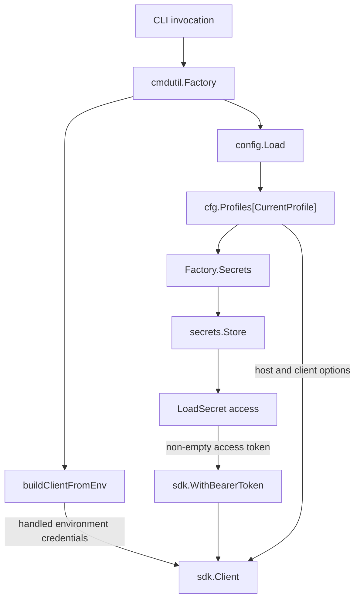
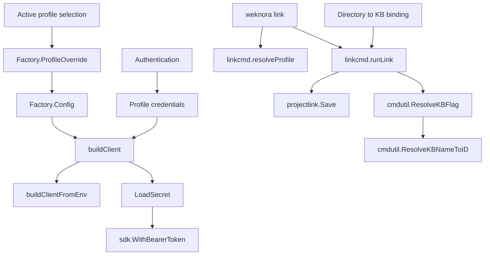

<!-- source: DeepWiki mcp.deepwiki.com · repo Tencent/WeKnora · extra page CLI Authentication and Profiles · fetched 2026-10-29 -->

# CLI Authentication and Profiles

<details>
<summary>Relevant source files</summary>

The following files were used as context for generating this wiki page:

- [cli/acceptance/contract/errorcodes_test.go](cli/acceptance/contract/errorcodes_test.go)
- [cli/acceptance/contract/wire_test.go](cli/acceptance/contract/wire_test.go)
- [cli/cmd/doc/wait.go](cli/cmd/doc/wait.go)
- [cli/cmd/doc/wait_test.go](cli/cmd/doc/wait_test.go)
- [cli/cmd/link/link.go](cli/cmd/link/link.go)
- [cli/cmd/link/link_test.go](cli/cmd/link/link_test.go)
- [cli/cmd/root_test.go](cli/cmd/root_test.go)
- [cli/internal/cmdutil/errors.go](cli/internal/cmdutil/errors.go)
- [cli/internal/cmdutil/errors_test.go](cli/internal/cmdutil/errors_test.go)
- [cli/internal/cmdutil/exit.go](cli/internal/cmdutil/exit.go)
- [cli/internal/cmdutil/exit_test.go](cli/internal/cmdutil/exit_test.go)
- [cli/internal/cmdutil/factory.go](cli/internal/cmdutil/factory.go)
- [cli/internal/cmdutil/factory_test.go](cli/internal/cmdutil/factory_test.go)
- [cli/internal/cmdutil/kb.go](cli/internal/cmdutil/kb.go)

</details>


This page is section **10.5.1** of the Development Guide. It documents the authentication and profile behavior that can be established from the available CLI implementation, including how `cmdutil.Factory` resolves configuration and builds an SDK client, and how `weknora link` records a profile and knowledge base for a directory. The supplied source excerpts do not include the implementations of the `auth` and `profile` subcommands, the configuration and secrets packages, or the SDK token-refresh transport; command-specific details for those areas are therefore not inferred here.

Sources: [`cli/internal/cmdutil/factory.go:23-55`](), [`cli/cmd/link/link.go:39-56`]()

---

## Purpose and Scope

The CLI uses a `Factory` to provide configuration, an SDK client, prompts, and a secrets store to commands. Its `ProfileOverride` field lets an invocation select a profile without changing the stored `CurrentProfile`; client construction then selects credentials based on the active profile, unless environment credentials take precedence. [`cli/internal/cmdutil/factory.go:23-55`]() [`cli/internal/cmdutil/factory.go:112-174`]()

The `link` command binds the current directory to a knowledge base and records the resolved profile in `.weknora/project.yaml`. It requires a configured profile, and it can accept a KB ID or name. [`cli/cmd/link/link.go:39-56`]() [`cli/cmd/link/link.go:112-172`]()

The available source does not show which `auth` or `profile` subcommands are registered, their flags, their credential-writing behavior, or whether/how they refresh tokens. This page limits claims about those operations to behavior directly visible in the supplied code. [`cli/internal/cmdutil/factory.go:23-55`]() [`cli/cmd/link/link.go:39-56`]()

Sources: [`cli/internal/cmdutil/factory.go:23-55`]() [`cli/internal/cmdutil/factory.go:112-174`]() [`cli/cmd/link/link.go:39-56`]()

---

## 1. Authentication Profiles Overview

`Factory.Config` calls `config.Load()` and applies `Factory.ProfileOverride` to the returned config’s `CurrentProfile` when the override is non-empty. The override is applied in memory by this function; the accompanying test verifies that applying it does not rewrite the config file. [`cli/internal/cmdutil/factory.go:77-92`]() [`cli/internal/cmdutil/factory_test.go:75-115`]()

`buildClient` reads the selected profile from `cfg.Profiles`, requires a non-empty host, and fetches referenced secrets from the store. The visible profile fields used by this path include `Host`, `TokenRef`, and `APIKeyRef`; the excerpt does not establish the complete profile schema or all metadata it may contain. [`cli/internal/cmdutil/factory.go:124-174`]()

The `Factory` exposes `Config`, `Client`, `Prompter`, and `Secrets` closures. In the production factory, client and secrets initialization are lazy and cached with `sync.Once`; the comments explain that this avoids constructing multiple clients with independent authentication transport state during one process. [`cli/internal/cmdutil/factory.go:23-49`]() [`cli/internal/cmdutil/factory.go:57-109`]()

### Profile and credential concepts

| Concept | Behavior established by the supplied implementation |
|---|---|
| `CurrentProfile` | The profile name used by `buildClient`; `Factory.Config` can replace it for one invocation using `ProfileOverride`. [`cli/internal/cmdutil/factory.go:77-92`]() [`cli/internal/cmdutil/factory.go:124-138`]() |
| `Profile.Host` | Required for SDK client construction; an empty host is treated as corrupt local configuration. [`cli/internal/cmdutil/factory.go:138-155`]() |
| `Profile.TokenRef` | When present, causes `buildClient` to load the profile’s `access` secret and, if non-empty, configure the SDK with a bearer token. [`cli/internal/cmdutil/factory.go:162-172`]() |
| `Profile.APIKeyRef` | The client-building code enters a separate API-key credential path when this reference is present; the remainder of that path is outside the supplied excerpt. [`cli/internal/cmdutil/factory.go:162-174`]() |
| Secrets store | `Factory.Secrets` obtains a `secrets.Store` through `secrets.NewBestEffortStore()` on first use. The store implementation and its persistence guarantees are not included in the supplied source. [`cli/internal/cmdutil/factory.go:103-108`]() |

Sources: [`cli/internal/cmdutil/factory.go:23-55`]() [`cli/internal/cmdutil/factory.go:57-109`]() [`cli/internal/cmdutil/factory.go:124-174`]() [`cli/internal/cmdutil/factory_test.go:75-115`]()

---

## 2. CLI Commands for Authentication and Profiles

The supplied excerpts do not include the `auth` or `profile` command packages, so they do not support a detailed reference for `auth login`, `auth refresh`, `auth logout`, `auth list`, `auth status`, or profile CRUD commands. The sections below distinguish what is established by the available client-factory and error-handling code from command behavior that cannot be verified here. [`cli/internal/cmdutil/factory.go:23-55`]() [`cli/internal/cmdutil/factory.go:112-174`]()

### 2.1 `weknora auth login`

The available source does not show the `auth login` command implementation, its input modes, API calls, or writes to configuration and secrets. The factory’s unauthenticated-client error recommends creating a profile and then running `weknora auth login`, but this is a hint rather than evidence of the login command’s detailed behavior. [`cli/internal/cmdutil/factory.go:128-136`]()

The shared error helper also supplies `weknora auth login` as the default hint for `auth.unauthenticated` and `auth.bad_credential`. [`cli/internal/cmdutil/exit.go:144-156`]()

Sources: [`cli/internal/cmdutil/factory.go:128-136`]() [`cli/internal/cmdutil/exit.go:144-156`]()

### 2.2 `weknora auth refresh`

The available source does not show an `auth refresh` command or its API request and persistence flow. The client factory loads an `access` secret when the active profile has a `TokenRef`, but that does not establish how refresh tokens are stored, when tokens are renewed, or how refreshed credentials are saved. [`cli/internal/cmdutil/factory.go:162-172`]()

Accordingly, token refresh mechanics cannot be specified from these excerpts. In particular, the presence of a token reference must not be taken as evidence that this code performs refresh-token rotation. [`cli/internal/cmdutil/factory.go:162-174`]()

Sources: [`cli/internal/cmdutil/factory.go:157-174`]()

### 2.3 `weknora auth logout`

The available source does not show an `auth logout` command or credential deletion behavior. `Factory.Secrets` constructs the secrets-store abstraction, but the excerpt does not expose store deletion methods or command call sites that use them. [`cli/internal/cmdutil/factory.go:103-108`]()

Sources: [`cli/internal/cmdutil/factory.go:103-108`]()

### 2.4 `weknora auth list`

The available source does not show an `auth list` command or its output contract. It establishes that profile configuration is loaded through `config.Load()` and that the selected profile is looked up in `cfg.Profiles`, but does not establish how any command enumerates or presents profiles. [`cli/internal/cmdutil/factory.go:77-92`]() [`cli/internal/cmdutil/factory.go:124-151`]()

Sources: [`cli/internal/cmdutil/factory.go:77-92`]() [`cli/internal/cmdutil/factory.go:124-151`]()

### 2.5 `weknora auth status`

The available source does not show an `auth status` command or a live authentication-status request. It does show that typed authentication errors include `auth.unauthenticated`, `auth.token_expired`, and `auth.forbidden`, and that `ExitCode` maps the `auth.*` namespace to exit code `3`. [`cli/internal/cmdutil/errors.go:22-30`]() [`cli/internal/cmdutil/exit.go:35-70`]()

Sources: [`cli/internal/cmdutil/errors.go:22-30`]() [`cli/internal/cmdutil/exit.go:35-70`]()

### 2.6 `weknora link`

`weknora link` writes `.weknora/project.yaml` in the current working directory. Its help text says that commands run from that directory or a subdirectory can resolve the KB from the link unless overridden by `--kb` or `WEKNORA_KB_ID`. The command accepts the KB as a positional argument or `--kb`; without either, interactive selection is intended for a TTY, while non-TTY invocation returns `local.kb_id_required`. [`cli/cmd/link/link.go:39-56`]() [`cli/cmd/link/link.go:61-100`]()

`runLink` obtains the current directory, constructs the link path, resolves the profile and KB, then saves a `projectlink.Project` containing the profile name, KB ID, and UTC creation time. Existing links are overwritten by the save path, consistent with the command’s documented behavior. [`cli/cmd/link/link.go:112-153`]() [`cli/cmd/link/link.go:1-5`]()

The profile recorded in the link is the active profile at link time. `resolveProfile` reads configuration and returns `auth.unauthenticated` if no `CurrentProfile` is configured; its comment directs callers that need another profile to use the global `--profile` flag. [`cli/cmd/link/link.go:155-172`]()

A KB name is resolved by listing knowledge bases and matching `kb.Name` exactly; a UUID-shaped value is recognized as an ID by `IsKBID` and can pass through without name lookup. [`cli/internal/cmdutil/kb.go:11-19`]() [`cli/internal/cmdutil/kb.go:28-54`]()

For JSON output, `link` emits fields `profile`, `kb_id`, `kb_name`, and `project_link_path`. Its text output reports the path and profile, with the KB name when available. [`cli/cmd/link/link.go:22-37`]() [`cli/cmd/link/link.go:138-151`]()

Sources: [`cli/cmd/link/link.go:22-56`]() [`cli/cmd/link/link.go:61-100`]() [`cli/cmd/link/link.go:112-172`]() [`cli/internal/cmdutil/kb.go:11-54`]()

---

## 3. Credential Storage and Token Refresh Architecture

### 3.1 Credential Storage

The production `Factory` creates its secrets store only when `Secrets()` is called. It uses `secrets.NewBestEffortStore()` and caches the result, including any initialization error, with `sync.Once`. The supplied excerpt does not define which backend the store selects or whether any fallback is encrypted. [`cli/internal/cmdutil/factory.go:57-75`]() [`cli/internal/cmdutil/factory.go:103-108`]()

For a configured profile, `buildClient` requests the secrets store and loads the `access` secret only when `TokenRef` is non-empty. If the loaded value is non-empty, it adds `sdk.WithBearerToken(access)` to the SDK client options. The following API-key branch begins in the supplied source, but its full behavior is not shown. [`cli/internal/cmdutil/factory.go:157-174`]()

The factory’s lazy dependency design avoids keyring access merely from constructing a command factory; help, version, and completion are explicitly intended not to trigger the closures. [`cli/internal/cmdutil/factory.go:23-40`]() [`cli/internal/cmdutil/factory.go:57-65`]()

**Title: Credential loading from `Factory` to the SDK client**



Sources: [`cli/internal/cmdutil/factory.go:57-65`]() [`cli/internal/cmdutil/factory.go:103-108`]() [`cli/internal/cmdutil/factory.go:112-174`]()

### 3.2 Token Refresh Flow

The supplied source does not show a `weknora auth refresh` implementation, refresh-token lookup, refresh endpoint, or persistence of rotated tokens. It therefore does not support a token-refresh sequence diagram or claims about refresh timing. [`cli/internal/cmdutil/factory.go:112-174`]()

The visible authentication path loads an access secret associated with `TokenRef` and configures the SDK with a bearer token. The factory comments state that avoiding duplicate SDK clients also avoids independent authentication transport state within an invocation, but do not document the transport’s refresh behavior. [`cli/internal/cmdutil/factory.go:57-65`]() [`cli/internal/cmdutil/factory.go:162-172`]()

Sources: [`cli/internal/cmdutil/factory.go:57-65`]() [`cli/internal/cmdutil/factory.go:157-174`]()

---

## 4. Multi-Profile Configuration and Resolution

### 4.1 Profile Lifecycle and Resolution

`Factory.Config` loads configuration and, when `ProfileOverride` is set, replaces the returned `CurrentProfile` in memory. The global `--profile` flag is described by `Factory` as the source of this per-invocation override; tests verify that the override is propagated and does not modify the on-disk `current_profile`. [`cli/internal/cmdutil/factory.go:45-55`]() [`cli/internal/cmdutil/factory.go:77-92`]() [`cli/cmd/root_test.go:138-163`]() [`cli/internal/cmdutil/factory_test.go:75-115`]()

`buildClient` first checks for environment-provided credentials. If that path does not handle the invocation, it loads configuration, requires a current profile, finds that profile in `cfg.Profiles`, and validates that the profile has a host. A missing current profile returns `auth.unauthenticated`; an explicitly overridden but unknown profile returns `input.invalid_argument`; a stored current profile that references no configured profile returns `local.config_corrupt`. [`cli/internal/cmdutil/factory.go:116-155`]()

With no configured profile, the error hint identifies `weknora profile add <name> --host <url> --use` as the first step before `weknora auth login`; it also names environment credentials as a headless alternative. This is the factory’s guidance and does not, by itself, document the implementation of `profile add`. [`cli/internal/cmdutil/factory.go:128-136`]()

### 4.2 Environment Variables and Stateless Auth

The `buildClient` comment documents an environment-credential path using `WEKNORA_TOKEN` or `WEKNORA_API_KEY`, together with `WEKNORA_HOST` or the active profile’s host. The path is described as an ephemeral client that bypasses `config.yaml` and the keyring for headless, CI, and agent use. Its implementation, including precedence details, is outside the supplied excerpt. [`cli/internal/cmdutil/factory.go:112-123`]()

The supplied source does not establish how `WEKNORA_PROFILE` is handled. The profile override field is documented as being set by the global `--profile` flag, and the root-command test verifies that flag’s propagation to `Factory.ProfileOverride`. [`cli/internal/cmdutil/factory.go:51-55`]() [`cli/cmd/root_test.go:138-163`]()

**Title: Profile selection and KB link recording**

```mermaid
sequenceDiagram
  participant User as "CLI caller"
  participant Root as "cmd/root.go --profile"
  participant Factory as "cmdutil.Factory"
  participant Config as "config.Load"
  participant Client as "buildClient"
  participant Link as "linkcmd.runLink"
  participant Project as "projectlink.Save"

  User->>Root: "weknora --profile staging link --kb <kb>"
  Root->>Factory: "set ProfileOverride"
  Link->>Factory: "resolveProfile"
  Factory->>Config: "load config"
  Config-->>Factory: "cfg.CurrentProfile and cfg.Profiles"
  Factory-->>Link: "resolved profile name"
  Link->>Client: "resolve KB name when needed"
  Client-->>Link: "SDK client"
  Link->>Project: "save Project{Profile, KBID, CreatedAt}"
  Project-->>User: "link result"
```

Sources: [`cli/internal/cmdutil/factory.go:45-55`]() [`cli/internal/cmdutil/factory.go:77-92`]() [`cli/internal/cmdutil/factory.go:124-174`]() [`cli/cmd/root_test.go:138-163`]() [`cli/cmd/link/link.go:112-153`]()

Sources: [`cli/internal/cmdutil/factory.go:45-55`]() [`cli/internal/cmdutil/factory.go:77-92`]() [`cli/internal/cmdutil/factory.go:112-174`]() [`cli/cmd/root_test.go:138-163`]() [`cli/cmd/link/link.go:112-153`]()

---

## 5. Commands: Natural Language to Code Entity Mapping

This mapping connects the user-facing authentication/profile concepts supported by the supplied excerpts to the implementation entities that can be verified. It intentionally does not assign unprovided `auth` or `profile` subcommands to implementation functions. [`cli/internal/cmdutil/factory.go:23-55`]() [`cli/cmd/link/link.go:39-56`]()

**Title: CLI profile and link concepts mapped to implementation entities**



Sources: [`cli/internal/cmdutil/factory.go:45-55`]() [`cli/internal/cmdutil/factory.go:77-92`]() [`cli/internal/cmdutil/factory.go:112-174`]() [`cli/cmd/link/link.go:112-172`]() [`cli/internal/cmdutil/kb.go:28-54`]()

---

## Appendix: Error Handling and Exit Codes

Authentication errors are represented by typed codes including `auth.unauthenticated`, `auth.token_expired`, `auth.bad_credential`, `auth.forbidden`, `auth.cross_tenant_blocked`, and `auth.tenant_mismatch`. The typed `Error` carries a code, message, hint, cause, and optional retry metadata. [`cli/internal/cmdutil/errors.go:17-30`]() [`cli/internal/cmdutil/errors.go:113-130`]()

`ExitCode` maps `auth.*` errors to exit code `3`. `PrintError` emits text or an error envelope depending on the resolved format mode; the default hint for unauthenticated or bad-credential errors is `weknora auth login`. [`cli/internal/cmdutil/exit.go:35-70`]() [`cli/internal/cmdutil/exit.go:95-117`]() [`cli/internal/cmdutil/exit.go:144-156`]()

For profile and link setup, the factory distinguishes an unconfigured profile from an unknown explicit override and a corrupt stored profile reference. The link error helpers also identify missing KB selection and corrupt project-link cases with local error codes. [`cli/internal/cmdutil/factory.go:128-155`]() [`cli/internal/cmdutil/errors.go:87-96`]() [`cli/cmd/link/link.go:79-88`]()

Sources: [`cli/internal/cmdutil/errors.go:17-30`]() [`cli/internal/cmdutil/errors.go:87-130`]() [`cli/internal/cmdutil/exit.go:35-70`]() [`cli/internal/cmdutil/exit.go:95-117`]() [`cli/internal/cmdutil/exit.go:144-156`]() [`cli/internal/cmdutil/factory.go:128-155`]() [`cli/cmd/link/link.go:79-88`]()

---

## References and Sources

- `cmdutil.Factory` and SDK client construction: [`cli/internal/cmdutil/factory.go:23-55`]() [`cli/internal/cmdutil/factory.go:57-109`]() [`cli/internal/cmdutil/factory.go:112-174`]()
- Authentication error codes and rendering: [`cli/internal/cmdutil/errors.go:17-30`]() [`cli/internal/cmdutil/errors.go:113-130`]() [`cli/internal/cmdutil/exit.go:35-70`]() [`cli/internal/cmdutil/exit.go:95-117`]()
- Profile override tests: [`cli/internal/cmdutil/factory_test.go:75-115`]() [`cli/cmd/root_test.go:138-163`]()
- `link` command and project-link persistence: [`cli/cmd/link/link.go:39-56`]() [`cli/cmd/link/link.go:112-172`]()
- KB ID and name resolution: [`cli/internal/cmdutil/kb.go:11-54`]()

---

