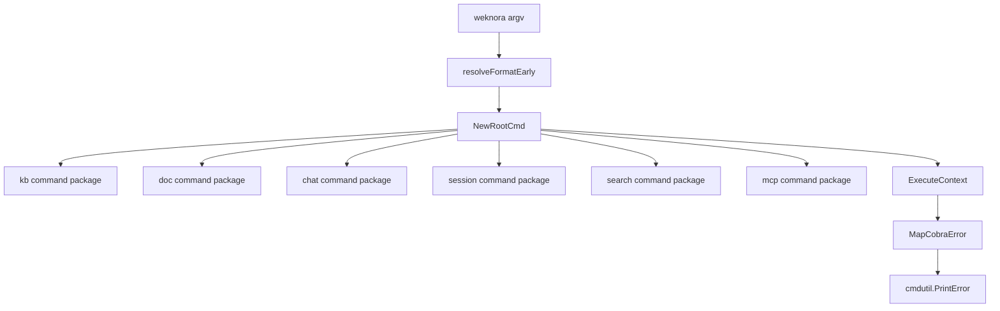
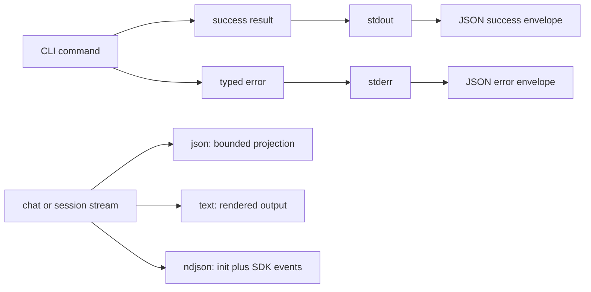
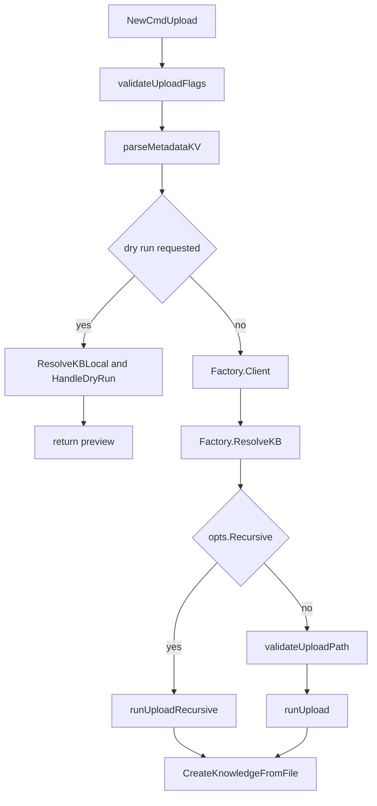
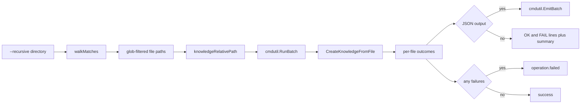
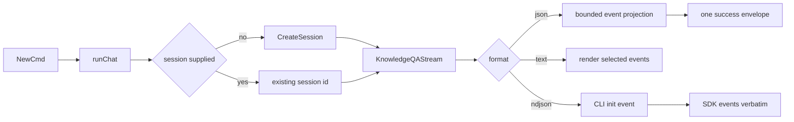
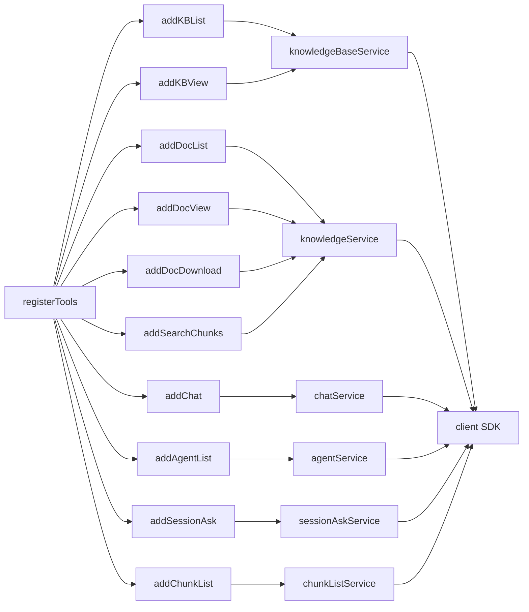
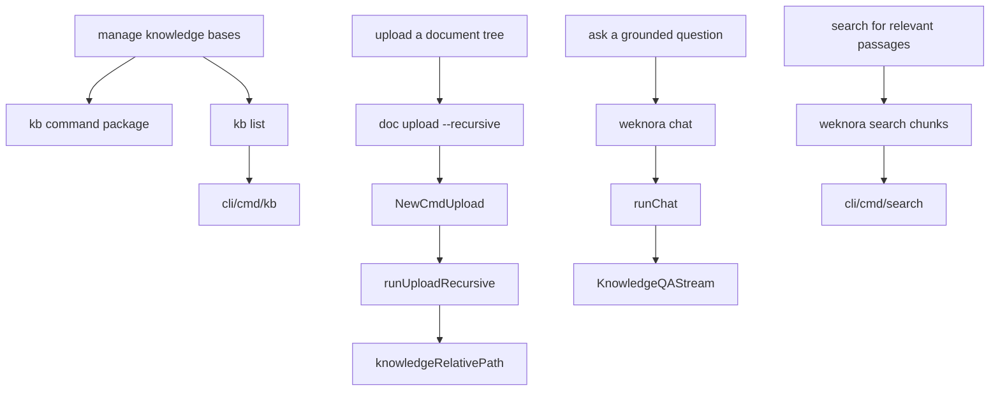
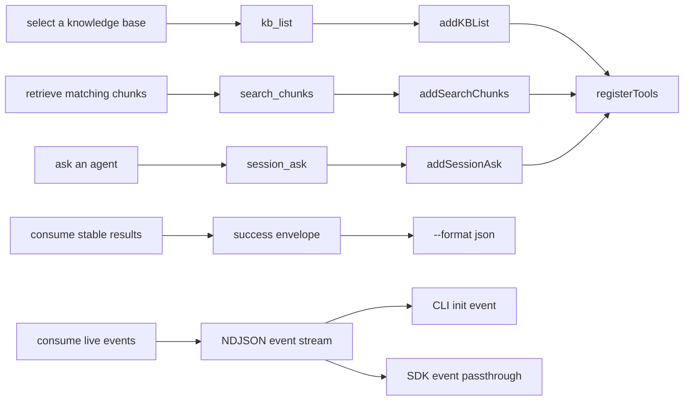

<!-- source: DeepWiki mcp.deepwiki.com · repo Tencent/WeKnora · extra page CLI Document, KB and Chat Commands · fetched 2026-10-29 -->

# CLI Document, KB and Chat Commands

<details>
<summary>Relevant source files</summary>

The following files were used as context for generating this wiki page:

- [cli/AGENTS.md](cli/AGENTS.md)
- [cli/CHANGELOG.md](cli/CHANGELOG.md)
- [cli/README.md](cli/README.md)
- [cli/acceptance/e2e/e2e_test.go](cli/acceptance/e2e/e2e_test.go)
- [cli/cmd/chat/chat.go](cli/cmd/chat/chat.go)
- [cli/cmd/chat/chat_test.go](cli/cmd/chat/chat_test.go)
- [cli/cmd/doc/download.go](cli/cmd/doc/download.go)
- [cli/cmd/doc/download_test.go](cli/cmd/doc/download_test.go)
- [cli/cmd/doc/list.go](cli/cmd/doc/list.go)
- [cli/cmd/doc/list_limit_order_test.go](cli/cmd/doc/list_limit_order_test.go)
- [cli/cmd/doc/list_test.go](cli/cmd/doc/list_test.go)
- [cli/cmd/doc/upload.go](cli/cmd/doc/upload.go)
- [cli/cmd/doc/upload_recursive.go](cli/cmd/doc/upload_recursive.go)
- [cli/cmd/doc/upload_recursive_test.go](cli/cmd/doc/upload_recursive_test.go)
- [cli/cmd/doc/upload_test.go](cli/cmd/doc/upload_test.go)
- [cli/cmd/doctor/doctor.go](cli/cmd/doctor/doctor.go)
- [cli/cmd/doctor/doctor_test.go](cli/cmd/doctor/doctor_test.go)
- [cli/cmd/kb/list.go](cli/cmd/kb/list.go)
- [cli/cmd/kb/list_test.go](cli/cmd/kb/list_test.go)
- [cli/cmd/root.go](cli/cmd/root.go)
- [cli/cmd/search/search.go](cli/cmd/search/search.go)
- [cli/cmd/search/search_test.go](cli/cmd/search/search_test.go)
- [cli/cmd/session/ask.go](cli/cmd/session/ask.go)
- [cli/cmd/session/ask_test.go](cli/cmd/session/ask_test.go)
- [cli/cmd/session/delete_test.go](cli/cmd/session/delete_test.go)
- [cli/cmd/session/list.go](cli/cmd/session/list.go)
- [cli/cmd/session/list_filter_limit_test.go](cli/cmd/session/list_filter_limit_test.go)
- [cli/cmd/session/list_test.go](cli/cmd/session/list_test.go)
- [cli/internal/mcp/tools.go](cli/internal/mcp/tools.go)
- [cli/internal/mcp/tools_test.go](cli/internal/mcp/tools_test.go)
- [cli/internal/sse/accumulator.go](cli/internal/sse/accumulator.go)
- [cli/internal/sse/agent_accumulator_test.go](cli/internal/sse/agent_accumulator_test.go)
- [cli/skills/weknora-rag-search/SKILL.md](cli/skills/weknora-rag-search/SKILL.md)
- [cli/skills/weknora-rag-search/references/chat.md](cli/skills/weknora-rag-search/references/chat.md)
- [cli/skills/weknora-shared/SKILL.md](cli/skills/weknora-shared/SKILL.md)

</details>


## Purpose and Scope

This page is the command reference for the `weknora` CLI’s knowledge-base, document, session, search, chat, and MCP surfaces. It describes the command tree, implementation boundaries, recursive document uploads, streaming-output modes, and the JSON contracts used by scripts and AI agents. The CLI is a client for the WeKnora RAG server; its command tree is built with Cobra and its domain commands use the WeKnora client SDK. [cli/AGENTS.md:1-5](), [cli/cmd/root.go:1-33](), [cli/README.md:1-5]()

Sources: [cli/AGENTS.md:1-5](), [cli/cmd/root.go:1-33](), [cli/README.md:1-5]()

---

## 1. CLI Command Tree and Key Modules

`cli/cmd/root.go` constructs the Cobra command tree. It imports the KB, document, chat, session, search, and MCP command packages and installs their command groups on the root command. `Execute` resolves the output format before Cobra dispatch, runs the root command with the caller’s context, and maps errors to a process exit code. [cli/cmd/root.go:1-33](), [cli/cmd/root.go:35-92]()

### Command Dispatch Architecture

**Title: CLI command dispatch and format resolution**



Sources: [cli/cmd/root.go:13-33](), [cli/cmd/root.go:35-92](), [cli/cmd/root.go:95-129]()

`resolveFormatEarly` checks raw arguments for `--format` and `--format=<value>`, then falls back to `WEKNORA_FORMAT`. It sets the format mode before Cobra parses flags, allowing parse and invocation errors to use the requested error-output format. The root command’s `PersistentPreRunE` performs the later validation and configuration setup. [cli/cmd/root.go:35-70](), [cli/cmd/root.go:154-165]()

The root’s command description identifies the primary CLI workflows: manage knowledge bases and documents, run hybrid search, ask grounded questions, and expose a curated MCP tool surface. The README lists `kb`, `doc`, `chat`, `session`, `search`, and `mcp` among the available command groups. [cli/cmd/root.go:134-146](), [cli/README.md:7-37]()

Sources: [cli/cmd/root.go:35-70](), [cli/cmd/root.go:134-165](), [cli/README.md:7-37]()

---

## 2. Agent-Friendly JSON Output and Wire Contract

The CLI treats its output shape as an API for agent consumers. In JSON mode, successful non-streaming commands emit a success envelope. List commands place an array in `data` and commonly include counters in `meta`; resource commands place an object in `data`. Empty optional fields are omitted, and a mutation without a payload may return only `ok` and `profile`. [cli/AGENTS.md:7-45]()

A successful response generally follows this shape:

```json
{
  "ok": true,
  "data": [],
  "meta": {"count": 0},
  "profile": "prod"
}
```

`profile` is omitted when no profile is configured. The contract reserves `meta.next_cursor`, `meta.total_count`, and `meta.request_id` for future use; the documentation says these fields are not currently populated by the general envelope contract. [cli/AGENTS.md:38-45]()

For JSON-mode errors, the CLI writes an error envelope to stderr; text mode uses prose. The error object can provide a typed `type`, human-readable `message`, actionable `hint`, `retry_argv`, retry timing, risk metadata, and structured `detail`. The success stream remains separate on stdout so pipelines that consume JSON output do not mistake errors for result data. [cli/AGENTS.md:47-76](), [cli/cmd/root.go:82-90]()

**Title: Agent-facing output channels and stream shapes**



Sources: [cli/AGENTS.md:13-92](), [cli/cmd/root.go:82-92](), [cli/cmd/chat/chat.go:4-21]()

### Streaming contract

For `chat` and `session ask`, `--format json` and `--format ndjson` are streaming-command formats, not the ordinary resource-envelope format. The CLI emits a bare JSON event per line: it injects one `init` event at the beginning and passes subsequent SDK events through without renaming them. Use `--format text` for prose rendering. [cli/AGENTS.md:78-92]()

The current chat implementation distinguishes JSON from NDJSON: JSON buffers a bounded event projection into one success envelope, whereas NDJSON represents the raw event stream. This distinction is also recorded as a CLI breaking change in the changelog. [cli/cmd/chat/chat.go:4-21](), [cli/CHANGELOG.md:13-23]()

Sources: [cli/AGENTS.md:78-92](), [cli/cmd/chat/chat.go:4-21](), [cli/CHANGELOG.md:13-23]()

---

## 3. Knowledge Base and Document Commands

The root command registers a KB command group and a document command group. The available CLI documentation describes KB operations including listing and viewing knowledge bases, and document operations including upload, listing, and download. KB selection is shared across relevant commands through the `--kb` flag and CLI configuration. [cli/cmd/root.go:19-22](), [cli/README.md:13-37](), [cli/cmd/doc/upload.go:73-89](), [cli/cmd/doc/list.go:61-77]()

### 3.1 Document Upload Implementation (`weknora doc upload`)

`NewCmdUpload` builds `weknora doc upload <file>`. The command accepts a single-file path or, with `--recursive`, a directory to walk. These modes are mutually exclusive. Upload options include a custom name for single-file uploads, a glob for recursive selection, optional multimodal extraction, repeatable metadata, an ingestion channel, and dry-run behavior. [cli/cmd/doc/upload.go:35-54](), [cli/cmd/doc/upload.go:69-107]()

KB resolution for upload follows the order described by the command: explicit `--kb`, `WEKNORA_KB_ID`, the directory’s `.weknora/project.yaml` binding, then an error. The flag may identify a KB by ID or name. [cli/cmd/doc/upload.go:73-89]()

**Title: Document upload control flow**



Sources: [cli/cmd/doc/upload.go:109-179](), [cli/cmd/doc/upload_recursive.go:24-30]()

`UploadService` is the narrow SDK interface used by upload logic. Its `CreateKnowledgeFromFile` method receives the KB ID and file path, metadata, optional multimodal setting, custom file name, channel, and process overrides. This interface boundary allows upload behavior to be tested without coupling the command logic to the full SDK client. [cli/cmd/doc/upload.go:56-67]()

Sources: [cli/cmd/doc/upload.go:56-67]()

### 3.2 Recursive Upload

`runUploadRecursive` validates the recursive-upload inputs, checks that the root path is a directory, validates the glob, finds matching files, and uploads matches sequentially. Per-file failures do not stop the walk; results are aggregated so one run reports both successful and failed files. [cli/cmd/doc/upload_recursive.go:24-30](), [cli/cmd/doc/upload_recursive.go:38-79]()

For each match, the uploader computes a path relative to the walked directory and supplies it as `customFileName`. Files directly in the root use an empty custom name; nested files use a slash-normalized relative path so the server can reconstruct folder placement. Paths outside the root are defensively excluded from the relative-path result. [cli/cmd/doc/upload_recursive.go:87-95](), [cli/cmd/doc/upload_recursive.go:157-178]()

In JSON mode, the command suppresses per-file progress lines, emits a batch result, and returns a silent typed operation error if any file failed. In non-JSON mode it prints per-file `OK` or `FAIL` progress and an uploaded/failed summary. Cancellation and timeout retain their context-derived classification instead of being reported as ordinary partial-upload failure. [cli/cmd/doc/upload_recursive.go:96-112](), [cli/cmd/doc/upload_recursive.go:115-153]()

The recursive-upload tests cover nested paths, glob filtering, partial failures, and directories with no matching files. They also verify that a partial failure is represented as an operation failure while successful files remain visible in the batch output. [cli/cmd/doc/upload_recursive_test.go:73-88](), [cli/cmd/doc/upload_recursive_test.go:93-109](), [cli/cmd/doc/upload_recursive_test.go:123-177]()

**Title: Recursive upload data flow**



Sources: [cli/cmd/doc/upload_recursive.go:24-30](), [cli/cmd/doc/upload_recursive.go:69-79](), [cli/cmd/doc/upload_recursive.go:82-153](), [cli/cmd/doc/doc_upload_recursive_test.go:73-177]()

> **Citation correction:** The recursive-upload test file is `cli/cmd/doc/upload_recursive_test.go`; the reference above should be read as that path.

### 3.3 Document Listing

`doc list` supports server-side filters including parse status, keyword, file type, source, tag, and updated-time range. It accepts page-size and client-side limit settings, and can walk pages with `--all-pages`. Results are sorted by `updated_at` descending because backend storage ordering is not guaranteed. [cli/cmd/doc/list.go:19-47](), [cli/cmd/doc/list.go:61-77](), [cli/cmd/doc/list.go:104-115]()

`ListService` isolates the command’s SDK dependency to `ListKnowledgeWithFilter`, which receives the KB ID, page values, and a `KnowledgeListFilter`. Static page-size, limit, and status validation happens before resolving the KB and constructing the client, so invalid local input is not obscured by an authentication failure. [cli/cmd/doc/list.go:55-59](), [cli/cmd/doc/list.go:79-101](), [cli/cmd/doc/list.go:124-148]()

Sources: [cli/cmd/doc/list.go:19-59](), [cli/cmd/doc/list.go:61-148]()

---

## 4. Chat, Session, and SSE Streaming

### 4.1 Chat Streaming (`weknora chat`)

`NewCmd` builds `weknora chat "<text>"`. It trims and rejects an empty query, resolves the KB, constructs the client, and calls the testable `runChat` core. The command accepts an optional existing session ID; without one, the chat core creates a session before asking the SDK to stream the knowledge answer. [cli/cmd/chat/chat.go:67-110](), [cli/cmd/chat/chat.go:129-150]()

`ChatService` defines the two SDK operations used by chat: `CreateSession` and `KnowledgeQAStream`. The streaming callback contract is sequential on one goroutine, so the chat output modes do not need locking around callback handling. [cli/cmd/chat/chat.go:18-21](), [cli/cmd/chat/chat.go:59-65]()

The output modes have different contracts:

| Format | Behavior |
|---|---|
| `json` | Buffers a bounded projection into one success envelope; answer events are the default projection. |
| `text` | Renders the selected projection as events arrive. |
| `ndjson` | Emits the CLI `init` event, then passes SDK events through as raw NDJSON. |

`--reference` adds bounded reference indexes, while `--verbose` adds reasoning, tool activity, and lifecycle frames to JSON/text output. NDJSON remains the raw stream and is not changed by these presentation flags. [cli/cmd/chat/chat.go:4-16](), [cli/cmd/chat/chat.go:47-56](), [cli/cmd/chat/chat.go:77-85]()

**Title: Chat stream data flow**



Sources: [cli/cmd/chat/chat.go:4-21](), [cli/cmd/chat/chat.go:67-125](), [cli/cmd/chat/chat.go:129-150](), [cli/AGENTS.md:78-92]()

### 4.2 Session Commands and Stream Accumulation

The `session` command group is registered by the root command. `session list` retrieves sessions through `GetSessionsByTenant`, supports pagination and a recency filter, and applies its client-side limit after the recency filter. In JSON mode it emits a result envelope with `count`, `has_more`, and server-total metadata. [cli/cmd/root.go:26-29](), [cli/cmd/session/list.go:31-47](), [cli/cmd/session/list.go:49-85](), [cli/cmd/session/list.go:107-177]()

`session ask` is the agent-oriented streaming command, while `session resume` is the current name for stream resumption. The changelog records the rename from `continue-stream` to `resume` and the CLI’s support for session-stream recovery. [cli/CHANGELOG.md:13-23](), [cli/CHANGELOG.md:94-100]()

The SSE accumulator implementation is located at `cli/internal/sse/accumulator.go`; the agent accumulation tests are at `cli/internal/sse/agent_accumulator_test.go`. The available source excerpts identify those files but do not expose their implementation lines, so this page does not specify accumulator internals beyond the documented stream-output contract. The changelog states that agent accumulation waits for `response_type=complete`, rather than treating a per-event `done:true` marker as completion of the entire run. [cli/CHANGELOG.md:54-63]()

Sources: [cli/cmd/root.go:26-29](), [cli/cmd/session/list.go:31-47](), [cli/cmd/session/list.go:49-85](), [cli/cmd/session/list.go:107-177](), [cli/CHANGELOG.md:13-23](), [cli/CHANGELOG.md:54-63]()

---

## 5. Search Subtree Commands

The root command registers the `search` package. The README describes `search` as a command group for searching chunks, knowledge bases, documents, or sessions. The provided source excerpt identifies `cli/cmd/search/search.go` as the implementation file, but does not include its command definitions; consequently, exact flags and request construction are not detailed here. [cli/cmd/root.go:26-28](), [cli/README.md:30-34]()

The CLI quickstart demonstrates `weknora search chunks` for a natural-language retrieval query. The changelog additionally records that `--kb` accepts a KB name or ID for `search chunks` and `search docs`. [cli/README.md:88-90](), [cli/CHANGELOG.md:79-85]()

Sources: [cli/cmd/root.go:26-28](), [cli/README.md:30-34](), [cli/README.md:88-90](), [cli/CHANGELOG.md:79-85]()

---

## 6. Model Context Protocol (MCP) Server Integration

The CLI registers an MCP command group, and the MCP tool registry in `cli/internal/mcp/tools.go` deliberately exposes a curated set of tools. `registerTools` wires ten tool handlers to the server. The tool list is manually maintained because adding a tool expands the surface callable by external agents. [cli/cmd/root.go:24-25](), [cli/internal/mcp/tools.go:125-148]()

### Registered MCP Tools

| Tool name | Service interface | SDK operation or role |
|---|---|---|
| `kb_list` | `knowledgeBaseService` | List knowledge bases. |
| `kb_view` | `knowledgeBaseService` | Retrieve a knowledge base. |
| `doc_list` | `knowledgeService` | List documents with filters. |
| `doc_view` | `knowledgeService` | Retrieve document metadata. |
| `doc_download` | `knowledgeService` | Open a document’s file. |
| `search_chunks` | `knowledgeService` | Run hybrid search. |
| `chat` | `chatService` | Create a session and stream knowledge QA. |
| `agent_list` | `agentService` | List agents. |
| `session_ask` | `sessionAskService` | Create or use a session and stream agent QA. |
| `chunk_list` | `chunkListService` | List knowledge chunks. |

The narrow service interfaces declare the SDK methods required by each domain. The tests use a fake service implementation that records call arguments, demonstrating that the MCP layer can be tested independently of a live server. [cli/internal/mcp/tools.go:77-123](), [cli/internal/mcp/tools.go:137-148](), [cli/internal/mcp/tools_test.go:19-70](), [cli/internal/mcp/tools_test.go:73-138]()

MCP handlers use `successResult` to populate structured content and a text fallback. Errors use `toolErrorResult`, which includes a readable text fallback and structured error details derived through the shared CLI error conversion path. Streaming errors can include the session ID and assistant message ID in their detail. [cli/internal/mcp/tools.go:19-58](), [cli/internal/mcp/tools.go:60-75]()

**Title: MCP tool registrations and SDK service interfaces**



Sources: [cli/internal/mcp/tools.go:77-148](), [cli/internal/mcp/tools.go:19-75]()

---

## Diagrams Bridging Natural Language Space to Code Entity Space

### Diagram 1: User workflows mapped to command implementations

**Title: Natural-language CLI workflows to code entities**



Sources: [cli/cmd/root.go:13-33](), [cli/cmd/doc/upload.go:69-89](), [cli/cmd/doc/upload_recursive.go:24-30](), [cli/cmd/doc/upload_recursive.go:157-170](), [cli/cmd/chat/chat.go:67-75](), [cli/cmd/chat/chat.go:129-150](), [cli/README.md:88-92]()

### Diagram 2: Agent integration mapped to CLI and MCP code entities

**Title: Agent-facing commands and MCP entities**



Sources: [cli/internal/mcp/tools.go:125-148](), [cli/internal/mcp/tools.go:150-171](), [cli/AGENTS.md:13-45](), [cli/AGENTS.md:78-92]()

---

## Sources

- [cli/AGENTS.md:1-160]()
- [cli/CHANGELOG.md:13-65]()
- [cli/cmd/root.go:1-165]()
- [cli/cmd/doc/upload.go:35-181]()
- [cli/cmd/doc/upload_recursive.go:24-30]()
- [cli/cmd/doc/upload_recursive.go:38-79]()
- [cli/cmd/doc/upload_recursive.go:82-153]()
- [cli/cmd/doc/upload_recursive.go:157-178]()
- [cli/cmd/doc/upload_recursive_test.go:73-177]()
- [cli/cmd/doc/list.go:19-148]()
- [cli/cmd/chat/chat.go:4-21]()
- [cli/cmd/chat/chat.go:47-65]()
- [cli/cmd/chat/chat.go:67-150]()
- [cli/cmd/session/list.go:31-47]()
- [cli/cmd/session/list.go:49-85]()
- [cli/cmd/session/list.go:107-177]()
- [cli/cmd/search/search.go:1-47]()
- [cli/internal/mcp/tools.go:19-75]()
- [cli/internal/mcp/tools.go:77-148]()
- [cli/internal/mcp/tools_test.go:19-70]()
- [cli/internal/mcp/tools_test.go:73-138]()
- [cli/README.md:7-37]()
- [cli/README.md:88-104]()

---

