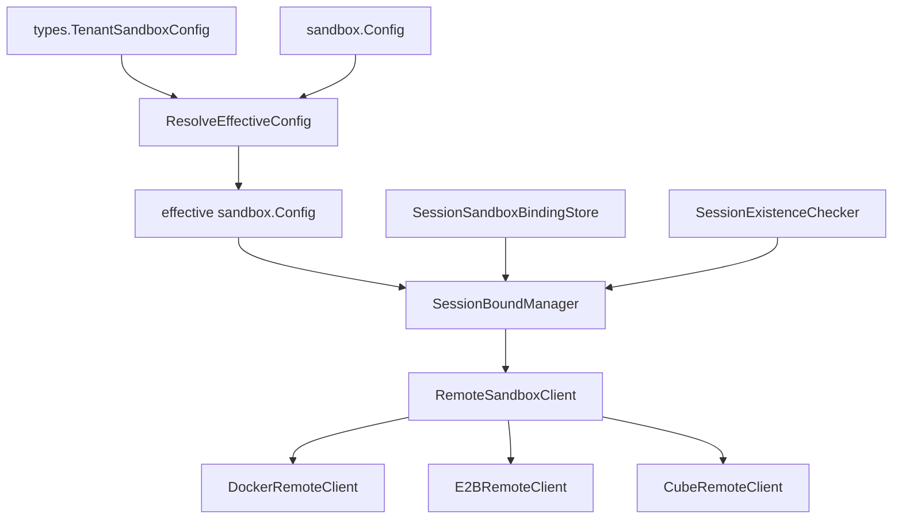
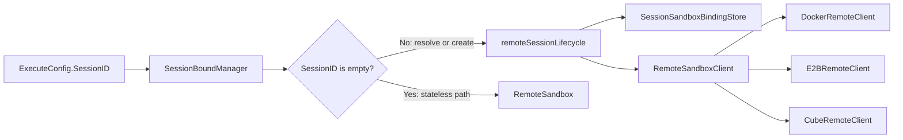

<!-- source: DeepWiki mcp.deepwiki.com · repo Tencent/WeKnora · extra page Sandbox Runtimes and Configuration · fetched 2026-10-29 -->

# Sandbox Runtimes and Configuration

Relevant source files

The following files were used as context for generating this wiki page:

- [internal/agent/tools/shell_exec.go](internal/agent/tools/shell_exec.go)
- [internal/agent/tools/shell_exec_test.go](internal/agent/tools/shell_exec_test.go)
- [internal/application/service/sandboxalloc/service_test.go](internal/application/service/sandboxalloc/service_test.go)
- [internal/sandbox/cube_remote_client.go](internal/sandbox/cube_remote_client.go)
- [internal/sandbox/cube_template_catalog_test.go](internal/sandbox/cube_template_catalog_test.go)
- [internal/sandbox/docker_engine.go](internal/sandbox/docker_engine.go)
- [internal/sandbox/docker_integration_test.go](internal/sandbox/docker_integration_test.go)
- [internal/sandbox/docker_remote_client.go](internal/sandbox/docker_remote_client.go)
- [internal/sandbox/docker_remote_client_test.go](internal/sandbox/docker_remote_client_test.go)
- [internal/sandbox/docker_rpc_timeout.go](internal/sandbox/docker_rpc_timeout.go)
- [internal/sandbox/e2b_remote_client.go](internal/sandbox/e2b_remote_client.go)
- [internal/sandbox/e2b_remote_client_test.go](internal/sandbox/e2b_remote_client_test.go)
- [internal/sandbox/remote_client.go](internal/sandbox/remote_client.go)
- [internal/sandbox/remote_fake_test.go](internal/sandbox/remote_fake_test.go)
- [internal/sandbox/sandbox.go](internal/sandbox/sandbox.go)
- [internal/sandbox/session_input_rebind_test.go](internal/sandbox/session_input_rebind_test.go)
- [internal/sandbox/session_lifecycle.go](internal/sandbox/session_lifecycle.go)
- [internal/sandbox/session_lifecycle_test.go](internal/sandbox/session_lifecycle_test.go)
- [internal/sandbox/session_manager.go](internal/sandbox/session_manager.go)
- [internal/sandbox/session_manager_test.go](internal/sandbox/session_manager_test.go)
- [internal/sandbox/template_catalog.go](internal/sandbox/template_catalog.go)
- [internal/sandbox/tenant_config.go](internal/sandbox/tenant_config.go)
- [internal/sandbox/tenant_config_test.go](internal/sandbox/tenant_config_test.go)
- [internal/types/config_redaction.go](internal/types/config_redaction.go)
- [internal/types/config_redaction_sandbox_test.go](internal/types/config_redaction_sandbox_test.go)
- [internal/types/config_redaction_test.go](internal/types/config_redaction_test.go)

## Purpose and scope

This page documents the Docker, E2B, and Cube sandbox backends; session-bound sandbox management; runtime templates; idle cleanup; and tenant sandbox configuration. The provider adapters implement a common remote-sandbox contract, while `SessionBoundManager` handles session-to-sandbox behavior. [internal/sandbox/sandbox.go:1-3](), [internal/sandbox/session_manager.go:1-22](), [internal/sandbox/docker_remote_client.go:1-18](), [internal/sandbox/e2b_remote_client.go:1-5](), [internal/sandbox/cube_remote_client.go:1-7]()

Sources: `internal/sandbox/sandbox.go:1-3`, `internal/sandbox/session_manager.go:1-22`, `internal/sandbox/docker_remote_client.go:1-18`, `internal/sandbox/e2b_remote_client.go:1-5`, `internal/sandbox/cube_remote_client.go:1-7`

---

## Overview

The named remote sandbox backends are `docker`, `cube`, and `e2b`. Docker uses a long-lived container per session; Cube and E2B use remote sandbox services. `host` and `disabled` are also defined sandbox types, but `host` is not a named session-pinned backend. [internal/sandbox/sandbox.go:12-49]()

The session manager resolves a persistent remote sandbox when an execution supplies a non-empty `SessionID`. Without a session ID, it uses a stateless remote sandbox that is torn down after execution. The manager delegates provider-specific operations to a `RemoteSandboxClient` adapter. [internal/sandbox/session_manager.go:1-22]()

| Backend | Execution environment | Notable behavior |
|---|---|---|
| Docker | Long-lived container on a Docker daemon | Docker has no provider TTL; WeKnora can sweep idle containers using an activity marker. [internal/sandbox/docker_remote_client.go:1-8](), [internal/sandbox/session_manager.go:21-22]() |
| E2B | Hosted or E2B-compatible remote sandbox | `E2BRemoteClient` wraps the `go-e2b` client and requires an API key. [internal/sandbox/e2b_remote_client.go:25-27](), [internal/sandbox/e2b_remote_client.go:49-98]() |
| Cube | Tencent CubeSandbox remote sandbox | `CubeRemoteClient` wraps the Cube SDK and envd transport. [internal/sandbox/cube_remote_client.go:1-7](), [internal/sandbox/cube_remote_client.go:25-43]() |

Sources: `internal/sandbox/sandbox.go:12-49`, `internal/sandbox/session_manager.go:1-22`, `internal/sandbox/docker_remote_client.go:1-8`, `internal/sandbox/e2b_remote_client.go:25-27`, `internal/sandbox/e2b_remote_client.go:49-98`, `internal/sandbox/cube_remote_client.go:1-7`, `internal/sandbox/cube_remote_client.go:25-43`

---

## 1. Sandbox Backends: Docker, E2B, and Cube

### 1.1 Docker Backend

`DockerRemoteClient` implements `RemoteSandboxClient` on top of a Docker Engine API client. A sandbox is a long-lived container whose PID 1 sleeps; scripts, shell commands, and file operations run against that container until the session ends or idle cleanup reclaims it. The container is created and started through the Engine API, and commands run through Docker exec. [internal/sandbox/docker_remote_client.go:1-23](), [internal/sandbox/docker_remote_client.go:79-89]()

The adapter maps its main operations to Docker Engine API calls: create and start a container, inspect or restart it when connecting, list containers, force-delete containers, and create/start execs. The file also describes snapshotting with Docker commit. [internal/sandbox/docker_remote_client.go:10-18]()

Docker-specific behavior and configuration:

- The entrypoint prepares `/var/lib/weknora-sandbox-activity` and then runs `sleep infinity`. The marker is outside `/workspace` and `/tmp`; its permissions allow the configured execution identity to update it. [internal/sandbox/docker_remote_client.go:56-77]()
- Docker does not stop an in-container process merely because the client cancels its exec. The adapter wraps execs in the container’s `timeout(1)` command, and each exec refreshes the activity marker used by the idle sweeper. [internal/sandbox/docker_remote_client.go:28-36]()
- File operations use exec with an explicit account and timeout. Archive endpoints do not provide those same exec settings, and the file notes that path-prefix guards do not prevent traversal through intermediate symlinks inside the container. [internal/sandbox/docker_remote_client.go:19-24]()
- `dockerRuntimeSettings` holds the image, CPU and memory limits, PID limit, network mode, runtime, idle TTL, HTTP timeout, and daemon endpoint. `dockerSettingsFromConfig` requires a non-empty image and projects these values from `Config`. [internal/sandbox/docker_remote_client.go:91-102](), [internal/sandbox/docker_remote_client.go:149-175]()
- `NewDockerRemoteClientForCheck` disables idle sweeping for connectivity checks, so a probe using an in-progress configuration cannot sweep containers owned by a working configuration. [internal/sandbox/docker_remote_client.go:118-134]()

The sandbox type constants identify `wechatopenai/weknora-sandbox:main` as the default Docker image. The Docker adapter notes that `find -printf` requires GNU findutils in the image; the standard WeKnora sandbox image provides it. [internal/sandbox/sandbox.go:51-62](), [internal/sandbox/docker_remote_client.go:25-27]()

Sources: `internal/sandbox/docker_remote_client.go:1-36`, `internal/sandbox/docker_remote_client.go:56-89`, `internal/sandbox/docker_remote_client.go:91-102`, `internal/sandbox/docker_remote_client.go:118-175`, `internal/sandbox/sandbox.go:51-62`

### 1.2 E2B Backend

`E2BRemoteClient` wraps the `go-e2b` client and hides E2B-specific lifecycle, access-token, and filesystem details behind the provider-neutral remote client interface. Its constructors accept an optional HTTP transport or a shared `SandboxGatewayTransportPool`. [internal/sandbox/e2b_remote_client.go:1-5](), [internal/sandbox/e2b_remote_client.go:25-42](), [internal/sandbox/e2b_remote_client.go:49-85]()

Client construction requires a non-empty E2B API key. It defaults the HTTP timeout and sandbox TTL when their configured values are non-positive, attaches inbound-token transport, and wraps the transport with envd compatibility and RPC-timeout handling. The E2B client receives the configured API URL and sandbox domain. [internal/sandbox/e2b_remote_client.go:87-143]()

The E2B template ID is retained by the adapter, and `DesktopEnabled` is carried into the client. The adapter also detects Aliyun Agent Sandbox endpoints: when creating from snapshots on those control planes, some overrides are rejected, so the adapter has snapshot-specific handling for those fields. [internal/sandbox/e2b_remote_client.go:35-46](), [internal/sandbox/e2b_remote_client.go:134-155](), [internal/sandbox/e2b_remote_client.go:157-180]()

Sources: `internal/sandbox/e2b_remote_client.go:1-5`, `internal/sandbox/e2b_remote_client.go:25-46`, `internal/sandbox/e2b_remote_client.go:49-143`, `internal/sandbox/e2b_remote_client.go:145-180`

### 1.3 Cube Backend

`CubeRemoteClient` wraps the Cube SDK and envd transport. It converts provider-specific details into neutral DTOs or `RemoteError` values, so the manager and lifecycle coordinator interact with the adapter rather than Cube SDK types. [internal/sandbox/cube_remote_client.go:1-7](), [internal/sandbox/cube_remote_client.go:25-43]()

`NewCubeRemoteClientWithPool` builds a Cube SDK configuration from the API URL, API key, template ID, sandbox domain, and HTTP timeout. If configured, the proxy URL is parsed into proxy connection settings. The client uses the transport pool for gateway routing and a WebSocket dialer for non-envd data-plane ports. [internal/sandbox/cube_remote_client.go:45-117]()

The adapter advertises capabilities for reconnect, metadata, listing, pause/resume, timeout refresh, filesystem enumeration, snapshots, terminals, and desktop access. It does not advertise volume support. Cube snapshots are templates and can be passed back as create template IDs. [internal/sandbox/cube_remote_client.go:154-178]()

The sandbox package defines Cube defaults, including the envd port and health path, default Cube API and proxy URLs, sandbox domain, sandbox TTL, and HTTP timeout. The default Cube template image differs from the Docker image because Cube’s template health probe requires envd. [internal/sandbox/sandbox.go:63-71](), [internal/sandbox/sandbox.go:109-133]()

Sources: `internal/sandbox/cube_remote_client.go:1-7`, `internal/sandbox/cube_remote_client.go:25-43`, `internal/sandbox/cube_remote_client.go:45-117`, `internal/sandbox/cube_remote_client.go:154-185`, `internal/sandbox/sandbox.go:63-71`, `internal/sandbox/sandbox.go:109-133`

---

## 2. Session Sandbox Lifecycle and Manager (`SessionBoundManager`)

`SessionBoundManager` binds one remote sandbox to a tenant session. It treats `SessionSandboxBindingStore` as the authoritative session-to-sandbox mapping; the package comment identifies Redis as the production store and memory as a test or single-process option. Lifecycle operations are coordinated through a distributed lifecycle lock, which serializes create, recover, replace, and delete operations. [internal/sandbox/session_manager.go:1-22](), [internal/sandbox/session_manager.go:96-109]()

For a session-scoped `Execute`, the manager resolves or lazily creates the sandbox and executes against the resulting handle. For an empty `SessionID`, it uses a stateless sandbox and tears it down after execution. [internal/sandbox/session_manager.go:12-22]()

The manager exposes workspace and artifact path constants:

| Symbol | Purpose |
|---|---|
| `SessionInputRoot` | Reserved path for durable user attachments restored from file storage. [internal/sandbox/session_manager.go:48-50]() |
| `SessionOutputRoot` | Path where skill scripts write artifacts for collection. [internal/sandbox/session_manager.go:52-56]() |
| `SessionWorkspaceRoot` | Writable workspace root; `shell_exec` work directories must remain underneath it. [internal/sandbox/session_manager.go:67-69]() |
| `SessionGitDir` | Git metadata location used for per-turn workspace checkpoints. [internal/sandbox/session_manager.go:71-81]() |
| `WEKNORA_SKILL_OUTPUT_DIR` | Environment variable name used to identify the skill output directory. [internal/sandbox/session_manager.go:52-59]() |
| `WEKNORA_SESSION_INPUT_DIR` | Environment variable name used to identify the session input directory. [internal/sandbox/session_manager.go:61-65]() |

These paths and variables are part of the sandbox environment, not just the skill-script call: the manager comments state that shell exploration should see the same input and output locations as the skills framework. [internal/sandbox/session_manager.go:52-69]()

Sources: `internal/sandbox/session_manager.go:1-22`, `internal/sandbox/session_manager.go:48-81`, `internal/sandbox/session_manager.go:96-109`

---

## 3. Template Catalogs

Templates provide the base environment used to create sandboxes. The available code excerpts identify default images for Docker, Cube, and desktop variants; Cube additionally exposes a `ListTemplates` method on `CubeRemoteClient`. [internal/sandbox/sandbox.go:51-81](), [internal/sandbox/cube_remote_client.go:180-188]()

| Backend or variant | Template-related detail |
|---|---|
| Docker | The default image is `wechatopenai/weknora-sandbox:main`. [internal/sandbox/sandbox.go:56-62]() |
| Cube | The default template image is `wechatopenai/weknora-sandbox:main-cube`, which includes Cube’s envd daemon. [internal/sandbox/sandbox.go:63-71]() |
| Docker desktop image | `wechatopenai/weknora-sandbox:main-desktop` is the desktop variant; the package comment says the Docker backend does not yet consume this tag. [internal/sandbox/sandbox.go:73-77]() |
| Cube desktop template image | `wechatopenai/weknora-sandbox:main-desktop-cube` is the desktop image plus Cube envd. [internal/sandbox/sandbox.go:79-81]() |
| E2B | The E2B adapter stores the configured template ID. The available excerpt does not specify the catalog-listing behavior. [internal/sandbox/e2b_remote_client.go:35-46](), [internal/sandbox/e2b_remote_client.go:134-143]() |

A Cube template image must include envd because Cube’s build health probe calls `GET :49983/health`; the default Docker image does not include envd, whereas the Cube image does. [internal/sandbox/sandbox.go:63-71](), [internal/sandbox/sandbox.go:109-116]()

Sources: `internal/sandbox/sandbox.go:51-81`, `internal/sandbox/sandbox.go:109-116`, `internal/sandbox/cube_remote_client.go:180-188`, `internal/sandbox/e2b_remote_client.go:35-46`, `internal/sandbox/e2b_remote_client.go:134-143`

---

## 4. Idle Sweeping and Sandbox Cleanup

### Docker idle sweeping

Docker has no provider TTL, so its adapter supports its own idle sweep. When the adapter is constructed with a positive `IdleTTL`, it creates a `dockerIdleSweeper`; a Docker connectivity-check client sets that TTL to zero and has no sweeper. [internal/sandbox/session_manager.go:21-22](), [internal/sandbox/docker_remote_client.go:86-89](), [internal/sandbox/docker_remote_client.go:118-146]()

Every exec refreshes the marker at `/var/lib/weknora-sandbox-activity`. The sweeper reads the marker’s modification time to decide which containers to reclaim. The marker is initialized by the container entrypoint, outside `/workspace` and `/tmp`. [internal/sandbox/docker_remote_client.go:33-36](), [internal/sandbox/docker_remote_client.go:56-77]()

### E2B and Cube lifetime

The session manager’s package comment states that Cube and E2B reap idle sandboxes themselves. The package defines default sandbox TTLs of 30 minutes for Cube and 5 minutes for E2B; the E2B adapter substitutes its default when a configured TTL is non-positive. [internal/sandbox/session_manager.go:21-22](), [internal/sandbox/sandbox.go:127-139](), [internal/sandbox/e2b_remote_client.go:130-143]()

### Session-scoped cleanup

Session sandbox resolution and cleanup are routed through the lifecycle coordinator, which uses a distributed lifecycle lock. The manager defines a 30-second timeout for lifecycle bookkeeping deletions, including loser cleanup and orphan cleanup after session disappearance. [internal/sandbox/session_manager.go:12-17](), [internal/sandbox/session_manager.go:83-90]()

Sources: `internal/sandbox/session_manager.go:12-22`, `internal/sandbox/session_manager.go:83-90`, `internal/sandbox/docker_remote_client.go:33-36`, `internal/sandbox/docker_remote_client.go:56-77`, `internal/sandbox/docker_remote_client.go:118-146`, `internal/sandbox/sandbox.go:127-139`, `internal/sandbox/e2b_remote_client.go:130-143`

---

## 5. Tenant Sandbox Configuration and Policy Resolution

`ResolveEffectiveConfig` converts a stored `types.TenantSandboxConfig` and a deployment-level `Config` into the effective runtime configuration. Named tenant configurations are self-contained for provider settings: the resolver clears provider-scoped fields from the baseline before applying tenant values. The baseline still supplies the deployment script execution timeout; a nil tenant config is the explicit path that uses the supplied baseline. [internal/sandbox/tenant_config.go:1-19](), [internal/sandbox/tenant_config.go:31-53]()

### Provider configuration

The resolver applies the selected sandbox type, execution and terminal timeouts, private-endpoint setting, desktop setting, network policy, and environment variables. It then applies fields from the selected provider block. [internal/sandbox/tenant_config.go:55-74]()

| Tenant configuration block | Fields applied in the shown resolver |
|---|---|
| `Cube` | API URL, proxy URL, sandbox domain, API key, template ID, HTTP timeout, sandbox TTL, and DNS servers. [internal/sandbox/tenant_config.go:75-92]() |
| `E2B` | API URL, proxy URL, sandbox domain, API key, template ID, HTTP timeout, and sandbox TTL. [internal/sandbox/tenant_config.go:94-106]() |
| `Docker` | Image, daemon host, TLS certificate path, network mode, runtime, CPU, memory, PID limit, idle TTL, and HTTP timeout. The network mode is validated before assignment. [internal/sandbox/tenant_config.go:108-128]() |

The resolver applies runtime defaults after processing the provider block. It can also apply a skill image snapshot override: Cube and E2B snapshot IDs replace their template IDs, while Docker uses its image setting. The excerpt shows the Cube and E2B branches and the beginning of the Docker branch. [internal/sandbox/tenant_config.go:130-162]()

### Network policy and endpoint validation

The resolver materializes a network policy from the tenant configuration and validates provider URLs using the `AllowPrivateEndpoints` setting. It also normalizes Cube DNS servers and validates Docker network mode. [internal/sandbox/tenant_config.go:69-71](), [internal/sandbox/tenant_config.go:75-91](), [internal/sandbox/tenant_config.go:94-100](), [internal/sandbox/tenant_config.go:108-116]()

The configuration tests show that `DenyEgressByDefault` results in a provider-facing policy with internet access disabled and a canonical deny-all IPv4 entry (`0.0.0.0/0`). They also test that existing deny-all entries are canonicalized rather than duplicated. [internal/sandbox/tenant_config_test.go:107-152](), [internal/sandbox/tenant_config_test.go:154-185]()

Sources: `internal/sandbox/tenant_config.go:1-19`, `internal/sandbox/tenant_config.go:31-74`, `internal/sandbox/tenant_config.go:75-128`, `internal/sandbox/tenant_config.go:130-162`, `internal/sandbox/tenant_config_test.go:107-185`

---

## 6. Data Flow and Key Classes / Functions

### 6.1 Remote sandbox adapters

The provider adapters implement the provider-neutral remote sandbox contract. `DockerRemoteClient` is defined as an implementation over the Docker Engine API; `E2BRemoteClient` wraps the `go-e2b` client; and `CubeRemoteClient` wraps the Cube SDK and envd transport. [internal/sandbox/docker_remote_client.go:79-89](), [internal/sandbox/e2b_remote_client.go:25-27](), [internal/sandbox/cube_remote_client.go:25-27]()

| Code entity | Role |
|---|---|
| `DockerRemoteClient` | Docker Engine API adapter, with optional `dockerIdleSweeper`. [internal/sandbox/docker_remote_client.go:79-89](), [internal/sandbox/docker_remote_client.go:136-147]() |
| `E2BRemoteClient` | E2B adapter constructed from `Config`, with optional pooled transport. [internal/sandbox/e2b_remote_client.go:25-27](), [internal/sandbox/e2b_remote_client.go:49-85]() |
| `CubeRemoteClient` | Cube adapter constructed from `Config` and an optional gateway pool. [internal/sandbox/cube_remote_client.go:25-43](), [internal/sandbox/cube_remote_client.go:45-61]() |

### 6.2 SessionBoundManager

`SessionBoundManager` owns validation and mapping between application session concepts and the provider-neutral remote client contract. Its dependencies include `RemoteSandboxClient`, `SessionSandboxBindingStore`, `SessionExistenceChecker`, a remote lifecycle coordinator, and a stateless `RemoteSandbox`. [internal/sandbox/session_manager.go:96-109]()

A non-empty session ID uses the session-bound lifecycle path; an empty session ID uses the stateless path. Resolution and lifecycle changes are serialized by the distributed lifecycle lock described in the package comment. [internal/sandbox/session_manager.go:12-22]()

### 6.3 Tenant config resolution

`ResolveEffectiveConfig` returns the `Config` used to build a tenant’s sandbox manager, or an error for unsafe or incomplete configuration. It removes inherited provider fields for named configurations, applies tenant provider settings, applies backend defaults, and considers skill snapshot overrides. [internal/sandbox/tenant_config.go:31-41](), [internal/sandbox/tenant_config.go:50-53](), [internal/sandbox/tenant_config.go:130-162]()

Sources: `internal/sandbox/docker_remote_client.go:79-89`, `internal/sandbox/docker_remote_client.go:136-147`, `internal/sandbox/e2b_remote_client.go:25-27`, `internal/sandbox/e2b_remote_client.go:49-85`, `internal/sandbox/cube_remote_client.go:25-43`, `internal/sandbox/cube_remote_client.go:45-61`, `internal/sandbox/session_manager.go:12-22`, `internal/sandbox/session_manager.go:96-109`, `internal/sandbox/tenant_config.go:31-53`, `internal/sandbox/tenant_config.go:130-162`

---

## 7. Bridging Natural Language to Code Entities

This section maps the runtime and configuration concepts described on this page to the concrete identifiers used in the code. [internal/sandbox/session_manager.go:96-109](), [internal/sandbox/tenant_config.go:31-53](), [internal/sandbox/docker_remote_client.go:79-89](), [internal/sandbox/e2b_remote_client.go:25-27](), [internal/sandbox/cube_remote_client.go:25-27]()

### Diagram 1: Runtime adapters and configuration resolver

Sources: `internal/sandbox/session_manager.go:96-109`, `internal/sandbox/tenant_config.go:31-53`, `internal/sandbox/docker_remote_client.go:79-89`, `internal/sandbox/e2b_remote_client.go:25-27`, `internal/sandbox/cube_remote_client.go:25-27`

### Diagram 2: Session execution and backend selection

Sources: `internal/sandbox/session_manager.go:12-22`, `internal/sandbox/session_manager.go:96-109`, `internal/sandbox/docker_remote_client.go:79-89`, `internal/sandbox/e2b_remote_client.go:25-27`, `internal/sandbox/cube_remote_client.go:25-27`

---

## 8. Important Constants and Paths

| Symbol | Purpose |
|---|---|
| `SessionInputRoot` | Reserved location for durable input attachments restored from file storage. [internal/sandbox/session_manager.go:48-50]() |
| `SessionOutputRoot` | Location where skill scripts write artifacts. [internal/sandbox/session_manager.go:52-56]() |
| `skillOutputEnvVar` | `WEKNORA_SKILL_OUTPUT_DIR`, the output-directory environment variable. [internal/sandbox/session_manager.go:52-59]() |
| `sessionInputEnvVar` | `WEKNORA_SESSION_INPUT_DIR`, the session-input environment variable. [internal/sandbox/session_manager.go:61-65]() |
| `SessionWorkspaceRoot` | Writable remote workspace root; `shell_exec` work directories must remain under this path. [internal/sandbox/session_manager.go:67-69]() |
| `SessionGitDir` | Git metadata directory used for per-turn workspace checkpoints. [internal/sandbox/session_manager.go:71-81]() |
| `dockerActivityMarker` | `/var/lib/weknora-sandbox-activity`, refreshed by Docker exec and read by the idle sweeper. [internal/sandbox/docker_remote_client.go:56-59](), [internal/sandbox/docker_remote_client.go:33-36]() |
| `CubeEnvdPort` | Cube envd port, used for readiness and data-plane access. [internal/sandbox/sandbox.go:109-112]() |
| `CubeEnvdHealthPath` | Health endpoint Cube probes during template builds. [internal/sandbox/sandbox.go:114-116]() |

Sources: `internal/sandbox/session_manager.go:48-81`, `internal/sandbox/docker_remote_client.go:33-36`, `internal/sandbox/docker_remote_client.go:56-59`, `internal/sandbox/sandbox.go:109-116`

---

## 9. Summary

| Aspect | Description | Key code entities |
|---|---|---|
| Sandbox runtimes | Docker containers, E2B remote sandboxes, and Cube remote sandboxes. [internal/sandbox/sandbox.go:12-35]() | `DockerRemoteClient`, `E2BRemoteClient`, `CubeRemoteClient` [internal/sandbox/docker_remote_client.go:79-89](), [internal/sandbox/e2b_remote_client.go:25-27](), [internal/sandbox/cube_remote_client.go:25-27]() |
| Session lifecycle | Session-bound execution resolves or lazily creates a persistent sandbox; stateless execution uses a fresh sandbox. [internal/sandbox/session_manager.go:12-22]() | `SessionBoundManager`, `SessionSandboxBindingStore` [internal/sandbox/session_manager.go:96-109]() |
| Template configuration | Default image constants exist for Docker, Cube, and desktop variants; Cube provides `ListTemplates`. [internal/sandbox/sandbox.go:51-81](), [internal/sandbox/cube_remote_client.go:180-188]() | `DefaultDockerImage`, `DefaultCubeTemplateImage`, `CubeRemoteClient.ListTemplates` |
| Idle cleanup | Docker uses an activity-marker-based sweeper; Cube and E2B manage idle reaping on the provider side. [internal/sandbox/docker_remote_client.go:33-36](), [internal/sandbox/session_manager.go:21-22]() | `dockerActivityMarker`, `dockerIdleSweeper` [internal/sandbox/docker_remote_client.go:56-59](), [internal/sandbox/docker_remote_client.go:136-147]() |
| Tenant policies | Named configurations do not inherit provider-scoped fields from the deployment baseline; tenant network and provider settings are resolved into an effective `Config`. [internal/sandbox/tenant_config.go:1-19](), [internal/sandbox/tenant_config.go:50-74]() | `ResolveEffectiveConfig`, `types.TenantSandboxConfig` |

Sources: `internal/sandbox/sandbox.go:12-35`, `internal/sandbox/session_manager.go:12-22`, `internal/sandbox/session_manager.go:96-109`, `internal/sandbox/docker_remote_client.go:33-36`, `internal/sandbox/docker_remote_client.go:56-59`, `internal/sandbox/docker_remote_client.go:79-89`, `internal/sandbox/docker_remote_client.go:136-147`, `internal/sandbox/e2b_remote_client.go:25-27`, `internal/sandbox/cube_remote_client.go:25-27`, `internal/sandbox/cube_remote_client.go:180-188`, `internal/sandbox/tenant_config.go:1-19`, `internal/sandbox/tenant_config.go:50-74`

---

