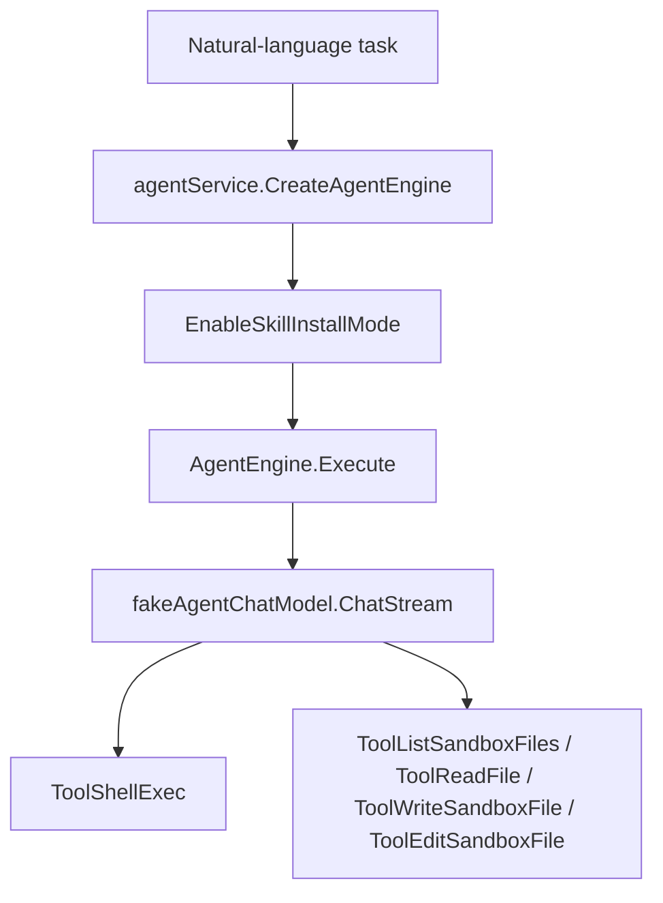
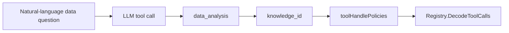
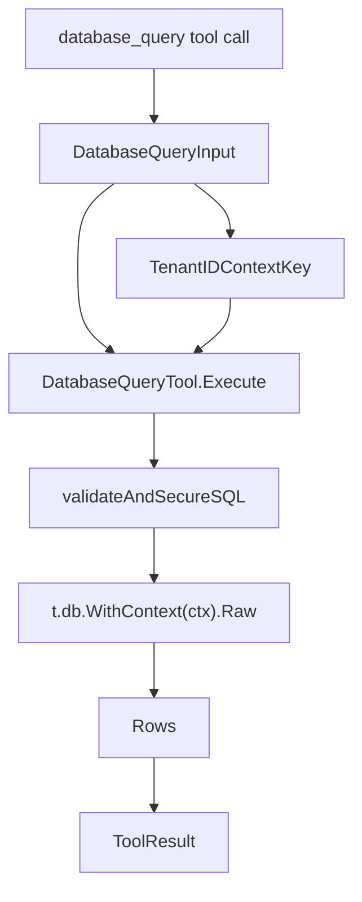
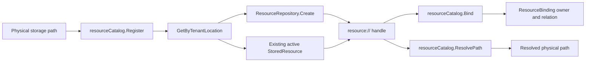

<!-- source: DeepWiki mcp.deepwiki.com · repo Tencent/WeKnora · extra page Sandbox Tools and Artifacts · fetched 2026-10-29 -->

# Sandbox Tools and Artifacts

Relevant source files

The following files were used as context for generating this wiki page:

- [internal/agent/tools/data_analysis_query_test.go](internal/agent/tools/data_analysis_query_test.go)
- [internal/agent/tools/data_schema.go](internal/agent/tools/data_schema.go)
- [internal/agent/tools/database_query.go](internal/agent/tools/database_query.go)
- [internal/agent/tools/database_query_test.go](internal/agent/tools/database_query_test.go)
- [internal/agent/tools/scope_authorization.go](internal/agent/tools/scope_authorization.go)
- [internal/agent/tools/scope_authorization_test.go](internal/agent/tools/scope_authorization_test.go)
- [internal/agent/tools/tool_policy_coverage_test.go](internal/agent/tools/tool_policy_coverage_test.go)
- [internal/application/repository/resource.go](internal/application/repository/resource.go)
- [internal/application/repository/resource_content_hash_test.go](internal/application/repository/resource_content_hash_test.go)
- [internal/application/service/agent_service_test.go](internal/application/service/agent_service_test.go)
- [internal/application/service/artifact_collector_test.go](internal/application/service/artifact_collector_test.go)
- [internal/application/service/fallback_messages_test.go](internal/application/service/fallback_messages_test.go)
- [internal/application/service/file/resource_catalog.go](internal/application/service/file/resource_catalog.go)
- [internal/application/service/file/resource_catalog_test.go](internal/application/service/file/resource_catalog_test.go)
- [internal/application/service/file/resource_content_dedup_test.go](internal/application/service/file/resource_content_dedup_test.go)
- [internal/application/service/knowledge_content_binding_test.go](internal/application/service/knowledge_content_binding_test.go)
- [internal/application/service/resource.go](internal/application/service/resource.go)
- [internal/application/service/resource_test.go](internal/application/service/resource_test.go)
- [internal/application/service/temporary_document_resource_release_test.go](internal/application/service/temporary_document_resource_release_test.go)
- [internal/modelcontext/README.md](internal/modelcontext/README.md)
- [internal/modelcontext/citations.go](internal/modelcontext/citations.go)
- [internal/modelcontext/handle_table.go](internal/modelcontext/handle_table.go)
- [internal/modelcontext/handles.go](internal/modelcontext/handles.go)
- [internal/modelcontext/mcp_sources.go](internal/modelcontext/mcp_sources.go)
- [internal/modelcontext/mcp_sources_test.go](internal/modelcontext/mcp_sources_test.go)
- [internal/modelcontext/model_output.go](internal/modelcontext/model_output.go)
- [internal/modelcontext/registry.go](internal/modelcontext/registry.go)
- [internal/modelcontext/registry_test.go](internal/modelcontext/registry_test.go)
- [internal/modelcontext/resources.go](internal/modelcontext/resources.go)
- [internal/modelcontext/resources_test.go](internal/modelcontext/resources_test.go)
- [internal/modelcontext/sources.go](internal/modelcontext/sources.go)
- [internal/modelcontext/sources_test.go](internal/modelcontext/sources_test.go)
- [internal/modelcontext/stream.go](internal/modelcontext/stream.go)
- [internal/modelcontext/tool_policy.go](internal/modelcontext/tool_policy.go)
- [internal/modelcontext/tool_policy_test.go](internal/modelcontext/tool_policy_test.go)
- [internal/router/router_files_test.go](internal/router/router_files_test.go)
- [internal/types/interfaces/resource.go](internal/types/interfaces/resource.go)
- [internal/utils/inject.go](internal/utils/inject.go)
- [internal/utils/inject_shared_tenant_test.go](internal/utils/inject_shared_tenant_test.go)
- [internal/utils/inject_test.go](internal/utils/inject_test.go)

## Purpose and Scope

This page describes the sandbox-related tool and artifact boundaries visible in the supplied code: how the agent service gates shell and sandbox-file tools, how `database_query` validates and executes SQL, how model-facing tool policies declare identifier handling, and how stored resources are registered and bound to owners. The supplied excerpts do not include the implementations of `shell_exec`, the file tools, or `data_analysis`; this page therefore does not infer their execution details. [internal/application/service/agent_service_test.go:148-193](), [internal/agent/tools/database_query.go:15-17](), [internal/modelcontext/tool_policy.go:65-123](), [internal/application/service/resource.go:23-31]()

Sources: `internal/application/service/agent_service_test.go:148-193`, `internal/agent/tools/database_query.go:15-17`, `internal/modelcontext/tool_policy.go:65-123`, `internal/application/service/resource.go:23-31`

---

## 1. Shell Execution Tool (`shell_exec`)

### Overview

The supplied agent-service test documents a tool-availability rule for `shell_exec`: in skill-install mode, the service offers `shell_exec` when it is allowed by the agent configuration, even when `SkillsEnabled` is false. The test also verifies that this installer configuration does not offer the legacy skill tools or the sandbox-file tools. [internal/application/service/agent_service_test.go:148-193]()

The test configures a sandbox resolver with a Cube manager that advertises both a shell executor and a session file store, then creates an agent engine and executes it to capture the tool names offered to the chat model. It verifies `shell_exec` is offered, while `list_sandbox_files`, `read_file`, `write_sandbox_file`, and `edit_sandbox_file` are withheld in this install-mode case. [internal/application/service/agent_service_test.go:157-192]()

The excerpt does not show the `shell_exec` implementation, command validation, working-directory rules, execution limits, or output handling. Those details cannot be established from the supplied files. [internal/application/service/agent_service_test.go:148-193]()

Sources: `internal/application/service/agent_service_test.go:148-193`

### Diagram 1: Natural-Language Request to `shell_exec` Tool Offer

The diagram represents the tested installer-mode tool-offer path; it does not claim that the excerpt specifies the shell command execution path. [internal/application/service/agent_service_test.go:157-192]()

Sources: `internal/application/service/agent_service_test.go:157-192`

---

## 2. File Read/Write/Edit Tools

The visible test names the sandbox-file tools as `ToolListSandboxFiles`, `ToolReadFile`, `ToolWriteSandboxFile`, and `ToolEditSandboxFile`. It documents an important scope distinction: ordinary agents may receive session-file tools when a `SessionFileStore` is available, even if skills are disabled, while the skill installer is deliberately not given those tools. The test comment explains that these session-file tools accept only `/workspace`, whereas the installer must write the skill tree through `shell_exec`. [internal/application/service/agent_service_test.go:148-153]()

The test’s installer-mode assertions verify that `ToolListSandboxFiles`, `ToolReadFile`, `ToolWriteSandboxFile`, and `ToolEditSandboxFile` are not offered, even though the fake sandbox manager advertises a `SessionFileStore`. The supplied excerpt does not include the tools’ implementations, path validation logic, or file-content persistence behavior. [internal/application/service/agent_service_test.go:157-192]()

Sources: `internal/application/service/agent_service_test.go:148-153`, `internal/application/service/agent_service_test.go:157-192`

---

## 3. Data Analysis Tool (`data_analysis`)

The model-context tool policy declares `data_analysis` as a built-in tool and specifies that its `knowledge_id` argument is an identifier-bearing field. The accompanying policy comment says the tool exposes the selected document as a fixed table name, so its SQL does not carry a document handle; only `knowledge_id` is decoded by this policy. [internal/modelcontext/tool_policy.go:12-17](), [internal/modelcontext/tool_policy.go:119-123]()

The supplied files do not show the `data_analysis` tool implementation, its input schema, SQL engine, document loading path, or query execution and cleanup behavior. Consequently, those implementation details are not described here. [internal/modelcontext/tool_policy.go:119-123]()

Sources: `internal/modelcontext/tool_policy.go:12-17`, `internal/modelcontext/tool_policy.go:119-123`

### Diagram 2: Natural-Language Data Question to Policy-Declared Entity

This diagram shows the model-context identifier-policy path. It does not assert how `data_analysis` loads a document or executes SQL; those implementations are not present in the supplied excerpts. [internal/modelcontext/tool_policy.go:65-69](), [internal/modelcontext/tool_policy.go:119-123](), [internal/modelcontext/registry.go:107-147]()

Sources: `internal/modelcontext/tool_policy.go:65-69`, `internal/modelcontext/tool_policy.go:119-123`, `internal/modelcontext/registry.go:107-147`

---

## 4. Database Query Tool (`database_query`)

### Purpose and Inputs

`DatabaseQueryTool` is constructed with a GORM database handle and `types.SearchTargets`. Its input type, `DatabaseQueryInput`, contains a single `SQL` field. The tool description documents read-only querying of `knowledge_bases`, `knowledges`, and `chunks`, with tenant and soft-delete filtering. [internal/agent/tools/database_query.go:15-23](), [internal/agent/tools/database_query.go:52-62](), [internal/agent/tools/database_query.go:95-113]()

### Execution Flow

`DatabaseQueryTool.Execute` reads the tenant ID from `types.TenantIDContextKey`, decodes the JSON arguments, and rejects missing SQL. It then calls `validateAndSecureSQL` before submitting the secured SQL through `t.db.WithContext(ctx).Raw(securedSQL).Rows()`. The shown excerpt also demonstrates that the tool reads the returned column names and iterates over result rows. [internal/agent/tools/database_query.go:115-171](), [internal/agent/tools/database_query.go:175-197]()

The tool’s description says queries are limited to `SELECT` and the three listed safe tables, with `tenant_id` and soft-delete constraints applied automatically. The actual `validateAndSecureSQL` implementation is beyond the supplied excerpt, so this page does not detail its internal options or rewrite algorithm. [internal/agent/tools/database_query.go:17-24](), [internal/agent/tools/database_query.go:85-90]()

### Diagram 3: `database_query` Execution and SQL Validation

The diagram follows the visible `Execute` flow through validation and GORM query execution; it does not expand the unshown `validateAndSecureSQL` implementation. [internal/agent/tools/database_query.go:95-113](), [internal/agent/tools/database_query.go:115-171]()

Sources: `internal/agent/tools/database_query.go:95-113`, `internal/agent/tools/database_query.go:115-171`

### SQL Parsing and Validation Utilities

`ParseSQL` uses `pg_query.Parse` and returns a `SQLParseResult` that includes whether the statement is a `SELECT`, table names, selected fields, WHERE fields, the WHERE clause, the original SQL, and a parse error when applicable. It rejects empty statement lists, invalid statements, and non-`SELECT` statements in the shown parsing path. [internal/utils/inject.go:78-103](), [internal/utils/inject.go:165-205]()

The utility defines configurable validation options and validator state for input length, statement type and count, allowed tables and functions, injection-risk checks, subqueries, CTEs, system columns, schema access, tenant injection, soft-delete injection, and search-scope filtering. These declarations show the available validation dimensions; they do not, by themselves, establish which options `DatabaseQueryTool.validateAndSecureSQL` enables. [internal/utils/inject.go:102-152]()

Sources: `internal/utils/inject.go:78-103`, `internal/utils/inject.go:102-152`, `internal/utils/inject.go:165-205`

---

## 5. Tool Policy and Scope Authorization

### Model-Context Tool Policies

`toolHandlePolicies` is an allowlist keyed by built-in tool name. A policy can define source-ID keys, source-text keys, whether output contains source references, MCP routing behavior, and issue-ID handling. The file comment explicitly states that field names alone are insufficient: a dynamic MCP tool using the same field name with different semantics must remain opaque. [internal/modelcontext/tool_policy.go:53-68]()

For `database_query`, the policy marks `sql` as source text and enables source-output handling. For `data_analysis`, it declares `knowledge_id` as the source identifier to decode. These are model-context handle policies, not a substitute for the database tool’s SQL validation or tenant authorization. [internal/modelcontext/tool_policy.go:115-123]()

`Registry.DecodeToolCalls` performs the request-local decoding pipeline: it normalizes web-fetch and MCP arguments, decodes resource and source handles, applies tool-specific policies, records unresolved handles, and classifies argument resolution as unchanged, resolved, partially resolved, or unresolved. [internal/modelcontext/registry.go:107-147]()

### SQL Scope and Tenant Filtering

The SQL validator’s configuration includes tenant injection and search-scope filtering state. `SearchScope` represents an authorized knowledge scope with a tenant ID, knowledge-base ID, optional knowledge IDs, and optional tag IDs; its comments state that scopes must be authorized by the caller. [internal/utils/inject.go:132-163]()

`DatabaseQueryTool.Execute` obtains the tenant ID from the request context and passes it to `validateAndSecureSQL`. Its user-facing tool description documents automatic tenant filtering, soft-delete filtering, SELECT-only behavior, and a three-table allowlist. The supplied excerpt does not show the validator call’s option list, so the exact relationship between `searchTargets` and the database-query validation is not specified here. [internal/agent/tools/database_query.go:17-24](), [internal/agent/tools/database_query.go:102-113](), [internal/agent/tools/database_query.go:115-159]()

Sources: `internal/modelcontext/tool_policy.go:53-68`, `internal/modelcontext/tool_policy.go:115-123`, `internal/modelcontext/registry.go:107-147`, `internal/utils/inject.go:132-163`, `internal/agent/tools/database_query.go:17-24`, `internal/agent/tools/database_query.go:102-159`

---

## 6. Artifact Collection and Output Sanitization

### Stored Resource Registration

The resource catalog maps physical storage paths to stable resource references. `NewResourceCatalog` constructs the catalog around a `ResourceRepository`. `Register` requires a nonzero tenant ID and a nonempty physical path, hashes the physical path for tenant-scoped lookup, and returns an existing resource handle when the location is already registered. Otherwise it derives provider and storage-backend information, records resource metadata and lifecycle, and creates a resource record. [internal/application/service/resource.go:23-31](), [internal/application/service/resource.go:47-125]()

`ReuseByContentHash` searches for an active resource with the same content hash within the same tenant. It returns a reusable reference only for persistent resources; temporary resources are not reused. [internal/application/service/resource.go:127-160]()

### Ownership Bindings and Lifecycle

`Bind` resolves a resource reference and creates a binding to an owner type and owner ID, defaulting an empty relation to `attachment`. The resource repository persists bindings and supports deleting an owner’s binding, counting remaining bindings, and listing resource handles by owner. [internal/application/service/resource.go:188-206](), [internal/application/repository/resource.go:109-144]()

The `ResourceCatalog` interface documents release and cleanup semantics: a resource may remain in use by another owner, and owner-based reference listing is used to discover derived resources such as extracted images and markdown attachments. These are catalog lifecycle capabilities; the supplied excerpts do not show a sandbox artifact collector that enumerates command outputs or transfers files from a sandbox. [internal/types/interfaces/resource.go:77-116]()

### Resource Resolution

`Resolve` parses a resource reference, looks up its active record by handle, and reports invalid or missing references. `ResolvePath` leaves non-resource paths unchanged and resolves a resource reference to its physical storage path. [internal/application/service/resource.go:162-185]()

The repository persists active resource metadata and performs tenant-scoped location and content-hash lookups. For content hashes, it selects the oldest active, non-deleted matching record to make duplicate selection stable. [internal/application/repository/resource.go:21-32](), [internal/application/repository/resource.go:58-101]()

Sources: `internal/application/service/resource.go:23-31`, `internal/application/service/resource.go:47-125`, `internal/application/service/resource.go:127-160`, `internal/application/service/resource.go:162-185`, `internal/application/service/resource.go:188-206`, `internal/application/repository/resource.go:21-32`, `internal/application/repository/resource.go:58-101`, `internal/application/repository/resource.go:109-144`, `internal/types/interfaces/resource.go:77-116`

### Diagram 4: Physical Artifact Location to Stable Resource Reference

This diagram shows the resource-catalog path and ownership APIs. It does not describe sandbox-specific artifact enumeration or collection, which is not present in the supplied excerpts. [internal/application/service/resource.go:47-125](), [internal/application/service/resource.go:162-205](), [internal/application/repository/resource.go:21-22](), [internal/application/repository/resource.go:109-119]()

Sources: `internal/application/service/resource.go:47-125`, `internal/application/service/resource.go:162-205`, `internal/application/repository/resource.go:21-22`, `internal/application/repository/resource.go:109-119`

---

## 7. SQL Validation and Injection Mitigation (`internal/utils/inject.go`)

### Summary

The SQL utilities define `SQLParseResult`, `SQLValidationError`, `SQLValidationResult`, and `SQLValidationOption`. `ParseSQL` parses through `pg_query.Parse`, detects whether the parsed statement is a `SELECT`, and extracts SELECT fields, table names, and WHERE information. [internal/utils/inject.go:78-103](), [internal/utils/inject.go:165-210]()

The validator configuration supports controls for input length, SELECT-only and single-statement checks, allowed tables and functions, injection-risk checks, subqueries, CTEs, system columns, schema access, tenant isolation, soft-delete filtering, and search-scope filtering. The available excerpt does not include the complete validator execution path, so it is not possible to state from these lines how each option is enforced or which combination is used by each tool. [internal/utils/inject.go:102-152]()

Sources: `internal/utils/inject.go:78-103`, `internal/utils/inject.go:102-152`, `internal/utils/inject.go:165-210`

---

## Summary Table of Sandbox Tools and Their Roles

| Tool or component | What the supplied code establishes | Evidence boundary |
| --- | --- | --- |
| `shell_exec` | Offered in the tested skill-install configuration when allowed by `AllowedTools`; used by the installer instead of the sandbox-file tools. | The command executor implementation and runtime safeguards are not included in the supplied excerpts. |
| Sandbox file tools | The test names `ToolListSandboxFiles`, `ToolReadFile`, `ToolWriteSandboxFile`, and `ToolEditSandboxFile`; its comments describe `/workspace` scope and the installer exclusion. | File-operation implementations and artifact persistence details are not included. |
| `data_analysis` | The model-context policy decodes its `knowledge_id`; its SQL does not carry a document handle under the described fixed-table convention. | The analysis engine and query execution implementation are not included. |
| `database_query` | Accepts SQL, gets tenant context, validates/secur es SQL, and runs the resulting query with GORM. The tool description documents SELECT-only queries and an allowlist of three tables. | The complete `validateAndSecureSQL` implementation is not included. |
| `Registry` and tool policies | Decode request-local resource/source handles and apply tool-specific identifier policies. | These policies govern model-context identifiers; they do not replace authorization checks in tool execution. |
| Resource catalog | Registers stable resource references, resolves them to physical paths, and manages owner bindings and lifecycle operations. | The supplied excerpts do not show a sandbox-specific artifact collection routine. |

Sources: `internal/application/service/agent_service_test.go:148-192`, `internal/modelcontext/tool_policy.go:65-123`, `internal/modelcontext/registry.go:107-147`, `internal/agent/tools/database_query.go:15-24`, `internal/agent/tools/database_query.go:115-171`, `internal/application/service/resource.go:47-125`, `internal/application/service/resource.go:162-205`

---

