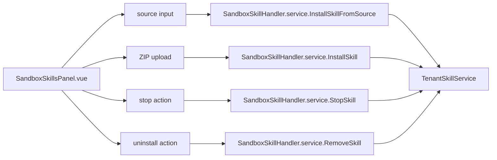

<!-- source: DeepWiki mcp.deepwiki.com · repo Tencent/WeKnora · extra page Tenant Skill Catalog and Installation · fetched 2026-10-29 -->

# Tenant Skill Catalog and Installation

Relevant source files

The following files were used as context for generating this wiki page:

- [client/README.md](client/README.md)
- [client/README_EN.md](client/README_EN.md)
- [client/skill.go](client/skill.go)
- [frontend/src/components/SandboxConfigEditorDrawer.vue](frontend/src/components/SandboxConfigEditorDrawer.vue)
- [frontend/src/components/SandboxSkillsPanel.vue](frontend/src/components/SandboxSkillsPanel.vue)
- [frontend/src/components/SkillInstallTimeline.vue](frontend/src/components/SkillInstallTimeline.vue)
- [frontend/src/views/settings/SandboxSettings.vue](frontend/src/views/settings/SandboxSettings.vue)
- [internal/application/service/agent_service_install_shell_test.go](internal/application/service/agent_service_install_shell_test.go)
- [internal/application/service/tenant_sandbox_config.go](internal/application/service/tenant_sandbox_config.go)
- [internal/application/service/tenant_sandbox_config_test.go](internal/application/service/tenant_sandbox_config_test.go)
- [internal/application/service/tenant_skill_bundle.go](internal/application/service/tenant_skill_bundle.go)
- [internal/application/service/tenant_skill_bundle_test.go](internal/application/service/tenant_skill_bundle_test.go)
- [internal/application/service/tenant_skill_install.go](internal/application/service/tenant_skill_install.go)
- [internal/application/service/tenant_skill_install_test.go](internal/application/service/tenant_skill_install_test.go)
- [internal/application/service/tenant_skill_reaper.go](internal/application/service/tenant_skill_reaper.go)
- [internal/application/service/tenant_skill_reaper_test.go](internal/application/service/tenant_skill_reaper_test.go)
- [internal/application/service/tenant_skill_remove.go](internal/application/service/tenant_skill_remove.go)
- [internal/application/service/tenant_skill_remove_test.go](internal/application/service/tenant_skill_remove_test.go)
- [internal/application/service/tenant_skill_runtime_verify.go](internal/application/service/tenant_skill_runtime_verify.go)
- [internal/application/service/tenant_skill_runtime_verify_test.go](internal/application/service/tenant_skill_runtime_verify_test.go)
- [internal/application/service/tenant_skill_service.go](internal/application/service/tenant_skill_service.go)
- [internal/application/service/tenant_skill_service_test.go](internal/application/service/tenant_skill_service_test.go)
- [internal/application/service/tenant_skill_source.go](internal/application/service/tenant_skill_source.go)
- [internal/application/service/tenant_skill_source_test.go](internal/application/service/tenant_skill_source_test.go)
- [internal/handler/sandbox_skill.go](internal/handler/sandbox_skill.go)
- [internal/handler/sandbox_skill_test.go](internal/handler/sandbox_skill_test.go)
- [internal/types/tenant_skill.go](internal/types/tenant_skill.go)

## Purpose and Scope

This section explains how WeKnora accepts tenant skills from registry, Git, URL, and ZIP sources; validates and installs bundles into sandbox images; reports declared environment variables; and exposes skill-management controls in the frontend. It focuses on the `TenantSkillService` and `SandboxSkillHandler` flow, plus the install and cleanup behavior evidenced by the implementation and tests. [internal/application/service/tenant_skill_install.go:77-99]()[internal/application/service/tenant_skill_source.go:92-114]()[internal/handler/sandbox_skill.go:36-73]()

Sources: `[internal/application/service/tenant_skill_install.go:77-99]()` `[internal/application/service/tenant_skill_source.go:92-114]()` `[internal/handler/sandbox_skill.go:36-73]()`

---

## 1. Skill Sources: ClawHub, SkillHub, Git, and ZIP Uploads

`TenantSkillService.InstallSkillFromSource` resolves a source locator, fetches and normalizes its archive, then hands the resulting bundle to the shared parsed-bundle install path. Direct ZIP uploads enter through `InstallSkill` and use that same path. [internal/application/service/tenant_skill_source.go:92-114]()[internal/application/service/tenant_skill_install.go:77-99]()

| Source form | Resolution behavior |
|---|---|
| ClawHub slug | A bare slug such as `my-skill` resolves against the default registry origin, `https://clawhub.ai`. [internal/application/service/tenant_skill_source.go:25-27]()[internal/application/service/tenant_skill_source.go:148-186]() |
| ClawHub owner and slug | `@owner/slug` is parsed as a registry locator; the owner is treated as the registry owner handle. [internal/application/service/tenant_skill_source.go:148-185]() |
| ClawHub version | A locator such as `my-skill@1.2.0` carries a version; the parser uses a semver-like version pattern. [internal/application/service/tenant_skill_source.go:32-37]()[internal/application/service/tenant_skill_source.go:153-163]() |
| SkillHub / skills.sh | The parser recognizes `skills-sh:owner/repo/slug`; URLs are dispatched according to their host. The source-kind list includes `skills-sh`. [internal/application/service/tenant_skill_source.go:39-49]()[internal/application/service/tenant_skill_source.go:153-163]() |
| GitHub / GitLab | Repository URLs are parsed as GitHub or GitLab sources; the parsed representation includes owner, repository, ref, and subdirectory fields. [internal/application/service/tenant_skill_source.go:39-63]()[internal/application/service/tenant_skill_source.go:148-163]() |
| Direct URL / ZIP | URL parsing supports direct sources, including downloadable ZIPs and URLs identifying `SKILL.md`; uploaded ZIPs use `InstallSkill`. [internal/application/service/tenant_skill_source.go:92-114]()[internal/application/service/tenant_skill_source.go:148-163]() |

### Parsing, Fetching, and Trust Boundaries

`parseSkillSource` chooses one source kind from the input without probing the network. A bare value containing `/` is rejected as ambiguous rather than guessed to be either a registry locator or a Git repository. [internal/application/service/tenant_skill_source.go:148-185]()

Before fetching, `InstallSkillFromSource` calls `requireSkillTarget` to authorize and validate the tenant sandbox configuration. The fetch uses the configured HTTP client or a lazily initialized SSRF-safe default client, with a five-minute timeout. Source requests are anonymous; private registries are explicitly out of scope. [internal/application/service/tenant_skill_source.go:92-126]()

The fetch pipeline is `parseSkillSource` → `fetchSkillSourceBytes` → `normalizeFetchedSkill`. The normalized bundle and original archive are passed to `installParsedSkill`, the same service path used by uploaded archives. [internal/application/service/tenant_skill_source.go:133-146]()[internal/application/service/tenant_skill_source.go:99-114]()

Sources: `[internal/application/service/tenant_skill_source.go:21-63]()` `[internal/application/service/tenant_skill_source.go:92-185]()` `[internal/application/service/tenant_skill_install.go:77-99]()`

---

## 2. Installation Pipeline and Skill Bundle Verification

### Entry Points and Catalog Semantics

`InstallSkill` accepts archive bytes and calls `installSkillArchive` with `skillArchiveUploaded`. That function validates the target, parses the archive with `ParseSkillBundle`, and passes the parsed bundle and original archive to `installParsedSkill`. [internal/application/service/tenant_skill_install.go:77-99]()

`installParsedSkill` treats a same-name skill as an upgrade of the existing row rather than creating a second catalog entry. It also limits supplied install guidance to 10,000 runes and rejects guidance sent while an existing skill is installing or removing. [internal/application/service/tenant_skill_install.go:101-125]()

The service distinguishes uploaded archives from stored catalog archives with `skillArchiveOrigin`. Its comments explain that a retry replays the archive already named by the row, while catalog installation uses the definition’s stored bytes; replaying an older archive must not overwrite a newer catalog definition. [internal/application/service/tenant_skill_install.go:63-75]()

### Install Execution and Image Activation

The install tests pin the command sequence used by `runInstall`: prepare the install area, probe tools, extract the seeded archive, verify the skill tree, verify Python requirements, and clean image scratch space. The happy-path event sequence additionally shows agent execution, manifest writing, workspace cleanup, snapshot creation, pointer switching, stale-state marking, and sandbox destruction. [internal/application/service/tenant_skill_install_test.go:45-77]()[internal/application/service/tenant_skill_install_test.go:119-151]()

The skill files are seeded as a tar archive at `skillSeedArchivePath`, rather than by issuing separate writes for every file. The tests verify that the previous skill tree is prepared before seeding and that the expected manifest and skill files are written. [internal/application/service/tenant_skill_install.go:46-50]()[internal/application/service/tenant_skill_install_test.go:138-151]()

The image pointer changes only after the snapshot exists. A successful install records the resulting snapshot ID, generation, base template ID, and owner fingerprint in the sandbox configuration; the test asserts a single configuration write for the pointer switch. The previous image is not deleted on successful installation. [internal/application/service/tenant_skill_install_test.go:45-77]()

Install runs are coordinated per sandbox configuration. The service uses a Redis-backed lock when available and a local keyed mutex otherwise; the local mutex only provides single-process serialization. The service defines heartbeat, stuck-run, and snapshot-retention intervals for lifecycle management. [internal/application/service/tenant_skill_service.go:20-56]()[internal/application/service/tenant_skill_service.go:58-109]()

### Bundle Verification

`installSkillArchive` invokes `ParseSkillBundle` before starting installation, so invalid archives are rejected before the install pipeline proceeds. The install pipeline then performs structural verification and Python verification; the installer is bounded to two verification rounds, allowing one reconciliation round based on verification findings. [internal/application/service/tenant_skill_install.go:86-99]()[internal/application/service/tenant_skill_install.go:51-60]()[internal/application/service/tenant_skill_install_test.go:119-135]()

The tests also assert that verification does not use the install-mode escape options: `AsRoot` and `AllowSkillsRoot` remain false for the verification executor. [internal/application/service/tenant_skill_install_test.go:68-72]()

Sources: `[internal/application/service/tenant_skill_install.go:33-99]()` `[internal/application/service/tenant_skill_install.go:101-145]()` `[internal/application/service/tenant_skill_service.go:20-109]()` `[internal/application/service/tenant_skill_install_test.go:45-77]()` `[internal/application/service/tenant_skill_install_test.go:119-151]()`

---

## 3. Bundle Verification and Environment Declarations

### Bundle Verification

The service parses an archive into a `SkillBundle` before catalog installation continues. In the runtime install path, the ordered command set includes `skillTreeVerifyCommand` and `installPythonVerifyCommand`; the installer allows two verification rounds so it can reconcile installer output with gate findings once. [internal/application/service/tenant_skill_install.go:86-99]()[internal/application/service/tenant_skill_install.go:51-60]()[internal/application/service/tenant_skill_install_test.go:119-135]()

The verification test checks transport failure reporting for the skill-tree verification command. It scopes the injected failure to that command and expects the resulting error to identify skill-tree verification as the failed stage. [internal/application/service/tenant_skill_install_test.go:153-168]()

### Environment Variable Declarations

The handler represents each declared skill environment variable as `skillEnvResponse`, with `Name`, `Description`, `Required`, and `IsSet` fields. `toSkillEnvResponses` sets `IsSet` based on whether the stored value is non-empty; it does not return the value itself. [internal/handler/sandbox_skill.go:135-159]()

`missingSkillEnvs` returns the names of required variables whose values are empty. The outward `skillResponse` includes both the declarations (`Envs`) and the missing required names (`MissingEnvs`), allowing clients to show configuration state without exposing stored credentials. [internal/handler/sandbox_skill.go:120-128]()[internal/handler/sandbox_skill.go:161-169]()

Sources: `[internal/application/service/tenant_skill_install.go:86-99]()` `[internal/application/service/tenant_skill_install.go:51-60]()` `[internal/application/service/tenant_skill_install_test.go:119-168]()` `[internal/handler/sandbox_skill.go:120-169]()`

---

## 4. Reaper Cleanup and Resource Management

### Stuck-Run Recovery

The skill service defines a 60-minute stuck-run TTL and a 30-second heartbeat interval. The TTL is a silence budget: a long-running install that continues to heartbeat is not considered abandoned. The service also describes `InstallingSince` as the timestamp used to distinguish a live run from a dead one. [internal/application/service/tenant_skill_service.go:27-36]()

The handler’s skill-event stream polls durable status every five seconds and has a 60-minute maximum duration. Its comments explain that a process can die while a skill row remains `installing`; the stuck-run reaper is expected to rewrite that row, while the stream’s duration bound prevents waiting indefinitely. [internal/handler/sandbox_skill.go:22-34]()

The reaper implementation itself is not included in the provided file contents, so this page does not specify its exact state-reconciliation algorithm or cleanup schedule.

### Removal and Snapshot Lifecycle

`RemoveSkill` first changes the row to `Removing`, clears its error, records the operation timestamp, publishes initial progress, and starts a background removal run that is detached from HTTP-request cancellation. The actual removal work shares the per-config lock with installation because both operations can create a snapshot and update the image pointer. [internal/application/service/tenant_skill_remove.go:18-55]()

`runRemove` validates the skill and resolves its directory before sandbox work. If no skill snapshot exists, it can finish removal without starting a sandbox. Otherwise, it counts remaining skills; if none remain, it can clear the image pointer back to the base image instead of producing an unused snapshot. [internal/application/service/tenant_skill_remove.go:59-105]()[internal/application/service/tenant_skill_remove.go:149-178]()

Removal tracks whether the image has changed. If an error happens before the image changes, the service attempts to restore a retryable row; if the image has already changed, it logs that image and bookkeeping may be inconsistent rather than restoring a row that would claim the removed files still exist. [internal/application/service/tenant_skill_remove.go:117-139]()

Sources: `[internal/application/service/tenant_skill_service.go:20-56]()` `[internal/handler/sandbox_skill.go:22-34]()` `[internal/application/service/tenant_skill_remove.go:18-55]()` `[internal/application/service/tenant_skill_remove.go:59-178]()`

---

## 5. Skill UI Panels

### `SandboxSkillsPanel.vue`

`SandboxSkillsPanel.vue` has separate install and list modes. In install mode it presents an installer-model selector, a source input, and a ZIP upload area that accepts `.zip` files and supports drag and drop. The source and upload controls are disabled or gated while installation activity is in progress. [frontend/src/components/SandboxSkillsPanel.vue:1-76]()

In list mode, a focused skill can expose stop and uninstall actions. The panel also displays removal progress and, when a managed skill is available, served-version and upgrade information. [frontend/src/components/SandboxSkillsPanel.vue:78-152]()

### Sandbox Configuration Settings

`SandboxConfigEditorDrawer.vue` provides a multi-step sandbox configuration drawer and displays conflicts such as a template locked by skill snapshots. This is the configuration-editing surface associated with sandbox runtime settings, not the skill archive installer itself. [frontend/src/components/SandboxConfigEditorDrawer.vue:1-57]()[frontend/src/components/SandboxConfigEditorDrawer.vue:59-81]()

`SandboxSettings.vue` presents workspace sandbox settings, including a script-execution policy switch, sandbox backend tabs, configuration cards, and search. [frontend/src/views/settings/SandboxSettings.vue:1-59]()[frontend/src/views/settings/SandboxSettings.vue:62-100]()

Sources: `[frontend/src/components/SandboxSkillsPanel.vue:1-152]()` `[frontend/src/components/SandboxConfigEditorDrawer.vue:1-81]()` `[frontend/src/views/settings/SandboxSettings.vue:1-100]()`

---

## 6. Code Entities Mapping: Bridging Natural Language and Code

### Diagram: Source Locator to Installed Snapshot

The diagram maps the user-facing concepts—source locator, validated skill bundle, install session, and active image—to the implementation symbols used to find those stages in the codebase. [internal/application/service/tenant_skill_source.go:92-146]()[internal/application/service/tenant_skill_install.go:77-99]()[internal/application/service/tenant_skill_install_test.go:45-77]()

```mermaid
flowchart LR
  Source["Source locator: ClawHub, SkillHub, Git, ZIP"] --> Parse["parseSkillSource"]
  Parse --> Fetch["fetchNormalizedSkillBundle"]
  Fetch --> Bundle["ParseSkillBundle"]
  Bundle --> Install["TenantSkillService.installParsedSkill"]
  Install --> Run["runInstall"]
  Run --> Verify["skillTreeVerifyCommand and installPythonVerifyCommand"]
  Verify --> Snapshot["create-snapshot"]
  Snapshot --> Pointer["switch-pointer"]
  Pointer --> Config["SkillImage snapshot configuration"]
```

Sources: `[internal/application/service/tenant_skill_source.go:92-146]()` `[internal/application/service/tenant_skill_install.go:77-99]()` `[internal/application/service/tenant_skill_install_test.go:45-77]()` `[internal/application/service/tenant_skill_install_test.go:119-135]()`

### Diagram: Skill Management UI to Tenant Skill API Surface

The diagram connects the user-facing skill panel to the handler contract and service methods. The handler interface defines the operations available to the admin endpoints; the provided panel excerpt shows source installation, ZIP upload, stop, and uninstall controls. [frontend/src/components/SandboxSkillsPanel.vue:18-57]()[frontend/src/components/SandboxSkillsPanel.vue:78-110]()[internal/handler/sandbox_skill.go:36-73]()

Sources: `[frontend/src/components/SandboxSkillsPanel.vue:18-57]()` `[frontend/src/components/SandboxSkillsPanel.vue:78-110]()` `[internal/handler/sandbox_skill.go:36-73]()`

Sources: `[frontend/src/components/SandboxSkillsPanel.vue:18-57]()` `[frontend/src/components/SandboxSkillsPanel.vue:78-110]()` `[internal/handler/sandbox_skill.go:36-73]()`

---

## 7. Summary Table of Key Components and Responsibilities

| Component | Responsibility | Reference |
|---|---|---|
| `parseSkillSource` | Maps a source string to a specific registry, Git, or URL source kind without network guessing. [internal/application/service/tenant_skill_source.go:148-185]() | `[internal/application/service/tenant_skill_source.go:148-185]()` |
| `fetchNormalizedSkillBundle` | Parses the locator, fetches source bytes, and normalizes the result into a bundle. [internal/application/service/tenant_skill_source.go:133-146]() | `[internal/application/service/tenant_skill_source.go:133-146]()` |
| `InstallSkill` | Accepts uploaded archive bytes and delegates to archive installation. [internal/application/service/tenant_skill_install.go:77-84]() | `[internal/application/service/tenant_skill_install.go:77-84]()` |
| `installParsedSkill` | Handles name-based upgrades, install guidance checks, and catalog/install setup. [internal/application/service/tenant_skill_install.go:101-145]() | `[internal/application/service/tenant_skill_install.go:101-145]()` |
| `TenantSkillService` | Holds skill/config repositories, sandbox resolvers, locking, install heartbeat, and bundle-cache dependencies. [internal/application/service/tenant_skill_service.go:58-123]() | `[internal/application/service/tenant_skill_service.go:58-123]()` |
| `SandboxSkillHandler` | Defines the admin-facing skill service contract and response projection. [internal/handler/sandbox_skill.go:36-73]()[internal/handler/sandbox_skill.go:102-159]() | `[internal/handler/sandbox_skill.go:36-73]()` |
| `RemoveSkill` / `runRemove` | Marks skills as removing and performs the locked image-removal lifecycle. [internal/application/service/tenant_skill_remove.go:18-55]()[internal/application/service/tenant_skill_remove.go:59-105]() | `[internal/application/service/tenant_skill_remove.go:18-55]()` |
| `SandboxSkillsPanel.vue` | Presents source installation, ZIP upload, skill progress, stop, and uninstall controls. [frontend/src/components/SandboxSkillsPanel.vue:1-152]() | `[frontend/src/components/SandboxSkillsPanel.vue:1-152]()` |

Sources: `[internal/application/service/tenant_skill_source.go:133-185]()` `[internal/application/service/tenant_skill_install.go:77-145]()` `[internal/application/service/tenant_skill_service.go:58-123]()` `[internal/application/service/tenant_skill_remove.go:18-105]()` `[internal/handler/sandbox_skill.go:36-159]()` `[frontend/src/components/SandboxSkillsPanel.vue:1-152]()`

---

