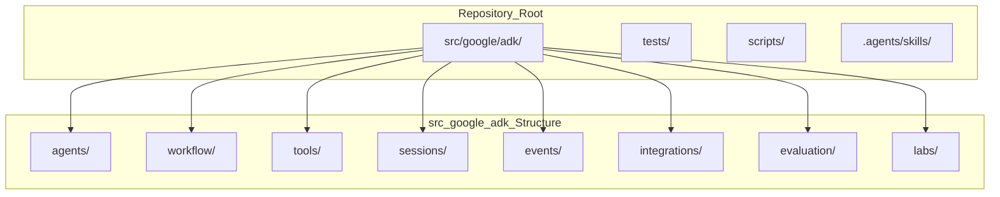
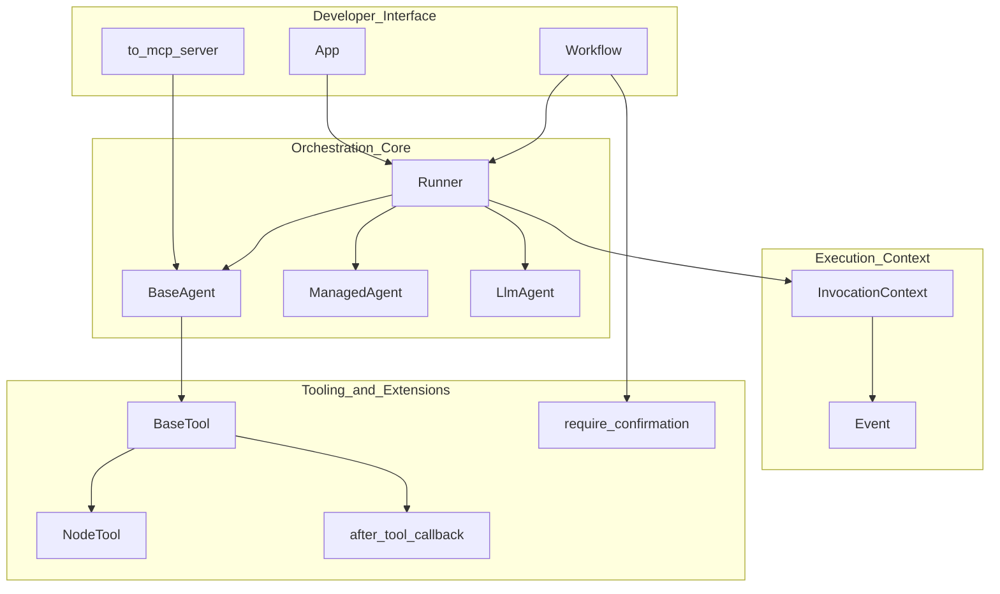
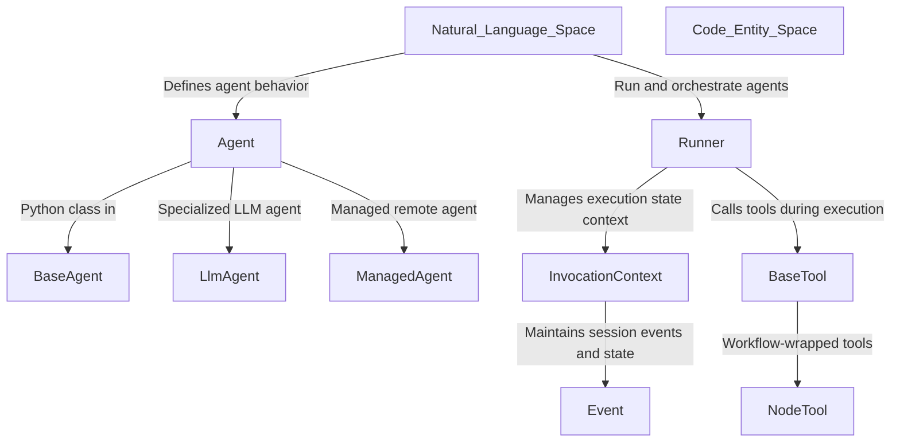
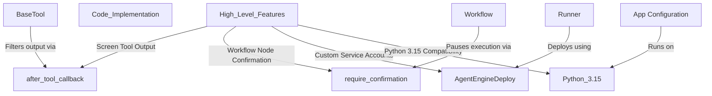
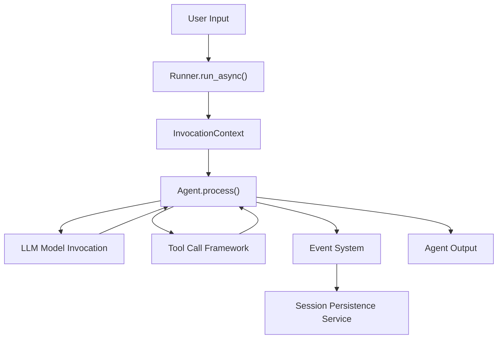

<!-- source: DeepWiki mcp.deepwiki.com · repo google/adk-python · page 1 Overview · fetched 2026-10-29 -->

# Overview

Relevant source files

The following files were used as context for generating this wiki page:

- [.agents/skills/adk-setup/SKILL.md](.agents/skills/adk-setup/SKILL.md)
- [.github/.release-please-manifest-v1.json](.github/.release-please-manifest-v1.json)
- [.github/.release-please-manifest.json](.github/.release-please-manifest.json)
- [.github/pull_request_template.md](.github/pull_request_template.md)
- [.github/release-please-config-v1.json](.github/release-please-config-v1.json)
- [.github/release-please-config.json](.github/release-please-config.json)
- [.gitignore](.gitignore)
- [AGENTS.md](AGENTS.md)
- [CHANGELOG.md](CHANGELOG.md)
- [CONTRIBUTING.md](CONTRIBUTING.md)
- [README.md](README.md)
- [assets/adk-web-dev-ui-function-call.png](assets/adk-web-dev-ui-function-call.png)
- [assets/adk-web-dev-ui.png](assets/adk-web-dev-ui.png)
- [contributing/README.md](contributing/README.md)
- [contributing/adk_project_overview_and_architecture.md](contributing/adk_project_overview_and_architecture.md)
- [scripts/update_constraints.sh](scripts/update_constraints.sh)
- [src/google/adk/__init__.py](src/google/adk/__init__.py)
- [src/google/adk/agents/__init__.py](src/google/adk/agents/__init__.py)
- [src/google/adk/cli/__init__.py](src/google/adk/cli/__init__.py)
- [src/google/adk/cli/browser/styles-4R3GDHUZ.css](src/google/adk/cli/browser/styles-4R3GDHUZ.css)
- [src/google/adk/dependencies/__init__.py](src/google/adk/dependencies/__init__.py)
- [src/google/adk/dependencies/rouge_scorer.py](src/google/adk/dependencies/rouge_scorer.py)
- [src/google/adk/dependencies/vertexai.py](src/google/adk/dependencies/vertexai.py)
- [src/google/adk/integrations/bigquery/search_tool.py](src/google/adk/integrations/bigquery/search_tool.py)
- [src/google/adk/utils/_lazy.py](src/google/adk/utils/_lazy.py)
- [src/google/adk/version.py](src/google/adk/version.py)
- [src/google/adk/workflow/__init__.py](src/google/adk/workflow/__init__.py)
- [tests/unittests/conftest.py](tests/unittests/conftest.py)
- [tests/unittests/dependencies/test_vertexai.py](tests/unittests/dependencies/test_vertexai.py)
- [tests/unittests/isolated_import_utils.py](tests/unittests/isolated_import_utils.py)
- [tests/unittests/test_import_loading.py](tests/unittests/test_import_loading.py)
- [tests/unittests/test_optional_dependencies.py](tests/unittests/test_optional_dependencies.py)
- [tests/unittests/test_release_dependencies.py](tests/unittests/test_release_dependencies.py)
- [tests/unittests/utils/test_lazy.py](tests/unittests/utils/test_lazy.py)
- [tox.ini](tox.ini)

This page provides a high-level introduction to the Agent Development Kit (ADK) Python repository, its architecture, and core concepts. ADK is designed to make AI agent development feel like software development, emphasizing flexibility, testability, and modularity.

**Purpose and Scope**: This overview introduces the ADK Python framework, its purpose as a code-first system for building AI agents, and its high-level architecture at version `2.12.0` [src/google/adk/version.py:16-16](). It covers core components, repository layout, system architecture, data flows, and highlights major features such as tool output interception via `after_tool_callback`, human-in-the-loop workflow node confirmation via `require_confirmation`, performance enhancements in long sessions, and custom service account deployments [README.md:1-36](), [CHANGELOG.md:8-14]().

Sources: [README.md:1-36](), [CHANGELOG.md:8-14](), [src/google/adk/version.py:16-16]()

---

## What is ADK?

Agent Development Kit (ADK) is an open-source, code-first Python framework designed for building, evaluating, and deploying sophisticated AI agents. It applies software development principles to AI agent creation, enabling developers to construct agentic systems ranging from simple single-agent applications to complex, graph-structured multi-agent orchestrations. Although optimized for use with Gemini models, ADK is model-agnostic, deployment-agnostic, and compatible with other frameworks and models [README.md:1-16](), [README.md:32-36]().

**Design Philosophy**:

- **Code-first development:** All agent definitions, instructions, tools, and workflows are specified directly in Python code. This approach promotes standard software best practices such as versioning, unit testing, and IDE support [README.md:56-58]().
- **Modularity and composition:** Complex AI applications are composed of multiple specialized agents and workflows, enabling flexible orchestration and reuse [README.md:49-51]().
- **Deployment-agnostic:** The core agent logic is decoupled from deployment environments. ADK supports local runs via CLI, web UI, FastAPI servers, Cloud Run, and managed platforms like Vertex AI Agent Engine [README.md:64-65]().
- **Workflow-driven architecture:** ADK 2.0 introduces a graph-based deterministic execution engine for composing non-linear agent workflows with features such as routing, fan-out/fan-in, loops, retry policies, state management, human-in-the-loop (HITL) support, and nested workflows [README.md:40-43]().

Sources: [README.md:1-65]()

---

## Repository Structure

The ADK Python repository is organized to clearly separate core functionality, tools, integrations, workflows, and tests.

Title: "Repository Directory Layout"

Sources: [README.md:1-107](), [src/google/adk/version.py:1-16]()

| Directory/File | Purpose | Code/Doc Pointer |
|---|---|---|
| `src/google/adk/agents/` | Agent implementations including `ManagedAgent`, `LlmAgent` | [AGENTS.md:7-10]() |
| `src/google/adk/workflow/` | Graph-based workflow core (`Workflow`, Nodes, `Runner`) | [README.md:40-43]() |
| `src/google/adk/tools/` | Tool framework and custom tools | [CHANGELOG.md:11-12]() |
| `src/google/adk/integrations/` | Integrations including BigQuery, Dataplex | [tests/unittests/test_import_loading.py:195-197]() |
| `src/google/adk/version.py` | Current framework version (`2.12.0`) | [src/google/adk/version.py:16-16]() |

Sources: [README.md:1-107](), [CHANGELOG.md:8-14](), [src/google/adk/version.py:1-16]()

---

## System Architecture

This diagram aligns ADK's conceptual layers — from developer-facing constructs to lower-level execution and tooling — with their concrete code entities, bridging high-level intent to implementation files.

Title: "System Architecture and Component Relationships"

**Key Architectural Updates in v2.12.0**:

- **Performance Enhancements**: Cut time to first model request by 40% in long sessions [CHANGELOG.md:10-10]().
- **Tool Output Interception**: Intercept and filter tool outputs via `after_tool_callback` [CHANGELOG.md:11-11]().
- **Workflow Node Confirmation**: Require human confirmation before executing workflow nodes via `require_confirmation` [CHANGELOG.md:12-12]().
- **Custom Service Accounts**: Deploy agents to Agent Engine using dedicated custom service accounts [CHANGELOG.md:13-13]().
- **Python 3.15 Support**: Install and run ADK on Python 3.15 [CHANGELOG.md:14-14]().

Sources: [CHANGELOG.md:8-14](), [src/google/adk/version.py:1-16]()

---

## Core Components

### Runner and Execution Engine

The `Runner` class is the stateless core orchestrator managing agent execution lifecycles, LLM invocations, workflows, and tool calls. It orchestrates asynchronous operations across sessions, state, and events using the `InvocationContext` object that bundles session state, active tools, agent states, and event histories for deterministic execution flows [AGENTS.md:8-14]().

### Agents and Workflows

- **Agent**: The base abstraction encapsulating an AI agent’s identity, instructions, and tool capabilities. Implemented primarily via `BaseAgent` and subclasses to define agent behavior [AGENTS.md:7-10]().
- **LlmAgent**: Specializes in large language model-backed agents, supporting model configuration, tool integration, output schema enforcement, and multi-mode behaviors.
- **ManagedAgent**: Facilitates agents operating remotely over supported protocols, supporting callback integrations and MCP sessions.
- **Workflow**: Represents a graph-based execution engine coordinating agents, functions, and tools with support for loops, retries, conditional routing, and human-in-the-loop interaction [AGENTS.md:12-14]().

### Tools and Integrations

- **BaseTool and NodeTool**: Extendable abstractions providing diverse capabilities and encapsulating workflow nodes as callable tools [README.md:52-55]().
- **Tool Output Screening**: `after_tool_callback` enables custom interception logic prior to feeding data back to the model [CHANGELOG.md:11-11]().
- **Workflow Approval Gates**: `require_confirmation` integrated into `@node` and `FunctionNode` for explicit human authorization [CHANGELOG.md:50-50]().

Sources: [AGENTS.md:7-14](), [CHANGELOG.md:8-14](), [README.md:52-55]()

---

## Bridging Natural Language Space to Code Entity Space

The following diagrams illustrate mappings from user-facing natural language concepts to the underlying code constructs responsible for these features.

Title: "Core Agent and Runner Code Mapping"

Sources: [AGENTS.md:7-14]()

Title: "Workflow and Tool Enhancements Code Mapping"

Sources: [CHANGELOG.md:8-14](), [src/google/adk/version.py:16-16]()

---

## Data Flow in ADK Agent Execution

The typical data flow shows how user input is processed through the Runner, agents, model invocation, tools, event system, and persistence layers:

Title: "ADK Agent Execution Data Flow"

- User inputs trigger the Runner's asynchronous execution.
- `InvocationContext` maintains session state, memory, and events across agent invocations [AGENTS.md:14-14]().
- The `Agent` processes input, optionally calling the LLM model to generate responses.
- Agents can invoke tools wrapped as `BaseTool` or `NodeTool`, passing results through interception hooks like `after_tool_callback` [CHANGELOG.md:11-11]().
- All interactions (agent outputs, tool invocations, and state changes) are recorded as events.
- Session state and events are persisted through supported session services.
- The final outputs are returned to the user or passed to the next workflow node.

Sources: [AGENTS.md:8-14](), [CHANGELOG.md:8-14](), [src/google/adk/version.py:16-16]()

---

## Next Steps

- Explore [Getting Started](#) for installation and first-agent creation tutorials.
- Review [Core Concepts](#) for detailed understanding of Agents, Runner, Tools, and Sessions.
- Study [Workflow Engine](#) documentation to master graph-based orchestrations.
- Check out [LLM Integration](#) for model providers and configuration options.

Sources: [README.md:1-172](), [CHANGELOG.md:8-14]()

---

