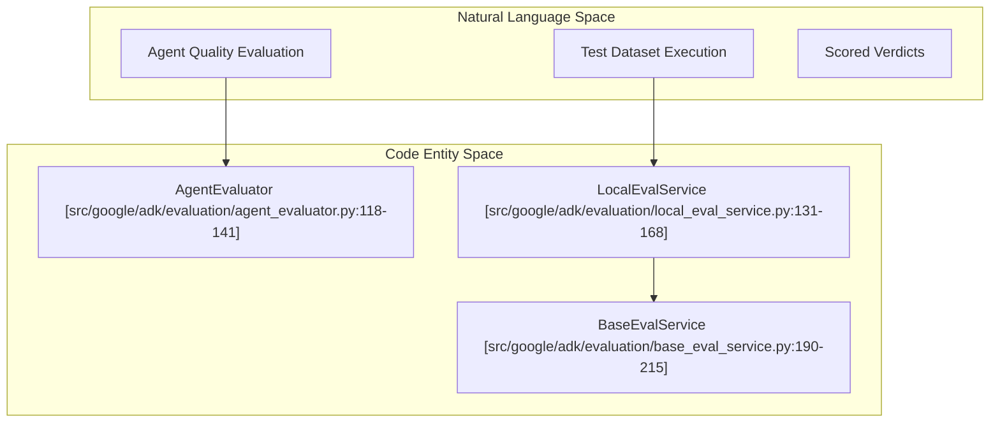
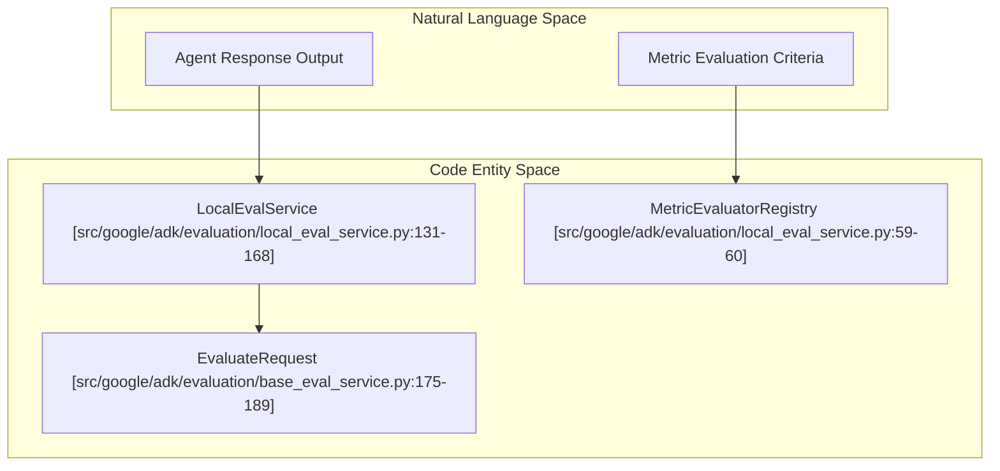

<!-- source: DeepWiki mcp.deepwiki.com · repo google/adk-python · page 10 Evaluation and Testing · fetched 2026-10-29 -->

# Evaluation and Testing

Relevant source files

The following files were used as context for generating this wiki page:

- [src/google/adk/cli/cli_eval.py](src/google/adk/cli/cli_eval.py)
- [src/google/adk/evaluation/_efficiency_evaluators.py](src/google/adk/evaluation/_efficiency_evaluators.py)
- [src/google/adk/evaluation/agent_evaluator.py](src/google/adk/evaluation/agent_evaluator.py)
- [src/google/adk/evaluation/app_details.py](src/google/adk/evaluation/app_details.py)
- [src/google/adk/evaluation/base_eval_service.py](src/google/adk/evaluation/base_eval_service.py)
- [src/google/adk/evaluation/constants.py](src/google/adk/evaluation/constants.py)
- [src/google/adk/evaluation/eval_case.py](src/google/adk/evaluation/eval_case.py)
- [src/google/adk/evaluation/eval_rubrics.py](src/google/adk/evaluation/eval_rubrics.py)
- [src/google/adk/evaluation/evaluation_generator.py](src/google/adk/evaluation/evaluation_generator.py)
- [src/google/adk/evaluation/local_eval_service.py](src/google/adk/evaluation/local_eval_service.py)
- [src/google/adk/evaluation/metric_info_providers.py](src/google/adk/evaluation/metric_info_providers.py)
- [tests/unittests/cli/utils/test_cli_eval.py](tests/unittests/cli/utils/test_cli_eval.py)
- [tests/unittests/cli/utils/test_cli_eval_pretty_print.py](tests/unittests/cli/utils/test_cli_eval_pretty_print.py)
- [tests/unittests/evaluation/test_agent_evaluator.py](tests/unittests/evaluation/test_agent_evaluator.py)
- [tests/unittests/evaluation/test_efficiency_evaluators.py](tests/unittests/evaluation/test_efficiency_evaluators.py)
- [tests/unittests/evaluation/test_eval_case.py](tests/unittests/evaluation/test_eval_case.py)
- [tests/unittests/evaluation/test_evaluation_generator.py](tests/unittests/evaluation/test_evaluation_generator.py)
- [tests/unittests/evaluation/test_local_eval_service.py](tests/unittests/evaluation/test_local_eval_service.py)

This document provides a high-level overview of the evaluation and testing framework in the ADK Python repository (`https://github.com/google/adk-python`). The evaluation system measures agent quality through a two-phase architecture: local inference generation and automated metric evaluation [src/google/adk/evaluation/local_eval_service.py:131-168](), [src/google/adk/evaluation/base_eval_service.py:190-214]().

As a parent page, this document outlines the major subsystems and links to detailed child pages for implementation specifics.

---

## Overview

The ADK evaluation framework coordinates test execution, data management, metric scoring, conformance checking, and agent prompt optimization.

### Evaluation Architecture (Natural Language to Code Entity Space)

**Sources:** [src/google/adk/evaluation/agent_evaluator.py:118-141](), [src/google/adk/evaluation/local_eval_service.py:131-168](), [src/google/adk/evaluation/base_eval_service.py:190-214]()

---

## 10.1. Evaluation Framework

The evaluation framework orchestrates the end-to-end testing workflow via `LocalEvalService`, `AgentEvaluator`, and the `adk eval` command-line interface [src/google/adk/evaluation/agent_evaluator.py:118-141](), [src/google/adk/evaluation/local_eval_service.py:131-168](). The `EvaluationGenerator` is responsible for running the agent against `EvalCase` instances and collecting invocation events [src/google/adk/evaluation/eval_case.py:190-197](). It handles asynchronous inference collection, parallelism control via semaphores, and structured reporting.

For details on the execution lifecycle and CLI commands, see [Evaluation Framework](#10.1).

**Sources:** [src/google/adk/evaluation/agent_evaluator.py:118-141](), [src/google/adk/evaluation/local_eval_service.py:131-168](), [src/google/adk/evaluation/eval_case.py:190-197]()

---

## 10.2. Evaluation Sets and Cases

Test cases are structured using `EvalSet` and `EvalCase` models, which capture conversation scenarios, user inputs, session initialization states, and expected intermediate tool trajectories [src/google/adk/evaluation/eval_case.py:190-197](). Local and Google Cloud Storage (GCS) managers handle persistence and retrieval of test suites. Eval configuration is defined by `EvalConfig` which specifies metrics and their criteria [src/google/adk/evaluation/base_eval_service.py:34-57]().

For details on dataset schemas and storage managers, see [Evaluation Sets and Cases](#10.2).

**Sources:** [src/google/adk/evaluation/eval_case.py:190-197](), [src/google/adk/evaluation/base_eval_service.py:34-57]()

---

## 10.3. Evaluation Metrics and User Personas

ADK provides a registry of metric evaluators supporting deterministic checks, response comparisons, hallucination detection, safety classifiers, and LLM-as-a-judge scoring [src/google/adk/evaluation/local_eval_service.py:59-60](). The `EvaluateConfig` class defines the structure for evaluation metrics, including parallel execution limits and selected criteria [src/google/adk/evaluation/base_eval_service.py:34-57](). Additionally, user simulators enable multi-turn conversation testing using configurable personas [src/google/adk/evaluation/agent_evaluator.py:64]().

### Metric Evaluation Pipeline (Natural Language to Code Entity Space)

**Sources:** [src/google/adk/evaluation/local_eval_service.py:59-168](), [src/google/adk/evaluation/base_eval_service.py:175-189]()

For details on metrics, rubrics, and user simulators, see [Evaluation Metrics and User Personas](#10.3).

**Sources:** [src/google/adk/evaluation/local_eval_service.py:59-168](), [src/google/adk/evaluation/base_eval_service.py:175-189]()

---

## 10.4. Conformance Testing

Conformance testing utilizes `adk conformance` to record agent interactions into YAML files and replay them in subsequent test runs. This ensures regression testing stability across code changes through replay validation and automated markdown report generation.

For details on recording plugins and replay modes, see [Conformance Testing](#10.4).

**Sources:** [src/google/adk/evaluation/local_eval_service.py:131-168]()

---

## 10.5. Optimization

Automated prompt and agent optimization is driven by the `adk optimize` CLI and optimization components [src/google/adk/evaluation/agent_evaluator.py:118-141](). It uses customizable samplers and optimizers to iteratively improve agent trajectories.

For details on optimization workflows and samplers, see [Optimization](#10.5).

**Sources:** [src/google/adk/evaluation/agent_evaluator.py:118-141]()

---

## Key Classes and Interfaces

| Class | File | Purpose |
| :--- | :--- | :--- |
| `LocalEvalService` | `local_eval_service.py` | Orchestrates local inference execution and metric evaluation [src/google/adk/evaluation/local_eval_service.py:131]() |
| `AgentEvaluator` | `agent_evaluator.py` | High-level test helper for running eval sets against agent modules [src/google/adk/evaluation/agent_evaluator.py:118]() |
| `BaseEvalService` | `base_eval_service.py` | Abstract base class defining inference and evaluation service contracts [src/google/adk/evaluation/base_eval_service.py:190]() |
| `EvalCase` | `eval_case.py` | Pydantic model representing individual evaluation test cases [src/google/adk/evaluation/eval_case.py:190]() |
| `EvaluateConfig` | `base_eval_service.py` | Defines evaluation metrics and parallelism configurations [src/google/adk/evaluation/base_eval_service.py:34]() |
| `MetricEvaluatorRegistry` | `metric_evaluator_registry.py` | Manages the registration and retrieval of metric evaluators [src/google/adk/evaluation/local_eval_service.py:59]() |

**Sources:** [src/google/adk/evaluation/local_eval_service.py:59-131](), [src/google/adk/evaluation/agent_evaluator.py:118](), [src/google/adk/evaluation/base_eval_service.py:34-190](), [src/google/adk/evaluation/eval_case.py:190]()

---

