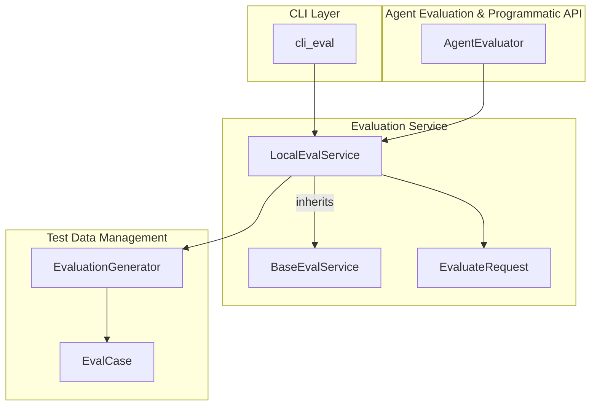
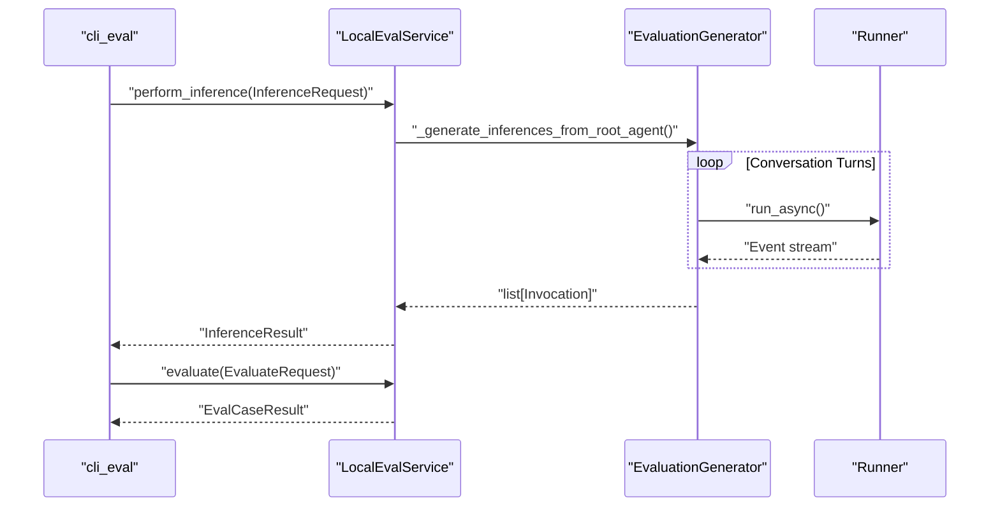
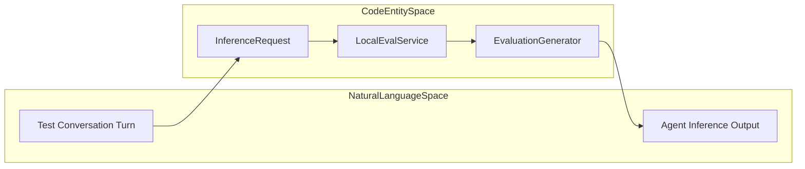
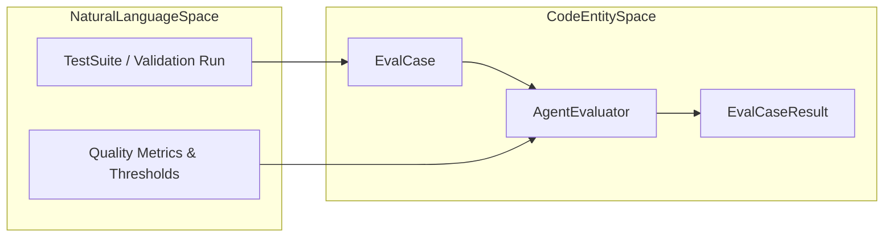
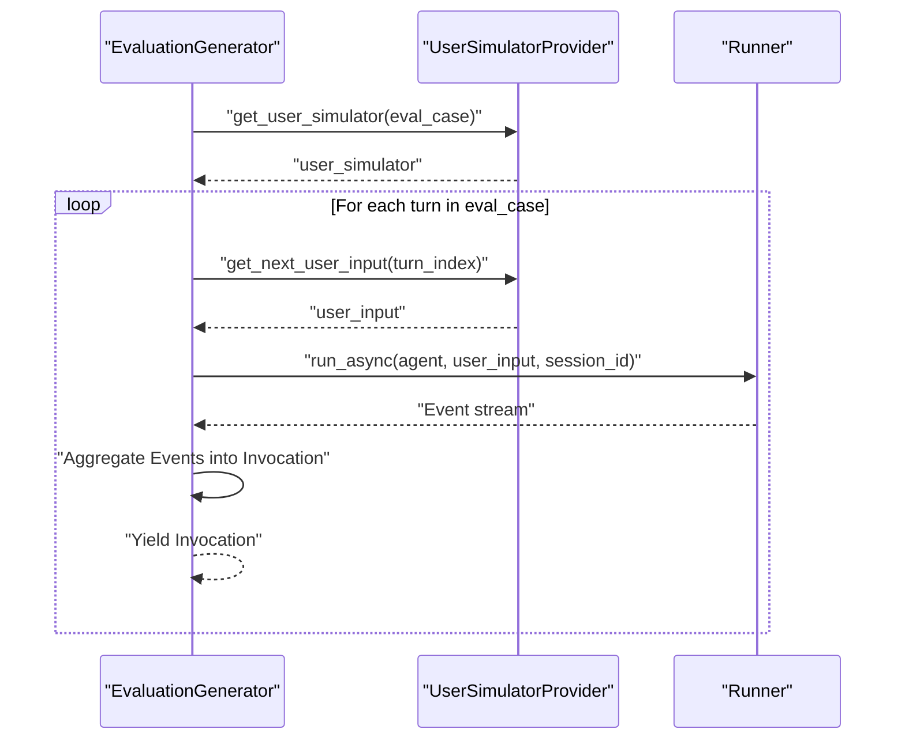

<!-- source: DeepWiki mcp.deepwiki.com · repo google/adk-python · page 10.1 Evaluation Framework · fetched 2026-10-29 -->

# Evaluation Framework

Relevant source files

The following files were used as context for generating this wiki page:

- [src/google/adk/cli/cli_eval.py](src/google/adk/cli/cli_eval.py)
- [src/google/adk/evaluation/_efficiency_evaluators.py](src/google/adk/evaluation/_efficiency_evaluators.py)
- [src/google/adk/evaluation/agent_evaluator.py](src/google/adk/evaluation/agent_evaluator.py)
- [src/google/adk/evaluation/app_details.py](src/google/adk/evaluation/app_details.py)
- [src/google/adk/evaluation/base_eval_service.py](src/google/adk/evaluation/base_eval_service.py)
- [src/google/adk/evaluation/constants.py](src/google/adk/evaluation/constants.py)
- [src/google/adk/evaluation/eval_case.py](src/google/adk/evaluation/eval_case.py)
- [src/google/adk/evaluation/eval_rubrics.py](src/google/adk/evaluation/eval_rubrics.py)
- [src/google/adk/evaluation/evaluation_generator.py](src/google/adk/evaluation/evaluation_generator.py)
- [src/google/adk/evaluation/local_eval_service.py](src/google/adk/evaluation/local_eval_service.py)
- [src/google/adk/evaluation/metric_info_providers.py](src/google/adk/evaluation/metric_info_providers.py)
- [tests/unittests/cli/utils/test_cli_eval.py](tests/unittests/cli/utils/test_cli_eval.py)
- [tests/unittests/cli/utils/test_cli_eval_pretty_print.py](tests/unittests/cli/utils/test_cli_eval_pretty_print.py)
- [tests/unittests/evaluation/test_agent_evaluator.py](tests/unittests/evaluation/test_agent_evaluator.py)
- [tests/unittests/evaluation/test_efficiency_evaluators.py](tests/unittests/evaluation/test_efficiency_evaluators.py)
- [tests/unittests/evaluation/test_eval_case.py](tests/unittests/evaluation/test_eval_case.py)
- [tests/unittests/evaluation/test_evaluation_generator.py](tests/unittests/evaluation/test_evaluation_generator.py)
- [tests/unittests/evaluation/test_local_eval_service.py](tests/unittests/evaluation/test_local_eval_service.py)

## Purpose and Scope

The evaluation framework in ADK provides a systematic approach to measuring agent quality through automated testing and validation. This page documents the core evaluation components, including `LocalEvalService`, `AgentEvaluator`, `EvaluationGenerator`, and the `adk eval` CLI integration workflow [src/google/adk/evaluation/local_eval_service.py:131-168](), [src/google/adk/evaluation/agent_evaluator.py:118-170](), [src/google/adk/evaluation/evaluation_generator.py:34-76](), [src/google/adk/cli/cli_eval.py]().

**Scope:** This page covers evaluation architecture, service implementation, generation logic, and CLI commands. For details on evaluation datasets, see [10.2 Evaluation Sets and Cases](). For metrics and user simulation, see [10.3 Evaluation Metrics and User Personas](). For conformance testing, see [10.4 Conformance Testing](). For prompt optimization using evaluation results, see [10.5 Optimization]().

Sources: [src/google/adk/evaluation/local_eval_service.py:131-168](), [src/google/adk/evaluation/agent_evaluator.py:118-170](), [src/google/adk/evaluation/evaluation_generator.py:34-76](), [src/google/adk/cli/cli_eval.py]()

---

## Overview

The evaluation framework enables developers to:
- Define test cases with expected behaviors and conversation scenarios [src/google/adk/evaluation/eval_case.py:190-194]().
- Run agents against test suites automatically using local services [src/google/adk/evaluation/local_eval_service.py:131-168]().
- Measure performance using standard and custom metric evaluators [src/google/adk/evaluation/base_eval_service.py:190-214]().
- Compare results across agent versions and manage evaluation histories [src/google/adk/evaluation/agent_evaluator.py:118-170]().
- Simulate user interactions for multi-turn conversations via `EvaluationGenerator` [src/google/adk/evaluation/evaluation_generator.py:34-76]().

The framework is distributed as part of the optional `eval` dependency extra and relies on packages such as `pandas`, `rouge-score`, and `tabulate`.

**Core Classes and Modules:**
- `LocalEvalService`: Concrete implementation of `BaseEvalService` that coordinates inference generation and metric evaluation locally [src/google/adk/evaluation/local_eval_service.py:131-168]().
- `AgentEvaluator`: Programmatic interface for running evaluation sets in test suites or deployment pipelines [src/google/adk/evaluation/agent_evaluator.py:118-170]().
- `EvaluationGenerator`: Orchestrates user-agent simulation loops to collect inferences [src/google/adk/evaluation/evaluation_generator.py:34-76]().
- `BaseEvalService`: Abstract base class defining `perform_inference` and `evaluate` interfaces [src/google/adk/evaluation/base_eval_service.py:190-214]().

Sources: [src/google/adk/evaluation/local_eval_service.py:131-168](), [src/google/adk/evaluation/agent_evaluator.py:118-170](), [src/google/adk/evaluation/evaluation_generator.py:34-76](), [src/google/adk/evaluation/base_eval_service.py:190-214](), [src/google/adk/evaluation/eval_case.py:190-194]()

---

## Architecture and Components

The evaluation framework follows a modular architecture separating test case management, execution orchestration, and metric evaluation.

### Component Diagram

Sources: [src/google/adk/evaluation/local_eval_service.py:131-168](), [src/google/adk/evaluation/base_eval_service.py:34-214](), [src/google/adk/evaluation/evaluation_generator.py:34-76](), [src/google/adk/evaluation/agent_evaluator.py:118-170]()

---

## Evaluation Workflow

The evaluation process follows a pipeline from loading test sets through running agent inferences (`perform_inference`) to computing evaluation metrics (`evaluate`) [src/google/adk/evaluation/base_eval_service.py:190-214]().

### Workflow Diagram

Sources: [src/google/adk/evaluation/local_eval_service.py:131-168](), [src/google/adk/evaluation/base_eval_service.py:190-214]()

---

## Natural Language Space to Code Entity Space Bridges

### Bridge 1: Agent Execution & Inference Collection
This bridge connects high-level conversation test cases to their underlying code implementations in `LocalEvalService` and `EvaluationGenerator`.

Sources: [src/google/adk/evaluation/local_eval_service.py:131-168](), [src/google/adk/evaluation/evaluation_generator.py:34-76](), [src/google/adk/evaluation/base_eval_service.py:98-128]()

### Bridge 2: Programmatic Evaluation & Test Harness
This bridge maps the concept of evaluating test suites programmatically to `AgentEvaluator` and `EvalCase` structures [src/google/adk/evaluation/agent_evaluator.py:118-170](), [src/google/adk/evaluation/eval_case.py:190-194]().

Sources: [src/google/adk/evaluation/agent_evaluator.py:118-170](), [src/google/adk/evaluation/eval_case.py:190-194](), [src/google/adk/evaluation/eval_result.py]()

---

## LocalEvalService and AgentEvaluator

### LocalEvalService Implementation
`LocalEvalService` [src/google/adk/evaluation/local_eval_service.py:131-168]() implements `BaseEvalService` [src/google/adk/evaluation/base_eval_service.py:190-214]() to execute test cases locally:
- `perform_inference` processes an `InferenceRequest` [src/google/adk/evaluation/base_eval_service.py:98-128]() and generates responses via `EvaluationGenerator`.
- `evaluate` evaluates collected inferences against configured metrics, returning `EvalCaseResult` items.
- Supports optional `App` wrapping [src/google/adk/evaluation/local_eval_service.py:146-155]() to honor application-level plugins, context caching, and resumability configurations.

### AgentEvaluator Utility
`AgentEvaluator` [src/google/adk/evaluation/agent_evaluator.py:118-170]() simplifies running evaluations within tests or scripts:
- `evaluate_eval_set` orchestrates evaluation runs across `EvalSet` objects [src/google/adk/evaluation/agent_evaluator.py:129-170]().
- `find_config_for_test_file` automatically locates `test_config.json` relative to test files [src/google/adk/evaluation/agent_evaluator.py:122-127]().

Sources: [src/google/adk/evaluation/local_eval_service.py:131-168](), [src/google/adk/evaluation/base_eval_service.py:98-214](), [src/google/adk/evaluation/agent_evaluator.py:118-170]()

---

## EvaluationGenerator

The `EvaluationGenerator` [src/google/adk/evaluation/evaluation_generator.py:34-76]() simulates user interactions and collects agent responses during an evaluation run, bridging `LocalEvalService` and `Runner`.

### Key Responsibilities
- **User Simulation**: Utilizes `UserSimulatorProvider` to generate user inputs based on `EvalCase` definitions [src/google/adk/evaluation/evaluation_generator.py:75-75](), [src/google/adk/evaluation/eval_case.py:190-194]().
- **Agent Execution**: Invokes agent execution via `Runner` [src/google/adk/evaluation/evaluation_generator.py:54-54]() for each conversation turn.
- **Inference Collection**: Collects `Event` streams and aggregates them into `Invocation` objects representing full turn responses [src/google/adk/evaluation/eval_case.py:97-137]().
- **Multi-turn Handling**: Manages state across conversation turns to maintain context.

### Execution Sequence

Sources: [src/google/adk/evaluation/evaluation_generator.py:34-76](), [src/google/adk/evaluation/eval_case.py:97-194]()

---

## `adk eval` CLI Integration

The `adk eval` command provides a command-line interface for running agent evaluations. It integrates `LocalEvalService` and evaluation set managers to allow users to specify agents, evaluation sets, and configuration parameters [src/google/adk/cli/cli_eval.py](), [src/google/adk/evaluation/local_eval_service.py:131-168]().

### Key Features
- **Module Loading**: Automatically resolves agent modules and `App` instances [src/google/adk/cli/cli_eval.py:94-117]().
- **Result Persistence**: Uses `EvalSetResultsManager` to output JSON evaluation set results [src/google/adk/evaluation/agent_evaluator.py:168-169]().
- **Detailed Reporting**: Supports writing per-invocation evaluation results to CSV files [src/google/adk/evaluation/agent_evaluator.py:162-164]().

Sources: [src/google/adk/cli/cli_eval.py:94-117](), [src/google/adk/evaluation/agent_evaluator.py:118-170](), [src/google/adk/evaluation/local_eval_service.py:131-168]()

---

