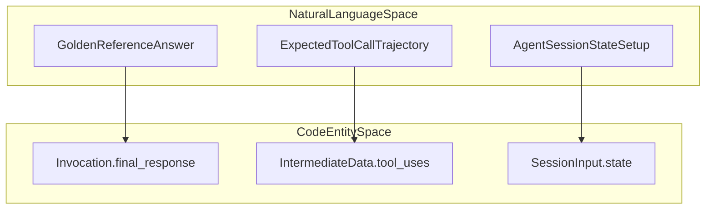
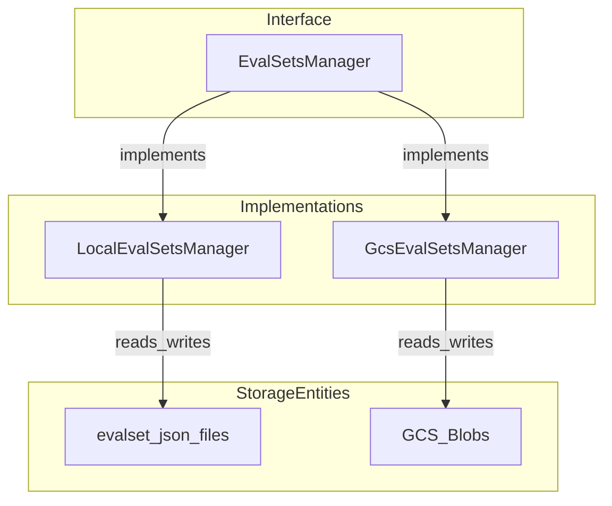

<!-- source: DeepWiki mcp.deepwiki.com · repo google/adk-python · page 10.2 Evaluation Sets and Cases · fetched 2026-10-29 -->

# Evaluation Sets and Cases

<details>
<summary>Relevant source files</summary>

The following files were used as context for generating this wiki page:

- [src/google/adk/evaluation/_eval_set_results_manager_utils.py](src/google/adk/evaluation/_eval_set_results_manager_utils.py)
- [src/google/adk/evaluation/_path_validation.py](src/google/adk/evaluation/_path_validation.py)
- [src/google/adk/evaluation/eval_config.py](src/google/adk/evaluation/eval_config.py)
- [src/google/adk/evaluation/eval_result.py](src/google/adk/evaluation/eval_result.py)
- [src/google/adk/evaluation/eval_set.py](src/google/adk/evaluation/eval_set.py)
- [src/google/adk/evaluation/eval_set_results_manager.py](src/google/adk/evaluation/eval_set_results_manager.py)
- [src/google/adk/evaluation/eval_sets_manager.py](src/google/adk/evaluation/eval_sets_manager.py)
- [src/google/adk/evaluation/gcs_eval_set_results_manager.py](src/google/adk/evaluation/gcs_eval_set_results_manager.py)
- [src/google/adk/evaluation/gcs_eval_sets_manager.py](src/google/adk/evaluation/gcs_eval_sets_manager.py)
- [src/google/adk/evaluation/in_memory_eval_sets_manager.py](src/google/adk/evaluation/in_memory_eval_sets_manager.py)
- [src/google/adk/evaluation/local_eval_set_results_manager.py](src/google/adk/evaluation/local_eval_set_results_manager.py)
- [src/google/adk/evaluation/local_eval_sets_manager.py](src/google/adk/evaluation/local_eval_sets_manager.py)
- [src/google/adk/evaluation/simulation/_cloud_tts_llm.py](src/google/adk/evaluation/simulation/_cloud_tts_llm.py)
- [src/google/adk/evaluation/simulation/_llm_audio_user_simulator.py](src/google/adk/evaluation/simulation/_llm_audio_user_simulator.py)
- [tests/unittests/evaluation/mock_gcs_utils.py](tests/unittests/evaluation/mock_gcs_utils.py)
- [tests/unittests/evaluation/simulation/test_cloud_tts_llm.py](tests/unittests/evaluation/simulation/test_cloud_tts_llm.py)
- [tests/unittests/evaluation/test__path_validation.py](tests/unittests/evaluation/test__path_validation.py)
- [tests/unittests/evaluation/test_eval_config.py](tests/unittests/evaluation/test_eval_config.py)
- [tests/unittests/evaluation/test_gcs_eval_set_results_manager.py](tests/unittests/evaluation/test_gcs_eval_set_results_manager.py)
- [tests/unittests/evaluation/test_gcs_eval_sets_manager.py](tests/unittests/evaluation/test_gcs_eval_sets_manager.py)
- [tests/unittests/evaluation/test_in_memory_eval_sets_manager.py](tests/unittests/evaluation/test_in_memory_eval_sets_manager.py)
- [tests/unittests/evaluation/test_local_eval_set_results_manager.py](tests/unittests/evaluation/test_local_eval_set_results_manager.py)
- [tests/unittests/evaluation/test_local_eval_sets_manager.py](tests/unittests/evaluation/test_local_eval_sets_manager.py)

</details>


This page documents the Evaluation Set system in ADK, which provides structured storage and management of test cases for agent evaluation. An **EvalSet** is a named collection of **EvalCases** used to systematically test agent behavior against predefined scenarios, including both static conversations and dynamic simulation scenarios.

## Purpose and Scope

Evaluation Sets serve as the foundation for automated agent testing in ADK. They enable:

-   **Reproducible Testing**: Store test cases that can be run consistently across agent versions [contributing/samples/evaluation/README.md:10-16]().
-   **Trajectory Verification**: Define expected tool use trajectories and intermediate agent responses [src/google/adk/evaluation/local_eval_sets_manager.py:49-86]().
-   **Collaborative Development**: Share test cases across teams via local files or Google Cloud Storage (GCS) [src/google/adk/evaluation/gcs_eval_sets_manager.py:44-46]().

Sources: [contributing/samples/evaluation/README.md:10-16](), [src/google/adk/evaluation/local_eval_sets_manager.py:49-86](), [src/google/adk/evaluation/gcs_eval_sets_manager.py:44-46]()

## Data Structures

### EvalSet and EvalCase Hierarchy

The evaluation data model is built on Pydantic to ensure strict validation and schema consistency across storage backends.

**Diagram: EvalSet and EvalCase Code Entities**

```mermaid
classDiagram
    class "EvalSet" as EvalSet {
        +str eval_set_id
        +str name
        +list~EvalCase~ eval_cases
        +float creation_timestamp
    }

    class "EvalCase" as EvalCase {
        +str eval_id
        +list~Invocation~ conversation
        +SessionInput session_input
        +float creation_timestamp
    }

    class "Invocation" as Invocation {
        +str invocation_id
        +Content user_content
        +Content final_response
        +IntermediateData intermediate_data
        +float creation_timestamp
    }

    class "IntermediateData" as IntermediateData {
        +list~FunctionCall~ tool_uses
        +list~tuple~ intermediate_responses
    }

    EvalSet "1" *-- "many" EvalCase : "contains"
    EvalCase "1" *-- "0..*" "Invocation" : "conversation"
    Invocation "1" *-- "0..1" "IntermediateData" : "intermediate_data"
```

-   **EvalSet** (`google.adk.evaluation.eval_set.EvalSet`): The top-level container defined by `eval_set_id` and a list of `eval_cases` [src/google/adk/evaluation/local_eval_sets_manager.py:168-173]().
-   **EvalCase** (`google.adk.evaluation.eval_case.EvalCase`): Represents a specific test scenario with an `eval_id`, a `conversation` list of invocations, and optional `session_input` [src/google/adk/evaluation/local_eval_sets_manager.py:140-166]().
-   **Invocation** (`google.adk.evaluation.eval_case.Invocation`): Represents a single turn containing `user_content`, `final_response`, and `intermediate_data` [src/google/adk/evaluation/local_eval_sets_manager.py:49-86]().

Sources: [src/google/adk/evaluation/local_eval_sets_manager.py:49-173]()

## Natural Language Space to Code Entity Space

To bridge conceptual evaluation requests to their code implementations, the mapping between natural language test definitions and ADK code constructs is represented below:

**Diagram: Evaluation Concept Mapping**



Sources: [src/google/adk/evaluation/local_eval_sets_manager.py:49-166]()

## Storage and Management

ADK uses an abstract `EvalSetsManager` interface to decouple evaluation logic from underlying storage backends [src/google/adk/evaluation/eval_sets_manager.py:25-87]().

### EvalSetsManager Implementations

**Diagram: Manager Implementations and Data Flow**



1.  **LocalEvalSetsManager** (`google.adk.evaluation.local_eval_sets_manager.LocalEvalSetsManager`): Stores evaluation sets locally on disk as `.evalset.json` files [src/google/adk/evaluation/local_eval_sets_manager.py:46](), [src/google/adk/evaluation/local_eval_sets_manager.py:192-196](). It supports legacy schema conversions via `convert_eval_set_to_pydantic_schema` [src/google/adk/evaluation/local_eval_sets_manager.py:89-173](). Path segment safety validation is enforced through `validate_path_segment` (`src/google/adk/evaluation/_path_validation.py`) [src/google/adk/evaluation/_path_validation.py:22-32]().
2.  **GcsEvalSetsManager** (`google.adk.evaluation.gcs_eval_sets_manager.GcsEvalSetsManager`): Stores evaluation sets as blobs inside a Google Cloud Storage bucket under `evals/eval_sets` [src/google/adk/evaluation/gcs_eval_sets_manager.py:40](), [src/google/adk/evaluation/gcs_eval_sets_manager.py:44-46]().

Sources: [src/google/adk/evaluation/eval_sets_manager.py:25-87](), [src/google/adk/evaluation/local_eval_sets_manager.py:46-196](), [src/google/adk/evaluation/gcs_eval_sets_manager.py:40-46](), [src/google/adk/evaluation/_path_validation.py:22-32]()

## Evaluation Configuration Files

Evaluation configuration is defined using `EvalConfig` [src/google/adk/evaluation/eval_config.py:98-102](), which allows users to specify metrics, their thresholds, and other properties for an evaluation run.

**Diagram: EvalConfig Structure**

```mermaid
classDiagram
    class "EvalConfig" as EvalConfig {
        +dict criteria
        +dict custom_metrics
        +UserSimulatorConfig user_simulator_config
        +LiveModelConfig live_model_config
    }

    class "CustomMetricConfig" as CustomMetricConfig {
        +CodeConfig code_config
        +MetricInfo metric_info
        +str description
    }

    class "LiveModelConfig" as LiveModelConfig {
        +int timeout_seconds
    }

    EvalConfig "1" *-- "0..*" CustomMetricConfig : "custom_metrics"
    EvalConfig "1" *-- "0..1" LiveModelConfig : "live_model_config"
```

Key components of `EvalConfig`:

-   **`criteria`**: A dictionary mapping metric names to their evaluation criteria. This can be a simple `Threshold` or a more complex criterion [src/google/adk/evaluation/eval_config.py:109-136]().
-   **`custom_metrics`**: An optional dictionary mapping custom metric names to `CustomMetricConfig` objects, utilizing `CodeConfig` to locate custom metric functions [src/google/adk/evaluation/eval_config.py:60-79](), [src/google/adk/evaluation/eval_config.py:138-179]().
-   **`user_simulator_config`**: Configuration for user simulators like `LlmBackedUserSimulatorConfig` or `LlmAudioUserSimulatorConfig` selected via a `type` discriminator [src/google/adk/evaluation/eval_config.py:46-49](), [src/google/adk/evaluation/eval_config.py:186-196]().
-   **`live_model_config`**: Configuration for evaluating models in live (bidirectional streaming) mode, including `timeout_seconds` [src/google/adk/evaluation/eval_config.py:81-97]().

Sources: [src/google/adk/evaluation/eval_config.py:46-208]()

## Results Management

Evaluation results are managed via the `EvalSetResultsManager` interface to enable historical tracking and reporting [src/google/adk/evaluation/eval_set_results_manager.py]().

-   **LocalEvalSetResultsManager** (`google.adk.evaluation.local_eval_set_results_manager.LocalEvalSetResultsManager`): Persists evaluation results in the `.adk/eval_history` directory as `.evalset_result.json` files [src/google/adk/evaluation/local_eval_set_results_manager.py:32-41]().
-   **GcsEvalSetResultsManager** (`google.adk.evaluation.gcs_eval_set_results_manager.GcsEvalSetResultsManager`): Stores evaluation results in GCS blobs under the `evals/eval_history` path [src/google/adk/evaluation/gcs_eval_set_results_manager.py:34-41]().

Sources: [src/google/adk/evaluation/local_eval_set_results_manager.py:32-41](), [src/google/adk/evaluation/gcs_eval_set_results_manager.py:34-41]()

---

