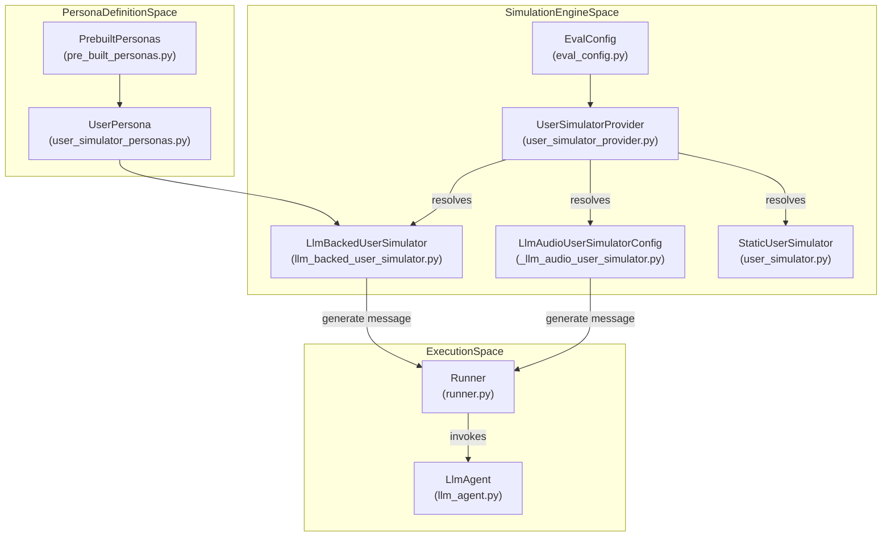

<!-- source: DeepWiki mcp.deepwiki.com · repo google/adk-python · page 10.3 Evaluation Metrics and User Personas · fetched 2026-10-29 -->

# Evaluation Metrics and User Personas

<details>
<summary>Relevant source files</summary>

The following files were used as context for generating this wiki page:

- [src/google/adk/evaluation/common.py](src/google/adk/evaluation/common.py)
- [src/google/adk/evaluation/eval_metrics.py](src/google/adk/evaluation/eval_metrics.py)
- [src/google/adk/evaluation/evaluator.py](src/google/adk/evaluation/evaluator.py)
- [src/google/adk/evaluation/final_response_match_v1.py](src/google/adk/evaluation/final_response_match_v1.py)
- [src/google/adk/evaluation/final_response_match_v2.py](src/google/adk/evaluation/final_response_match_v2.py)
- [src/google/adk/evaluation/hallucinations_v1.py](src/google/adk/evaluation/hallucinations_v1.py)
- [src/google/adk/evaluation/llm_as_judge.py](src/google/adk/evaluation/llm_as_judge.py)
- [src/google/adk/evaluation/llm_as_judge_utils.py](src/google/adk/evaluation/llm_as_judge_utils.py)
- [src/google/adk/evaluation/metric_evaluator_registry.py](src/google/adk/evaluation/metric_evaluator_registry.py)
- [src/google/adk/evaluation/response_evaluator.py](src/google/adk/evaluation/response_evaluator.py)
- [src/google/adk/evaluation/rubric_based_evaluator.py](src/google/adk/evaluation/rubric_based_evaluator.py)
- [src/google/adk/evaluation/rubric_based_final_response_quality_v1.py](src/google/adk/evaluation/rubric_based_final_response_quality_v1.py)
- [src/google/adk/evaluation/rubric_based_multi_turn_trajectory_evaluator.py](src/google/adk/evaluation/rubric_based_multi_turn_trajectory_evaluator.py)
- [src/google/adk/evaluation/rubric_based_tool_use_quality_v1.py](src/google/adk/evaluation/rubric_based_tool_use_quality_v1.py)
- [src/google/adk/evaluation/safety_evaluator.py](src/google/adk/evaluation/safety_evaluator.py)
- [src/google/adk/evaluation/simulation/llm_backed_user_simulator.py](src/google/adk/evaluation/simulation/llm_backed_user_simulator.py)
- [src/google/adk/evaluation/simulation/per_turn_user_simulator_quality_v1.py](src/google/adk/evaluation/simulation/per_turn_user_simulator_quality_v1.py)
- [src/google/adk/evaluation/simulation/user_simulator.py](src/google/adk/evaluation/simulation/user_simulator.py)
- [src/google/adk/evaluation/trajectory_evaluator.py](src/google/adk/evaluation/trajectory_evaluator.py)
- [src/google/adk/evaluation/vertex_ai_eval_facade.py](src/google/adk/evaluation/vertex_ai_eval_facade.py)
- [tests/unittests/evaluation/simulation/test_llm_audio_user_simulator.py](tests/unittests/evaluation/simulation/test_llm_audio_user_simulator.py)
- [tests/unittests/evaluation/simulation/test_llm_backed_user_simulator.py](tests/unittests/evaluation/simulation/test_llm_backed_user_simulator.py)
- [tests/unittests/evaluation/simulation/test_per_turn_user_simulation_quality_v1.py](tests/unittests/evaluation/simulation/test_per_turn_user_simulation_quality_v1.py)
- [tests/unittests/evaluation/simulation/test_user_simulator_provider.py](tests/unittests/evaluation/simulation/test_user_simulator_provider.py)
- [tests/unittests/evaluation/test_final_response_match_v1.py](tests/unittests/evaluation/test_final_response_match_v1.py)
- [tests/unittests/evaluation/test_final_response_match_v2.py](tests/unittests/evaluation/test_final_response_match_v2.py)
- [tests/unittests/evaluation/test_hallucinations_v1.py](tests/unittests/evaluation/test_hallucinations_v1.py)
- [tests/unittests/evaluation/test_llm_as_judge.py](tests/unittests/evaluation/test_llm_as_judge.py)
- [tests/unittests/evaluation/test_llm_as_judge_utils.py](tests/unittests/evaluation/test_llm_as_judge_utils.py)
- [tests/unittests/evaluation/test_metric_evaluator_registry.py](tests/unittests/evaluation/test_metric_evaluator_registry.py)
- [tests/unittests/evaluation/test_response_evaluator.py](tests/unittests/evaluation/test_response_evaluator.py)
- [tests/unittests/evaluation/test_rubric_based_evaluator.py](tests/unittests/evaluation/test_rubric_based_evaluator.py)
- [tests/unittests/evaluation/test_rubric_based_final_response_quality_v1.py](tests/unittests/evaluation/test_rubric_based_final_response_quality_v1.py)
- [tests/unittests/evaluation/test_rubric_based_multi_turn_trajectory_evaluator.py](tests/unittests/evaluation/test_rubric_based_multi_turn_trajectory_evaluator.py)
- [tests/unittests/evaluation/test_rubric_based_tool_use_quality_v1.py](tests/unittests/evaluation/test_rubric_based_tool_use_quality_v1.py)
- [tests/unittests/evaluation/test_safety_evaluator.py](tests/unittests/evaluation/test_safety_evaluator.py)
- [tests/unittests/evaluation/test_trajectory_evaluator.py](tests/unittests/evaluation/test_trajectory_evaluator.py)
- [tests/unittests/evaluation/test_vertex_ai_eval_facade.py](tests/unittests/evaluation/test_vertex_ai_eval_facade.py)

</details>


## Purpose and Scope

This page documents the evaluation metrics system and user persona framework in ADK, which enable quantitative assessment of agent performance and automated user interaction simulation. The evaluation system provides two primary capabilities:
1. **Metrics**: Quantitative measures to assess agent responses, tool usage trajectories, safety, and hallucinations via `EvalMetric` [src/google/adk/evaluation/eval_metrics.py:33-33]() and `Evaluator` [src/google/adk/evaluation/evaluator.py:27-27]() subclasses.
2. **User Personas**: Simulated users that interact with agents for testing purposes using `LlmBackedUserSimulator` [src/google/adk/evaluation/simulation/llm_backed_user_simulator.py:125-146]() or `UserSimulator` [src/google/adk/evaluation/simulation/user_simulator.py:30-30]().

Sources: [src/google/adk/evaluation/eval_metrics.py:33-33](), [src/google/adk/evaluation/evaluator.py:27-27](), [src/google/adk/evaluation/simulation/llm_backed_user_simulator.py:125-146](), [src/google/adk/evaluation/simulation/user_simulator.py:30-30]()

---

## Metric Evaluators and Registry

The `MetricEvaluatorRegistry` manages the mapping between `EvalMetric` definitions and their corresponding `Evaluator` implementations [src/google/adk/evaluation/metric_evaluator_registry.py:76-116](). It seeds standard prebuilt metrics and resolves custom functions via `CodeConfig` [src/google/adk/evaluation/eval_config.py:64-69]().

### Prebuilt Metrics and Registry Flow

The following diagram bridges natural language configuration to code entities for metric resolution.

**Metric Execution Entity Map**

```mermaid
graph TD
    subgraph "NaturalLanguageSpace"
        UserConfig["EvalConfig"]
        Criteria["tool_trajectory_avg_score: 1.0"]
    end

    subgraph "CodeEntitySpace"
        Registry["MetricEvaluatorRegistry<br/>(metric_evaluator_registry.py)"]
        EvalMetric["EvalMetric<br/>(eval_metrics.py)"]
        Evaluator["Evaluator<br/>(evaluator.py)"]
        
        subgraph "SpecificEvaluators"
            TrajEval["TrajectoryEvaluator<br/>(trajectory_evaluator.py)"]
            RespEval["ResponseEvaluator<br/>(response_evaluator.py)"]
            HallucEval["HallucinationsV1Evaluator<br/>(hallucinations_v1.py)"]
            TaskSuccessEval["MultiTurnTaskSuccessV1Evaluator<br/>(multi_turn_task_success_evaluator.py)"]
            RubricEval["RubricBasedEvaluator<br/>(rubric_based_evaluator.py)"]
            RubricTrajEval["RubricBasedMultiTurnTrajectoryEvaluator<br/>(rubric_based_multi_turn_trajectory_evaluator.py)"]
            SafetyEval["SafetyEvaluatorV1<br/>(safety_evaluator.py)"]
            FinalRespMatchV1["RougeEvaluator<br/>(final_response_match_v1.py)"]
            FinalRespMatchV2["FinalResponseMatchV2Evaluator<br/>(final_response_match_v2.py)"]
            RubricFinalRespQualityV1["RubricBasedFinalResponseQualityV1Evaluator<br/>(rubric_based_final_response_quality_v1.py)"]
            RubricToolUseQualityV1["RubricBasedToolUseQualityV1Evaluator<br/>(rubric_based_tool_use_quality_v1.py)"]
            ToolCallCountEval["_ToolCallCountV1Evaluator<br/>(_efficiency_evaluators.py)"]
            InferenceCallCountEval["_InferenceCallCountV1Evaluator<br/>(_efficiency_evaluators.py)"]
            TokenUsageEval["_TokenUsageV1Evaluator<br/>(_efficiency_evaluators.py)"]
            InvocationDurationEval["_InvocationDurationV1Evaluator<br/>(_efficiency_evaluators.py)"]
            PerTurnUserSimulatorQualityV1["PerTurnUserSimulatorQualityV1<br/>(per_turn_user_simulator_quality_v1.py)"]
            MultiTurnToolUseQualityV1["MultiTurnToolUseQualityV1Evaluator<br/>(multi_turn_tool_use_quality_evaluator.py)"]
        end
    end

    UserConfig --> EvalMetric
    EvalMetric --> Registry
    Registry -- "get_evaluator()" --> Evaluator
    Evaluator <|-- TrajEval
    Evaluator <|-- RespEval
    Evaluator <|-- HallucEval
    Evaluator <|-- TaskSuccessEval
    Evaluator <|-- RubricEval
    Evaluator <|-- RubricTrajEval
    Evaluator <|-- SafetyEval
    Evaluator <|-- FinalRespMatchV1
    Evaluator <|-- FinalRespMatchV2
    Evaluator <|-- RubricFinalRespQualityV1
    Evaluator <|-- RubricToolUseQualityV1
    Evaluator <|-- ToolCallCountEval
    Evaluator <|-- InferenceCallCountEval
    Evaluator <|-- TokenUsageEval
    Evaluator <|-- InvocationDurationEval
    Evaluator <|-- PerTurnUserSimulatorQualityV1
    Evaluator <|-- MultiTurnToolUseQualityV1
```

Sources: [src/google/adk/evaluation/eval_metrics.py:47-105](), [src/google/adk/evaluation/metric_evaluator_registry.py:76-116](), [src/google/adk/evaluation/trajectory_evaluator.py:40-63](), [src/google/adk/evaluation/response_evaluator.py:32-46](), [src/google/adk/evaluation/hallucinations_v1.py:53-143](), [src/google/adk/evaluation/rubric_based_evaluator.py:31-37]()

`PrebuiltMetrics` defines standard string keys such as `PrebuiltMetrics.TOOL_TRAJECTORY_AVG_SCORE`, `PrebuiltMetrics.RESPONSE_EVALUATION_SCORE`, `PrebuiltMetrics.SAFETY_V1`, and `PrebuiltMetrics.HALLUCINATIONS_V1` [src/google/adk/evaluation/eval_metrics.py:58-75](). It also includes efficiency metrics like `TOOL_CALL_COUNT_V1`, `INFERENCE_CALL_COUNT_V1`, `TOKEN_USAGE_V1`, and `INVOCATION_DURATION_V1` [src/google/adk/evaluation/eval_metrics.py:89-104](). When `MetricEvaluatorRegistry.get_evaluator()` is invoked with an `EvalMetric`, it returns an instantiated `Evaluator` configured with the metric's `BaseCriterion` parameters [src/google/adk/evaluation/metric_evaluator_registry.py:89-116]().

Sources: [src/google/adk/evaluation/eval_metrics.py:58-104](), [src/google/adk/evaluation/metric_evaluator_registry.py:89-116]()

---

## Response, Trajectory, Safety, and Hallucination Metrics

ADK provides specialized evaluators for different dimensions of agent output quality:

- **`ResponseEvaluator`**: Evaluates response coherence (`response_evaluation_score`, ranging from 1 to 5) or matches against expected final responses using Rouge-1 (`response_match_score`, ranging from 0 to 1) [src/google/adk/evaluation/response_evaluator.py:32-46](). It delegates single-turn evaluations to `_SingleTurnVertexAiEvalFacade` [src/google/adk/evaluation/response_evaluator.py:96-102]().
  - The `response_match_score` metric uses `RougeEvaluator` [src/google/adk/evaluation/response_evaluator.py:89-94](), which calculates Rouge-1 scores using `_calculate_rouge_1_scores` [src/google/adk/evaluation/final_response_match_v1.py:180-182]() and a `_UnicodeAwareTokenizer` for multilingual support [src/google/adk/evaluation/final_response_match_v1.py:148-177]().
- **`TrajectoryEvaluator`**: Compares actual tool invocation sequences against expected tool trajectories [src/google/adk/evaluation/trajectory_evaluator.py:40-63](). It evaluates matches using `ToolTrajectoryCriterion.MatchType` (`EXACT`, `IN_ORDER`, or `ANY_ORDER`) [src/google/adk/evaluation/eval_metrics.py:196-215](), optionally ignoring arguments [src/google/adk/evaluation/trajectory_evaluator.py:86-88](). The `_calculate_tool_use_accuracy` method determines the score for each invocation [src/google/adk/evaluation/trajectory_evaluator.py:147-174]().
- **`SafetyEvaluatorV1`**: Measures the harmlessness of an agent's response by delegating to Vertex Gen AI Eval SDK's `SAFETY` metric [src/google/adk/evaluation/safety_evaluator.py:34-49](). It uses a pinned Vertex safety spec version `v1` [src/google/adk/evaluation/safety_evaluator.py:30-30]().
- **`HallucinationsV1Evaluator`**: Detects hallucinations by segmenting the model's response into sentences using `_HALLUCINATIONS_V1_SEGMENTER_PROMPT` [src/google/adk/evaluation/hallucinations_v1.py:53-111]() and then validating each sentence against a provided context using `_HALLUCINATIONS_V1_VALIDATOR_PROMPT` [src/google/adk/evaluation/hallucinations_v1.py:113-143](). This process involves an LLM as a judge for both segmentation and validation.

Sources: [src/google/adk/evaluation/response_evaluator.py:32-102](), [src/google/adk/evaluation/final_response_match_v1.py:148-182](), [src/google/adk/evaluation/trajectory_evaluator.py:40-174](), [src/google/adk/evaluation/eval_metrics.py:194-215](), [src/google/adk/evaluation/safety_evaluator.py:30-49](), [src/google/adk/evaluation/hallucinations_v1.py:53-143]()

---

## Rubric-Based Evaluators and LLM-as-Judge

Many advanced evaluators inherit from `LlmAsJudge`, which utilizes an LLM auto-rater to judge agent responses [src/google/adk/evaluation/llm_as_judge.py:71-84]().

### LlmAsJudge Execution and Aggregation

`LlmAsJudge` validates criteria against `LlmAsAJudgeCriterion` or `RubricsBasedCriterion` [src/google/adk/evaluation/llm_as_judge.py:60-107](), invokes the configured `judge_model` (default: `gemini-2.5-flash`) via `JudgeModelOptions` [src/google/adk/evaluation/eval_metrics.py:110-148](), and samples invocations repeatedly (default `num_samples: 5`) to handle model variance [src/google/adk/evaluation/eval_metrics.py:127-138]().

Sources: [src/google/adk/evaluation/llm_as_judge.py:60-107](), [src/google/adk/evaluation/eval_metrics.py:110-148]()

- **`RubricBasedEvaluator`**: Extends `LlmAsJudge` to evaluate adherence to a list of `Rubric` objects [src/google/adk/evaluation/rubric_based_evaluator.py:31-37](). It defines abstract methods `format_auto_rater_prompt`, `convert_auto_rater_response_to_score`, `aggregate_per_invocation_samples`, and `aggregate_invocation_results` [src/google/adk/evaluation/llm_as_judge.py:117-142]() which are implemented by concrete rubric evaluators.
- **`DefaultAutoRaterResponseParser`**: Parses the auto-rater's text output using regular expressions into `RubricResponse` data models [src/google/adk/evaluation/rubric_based_evaluator.py:61-111](). This parser extracts the property text, rationale, and a score [src/google/adk/evaluation/rubric_based_evaluator.py:77-84]().
- **`MajorityVotePerInvocationResultsAggregator`**: Aggregates multi-sample per-invocation results into a single verdict using majority voting across rubric scores [src/google/adk/evaluation/rubric_based_evaluator.py:134-143]().
- **`RubricBasedFinalResponseQualityV1Evaluator`**: Evaluates final response quality against specific properties by enforcing trusted evidence collection from tool calls and grounding metadata [src/google/adk/evaluation/rubric_based_final_response_quality_v1.py:32-79]().
- **`FinalResponseMatchV2`**: An LLM-as-judge based evaluator for final response matching, focusing on correctness and flexibility in format [src/google/adk/evaluation/final_response_match_v2.py:40-79]().

Sources: [src/google/adk/evaluation/eval_metrics.py:110-148](), [src/google/adk/evaluation/llm_as_judge.py:60-142](), [src/google/adk/evaluation/rubric_based_evaluator.py:31-192](), [src/google/adk/evaluation/rubric_based_final_response_quality_v1.py:32-79]()

---

## Multi-Turn Metrics and Conversation Scenarios

For multi-turn interactions, ADK provides specialized evaluators and conversation tracking:

- **`MultiTurnTaskSuccessV1Evaluator`**: Assesses goal achievement across full conversation turns [src/google/adk/evaluation/multi_turn_task_success_evaluator.py:40-40]().
- **`MultiTurnTrajectoryQualityV1Evaluator`** and **`MultiTurnToolUseQualityV1Evaluator`**: Evaluate path optimality and tool efficiency across multi-turn sessions [src/google/adk/evaluation/multi_turn_trajectory_quality_evaluator.py:32-32](), [src/google/adk/evaluation/multi_turn_tool_use_quality_evaluator.py:32-32]().
- **`RubricBasedMultiTurnTrajectoryEvaluator`**: Combines rubric criteria with multi-turn trajectory evaluation [src/google/adk/evaluation/rubric_based_multi_turn_trajectory_evaluator.py:24-24]().
- **`ConversationScenario`**: Encapsulates starting prompts, conversation plans, and persona configurations for test simulations [src/google/adk/evaluation/eval_case.py:21-21]().

Sources: [src/google/adk/evaluation/multi_turn_task_success_evaluator.py:40-40](), [src/google/adk/evaluation/multi_turn_trajectory_quality_evaluator.py:32-32](), [src/google/adk/evaluation/multi_turn_tool_use_quality_evaluator.py:32-32](), [src/google/adk/evaluation/rubric_based_multi_turn_trajectory_evaluator.py:24-24](), [src/google/adk/evaluation/eval_case.py:21-21]()

---

## User Simulators and Personas

The simulation subsystem interacts with agents under test using configurable user simulators and personas.

### User Simulation Architecture

The following diagram bridges persona configuration concepts to the underlying simulation engine and runtime execution classes.

**User Simulation Architecture Map**



Sources: [src/google/adk/evaluation/simulation/user_simulator_provider.py:24-38](), [src/google/adk/evaluation/simulation/llm_backed_user_simulator.py:125-146](), [src/google/adk/evaluation/simulation/user_simulator_personas.py:25-45](), [src/google/adk/evaluation/simulation/user_simulator.py:30-30]()

- **`UserSimulatorProvider`**: Resolves simulator instances based on `EvalConfig.user_simulator_config` [src/google/adk/evaluation/simulation/user_simulator_provider.py:24-38](). It can provide either an `LlmBackedUserSimulator` or an `LlmAudioUserSimulatorConfig` [src/google/adk/evaluation/eval_config.py:46-49]() or a `StaticUserSimulator` [src/google/adk/evaluation/simulation/user_simulator_provider.py:30-37]().
- **`LlmBackedUserSimulator`**: Uses an LLM backend to simulate user turns dynamically, tracking state and history against goals defined in `UserPersona` [src/google/adk/evaluation/simulation/llm_backed_user_simulator.py:125-146]() [src/google/adk/evaluation/simulation/user_simulator_personas.py:25-45](). It leverages an LLM to generate user messages and evaluate the agent's responses [src/google/adk/evaluation/simulation/llm_backed_user_simulator.py:189-191]().
- **`LlmAudioUserSimulatorConfig`**: A configuration for an LLM-backed user simulator that can handle audio interactions [src/google/adk/evaluation/simulation/_llm_audio_user_simulator.py:29-32]().
- **`StaticUserSimulator`**: A simpler simulator that provides predefined user messages [src/google/adk/evaluation/simulation/user_simulator.py:30-30]().
- **`PerTurnUserSimulatorQualityV1`**: Evaluates whether the simulator successfully stayed in character and adhered to conversational objectives [src/google/adk/evaluation/simulation/per_turn_user_simulator_quality_v1.py:108-123]().

Sources: [src/google/adk/evaluation/simulation/user_simulator_provider.py:24-38](), [src/google/adk/evaluation/simulation/llm_backed_user_simulator.py:125-191](), [src/google/adk/evaluation/simulation/user_simulator_personas.py:25-45](), [src/google/adk/evaluation/simulation/user_simulator.py:30-30](), [src/google/adk/evaluation/simulation/per_turn_user_simulator_quality_v1.py:108-123](), [src/google/adk/evaluation/eval_config.py:46-49](), [src/google/adk/evaluation/simulation/_llm_audio_user_simulator.py:29-32]()

---

