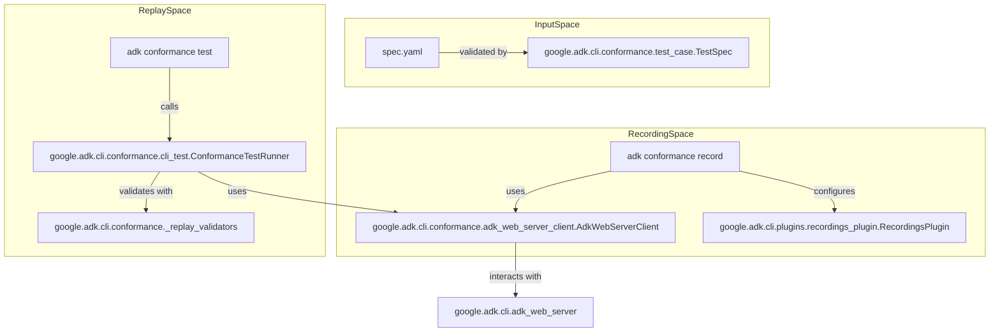
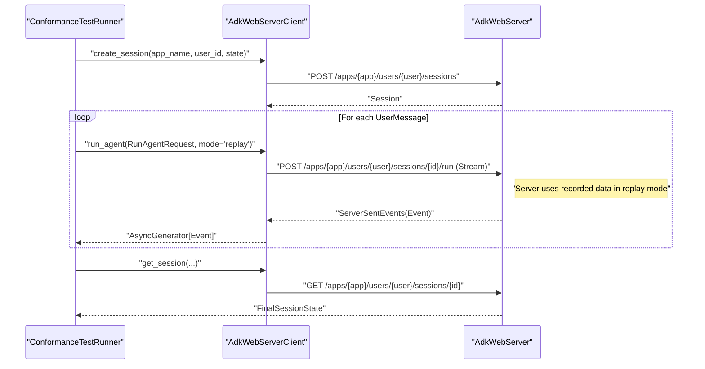

<!-- source: DeepWiki mcp.deepwiki.com · repo google/adk-python · page 10.4 Conformance Testing · fetched 2026-10-29 -->

# Conformance Testing

Relevant source files

The following files were used as context for generating this wiki page:

- [src/google/adk/cli/conformance/__init__.py](src/google/adk/cli/conformance/__init__.py)
- [src/google/adk/cli/conformance/_conformance_test_google_llm.py](src/google/adk/cli/conformance/_conformance_test_google_llm.py)
- [src/google/adk/cli/conformance/_generate_markdown_utils.py](src/google/adk/cli/conformance/_generate_markdown_utils.py)
- [src/google/adk/cli/conformance/_generated_file_utils.py](src/google/adk/cli/conformance/_generated_file_utils.py)
- [src/google/adk/cli/conformance/_replay_validators.py](src/google/adk/cli/conformance/_replay_validators.py)
- [src/google/adk/cli/conformance/adk_web_server_client.py](src/google/adk/cli/conformance/adk_web_server_client.py)
- [src/google/adk/cli/conformance/cli_record.py](src/google/adk/cli/conformance/cli_record.py)
- [src/google/adk/cli/conformance/cli_test.py](src/google/adk/cli/conformance/cli_test.py)
- [src/google/adk/cli/conformance/test_case.py](src/google/adk/cli/conformance/test_case.py)
- [src/google/adk/cli/plugins/__init__.py](src/google/adk/cli/plugins/__init__.py)
- [src/google/adk/cli/plugins/recordings_plugin.py](src/google/adk/cli/plugins/recordings_plugin.py)
- [src/google/adk/cli/plugins/recordings_schema.py](src/google/adk/cli/plugins/recordings_schema.py)
- [src/google/adk/utils/yaml_utils.py](src/google/adk/utils/yaml_utils.py)
- [tests/unittests/cli/conformance/__init__.py](tests/unittests/cli/conformance/__init__.py)
- [tests/unittests/cli/conformance/test_adk_web_server_client.py](tests/unittests/cli/conformance/test_adk_web_server_client.py)
- [tests/unittests/cli/conformance/test_cli_test.py](tests/unittests/cli/conformance/test_cli_test.py)
- [tests/unittests/cli/conformance/test_conformance_test_google_llm.py](tests/unittests/cli/conformance/test_conformance_test_google_llm.py)
- [tests/unittests/cli/plugins/test_recordings_plugin.py](tests/unittests/cli/plugins/test_recordings_plugin.py)
- [tests/unittests/utils/test_yaml_utils.py](tests/unittests/utils/test_yaml_utils.py)

Conformance testing provides a systematic mechanism to verify that ADK agents produce consistent and expected execution behaviors. It enables developers to capture agent interactions as test fixtures and replay them to detect behavioral regressions by comparing live or replayed execution against recorded snapshots.

---

## Overview

Conformance testing follows a dual-mode workflow:
1. **Recording**: Execute test specifications against live agents and capture their interactions (LLM requests and responses, tool calls and results, events, and session states) into YAML files using specialized recording plugins.
2. **Replay Testing**: Replay recorded interactions to verify that agents produce identical behaviors without requiring live LLM or tool endpoints, employing deterministic replay validators and generating detailed markdown reports.

### Data Flow Architecture

The following diagram maps natural language conformance concepts to their implementing code entities.

**Natural Language to Code Entity Space**

Sources: `[src/google/adk/cli/conformance/test_case.py:42-65]`, `[src/google/adk/cli/conformance/cli_test.py:69-85]`, `[src/google/adk/cli/conformance/adk_web_server_client.py:43-56]`, `[src/google/adk/cli/plugins/recordings_plugin.py:66-75]()`

---

## Conformance Test Specification

A conformance test case is defined by a `spec.yaml` configuration file, which is mapped directly to the `TestSpec` Pydantic model.

### TestSpec Structure
| Field | Type | Description |
|-------|------|-------------|
| `description` | `str` | Human-readable explanation of the test objective `[src/google/adk/cli/conformance/test_case.py:53-54]()`. |
| `agent` | `str` | Target ADK application/agent name under test `[src/google/adk/cli/conformance/test_case.py:56-57]()`. |
| `initial_state` | `dict[str, Any]` | Initial key-value pairs populated during session creation `[src/google/adk/cli/conformance/test_case.py:59-60]()`. |
| `user_messages` | `list[UserMessage]` | Ordered sequence of user interactions (`text` or structured `UserContent`) with optional state deltas `[src/google/adk/cli/conformance/test_case.py:62-63]()`. |

Sources: `[src/google/adk/cli/conformance/test_case.py:42-65]`, `[src/google/adk/cli/conformance/test_case.py:28-40]()`

---

## Recording Mode

The `adk conformance record` command executes an agent against live backends and persists session outcomes using `_create_conformance_test_files` `[src/google/adk/cli/conformance/cli_record.py:32-146]()`.

### Recording Implementation Details
* **Session Initialization**: Instantiates a new session via `AdkWebServerClient.create_session` using the specified `initial_state` `[src/google/adk/cli/conformance/cli_record.py:56-60]()`.
* **Message Dispatch**: Iterates through `user_messages`. When a `function_response` is provided for long-running tools, the system maps pending function call IDs dynamically to ensure consistency [src/google/adk/cli/conformance/cli_record.py:63-93]().
* **Serialization**: Persists final states and events using `dump_pydantic_to_yaml`, stripping internal recording metadata to ensure clean comparisons [src/google/adk/cli/conformance/cli_record.py:132-144](), `[src/google/adk/utils/yaml_utils.py:49-114]()`.

### Mode-Specific Artifacts
* **Standard Mode**: `generated-recordings.yaml` and `generated-session.yaml` `[src/google/adk/cli/conformance/cli_record.py:46-47]()`
* **Streaming (SSE) Mode**: `generated-recordings-sse.yaml` and `generated-session-sse.yaml` `[src/google/adk/cli/conformance/cli_record.py:43-44]()`

Sources: `[src/google/adk/cli/conformance/cli_record.py:32-146]`, `[src/google/adk/cli/conformance/adk_web_server_client.py:139-170]`, `[src/google/adk/utils/yaml_utils.py:49-114]()`

---

## Replay Mode and Replay Validators

The `adk conformance test` command utilizes `ConformanceTestRunner` to execute test suites under `mode="replay"` [src/google/adk/cli/conformance/cli_test.py:69-85]().

### Replay Workflow
1. **Discovery**: Recursively locates `spec.yaml` test specifications via `_discover_test_cases` `[src/google/adk/cli/conformance/cli_test.py:86-126]()`.
2. **Execution**: Interacts with the local test server via `AdkWebServerClient` where recorded responses are injected [src/google/adk/cli/conformance/cli_test.py:172-196]().
3. **Validation**: Compares output events and session dumps using `compare_session` and `compare_events` `[src/google/adk/cli/conformance/_replay_validators.py:130-188]()`.

### Comparison Normalization
To prevent spurious failures caused by non-deterministic metadata, specific fields are excluded during validation:
* **Event-Level**: `id`, `timestamp`, `invocation_id`, `long_running_tool_ids`, `node_info` `[src/google/adk/cli/conformance/_replay_validators.py:84-89]()`.
* **Content-Level**: `thought_signature`, `function_call.id`, `function_response.id` `[src/google/adk/cli/conformance/_replay_validators.py:93-96]()`.
* **Action-Level**: Internal configs inside `state_delta`, `requested_auth_configs`, `requested_tool_confirmations` `[src/google/adk/cli/conformance/_replay_validators.py:101-107]()`.
* **Session-Level**: `id`, `last_update_time`, and `_adk_recordings_config` `[src/google/adk/cli/conformance/_replay_validators.py:161-166]()`.
* **Tool Normalization**: `_normalize_tool_config` and `_normalize_schema_dict` strip transient documentation and parameter schema formatting differences `[src/google/adk/cli/conformance/_conformance_test_google_llm.py:81-150]()`.
* **Relayed Content Normalization**: `_normalize_relayed_agent_text` standardizes text payloads transferred between multi-agent hops `[src/google/adk/cli/conformance/_conformance_test_google_llm.py:174-201]()`.

Sources: `[src/google/adk/cli/conformance/cli_test.py:69-126]`, `[src/google/adk/cli/conformance/_replay_validators.py:33-188]`, `[src/google/adk/cli/conformance/_conformance_test_google_llm.py:81-201]()`

---

## Web Server Integration

The conformance CLI communicates with running agents through `AdkWebServerClient`.

**Client-Server Interaction Flow**

Sources: `[src/google/adk/cli/conformance/adk_web_server_client.py:43-56]`, `[src/google/adk/cli/conformance/adk_web_server_client.py:116-170]`, `[src/google/adk/cli/conformance/cli_test.py:172-196]()`

---

## Report Generation

Test summaries are compiled into structured Markdown reports via `generate_markdown_report` `[src/google/adk/cli/conformance/_generate_markdown_utils.py:31-35]()`.

### Report Sections
* **Summary Header**: Displays framework version, language environment, and aggregate success rates per streaming mode `[src/google/adk/cli/conformance/_generate_markdown_utils.py:37-91]()`.
* **Results Matrix**: Tabular breakdown of category, test name, description, and status (`✅ PASS` / `❌ FAIL`) across modes `[src/google/adk/cli/conformance/_generate_markdown_utils.py:94-114]()`.
* **Failure Tracebacks**: Detailed unified diff blocks for mismatched events or sessions to facilitate debugging `[src/google/adk/cli/conformance/_generate_markdown_utils.py:117-137]`, `[src/google/adk/cli/conformance/_replay_validators.py:50-70]()`.

Sources: `[src/google/adk/cli/conformance/_generate_markdown_utils.py:31-139]`, `[src/google/adk/cli/conformance/_replay_validators.py:50-70]()`

---

## Recordings Plugins and Schema

The recording mechanism is implemented via `RecordingsPlugin`, a subclass of `BasePlugin` that captures execution traces `[src/google/adk/cli/plugins/recordings_plugin.py:66-75]()`.

### RecordingsPlugin Lifecycle
* `before_run_callback`: Instantiates per-invocation state tracks (`_InvocationRecordingState`) to handle concurrent executions safely `[src/google/adk/cli/plugins/recordings_plugin.py:77-85]()`.
* `before_model_callback`: Registers a pending `LlmRecording` prior to dispatching model calls `[src/google/adk/cli/plugins/recordings_plugin.py:88-127]()`.
* `after_model_callback`: Appends completed `LlmResponse` instances to the active record `[src/google/adk/cli/plugins/recordings_plugin.py:130-161]()`.
* `before_tool_callback`: Creates a `ToolRecording` wrapper for invoked tools `[src/google/adk/cli/plugins/recordings_plugin.py:164-194]()`.
* `after_run_callback`: Serializes records to YAML while sanitizing sensitive connection attributes like `http_options` `[tests/unittests/cli/plugins/test_recordings_plugin.py:46-104]()`.

Sources: `[src/google/adk/cli/plugins/recordings_plugin.py:66-194]`, `[tests/unittests/cli/plugins/test_recordings_plugin.py:46-104]()`

---

