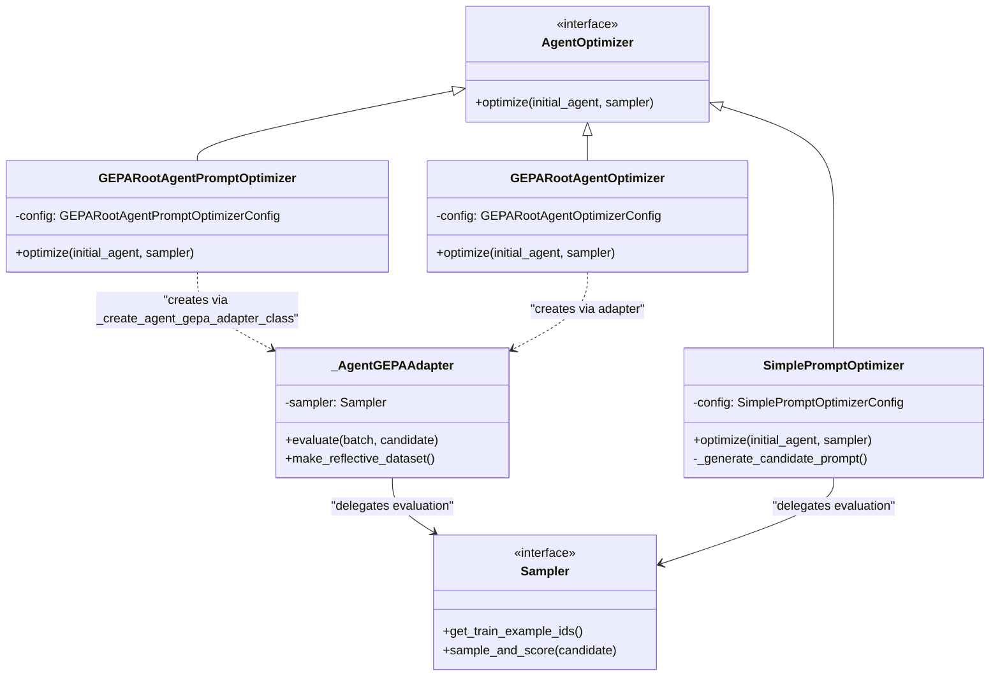
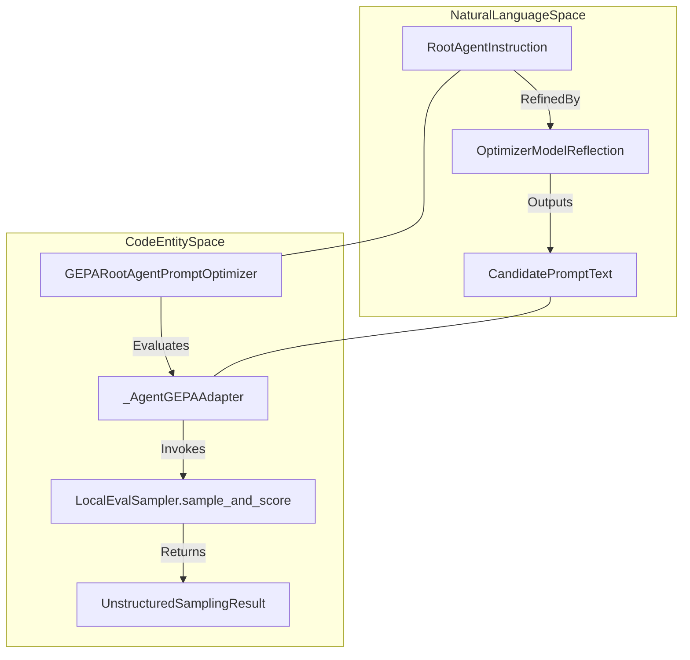
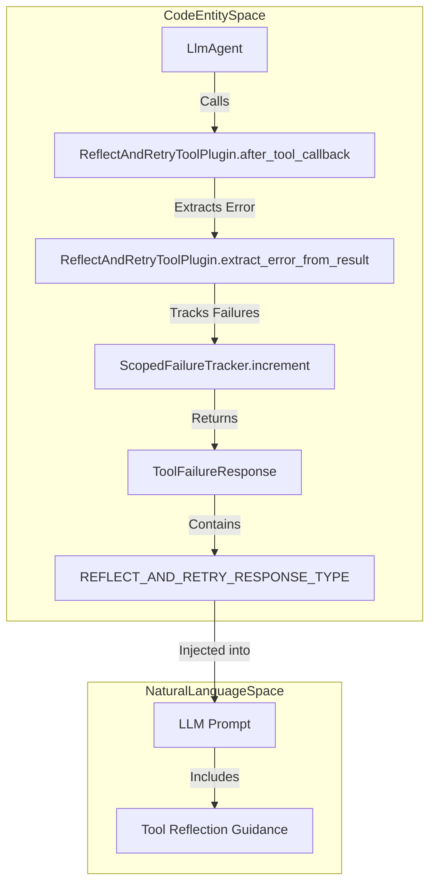
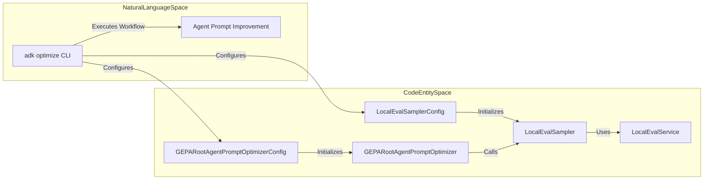

<!-- source: DeepWiki mcp.deepwiki.com · repo google/adk-python · page 10.5 Optimization · fetched 2026-10-29 -->

# Optimization

Relevant source files

The following files were used as context for generating this wiki page:

- [.agents/skills/adk-debug/references/failure-modes.md](.agents/skills/adk-debug/references/failure-modes.md)
- [docs/guides/plugins/reflect_retry_model_plugin/index.md](docs/guides/plugins/reflect_retry_model_plugin/index.md)
- [src/google/adk/flows/llm_flows/tools/_caller.py](src/google/adk/flows/llm_flows/tools/_caller.py)
- [src/google/adk/flows/llm_flows/tools/_confirmation.py](src/google/adk/flows/llm_flows/tools/_confirmation.py)
- [src/google/adk/flows/llm_flows/tools/_error_handler.py](src/google/adk/flows/llm_flows/tools/_error_handler.py)
- [src/google/adk/flows/llm_flows/tools/_thread_pool.py](src/google/adk/flows/llm_flows/tools/_thread_pool.py)
- [src/google/adk/optimization/__init__.py](src/google/adk/optimization/__init__.py)
- [src/google/adk/optimization/_gepa_utils.py](src/google/adk/optimization/_gepa_utils.py)
- [src/google/adk/optimization/agent_optimizer.py](src/google/adk/optimization/agent_optimizer.py)
- [src/google/adk/optimization/data_types.py](src/google/adk/optimization/data_types.py)
- [src/google/adk/optimization/gepa_root_agent_optimizer.py](src/google/adk/optimization/gepa_root_agent_optimizer.py)
- [src/google/adk/optimization/gepa_root_agent_prompt_optimizer.py](src/google/adk/optimization/gepa_root_agent_prompt_optimizer.py)
- [src/google/adk/optimization/local_eval_sampler.py](src/google/adk/optimization/local_eval_sampler.py)
- [src/google/adk/optimization/sampler.py](src/google/adk/optimization/sampler.py)
- [src/google/adk/optimization/simple_prompt_optimizer.py](src/google/adk/optimization/simple_prompt_optimizer.py)
- [src/google/adk/plugins/_reflect_retry_model_plugin.py](src/google/adk/plugins/_reflect_retry_model_plugin.py)
- [src/google/adk/plugins/_reflect_retry_utils.py](src/google/adk/plugins/_reflect_retry_utils.py)
- [src/google/adk/plugins/reflect_retry_tool_plugin.py](src/google/adk/plugins/reflect_retry_tool_plugin.py)
- [src/google/adk/utils/_sync_runner.py](src/google/adk/utils/_sync_runner.py)
- [tests/unittests/flows/llm_flows/tools/test_caller.py](tests/unittests/flows/llm_flows/tools/test_caller.py)
- [tests/unittests/flows/llm_flows/tools/test_confirmation.py](tests/unittests/flows/llm_flows/tools/test_confirmation.py)
- [tests/unittests/flows/llm_flows/tools/test_functions_thread_pool.py](tests/unittests/flows/llm_flows/tools/test_functions_thread_pool.py)
- [tests/unittests/optimization/gepa_root_agent_optimizer_test.py](tests/unittests/optimization/gepa_root_agent_optimizer_test.py)
- [tests/unittests/optimization/gepa_root_agent_prompt_optimizer_test.py](tests/unittests/optimization/gepa_root_agent_prompt_optimizer_test.py)
- [tests/unittests/optimization/local_eval_sampler_test.py](tests/unittests/optimization/local_eval_sampler_test.py)
- [tests/unittests/optimization/simple_prompt_optimizer_test.py](tests/unittests/optimization/simple_prompt_optimizer_test.py)
- [tests/unittests/plugins/test_reflect_retry_model_plugin.py](tests/unittests/plugins/test_reflect_retry_model_plugin.py)
- [tests/unittests/plugins/test_reflect_retry_tool_plugin.py](tests/unittests/plugins/test_reflect_retry_tool_plugin.py)
- [tests/unittests/runners/__init__.py](tests/unittests/runners/__init__.py)
- [tests/unittests/runners/test_run_tool_confirmation.py](tests/unittests/runners/test_run_tool_confirmation.py)
- [tests/unittests/utils/test_sync_runner.py](tests/unittests/utils/test_sync_runner.py)

This page documents the ADK's optimization system for automatically improving agent prompts and instructions using the GEPA (Genetic-Pareto) algorithm, simple iterative methods, and the `AgentOptimizer` interface. Optimization uses evaluation datasets to iteratively refine agent prompts for better performance in complex scenarios like tool-use and policy adherence.

## Purpose and Scope

The optimization system provides automated prompt engineering capabilities. It addresses the limitation where simple, one-line instructions often fail in complex tasks. The system works by:

1. **Sampling and Scoring**: Running candidate agents against evaluation sets using the `Sampler` interface `[src/google/adk/optimization/sampler.py:30-76]()`.
2. **Reflection**: Analyzing failed trajectories (often using an LLM) to generate high-level rules or insights for improvement `[src/google/adk/optimization/gepa_root_agent_prompt_optimizer.py:180-202]()`.
3. **Evolution**: Proposing new candidate prompts by editing or combining successful ideas, inspired by genetic algorithms or simple LLM-based rewriting `[src/google/adk/optimization/simple_prompt_optimizer.py:96-123]()`.
4. **Selection**: Maintaining high-performing prompts based on scores provided by evaluation metrics `[src/google/adk/optimization/data_types.py:45-76]()`.

The system primarily targets the root agent's `instruction` field `[src/google/adk/optimization/gepa_root_agent_prompt_optimizer.py:134-136]()` and skill-specific instructions `[src/google/adk/optimization/gepa_root_agent_optimizer.py:160-170]()`.

Sources: `[src/google/adk/optimization/sampler.py:30-76]()`, `[src/google/adk/optimization/gepa_root_agent_prompt_optimizer.py:134-136]()`, `[src/google/adk/optimization/data_types.py:45-76]()`, `[src/google/adk/optimization/simple_prompt_optimizer.py:96-123]()`, `[src/google/adk/optimization/gepa_root_agent_prompt_optimizer.py:160-202]()`

---

## Core Interfaces and Data Types

The optimization framework is built on a generic interface that separates the optimization strategy from the evaluation mechanism.

### AgentOptimizer Interface
The `AgentOptimizer` is the base abstract class for all optimization strategies `[src/google/adk/optimization/agent_optimizer.py:28-29]()`. It defines a single `optimize` method that takes an initial `Agent` and a `Sampler` `[src/google/adk/optimization/agent_optimizer.py:32-36]()`.

### Sampler Interface
The `Sampler` defines how candidate agents are evaluated `[src/google/adk/optimization/sampler.py:30-76]()`. It requires implementations to provide training/validation example IDs and a `sample_and_score` method `[src/google/adk/optimization/sampler.py:41-76]()`.

### Data Flow Entities

| Class | Role | File Reference |
| :--- | :--- | :--- |
| `SamplingResult` | Base class for scores mapped by example UID. | `[src/google/adk/optimization/data_types.py:27-36]()` |
| `UnstructuredSamplingResult` | Extends results with trajectories and tool call data. | `[src/google/adk/optimization/data_types.py:79-90]()` |
| `AgentWithScores` | Pairs an optimized `Agent` instance with its `overall_score`. | `[src/google/adk/optimization/data_types.py:45-60]()` |
| `OptimizerResult` | The final output containing a list of Pareto-optimal agents. | `[src/google/adk/optimization/data_types.py:66-76]()` |

Sources: `[src/google/adk/optimization/agent_optimizer.py:28-36]()`, `[src/google/adk/optimization/sampler.py:30-76]()`, `[src/google/adk/optimization/data_types.py:27-90]()`

---

## Optimization Strategies

ADK provides multiple strategies for prompt optimization, ranging from simple iterative rewriting to complex genetic algorithms.

### GEPA Root Agent Prompt Optimizer & Root Agent Optimizer
- **`GEPARootAgentPromptOptimizer`**: Leverages external libraries to evolve system instructions for root agents `[src/google/adk/optimization/gepa_root_agent_prompt_optimizer.py:110-148]()`. It uses a dynamically created adapter class (`_AgentGEPAAdapter`) to bridge the external `gepa` framework with ADK's internal `Sampler` `[src/google/adk/optimization/gepa_root_agent_prompt_optimizer.py:101-155]()`.
- **`GEPARootAgentOptimizer`**: Extends optimization capabilities to both root instructions and skill instructions registered via `SkillToolset` `[src/google/adk/optimization/gepa_root_agent_prompt_optimizer.py:160-170]()`.

### Simple Prompt Optimizer
The `SimplePromptOptimizer` is an iterative optimizer `[src/google/adk/optimization/simple_prompt_optimizer.py:86-89]()`. It uses an LLM to rewrite the agent's prompt based on the current score `[src/google/adk/optimization/simple_prompt_optimizer.py:96-103]()`. It follows a basic loop:
1. Generate a candidate prompt using `_generate_candidate_prompt` `[src/google/adk/optimization/simple_prompt_optimizer.py:96-123]()`.
2. Score the candidate on a random batch of training examples via `_score_agent_on_batch` `[src/google/adk/optimization/simple_prompt_optimizer.py:125-138]()`.
3. If the candidate score is higher than the best score, update the best agent `[src/google/adk/optimization/simple_prompt_optimizer.py:175-178]()`.

Optimization Strategy Hierarchy

Sources: `[src/google/adk/optimization/gepa_root_agent_prompt_optimizer.py:101-155]()`, `[src/google/adk/optimization/gepa_root_agent_prompt_optimizer.py:160-170]()`, `[src/google/adk/optimization/simple_prompt_optimizer.py:86-181]()`, `[src/google/adk/optimization/agent_optimizer.py:28-36]()`

Prompt Optimization Space Mapping

Sources: `[src/google/adk/optimization/gepa_root_agent_prompt_optimizer.py:101-170]()`, `[src/google/adk/optimization/local_eval_sampler.py:150-181]()`

---

## Local Evaluation Sampling

The `LocalEvalSampler` provides a concrete implementation of the `Sampler` interface that uses ADK's internal evaluation services `[src/google/adk/optimization/local_eval_sampler.py:150-181]()`.

### Implementation Details
- **Example Management**: Retrieves evaluation case IDs from the `EvalSetsManager` based on configured training and validation sets `[src/google/adk/optimization/local_eval_sampler.py:153-181]()`.
- **Data Extraction**: Pulls user prompts and agent responses from `Invocation` objects via `extract_single_invocation_info` `[src/google/adk/optimization/local_eval_sampler.py:81-101]()`.
- **Tool Data**: Extracts tool call names, arguments, and responses using `extract_tool_call_data` `[src/google/adk/optimization/local_eval_sampler.py:66-78]()`.

Sources: `[src/google/adk/optimization/local_eval_sampler.py:66-181]()`

---

## Self-Healing and Error Recovery

Optimization also extends to runtime resilience via plugins such as `ReflectAndRetryToolPlugin` and `ReflectAndRetryModelPlugin`. These plugins provide self-healing capabilities by intercepting tool/model failures and providing structured guidance to the LLM `[src/google/adk/plugins/reflect_retry_tool_plugin.py:46-51]()`.

- **Max Retries**: Manages consecutive failures up to a configured `max_retries` threshold `[src/google/adk/plugins/reflect_retry_tool_plugin.py:102-126]()`.
- **Scoped Tracking**: Uses `ScopedFailureTracker` and `TrackingScope` to isolate failure counts per invocation or globally `[src/google/adk/plugins/_reflect_retry_utils.py:24-64]()`.
- **Reflection Guidance**: Intercepts errors and formats custom tool/model failure responses containing reflection instructions `[src/google/adk/plugins/reflect_retry_tool_plugin.py:36-44]()`.

### ReflectAndRetryToolPlugin
The `ReflectAndRetryToolPlugin` handles errors that occur during tool execution. It intercepts tool failures via `after_tool_callback` `[src/google/adk/plugins/reflect_retry_tool_plugin.py:130-168]()` or `on_tool_error_callback` `[src/google/adk/plugins/reflect_retry_tool_plugin.py:200-238]()`. If an error is detected, it increments a failure counter for the specific tool within the defined scope `[src/google/adk/plugins/reflect_retry_tool_plugin.py:240-250]()`. If the `max_retries` limit is not exceeded, it returns a `ToolFailureResponse` containing `reflection_guidance` to the LLM, prompting it to reflect and retry `[src/google/adk/plugins/reflect_retry_tool_plugin.py:252-279]()`. If the limit is exceeded, it either re-raises the original exception or returns a final guidance message, depending on the `throw_exception_if_retry_exceeded` configuration `[src/google/adk/plugins/reflect_retry_tool_plugin.py:281-308]()`.

### ReflectAndRetryModelPlugin
Similarly, the `ReflectAndRetryModelPlugin` focuses on model-related errors, particularly `types.FinishReason.MALFORMED_FUNCTION_CALL` `[src/google/adk/plugins/_reflect_retry_model_plugin.py:45-48]()`. It injects a special tool, `adk_handle_model_error`, into the `LlmRequest` before the model call `[src/google/adk/plugins/_reflect_retry_model_plugin.py:160-171]()`. If the model returns an error matching the configured `on_model_errors`, this tool is invoked, and the plugin handles the error by providing reflection guidance to the LLM `[src/google/adk/plugins/_reflect_retry_model_plugin.py:200-227]()`. It also uses `ScopedFailureTracker` to manage retry counts for model errors `[src/google/adk/plugins/_reflect_retry_model_plugin.py:230-240]()`.

Tool Error Reflection Flow

Sources: `[src/google/adk/plugins/reflect_retry_tool_plugin.py:36-308]()`, `[src/google/adk/plugins/_reflect_retry_utils.py:24-64]()`, `[src/google/adk/plugins/_reflect_retry_model_plugin.py:45-240]()`

---

## CLI Usage: `adk optimize`

The `adk optimize` command provides the command-line entry point for executing prompt optimization workflows.

### Key Configuration Parameters
- **`optimizer_model`**: The LLM used to analyze evaluation results and rewrite prompts `[src/google/adk/optimization/gepa_root_agent_prompt_optimizer.py:57-62]()`.
- **`max_metric_calls`**: Total budget for metric evaluation calls `[src/google/adk/optimization/gepa_root_agent_prompt_optimizer.py:74-77]()`.
- **`train_eval_set`**: The evaluation set used as the training signal during optimization `[src/google/adk/optimization/local_eval_sampler.py:117-120]()`.

CLI to Optimization Component Mapping

Sources: `[src/google/adk/optimization/local_eval_sampler.py:104-148]()`, `[src/google/adk/optimization/gepa_root_agent_prompt_optimizer.py:57-77]()`

---

