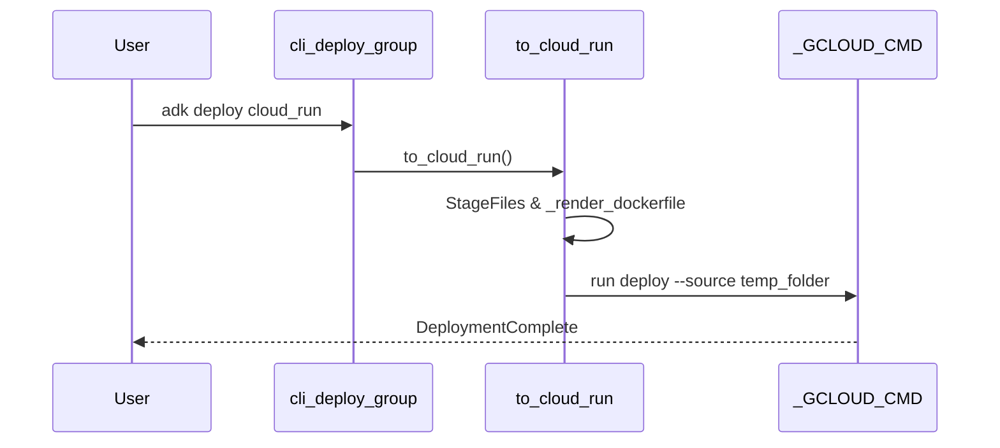
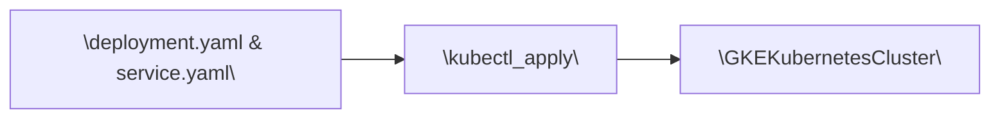

<!-- source: DeepWiki mcp.deepwiki.com · repo google/adk-python · page 11 Deployment · fetched 2026-10-29 -->

# Deployment

<details>
<summary>Relevant source files</summary>

The following files were used as context for generating this wiki page:

- [src/google/adk/cli/_dev_deploy.py](src/google/adk/cli/_dev_deploy.py)
- [src/google/adk/cli/adk_web_server.py](src/google/adk/cli/adk_web_server.py)
- [src/google/adk/cli/api_server.py](src/google/adk/cli/api_server.py)
- [src/google/adk/cli/cli_deploy.py](src/google/adk/cli/cli_deploy.py)
- [src/google/adk/cli/cli_tools_click.py](src/google/adk/cli/cli_tools_click.py)
- [src/google/adk/cli/dev_server.py](src/google/adk/cli/dev_server.py)
- [src/google/adk/cli/fast_api.py](src/google/adk/cli/fast_api.py)
- [tests/unittests/cli/test_adk_web_server_run_live.py](tests/unittests/cli/test_adk_web_server_run_live.py)
- [tests/unittests/cli/test_adk_web_server_tests.py](tests/unittests/cli/test_adk_web_server_tests.py)
- [tests/unittests/cli/test_dev_deploy.py](tests/unittests/cli/test_dev_deploy.py)
- [tests/unittests/cli/test_dns_rebinding_protection.py](tests/unittests/cli/test_dns_rebinding_protection.py)
- [tests/unittests/cli/test_fast_api.py](tests/unittests/cli/test_fast_api.py)
- [tests/unittests/cli/test_local_client_check.py](tests/unittests/cli/test_local_client_check.py)
- [tests/unittests/cli/utils/test_cli_deploy.py](tests/unittests/cli/utils/test_cli_deploy.py)
- [tests/unittests/cli/utils/test_cli_deploy_ignore.py](tests/unittests/cli/utils/test_cli_deploy_ignore.py)
- [tests/unittests/cli/utils/test_cli_deploy_to_cloud_run.py](tests/unittests/cli/utils/test_cli_deploy_to_cloud_run.py)
- [tests/unittests/cli/utils/test_cli_tools_click.py](tests/unittests/cli/utils/test_cli_tools_click.py)

</details>


This page serves as a high-level overview of deploying ADK agents to production environments. ADK provides a unified command-line interface (`cli_tools_click.py` [src/google/adk/cli/cli_tools_click.py:1-50]()) and an extensible deployer architecture (`DeployerFactory` [src/google/adk/cli/cli_deploy.py:37-45]()) to package and deploy agents across serverless, managed, and containerized infrastructure targets.

For information about local development and testing, see [Getting Started](#2). For web server configuration details, see [FastAPI Server](#9.3).

---

## Deployment Architecture and Flow

ADK coordinates production deployments through the `adk deploy` command group implemented via Click [src/google/adk/cli/cli_tools_click.py:1-50](). Deployments are managed using a factory pattern (`DeployerFactory` [src/google/adk/cli/cli_deploy.py:37-45]()) that handles source staging, dependency resolution, and generation of target-specific infrastructure artifacts.

Title: ADK Deployment Routing and Execution

```mermaid
graph TB
    CLI["cli_tools_click.py<br/>\"cli_deploy_group\""] --> Factory["DeployerFactory<br/>\"cli_deploy.py\""]
    
    subgraph "Deployment Targets"
        CloudRun["\"cloud_run\"<br/>cli_deploy_cloud_run"]
        AgentEngine["\"agent_engine\"<br/>cli_deploy_agent_engine"]
        GKE["\"gke\"<br/>cli_deploy_gke"]
        Docker["\"docker\"<br/>cli_deploy_docker"]
    end
    
    subgraph "Implementation Functions"
        CR_Func["\"to_cloud_run\"<br/>cli_deploy.py"]
        AE_Func["\"to_agent_engine\"<br/>cli_deploy.py"]
        GKE_Func["\"to_gke\"<br/>cli_deploy.py"]
    end
    
    Factory --> CloudRun
    Factory --> AgentEngine
    Factory --> GKE
    Factory --> Docker
    
    CloudRun --> CR_Func
    AgentEngine --> AE_Func
    GKE --> GKE_Func
```
Sources: [src/google/adk/cli/cli_tools_click.py:1-50](), [src/google/adk/cli/cli_deploy.py:37-45]()

---

## 11.1 Deployment Overview

The deployment subsystem abstracts the details of preparing an agent codebase for production. It validates agent project structures, stages required source files and environment variables, generates container templates, and invokes platform-specific deployment commands. The `_validate_worker_pool` function [src/google/adk/cli/cli_deploy.py:105-128]() ensures Cloud Build worker pool resource names are correctly formatted, while `_apply_worker_pool_to_agent_config` [src/google/adk/cli/cli_deploy.py:130-184]() handles worker pool configuration nesting.

For complete details on deployment targets, base deployer abstractions, Dockerfile template generation, and source staging, see [Deployment Overview](#11.1).

Title: Agent Source Staging and Packaging Pipeline

```mermaid
graph LR
    Source["\"AgentSourceDirectory\""] --> Validate["\"_validate_worker_pool\"<br/>cli_deploy.py"]
    Validate --> Staged["\"StagedTempFolder\""]
    Staged --> Dockergen["\"_render_dockerfile\"<br/>cli_deploy.py"]
    Dockergen --> Build["\"ContainerImageBuild\""]
```
Sources: [src/google/adk/cli/cli_deploy.py:105-184](), [src/google/adk/cli/cli_deploy.py:37-45]()

---

## 11.2 Cloud Run Deployment

The `adk deploy cloud_run` command packages an ADK agent into a serverless containerized service on Google Cloud Run. It utilizes a secure Dockerfile template with a non-root user and executes `gcloud run deploy` with appropriate service configuration and environment variables. The `_GCLOUD_CMD` constant [src/google/adk/cli/cli_deploy.py:51-52]() defines the target command executable.

For details on private Cloud Build worker pools, `gcloud` integration options, and service configuration, see [Cloud Run Deployment](#11.2).

Title: Cloud Run Deployment Invocation Sequence


Sources: [src/google/adk/cli/cli_deploy.py:51-52](), [src/google/adk/cli/cli_deploy.py:130-184]()

---

## 11.3 Vertex AI Agent Engine Deployment

The `adk deploy agent_engine` command deploys agents to Vertex AI Agent Engine by registering them as managed Reasoning Engine instances. It automatically injects required platform dependencies, such as `_AGENT_ENGINE_REQUIREMENT` [src/google/adk/cli/cli_deploy.py:58-60](), ensuring correct resolution to the v2 SDK surface.

For information on dependency baking, reasoning engine integration, and Gemini Enterprise registration hints, see [Vertex AI Agent Engine Deployment](#11.3).

Title: Vertex AI Agent Engine Integration Flow

```mermaid
graph TD
    Agent["\"LocalAgentCode\""] --> AppTemplate["\"_AGENT_ENGINE_REQUIREMENT\"<br/>cli_deploy.py"]
    AppTemplate --> AdkApp["\"AdkApp Wrapper\""]
    AdkApp --> Vertex["\"VertexAiReasoningEngine\""]
```
Sources: [src/google/adk/cli/cli_deploy.py:58-60]()

---

## 11.4 GKE Deployment

The `adk deploy gke` command enables enterprise-scale deployments on Google Kubernetes Engine (GKE). It generates Kubernetes manifests, builds container images via Cloud Build, and applies configurations using `kubectl` integration.

For cluster setup, manifest specifications, and code executor sandbox pairing, see [GKE Deployment](#11.4).

Title: GKE Manifest Deployment Pipeline


Sources: [src/google/adk/cli/cli_deploy.py:37-45]()

---

## 11.5 Deployment Configuration

ADK deployments support common configuration options for managing observability, security, and environment state. Parameters such as `trace_to_cloud`, `otel_to_cloud`, `with_ui`, `log_level`, and `allow_origins` control how the containerized FastAPI server behaves in production. The `get_fast_api_app` function [src/google/adk/cli/fast_api.py:107-146]() handles initialization of the FastAPI application, while `_parse_cors_origins` [src/google/adk/cli/api_server.py:135-160]() processes allowed CORS origins.

For detailed documentation on environment variables, CORS origins, triggers, and feature flags, see [Deployment Configuration](#11.5).

Sources: [src/google/adk/cli/fast_api.py:107-146](), [src/google/adk/cli/api_server.py:135-160]()

---

