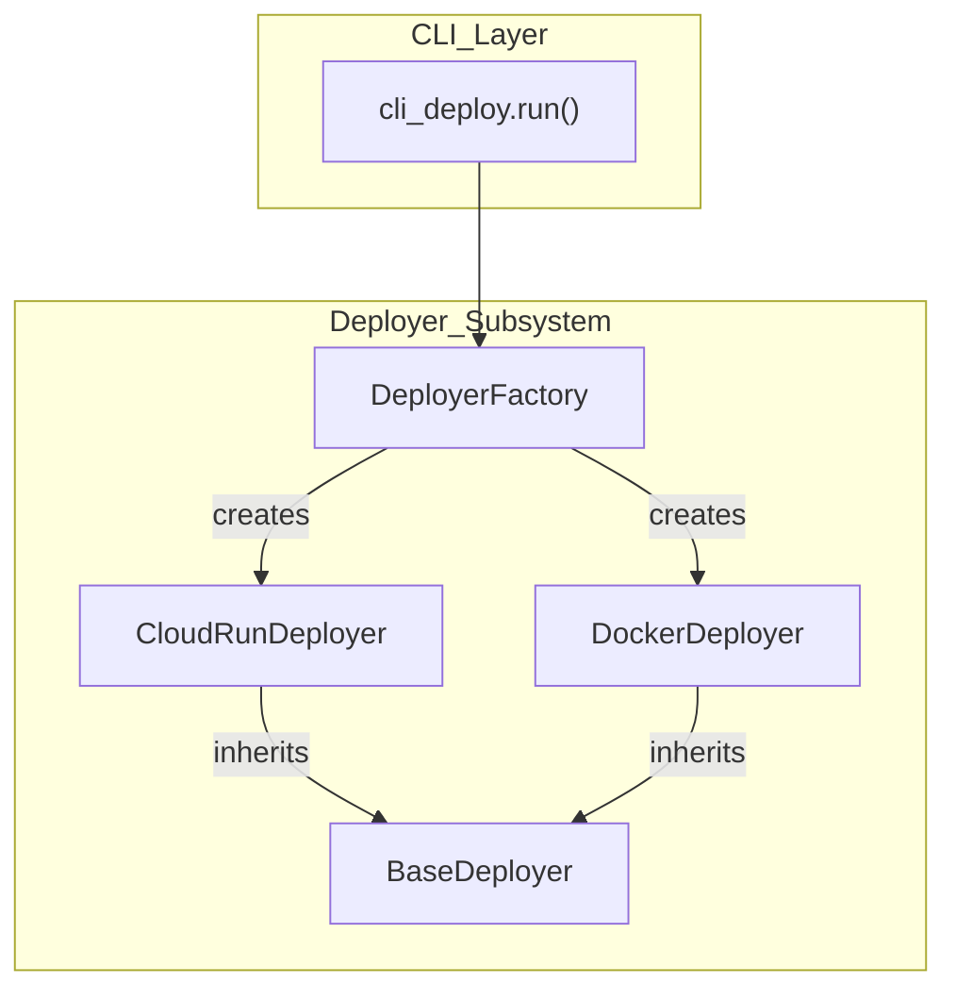
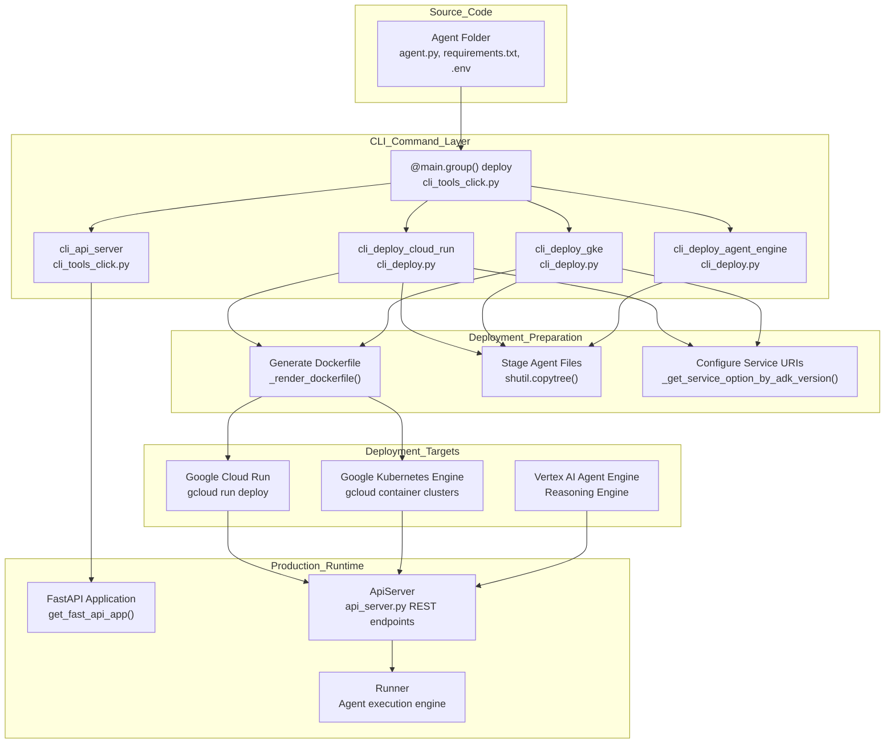
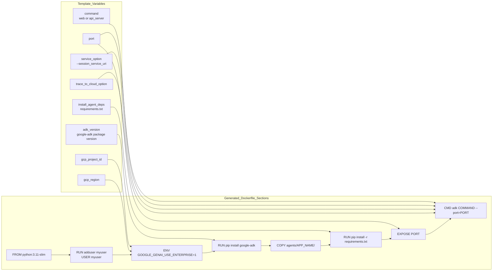

<!-- source: DeepWiki mcp.deepwiki.com · repo google/adk-python · page 11.1 Deployment Overview · fetched 2026-10-29 -->

# Deployment Overview

Relevant source files

The following files were used as context for generating this wiki page:

- [src/google/adk/cli/_dev_deploy.py](src/google/adk/cli/_dev_deploy.py)
- [src/google/adk/cli/adk_web_server.py](src/google/adk/cli/adk_web_server.py)
- [src/google/adk/cli/api_server.py](src/google/adk/cli/api_server.py)
- [src/google/adk/cli/cli_deploy.py](src/google/adk/cli/cli_deploy.py)
- [src/google/adk/cli/cli_tools_click.py](src/google/adk/cli/cli_tools_click.py)
- [src/google/adk/cli/dev_server.py](src/google/adk/cli/dev_server.py)
- [src/google/adk/cli/fast_api.py](src/google/adk/cli/fast_api.py)
- [tests/unittests/cli/test_adk_web_server_run_live.py](tests/unittests/cli/test_adk_web_server_run_live.py)
- [tests/unittests/cli/test_adk_web_server_tests.py](tests/unittests/cli/test_adk_web_server_tests.py)
- [tests/unittests/cli/test_dev_deploy.py](tests/unittests/cli/test_dev_deploy.py)
- [tests/unittests/cli/test_dns_rebinding_protection.py](tests/unittests/cli/test_dns_rebinding_protection.py)
- [tests/unittests/cli/test_fast_api.py](tests/unittests/cli/test_fast_api.py)
- [tests/unittests/cli/test_local_client_check.py](tests/unittests/cli/test_local_client_check.py)
- [tests/unittests/cli/utils/test_cli_deploy.py](tests/unittests/cli/utils/test_cli_deploy.py)
- [tests/unittests/cli/utils/test_cli_deploy_ignore.py](tests/unittests/cli/utils/test_cli_deploy_ignore.py)
- [tests/unittests/cli/utils/test_cli_deploy_to_cloud_run.py](tests/unittests/cli/utils/test_cli_deploy_to_cloud_run.py)
- [tests/unittests/cli/utils/test_cli_tools_click.py](tests/unittests/cli/utils/test_cli_tools_click.py)

## Purpose and Scope
This page provides an architectural overview of the ADK deployment subsystem, covering supported deployment targets, the deployer factory and base deployer implementation, Dockerfile template generation, and source staging and validation. For specific target instructions, see [Cloud Run Deployment](11.2), [Vertex AI Agent Engine Deployment](11.3), or [GKE Deployment](11.4). For configuration parameters, see [Deployment Configuration](11.5).

Sources: `[src/google/adk/cli/cli_deploy.py:1-40]`, `[src/google/adk/cli/cli_tools_click.py:22-31]`

## Deployment Targets

The ADK CLI provides discrete deployment pathways via its deployer subsystem, mapping production targets to containerized or managed runtimes.

| Target | CLI Command | Use Case | Key Features |
|--------|-------------|----------|--------------|
| **Cloud Run** | `adk deploy cloud_run` | Serverless HTTP endpoints | Auto-scaling, managed container execution |
| **Docker** | `adk deploy docker` | Container image builds | Local or registry image preparation |
| **Vertex AI Agent Engine** | `adk deploy agent_engine` | Managed agent platform | Integrated Vertex AI reasoning engines |
| **GKE** | `adk deploy gke` | Kubernetes clusters | Full orchestration and sandbox pairing |
| **Custom Server** | `adk api_server` or `adk web` | Direct hosting | Local testing, API serving, development UI |

Sources: `[src/google/adk/cli/cli_tools_click.py:22-31]`, `[src/google/adk/cli/cli_deploy.py:43-48]`

## Deployer Factory and Base Deployer Architecture

ADK encapsulates provider-specific deployment logic using an object-oriented pattern powered by `DeployerFactory` and `BaseDeployer` (`src/google/adk/cli/deployers/_deployer_factory.py` and `src/google/adk/cli/deployers/_base_deployer.py`) `[src/google/adk/cli/cli_deploy.py:43-44]()`.

Title: "Deployer Factory Architecture"

- **`DeployerFactory`**: Resolves and instantiates target deployers based on provider strings (`cloud_run`, `docker`, `gke`).
- **`BaseDeployer`**: Implements shared helpers for source validation, temporary directory staging, and requirement injection.

Sources: `[src/google/adk/cli/cli_deploy.py:43-44]()`, `[src/google/adk/cli/cli_tools_click.py:22-31]()`

## Deployment Architecture and Source Staging

The following diagram bridges the natural language deployment flow to specific code entities, staging functions, and runtime execution targets.

Title: "Deployment Flow Architecture"

**Deployment Staging Workflow:**
1. The user invokes a deployment command (e.g., `adk deploy cloud_run`) `[src/google/adk/cli/cli_tools_click.py:22-34]()`.
2. Source validation inspects the target agent directory for required configuration files `[src/google/adk/cli/cli_deploy.py:1-40]()`.
3. Source files are copied into an isolated temporary staging directory (`shutil.copytree`) via robust staging utilities `[src/google/adk/cli/cli_deploy.py:20-30]()`.
4. For containerized deployments, a `Dockerfile` is generated from `_render_dockerfile` `[src/google/adk/cli/cli_deploy.py:43-46]()`.
5. For Vertex AI Agent Engine deployments, required platform dependencies are automatically verified and injected `[src/google/adk/cli/cli_deploy.py:58-61]()`.

Sources: `[src/google/adk/cli/cli_deploy.py:1-185]()`, `[src/google/adk/cli/cli_tools_click.py:22-34]()`

## Dockerfile Template Generation Process

For Cloud Run, Docker, and GKE deployments, ADK compiles a production Dockerfile from internal templates to enforce security and runtime invariants `[src/google/adk/cli/cli_deploy.py:44-46]()`.

Title: "Dockerfile Template Logic"

**Key Characteristics:**
- **Non-root user execution:** Containers run under a dedicated `myuser` security context to mitigate container escape risks `[tests/unittests/cli/utils/test_cli_deploy_to_cloud_run.py:167-172]()`.
- **Minimal base image:** Utilizes `python:3.11-slim` `[tests/unittests/cli/utils/test_cli_deploy_to_cloud_run.py:167-167]()`.
- **Environment variables:** Sets `GOOGLE_GENAI_USE_ENTERPRISE`, `GOOGLE_CLOUD_PROJECT`, and location contexts `[tests/unittests/cli/utils/test_cli_deploy_to_cloud_run.py:206-207]()`.
- **Dependency installation:** Automatically detects and installs agent-specific `requirements.txt` packages `[tests/unittests/cli/utils/test_cli_deploy_to_cloud_run.py:180-186]()`.

Sources: `[src/google/adk/cli/cli_deploy.py:43-46]()`, `[tests/unittests/cli/utils/test_cli_deploy_to_cloud_run.py:145-213]()`

## Service Configuration Strategy

ADK manages service URI flags across different framework versions to maintain backward compatibility when constructing deployment commands `[src/google/adk/cli/cli_deploy.py:43-43]()`.

| ADK Version | Supported Flags |
|-------------|-----------------|
| **>= 1.3.0** | `--session_service_uri`, `--artifact_service_uri`, `--memory_service_uri` |
| **1.2.x** | `--session_db_url`, `--artifact_storage_uri` |
| **< 1.2.0** | `--session_db_url` only |

**Local Storage Flag Evolution:**
Starting from version `1.21.0` (`_LOCAL_STORAGE_FLAG_MIN_VERSION`), ADK supports explicit local storage control flags (`--use_local_storage` or `--no_use_local_storage`) `[src/google/adk/cli/cli_deploy.py:53-53]()`.

Sources: `[src/google/adk/cli/cli_deploy.py:43-54]()`, `[tests/unittests/cli/utils/test_cli_deploy.py:197-220]()`

---

