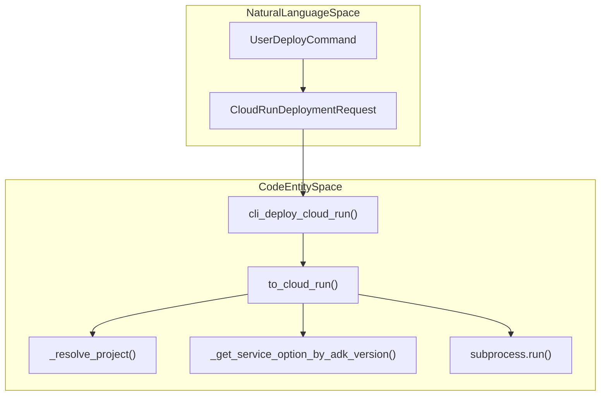
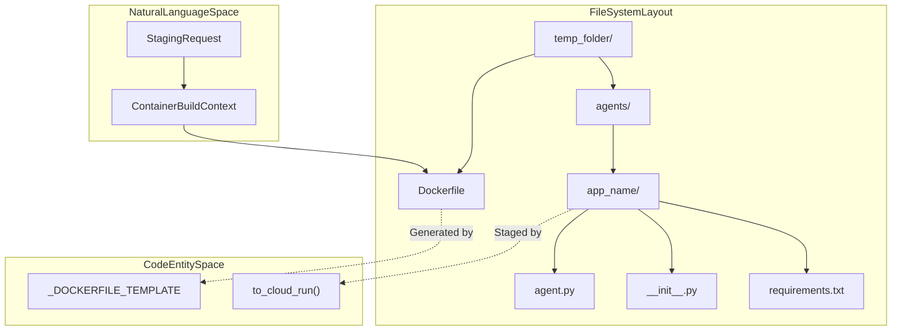

<!-- source: DeepWiki mcp.deepwiki.com · repo google/adk-python · page 11.2 Cloud Run Deployment · fetched 2026-10-29 -->

# Cloud Run Deployment

<details>
<summary>Relevant source files</summary>

The following files were used as context for generating this wiki page:

- [src/google/adk/cli/_dev_deploy.py](src/google/adk/cli/_dev_deploy.py)
- [src/google/adk/cli/_telemetry/_constants.py](src/google/adk/cli/_telemetry/_constants.py)
- [src/google/adk/cli/_telemetry/_metrics_collector.py](src/google/adk/cli/_telemetry/_metrics_collector.py)
- [src/google/adk/cli/_telemetry/_metrics_reporter.py](src/google/adk/cli/_telemetry/_metrics_reporter.py)
- [src/google/adk/cli/adk_web_server.py](src/google/adk/cli/adk_web_server.py)
- [src/google/adk/cli/api_server.py](src/google/adk/cli/api_server.py)
- [src/google/adk/cli/cli_create.py](src/google/adk/cli/cli_create.py)
- [src/google/adk/cli/cli_deploy.py](src/google/adk/cli/cli_deploy.py)
- [src/google/adk/cli/cli_tools_click.py](src/google/adk/cli/cli_tools_click.py)
- [src/google/adk/cli/dev_server.py](src/google/adk/cli/dev_server.py)
- [src/google/adk/cli/fast_api.py](src/google/adk/cli/fast_api.py)
- [src/google/adk/cli/utils/_onboarding.py](src/google/adk/cli/utils/_onboarding.py)
- [src/google/adk/cli/utils/gcp_utils.py](src/google/adk/cli/utils/gcp_utils.py)
- [tests/unittests/cli/_telemetry/test_metrics_collector.py](tests/unittests/cli/_telemetry/test_metrics_collector.py)
- [tests/unittests/cli/_telemetry/test_metrics_reporter.py](tests/unittests/cli/_telemetry/test_metrics_reporter.py)
- [tests/unittests/cli/conformance/test_generate_markdown_utils.py](tests/unittests/cli/conformance/test_generate_markdown_utils.py)
- [tests/unittests/cli/test_adk_web_server_run_live.py](tests/unittests/cli/test_adk_web_server_run_live.py)
- [tests/unittests/cli/test_adk_web_server_tests.py](tests/unittests/cli/test_adk_web_server_tests.py)
- [tests/unittests/cli/test_cli_utf8_encoding.py](tests/unittests/cli/test_cli_utf8_encoding.py)
- [tests/unittests/cli/test_dev_deploy.py](tests/unittests/cli/test_dev_deploy.py)
- [tests/unittests/cli/test_dns_rebinding_protection.py](tests/unittests/cli/test_dns_rebinding_protection.py)
- [tests/unittests/cli/test_fast_api.py](tests/unittests/cli/test_fast_api.py)
- [tests/unittests/cli/test_local_client_check.py](tests/unittests/cli/test_local_client_check.py)
- [tests/unittests/cli/utils/test_cli_create.py](tests/unittests/cli/utils/test_cli_create.py)
- [tests/unittests/cli/utils/test_cli_deploy.py](tests/unittests/cli/utils/test_cli_deploy.py)
- [tests/unittests/cli/utils/test_cli_deploy_ignore.py](tests/unittests/cli/utils/test_cli_deploy_ignore.py)
- [tests/unittests/cli/utils/test_cli_deploy_to_cloud_run.py](tests/unittests/cli/utils/test_cli_deploy_to_cloud_run.py)
- [tests/unittests/cli/utils/test_cli_tools_click.py](tests/unittests/cli/utils/test_cli_tools_click.py)
- [tests/unittests/cli/utils/test_gcp_utils.py](tests/unittests/cli/utils/test_gcp_utils.py)

</details>


This document describes how to deploy ADK agents to Google Cloud Run using the `adk deploy cloud_run` command. For deployment to other platforms, see [Vertex AI Agent Engine Deployment](11.3)() and [GKE Deployment](11.4)(). For general deployment concepts, see [Deployment Overview](11.1)().

## Overview

Cloud Run deployment packages an ADK agent as a containerized service and deploys it to Google Cloud Run. The deployment process automatically generates a `Dockerfile`, stages the source code, and executes the `gcloud run deploy` command. The deployed service can expose either the API server (`adk api_server`) or the Web UI (`adk web`), depending on the `--with_ui` flag.

As of recent ADK versions, the underlying `gcp_utils` utilized during deployment processes include support for mTLS (mutual TLS) via authorized sessions, ensuring secure communication with GCP services.

Sources: [src/google/adk/cli/cli_deploy.py:72-109](), [src/google/adk/cli/cli_deploy.py:467-633](), [src/google/adk/cli/cli_tools_click.py:25-30]()

## Command Structure and Execution Pipeline

The `cli_deploy_cloud_run` command is integrated into the `adk deploy` group in `src/google/adk/cli/cli_tools_click.py`. It uses a custom command parser to provide better error context for missing arguments.

```bash
adk deploy cloud_run [OPTIONS] AGENT [-- GCLOUD_ARGS...]
```

### Natural Language to Code Entity Mapping

The following diagram bridges the high-level deployment intent to the specific functions and modules responsible for execution in the codebase.

Title: "Cloud Run Deployment Execution Pipeline"



Sources: [src/google/adk/cli/cli_tools_click.py:166-182](), [src/google/adk/cli/cli_deploy.py:394-406](), [src/google/adk/cli/cli_deploy.py:467-633]()

## Staging and Build Artifacts

ADK creates a specific directory structure in the `temp_folder` to ensure the container build context is correct.

### Staging Directory Hierarchy and Code Entities

Title: "Staging Directory and Build Context Hierarchy"



The staging process managed by `to_cloud_run()` involves:
1. Creating a temporary directory (or using the provided `--temp_folder`). [src/google/adk/cli/cli_deploy.py:516-523]()
2. Copying the agent source into a nested `agents/app_name` folder. [src/google/adk/cli/cli_deploy.py:531]()
3. Generating a `Dockerfile` in the root of the temporary directory using `_DOCKERFILE_TEMPLATE`. [src/google/adk/cli/cli_deploy.py:581-583]()

Sources: [src/google/adk/cli/cli_deploy.py:516-543](), [src/google/adk/cli/cli_deploy.py:581-583](), [tests/unittests/cli/utils/test_cli_deploy_to_cloud_run.py:135-141]()

## Dockerfile Implementation and Service Configuration

The `Dockerfile` is constructed from a template (`_DOCKERFILE_TEMPLATE`) that includes environment variables for GCP project and location, and a `CMD` that invokes the `adk` CLI inside the container.

### Template Parameters

| Parameter | Logic |
|-----------|-------|
| `gcp_project_id` | Resolved via `--project` or `gcloud config` through `_resolve_project()`. [src/google/adk/cli/cli_deploy.py:394-406]() |
| `command` | `api_server` by default, or `web` if `--with_ui` is set. [src/google/adk/cli/cli_deploy.py:547-548]() |
| `install_agent_deps` | If `requirements.txt` is found, it adds a `RUN pip install` step. [src/google/adk/cli/cli_deploy.py:550-555]() |
| `service_option` | Constructed by `_get_service_option_by_adk_version()` to handle version-specific URI flags. [src/google/adk/cli/cli_deploy.py:228-235]() |

The template uses `python:3.11-slim` as the base image and sets up a non-root user `myuser` for security. [src/google/adk/cli/cli_deploy.py:72-109]()

Sources: [src/google/adk/cli/cli_deploy.py:72-109](), [src/google/adk/cli/cli_deploy.py:228-235](), [src/google/adk/cli/cli_deploy.py:543-575]()

## gcloud CLI Integration

ADK integrates with the `gcloud` command-line tool to perform the actual deployment. The command used is determined by the operating system (`gcloud.cmd` on Windows, `gcloud` elsewhere). [src/google/adk/cli/cli_deploy.py:52-52]()

### Validation and Conflicts
To prevent deployment failures, ADK validates user-provided extra arguments (`-- GCLOUD_ARGS...`) against its own managed arguments. If a user tries to provide `--source`, `--project`, or `--region` manually in the extra arguments, the CLI raises a `click.ClickException`. [src/google/adk/cli/cli_deploy.py:431-438]()

### Resource Identification
ADK automatically adds a label `created-by=adk` to the Cloud Run service. [src/google/adk/cli/cli_deploy.py:611]() If the user provides additional labels via `--labels`, ADK merges them into a single comma-separated string for the `gcloud` command. [src/google/adk/cli/cli_deploy.py:616-625]()

Sources: [src/google/adk/cli/cli_deploy.py:52-52](), [src/google/adk/cli/cli_deploy.py:431-438](), [src/google/adk/cli/cli_deploy.py:611-625]()

## Cloud Build Worker Pools

For deployments that require more control over the build environment, such as access to private networks or custom machine types, ADK supports specifying a Cloud Build private worker pool. This is configured via the `--worker_pool` flag.

The `_validate_worker_pool` function ensures that the provided worker pool resource name adheres to the expected format: `projects/{project}/locations/{location}/workerPools/{pool}`. [src/google/adk/cli/cli_deploy.py:73-75](), [src/google/adk/cli/cli_deploy.py:105-128]()

The `_apply_worker_pool_to_agent_config` function handles the precedence of worker pool specification:
1. Existing `build_config.worker_pool` in the agent configuration.
2. Top-level `worker_pool` key in `.agent_engine_config.json`.
3. Explicit `--worker_pool` CLI argument, which overrides both. [src/google/adk/cli/cli_deploy.py:130-184]()

Sources: [src/google/adk/cli/cli_deploy.py:73-75](), [src/google/adk/cli/cli_deploy.py:105-128](), [src/google/adk/cli/cli_deploy.py:130-184]()

## Example Usage

### Basic Deployment
Deploys the agent in the current directory to Cloud Run.
```bash
adk deploy cloud_run . --project my-gcp-project --region us-central1
```

### Deployment with Telemetry and UI
Enables the developer UI and exports traces/metrics to Google Cloud.
```bash
adk deploy cloud_run ./my_agent --with_ui --trace_to_cloud --otel_to_cloud
```

### Advanced Gcloud Passthrough
Passes additional resource limits directly to the `gcloud run deploy` command.
```bash
adk deploy cloud_run ./my_agent -- --memory 2Gi --cpu 2 --min-instances 1
```

Sources: [src/google/adk/cli/cli_deploy.py:467-633](), [tests/unittests/cli/utils/test_cli_deploy_to_cloud_run.py:96-133]()

---

