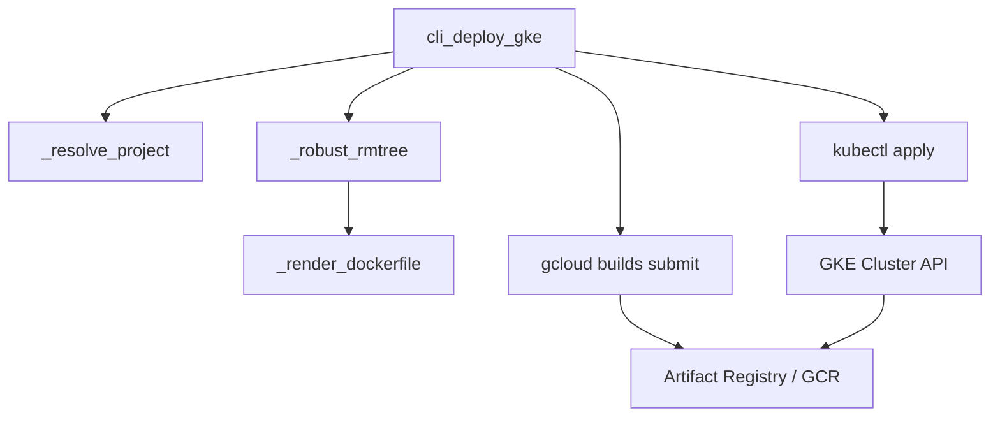
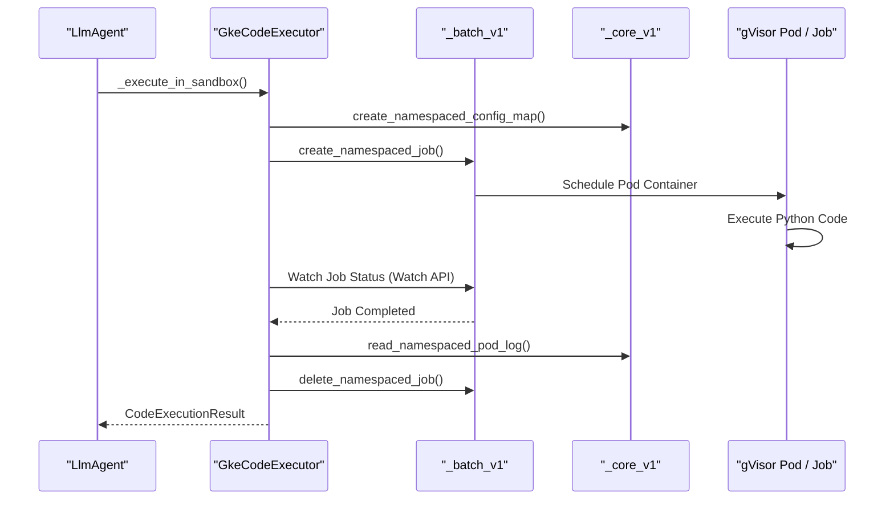

<!-- source: DeepWiki mcp.deepwiki.com · repo google/adk-python · page 11.4 GKE Deployment · fetched 2026-10-29 -->

# GKE Deployment

<details>
<summary>Relevant source files</summary>

The following files were used as context for generating this wiki page:

- [src/google/adk/cli/_dev_deploy.py](src/google/adk/cli/_dev_deploy.py)
- [src/google/adk/cli/adk_web_server.py](src/google/adk/cli/adk_web_server.py)
- [src/google/adk/cli/api_server.py](src/google/adk/cli/api_server.py)
- [src/google/adk/cli/cli_deploy.py](src/google/adk/cli/cli_deploy.py)
- [src/google/adk/cli/cli_tools_click.py](src/google/adk/cli/cli_tools_click.py)
- [src/google/adk/cli/dev_server.py](src/google/adk/cli/dev_server.py)
- [src/google/adk/cli/fast_api.py](src/google/adk/cli/fast_api.py)
- [src/google/adk/code_executors/base_code_executor.py](src/google/adk/code_executors/base_code_executor.py)
- [src/google/adk/code_executors/code_executor_context.py](src/google/adk/code_executors/code_executor_context.py)
- [src/google/adk/code_executors/container_code_executor.py](src/google/adk/code_executors/container_code_executor.py)
- [src/google/adk/code_executors/gke_code_executor.py](src/google/adk/code_executors/gke_code_executor.py)
- [src/google/adk/code_executors/unsafe_local_code_executor.py](src/google/adk/code_executors/unsafe_local_code_executor.py)
- [src/google/adk/code_executors/vertex_ai_code_executor.py](src/google/adk/code_executors/vertex_ai_code_executor.py)
- [src/google/adk/telemetry/_hallucination.py](src/google/adk/telemetry/_hallucination.py)
- [tests/unittests/cli/test_adk_web_server_run_live.py](tests/unittests/cli/test_adk_web_server_run_live.py)
- [tests/unittests/cli/test_adk_web_server_tests.py](tests/unittests/cli/test_adk_web_server_tests.py)
- [tests/unittests/cli/test_dev_deploy.py](tests/unittests/cli/test_dev_deploy.py)
- [tests/unittests/cli/test_dns_rebinding_protection.py](tests/unittests/cli/test_dns_rebinding_protection.py)
- [tests/unittests/cli/test_fast_api.py](tests/unittests/cli/test_fast_api.py)
- [tests/unittests/cli/test_local_client_check.py](tests/unittests/cli/test_local_client_check.py)
- [tests/unittests/cli/utils/test_cli_deploy.py](tests/unittests/cli/utils/test_cli_deploy.py)
- [tests/unittests/cli/utils/test_cli_deploy_ignore.py](tests/unittests/cli/utils/test_cli_deploy_ignore.py)
- [tests/unittests/cli/utils/test_cli_deploy_to_cloud_run.py](tests/unittests/cli/utils/test_cli_deploy_to_cloud_run.py)
- [tests/unittests/cli/utils/test_cli_tools_click.py](tests/unittests/cli/utils/test_cli_tools_click.py)
- [tests/unittests/code_executors/__init__.py](tests/unittests/code_executors/__init__.py)
- [tests/unittests/code_executors/test_code_executor_context.py](tests/unittests/code_executors/test_code_executor_context.py)
- [tests/unittests/code_executors/test_container_code_executor.py](tests/unittests/code_executors/test_container_code_executor.py)
- [tests/unittests/code_executors/test_gke_code_executor.py](tests/unittests/code_executors/test_gke_code_executor.py)
- [tests/unittests/code_executors/test_unsafe_local_code_executor.py](tests/unittests/code_executors/test_unsafe_local_code_executor.py)
- [tests/unittests/code_executors/test_vertex_ai_code_executor.py](tests/unittests/code_executors/test_vertex_ai_code_executor.py)

</details>


## Purpose and Scope

This page documents the `adk deploy gke` command, which deploys ADK agents to Google Kubernetes Engine (GKE). The deployment process generates Kubernetes manifests, builds a container image via Google Cloud Build, integrates with `kubectl` for cluster management, and pairs agents with the `GkeCodeExecutor` sandbox for secure, isolated code execution `[src/google/adk/code_executors/gke_code_executor.py:53-122]()`.

For other deployment targets, see [Cloud Run Deployment](11.2) and [Vertex AI Agent Engine Deployment](11.3). For general deployment concepts, see [Deployment Overview](11.1).

Sources: `[src/google/adk/cli/cli_tools_click.py:1-220]`, `[src/google/adk/cli/cli_deploy.py:37-48]`, `[src/google/adk/code_executors/gke_code_executor.py:53-122]`

---

## Command Overview

The `adk deploy gke` command automates the production deployment pipeline by performing the following programmatic steps:

1.  **Staging**: Copies agent code and local dependencies to a temporary staging folder using file utilities `[src/google/adk/cli/cli_deploy.py:1-185]()`.
2.  **Containerization**: Generates a container `Dockerfile` utilizing `_render_dockerfile` `[src/google/adk/cli/cli_deploy.py:44-44]()`.
3.  **Build**: Invokes `gcloud builds submit` to containerize the agent and push the image to Artifact Registry or GCR `[src/google/adk/cli/cli_deploy.py:37-185]()`.
4.  **Cluster Integration**: Configures `kubectl` access using `gcloud container clusters get-credentials`.
5.  **Manifest Application**: Generates and applies standard Kubernetes `Deployment` and `Service` manifests via `kubectl apply` `[src/google/adk/cli/cli_deploy.py:37-185]()`.

Sources: `[src/google/adk/cli/cli_deploy.py:37-185]`, `[src/google/adk/cli/cli_tools_click.py:1-220]`

---

## Command Syntax and Options

```bash
adk deploy gke [OPTIONS] AGENT_FOLDER
```

### Required Arguments

| Argument | Description |
| :--- | :--- |
| `AGENT_FOLDER` | Path to the directory containing the agent code (`agent.py` or `root_agent.yaml`). |

### Core Options

| Option | Type | Default | Description |
| :--- | :--- | :--- | :--- |
| `--project` | string | gcloud default | Google Cloud project ID. Resolved via `_resolve_project` if omitted `[src/google/adk/cli/cli_deploy.py:37-185]()`. |
| `--region` | string | (required) | GCP region hosting the target GKE cluster. |
| `--cluster_name` | string | (required) | Name of the GKE cluster. |
| `--service_name` | string | `<app_name>-service` | Kubernetes resource name for the Deployment and Service. |
| `--replicas` | int | 1 | Number of pod replicas to deploy. |
| `--port` | int | 8000 | Port exposed by the FastAPI server `[src/google/adk/cli/fast_api.py:113-113]()`. |

Sources: `[src/google/adk/cli/cli_deploy.py:37-185]`, `[src/google/adk/cli/fast_api.py:113-113]`

---

## Deployment Workflow

The following diagram bridges the natural language deployment description to internal code entities within `cli_deploy.py` and `cli_tools_click.py`.

### GKE CLI Deployment Pipeline


Sources: `[src/google/adk/cli/cli_deploy.py:37-185]`, `[src/google/adk/cli/cli_tools_click.py:1-220]`

---

## Container Implementation

### Dockerfile Template
Deployments rely on `_render_dockerfile` `[src/google/adk/cli/cli_deploy.py:44-44]()` to build a secure container image on `python:3.11-slim`. It establishes a dedicated non-root user (`myuser`) for security compliance.

Injected environment variables include:
*   `GOOGLE_GENAI_USE_ENTERPRISE=1`: Enables Gemini Enterprise features.
*   `GOOGLE_CLOUD_PROJECT`: Set to the resolved project ID.
*   `GOOGLE_CLOUD_LOCATION`: Set to the cluster region.

Sources: `[src/google/adk/cli/cli_deploy.py:37-185]`

---

## GKE Code Executor Sandbox Pairing (`GkeCodeExecutor`)

For agents that execute model-generated Python code, ADK provides `GkeCodeExecutor` `[src/google/adk/code_executors/gke_code_executor.py:53-122]()`. It supports two execution modes: **Job Mode** and **Sandbox Mode**.

### Job Mode (Default)
Job Mode securely runs code by dynamically spawning an ephemeral Kubernetes `Job` for each execution request.
*   **Isolation**: Requests the gVisor runtime (`RuntimeClass`) to sandbox code execution from the host kernel `[src/google/adk/code_executors/gke_code_executor.py:53-65]()`.
*   **Storage**: Mounts user code dynamically via ephemeral `ConfigMap` resources `[src/google/adk/code_executors/gke_code_executor.py:53-65]()`.
*   **Security Context**: Applies strict non-root policies, dropping all unnecessary Linux capabilities.

### Sandbox Mode
Sandbox Mode delegates execution to the Agent Sandbox Client (`k8s-agent-sandbox`). Pods are instantiated from pre-installed cluster templates (`python-sandbox-template`), requiring cluster controllers, routers, and gateway infrastructures `[src/google/adk/code_executors/gke_code_executor.py:66-75]()`.

### RBAC Requirements
To utilize `GkeCodeExecutor`, the Kubernetes `ServiceAccount` associated with the agent pod requires specific RBAC permissions `[src/google/adk/code_executors/gke_code_executor.py:83-101]()`:

```yaml
rules:
- apiGroups: [""]
  resources: ["configmaps"]
  verbs: ["create", "delete", "get", "patch"]
- apiGroups: ["batch"]
  resources: ["jobs"]
  verbs: ["get", "list", "watch", "create", "delete"]
- apiGroups: [""]
  resources: ["pods", "pods/log"]
  verbs: ["get", "list"]
```

Sources: `[src/google/adk/code_executors/gke_code_executor.py:53-122]`

---

## Code Execution Architecture

The sequence below illustrates how an agent invokes remote code execution within a GKE cluster via `GkeCodeExecutor` and its underlying API clients (`_batch_v1` and `_core_v1`) `[src/google/adk/code_executors/gke_code_executor.py:120-176]()`.

### GKE Code Execution Lifecycle


Sources: `[src/google/adk/code_executors/gke_code_executor.py:53-176]`

---

## Service URI Compatibility

Deployment generation configures explicit service endpoints to maintain compatibility with different versions of the `google-adk` package `[src/google/adk/cli/cli_deploy.py:37-185]()`:
*   Configures explicit `--session_service_uri`, `--artifact_service_uri`, and `--memory_service_uri` flags.
*   Supports `--use_local_storage` and `--no_use_local_storage` options.

Sources: `[src/google/adk/cli/cli_deploy.py:37-185]`

---

## Cleanup and Error Handling

Staging directories and temporary build artifacts are monitored and cleaned up via robust directory removal utilities `[src/google/adk/cli/cli_deploy.py:37-185]()`. If subprocess build steps fail or deployment commands encounter exceptions, staging directories are purged immediately to prevent disk bloat.

Sources: `[src/google/adk/cli/cli_deploy.py:37-185]`

---

