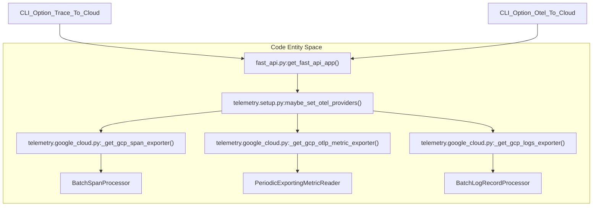
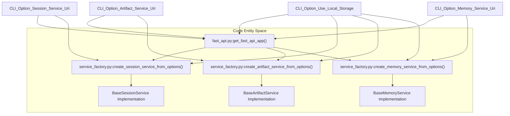

<!-- source: DeepWiki mcp.deepwiki.com · repo google/adk-python · page 11.5 Deployment Configuration · fetched 2026-10-29 -->

# Deployment Configuration

Relevant source files

The following files were used as context for generating this wiki page:

- [src/google/adk/cli/_dev_deploy.py](src/google/adk/cli/_dev_deploy.py)
- [src/google/adk/cli/adk_web_server.py](src/google/adk/cli/adk_web_server.py)
- [src/google/adk/cli/api_server.py](src/google/adk/cli/api_server.py)
- [src/google/adk/cli/cli_deploy.py](src/google/adk/cli/cli_deploy.py)
- [src/google/adk/cli/cli_tools_click.py](src/google/adk/cli/cli_tools_click.py)
- [src/google/adk/cli/dev_server.py](src/google/adk/cli/dev_server.py)
- [src/google/adk/cli/fast_api.py](src/google/adk/cli/fast_api.py)
- [src/google/adk/environment/__init__.py](src/google/adk/environment/__init__.py)
- [src/google/adk/environment/_base_environment.py](src/google/adk/environment/_base_environment.py)
- [src/google/adk/environment/_local_environment.py](src/google/adk/environment/_local_environment.py)
- [src/google/adk/features/__init__.py](src/google/adk/features/__init__.py)
- [src/google/adk/utils/env_utils.py](src/google/adk/utils/env_utils.py)
- [src/google/adk/utils/feature_decorator.py](src/google/adk/utils/feature_decorator.py)
- [tests/unittests/a2a/test_experimental.py](tests/unittests/a2a/test_experimental.py)
- [tests/unittests/cli/test_adk_web_server_run_live.py](tests/unittests/cli/test_adk_web_server_run_live.py)
- [tests/unittests/cli/test_adk_web_server_tests.py](tests/unittests/cli/test_adk_web_server_tests.py)
- [tests/unittests/cli/test_dev_deploy.py](tests/unittests/cli/test_dev_deploy.py)
- [tests/unittests/cli/test_dns_rebinding_protection.py](tests/unittests/cli/test_dns_rebinding_protection.py)
- [tests/unittests/cli/test_fast_api.py](tests/unittests/cli/test_fast_api.py)
- [tests/unittests/cli/test_local_client_check.py](tests/unittests/cli/test_local_client_check.py)
- [tests/unittests/cli/utils/test_cli_deploy.py](tests/unittests/cli/utils/test_cli_deploy.py)
- [tests/unittests/cli/utils/test_cli_deploy_ignore.py](tests/unittests/cli/utils/test_cli_deploy_ignore.py)
- [tests/unittests/cli/utils/test_cli_deploy_to_cloud_run.py](tests/unittests/cli/utils/test_cli_deploy_to_cloud_run.py)
- [tests/unittests/cli/utils/test_cli_tools_click.py](tests/unittests/cli/utils/test_cli_tools_click.py)
- [tests/unittests/environment/__init__.py](tests/unittests/environment/__init__.py)
- [tests/unittests/environment/test_local_environment.py](tests/unittests/environment/test_local_environment.py)
- [tests/unittests/features/test_feature_decorator.py](tests/unittests/features/test_feature_decorator.py)
- [tests/unittests/features/test_feature_registry.py](tests/unittests/features/test_feature_registry.py)
- [tests/unittests/integrations/eventarc/test_eventarc_toolset.py](tests/unittests/integrations/eventarc/test_eventarc_toolset.py)
- [tests/unittests/utils/test_env_utils.py](tests/unittests/utils/test_env_utils.py)
- [tests/unittests/utils/test_feature_decorator.py](tests/unittests/utils/test_feature_decorator.py)

## Purpose and Scope

This page documents the common configuration options available when deploying ADK agents to production environments via the CLI and server entrypoints. These options control observability, user interfaces, storage backends, runtime logging, CORS, environment variables, feature flags, and event triggers. For target-specific deployment workflows, see [Cloud Run Deployment](), [Vertex AI Agent Engine Deployment](), and [GKE Deployment]().

Sources: [src/google/adk/cli/cli_tools_click.py:130-203](), [src/google/adk/cli/cli_deploy.py:78-103]()

---

## Configuration Categories

ADK deployment configuration options are categorized by subsystem:

| Category | Key Options | Purpose |
|----------|-------------|---------|
| **Observability** | `trace_to_cloud`, `otel_to_cloud` | Configure OpenTelemetry and Google Cloud telemetry exporters. |
| **User Interface** | `with_ui`, `allow_origins` | Control development web UI availability and CORS security headers. |
| **Storage Backends** | `session_service_uri`, `artifact_service_uri`, `memory_service_uri`, `use_local_storage` | Decouple persistence from local container file systems. |
| **Runtime Behavior** | `log_level`, `-v`/`--verbose`, `port`, `bind_host` | Control server logging verbosity and network bindings. |
| **Agent-Specific** | `enable_features`, `disable_features`, `trigger_sources` | Gate experimental features and bind asynchronous event triggers. |

Sources: [src/google/adk/cli/cli_tools_click.py:130-203](), [src/google/adk/cli/cli_deploy.py:78-103]()

---

## Observability Configuration

### Tracing and Metrics Options

ADK supports distributed tracing and telemetry via OpenTelemetry (`otel`) and Google Cloud integrations:

- **`trace_to_cloud`**: Enables Google Cloud Trace span exporters by configuring OpenTelemetry hooks to send trace data to the telemetry endpoint [src/google/adk/cli/fast_api.py:125-125](), [src/google/adk/cli/cli_tools_click.py:130-160](). This option is passed to the `get_fast_api_app` function [src/google/adk/cli/fast_api.py:107-146](). The actual exporters are created by `get_gcp_exporters` and specifically `_get_gcp_span_exporter`.
- **`otel_to_cloud`**: Enables comprehensive GCP observability across traces, metrics, and logs by orchestrating exporters within deployment templates [src/google/adk/cli/fast_api.py:126-126](), [tests/unittests/cli/utils/test_cli_deploy_to_cloud_run.py:136-176](). This option is also passed to `get_fast_api_app` [src/google/adk/cli/fast_api.py:107-146](). This will enable span, metric, and log exporters via underlying GCP OTel hooks [src/google/adk/cli/api_server.py:98-100]().

Title: "Telemetry Configuration to Code Entity Mapping"

Sources: [src/google/adk/cli/fast_api.py:125-126](), [tests/unittests/cli/utils/test_cli_deploy_to_cloud_run.py:136-176](), [src/google/adk/cli/fast_api.py:107-146](), [src/google/adk/cli/api_server.py:98-100]()

---

## User Interface Configuration

### Web UI and CORS Controls

- **`with_ui`**: Determines whether the development web UI assets are mounted and served by the application [src/google/adk/cli/fast_api.py:118-118](). This is controlled by the `web` parameter in `get_fast_api_app` [src/google/adk/cli/fast_api.py:107-118]().
  > **Security Warning:** The ADK Web UI is designed for local development and debugging. Exposing it in production grants broad read/write access to agent sessions and state [src/google/adk/cli/dev_server.py:25-35]().
- **`allow_origins`**: Configures Cross-Origin Resource Sharing (CORS) rules for the FastAPI backend [src/google/adk/cli/fast_api.py:117-117](). Allowed origins are validated and parsed into server middleware rules by `_parse_cors_origins` [src/google/adk/cli/api_server.py:135-161]() and `_is_origin_allowed` [src/google/adk/cli/api_server.py:163-175]().

Sources: [src/google/adk/cli/fast_api.py:107-118](), [src/google/adk/cli/api_server.py:135-175](), [src/google/adk/cli/dev_server.py:25-35]()

---

## Storage Backend Configuration

ADK abstracts persistence services through URI strings accepted by deployment CLI commands [tests/unittests/cli/utils/test_cli_deploy.py:143-230](). These URIs are passed to `get_fast_api_app` [src/google/adk/cli/fast_api.py:107-146]() to configure the respective services.

| Service Parameter | Target Function / Factory | Supported Schemes |
|-------------------|---------------------------|-------------------|
| `session_service_uri` | `create_session_service_from_options` [src/google/adk/cli/fast_api.py:66-66]() | `memory://`, `sqlite://`, `postgresql://`, `mysql://`, `agentengine://` |
| `artifact_service_uri` | `create_artifact_service_from_options` [src/google/adk/cli/fast_api.py:64-64]() | Local paths, `gs://` |
| `memory_service_uri` | `create_memory_service_from_options` [src/google/adk/cli/fast_api.py:65-65]() | Local store, Vertex AI RAG memory |

### Local Storage Flag

- **`use_local_storage`**: A boolean flag indicating whether fallback local filesystem storage should be initialized for session and artifact data [src/google/adk/cli/fast_api.py:115-115](). This is used by the service factory functions to determine the default storage backend [src/google/adk/cli/fast_api.py:64-66]().

Title: "Storage URI Configuration to Code Entity Mapping"

Sources: [src/google/adk/cli/fast_api.py:64-66](), [src/google/adk/cli/fast_api.py:107-116](), [tests/unittests/cli/utils/test_cli_deploy.py:143-230]()

---

## Runtime and Docker Configuration

### Log Level and Verbosity

- **`log_level`**: Managed via the `_logging_options` decorator [src/google/adk/cli/cli_tools_click.py:130-162](), accepting `DEBUG`, `INFO`, `WARNING`, `ERROR`, or `CRITICAL` [src/google/adk/cli/cli_tools_click.py:67-70]().
- **`-v` / `--verbose`**: Acts as a shortcut flag that automatically promotes the log level to `DEBUG` when default logging is active [src/google/adk/cli/cli_tools_click.py:134-160]().

### Docker Environment Variables

Container deployments populate necessary runtime environment variables via `cli_deploy.py` [src/google/adk/cli/cli_deploy.py:1-50]():
- `GOOGLE_CLOUD_PROJECT` [tests/unittests/cli/utils/test_cli_deploy_to_cloud_run.py:205-207]()
- `GOOGLE_CLOUD_LOCATION` [tests/unittests/cli/utils/test_cli_deploy_to_cloud_run.py:205-207]()
- `GOOGLE_GENAI_USE_ENTERPRISE` [tests/unittests/cli/utils/test_cli_deploy_to_cloud_run.py:205-207]()

Sources: [src/google/adk/cli/cli_tools_click.py:67-162](), [src/google/adk/cli/cli_deploy.py:1-50](), [tests/unittests/cli/utils/test_cli_deploy_to_cloud_run.py:205-207]()

---

## Agent-Specific Configuration & Feature Flags

### Feature Flags

Feature overrides can be applied via CLI arguments or environment variables using the `feature_options` decorator and `_apply_feature_overrides` [src/google/adk/cli/cli_tools_click.py:165-203]():
- **`enable_features`**: Comma-separated strings enabling experimental capabilities mapped to `FeatureName` [src/google/adk/features/__init__.py:1-10]().
- **`disable_features`**: Comma-separated strings disabling specific framework features [src/google/adk/cli/cli_tools_click.py:165-195]().

### Event Triggers

The `trigger_sources` parameter in `get_fast_api_app` [src/google/adk/cli/fast_api.py:133-135]() allows configuring event-driven triggers for the deployed agent. This enables the agent to respond to external events from sources like Pub/Sub or Eventarc.

- **`trigger_oidc_audience`**: Specifies the OIDC audience for authenticating incoming trigger requests [src/google/adk/cli/fast_api.py:136-136]().
- **`trigger_oidc_service_accounts`**: A list of service accounts allowed to invoke the trigger endpoints [src/google/adk/cli/fast_api.py:137-137]().
- **`trigger_auth_verifier`**: A custom callable for advanced authentication verification of trigger requests [src/google/adk/cli/fast_api.py:138-140]().

Sources: [src/google/adk/cli/cli_tools_click.py:165-203](), [src/google/adk/cli/fast_api.py:133-140](), [src/google/adk/features/__init__.py:1-10]()

---

