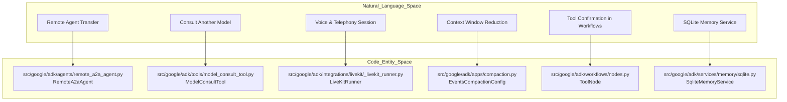
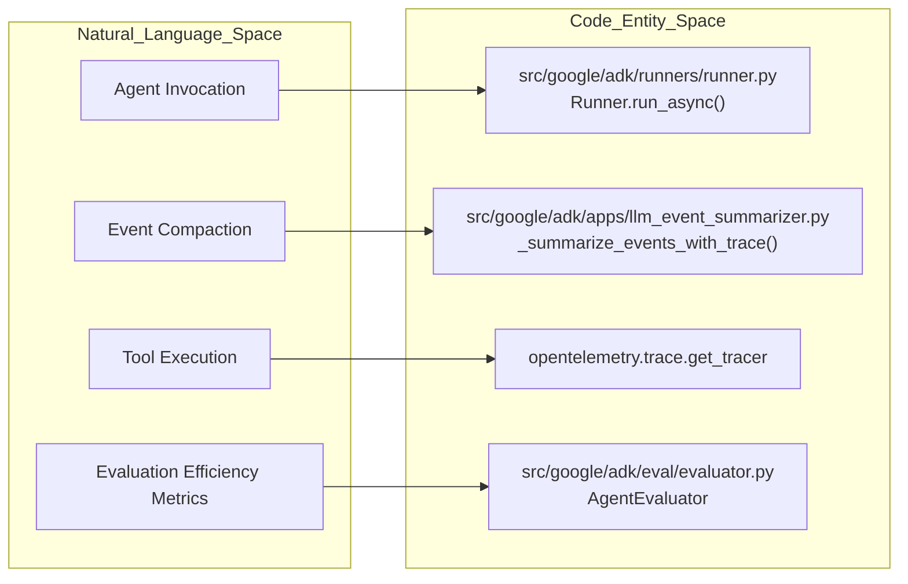

<!-- source: DeepWiki mcp.deepwiki.com · repo google/adk-python · page 12 Advanced Topics · fetched 2026-10-29 -->

# Advanced Topics

Relevant source files

The following files were used as context for generating this wiki page:

- [src/google/adk/a2a/_compat.py](src/google/adk/a2a/_compat.py)
- [src/google/adk/a2a/executor/__init__.py](src/google/adk/a2a/executor/__init__.py)
- [src/google/adk/a2a/executor/task_result_aggregator.py](src/google/adk/a2a/executor/task_result_aggregator.py)
- [src/google/adk/a2a/logs/log_utils.py](src/google/adk/a2a/logs/log_utils.py)
- [src/google/adk/a2a/utils/agent_card_builder.py](src/google/adk/a2a/utils/agent_card_builder.py)
- [src/google/adk/a2a/utils/agent_to_a2a.py](src/google/adk/a2a/utils/agent_to_a2a.py)
- [src/google/adk/agents/remote_a2a_agent.py](src/google/adk/agents/remote_a2a_agent.py)
- [tests/unittests/a2a/executor/__init__.py](tests/unittests/a2a/executor/__init__.py)
- [tests/unittests/a2a/executor/test_task_result_aggregator.py](tests/unittests/a2a/executor/test_task_result_aggregator.py)
- [tests/unittests/a2a/logs/test_log_utils.py](tests/unittests/a2a/logs/test_log_utils.py)
- [tests/unittests/a2a/test_compat.py](tests/unittests/a2a/test_compat.py)
- [tests/unittests/a2a/utils/test_agent_card_builder.py](tests/unittests/a2a/utils/test_agent_card_builder.py)
- [tests/unittests/a2a/utils/test_agent_to_a2a.py](tests/unittests/a2a/utils/test_agent_to_a2a.py)
- [tests/unittests/agents/test_llm_agent_output_save.py](tests/unittests/agents/test_llm_agent_output_save.py)

## Purpose and Scope

This section covers advanced ADK features for production deployments, sophisticated agent workflows, and system extensibility. These capabilities enable distributed agent communication, persistent state management, observability, model failover, native voice and telephony, and performance optimization.

For foundational concepts, see [Core Concepts](#2.3), [Agent System](#3), and [Persistence and State](#8).

Sources: [CHANGELOG.md:8-9]()

---

## Advanced Features Architecture

**Advanced Features Architecture Bridge**

Sources: [CHANGELOG.md:10-11](), [CHANGELOG.md:39](), [CHANGELOG.md:34](), [CHANGELOG.md:49](), [CHANGELOG.md:51]()

---

## Agent-to-Agent Protocol (A2A)

The Agent-to-Agent (A2A) protocol enables ADK agents to communicate with remote agents over HTTP using a standardized message format. `RemoteA2aAgent` acts as a client-side proxy that translates invocations into A2A requests [src/google/adk/agents/remote_a2a_agent.py:14-30](), while `to_a2a` converts an ADK agent or workflow into a Starlette application [src/google/adk/a2a/utils/agent_to_a2a.py:80-97](). `AgentCardBuilder` constructs agent discovery cards [src/google/adk/a2a/utils/agent_card_builder.py:51-101](), `TaskResultAggregator` handles asynchronous task state tracking [src/google/adk/a2a/executor/task_result_aggregator.py:28-89](), and version shims isolate divergence between `a2a-sdk` versions [src/google/adk/a2a/_compat.py:15-74](). Structured logging utilities format payloads safely [src/google/adk/a2a/logs/log_utils.py:15-37]().

For details, see [Agent-to-Agent Protocol (A2A)](#12.1).

Sources: [src/google/adk/agents/remote_a2a_agent.py:14-30](), [src/google/adk/a2a/utils/agent_to_a2a.py:80-97](), [src/google/adk/a2a/utils/agent_card_builder.py:51-101](), [src/google/adk/a2a/executor/task_result_aggregator.py:28-89](), [src/google/adk/a2a/_compat.py:15-74](), [src/google/adk/a2a/logs/log_utils.py:15-37]()

---

## Session Resumability

Resumability enables agents to pause execution during long-running tool calls or human-in-the-loop interactions and resume from saved checkpoints without losing conversational context. Utilities handle invocation ID resolution and synthetic user event injection.

For details, see [Session Resumability](#12.2).

Sources: []

---

## Session Rewind

Session rewind allows an application to undo past invocations, restoring session state, variables, and artifact versions to an earlier chronological point using `rewind_async`. Rewound invocations are isolated to prevent skewing event compaction histories.

For details, see [Session Rewind](#12.3).

Sources: []

---

## Event Compaction

Event compaction manages context window limits during extended conversations by summarizing older message history once token or event count thresholds are exceeded. `LlmEventSummarizer` formats historical events and tool calls into prompts for summarization under `EventsCompactionConfig`.

For details, see [Event Compaction](#12.4).

Sources: []

---

## Database Schema Management

ADK provides versioned database migrations and schema checks for production persistence backends. `DatabaseSessionService` handles SQLAlchemy engine configurations, row-level locking, and secure unpickling rules for serialized state rows.

For details, see [Database Schema Management](#12.5).

Sources: []

---

## Concurrency and Performance

ADK supports high-throughput execution through asynchronous routines, thread pools for blocking functions, batch tool execution, and session-level locking. Deferred imports are utilized extensively to keep cold-start times minimal across optional integrations. The `tool_thread_pool_config` is honored for synchronous tools even outside live mode [CHANGELOG.md:39]().

For details, see [Concurrency and Performance](#12.6).

Sources: [CHANGELOG.md:39]()

---

## Telemetry and Observability

ADK integrates with OpenTelemetry to track traces, spans, and gen_ai semantic conventions across node executions, tool calls, and LLM requests. Exporters support Google Cloud, Agent Engine, and local SQLite backends. Internal metadata is added for ADK events [CHANGELOG.md:38](), and spans can be marked if their response came from a callback [CHANGELOG.md:42](). Skill telemetry span attributes have moved out of experimental [CHANGELOG.md:48]().

**Telemetry Mapping Bridge**

For details, see [Telemetry and Observability](#12.7).

Sources: [CHANGELOG.md:38](), [CHANGELOG.md:42](), [CHANGELOG.md:48]()

---

## BigQuery Analytics Plugin

The `BigQueryAgentAnalyticsPlugin` logs agent lifecycle events, tool metadata, and token usage metrics directly into BigQuery for analytics, auditing, and usage tracking. BigQuery tools can now run where CMEK is required [CHANGELOG.md:40]().

For details, see [BigQuery Analytics Plugin](#12.8).

Sources: [CHANGELOG.md:40]()

---

## Security, Guardrails and CORS

ADK secures web and API deployments via CORS controls, allowlists, DNS-rebinding protection, module blocklists for YAML agent loaders, credential redaction, and the Model Armor guardrail plugin. An optional `ToolCallIntegrityPlugin` has been added [CHANGELOG.md:44]().

For details, see [Security, Guardrails and CORS](#12.9).

Sources: [CHANGELOG.md:44]()

---

## Code Execution

Model-generated code execution is supported through secure sandboxes including AgentEngine, GKE, Cloud Run sandboxes, containers, and Vertex AI execution environments.

For details, see [Code Execution](#12.10).

Sources: []

---

## Environment Simulation

Environment simulation tools test agents against simulated external environments and mock tool responses using `EnvironmentSimulationEngine`, supporting remote backends like Daytona, E2B, and VMaaS.

For details, see [Environment Simulation](#12.11).

Sources: []

---

## Integrations and Messaging

ADK connects to third-party messaging systems and infrastructure services, including Slack runners, Google Cloud Pub/Sub, Redis/Firestore services, Secret Managers, Agent Registries, and Skill Registries. The MCP SDK 2.x now has an opt-in modern-protocol connect path [CHANGELOG.md:14](), and grounding metadata can be propagated from MCP `_meta` [CHANGELOG.md:45]().

For details, see [Integrations and Messaging](#12.12).

Sources: [CHANGELOG.md:14](), [CHANGELOG.md:45]()

---

## Event-Driven Triggers

`trigger_routes.py` provides FastAPI endpoints (`/trigger/pubsub` and `/trigger/eventarc`) to handle event-driven agent triggers with built-in concurrency controls, retries, exponential backoff, and transient error identification.

For details, see [Event-Driven Triggers](#12.13).

Sources: []

---

## LiveKit Voice and Telephony

`google.adk.integrations.livekit` provides a LiveKit-based runner for native real-time voice and telephony agents. It handles audio-video modalities, WebRTC connections via `_rtc`, audio session transcripts, session resumption, and model callbacks for low-latency streaming interactions. A pre-built avatar is now defaulted for VIDEO live sessions [CHANGELOG.md:41]().

For details, see [LiveKit Voice and Telephony](#12.14).

Sources: [CHANGELOG.md:41]()

---

