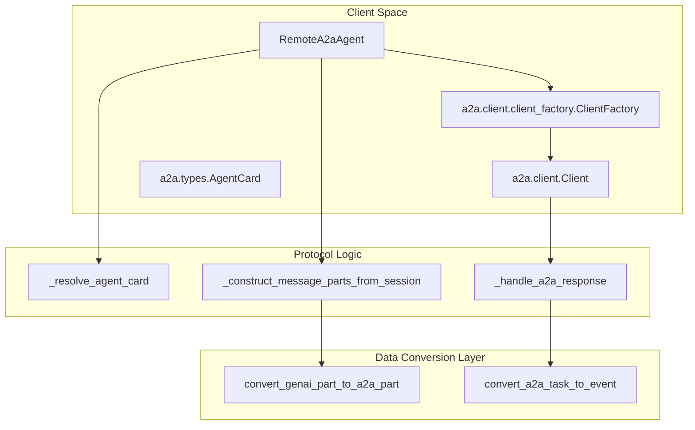
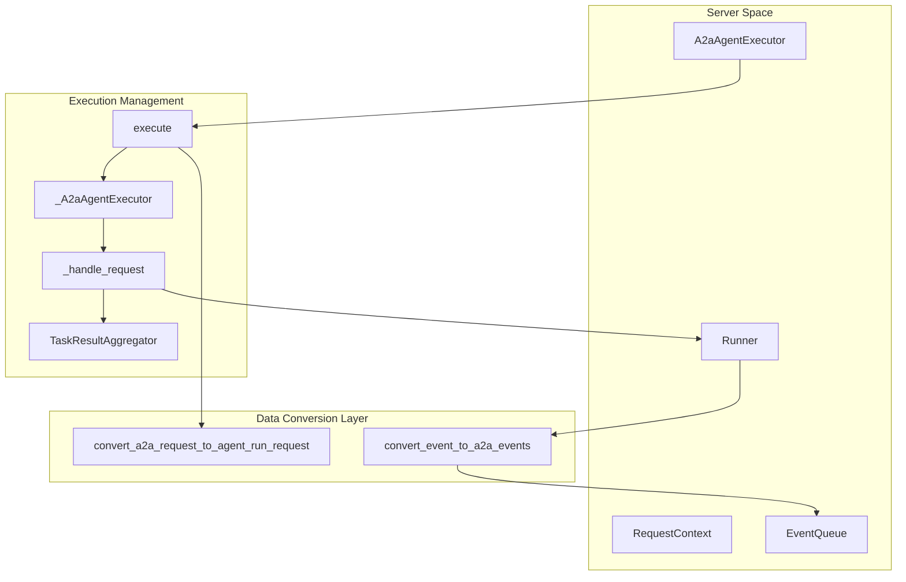

<!-- source: DeepWiki mcp.deepwiki.com · repo google/adk-python · page 12.1 Agent-to-Agent Protocol (A2A) · fetched 2026-10-29 -->

# Agent-to-Agent Protocol (A2A)

Relevant source files

The following files were used as context for generating this wiki page:

- [docs/guides/agents/remote_a2a_agent/task.md](docs/guides/agents/remote_a2a_agent/task.md)
- [src/google/adk/a2a/_compat.py](src/google/adk/a2a/_compat.py)
- [src/google/adk/a2a/agent/__init__.py](src/google/adk/a2a/agent/__init__.py)
- [src/google/adk/a2a/agent/_remote_a2a_agent.py](src/google/adk/a2a/agent/_remote_a2a_agent.py)
- [src/google/adk/a2a/agent/config.py](src/google/adk/a2a/agent/config.py)
- [src/google/adk/a2a/agent/utils.py](src/google/adk/a2a/agent/utils.py)
- [src/google/adk/a2a/converters/event_converter.py](src/google/adk/a2a/converters/event_converter.py)
- [src/google/adk/a2a/converters/from_adk_event.py](src/google/adk/a2a/converters/from_adk_event.py)
- [src/google/adk/a2a/converters/long_running_functions.py](src/google/adk/a2a/converters/long_running_functions.py)
- [src/google/adk/a2a/converters/part_converter.py](src/google/adk/a2a/converters/part_converter.py)
- [src/google/adk/a2a/converters/to_adk_event.py](src/google/adk/a2a/converters/to_adk_event.py)
- [src/google/adk/a2a/executor/__init__.py](src/google/adk/a2a/executor/__init__.py)
- [src/google/adk/a2a/executor/a2a_agent_executor.py](src/google/adk/a2a/executor/a2a_agent_executor.py)
- [src/google/adk/a2a/executor/a2a_agent_executor_impl.py](src/google/adk/a2a/executor/a2a_agent_executor_impl.py)
- [src/google/adk/a2a/executor/config.py](src/google/adk/a2a/executor/config.py)
- [src/google/adk/a2a/executor/interceptors/__init__.py](src/google/adk/a2a/executor/interceptors/__init__.py)
- [src/google/adk/a2a/executor/task_result_aggregator.py](src/google/adk/a2a/executor/task_result_aggregator.py)
- [src/google/adk/a2a/executor/utils.py](src/google/adk/a2a/executor/utils.py)
- [src/google/adk/a2a/logs/log_utils.py](src/google/adk/a2a/logs/log_utils.py)
- [src/google/adk/a2a/utils/agent_card_builder.py](src/google/adk/a2a/utils/agent_card_builder.py)
- [src/google/adk/a2a/utils/agent_to_a2a.py](src/google/adk/a2a/utils/agent_to_a2a.py)
- [src/google/adk/agents/remote_a2a_agent.py](src/google/adk/agents/remote_a2a_agent.py)
- [tests/unittests/a2a/agent/__init__.py](tests/unittests/a2a/agent/__init__.py)
- [tests/unittests/a2a/agent/test_remote_a2a_agent.py](tests/unittests/a2a/agent/test_remote_a2a_agent.py)
- [tests/unittests/a2a/converters/test_event_converter.py](tests/unittests/a2a/converters/test_event_converter.py)
- [tests/unittests/a2a/converters/test_from_adk.py](tests/unittests/a2a/converters/test_from_adk.py)
- [tests/unittests/a2a/converters/test_long_running_functions.py](tests/unittests/a2a/converters/test_long_running_functions.py)
- [tests/unittests/a2a/converters/test_part_converter.py](tests/unittests/a2a/converters/test_part_converter.py)
- [tests/unittests/a2a/converters/test_to_adk.py](tests/unittests/a2a/converters/test_to_adk.py)
- [tests/unittests/a2a/executor/__init__.py](tests/unittests/a2a/executor/__init__.py)
- [tests/unittests/a2a/executor/test_a2a_agent_executor.py](tests/unittests/a2a/executor/test_a2a_agent_executor.py)
- [tests/unittests/a2a/executor/test_a2a_agent_executor_impl.py](tests/unittests/a2a/executor/test_a2a_agent_executor_impl.py)
- [tests/unittests/a2a/executor/test_task_result_aggregator.py](tests/unittests/a2a/executor/test_task_result_aggregator.py)
- [tests/unittests/a2a/integration/__init__.py](tests/unittests/a2a/integration/__init__.py)
- [tests/unittests/a2a/integration/client.py](tests/unittests/a2a/integration/client.py)
- [tests/unittests/a2a/integration/server.py](tests/unittests/a2a/integration/server.py)
- [tests/unittests/a2a/integration/test_client_server.py](tests/unittests/a2a/integration/test_client_server.py)
- [tests/unittests/a2a/integration/test_client_server_v1.py](tests/unittests/a2a/integration/test_client_server_v1.py)
- [tests/unittests/a2a/logs/test_log_utils.py](tests/unittests/a2a/logs/test_log_utils.py)
- [tests/unittests/a2a/test_compat.py](tests/unittests/a2a/test_compat.py)
- [tests/unittests/a2a/utils/test_agent_card_builder.py](tests/unittests/a2a/utils/test_agent_card_builder.py)
- [tests/unittests/a2a/utils/test_agent_to_a2a.py](tests/unittests/a2a/utils/test_agent_to_a2a.py)
- [tests/unittests/agents/test_llm_agent_output_save.py](tests/unittests/agents/test_llm_agent_output_save.py)

## Purpose and Scope

This document covers ADK's implementation of the Agent-to-Agent (A2A) protocol, which enables inter-agent communication between ADK agents and other A2A-compliant systems. The A2A protocol is an industry-standard protocol for agent communication.

This document describes:
- Using remote A2A agents within ADK via `RemoteA2aAgent` [src/google/adk/agents/remote_a2a_agent.py:23-23]().
- Exposing ADK agents as A2A servers via `A2aAgentExecutor` [src/google/adk/a2a/executor/a2a_agent_executor.py:53-54]().
- Data conversion between ADK and A2A formats using dedicated converters [src/google/adk/a2a/converters/part_converter.py:116-119](), [src/google/adk/a2a/converters/event_converter.py:56-65](), and [src/google/adk/a2a/converters/to_adk_event.py:70-78]().
- Task and lifecycle management within the A2A context using `TaskResultAggregator` [src/google/adk/a2a/executor/task_result_aggregator.py:25-28]().
- Utility functions for rapid A2A server deployment and agent card building via `to_a2a()` [src/google/adk/a2a/utils/agent_to_a2a.py:79-80]() and `AgentCardBuilder` [src/google/adk/a2a/utils/agent_card_builder.py:43-45]().
- Compatibility shim (`_compat`) supporting both A2A SDK 0.3.x and 1.x versions [src/google/adk/a2a/_compat.py:1-21]().

For information about agent orchestration patterns within ADK, see **Multi-Agent Orchestration (3.5)**. For tool integration, see **Tool Framework (7.1)**.

Sources: [src/google/adk/agents/remote_a2a_agent.py:23-23](), [src/google/adk/a2a/executor/a2a_agent_executor.py:53-54](), [src/google/adk/a2a/converters/part_converter.py:116-119](), [src/google/adk/a2a/converters/event_converter.py:56-65](), [src/google/adk/a2a/converters/to_adk_event.py:70-78](), [src/google/adk/a2a/executor/task_result_aggregator.py:25-28](), [src/google/adk/a2a/utils/agent_to_a2a.py:79-80](), [src/google/adk/a2a/utils/agent_card_builder.py:43-45](), [src/google/adk/a2a/_compat.py:1-21]()

---

## Architecture Overview

The A2A integration in ADK operates in two modes: **client mode** (consuming remote agents via `RemoteA2aAgent`) and **server mode** (exposing ADK agents via `A2aAgentExecutor`). A compatibility layer (`_compat`) normalizes protocol structures across A2A SDK versions.

### Natural Language Space to Code Entity Space

The following diagrams map the conceptual components of the A2A protocol to specific classes and functions in the ADK codebase.

Title: "A2A Client Mode Entity Mapping"

Sources: [src/google/adk/agents/remote_a2a_agent.py:23-23](), [src/google/adk/a2a/converters/part_converter.py:116-119](), [src/google/adk/a2a/converters/event_converter.py:208-210]()

Title: "A2A Server Mode Entity Mapping"

Sources: [src/google/adk/a2a/executor/a2a_agent_executor.py:53-54](), [src/google/adk/a2a/executor/a2a_agent_executor_impl.py:39-39](), [src/google/adk/a2a/executor/task_result_aggregator.py:25-28]()

---

## A2A SDK Compatibility Shim (`_compat`)

Because ADK supports both A2A SDK `0.3.x` and `1.x`, a version-agnostic shim module is provided (`google.adk.a2a._compat`) [src/google/adk/a2a/_compat.py:1-21]().

This shim handles differences in:
- Agent card parsing and construction (`_compat.parse_agent_card`, `_compat.build_agent_card`) [tests/unittests/a2a/utils/test_agent_to_a2a.py:95-96]().
- Stream message wrapping (`_compat.make_stream_normalizer`) [src/google/adk/a2a/_compat.py:176-187]().
- Task and status states (`_compat.TS_UNKNOWN`, `_compat.TS_SUBMITTED`, `_compat.TS_WORKING`, `_compat.TS_FAILED`) [src/google/adk/a2a/_compat.py:144-149]().
- Part extraction and metadata manipulation (`_compat.part_metadata`, `_compat.is_text_part`, `_compat.is_file_part`) [src/google/adk/a2a/converters/part_converter.py:129-130]().

Sources: [src/google/adk/a2a/_compat.py:1-21](), [src/google/adk/a2a/_compat.py:144-149](), [src/google/adk/a2a/_compat.py:176-187](), [src/google/adk/a2a/converters/part_converter.py:129-130]()

---

## Using Remote A2A Agents

### RemoteA2aAgent Class

`RemoteA2aAgent` extends `BaseAgent` [src/google/adk/agents/remote_a2a_agent.py:23-23]() to communicate with remote A2A-compliant agents. It handles agent card resolution, client management via `A2AClientFactory`, and session state mapping.

**Key Methods:**
- `_resolve_agent_card()`: Orchestrates discovery of the remote agent's capabilities using `AgentCardResolutionError` handling [src/google/adk/agents/remote_a2a_agent.py:21-21]().
- `_construct_message_parts_from_session()`: Builds an A2A message by scanning the ADK session history and converting `Event` content to A2A parts.
- `_handle_a2a_response()`: Processes the incoming A2A stream and converts it back into ADK `Event` objects using `convert_a2a_message_to_event` [src/google/adk/a2a/converters/to_adk_event.py:36-36]().

Sources: [src/google/adk/agents/remote_a2a_agent.py:23-23](), [src/google/adk/agents/remote_a2a_agent.py:21-21](), [src/google/adk/a2a/converters/to_adk_event.py:36-36]()

### Initialization Patterns

`RemoteA2aAgent` supports multiple ways to specify the remote target via the `agent_card` argument:

| Pattern | Input Type | Description |
|---------|------------|-------------|
| **Direct Object** | `AgentCard` | Pass a pre-constructed A2A `AgentCard` object. |
| **URL** | `str` | URL string to an agent card JSON (e.g., `https://example.com/agent.json`). |
| **File Path** | `str` | Local file path string to an agent card JSON. |

Sources: [src/google/adk/agents/remote_a2a_agent.py:23-23]()

### Stateful vs Stateless Agents

The agent adapts its behavior based on whether the remote agent returns a `context_id` (stateful) or not (stateless).

- **Stateful**: ADK sends only the new events since the last response from that agent by tracking the `context_id`.
- **Stateless**: If the agent does not return a context ID, ADK can be configured to send the entire session history on every request.

Sources: [src/google/adk/agents/remote_a2a_agent.py:23-23]()

Sources: [src/google/adk/agents/remote_a2a_agent.py:23-23]()

---

## Exposing ADK Agents via A2A

### A2aAgentExecutor Class

`A2aAgentExecutor` implements the `AgentExecutor` interface from the `a2a-sdk` [src/google/adk/a2a/executor/a2a_agent_executor.py:22-23](). It acts as a bridge, taking A2A requests and running them through an ADK `Runner` [src/google/adk/a2a/executor/a2a_agent_executor.py:29-29]().

**Execution Flow:**
1. **Request Conversion**: The `RequestContext` is converted to an `AgentRunRequest` model [src/google/adk/a2a/converters/request_converter.py:39-48]().
2. **Task Submission**: A `TaskStatusUpdateEvent` with state `submitted` is enqueued for new tasks [src/google/adk/a2a/executor/a2a_agent_executor.py:147-149]().
3. **Implementation Selection**: Depending on configuration, it uses either a legacy or a new implementation (`_A2aAgentExecutor`) [src/google/adk/a2a/executor/a2a_agent_executor.py:39-39]().
4. **Runner Invocation**: The ADK `Runner` processes the run asynchronously.
5. **Event Streaming**: ADK `Event` objects are converted to A2A events and enqueued to the `EventQueue` [src/google/adk/a2a/executor/a2a_agent_executor.py:24-24]().
6. **Aggregation**: `TaskResultAggregator` tracks the final state and message [src/google/adk/a2a/executor/task_result_aggregator.py:25-28]().

Sources: [src/google/adk/a2a/executor/a2a_agent_executor.py:22-23](), [src/google/adk/a2a/executor/a2a_agent_executor.py:29-29](), [src/google/adk/a2a/converters/request_converter.py:39-48](), [src/google/adk/a2a/executor/a2a_agent_executor.py:147-149](), [src/google/adk/a2a/executor/a2a_agent_executor.py:39-39](), [src/google/adk/a2a/executor/a2a_agent_executor.py:24-24](), [src/google/adk/a2a/executor/task_result_aggregator.py:25-28]()

### Utility: to_a2a()

The `to_a2a()` helper function simplifies the creation of a Starlette application that serves an ADK agent or `Workflow` over the A2A protocol [src/google/adk/a2a/utils/agent_to_a2a.py:79-97]().

It automatically handles:
- Creating an `InMemoryTaskStore` if no store is provided [src/google/adk/a2a/utils/agent_to_a2a.py:24-26]().
- Setting up the `A2aAgentExecutor` with a default or custom `Runner` [src/google/adk/a2a/utils/agent_to_a2a.py:94-94]().
- Building the `AgentCard` from the agent's metadata using `AgentCardBuilder` [src/google/adk/a2a/utils/agent_to_a2a.py:41-41]().
- Configuring routes and the Starlette application [src/google/adk/a2a/utils/agent_to_a2a.py:29-29]().

Sources: [src/google/adk/a2a/utils/agent_to_a2a.py:79-97](), [src/google/adk/a2a/utils/agent_to_a2a.py:24-26](), [src/google/adk/a2a/utils/agent_to_a2a.py:94-94](), [src/google/adk/a2a/utils/agent_to_a2a.py:41-41](), [src/google/adk/a2a/utils/agent_to_a2a.py:29-29]()

---

## Data Conversion Layer

### Part Converters

Bidirectional conversion between `a2a.types.Part` and `google.genai.types.Part` is essential for multi-provider support [src/google/adk/a2a/converters/part_converter.py:29-30]().

| Function | Direction | Key Logic |
|----------|-----------|-----------|
| `convert_a2a_part_to_genai_part` | A2A → ADK | Handles `TextPart`, `FilePart` (URI or Bytes), and `DataPart` (mapping metadata keys like `type` to `function_call`, `function_response`, etc.) [src/google/adk/a2a/converters/part_converter.py:116-179](). |
| `convert_genai_part_to_a2a_part` | ADK → A2A | Converts `text`, `file_data`, `inline_data`, and complex types like `FunctionCall` into A2A `DataPart` with appropriate metadata prefixes. |

Sources: [src/google/adk/a2a/converters/part_converter.py:29-30](), [src/google/adk/a2a/converters/part_converter.py:116-179]()

### Event Converters

Events are the primary unit of communication in ADK [src/google/adk/events/event.py]().

- **`convert_a2a_task_to_event`**: Extracts content from an A2A `Task` to create an ADK `Event` [src/google/adk/a2a/converters/event_converter.py:208-210]().
- **`convert_event_to_a2a_events`**: Transforms an ADK `Event` into a list of A2A server events (`TaskStatusUpdateEvent`, `TaskArtifactUpdateEvent`) [src/google/adk/a2a/converters/event_converter.py:56-65]().
- **`convert_a2a_message_to_event`**: Converts an A2A `Message` into an ADK `Event` [src/google/adk/a2a/converters/to_adk_event.py:70-78]().

Sources: [src/google/adk/a2a/converters/event_converter.py:56-65](), [src/google/adk/a2a/converters/event_converter.py:208-210](), [src/google/adk/a2a/converters/to_adk_event.py:70-78]()

### Request Converters

- **`convert_a2a_request_to_agent_run_request`**: Maps an A2A `RequestContext` to the `AgentRunRequest` model, extracting parameters and wrapping metadata into `RunConfig` [src/google/adk/a2a/converters/request_converter.py:39-48]().

Sources: [src/google/adk/a2a/converters/request_converter.py:39-48]()

---

## Task Management

### TaskResultAggregator

This class maintains the state of an A2A task during the streaming execution of an ADK agent [src/google/adk/a2a/executor/task_result_aggregator.py:25-28](). It aggregates message parts, task updates, and final states.

Sources: [src/google/adk/a2a/executor/task_result_aggregator.py:25-28]()

### Agent Card Builder

The `AgentCardBuilder` class automatically inspects ADK agents to generate A2A-compliant `AgentCard` objects.

- **Skill Extraction**: Builds skills based on agent type (`LlmAgent`) and extracts tool definitions as skills.
- **Sub-Agent Mapping**: Recursively builds skills for nested sub-agents, prefixing their names to indicate hierarchy.
- **Capability Mapping**: Populates `AgentCapabilities`, including streaming support.

Sources: [src/google/adk/a2a/utils/agent_card_builder.py:43-45]()

### Metadata Prefixing

To avoid collisions with standard A2A fields, ADK uses specific prefixes for its internal metadata:
- `A2A_METADATA_PREFIX`: Used for tracking A2A-specific info in ADK events (`a2a:`) [src/google/adk/agents/remote_a2a_agent.py:18-18]().
- `ADK_METADATA_KEY_PREFIX`: Used for ADK-specific info inside A2A metadata objects (`adk_`) [src/google/adk/a2a/converters/utils.py]().

Sources: [src/google/adk/agents/remote_a2a_agent.py:18-18]()

---

