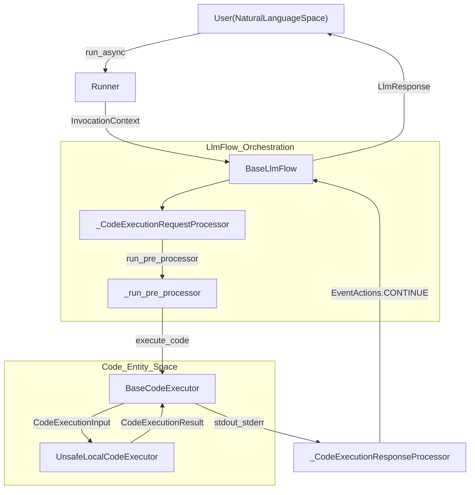
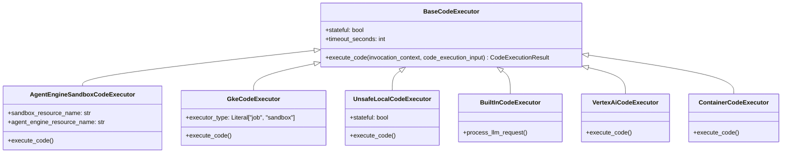

<!-- source: DeepWiki mcp.deepwiki.com · repo google/adk-python · page 12.10 Code Execution · fetched 2026-10-29 -->

# Code Execution

Relevant source files

The following files were used as context for generating this wiki page:

- [src/google/adk/code_executors/__init__.py](src/google/adk/code_executors/__init__.py)
- [src/google/adk/code_executors/agent_engine_sandbox_code_executor.py](src/google/adk/code_executors/agent_engine_sandbox_code_executor.py)
- [src/google/adk/code_executors/base_code_executor.py](src/google/adk/code_executors/base_code_executor.py)
- [src/google/adk/code_executors/code_execution_utils.py](src/google/adk/code_executors/code_execution_utils.py)
- [src/google/adk/code_executors/code_executor_context.py](src/google/adk/code_executors/code_executor_context.py)
- [src/google/adk/code_executors/container_code_executor.py](src/google/adk/code_executors/container_code_executor.py)
- [src/google/adk/code_executors/gke_code_executor.py](src/google/adk/code_executors/gke_code_executor.py)
- [src/google/adk/code_executors/unsafe_local_code_executor.py](src/google/adk/code_executors/unsafe_local_code_executor.py)
- [src/google/adk/code_executors/vertex_ai_code_executor.py](src/google/adk/code_executors/vertex_ai_code_executor.py)
- [src/google/adk/flows/llm_flows/_code_execution.py](src/google/adk/flows/llm_flows/_code_execution.py)
- [src/google/adk/flows/llm_flows/_nl_planning.py](src/google/adk/flows/llm_flows/_nl_planning.py)
- [src/google/adk/flows/llm_flows/agent_transfer.py](src/google/adk/flows/llm_flows/agent_transfer.py)
- [src/google/adk/flows/llm_flows/auto_flow.py](src/google/adk/flows/llm_flows/auto_flow.py)
- [src/google/adk/flows/llm_flows/extensions/__init__.py](src/google/adk/flows/llm_flows/extensions/__init__.py)
- [src/google/adk/flows/llm_flows/instructions.py](src/google/adk/flows/llm_flows/instructions.py)
- [src/google/adk/memory/vertex_ai_memory_bank_service.py](src/google/adk/memory/vertex_ai_memory_bank_service.py)
- [src/google/adk/telemetry/_hallucination.py](src/google/adk/telemetry/_hallucination.py)
- [tests/unittests/code_executors/__init__.py](tests/unittests/code_executors/__init__.py)
- [tests/unittests/code_executors/test_agent_engine_sandbox_code_executor.py](tests/unittests/code_executors/test_agent_engine_sandbox_code_executor.py)
- [tests/unittests/code_executors/test_code_execution_utils.py](tests/unittests/code_executors/test_code_execution_utils.py)
- [tests/unittests/code_executors/test_code_executor_context.py](tests/unittests/code_executors/test_code_executor_context.py)
- [tests/unittests/code_executors/test_container_code_executor.py](tests/unittests/code_executors/test_container_code_executor.py)
- [tests/unittests/code_executors/test_gke_code_executor.py](tests/unittests/code_executors/test_gke_code_executor.py)
- [tests/unittests/code_executors/test_unsafe_local_code_executor.py](tests/unittests/code_executors/test_unsafe_local_code_executor.py)
- [tests/unittests/code_executors/test_vertex_ai_code_executor.py](tests/unittests/code_executors/test_vertex_ai_code_executor.py)
- [tests/unittests/memory/test_vertex_ai_memory_bank_service.py](tests/unittests/memory/test_vertex_ai_memory_bank_service.py)

## Purpose and Scope
This page details the code execution subsystem in the ADK Python framework (`google.adk.code_executors`), which enables AI agents to generate, sandbox, and execute Python code safely across various environments (local subprocesses, GKE pods, Vertex AI Agent Engines, and containerized runtimes). It covers the underlying executors, execution flow processors, request/response lifecycle integration, and state management.

Sources: [src/google/adk/code_executors/__init__.py:1-43](), [src/google/adk/code_executors/base_code_executor.py:1-40]()

---

## Architecture and Data Flow

Code execution is integrated into the `LlmFlow` via `_CodeExecutionRequestProcessor` and `_CodeExecutionResponseProcessor` [src/google/adk/flows/llm_flows/_code_execution.py:24-25](). When an agent is configured with a `code_executor`, the framework handles the extraction, preprocessing, execution, and postprocessing of model-generated code blocks.

### Diagram: NL Request to Code Execution Pipeline

Sources: [src/google/adk/flows/llm_flows/_code_execution.py:24-25](), [src/google/adk/code_executors/base_code_executor.py:1-40]()

---

## Code Executor Implementations

ADK provides several implementations of `BaseCodeExecutor` [src/google/adk/code_executors/__init__.py:33-42]() for different security and deployment contexts:

### 1. Agent Engine Sandbox (`AgentEngineSandboxCodeExecutor`)
Uses the Vertex AI Agent Engine Code Execution Sandbox.
* **State Management**: Stores the sandbox reference in `InvocationContext` and manages automatic recreation of expired or missing sandbox instances [src/google/adk/code_executors/agent_engine_sandbox_code_executor.py:154-170]().
* **Resource Format**: `projects/{project}/locations/{location}/reasoningEngines/{engine_id}/sandboxEnvironments/{sandbox_id}` [src/google/adk/code_executors/agent_engine_sandbox_code_executor.py:48-50]().
* **Lazy Creation**: Automatically provisions an Agent Engine instance using project and location environment variables when no explicit resource name is provided [src/google/adk/code_executors/agent_engine_sandbox_code_executor.py:131-152]().

Sources: [src/google/adk/code_executors/__init__.py:41-41](), [src/google/adk/code_executors/agent_engine_sandbox_code_executor.py:44-170]()

### 2. GKE Sandbox (`GkeCodeExecutor`)
Executes Python code in a dedicated Pod on Google Kubernetes Engine [src/google/adk/code_executors/gke_code_executor.py:53-64]().
* **Job Mode (Default)**: Dynamically creates an ephemeral Kubernetes Job per execution request (`_batch_v1`), mounting user code via a ConfigMap, targeting the `_CODE_CONTAINER_NAME` ("code-runner") container, and enforcing gVisor security context [src/google/adk/code_executors/gke_code_executor.py:50-64]().
* **Sandbox Mode**: Uses `k8s_agent_sandbox.SandboxClient` referencing pre-installed cluster templates and gateway configurations [src/google/adk/code_executors/gke_code_executor.py:66-74]().

Sources: [src/google/adk/code_executors/gke_code_executor.py:50-111]()

### 3. Built-in Gemini Code Execution (`BuiltInCodeExecutor`)
Leverages native model code execution features [src/google/adk/code_executors/__init__.py:35-35]() without requiring external infrastructure management. Configures the model request to enable internal execution tools.

Sources: [src/google/adk/code_executors/__init__.py:35-35]()

### 4. Unsafe Local Executor (`UnsafeLocalCodeExecutor`)
Runs Python code locally via subprocess execution [src/google/adk/code_executors/unsafe_local_code_executor.py:120-145]().
* **Process Isolation**: Spawns an isolated process group (`start_new_session=True`) using `_RUNNER` script execution, injecting agent paths into `PYTHONPATH` and setting `PYTHONIOENCODING='utf-8'` [src/google/adk/code_executors/unsafe_local_code_executor.py:52-73](), [src/google/adk/code_executors/unsafe_local_code_executor.py:148-169]().
* **Timeouts & Cleanup**: Enforces `timeout_seconds`, terminating unresponsive subprocesses via `_kill_execution` using `SIGTERM`, a grace period (`_TERMINATE_GRACE_SECONDS`), and `SIGKILL` [src/google/adk/code_executors/unsafe_local_code_executor.py:37-118]().
* **Restrictions**: Enforces `stateful=False` and `optimize_data_file=False` at initialization [src/google/adk/code_executors/unsafe_local_code_executor.py:120-138]().

Sources: [src/google/adk/code_executors/unsafe_local_code_executor.py:37-185]()

### 5. Vertex AI Code Interpreter (`VertexAiCodeExecutor`) & Container Sandbox (`ContainerCodeExecutor`)
Provides access to legacy Vertex AI extension runtimes and containerized serverless sandbox environments [src/google/adk/code_executors/__init__.py:27-29](). Note that `VertexAiCodeExecutor` is deprecated in favor of `AgentEngineSandboxCodeExecutor`.

Sources: [src/google/adk/code_executors/__init__.py:27-29]()

---

## Code Execution Utilities and Context

Data structures supporting code execution are defined across execution modules:
* `CodeExecutionInput`: Holds the code string, input files, and execution metadata [src/google/adk/code_executors/code_execution_utils.py]() (or referenced via [src/google/adk/code_executors/unsafe_local_code_executor.py:32-33]()).
* `CodeExecutionResult`: Contains `stdout`, `stderr`, `exit_code`, and `output_files` [src/google/adk/code_executors/unsafe_local_code_executor.py:33-33]().
* `CodeExecutorContext`: Manages executor-specific scoping and session context keys [src/google/adk/code_executors/__init__.py:50-53]().

Sources: [src/google/adk/code_executors/__init__.py:50-53](), [src/google/adk/code_executors/unsafe_local_code_executor.py:32-33]()

---

## Diagram: Code Executor Class Hierarchy and Roles

Sources: [src/google/adk/code_executors/base_code_executor.py:1-40](), [src/google/adk/code_executors/__init__.py:33-42]()

---

## Key Classes and Functions Reference

| Class / Function | Role / Purpose | File Reference |
| :--- | :--- | :--- |
| `BaseCodeExecutor` | Abstract base class defining code execution interface. | [src/google/adk/code_executors/base_code_executor.py:1-40]() |
| `AgentEngineSandboxCodeExecutor` | Vertex AI Agent Engine sandbox execution engine. | [src/google/adk/code_executors/__init__.py:41-41]() |
| `GkeCodeExecutor` | GKE Pod/Job secure execution environment. | [src/google/adk/code_executors/gke_code_executor.py:53-64]() |
| `UnsafeLocalCodeExecutor` | Local subprocess execution with signal/timeout handling. | [src/google/adk/code_executors/unsafe_local_code_executor.py:120-145]() |
| `ContainerCodeExecutor` | Executes code within a Docker container with timeout and network controls. | [src/google/adk/code_executors/__init__.py:39-39]() |
| `_CodeExecutionRequestProcessor` | Pre-processes requests for code blocks and data files. | [src/google/adk/flows/llm_flows/_code_execution.py:24-24]() |
| `_CodeExecutionResponseProcessor` | Intercepts responses, executes code blocks, and saves artifacts. | [src/google/adk/flows/llm_flows/_code_execution.py:25-25]() |
| `DataFileUtil` | Helper structure for data loader code templates (e.g., pandas). | [src/google/adk/flows/llm_flows/_code_execution.py:35-35]() |

Sources: [src/google/adk/code_executors/base_code_executor.py:1-40](), [src/google/adk/code_executors/__init__.py:39-41](), [src/google/adk/code_executors/gke_code_executor.py:53-64](), [src/google/adk/code_executors/unsafe_local_code_executor.py:120-145](), [src/google/adk/flows/llm_flows/_code_execution.py:24-35]()

---

