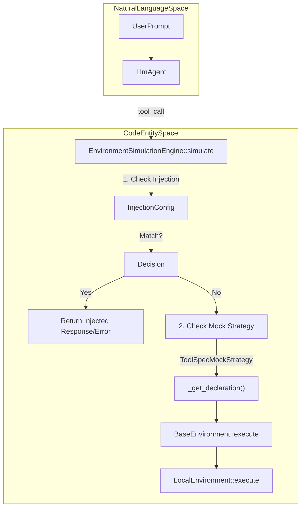
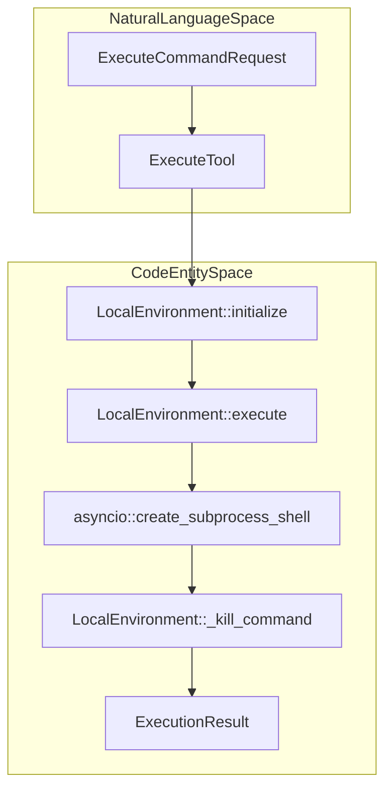

<!-- source: DeepWiki mcp.deepwiki.com · repo google/adk-python · page 12.11 Environment Simulation · fetched 2026-10-29 -->

# Environment Simulation

Relevant source files

The following files were used as context for generating this wiki page:

- [src/google/adk/environment/__init__.py](src/google/adk/environment/__init__.py)
- [src/google/adk/environment/_base_environment.py](src/google/adk/environment/_base_environment.py)
- [src/google/adk/environment/_local_environment.py](src/google/adk/environment/_local_environment.py)
- [src/google/adk/features/__init__.py](src/google/adk/features/__init__.py)
- [src/google/adk/integrations/_google_sdk.py](src/google/adk/integrations/_google_sdk.py)
- [src/google/adk/integrations/bigquery/__init__.py](src/google/adk/integrations/bigquery/__init__.py)
- [src/google/adk/integrations/bigquery/client.py](src/google/adk/integrations/bigquery/client.py)
- [src/google/adk/integrations/bigquery/query_tool.py](src/google/adk/integrations/bigquery/query_tool.py)
- [src/google/adk/integrations/gcs/client.py](src/google/adk/integrations/gcs/client.py)
- [src/google/adk/integrations/parameter_manager/parameter_client.py](src/google/adk/integrations/parameter_manager/parameter_client.py)
- [src/google/adk/integrations/secret_manager/secret_client.py](src/google/adk/integrations/secret_manager/secret_client.py)
- [src/google/adk/integrations/slack/slack_runner.py](src/google/adk/integrations/slack/slack_runner.py)
- [src/google/adk/integrations/vmaas/sandbox_client.py](src/google/adk/integrations/vmaas/sandbox_client.py)
- [src/google/adk/integrations/vmaas/sandbox_computer.py](src/google/adk/integrations/vmaas/sandbox_computer.py)
- [src/google/adk/tools/environment/_read_file_tool.py](src/google/adk/tools/environment/_read_file_tool.py)
- [src/google/adk/tools/environment_simulation/environment_simulation_config.py](src/google/adk/tools/environment_simulation/environment_simulation_config.py)
- [src/google/adk/tools/environment_simulation/environment_simulation_engine.py](src/google/adk/tools/environment_simulation/environment_simulation_engine.py)
- [src/google/adk/tools/environment_simulation/strategies/base.py](src/google/adk/tools/environment_simulation/strategies/base.py)
- [src/google/adk/tools/environment_simulation/strategies/tool_spec_mock_strategy.py](src/google/adk/tools/environment_simulation/strategies/tool_spec_mock_strategy.py)
- [src/google/adk/tools/environment_simulation/tool_connection_analyzer.py](src/google/adk/tools/environment_simulation/tool_connection_analyzer.py)
- [src/google/adk/utils/env_utils.py](src/google/adk/utils/env_utils.py)
- [src/google/adk/utils/feature_decorator.py](src/google/adk/utils/feature_decorator.py)
- [tests/unittests/a2a/test_experimental.py](tests/unittests/a2a/test_experimental.py)
- [tests/unittests/environment/__init__.py](tests/unittests/environment/__init__.py)
- [tests/unittests/environment/test_local_environment.py](tests/unittests/environment/test_local_environment.py)
- [tests/unittests/features/test_feature_decorator.py](tests/unittests/features/test_feature_decorator.py)
- [tests/unittests/features/test_feature_registry.py](tests/unittests/features/test_feature_registry.py)
- [tests/unittests/integrations/bigquery/test_bigquery_query_tool.py](tests/unittests/integrations/bigquery/test_bigquery_query_tool.py)
- [tests/unittests/integrations/eventarc/test_eventarc_toolset.py](tests/unittests/integrations/eventarc/test_eventarc_toolset.py)
- [tests/unittests/integrations/gcs/test_client.py](tests/unittests/integrations/gcs/test_client.py)
- [tests/unittests/integrations/parameter_manager/test_parameter_client.py](tests/unittests/integrations/parameter_manager/test_parameter_client.py)
- [tests/unittests/integrations/secret_manager/test_secret_client.py](tests/unittests/integrations/secret_manager/test_secret_client.py)
- [tests/unittests/integrations/vmaas/test_sandbox_computer.py](tests/unittests/integrations/vmaas/test_sandbox_computer.py)
- [tests/unittests/tools/environment/test_read_file_tool.py](tests/unittests/tools/environment/test_read_file_tool.py)
- [tests/unittests/tools/environment_simulation/test_environment_simulation_config.py](tests/unittests/tools/environment_simulation/test_environment_simulation_config.py)
- [tests/unittests/tools/environment_simulation/test_environment_simulation_engine.py](tests/unittests/tools/environment_simulation/test_environment_simulation_engine.py)
- [tests/unittests/tools/environment_simulation/test_environment_simulation_plugin.py](tests/unittests/tools/environment_simulation/test_environment_simulation_plugin.py)
- [tests/unittests/tools/environment_simulation/test_tool_connection_analyzer.py](tests/unittests/tools/environment_simulation/test_tool_connection_analyzer.py)
- [tests/unittests/utils/test_env_utils.py](tests/unittests/utils/test_env_utils.py)
- [tests/unittests/utils/test_feature_decorator.py](tests/unittests/utils/test_feature_decorator.py)

### Purpose and Scope

The Environment Simulation framework provides a comprehensive mechanism for testing agents by mocking tool responses, injecting deterministic or randomized errors, and simulating complex environment states. Additionally, it encompasses the `EnvironmentToolset` and underlying `BaseEnvironment` abstractions for performing real file operations and shell commands within local subprocesses or remote sandboxes, alongside computer-use capabilities via `BaseComputer` and `ComputerUseToolset`, and remote environment integrations like Vertex AI Agent Engine VMaaS (`AgentEngineSandboxComputer`), Daytona, and E2B.

Sources: [src/google/adk/environment/_base_environment.py:45-134](), [src/google/adk/tools/environment/_environment_toolset.py:46-161](), [src/google/adk/tools/computer_use/base_computer.py:60-215](), [src/google/adk/integrations/vmaas/sandbox_computer.py:83-172]()

### Simulation Engine Architecture & Data Flow

The core simulation logic is driven by `EnvironmentSimulationEngine` [src/google/adk/tools/environment_simulation/environment_simulation_engine.py:56-148](). It intercepts tool invocations through its `simulate()` method [src/google/adk/tools/environment_simulation/environment_simulation_engine.py:82-148](), evaluates injection conditions (such as specific argument matching, probabilities, and injected error codes), and falls back to configured mock strategies when no injection rule matches.

Title: "Environment Simulation and Execution Flow"

Sources: [src/google/adk/tools/environment_simulation/environment_simulation_engine.py:56-148](), [src/google/adk/environment/_base_environment.py:45-134](), [src/google/adk/environment/_local_environment.py:68-203]()

### Tool Connection Analysis & Simulation Strategies

The framework utilizes an LLM via `LLMRegistry` and `LlmRequest` to analyze tool declarations and map out stateful parameter dependencies via `ToolConnectionAnalyzer`. It produces a `ToolConnectionMap` categorizing parameters into creating tools (which generate or mutate state identifiers like `ticket_id`) and consuming tools (which read state without mutating it).

When a tool call does not trigger an explicit injection rule, `EnvironmentSimulationEngine` delegates response generation to mock strategies instantiated via `_create_mock_strategy()` [src/google/adk/tools/environment_simulation/environment_simulation_engine.py:42-52](). Strategies include `ToolSpecMockStrategy` (which inspects tool JSON schemas to synthesize structurally valid mock responses) and `TracingMockStrategy` [src/google/adk/tools/environment_simulation/environment_simulation_engine.py:48-51]().

Sources: [src/google/adk/tools/environment_simulation/environment_simulation_engine.py:42-148](), [src/google/adk/environment/_base_environment.py:45-134]()

### Environment Toolset and Local Execution

The `EnvironmentToolset` provides tools for interacting with the execution environment, including `ExecuteTool`, `ReadFileTool`, `WriteFileTool`, and `EditFileTool`. These tools operate on a `BaseEnvironment` instance.

`BaseEnvironment` is an abstract base class defining the interface for code execution environments, offering abstract methods for `execute` shell commands, `read_file`, and `write_file`.

`LocalEnvironment` [src/google/adk/environment/_local_environment.py:68-203]() is a concrete implementation of `BaseEnvironment` that executes commands via local `asyncio` subprocesses. It manages a working directory—either specified explicitly or created as a temporary directory on `initialize()` and removed on `close()` [src/google/adk/environment/_local_environment.py:75-119](). The `execute()` method handles subprocess creation, stdout/stderr capture, and timeout management, including graceful termination with `SIGTERM` before escalating to `SIGKILL` in `_kill_command()` [src/google/adk/environment/_local_environment.py:121-201]().

Title: "Environment Execution and Local Subprocess Flow"

Sources: [src/google/adk/environment/_base_environment.py:45-134](), [src/google/adk/environment/_local_environment.py:68-203](), [src/google/adk/tools/environment/_environment_toolset.py:46-161]()

### Computer Use and Remote Environments

ADK supports advanced agent interaction with graphical environments and remote workspaces via specialized toolsets and computer interfaces.

*   `BaseComputer`: Abstract base class defining standard computer control methods like `click_at`, `hover_at`, `type_text_at`, `scroll_at`, and `current_state` returning a `ComputerState` object.
*   `ComputerUseToolset`: Wraps a `BaseComputer` instance and provides `ComputerUseTool` instances to agents.
*   `ComputerUseTool`: Extends `FunctionTool` to normalize coordinates from a virtual coordinate space (default `1000x1000`) to actual screen dimensions.
*   `AgentEngineSandboxComputer` [src/google/adk/integrations/vmaas/sandbox_computer.py:83-172](): A concrete `BaseComputer` implementation backed by Vertex AI Agent Engine Computer Use Sandbox (VMaaS). It supports auto-provisioning of agent engines and sandboxes, bring-your-own-sandbox (BYOS) modes via `sandbox_name`, sandbox templates (`sandbox_template_name`), snapshots (`sandbox_snapshot_name`), and automatic token refreshes.
*   **Remote Sandboxes**: Integration support for remote containerized environments such as Daytona and E2B alongside VMaaS sandboxes, managed via client wrappers like `SandboxClient`.

Sources: [src/google/adk/tools/computer_use/base_computer.py:43-215](), [src/google/adk/integrations/vmaas/sandbox_computer.py:83-172](), [src/google/adk/integrations/vmaas/sandbox_client.py:1-50]()

---

