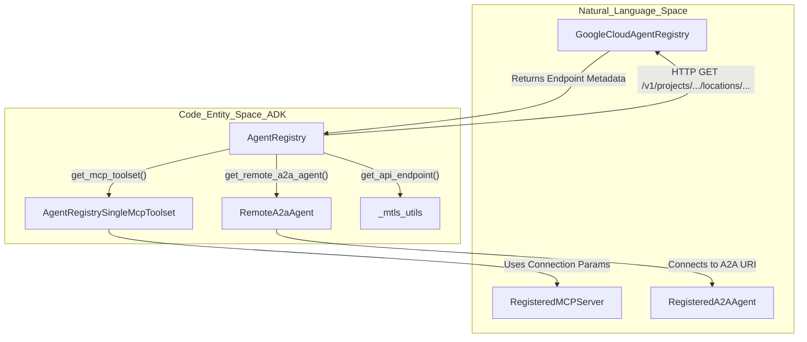
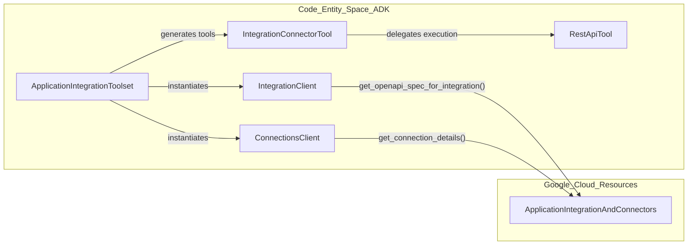

<!-- source: DeepWiki mcp.deepwiki.com · repo google/adk-python · page 12.12 Integrations and Messaging · fetched 2026-10-29 -->

# Integrations and Messaging

Relevant source files

The following files were used as context for generating this wiki page:

- [contributing/samples/adk_team/adk_knowledge_agent/requirements.txt](contributing/samples/adk_team/adk_knowledge_agent/requirements.txt)
- [contributing/samples/integrations/agent_registry_agent/README.md](contributing/samples/integrations/agent_registry_agent/README.md)
- [contributing/samples/integrations/agent_registry_agent/agent.py](contributing/samples/integrations/agent_registry_agent/agent.py)
- [contributing/samples/integrations/api_registry_agent/README.md](contributing/samples/integrations/api_registry_agent/README.md)
- [contributing/samples/integrations/api_registry_agent/agent.py](contributing/samples/integrations/api_registry_agent/agent.py)
- [contributing/samples/integrations/application_integration_agent/README.md](contributing/samples/integrations/application_integration_agent/README.md)
- [contributing/samples/integrations/authn-adk-all-in-one/README.md](contributing/samples/integrations/authn-adk-all-in-one/README.md)
- [contributing/samples/integrations/authn-adk-all-in-one/adk_agents/requirements.txt](contributing/samples/integrations/authn-adk-all-in-one/adk_agents/requirements.txt)
- [contributing/samples/integrations/authn-adk-all-in-one/adk_agents/sample.env](contributing/samples/integrations/authn-adk-all-in-one/adk_agents/sample.env)
- [contributing/samples/integrations/authn-adk-all-in-one/requirements.txt](contributing/samples/integrations/authn-adk-all-in-one/requirements.txt)
- [contributing/samples/integrations/bigquery/agent.py](contributing/samples/integrations/bigquery/agent.py)
- [src/google/adk/agents/active_streaming_tool.py](src/google/adk/agents/active_streaming_tool.py)
- [src/google/adk/agents/langgraph_agent.py](src/google/adk/agents/langgraph_agent.py)
- [src/google/adk/agents/transcription_entry.py](src/google/adk/agents/transcription_entry.py)
- [src/google/adk/integrations/_google_sdk.py](src/google/adk/integrations/_google_sdk.py)
- [src/google/adk/integrations/agent_registry/__init__.py](src/google/adk/integrations/agent_registry/__init__.py)
- [src/google/adk/integrations/agent_registry/agent_registry.py](src/google/adk/integrations/agent_registry/agent_registry.py)
- [src/google/adk/integrations/api_registry/__init__.py](src/google/adk/integrations/api_registry/__init__.py)
- [src/google/adk/integrations/api_registry/api_registry.py](src/google/adk/integrations/api_registry/api_registry.py)
- [src/google/adk/integrations/bigquery/__init__.py](src/google/adk/integrations/bigquery/__init__.py)
- [src/google/adk/integrations/bigquery/client.py](src/google/adk/integrations/bigquery/client.py)
- [src/google/adk/integrations/bigquery/query_tool.py](src/google/adk/integrations/bigquery/query_tool.py)
- [src/google/adk/integrations/gcs/client.py](src/google/adk/integrations/gcs/client.py)
- [src/google/adk/integrations/parameter_manager/parameter_client.py](src/google/adk/integrations/parameter_manager/parameter_client.py)
- [src/google/adk/integrations/secret_manager/secret_client.py](src/google/adk/integrations/secret_manager/secret_client.py)
- [src/google/adk/integrations/skill_registry/gcp_skill_registry.py](src/google/adk/integrations/skill_registry/gcp_skill_registry.py)
- [src/google/adk/integrations/slack/slack_runner.py](src/google/adk/integrations/slack/slack_runner.py)
- [src/google/adk/integrations/vmaas/sandbox_client.py](src/google/adk/integrations/vmaas/sandbox_client.py)
- [src/google/adk/integrations/vmaas/sandbox_computer.py](src/google/adk/integrations/vmaas/sandbox_computer.py)
- [src/google/adk/live/_active_streaming_tool.py](src/google/adk/live/_active_streaming_tool.py)
- [src/google/adk/live/_transcription_entry.py](src/google/adk/live/_transcription_entry.py)
- [src/google/adk/tools/api_registry.py](src/google/adk/tools/api_registry.py)
- [tests/unittests/agents/test_langgraph_agent.py](tests/unittests/agents/test_langgraph_agent.py)
- [tests/unittests/flows/llm_flows/test_tool_telemetry.py](tests/unittests/flows/llm_flows/test_tool_telemetry.py)
- [tests/unittests/integrations/agent_registry/test_agent_registry.py](tests/unittests/integrations/agent_registry/test_agent_registry.py)
- [tests/unittests/integrations/api_registry/__init__.py](tests/unittests/integrations/api_registry/__init__.py)
- [tests/unittests/integrations/api_registry/test_api_registry.py](tests/unittests/integrations/api_registry/test_api_registry.py)
- [tests/unittests/integrations/bigquery/test_bigquery_query_tool.py](tests/unittests/integrations/bigquery/test_bigquery_query_tool.py)
- [tests/unittests/integrations/gcs/test_client.py](tests/unittests/integrations/gcs/test_client.py)
- [tests/unittests/integrations/parameter_manager/test_parameter_client.py](tests/unittests/integrations/parameter_manager/test_parameter_client.py)
- [tests/unittests/integrations/secret_manager/test_secret_client.py](tests/unittests/integrations/secret_manager/test_secret_client.py)
- [tests/unittests/integrations/skill_registry/test_gcp_skill_registry.py](tests/unittests/integrations/skill_registry/test_gcp_skill_registry.py)
- [tests/unittests/integrations/vmaas/test_sandbox_computer.py](tests/unittests/integrations/vmaas/test_sandbox_computer.py)
- [tests/unittests/live/test_active_streaming_tool.py](tests/unittests/live/test_active_streaming_tool.py)
- [tests/unittests/live/test_audio_transcriber.py](tests/unittests/live/test_audio_transcriber.py)
- [tests/unittests/live/test_transcription_entry.py](tests/unittests/live/test_transcription_entry.py)

The ADK framework provides a robust set of integrations for connecting agents to external platforms, service registries, messaging protocols, storage backends, and multi-agent frameworks. This includes native support for Google Cloud registries (Agent Registry, Skill Registry, and API Registry), specialized secret and parameter management, messaging pipelines like Slack and Pub/Sub, database clients such as MongoDB, Firestore, and Redis, framework bridges including LangGraph, and experimental lab integrations like `labs/openai` and `labs/antigravity`.

Sources: [src/google/adk/integrations/agent_registry/agent_registry.py:15-16](), [src/google/adk/integrations/secret_manager/secret_client.py:39-51]()

## Agent Registry and API Registry

The `AgentRegistry` class serves as a high-level client for interacting with the Google Cloud Agent Registry service [src/google/adk/integrations/agent_registry/agent_registry.py:15-16](). It enables agents to dynamically discover and connect to other agents or MCP (Model Context Protocol) servers registered within a specific Google Cloud project and location [src/google/adk/integrations/agent_registry/agent_registry.py:154-170](). The legacy `ApiRegistry` module in `src/google/adk/tools/api_registry.py` is deprecated in favor of `AgentRegistry` [contributing/samples/integrations/api_registry_agent/README.md:1-1]().

### Key Functionalities
- **Discovery**: Fetches registered agent and MCP server details from the `agentregistry.googleapis.com` API [src/google/adk/integrations/agent_registry/agent_registry.py:69-70]().
- **mTLS Support**: Determines effective endpoints using `_mtls_utils.get_api_endpoint` [src/google/adk/utils/_mtls_utils.py:17-48]().
- **MCP Toolset Integration**: The `get_mcp_toolset` method resolves connection parameters for a registered MCP server and returns an `AgentRegistrySingleMcpToolset` [src/google/adk/integrations/agent_registry/agent_registry.py:85-118]().
- **A2A Agent Resolution**: The `get_remote_a2a_agent` method resolves the URI and protocol for a registered agent, returning a `RemoteA2aAgent` instance for inter-agent communication using the A2A protocol [src/google/adk/integrations/agent_registry/agent_registry.py:58-59]().
- **Telemetry Enrichment**: Tools generated via `AgentRegistrySingleMcpToolset` automatically include a `gcp.mcp.server.destination.id` in their `custom_metadata` [src/google/adk/integrations/agent_registry/agent_registry.py:86-88]().

**Agent Registry Entity Mapping**

Sources: [src/google/adk/integrations/agent_registry/agent_registry.py:15-183](), [src/google/adk/utils/_mtls_utils.py:17-48](), [contributing/samples/integrations/api_registry_agent/README.md:1-1]()

## Skill Registry

The `GCPSkillRegistry` extends the abstract `SkillRegistry` class to interface with the Google Cloud Skill Registry API [src/google/adk/integrations/skill_registry/gcp_skill_registry.py:44-46](). It supports retrieving skill metadata, downloading skill bundles (`alt=media`), and searching for skills using query strings [src/google/adk/integrations/skill_registry/gcp_skill_registry.py:165-186]().

### Key Features
- **Endpoint and mTLS Resolution**: Automatically resolves regional endpoints via `_mtls_utils.get_api_endpoint` and configures SSL client certificates if mTLS is enabled [src/google/adk/integrations/skill_registry/gcp_skill_registry.py:63-101]().
- **Skill Download and Parsing**: Fetches skill zips, unzips them, and validates skill frontmatter models (`models.Skill`) [src/google/adk/integrations/skill_registry/gcp_skill_registry.py:165-186]().
- **Robust Search**: Gracefully skips catalog entries that fail frontmatter validation during `search_skills()` [src/google/adk/integrations/skill_registry/gcp_skill_registry.py:165-186]().

Sources: [src/google/adk/integrations/skill_registry/gcp_skill_registry.py:44-186]()

## Application Integration Toolset

The `ApplicationIntegrationToolset` generates tools from Google Cloud Application Integration or Integration Connector resources [src/google/adk/tools/application_integration_tool/application_integration_toolset.py:47-60]().

### Key Features
- **Dynamic Endpoints**: Resolves endpoints dynamically with mTLS support via `_mtls_utils` [src/google/adk/tools/application_integration_tool/clients/connections_client.py:80-85]().
- **Client Separation**: Uses `IntegrationClient` for Application Integration OpenAPI specifications and `ConnectionsClient` for Integration Connectors schema metadata [src/google/adk/tools/application_integration_tool/clients/connections_client.py:57-118](), [src/google/adk/tools/application_integration_tool/clients/integration_client.py:54-103]().
- **IntegrationConnectorTool**: Wraps a `RestApiTool` to inject connection-specific metadata (host, service name, entity, action) into the request [src/google/adk/tools/application_integration_tool/integration_connector_tool.py:39-48]().
- **Authentication**: Supports dynamic OAuth2 and service account tokens via `AuthConfig` and `ToolAuthHandler` [src/google/adk/tools/application_integration_tool/application_integration_toolset.py:149-160](), [src/google/adk/tools/application_integration_tool/integration_connector_tool.py:162-168]().

**Application Integration Architecture**

Sources: [src/google/adk/tools/application_integration_tool/application_integration_toolset.py:47-170](), [src/google/adk/tools/application_integration_tool/integration_connector_tool.py:39-118]()

## Secret and Parameter Management

ADK provides dedicated clients for interacting with Google Cloud Secret Manager and Parameter Manager.

### Secret Manager Client
The `SecretManagerClient` provides a simplified interface for retrieving secrets [src/google/adk/integrations/secret_manager/secret_client.py:39-51]().
- **Authentication**: Supports Service Account JSON, existing Auth Tokens, or Application Default Credentials (ADC) [src/google/adk/integrations/secret_manager/secret_client.py:79-110]().
- **Regional Endpoints**: Supports location-specific endpoints and mTLS [src/google/adk/integrations/secret_manager/secret_client.py:114-121]().
- **Access**: The `get_secret(resource_name)` method accesses secret versions and returns payloads as UTF-8 strings [src/google/adk/integrations/secret_manager/secret_client.py:129-148]().

### Parameter Manager Client
The `ParameterManagerClient` interacts with the Google Cloud Parameter Manager service to retrieve rendered configuration values [src/google/adk/integrations/parameter_manager/parameter_client.py:39-51]().
- **Initialization**: Handles authentication via service account info, bearer tokens, or default credentials [src/google/adk/integrations/parameter_manager/parameter_client.py:53-110]().
- **Rendering**: The `get_parameter(resource_name)` method calls `render_parameter_version` [src/google/adk/integrations/parameter_manager/parameter_client.py:127-147]().

Sources: [src/google/adk/integrations/secret_manager/secret_client.py:39-148](), [src/google/adk/integrations/parameter_manager/parameter_client.py:39-147]()

## Messaging Infrastructure and Triggers

### Slack Runner
The `slack_runner.py` module facilitates running ADK agents directly as Slack bots via `slack-bolt`, handling message formatting, event subscriptions, and conversational context mapping [src/google/adk/integrations/slack/slack_runner.py:1-13]().

### PubSub Triggers
Pub/Sub event endpoints (`/trigger/pubsub`) route incoming messages and event payloads to agents asynchronously via `trigger_routes.py`.

Sources: [src/google/adk/integrations/slack/slack_runner.py:1-13]()

## Storage and Database Services

ADK provides comprehensive integrations for external databases and persistent storage services:
- **MongoDB Client and Toolset**: The `MongoDbToolset` provides vector and hybrid search capabilities over MongoDB collections, embedding query text on the fly [contributing/samples/integrations/authn-adk-all-in-one/requirements.txt:1-1]().
- **Firestore and Redis Services**: Persistent session and state storage backends implemented via `Firestore` and `RedisSessionService` to scale distributed agent state. The `RedisSessionService` [src/google/adk/integrations/redis/_redis_session_service.py:53-58]() stores session objects, events, and state in Redis using `redis.asyncio` [src/google/adk/integrations/redis/_redis_session_service.py:40-44](). It manages session keys, user-scoped state keys, and app-scoped state keys [src/google/adk/integrations/redis/_redis_session_service.py:100-110](). Session state is merged from app, user, and session-specific states [src/google/adk/integrations/redis/_redis_session_service.py:113-124]().
- **BigQuery Toolset**: The `BigQueryToolset` provides tools for executing SQL queries against BigQuery datasets [src/google/adk/integrations/bigquery/bigquery_toolset.py:1-13](). It includes `execute_sql` for running queries [src/google/adk/integrations/bigquery/query_tool.py:169-177]() and `search_table` for searching within tables [src/google/adk/integrations/bigquery/search_tool.py:1-13](). The toolset supports read-only and write modes, configurable via `BigQueryToolConfig` [src/google/adk/integrations/bigquery/config.py:1-13](). SQL injection prevention is implemented through validation functions like `_is_valid_table_identifier` and `_is_valid_column_identifier` [src/google/adk/integrations/bigquery/query_tool.py:79-122]().

Sources: [contributing/samples/integrations/authn-adk-all-in-one/requirements.txt:1-1](), [src/google/adk/integrations/redis/_redis_session_service.py:40-124](), [src/google/adk/integrations/bigquery/bigquery_toolset.py:1-13](), [src/google/adk/integrations/bigquery/query_tool.py:79-177](), [src/google/adk/integrations/bigquery/search_tool.py:1-13](), [src/google/adk/integrations/bigquery/config.py:1-13]()

## Framework Bridges and Agent Identity

### LangGraph Agent
ADK supports integrating LangGraph agent graphs alongside native ADK workflows, allowing stateful external graphs to execute under the standard ADK runner lifecycle. The `LangGraphAgent` class bridges compiled LangGraph state graphs (`CompiledStateGraph`) into ADK's execution model [src/google/adk/agents/langgraph_agent.py:84-97](). It computes deterministic session thread identifiers via `_get_thread_id` [src/google/adk/agents/langgraph_agent.py:37-61]() and converts conversation history and events into LangGraph-compatible message structures [src/google/adk/agents/langgraph_agent.py:156-196](). The `LangchainTool` and `CrewaiTool` classes provide wrappers for integrating tools from these frameworks into ADK [src/google/adk/tools/langchain_tool.py:19-20](), [src/google/adk/tools/crewai_tool.py:19-20]().

### GCP Agent Identity
The `GcpAuthProviderScheme` and related connectors (`google-cloud-agentidentitycredentials` and `google-cloud-iamconnectorcredentials`) handle secure token exchanges and IAM authentication for agents accessing GCP resources [contributing/samples/integrations/authn-adk-all-in-one/requirements.txt:1-1]().

Sources: [contributing/samples/integrations/authn-adk-all-in-one/requirements.txt:1-1](), [src/google/adk/integrations/agent_registry/agent_registry.py:33-35](), [src/google/adk/agents/langgraph_agent.py:37-97](), [src/google/adk/agents/langgraph_agent.py:156-196](), [src/google/adk/tools/langchain_tool.py:19-20](), [src/google/adk/tools/crewai_tool.py:19-20]()

## Lab Integrations

### OpenAI Native Integration
The `google.adk.integrations.openai` package provides native integration for OpenAI models, including `OpenAILlm` [src/google/adk/integrations/openai/_openai_llm.py:1-13]() and `_OpenAIResponsesLlm` [src/google/adk/integrations/openai/_openai_responses_llm.py:1-13](). These are registered in the `LLMRegistry` to resolve models like `gpt-4o` or `o3-mini` to `OpenAILlm` [src/google/adk/models/__init__.py:81-82](). If the `openai` package is not installed, a helpful error message guides the user to install the `google-adk[openai]` extra [src/google/adk/models/registry.py:203-207]().

### Antigravity Agent
The `AntigravityAgent` (located in `labs/antigravity`) allows running agents developed with the Google Antigravity SDK as native ADK `BaseAgents` [contributing/samples/integrations/agent_registry_agent/README.md:1-1]().
- **Composition Modes**: Can run as a root agent or as a `single_turn` sub-agent wrapped by an `LlmAgent` [contributing/samples/integrations/agent_registry_agent/README.md:1-1]().
- **Tool Bridging**: Automatically converts ADK sub-agents into client-side tools compatible with the Antigravity SDK harness [contributing/samples/integrations/agent_registry_agent/README.md:1-1]().

### Vertex AI Agent Engine Sandbox Computer
The `AgentEngineSandboxComputer` provides a `BaseComputer` implementation that uses Vertex AI Agent Engine Computer Use Sandbox as a remote browser environment [src/google/adk/integrations/vmaas/sandbox_computer.py:15-19]().
- **Auto-provisioning**: Supports on-demand creation of agent engines and sandboxes [src/google/adk/integrations/vmaas/sandbox_computer.py:65-66]().
- **Bring-your-own-sandbox (BYOS)**: Allows specifying an existing sandbox resource [src/google/adk/integrations/vmaas/sandbox_computer.py:111-115]().
- **Session Reuse**: Sandboxes are reused across invocations of a session and remembered by the computer instance [src/google/adk/integrations/vmaas/sandbox_computer.py:70-73]().
- **Token Refresh**: Automatically refreshes tokens before expiry [src/google/adk/integrations/vmaas/sandbox_computer.py:68-69]().
- **Sandbox Client**: Internally uses `SandboxClient` for API interactions with the Vertex AI Agent Engine Sandbox service [src/google/adk/integrations/vmaas/sandbox_client.py:1-13]().

Sources: [src/google/adk/integrations/openai/_openai_llm.py:1-13](), [src/google/adk/integrations/openai/_openai_responses_llm.py:1-13](), [src/google/adk/models/__init__.py:81-82](), [src/google/adk/models/registry.py:203-207](), [contributing/samples/integrations/agent_registry_agent/README.md:1-1](), [src/google/adk/integrations/vmaas/sandbox_computer.py:15-19](), [src/google/adk/integrations/vmaas/sandbox_computer.py:65-73](), [src/google/adk/integrations/vmaas/sandbox_computer.py:111-115](), [src/google/adk/integrations/vmaas/sandbox_client.py:1-13]()

## Integration Utilities Reference

| Code Entity | Responsibility |
| :--- | :--- |
| `AgentRegistry` | Client for discovering remote A2A agents and MCP servers [src/google/adk/integrations/agent_registry/agent_registry.py:15-16](). |
| `GCPSkillRegistry` | GCP implementation of `SkillRegistry` for fetching and searching skills [src/google/adk/integrations/skill_registry/gcp_skill_registry.py:44-46](). |
| `ApplicationIntegrationToolset` | Generates tools from Application Integration or Connectors [src/google/adk/tools/application_integration_tool/application_integration_toolset.py:47-60](). |
| `SecretManagerClient` | Retrieves secure secrets from GCP Secret Manager [src/google/adk/integrations/secret_manager/secret_client.py:39-51](). |
| `ParameterManagerClient` | Fetches rendered configuration versions from Parameter Manager [src/google/adk/integrations/parameter_manager/parameter_client.py:39-51](). |
| `RedisSessionService` | Provides Redis-backed session storage for ADK agents [src/google/adk/integrations/redis/_redis_session_service.py:53-58](). |
| `BigQueryToolset` | Provides tools for executing SQL queries and searching BigQuery tables [src/google/adk/integrations/bigquery/bigquery_toolset.py:1-13](). |
| `LangGraphAgent` | Adapts compiled LangGraph state graphs (`CompiledStateGraph`) into ADK execution [src/google/adk/agents/langgraph_agent.py:84-97](). |
| `LangchainTool` | Wrapper for integrating LangChain tools into ADK [src/google/adk/tools/langchain_tool.py:19-20](). |
| `CrewaiTool` | Wrapper for integrating CrewAI tools into ADK [src/google/adk/tools/crewai_tool.py:19-20](). |
| `AgentEngineSandboxComputer` | Implements a remote browser environment using Vertex AI Agent Engine Sandbox [src/google/adk/integrations/vmaas/sandbox_computer.py:15-19](). |
| `OpenAILlm` | Native integration for OpenAI models [src/google/adk/integrations/openai/_openai_llm.py:1-13](). |
| `AntigravityAgent` | Runs Google Antigravity SDK agents inside the ADK lifecycle [contributing/samples/integrations/agent_registry_agent/README.md:1-1](). |

Sources: [src/google/adk/integrations/agent_registry/agent_registry.py:15-16](), [src/google/adk/integrations/skill_registry/gcp_skill_registry.py:44-46](), [src/google/adk/tools/application_integration_tool/application_integration_toolset.py:47-60](), [src/google/adk/integrations/secret_manager/secret_client.py:39-51](), [src/google/adk/integrations/parameter_manager/parameter_client.py:39-51](), [src/google/adk/integrations/redis/_redis_session_service.py:53-58](), [src/google/adk/integrations/bigquery/bigquery_toolset.py:1-13](), [src/google/adk/agents/langgraph_agent.py:84-97](), [src/google/adk/tools/langchain_tool.py:19-20](), [src/google/adk/tools/crewai_tool.py:19-20](), [src/google/adk/integrations/vmaas/sandbox_computer.py:15-19](), [src/google/adk/integrations/openai/_openai_llm.py:1-13](), [contributing/samples/integrations/agent_registry_agent/README.md:1-1]()

---

