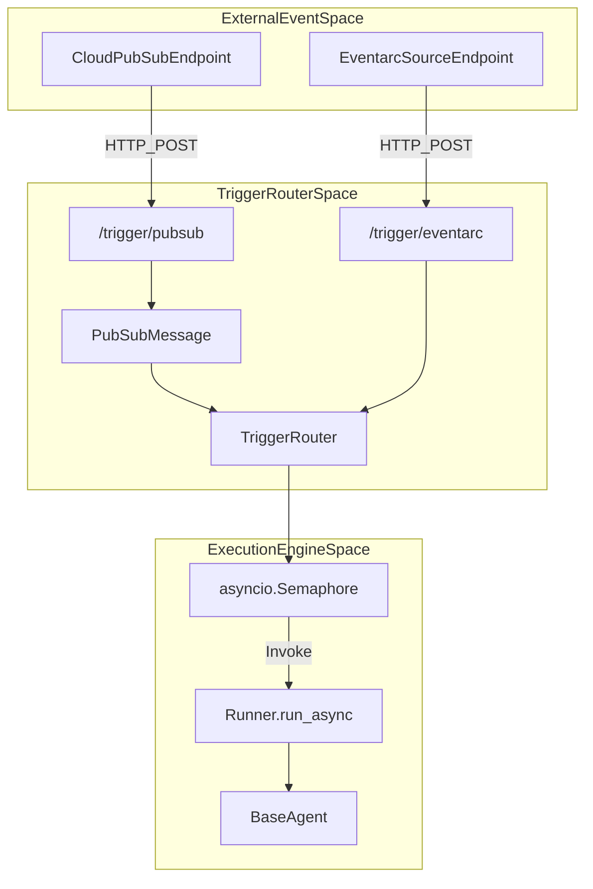
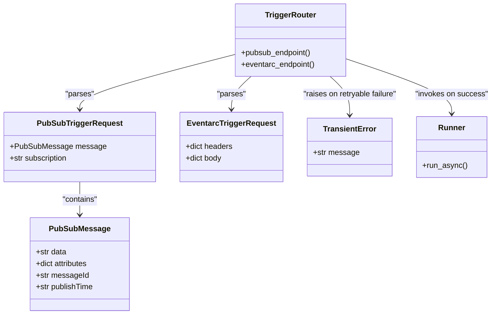

<!-- source: DeepWiki mcp.deepwiki.com · repo google/adk-python · page 12.13 Event-Driven Triggers · fetched 2026-10-29 -->

# Event-Driven Triggers

Relevant source files

The following files were used as context for generating this wiki page:

- [src/google/adk/cli/_dev_deploy.py](src/google/adk/cli/_dev_deploy.py)
- [src/google/adk/cli/adk_web_server.py](src/google/adk/cli/adk_web_server.py)
- [src/google/adk/cli/api_server.py](src/google/adk/cli/api_server.py)
- [src/google/adk/cli/cli_deploy.py](src/google/adk/cli/cli_deploy.py)
- [src/google/adk/cli/cli_tools_click.py](src/google/adk/cli/cli_tools_click.py)
- [src/google/adk/cli/dev_server.py](src/google/adk/cli/dev_server.py)
- [src/google/adk/cli/fast_api.py](src/google/adk/cli/fast_api.py)
- [src/google/adk/environment/__init__.py](src/google/adk/environment/__init__.py)
- [src/google/adk/environment/_base_environment.py](src/google/adk/environment/_base_environment.py)
- [src/google/adk/environment/_local_environment.py](src/google/adk/environment/_local_environment.py)
- [src/google/adk/features/__init__.py](src/google/adk/features/__init__.py)
- [src/google/adk/utils/env_utils.py](src/google/adk/utils/env_utils.py)
- [src/google/adk/utils/feature_decorator.py](src/google/adk/utils/feature_decorator.py)
- [tests/unittests/a2a/test_experimental.py](tests/unittests/a2a/test_experimental.py)
- [tests/unittests/cli/test_adk_web_server_run_live.py](tests/unittests/cli/test_adk_web_server_run_live.py)
- [tests/unittests/cli/test_adk_web_server_tests.py](tests/unittests/cli/test_adk_web_server_tests.py)
- [tests/unittests/cli/test_dev_deploy.py](tests/unittests/cli/test_dev_deploy.py)
- [tests/unittests/cli/test_dns_rebinding_protection.py](tests/unittests/cli/test_dns_rebinding_protection.py)
- [tests/unittests/cli/test_fast_api.py](tests/unittests/cli/test_fast_api.py)
- [tests/unittests/cli/test_local_client_check.py](tests/unittests/cli/test_local_client_check.py)
- [tests/unittests/cli/utils/test_cli_deploy.py](tests/unittests/cli/utils/test_cli_deploy.py)
- [tests/unittests/cli/utils/test_cli_deploy_ignore.py](tests/unittests/cli/utils/test_cli_deploy_ignore.py)
- [tests/unittests/cli/utils/test_cli_deploy_to_cloud_run.py](tests/unittests/cli/utils/test_cli_deploy_to_cloud_run.py)
- [tests/unittests/cli/utils/test_cli_tools_click.py](tests/unittests/cli/utils/test_cli_tools_click.py)
- [tests/unittests/environment/__init__.py](tests/unittests/environment/__init__.py)
- [tests/unittests/environment/test_local_environment.py](tests/unittests/environment/test_local_environment.py)
- [tests/unittests/features/test_feature_decorator.py](tests/unittests/features/test_feature_decorator.py)
- [tests/unittests/features/test_feature_registry.py](tests/unittests/features/test_feature_registry.py)
- [tests/unittests/integrations/eventarc/test_eventarc_toolset.py](tests/unittests/integrations/eventarc/test_eventarc_toolset.py)
- [tests/unittests/utils/test_env_utils.py](tests/unittests/utils/test_env_utils.py)
- [tests/unittests/utils/test_feature_decorator.py](tests/unittests/utils/test_feature_decorator.py)

The purpose of this page is to document the event-driven trigger subsystem in ADK Python, defined primarily in `src/google/adk/cli/trigger_routes.py`. This subsystem provides HTTP endpoints (`/trigger/pubsub` and `/trigger/eventarc`) that enable ADK agents to process Google Cloud Pub/Sub push messages and Eventarc events without requiring pre-created sessions [src/google/adk/cli/trigger_routes.py:15-20](). Key features include semaphore-based concurrency control, automatic retry with exponential backoff on transient errors (such as 429 / `RESOURCE_EXHAUSTED`), transient error detection, and delivery identity tracking via session state [src/google/adk/cli/trigger_routes.py:22-27]().

Sources: [src/google/adk/cli/trigger_routes.py:15-27]()

---

## Overview

The trigger subsystem exposes REST endpoints via FastAPI routers (`TriggerRouter`) that bridge external event sources with the ADK execution engine (`Runner`) [src/google/adk/cli/trigger_routes.py:44](). When an event arrives, the system spins up an ephemeral session, instantiates the delivery metadata in the session state, and executes the agent pipeline safely within concurrency and retry boundaries.

Key capabilities include:
*   **Pub/Sub Push Integration**: Parses and decodes base64 message payloads wrapped in `PubSubMessage` and `PubSubTriggerRequest` models [src/google/adk/cli/trigger_routes.py:155-184]().
*   **Eventarc / CloudEvents Integration**: Processes structured and binary CloudEvents via `EventarcTriggerRequest` [src/google/adk/cli/trigger_routes.py:185-193]().
*   **Concurrency Limiting**: Uses environment-configurable semaphores (`ADK_TRIGGER_MAX_CONCURRENT`) to restrict parallel agent executions [src/google/adk/cli/trigger_routes.py:71-72]().
*   **Resilience & Backoff**: Detects rate limits and transient faults using `_is_transient_error()` and applies retry logic with exponential backoff [src/google/adk/cli/trigger_routes.py:74-85](), [src/google/adk/cli/trigger_routes.py:124-147]().

### Data Flow: Event to Agent Execution

The following diagram bridges the natural language event domain to concrete code entities within the FastAPI application and runner stack.

**Event Transformation Flow**

Sources: [src/google/adk/cli/trigger_routes.py:44](), [src/google/adk/cli/trigger_routes.py:155-193]()

---

## Trigger Endpoints and Payload Models

### 1. Pub/Sub Trigger (`/trigger/pubsub`)
The `/trigger/pubsub` endpoint handles incoming HTTP POST requests from Google Cloud Pub/Sub push subscriptions. 
*   **Model**: Incoming payloads are validated against `PubSubTriggerRequest`, which wraps a `PubSubMessage` object [src/google/adk/cli/trigger_routes.py:172-184]().
*   **Data Structure**: The `PubSubMessage` model defines fields like `data` (base64 string), `attributes` (dictionary), `messageId`, and `publishTime` [src/google/adk/cli/trigger_routes.py:155-170]().
*   **Decoding**: The router base64-decodes `message.data` and dispatches the extracted text or content to the underlying agent runner.

### 2. Eventarc Trigger (`/trigger/eventarc`)
The `/trigger/eventarc` endpoint processes CloudEvents compliant with the Eventarc specification.
*   **Model**: Handled through `EventarcTriggerRequest` supporting both structured and binary CloudEvents modes [src/google/adk/cli/trigger_routes.py:185-193]().
*   **Headers & Attributes**: Inspects attributes such as `ce-type`, `ce-id`, and `ce-source` to extract invocation context.

Sources: [src/google/adk/cli/trigger_routes.py:155-193]()

---

## Concurrency, Authentication, and Resilience

To prevent resource exhaustion under heavy event loads, the trigger subsystem enforces robust concurrency limits, authentication checks, and transient error resilience.

### Concurrency Control
Execution concurrency is restricted using an asynchronous semaphore initialized with `DEFAULT_MAX_CONCURRENT` (defaulting to `10`, or configured via the `ADK_TRIGGER_MAX_CONCURRENT` environment variable) [src/google/adk/cli/trigger_routes.py:71-72](). This throttles incoming event storms before they hit resource-intensive LLM runners.

### Authentication & OIDC Validation
Deployments supporting triggers require proper authentication verification. The CLI and API server validate that `trigger_oidc_audience` is explicitly provided when `trigger_sources` are active [tests/unittests/cli/test_trigger_auth.py:54-57](). Optional service account restrictions (`trigger_oidc_service_accounts`) or custom verification functions (`trigger_auth_verifier`) can be registered [tests/unittests/cli/test_trigger_auth.py:29-51]().

### Transient Error Detection and Backoff
Pub/Sub and Eventarc expect specific HTTP status codes to determine whether to acknowledge or redeliver a message. 
*   **Transient Errors**: Detected by `_is_transient_error()`, which checks for google-api-core `ResourceExhausted` / `TooManyRequests` exception types or string patterns like `"429"`, `"resource_exhausted"`, `"rate limit"`, and `"quota"` [src/google/adk/cli/trigger_routes.py:124-147]().
*   **Retry Policy**: Automatically retried up to `DEFAULT_MAX_RETRIES` (default: `3`) using exponential backoff governed by `DEFAULT_RETRY_BASE_DELAY` and `DEFAULT_RETRY_MAX_DELAY` [src/google/adk/cli/trigger_routes.py:74-85]().
*   **Delivery State Tracking**: The session state records `TRIGGER_DELIVERY_STATE_KEY` (`"trigger_delivery"`), capturing metadata like source, message ID, subscription, and timestamp to assist tools with idempotency across redeliveries [src/google/adk/cli/trigger_routes.py:87-112]().

Sources: [src/google/adk/cli/trigger_routes.py:71-147](), [tests/unittests/cli/test_trigger_auth.py:29-57]()

---

## Code Entity Mapping

The relationship between trigger route request models, resilience checks, and execution classes is mapped below.

**Trigger Architecture Class Diagram**

Sources: [src/google/adk/cli/trigger_routes.py:44](), [src/google/adk/cli/trigger_routes.py:120-122](), [src/google/adk/cli/trigger_routes.py:155-193]()

---

